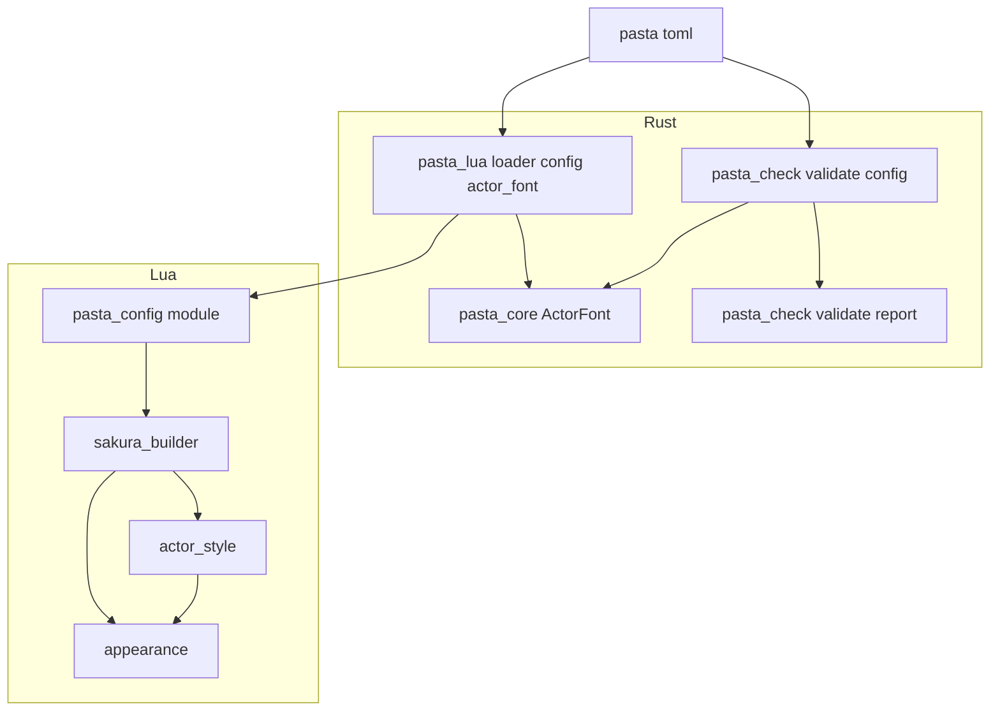
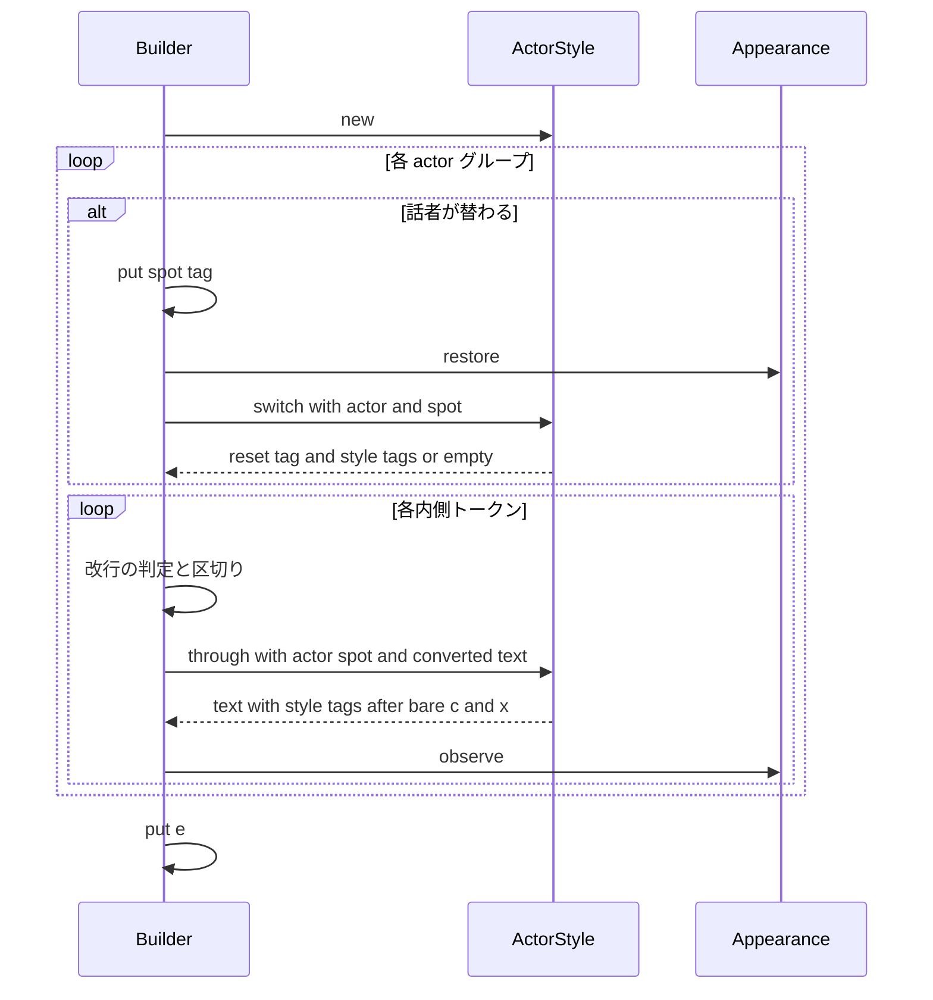
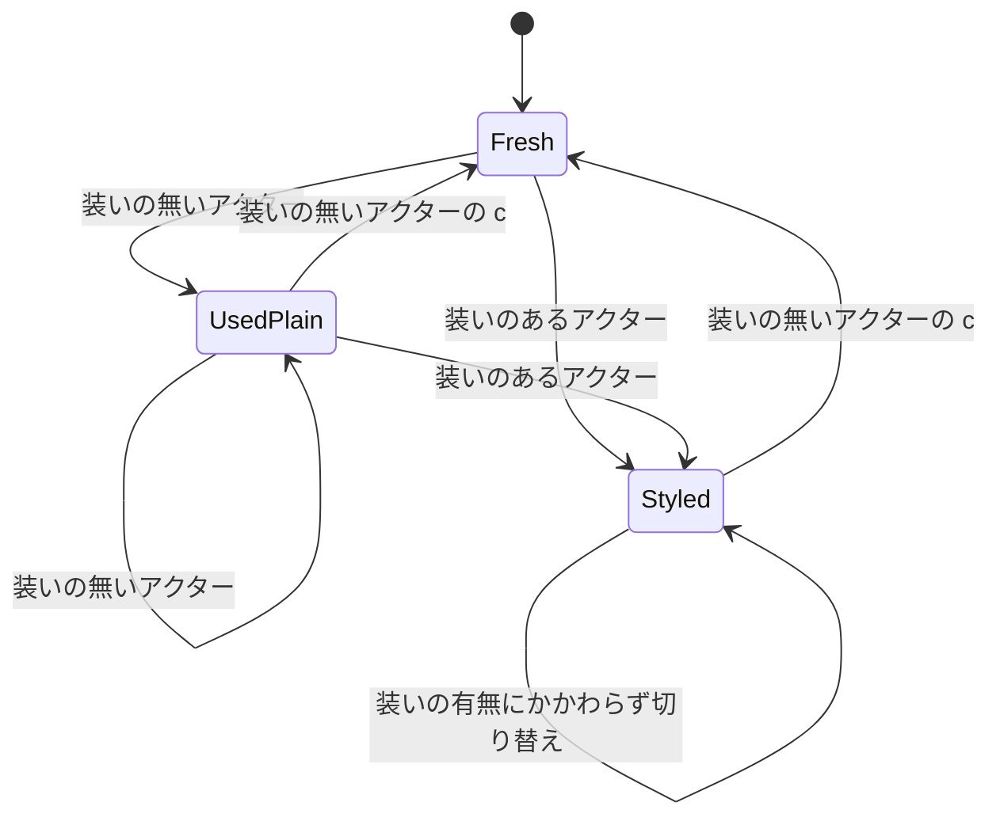

# 技術設計: actor-display-style

- 作成日: 2026-10-18
- 入力: `requirements.md`（Requirement 1〜8・確定事項の議題 1〜7）、`research.md`（ギャップ分析・SSP 2.9.18 の実機確認・設計の判断）、`brief.md`、steering（product / tech / structure）
- 基準コード: worktree `claude/actor-display-style-83dfd0`（`adae21f4`）

## Overview

**Purpose**: pasta.toml の `[actor."名前"]` に書いた `font` 表（SSP の文字装飾 `\f[属性名,値]` の 12 属性）を、そのアクターの台詞の表示の装いとして出力する。装いは話者の切り替えで付け、装いのあるアクターを離れるときに `\f[default]` で既定の表示へ戻す。装いの書き間違いは、pasta.dll の読み込みエラーと `pasta_check validate` のエラーで知らせる。

**Users**: シェルの無い相手役を、シェルのあるアクターと同じスポット（同じバルーン）で話させるゴースト作者（窓際のぱすたさん）。ネタ帳のとおり `おじさん：やあ。` と書くだけで、相手役の台詞が相手役の色で出る。

**Impact**: 出力の組み立て（`sakura_builder.lua`）の、アクターの切り替え（`emit_actor_switch`）と内側のトークンの出力（`emit_inner_token`）の 2 か所に、新しい Lua モジュール `pasta.shiori.actor_style` の呼び出しを 1 行ずつ足す。装いの規則（受け付ける 12 属性・値の検査・タグへの変換）は `pasta_core` に 1 つ置き、pasta.dll の設定の読み込みと `pasta_check validate` の両方が使う（`[scene.alias]` と同じ形）。装いを書かないゴーストの出力は 1 文字も変えない。

### Goals

- `font` 表を書いたアクターの台詞が、その装いで表示される（1.1〜1.5・2.1）。
- 装いが別のアクターの台詞・次のトークに持ち越されない（2.2〜2.8）。
- `\c`・`\x`・選択肢の後も、話しているアクターの装いが保たれる（3.1〜3.3）。
- 作者が台詞に書いた `\f[…]` を、装いが打ち消さない（4.1〜4.3）。
- 装いを書かないゴーストの出力が変わらない（5.1〜5.3）。
- 1 つのスポットを複数のアクターで共有する形を、テストとマニュアルで正式に支える（6.1〜6.4・8.2・8.3）。
- 装いの書き間違いを、読み込みエラーと validate のエラーで知らせる（7.1〜7.6）。
- マニュアルとスキル references が同じ変更で更新される（8.1〜8.8）。

### Non-Goals

- 話者名を台詞に添える出力（0.5.0 の `novel-talk-flow`）。
- シーンの途中で装いを変える DSL・Lua の手段。アクター辞書（`％名前`）の文法の変更。
- 同じスポットで話者が替わったときの改行の判定・幅（`sakura-script-newline` の成果をそのまま使う）。budoux の改行・選択肢どうしの間の改行（`vertical-balloon-lines`）。
- 立ち絵の復旧の判定（`actor-surface-restore` の成果をそのまま使う）。
- 作者が台詞に書いたスコープの切り替え（台詞の中の `\p[1]` など）や、最上位の `raw_script` の中の `\f`・`\c` の追跡（下記「境界の注記」）。
- `act.lua`（`pasta/act.lua`）・`pasta/shiori/act.lua`・`store.lua`・`actor.lua`・`appearance.lua` の変更。

## Boundary Commitments

### This Spec Owns

- **装いの規則**: 受け付ける 12 属性の一覧、値の型と禁止文字の検査、値からタグ列への変換（書いた順・文字列はそのまま・整数は 10 進・真偽値は `1`/`0`）。`pasta_core` の `ActorFont` が唯一の正。
- **装いの読み込み**: pasta.toml の `[actor."名前"].font` の取り出し（書いた順と行番号）、読み込みエラーの判定と文言、`@pasta_config` の `actor."名前".font` を検査済みのタグ列（文字列）に置き換えること。
- **装いの出し入れ**: ビルドの中だけの装いの状態（スポットごとの「使った」「装いを付けた」）、話者の切り替えでの戻すタグと装いのタグ、`\c`・`\x` の後の出し直し。`pasta.shiori.actor_style` が持つ。
- **validate の報告**: 新しい報告の種類 `config-actor-font`（誤り）と文言。
- **テスト**: 規則・読み込み・出し入れ・共有スポットの会話・pasta.dll と pasta_check の一致。
- **マニュアルとスキル references**: 8.1〜8.8 の章と、報告の種類の表（`debug/validate.md`）・`@pasta_config` の章（`lua/modules/pasta-config.md`）・内部設計のモジュール一覧。

### Out of Boundary

- `\p[spot]` の解決と出力、立ち絵の復旧（`emit_actor_switch` の既存の 2 行と `appearance.lua`）。本 spec はその後ろに 1 行足すだけで、順序と判定を変えない。
- 段落区切りの改行・選択肢の前の区切り・字の判定（`has_text`・`text_parts`・`pending_break`・`spot_has_text`・`spot_tail`）。装いのタグはこれらの判定の外で出す。
- グループ化（`pasta/act.lua`）・未登録アクターの目印（`act:actor_proxy`）。
- `[actor]` の `font` 以外のキーの検査（`spot` の型など）。本 spec は `font` だけを検査する。
- バルーンの descript（既定の文字色・書体・縦書き）。
- `budoux`・`script_wait_*` を読む Rust のさくらスクリプト変換（`@pasta_sakura_script`）。

### Allowed Dependencies

- `pasta_core`: 新しい依存を足さない（`thiserror` のみ）。`ActorFont` は TOML を知らず、呼び出し側が値を `FontValue` に直して渡す。
- `pasta_lua::loader::config`: `pasta_core::ActorFont`、`toml`（既存依存。`toml::de::DeTable` で書いた順と行番号を読む）。
- `pasta_check::validate::config`: `pasta_core::ActorFont`、`toml`（既存依存）。
- `pasta.shiori.actor_style`: `pasta.shiori.appearance` の `tag_at`（読み取りだけ）。`STORE`・`@pasta_*` を `require` しない（`appearance.lua` と同じ）。
- `pasta.shiori.sakura_builder` → `pasta.shiori.actor_style` の一方向。逆向きの依存を作らない。
- 依存の向き: `pasta_core::ActorFont` → `pasta_lua::loader::config`／`pasta_check::validate::config`（Rust）、`@pasta_config`（データ）→ `actor_style.lua` → `sakura_builder.lua`（Lua）。

### Revalidation Triggers

- `FONT_ATTRIBUTES`（12 属性）や値の変換規則を変えたとき → pasta.dll と pasta_check の一致テスト、マニュアルの属性の表、スキル references。
- `@pasta_config` の `actor."名前".font` の形（検査済みのタグ列の文字列）を変えたとき → `actor_style.lua`、`＠font` の副作用の記述（8.5）、`lua/modules/pasta-config.md`。
- `emit_actor_switch` の出力順（`\p` → 立ち絵の復旧 → 装い）や `emit_inner_token` の形を変えたとき → `vertical-balloon-lines`・`novel-talk-flow`・`cue-command-runtime`・`novel-checkpoint-rollback`・`scene-anchor-link`（`sakura_builder.lua` を共有する）。`novel-talk-flow` は話者名を装いと同じ所で出す前提を確かめる。
- SSP の文字装飾の扱い（スコープごとに保つ・`\c` で戻る・新しいスクリプトで戻る）が版で変わったとき → 本設計の出し入れの規則。
- `FindingKind` に種類を足したとき → `FindingKind::ALL`・`validate_report_test.rs`・`debug/validate.md` の表・VS Code 拡張の診断（code の文字列）。

## Architecture

### 既存アーキテクチャの分析

- **アクターの値は TOML の表そのまま Lua へ届く**。`PastaConfig::parse` が `custom_fields`（`toml::Table`）を作り、`register_config_module` が Lua の表に直し、`inject_actor_names` が各アクターに `name` を入れる。`store.lua` が `STORE.actors = CONFIG.actor` とし、ビルダーに届く `actor` はこの表である。
- **`toml::Table` は書いた順を保たない**。`toml` 1.1 は `preserve_order` を有効にしておらず（`cargo tree -e features` で確認）、表は名前順になる。Lua の表も順序を持たない。Requirement 2.1 の「属性の順は書いた順」は、Rust で書いた位置（span）から順を取り出して初めて満たせる。
- **出力の組み立ては 1 本の関数に分岐が集まる**。`BUILDER.build` は複雑度 28 を `ponytail:` 注記つきで許している。`emit_actor_switch`（`\p` と立ち絵の復旧）と `emit_inner_token`（変換・出力・外見の観測）はループの外の関数で、そこに足せば `BUILDER.build` の分岐は増えない。
- **設定の検査の先例は `[scene.alias]`**。規則を `pasta_core::SceneAliasTable::from_entries` に置き、pasta.dll は `toml::de::Error` の読み込みエラー、pasta_check は `Finding`（行番号つき）として報告する。取り出し（span の読み方）は両クレートがそれぞれ持つ。

### SSP 2.9.18 の文字装飾の振る舞い（実機で確認。research.md「SSP 2.9.18 の実機確認」）

| # | 確かめたこと | 結果 | 設計への効き方 |
| - | ------------ | ---- | -------------- |
| 1 | `\p[0]\f[color,…]あ\p[1]い\p[0]う` | 「い」は既定、「う」は装いのまま。装いはスコープごとに保たれ、スコープをまたがない | 状態をスポットごとに持つ。別のスポットへ移っても戻すタグは要らない |
| 1b | `\p[0]\f[…]あ\p[0]う\p[0]\f[default]\n[180]え` | `\p[0]` の出し直しでは装いが保たれ、`\f[default]` で戻る。`\n[180]` も効く | 同じスポットで話者が替わるときは `\f[default]` で戻す（2.5 の例どおり） |
| 2 | `\p[0]\f[…]あ\cかきくけこ` | `\c` の後は既定の表示に戻る（色・大きさとも）。別のスコープの装いは保たれる | `\c` の後に装いを出し直す（3.2）。`\c` でそのスポットは既定に戻ったとみなせる |
| 3 | `\p[0]\f[…]あ\n\![*]\q[…]\nかきく` | 選択肢の後の字は装いのまま。選択肢の表示の字は `height` を受け継ぎ、色は選択肢の色 | 選択肢の後に出し直しは要らない（3.3）。選択肢の見え方は確定事項 4 |
| 4 | `\x` の後 | 設計の時点では未確認だった。実装の後（タスク 5.1）に確かめた。`\x` は全スコープを消してスコープを `\0` に戻し、その後の字は既定の表示で出る（research.md「実装の後の確認」） | `\x` の直後に装いを出し直す（確定事項 2）。実機の振る舞いに合うので、出し方は変えない |
| 5 | 装いを付けたスクリプトの次のスクリプト | 両スコープとも既定に戻る | ビルドの中だけの状態でよい（2.8）。各ビルドの最初の装いの前に `\f[default]` は要らない |
| 6 | `\f[height,30]` と `\n[180]` の順 | 順を入れ替えても、行の送りに目で分かる違いは無かった（横書きのバルーン） | 装いのタグ → 改行の順（2.5）のままにする。縦書き（`vertical,1`）でも違いが無いことを、タスク 5.1 で確かめた（確定事項 5） |
| 7 | 字を出さないスコープへの `\f` だけ | バルーンは開かない（`get_status` が `balloon(0=0)` のまま） | 字の無いグループへの切り替えで装いのタグを出しても、余計なバルーンは出ない |

### Architecture Pattern & Boundary Map



**Architecture Integration**:
- 選んだ形: 「規則は `pasta_core` に 1 つ・取り出しは各クレート」（`[scene.alias]` と同じ）＋「状態を持たない Lua モジュールにビルドの中の状態の表を渡す」（`appearance.lua` と同じ）。
- 境界の分け方: タグ列を作るのは Rust（検査と同じ場所）。Lua は出来上がったタグ列を、いつ出すかだけを決める。Lua は 12 属性も値の変換も知らない。
- 守る既存の形: `emit_actor_switch` の `\p` → 立ち絵の復旧の順、改行は字の直前に出る、字の判定は変換前のテキストで行う、`appearance.lua` の `tag_at` がさくらスクリプトの単位の唯一の Lua の読み方。
- 新しい部品の理由: `ActorFont`（pasta.dll と pasta_check で規則を 1 つにするため）、`actor_style.lua`（`BUILDER.build` の複雑度を上げず、単体で試せるようにするため）、`loader/config/actor_font.rs`（`mod.rs` の責務を広げないため）。
- steering: 「出力を変えない限り既定は今の動き」、`act.lua` を触らない、マニュアルに Lua の回避を載せない。

### Technology Stack

| Layer | Choice / Version | Role in Feature | Notes |
| ----- | ---------------- | --------------- | ----- |
| 規則 | Rust 2024・`pasta_core`（`thiserror` 2） | 12 属性・値の検査・タグ列への変換 | 新しい依存なし |
| 設定の読み込み | `pasta_lua`・`toml` 1.1（既存） | `toml::de::DeTable::parse` で書いた順と行番号を読む | `preserve_order` は有効にしない（ほかの表の順に影響させない） |
| 検査 | `pasta_check`・`toml` 1.1（既存） | `config-actor-font` の報告 | WASM（VS Code 拡張）にも同じ報告が届く |
| 出力 | LuaJIT 2.1・`pasta_scripts`（自己展開 zip に自動で入る） | `pasta.shiori.actor_style` | `build.rs` は `pasta_scripts/` を丸ごと入れるので登録は要らない |
| 宿主 | SSP 2.9.18 | `\f[属性,値]`・`\f[default]` の解釈 | 上の表のとおり実機で確認 |

## File Structure Plan

### Directory Structure

```
crates/
├── pasta_core/src/
│   ├── actor_font.rs                      # 新規: FONT_ATTRIBUTES・FontValue・FontInput・ActorFont（検査とタグ列への変換）＋単体テスト
│   ├── error.rs                           # 変更: ActorFontError・FontValueProblem を足す
│   └── lib.rs                             # 変更: pub mod actor_font と再輸出
├── pasta_lua/
│   ├── src/loader/config/
│   │   ├── actor_font.rs                  # 新規: [actor.*.font] の取り出し（書いた順・行番号）→ ActorFont → custom_fields の font をタグ列に置き換え／読み込みエラー
│   │   └── mod.rs                         # 変更: parse から actor_font::apply を 1 回呼ぶ（mod 宣言を含む）
│   ├── pasta_scripts/pasta/shiori/
│   │   ├── actor_style.lua                # 新規: STYLE.new / STYLE.switch / STYLE.through（状態を持たない）
│   │   └── sakura_builder.lua             # 変更: require・ビルドの中の状態 1 つ・emit_actor_switch と emit_inner_token に 1 行ずつ
│   └── tests/
│       ├── lua_specs/actor_style_test.lua # 新規: 出し入れ・出し直し・既定の出力を変えないこと
│       ├── lua_specs/init.lua             # 変更: actor_style_test を登録
│       ├── lua_specs/sakura_builder_test.lua # 変更: 2.5 の例・共有スポットの会話（6.4）・装いの無いゴーストの不変
│       └── loader/config_test.rs          # 変更: 読み込みエラー 7.1〜7.4・@pasta_config の font がタグ列になること・書いた順
└── pasta_check/
    ├── src/validate/config.rs             # 変更: read_actor_fonts（Finding を行ごとに返す）を read_config から呼ぶ
    ├── src/validate/report.rs             # 変更: FindingKind::ConfigActorFont・code・ALL・msg の文言
    └── tests/
        ├── validate_config_test.rs        # 変更: config-actor-font の報告と行番号
        ├── validate_report_test.rs        # 変更: 種類・分類・code の表に 1 行
        └── validate_parity_test.rs        # 変更: 読み込みの成否の一致に font の正しい例・誤った例

book/src/
├── reference/pasta-toml.md                # 変更: アクター設定の表に font・「装い」の節・型が合わないときの表に [actor] の font
├── grammar/actor-dictionary.md            # 変更: 「1 つのスポットを複数のアクターで共有する」節（シェルの無い相手役の例と出力）・＠font の副作用
├── grammar/sakura-script.md               # 変更: 台詞に書いた \f と装いの関係へ案内
├── reference/shell.md                     # 変更: 吹き出しとアクターの spot の節から共有と装いへ案内
├── internals/talk-output.md               # 変更: emit_actor_switch の手順に装いの段・出し直し・モジュール表・境界の表
├── internals/shiori.md                    # 変更: SHIORI 用のモジュール一覧に pasta.shiori.actor_style
├── internals/index.md                     # 変更: トーク出力の章の対象ファイルに actor_style.lua
├── lua/modules/pasta-config.md            # 変更: actor の font が検査済みのタグ列の文字列で読めること
└── debug/validate.md                      # 変更: 報告の種類の表に config-actor-font

.claude/skills/pasta-ghost-authoring/references/  # 再生成: pasta-toml.md・actor-dictionary.md・sakura-script.md
.claude/skills/pasta-lua-coding/references/       # 再生成: pasta-config.md
```

### Modified Files（要点だけ。詳細は Components）

- `crates/pasta_lua/pasta_scripts/pasta/shiori/sakura_builder.lua` — `local STYLE = require("pasta.shiori.actor_style")`、`BUILDER.build` に `local style = STYLE.new()` を 1 行、`emit_actor_switch` の末尾に `buffer:put(STYLE.switch(style, actor, spot))`、`emit_inner_token` で `buffer:put` の前に `s = STYLE.through(style, actor, spot, s)`。`emit_actor_switch`・`emit_inner_token` は引数に `style` を 1 つ足す。`BUILDER.build` の分岐は増えない。
- `crates/pasta_lua/src/loader/config/mod.rs` — `parse` の中で、`custom_fields` を作った後・`apply_shiori_defaults` の前に `actor_font::apply(content, &mut custom_fields)?` を呼ぶ。
- `crates/pasta_shiori/tests/byte_invariant_test.rs`・`kick_unused_byte_invariant_test.rs`・hello-pasta のテスト — **変更しない**（5.3 の関門）。

## System Flows

### 話者の切り替えと内側のトークン（1 回のビルド）



- 改行（`\n[spot_newlines×100]`）は今までどおり字を出すトークンの直前に出る。装いのタグは切り替えの段で出るので、必ず改行より前に並ぶ（2.5・2.7）。
- `STYLE.through` は変換後の文字列を書き換える。字の判定（`text_parts`）は変換前のテキストで済んでいるので、差し込んだタグは字として数えない（2.7）。

### スポットごとの装いの状態（`STYLE.switch` の判定）



| 切り替え先のスポットの状態 | 装いのあるアクターへ | 装いの無いアクターへ |
| -------------------------- | -------------------- | -------------------- |
| Fresh（このビルドで未使用、または `\c` の後） | 装いのタグだけ | 何も出さない |
| UsedPlain（使ったが、装いを付けていない） | `\f[default]` ＋ 装いのタグ（台詞に書いた `\f` を消す。4.3） | 何も出さない（5.2） |
| Styled（このビルドで装いを付けた） | `\f[default]` ＋ 装いのタグ（2.6） | `\f[default]`（2.2・2.3） |

- 「話者の切り替え」は今までどおり `last_actor ~= actor` のときだけ起きる。同じアクターが話し続ける間は何も出さない（2.4・4.1）。
- 装いのあるアクターの `\c`・`\x` は、その直後に装いを出し直す（3.1・3.2）。状態は Styled のまま（保守的。冗長な `\f[default]` は 2.10 で許される）。`\x` の後は、出し直したタグがスコープ 0 に効く可能性があるので、スポット 0 も Styled にする。

## Requirements Traceability

| Requirement | Summary | Components | Interfaces | Flows |
| ----------- | ------- | ---------- | ---------- | ----- |
| 1.1 | `font` 表を装いとして読む | ActorFontLoader, ActorFont, ActorStyle | `actor_font::apply`, `ActorFont::from_input`, `actor.font` | 読み込み |
| 1.2 | 12 属性だけを受け付ける | ActorFont | `FONT_ATTRIBUTES` | 読み込み |
| 1.3 | 値の書き方（文字列・10 進・`1`/`0`） | ActorFont | `ActorFont::tags` | 読み込み |
| 1.4 | 書かない・空の表は装い無し | ActorFont, ActorStyle | `tags() == ""`、`font` が空文字列 | 切り替え |
| 1.5 | ほかのキーと読み出しを変えない | ActorFontLoader | `font` だけを置き換える | 読み込み |
| 2.1 | 切り替えで `\p`・復旧の後に装い（書いた順） | ActorStyle, BuilderHook, ActorFont | `STYLE.switch` | 切り替え |
| 2.2 | 装いの無いアクターは既定の表示 | ActorStyle | `STYLE.switch`（Styled → `\f[default]`） | 状態表 |
| 2.3 | 戻すタグは `\f[default]`・装いより前 | ActorStyle | `STYLE.switch` | 状態表 |
| 2.4 | 話し続ける間は出し直さない | BuilderHook | `last_actor` の判定（既存） | 切り替え |
| 2.5 | 例の出力の順序 | BuilderHook, ActorStyle | `emit_actor_switch` の順 | 切り替え |
| 2.6 | 装いのあるアクターどうしは戻してから付ける | ActorStyle | `STYLE.switch`（Styled → `\f[default]`＋装い） | 状態表 |
| 2.7 | 装いのタグを字として数えない | BuilderHook, ActorStyle | 切り替えの段・変換後の書き換え | 切り替え |
| 2.8 | 次のビルドへ持ち越さない | ActorStyle | `STYLE.new` をビルドごと | 切り替え |
| 2.9 | 未登録アクターは装い無し | ActorStyle | `actor.font` が無い表 | 切り替え |
| 2.10 | 出し方を SSP の実機の結果に合わせる | ActorStyle | SSP の振る舞いの表 | 状態表 |
| 3.1 | `\x` の後も装い | ActorStyle | `STYLE.through` | 内側のトークン |
| 3.2 | `\c` の後も装い | ActorStyle | `STYLE.through` | 内側のトークン |
| 3.3 | 選択肢の後も装い | （SSP が保つ。出力は今のまま） | — | 内側のトークン |
| 4.1 | 台詞の `\f` の後に差し込まない | ActorStyle | 切り替えでだけ出す | 切り替え |
| 4.2 | 台詞の `\f` を変えない | ActorStyle | `STYLE.through` は挿入だけ | 内側のトークン |
| 4.3 | 装いの関わる切り替えでだけ戻す | ActorStyle | 状態表（UsedPlain の扱い） | 状態表 |
| 5.1 | 装いの無いゴーストは同じ出力 | ActorStyle | `any` が偽なら素通し | 切り替え |
| 5.2 | 装いの無いアクターどうしは同じ出力 | ActorStyle | Fresh・UsedPlain は何も出さない | 状態表 |
| 5.3 | 既存の期待値のまま通る | Tests | バイト列の固定テスト・hello-pasta | — |
| 6.1 | 同じスポットの改行を保つ | BuilderHook | 既存の `pending_break` | 切り替え |
| 6.2 | シェルの無いアクターで立ち絵を崩さない | （`appearance.lua` の既存の判定） | `APPEARANCE.restore` | 切り替え |
| 6.3 | 戻ったときに復旧タグを出さない | （同上） | `APPEARANCE.restore` | 切り替え |
| 6.4 | 共有スポットの会話のテスト | Tests | `sakura_builder_test.lua` | — |
| 7.1 | 知らない属性名は読み込みエラー | ActorFont, ActorFontLoader | `UnknownAttribute` | 読み込み |
| 7.2 | 型違い・空文字列は読み込みエラー | ActorFont, ActorFontLoader | `InvalidValue` | 読み込み |
| 7.3 | `]`・`\` を含む値は読み込みエラー | ActorFont, ActorFontLoader | `InvalidValue(BreaksTag)` | 読み込み |
| 7.4 | 表でない `font` は読み込みエラー | ActorFont, ActorFontLoader | `NotTable` | 読み込み |
| 7.5 | validate も同じ内容をエラーで | FontFindingReader, ValidateReport | `config-actor-font` | 検査 |
| 7.6 | 値の中身は検査しない | ActorFont | 検査は型・空・禁止文字だけ | 読み込み |
| 8.1 | pasta-toml.md の表と節 | Manual | — | — |
| 8.2 | actor-dictionary.md の共有の節 | Manual | — | — |
| 8.3 | shell.md から案内 | Manual | — | — |
| 8.4 | talk-output.md の時機と順序 | Manual | — | — |
| 8.5 | `＠font` の副作用 | Manual | — | — |
| 8.6 | sakura-script.md から案内 | Manual | — | — |
| 8.7 | Lua の回避を載せない | Manual | — | — |
| 8.8 | references の再生成と食い違いの検査 | Manual | `gen-skill-refs.mjs`（`--check`） | — |

## Components and Interfaces

| Component | Domain/Layer | Intent | Req Coverage | Key Dependencies (P0/P1) | Contracts |
| --------- | ------------ | ------ | ------------ | ------------------------ | --------- |
| ActorFont | pasta_core | 12 属性の検査とタグ列への変換 | 1.1〜1.4, 2.1, 7.1〜7.4, 7.6 | なし | Service |
| ActorFontLoader | pasta_lua loader | `[actor.*.font]` の取り出し・読み込みエラー・`font` の置き換え | 1.1, 1.5, 7.1〜7.4 | ActorFont (P0), toml (P0) | Service |
| ActorStyle | Lua shiori | 装いの出し入れ（ビルドの中の状態） | 2.1〜2.10, 3.1〜3.3, 4.1〜4.3, 5.1, 5.2 | appearance.tag_at (P0) | Service, State |
| BuilderHook | Lua shiori | ビルダーから ActorStyle を呼ぶ 1 行ずつ | 2.1, 2.4, 2.5, 2.7, 6.1 | ActorStyle (P0) | — |
| FontFindingReader | pasta_check | `config-actor-font` の Finding を行ごとに | 7.5 | ActorFont (P0), toml (P0) | Service |
| ValidateReport | pasta_check | 種類・分類・code・文言 | 7.5 | — | — |
| Manual | book | 8 章の更新と references | 8.1〜8.8 | gen-skill-refs (P1) | — |
| Tests | 各クレート | 規則・読み込み・出し入れ・一致 | 5.3, 6.4 ほか | — | — |

### pasta_core

#### ActorFont

| Field | Detail |
| ----- | ------ |
| Intent | 装いの属性の並びを検査し、`\f[属性名,値]` を書いた順に並べたタグ列を作る |
| Requirements | 1.1, 1.2, 1.3, 1.4, 2.1, 7.1, 7.2, 7.3, 7.4, 7.6 |

**Responsibilities & Constraints**
- 受け付ける属性は `FONT_ATTRIBUTES` の 12 個だけ（大文字・小文字を区別する完全一致）。
- 値は文字列・整数・真偽値だけ。文字列は空でなく、`]` と `\` を含まない。中身（色の書き方・範囲・書体の有無）は見ない（7.6）。
- 誤りは表の中のすべての属性について集める（並びは入力の順）。1 つでも誤りがあれば `Err`。
- TOML・Lua を知らない。行番号を持たない（呼び出し側が属性名から引く）。

**Dependencies**
- Inbound: ActorFontLoader — 読み込み（P0）、FontFindingReader — 検査（P0）
- External: なし

**Contracts**: Service [x]

##### Service Interface

```rust
/// 受け付ける属性（Requirement 1.2）。この順は一覧の正であり、出力の順ではない
pub const FONT_ATTRIBUTES: [&str; 12] = [
    "color", "name", "height", "bold", "italic", "underline",
    "strike", "sub", "sup", "outline", "shadowcolor", "shadowstyle",
];

/// 呼び出し側が TOML の値から作る
pub enum FontValue {
    String(String),
    Integer(i64),
    Boolean(bool),
    /// 浮動小数点数・配列・表・日時。`type_name` は文言用（"float" など）
    Other { type_name: &'static str },
}

pub enum FontInput {
    /// 書いた順の (属性名, 値)
    Table(Vec<(String, FontValue)>),
    /// `font = "red"` のように表でない
    NotTable,
}

pub struct ActorFont { tags: String }

impl ActorFont {
    pub fn from_input(actor: &str, input: FontInput) -> Result<ActorFont, Vec<ActorFontError>>;
    /// 例: `\f[color,90,110,140]\f[bold,1]`。属性が 0 個なら ""
    pub fn tags(&self) -> &str;
}

// error.rs
pub enum FontValueProblem { WrongType { type_name: &'static str }, Empty, BreaksTag }

pub enum ActorFontError {
    NotTable { actor: String },
    UnknownAttribute { actor: String, attribute: String },
    InvalidValue { actor: String, attribute: String, problem: FontValueProblem },
}
```
- Preconditions: `Table` の並びは書いた順（呼び出し側の責任）。
- Postconditions: `Ok` のとき `tags` は入力の順に `\f[名,値]` を連ねたもの。文字列はそのまま、整数は `i64` の 10 進（負数は `-` 付き）、真偽値は `1`/`0`。
- Invariants: `tags` は `]` と `\` を値の中に含まないので、さくらスクリプトのタグとして閉じる。
- `Display`（`thiserror`）の文言は英語で、アクター名と属性名を含む（[scene.alias] と同じ。pasta.dll のログ・読み込みエラーに出る）。

### pasta_lua loader

#### ActorFontLoader（`crates/pasta_lua/src/loader/config/actor_font.rs`）

| Field | Detail |
| ----- | ------ |
| Intent | pasta.toml の本文から `[actor."名前"].font` を書いた順で取り出して検査し、`custom_fields` の `font` を検査済みのタグ列に置き換える |
| Requirements | 1.1, 1.5, 7.1, 7.2, 7.3, 7.4 |

**Responsibilities & Constraints**
- `[actor]` が無い、表でない、アクターの値が表でない、`font` が無い場合は何もしない（本 spec は `font` 以外の誤りを新しく作らない）。
- 書いた順と行番号は `toml::de::DeTable::parse(content)` の span から取る（`font` の各値の開始位置で並べる）。値は `custom_fields` の型つきの `toml::Value` から `FontValue` に直す（整数は `i64`。16 進などの書き方も 10 進になる）。
- 誤りは `toml::de::Error`（`serde::de::Error::custom`）として返し、`PastaConfig::parse` → `LoaderError::config` の既存の経路で読み込みエラーにする。文言は `"{ActorFontError}; at [actor.\"{名前}\".font] {属性名} (line {N})"` を `, ` でつなぐ（表でないときは属性名を省く）。
- 成功したら `custom_fields["actor"][名前]["font"]` を `toml::Value::String(tags)` に置き換える（空の表は `""`）。ほかのキーには触れない（1.5）。

**Dependencies**
- Inbound: `PastaConfig::parse` — 1 回だけ呼ぶ（P0）
- Outbound: ActorFont — 規則（P0）
- External: `toml` 1.1 の `de::DeTable`（P0。research.md で公開 API を確認済み）

**Contracts**: Service [x]

##### Service Interface

```rust
/// `[actor.*.font]` を検査し、custom_fields の font を検査済みのタグ列（文字列）に置き換える
pub(super) fn apply(content: &str, custom_fields: &mut toml::Table) -> Result<(), toml::de::Error>;
```
- Preconditions: `content` は TOML として読めている（`parse` の先頭で確認済み）。
- Postconditions: `Ok` のとき、`font` を書いた各アクターの `font` は文字列。`Err` のときゴーストは読み込まれない。

**Implementation Notes**
- Integration: `@pasta_config` の `actor."名前".font` は文字列になる。`＠font` はそのタグ列に解決される（8.5 でマニュアルに載せる。「その名前の単語を作らない」案内は `surface`・`dressup` と同じ）。
- Validation: `tests/loader/config_test.rs` に、7.1〜7.4 の各誤りで `PastaConfig::load` が `Err` になり文言にアクター名・属性名・行が入ること、書いた順（`bold` を先に書けば `\f[bold,1]` が先）、空の表が `""` になること。
- Risks: 書いた順を span で取るのは、インライン表・`[actor."X".font]` 節・ドット付きキー（`font.color = …`）のどれでも値の位置が書いた順に並ぶことに依る。3 つの書き方をテストで固定する。

### Lua shiori

#### ActorStyle（`crates/pasta_lua/pasta_scripts/pasta/shiori/actor_style.lua`）

| Field | Detail |
| ----- | ------ |
| Intent | ビルドの中の装いの状態を受け取り、切り替えで出すタグと、`\c`・`\x` の後に出し直すタグを返す |
| Requirements | 2.1, 2.2, 2.3, 2.6, 2.7, 2.8, 2.9, 2.10, 3.1, 3.2, 4.1, 4.2, 4.3, 5.1, 5.2 |

**Responsibilities & Constraints**
- モジュール自身は状態を持たない。`STORE`・`@pasta_*` を `require` しない。
- アクターの装いは `actor.font` が空でない文字列のときだけ（それ以外の型・`nil`・空は装い無し。未登録アクターの表には `font` が無い＝2.9）。
- タグの読み取りは `APPEARANCE.tag_at` だけを使う（エスケープと囲みの中はタグとして読まない）。
- 装いのあるアクターが 1 度も切り替えに現れていないビルドでは、`STYLE.through` は入力をそのまま返し、`STYLE.switch` は `""` を返す（5.1）。

**Dependencies**
- Inbound: BuilderHook（P0）
- Outbound: `pasta.shiori.appearance` の `tag_at`（P0）

**Contracts**: Service [x] / State [x]

##### Service Interface

```lua
--- @class ActorStyleState
--- @field used table<integer, boolean>   このビルドで切り替えに使い、`\c` で消していないスポット
--- @field styled table<integer, boolean> このビルドで装いのタグを出し、`\c` で消していないスポット
--- @field any boolean                    このビルドで装いのあるアクターが切り替えに現れたか

--- @return ActorStyleState
function STYLE.new() end

--- 話者の切り替えで出すタグ（`\p[spot]` と立ち絵の復旧の後に置く）
--- @param state ActorStyleState その場で更新する
--- @param actor table 切り替え先アクター
--- @param spot integer 解決済みスポット
--- @return string 戻すタグ（`\f[default]`）と装いのタグ。何も要らなければ ""
function STYLE.switch(state, actor, spot) end

--- 内側のトークンを変換した文字列を、出力の前に通す
--- @param state ActorStyleState その場で更新する
--- @param actor table|nil グループの話者（nil は話し手なしのグループ）
--- @param spot integer|nil 現在のスポット（last_spot）
--- @param s string 変換後の文字列（読むだけ。書き換えた新しい文字列を返す）
--- @return string 装いのあるアクターなら、引数の無い `\c`・`\x` の直後に装いのタグを差し込んだ文字列。それ以外は s
function STYLE.through(state, actor, spot, s) end
```
- `STYLE.switch` の判定は「スポットごとの装いの状態」の表のとおり。出した後に `used[spot] = true`、装いのあるアクターなら `styled[spot] = true`・`any = true`。
- `STYLE.through`:
  - `any` が偽なら `s` をそのまま返す。
  - 装いのあるアクター: 引数の無い `\c` と `\x`（`\x[noclear]` などは除く）の直後に装いのタグを差し込む。`\x` を見つけたら `used[0]`・`styled[0]` も真にする（`\x` の後の字はスコープ 0 に出るため）。
  - 装いの無いアクター: 引数の無い `\c` を見つけたら、そのスポットの `used`・`styled` を偽にする（バルーンが消えて既定に戻ったため。5.2 の「表示されていない」に合わせる）。`\x` では状態を変えない（保守的。冗長な `\f[default]` になるだけ）。
- Postconditions: 返す文字列は、`s` の文字を 1 文字も消さず・入れ替えず、タグを挿入しただけのもの（4.2）。

##### State Management
- 状態の表は `BUILDER.build` が呼び出しごとに `STYLE.new()` で作り、ビルドが終われば捨てる（2.8。SSP も新しいスクリプトで既定に戻ることを実機で確認）。`STORE` には置かない。
- `clear_spot` トークンでは状態を戻さない（バルーンは消えないため）。

**Implementation Notes**
- Integration: 差し込んだタグは `APPEARANCE.observe` にもそのまま渡る（`\f` は観測の対象外なので外見の記録は変わらない）。
- Validation: `actor_style_test.lua` で状態表の 6 マス、`\c`・`\x`・`\x[noclear]`・エスケープした `\\c`・囲みの中の `\c` を確かめる。
- Risks: `\x` の後の SSP の振る舞いは、設計の時点では未確認だった（確定事項 2）。タスク 5.1 で確かめ、`\x` で装いが外れてスコープが `\0` に戻ると分かった。今の出し直しで表示は合う。

#### BuilderHook（`sakura_builder.lua` の変更）

| Field | Detail |
| ----- | ------ |
| Intent | 既存の 2 つの関数の中で ActorStyle を呼び、出力の順を「`\p` → 立ち絵の復旧 → 装い → （改行）→ 字」に保つ |
| Requirements | 2.1, 2.4, 2.5, 2.7, 6.1 |

- `emit_actor_switch(buffer, actor_spots, actor, appearance, tokens, style)`: 既存の 2 行の後に `buffer:put(STYLE.switch(style, actor, spot))`。
- `emit_inner_token(buffer, actor, inner, appearance, spot, style)`: `s` を作った直後に `s = STYLE.through(style, actor, spot, s)`、その後は既存どおり `buffer:put(s)` と `APPEARANCE.observe`。
- `BUILDER.build`: `local style = STYLE.new()` を 1 行。呼び出し 5 か所に引数 `style` を足す。分岐は増やさない（複雑度 28 のまま）。
- 最上位の `raw_script`（グループの外）は `STYLE.through` を通さない（下記「境界の注記」）。

### pasta_check

#### FontFindingReader（`validate/config.rs` の `read_actor_fonts`）

| Field | Detail |
| ----- | ------ |
| Intent | pasta.dll と同じ取り出し方で `[actor.*.font]` を読み、`ActorFont` の誤りを行ごとの `Finding` にする |
| Requirements | 7.5 |

- `read_config` が `read_aliases` の後に呼ぶ。誤りがあっても検査は続ける（`GhostConfig` は変えない）。
- 1 つの誤りに 1 つの `Finding`（`ConfigActorFont`・`pasta.toml`・属性の値の行。表でないときは `font` の値の行）。
- `skip_reasons` には入れない（装いはシーンの集まりに関わらないので、飛び先の検査は続ける）。
- `pasta_check release` は検査の段で validate を通すので、誤りがあれば止まる（既存の経路。7.5）。

```rust
fn read_actor_fonts(text: &str) -> Vec<Finding>;
```

#### ValidateReport（`validate/report.rs`）

- `FindingKind::ConfigActorFont`（`ConfigSceneAlias` の次）。`severity` は既定の Error、`code` は `"config-actor-font"`、`ALL` は 25 件。
- 文言（`msg`）:
  - 知らない属性: `[actor."おじさん"] の font に知らない属性「colour」があります（書ける属性: color・name・height・bold・italic・underline・strike・sub・sup・outline・shadowcolor・shadowstyle）`
  - 型・空: `[actor."おじさん"] の font の color は文字列・整数・真偽値のどれかで、空にできません: 配列が書かれています`
  - 禁止文字: `[actor."おじさん"] の font の name に「]」か「\」が含まれています（さくらスクリプトのタグが壊れます）`
  - 表でない: `[actor."おじさん"] の font は表で書きます（例: font = { color = "90,110,140" }）`

### Manual（要約）

- `reference/pasta-toml.md`: アクター設定の表に `font`（表・既定なし・省略可）。「装い（font）」の節に 12 属性の表、値の書き方（文字列・10 進・`true`/`false`→`1`/`0`）、書いた順に出ること、書かなければ今の表示、書き間違いは読み込みエラー（`pasta_check validate` の `config-actor-font`）、中身は SSP に任せること。「値の型が合わないとき」の表に `[actor]` の `font` 行（読み込みエラー）。
- `grammar/actor-dictionary.md`: 「1 つのスポットを複数のアクターで共有する」節。pasta.toml（ぱすた＝`spot = 0`・`surface = 0`、おじさん・ギャル＝`spot = 0`・`font`）、辞書（`おじさん：やあ。`）、出力の例（2.5 の形）、改行・立ち絵の復旧・装いの出し入れの説明。副作用の節に `＠font`。
- `grammar/sakura-script.md`: 「台詞に書いた `\f[…]` はそのまま出る」説明から装いの節へ案内し、関係（4.1〜4.3: 話し続ける間は残る、装いのあるアクターが関わる切り替えで `\f[default]` に戻る）を載せる。
- `reference/shell.md`: 「吹き出しとアクターの spot」の節から、シェルの無いアクターを同じスポットに置く形と装いへのリンク。
- `internals/talk-output.md`: `emit_actor_switch` の手順に 4 つめの段、`emit_inner_token` の出し直し、状態表、モジュール表と境界の表に `actor_style`。
- `lua/modules/pasta-config.md`: `actor."名前".font` は検査済みのタグ列（文字列）で読めること（`name` の注入の記述の隣）。
- `debug/validate.md`: 報告の種類の表に `config-actor-font`。
- `internals/shiori.md`・`internals/index.md`: モジュール一覧と対象ファイルに `actor_style.lua`。
- Lua での回避の書き方は載せない（8.7）。

## Data Models

### Domain Model

- **装い（ActorFont）**: アクター 1 人につき 0 か 1 つ。値オブジェクトで、検査済みのタグ列だけを持つ。pasta.toml を読み直すまで変わらない。
- **装いの状態（ActorStyleState）**: 1 回のビルドにつき 1 つ。スポットごとの `used`・`styled` と、ビルド全体の `any`。

### Data Contracts & Integration

| 境界 | 形 | 例 |
| ---- | -- | -- |
| pasta.toml → ActorFontLoader | `[actor."名前"].font` は表。値は文字列・整数・真偽値 | `font = { color = "90,110,140", bold = true }` |
| ActorFontLoader → `@pasta_config` | `actor."名前".font` は文字列（空の表は `""`） | `"\\f[color,90,110,140]\\f[bold,1]"` |
| `@pasta_config` → ActorStyle | `actor.font`（文字列のときだけ使う） | 同上 |
| ActorStyle → 出力 | `\f[default]` と装いのタグ列 | `\p[0]\f[default]\n[180]…` |

## Error Handling

### Error Strategy

- 読み込み（pasta.dll）: 最初の失敗で止めず、1 つの `font` 表の中の誤りをまとめて 1 つの読み込みエラーにする。アクターをまたぐ誤りは、最初に誤りのあったアクター（名前順）で止める（`[scene.alias]` と同じく 1 回の読み込みで 1 つのエラー）。
- 検査（pasta_check）: すべてのアクターの誤りを行ごとに報告する。
- 実行時: 誤った装いは読み込みで止まるので、ビルダーは検査済みの文字列だけを見る。`actor.font` が文字列でない（Lua で作った表など）ときは装い無しとして扱い、エラーにしない。

### Error Categories and Responses

| 誤り | pasta.dll | pasta_check |
| ---- | --------- | ----------- |
| 知らない属性名（7.1） | 読み込みエラー（アクター名・属性名・行） | `config-actor-font`（誤り） |
| 型違い・空文字列（7.2） | 同上 | 同上 |
| `]`・`\` を含む（7.3） | 同上 | 同上 |
| 表でない（7.4） | 読み込みエラー（アクター名・行） | 同上 |
| 中身の誤り（例 `color = "みどり"`） | 書いたとおりに出す（7.6） | 報告しない |

### Monitoring

- 新しいログは足さない。読み込みエラーは既存の `LoaderError::config` の経路でログとバルーンに出る。

## Testing Strategy

### Unit Tests

- `pasta_core::actor_font`: 12 属性すべてが通り書いた順に並ぶ、知らない属性・大文字違い（`Color`）、浮動小数点数・配列・表、空文字列、`]`・`\` を含む値、負の整数、`true`/`false` → `1`/`0`、空の表 → `""`、`NotTable`（1.2〜1.4・7.1〜7.4・7.6）。
- `actor_style_test.lua`: 状態表の 6 マス（Fresh・UsedPlain・Styled × 装いの有無）、`any` が偽のときの素通し、`\c`・`\x` の後の出し直し、`\x[noclear]`・`\c[char,1]`・エスケープ `\\c`・囲みの中の `\c` は出し直さない、装いの無いアクターの `\c` で Fresh に戻る（2.2・2.3・2.6・3.1・3.2・4.3・5.1・5.2）。

### Integration Tests

- `sakura_builder_test.lua`: 2.5 の例をバイト列で一致させる。装いのあるアクター→別の装いのあるアクター（2.6。`bold` が残らない）。別スポットへ移るときに戻さないこと（実機 #1）。同じアクターが話し続ける間に出し直さないこと・台詞に書いた `\f` の後に差し込まないこと（2.4・4.1）。未登録アクター（2.9）。装いのタグが改行の判定・選択肢の前の区切りに影響しないこと（2.7）。
- `sakura_builder_test.lua`（共有スポットの会話。6.4）: ぱすた（`spot = 0`・`surface = 0`・装い無し）、おじさん（`spot = 0`・`font`）、ギャル（`spot = 0`・別の `font`）が ぱすた→おじさん→ぱすた→ギャル→おじさん と話す。各切り替えで `\n[180]`（6.1）、おじさん・ギャルへの切り替えで `\s` が出ないこと（6.2）、ぱすたへ戻るときに `\s` が出ないこと（6.3）、装いの出し入れ（2.1〜2.3・2.6）。
- `tests/loader/config_test.rs`: 7.1〜7.4 の読み込みエラーの文言、`@pasta_config` の `font` がタグ列になること、3 つの書き方（インライン表・節・ドット付きキー）で書いた順が保たれること、`font` 以外のキーが変わらないこと（1.5）。
- `pasta_check` の `validate_config_test.rs`・`validate_report_test.rs`: `config-actor-font` の行と文言、種類の表。
- `validate_parity_test.rs`: 正しい `font`・7.1〜7.4 の各例で、pasta.dll の読み込みの成否と pasta_check の誤りの有無が一致すること（7.5）。

### Regression Gate

- `crates/pasta_shiori/tests/byte_invariant_test.rs`・`kick_unused_byte_invariant_test.rs`・hello-pasta のテスト・`sakura_builder_test.lua` の既存のテストが、期待値を書き換えずに通る（5.1〜5.3）。
- luacheck（`actor_style.lua` の複雑度が 15 以下、`BUILDER.build` が 28 のまま）。

### 実機確認（実装時）

- 確定事項 2（`\x` の後）・5（縦書きの改行の順）の確認を、SSP 2.9.18 で実装の後に行い、結果を research.md に追記する（独立したタスクにする）。

## 境界の注記

- 作者が台詞の中に書いたスコープの切り替え（`\p[1]`・`\1` など）は追わない。その後の字の装いは作者の書いたとおりになる（外見の復旧の「切り離し」と同じ扱いで、本 spec は直さない）。
- 最上位の `raw_script`（出力の先頭や `clear_spot` の後の、話し手の前の生のさくらスクリプト）の中の `\f`・`\c` は追わない。直後に必ず話者の切り替えが起きるため、装いのあるアクターの表示は切り替えで決まる。

## 設計の確定事項（設計ディスカッション 2026-10-18）

research.md の「OPEN QUESTIONS（設計）」1〜6 は、全議題を推奨案で確定した。

1. **装いを Lua へ渡す形**: pasta.dll の読み込みで `@pasta_config` の `actor."名前".font` を検査済みのタグ列の文字列に置き換える（ActorFontLoader）。規則は `pasta_core` の 1 か所だけで、Lua は出す時機だけを持つ。
2. **`\x` の後**: 装いのあるアクターの台詞では、引数の無い `\x` の直後に必ず装いを出し直す（SSP がどちらの振る舞いでも表示は同じ）。実装のタスクで実機確認を行い（`\_q\p[0]\f[color,0,180,0]あああ\xかきくけこ\e` を送ってクリックし、`dump_balloon` で色を見る。`\p[1]` でも同じ）、結果を research.md に追記して 2.10 を閉じる。
3. **要件 4.3**: 文言を「切り替え先の吹き出し（スポット）で装いのあるアクターが話したとき」に直した（requirements.md）。状態表の UsedPlain・Styled の扱いはこの読み方のとおり。
4. **選択肢の字**: 何もしない。装いのあるアクターの吹き出しの選択肢が `height`・`name` を受け継ぐのは SSP の振る舞いのまま受け入れる。
5. **縦書きでの `\f[height]` と `\n[180]` の順**: 2.5 の順（戻すタグ → 改行）のまま。実装の後の実機確認（2 と同じタスク）で、窓際のぱすたさんの `vertical,1` のバルーンで `\p[0]\f[height,30]あ\p[0]\f[default]\n[180]い` を確かめ、食い違ったときだけ直す。
6. **`config-actor-font`**: `skip_reasons` に入れない（飛び先の検査を止めない）。

## Risks
- リスク: スキル references の再生成は `.claude/skills/` の下へ書くため、自動の分類器に拒まれることがある（プロジェクトの記録）。拒まれたら、生成した差分を示して開発者に許可を求める。
- リスク: `vertical-balloon-lines` と `sakura_builder.lua` を共有する。本 spec の変更は `emit_actor_switch`・`emit_inner_token` の引数と 1 行ずつに限るので、後から入る側の rebase は小さい。
