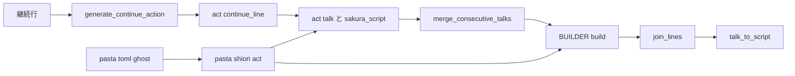
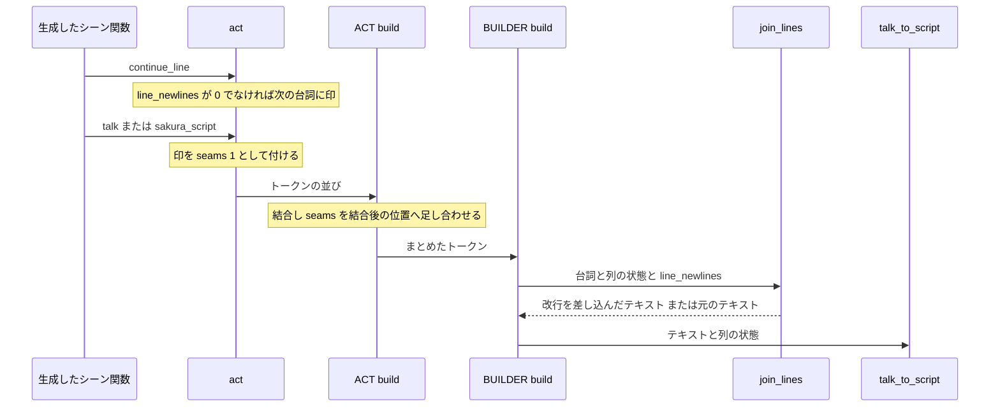
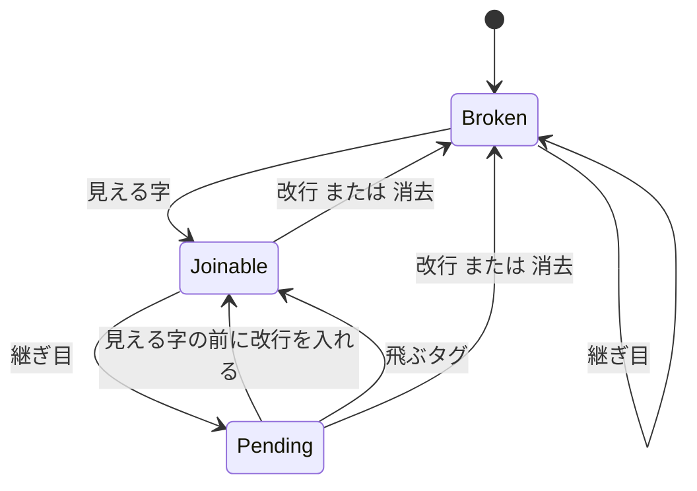

# 設計: actor-line-newlines

## 概要

**目的**: 縦書きバルーンのゴースト作者が、`pasta.toml` の `[ghost] line_newlines` に改行の幅を 1 つ書くだけで、辞書の継続行（`　：…`）の前に改行 `\n[N]` が入るようにする。辞書の 1 行がそのまま吹き出しの 1 列になり、行ごとの手書きの `＠改行` が要らなくなる。

**利用者**: ゴースト作者（ghost_dev「窓際のぱすたさん」の移行が最初の利用者）。設定を書かないゴーストの作者には何も変わらない。

**変わること**: トランスパイラが継続行の頭に値によらない印 `act:continue_line()` を 1 行出す。act はその印を次に積む台詞の「継ぎ目」として記録し、同じアクターの台詞の結合（`merge_consecutive_talks`）はそのまま行い、結合した台詞の中の継ぎ目の位置だけを残す。組み立て（`BUILDER.build`）は、`line_newlines` が `0` でないときだけ台詞の字を読み、改行を入れると決めた継ぎ目では、継続行の最初の見える字の直前に `\n[N]` を台詞のテキストへ差し込んでから `talk_to_script` に渡す。入れない継ぎ目では台詞のテキストを 1 バイトも変えない。

### Goals
- `[ghost] line_newlines`（既定 `0`）で、継続行の最初の見える字の前に改行を 1 つ入れる（要件 1・2）。
- 話し手の切り替え・選択肢・位置を決めるタグ・前の行の末尾の改行・空の吹き出しでは入れない（要件 3・4）。
- 既定 `0` のとき、および入れなかった継ぎ目では、出力を今と 1 バイトも変えない（要件 4.5・6.1）。
- 入れた改行は budoux の列を 1 つ進め、手書きの `＠改行` と同じ字・同じ幅・同じ budoux の折り方になる（要件 5・6.3）。

### Non-Goals
- アクターごとの値（`[actor."名前"] line_newlines`）、改行の後に付ける文字列、任意のさくらスクリプトを出す設定。
- 書き直した行・局所シーンの頭・Lua から積んだ台詞への改行。
- `spot_newlines`・`choice_newlines`・`after_choice_newlines`・budoux の折り方の変更。
- 継続行の文法・エラーの決まりの変更。

## 境界の約束

### This Spec Owns
- 継続行の頭の印の形（生成する Lua の 1 行 `act:continue_line()`）と、それを出す所（`generate_continue_action` だけ）。
- 印から台詞の継ぎ目への写し（act の `continue_line`・`talk`・`sakura_script` の印の欄、`merge_consecutive_talks` の継ぎ目の位置の足し合わせ）。
- 組み立ての「行の継ぎ目」の判定（列の状態に持つ 2 つの欄と、台詞を読む局所関数）と、Rust の `column_move` の Lua の写し。
- `[ghost] line_newlines` の既定値（SSOT の `GhostConfig`）・補う所（`apply_shiori_defaults`）・Lua の既定のリテラル・`BUILDER.build` の `config` の項目。
- マニュアルの該当章とそこから作るスキルの参照、`pasta_check` の act のメソッドの一覧。

### Out of Boundary
- `talk_to_script`（ウェイト・budoux）の Rust の実装。この spec は呼び方（渡すテキスト）だけを変え、Rust の側は触らない。
- `spot_newlines`・選択肢の区切りの判定（`pending_break`・`spot_tail`・`choice_break`）の中身。この spec はそれらが出す区切りを「列を動かす改行」として読むだけ。
- グループ化（`group_by_actor`）・空の判定（`is_all_empty_raw_script`）・話者の遡り（`actor_proxy`）・外見の復旧・装い（`STYLE`）・`BUILDER.speaks`。
- `cue-command-runtime`・`scene-anchor-link`・`novel-talk-flow` の挙動（同じファイルを触るが、前提にも変更にもしない）。

### Allowed Dependencies
- トランスパイラ → 生成器の既存の書き出し（`writeln`・`record_span_since`）。
- act → 既存のトークンの形（`talk`・`sakura_script` の表に欄を 1 つ足すだけ）。
- 組み立て → `APPEARANCE.tag_at`（単位の読み方）・`unit_shows_text`（見える字の判定）・`plain_newline_tag`（換算）・`next_column`・`first_column`。
- 依存の向き: 設定（Rust の SSOT）→ `pasta.shiori.act`（読む）→ `pasta.act`（印を付ける）→ `sakura_builder`（判定と差し込み）→ `@pasta_sakura_script`（変換）。逆向きの参照を作らない。

### Revalidation Triggers
- 生成する印の名前・形・位置を変える（生成物の比較・ソースマップ・`pasta_check` の一覧に響く）。
- トークンの `seams` 欄の意味（バイト位置・昇順・1 始まり）を変える。
- `BUILDER.build` の `config` の項目名・既定値を変える。
- Rust の `column_move` の分類を変える（Lua の写しを同時に直す）。
- `merge_consecutive_talks` の結合の範囲を変える（継ぎ目の位置がずれる）。

## アーキテクチャ

### 既存の構成の分析
- 出力は「トークンを積む（act）→ アクターごとにまとめ、同じアクターの連続した `talk` を 1 つに結合（`ACT_IMPL.build`）→ 状態機械で区切りを入れながら変換（`BUILDER.build`）」の 3 段である。
- 結合は Rust の変換の結果を決める。設計の調べで次を確かめた（詳細は `research.md`）。
  - ウェイト: `insert_waits` は句読点の続きを 1 つのウェイトにまとめる（`pending_max_wait`）。継ぎ目で 2 回の変換に分けると、継ぎ目の両側に句読点があるとき（`…なら。` ＋ `」…`）ウェイトの位置と数が変わる。
  - budoux: `break_lines_impl` はタグを除いた本文の全体をつないで `parse_boundaries` にかける。継ぎ目で分けると、継ぎ目にタグがあっても語の境界の文脈が変わり、折る位置が変わりうる。
  - したがって「継ぎ目で台詞を分ける」作りは、入れない継ぎ目のバイト同一（要件 4.5）を守れない。分けずに、入れる継ぎ目でだけテキストへタグを差し込む。差し込んだタグは、ウェイトでは手書きのタグと同じく句読点の保留を出し切り、budoux では本文を変えずに列の「次」の動きになる。
- 区切りの改行（`spot_newlines` など）は `put_break` → `next_column` で列を進める。台詞のテキストの中の改行は Rust が列を進める。

### パターンと境界図



**アーキテクチャの統合**:
- 採った型: 「値によらない印を生成し、判定は実行時に行う」＋「状態は列の状態の表に持つ」。印に値を焼き込まないので、`pasta.toml` を変えても生成物のキャッシュは古くならない（ローダーは変わった `.pasta` だけを変換し直す）。
- 区切りの判定は、既存の区切りがすべて `next_column`・`first_column` を通ることを使い、そこで行の状態を捨てる。新しい状態変数を `BUILDER.build` に足さない（複雑度 28 の関数に分岐を足さない）。
- 既存の型をそのまま使う: 設定は `spot_newlines` と同じ経路（SSOT → `apply_shiori_defaults` → `CONFIG.get` → `config`）、換算は `plain_newline_tag`、単位は `APPEARANCE.tag_at`、見える字は `unit_shows_text`。

### 技術スタック

| 層 | 選択 | この機能での役割 | 備考 |
|----|------|------------------|------|
| トランスパイラ | Rust（`pasta_lua::code_gen`） | 継続行の頭に印の 1 行を出す | 新しい依存なし |
| 実行時 | Lua 5.1 / LuaJIT 2.1（`pasta_scripts`） | 印の記録・継ぎ目の位置・判定と差し込み | 新しい依存なし |
| 設定 | Rust（`loader::config`）・TOML | `line_newlines` の既定値の SSOT と補い | 型の検査は足さない（`spot_newlines` と同じ） |
| 変換 | Rust（`@pasta_sakura_script`） | 変更なし | 渡すテキストだけが変わる |

## ファイル構成の計画

### 変更するファイル

**トランスパイラ（Rust）**
- `crates/pasta_lua/src/code_gen/element_gen.rs` — `generate_continue_action` が、アクターの確認（`InvalidContinuation`）の後、アクションの前に `act:continue_line()` の 1 行を書き、その行を継続行の span で `record_span_since` に記録する。`generate_action_line`・`generate_action` は変えない。
- `crates/pasta_lua/src/code_gen/element_gen_tests.rs` — 継続行の生成の期待値を印つきに直し、印を出すのは継続行だけ・エラーは今のまま、を足す。

**設定（Rust）**
- `crates/pasta_lua/src/loader/config/sections.rs` — `GhostConfig` に `line_newlines: f64`（既定 `0.0`）と `default_line_newlines()` を足す。
- `crates/pasta_lua/src/loader/config/mod.rs` — `apply_shiori_defaults` で `line_newlines` を `Float(0.0)` で補う。
- `crates/pasta_lua/src/loader/mod.rs` — `default_line_newlines` を他の既定値と同じく公開する。

**実行時（Lua）**
- `crates/pasta_lua/pasta_scripts/pasta/act.lua` — `ACT_IMPL.continue_line` を足す。`ACT_IMPL.talk`・`ACT_IMPL.sakura_script` が印を `seams = { 1 }` として受け取る。`merge_consecutive_talks` が結合のたびに `seams` の位置を足し合わせる。
- `crates/pasta_lua/pasta_scripts/pasta/shiori/act.lua` — `SHIORI_ACT.new` で `CONFIG.get("ghost", "line_newlines", 0.0)` を `_line_newlines` に読み、`build` で `config.line_newlines` として渡す。
- `crates/pasta_lua/pasta_scripts/pasta/shiori/sakura_builder.lua` — 局所関数 `column_move`（Rust の写し）・`line_newline_tag`・`join_lines` を足す。`next_column`・`first_column` で行の状態の 2 つの欄を捨てる。`inner_token_to_string`・`emit_inner_token` に `line_newlines` を 1 つ足して `join_lines` を通す。`BuildConfig` に `line_newlines` を足す。

**検査（Rust）**
- `crates/pasta_check/src/validate/builtins.rs` — `ACT_METHODS` に `continue_line` を足す（27 → 28）。
- `crates/pasta_check/tests/validate_scenes_test.rs` — 数の検査を 28 に直す。

**テスト**
- `crates/pasta_lua/tests/lua_specs/line_newlines_test.lua`（新規）— 組み立てと act の規則のテスト（下の「テスト戦略」）。`sakura_builder_test.lua`（3,600 行超）には足さず、機能ごとのスイートにする。
- `crates/pasta_lua/tests/lua_specs/init.lua` — 新しいスイートを `specs` に足す。
- `crates/pasta_lua/tests/line_newlines_e2e_test.rs`（新規）— 一時ゴーストを読み込み、`SHIORI.request` で設定の有無と出力を比べる（`chain_talk_interrupt_test.rs` と同じ作り）。
- `crates/pasta_lua/tests/loader/config_defaults_test.rs` — SSOT の値・マニュアルの表とテンプレートの行・`act.lua` のリテラルの照合に `line_newlines` を足す。
- 生成した Lua を文字列で比べるテストのうち継続行を含むもの（`tests/fixtures/sample.expected.lua`、`tests/transpiler/` の比較・スナップショット、`src/code_gen/*_tests.rs`）— 印の行を入れて期待値を作り直す。`sample.generated.lua` の改行コードだけの差分はコミットに入れない。

**マニュアルとスキルの参照**
- `book/src/reference/pasta-toml.md` — `[ghost]` の表の行（説明の最初に「継続行（`　：`）にだけ効く」・既定 `` `0.0` ``）・節・テンプレートの既定値の行（`line_newlines = 0.0   # 既定 …`）・budoux の節の「pasta が出す区切り」。
- `book/src/grammar/action-line.md` — 「行継続」「改行」に、既定では続けて出ること、設定すると継続行の前に改行が入ること、入らない場合を書く。
- `book/src/internals/talk-output.md` — 継続行の印・継ぎ目・行の状態・優先順位・判定の規則・`config` の項目。
- `book/src/internals/transpiler.md` — 継続行の生成の形（印の 1 行）。
- `book/src/debug/validate.md` — act のメソッドの一覧に `continue_line`。
- `[ghost]` のキーを並べる他の章（`book/src/lua/modules/pasta-config.md`・`book/src/internals/loader.md`・`book/src/internals/internal-modules.md`・`book/src/grammar/block-structure.md`）— キーの一覧を持つ所だけ足す。
- `.claude/skills/*/references/` の生成物 — `node book/tools/gen-skill-refs.mjs` で作り直す（手で直さない）。

## システムの流れ

### 印から差し込みまで



### 行の状態（スポットごとの列の状態に持つ）



- `Broken`（区切れ）: 吹き出しに字が無い、または最後の見える字の後に列を「次」か「最初」へ動かす単位が出た。継ぎ目は保留を立てない（要件 3.4・4.2）。
- `Joinable`（続けられる）: 最後の見える字の後に、改行も `\c` も出ていない。
- `Pending`（保留）: 継ぎ目を通った。次の見える字の直前に改行を 1 つ入れる。2 つ目の継ぎ目は重ねない（要件 2.4）。
- 「改行 または 消去」は、台詞の中の `\n`・`\n[…]`・`\c`、`newline`・`clear` のトークン、pasta の区切り（`spot_newlines`・`choice_newlines`・`after_choice_newlines`。どれも `put_break` → `next_column`）のすべてを含む。区切りがすべて列の動きを通るので、優先順位（要件 3.1〜3.3・3.5）は「区切りが出たら保留を捨てる」の 1 つの規則になる。
- 「飛ぶタグ」（`\_l[…]`）は保留だけを捨て、続けられるのままにする（要件 4.1・4.3）。

## 要件の対応

| 要件 | 要約 | コンポーネント | インターフェース | 流れ |
|------|------|----------------|------------------|------|
| 1.1 | `[ghost] line_newlines` を読む | ShioriActConfig・GhostConfigDefault | `CONFIG.get("ghost","line_newlines",0.0)` | — |
| 1.2 | 書かなければ `0` | GhostConfigDefault | `apply_shiori_defaults` | — |
| 1.3 | `N` が 0 以下なら入れない | BuilderLineJoin | `line_newline_tag` が `""` | 行の状態 |
| 1.4 | `N` が 100 なら `\n`、他は `\n[N]` | BuilderLineJoin | `line_newline_tag` → `plain_newline_tag` | — |
| 1.5 | 数でない値は `spot_newlines` と同じ | ShioriActConfig・BuilderLineJoin | 検査なし・使う所の算術で Lua のエラー | — |
| 1.6 | 既定値の入った設定として Lua から読める | GhostConfigDefault | `@pasta_config` の `ghost.line_newlines` | — |
| 1.7 | アクターごとの値を読まない | BuilderLineJoin | `config.line_newlines` だけを読む | — |
| 2.1 | 継続行の最初の見える字の前に 1 つ | ContinuationMarker・ActSeam・BuilderLineJoin | `act:continue_line()`・`seams`・`join_lines` | 両方 |
| 2.2 | 継続行の前にだけ | ContinuationMarker | `generate_continue_action` だけが印を出す | — |
| 2.3 | 空行・コメント・変数代入・Call 行を数えない | ContinuationMarker | 印は継続行の枝だけ。行の状態は出力の並びで見る | 行の状態 |
| 2.4 | 字の無い継続行で重ねない | BuilderLineJoin | 保留は真偽 1 つ | 行の状態 |
| 2.5 | Call 先が同じ話し手の字を出していたら入れる | ActSeam・BuilderLineJoin | 出力の並びで判定（同じグループ・同じ列の状態） | 両方 |
| 2.6 | 作者の書いたものを変えない | BuilderLineJoin | 差し込みだけ・並びは不変 | — |
| 3.1 | 話し手が替わっていたら `spot_newlines` だけ | BuilderLineJoin | `put_break` → `next_column` で保留を捨てる | 行の状態 |
| 3.2 | 選択肢の後は `after_choice_newlines` だけ | BuilderLineJoin | 選択肢の前の区切りで区切れ・後の区切りで保留を捨てる | 行の状態 |
| 3.3 | 継続行の後の選択肢は `choice_newlines` だけ | BuilderLineJoin | 同上 | 行の状態 |
| 3.4 | 空の吹き出しでは入れない | BuilderLineJoin | 列の状態の初期値・`first_column`・`columns = {}` | 行の状態 |
| 3.5 | 1 つの字の前に区切りは 1 つ | BuilderLineJoin | 区切りはすべて列の動きを通る | 行の状態 |
| 4.1 | 行の頭の位置を決めるタグで入れない | BuilderLineJoin | `column_move` | 行の状態 |
| 4.2 | 前の行が改行で終わるなら入れない | BuilderLineJoin | 区切れ | 行の状態 |
| 4.3 | 前の行の末尾の `\_l` では止めない | BuilderLineJoin | 飛ぶタグは続けられるを保つ | 行の状態 |
| 4.4 | エスケープ・囲みの中はタグにしない | BuilderLineJoin | `APPEARANCE.tag_at` | — |
| 4.5 | 入れなかった継ぎ目は設定なしと同じ | BuilderLineJoin | 入れないときは元のテキストを渡す | — |
| 5.1 | 列を 1 つ進める | BuilderLineJoin | 差し込んだ `\n[N]` を Rust が「次」として数える | 印から差し込み |
| 5.2 | budoux の折り方を変えない | BuilderLineJoin | 本文（タグを除いた字）を変えない | — |
| 6.1 | 既定 `0` で 1 バイトも変えない | ActSeam・BuilderLineJoin | 印を付けない・字を読まない | — |
| 6.2 | 既存の区切りと行の途中の `\n` を変えない | BuilderLineJoin | 既存の区切りの判定に手を入れない | — |
| 6.3 | 手書きの `＠改行` と同じ字・幅 | BuilderLineJoin | 最初の見える字の直前に差し込む | 印から差し込み |
| 6.4 | 継続行の書き方を変えない | ContinuationMarker | エラーの確認の後に印を出す | — |
| 7.1 | `pasta.toml` リファレンス | ManualUpdate | 表・節・テンプレート | — |
| 7.2 | アクション行の「行継続」「改行」 | ManualUpdate | — | — |
| 7.3 | 内部設計の台詞の出力 | ManualUpdate | — | — |
| 7.4 | スキルの参照の更新 | ManualUpdate | `gen-skill-refs.mjs` | — |
| 7.5 | 回避のレシピを載せない | ManualUpdate | — | — |

## コンポーネントとインターフェース

| コンポーネント | 層 | 役割 | 要件 | 主な依存 | 契約 |
|----------------|----|------|------|----------|------|
| ContinuationMarker | トランスパイラ | 継続行の頭に印の 1 行を出す | 2.2, 2.3, 6.4 | 生成器の書き出し (P0) | Service |
| ActSeam | 実行時（act） | 印を次の台詞の継ぎ目にし、結合後の位置を残す | 2.1, 2.5, 6.1 | ShioriActConfig (P0) | State |
| ShioriActConfig | 実行時（shiori act） | 値を読み、act と組み立てに渡す | 1.1, 1.5, 1.6 | `pasta.config` (P0) | Service |
| GhostConfigDefault | 設定 | 既定値 `0.0` の SSOT と補い | 1.2, 1.6 | — | State |
| BuilderLineJoin | 実行時（組み立て） | 行の状態の判定と改行の差し込み | 1.3〜1.5, 1.7, 2.1〜2.6, 3.1〜3.5, 4.1〜4.5, 5.1, 5.2, 6.1〜6.3 | `APPEARANCE.tag_at` (P0)・`talk_to_script` (P0) | Service, State |
| CheckBuiltins | 検査 | act のメソッドの一覧に印を足す | 6.4（検査の一致） | — | — |
| ManualUpdate | 文書 | マニュアルと生成するスキルの参照 | 7.1〜7.5 | `gen-skill-refs.mjs` (P1) | — |

### トランスパイラ

#### ContinuationMarker

| 項目 | 内容 |
|------|------|
| 役割 | 継続行のアクションの前に、値によらない印 `act:continue_line()` を 1 行出す |
| 要件 | 2.2, 2.3, 6.4 |

**責務と制約**
- 印を出すのは `generate_continue_action` だけ。アクション行（書き直した行を含む）・変数代入・Call・選択肢・空行・コメントには出さない。
- アクターが無いときの `InvalidContinuation` の確認を先に行い、エラーの挙動を変えない（局所シーンの頭の継続行は今もエラー。`generate_local_scene_items` が局所シーンごとに `last_actor` を `None` から始めるため）。
- 印の行は、継続行の span で `record_span_since` に記録する（行の対応・ソースマップで、印の行は継続行の `.pasta` の行に当たる）。
- 印に `line_newlines` の値や判定を焼き込まない。

**契約**: Service [x]

```rust
// element_gen.rs（形だけ。既存の関数の振る舞いの追加）
pub(super) fn generate_continue_action(
    &mut self,
    continue_action: &ContinueAction,
    last_actor: &Option<String>,
) -> Result<(), TranspileError>;
// 事後条件: Ok のとき、出力は "act:continue_line()" の 1 行に続けて、各アクションの行（今と同じ）。
// Err(InvalidContinuation) のとき、何も書かない（今と同じ）。
```

生成の例（`　　　　：＠注目　みんなに会ってみたいかも。`）:

```lua
act:continue_line()
act:actor_proxy("ぱすた"):talk(act:actor_proxy("ぱすた"):word("注目"))
act:actor_proxy("ぱすた"):talk("みんなに会ってみたいかも。")
```

**実装メモ**
- 統合: 印の行が増えるので、継続行より後ろの生成した Lua の行番号がずれる。行の対応（`line_map`）とソースマップは `out_line` から作るので食い違わない。比較用の生成物は作り直す。
- 検証: 継続行を含む生成物のテストと、印の行が継続行の span に記録されることのテスト。
- 危険: 開発中（同じ版のまま）は、変わっていない `.pasta` の古いキャッシュ（印の無い Lua）が使われ、設定が効かないことがある。0.5.1 への版上げでキャッシュは捨てられる。テストは一時フォルダで読み込むので影響しない。

### 実行時

#### ShioriActConfig

| 項目 | 内容 |
|------|------|
| 役割 | `[ghost] line_newlines` を読み、act の印の要否と組み立ての `config` に渡す |
| 要件 | 1.1, 1.5, 1.6 |

**責務と制約**
- `SHIORI_ACT.new` で `base._line_newlines = CONFIG.get("ghost", "line_newlines", 0.0)` を読む（`spot_newlines` と同じ並び。リテラルは SSOT の `{:?}` 表記 `0.0`）。
- `SHIORI_ACT_IMPL.build` が `BUILDER.build` の `config` に `line_newlines = self._line_newlines` を足す。
- 型の検査をしない（`spot_newlines` と同じ）。数字の文字列は Lua の算術の変換で数として使われ、数にならない値は改行を作る所の算術で Lua のエラーになる（`spot_newlines` が区切りを作る所でエラーになるのと同じ）。

#### ActSeam

| 項目 | 内容 |
|------|------|
| 役割 | 印を「次に積む台詞の頭の継ぎ目」にし、結合した台詞の中の継ぎ目の位置を残す |
| 要件 | 2.1, 2.5, 6.1 |

**責務と制約**
- `ACT_IMPL.continue_line(self)`: `self._line_newlines` が `nil` でも `0` でもないときだけ `self._seam_next = true` にする。`self` を返す。基の act（`pasta.act` を直接使うテストなど）では `_line_newlines` が無いので何もしない。
- `ACT_IMPL.talk`・`ACT_IMPL.sakura_script`: 積むトークンに `seams = self._seam_next and { 1 } or nil` を付け、`self._seam_next = nil` にする。`talk(nil)`（積まない）は印を消さない（次に積む台詞へ持ち越す）。
- `merge_consecutive_talks`: 新しく結合を始める台詞は `seams` を写して持つ（元のトークンの表を書き換えない）。続けて結合する台詞の `seams` の各位置に、結合前のテキストの長さを足して加える。
- 印は独立したトークンにしない。グループ化・空の判定・話者の遡り・外見の復旧・`BUILDER.speaks` はトークンの数と型で動くので、何も変わらない。
- 既定 `0` では `_seam_next` が立たず、`seams` の欄はどのトークンにも現れない（トークンの表が今と同じ）。

**契約**: State [x]

```lua
---@class SeamedToken            -- talk・sakura_script のトークン（既存の欄に 1 つ足す）
---@field type "talk"|"sakura_script"
---@field actor table|nil
---@field text string
---@field seams integer[]|nil    -- 継続行の頭のバイト位置（1 始まり・昇順）。無ければ nil
```

- 不変条件: `seams` の各位置 `p` は `1 <= p <= #text + 1`。結合した台詞では、継続行の頭のトークンのテキストが始まる位置を指す。

#### GhostConfigDefault

- `GhostConfig.line_newlines: f64`（既定 `0.0`、`default_line_newlines()`）。`apply_shiori_defaults` が書かれていないときに `Float(0.0)` を補い、`@pasta_config` の `ghost` から読める（要件 1.6）。
- 値の範囲・型の検査は足さない（要件 1.5）。

### 組み立て

#### BuilderLineJoin

| 項目 | 内容 |
|------|------|
| 役割 | 行の状態をスポットごとの列の状態に持ち、入れると決めた継ぎ目でだけ台詞へ改行を差し込む |
| 要件 | 1.3〜1.5, 1.7, 2.1〜2.6, 3.1〜3.5, 4.1〜4.5, 5.1, 5.2, 6.1〜6.3 |

**責務と制約**
- `line_newlines` が `nil` か `0` なら、台詞を読まずに元のテキストを返す（既定の出力が今と同じであることを、処理を通らないことで守る）。
- `talk`・`sakura_script` のテキストを先頭から単位ごとに読み、次を行う。読み方は `has_text`・`script_shows_text` と同じ（`APPEARANCE.tag_at`。エスケープ・囲みは位置を決めるタグにしない）。
  1. 位置が `seams` の位置に達したら（単位の途中に落ちた継ぎ目は、その単位の後で達したとみなす。テキストの終わり `#text + 1` の継ぎ目は読み終えた後で達する）、`column.line_pending = column.joinable`。
  2. 見える字（talk: タグ以外の字・単位にならない `\`・字を表示する単位。sakura_script: 字を表示する単位だけ。`emits_text` と同じ）なら、保留があればその字の直前に改行のタグを差し込み、保留を捨てる。その後 `column.joinable = true`。
  3. 列を動かす単位（`column_move`）なら、保留を捨てる。「次」（`\n`・`\n[…]`）と「最初」（引数の無い `\c`）なら `column.joinable = nil`。「飛ぶ」（`\_l[…]`）は `joinable` を変えない。
- `next_column`・`first_column` は、列の動きに加えて `joinable`・`line_pending` を `nil` にする。これで `put_break`（`spot_newlines`・選択肢の区切り）・`newline`・`clear` のトークンのすべてで行の状態が区切れになる。`nil` を入れるので、行の機能を使わないときの列の表は今と同じ。
- 改行のタグは差し込む時に作る（`line_newline_tag`）。`N`（`math.floor(ratio * 100)`）が 0 以下なら `""`（何も差し込まない）、それ以外は `plain_newline_tag(ratio)`。
- 差し込んだテキストを `talk_to_script` に渡す。差し込んだ `\n[N]` は Rust の列で「次」になり、列が 1 つ進む（要件 5.1）。タグを除いた本文は変わらないので budoux の語の区切りは変わらない（要件 5.2）。
- 作者の頭かどうか（`head_written_by_author`）は元のテキストと比べる。台詞の頭に差し込んだときは頭が変わるので、pasta が出す片として前の出力の単独の `\` から守られる（`put`）。
- 改行の位置は「継続行の最初の見える字の直前」。継続行の頭の表情の単語などのタグ（`\![bind,…]`・`\s[…]`）の後になる。手書きの `＠注目　＠改行　…` と同じバイトになる（要件 6.3）。
- 状態は列の状態の表に置き、`BUILDER.build` に状態変数も分岐も足さない。`BUILDER.build` の変更は、`line_newlines` を読む 1 行と、`emit_inner_token` の 4 か所の呼び出しに引数を 1 つ足すことだけ。新しい処理は複雑度 15 以下の局所関数に分ける（単位を 1 つ読む関数と、継ぎ目と差し込みの関数）。

**依存**
- Inbound: `BUILDER.build`（`emit_inner_token` → `inner_token_to_string`）— 台詞ごとに呼ぶ (P0)
- Outbound: `APPEARANCE.tag_at` — 単位の読み取り (P0)。`@pasta_sakura_script.talk_to_script` — 変換 (P0)
- External: なし

**契約**: Service [x] / State [x]

```lua
--- Rust の line_breaker.rs の column_move の写し（片方だけ直さない）
--- @param name string|nil APPEARANCE.tag_at の名前
--- @param arg string|nil 引数
--- @return "next"|"first"|"jump"|nil
local function column_move(name, arg) end
--   name == "n"                 → "next"   （\n・\n[…]。\n[half] を含む）
--   name == "c" and arg == nil  → "first"  （\c。\c[…] は動かない）
--   name == "_l" and arg ~= nil → "jump"   （\_l[…]）
--   それ以外                     → nil

--- 継続行の改行のタグ
--- @param ratio number line_newlines
--- @return string N が 0 以下なら ""、N が 100 なら "\n"、それ以外は "\n[N]"
local function line_newline_tag(ratio) end

--- 台詞に継続行の改行を差し込む
--- @param inner SeamedToken
--- @param column BudouxColumn 話し手のスポットの列の状態（joinable・line_pending を読み書きする）
--- @param ratio number|nil config.line_newlines
--- @return any 変換に渡すテキスト（差し込まなければ inner.text をそのまま返す）
local function join_lines(inner, column, ratio) end
```

```lua
---@class BudouxColumn             -- 既存（Rust が line・width・jump を読み書きする）
---@field line integer
---@field width integer
---@field jump boolean
---@field joinable true|nil        -- Lua だけの欄: 最後の見える字の後に改行・\c が無い
---@field line_pending true|nil    -- Lua だけの欄: 継ぎ目を通り、次の見える字の前に改行を入れる

---@class BuildConfig              -- 既存に 1 つ足す
---@field line_newlines number|nil -- 継続行の改行の幅（nil・0 なら入れない）
```

- 事前条件: `inner.type` は `talk` か `sakura_script`。
- 事後条件: 戻り値のテキストからこの機能が差し込んだタグを除くと `inner.text` と同じ。差し込みは高々「継ぎ目の数」まで、1 つの見える字の前に高々 1 つ。
- 不変条件: `column.joinable` が真なら、そのスポットの吹き出しに字がある（`spot_has_text` が真）。このため、話し手の切り替えの後に字があれば必ず `spot_newlines` の `put_break` が最初の見える字より前に出て、行の状態を区切れにする（要件 3.1）。

**実装メモ**
- 統合: `sakura_builder.lua` は約 560 行。足すのは局所関数 3〜4 つ（数十行）。`BUILDER._internal` に `column_move` を出し、Rust との一致をテストする。
- 検証: 規則ごとの Lua のテストと、`column_move` の写しを `talk_to_script` の列の動きと比べるテスト（既存の「決定 7」のテストと同じ作り）。
- 危険: 作者が台詞の中に書いたスコープの切り替え（`\1`・`\p[…]`）は、行の状態の吹き出しの区別に入らない（`spot_newlines` も同じく見ない）。

### 文書

#### ManualUpdate（要約のみ）
- 要件 7.1〜7.3 の 3 章に、規則（効く行・効かない行・他の区切りとの関係・印と判定）を書く。避ける書き方の代わりの書き方は載せない（要件 7.5）。
- `config_defaults_test` が読む表の行とテンプレートの行の形（`` `line_newlines` `` の行に `` `0.0` ``、`line_newlines = 0.0   # 既定 …`）に合わせる。
- スキルの参照は生成器で作り直す（要件 7.4）。

## データモデル

- 生成する Lua: 継続行 1 行につき `act:continue_line()` の 1 行（値によらない）。
- トークン: `talk`・`sakura_script` に `seams: integer[]|nil`。結合した `talk` は継ぎ目の位置を結合後のテキストのバイト位置で持つ。
- 列の状態（スポットごと、1 回の出力の中だけ）: Lua だけの欄 `joinable`・`line_pending`。`clear_spot`（`columns = {}`）と出力の終わりで捨てる。
- 設定: `[ghost] line_newlines`（浮動小数、既定 `0.0`）。

## エラー処理

- 局所シーンの頭の継続行: 今と同じ `InvalidContinuation`（トランスパイル時）。印は出さない。
- 数でない値: 読み込みでは検査しない。改行を差し込む所の算術で Lua のエラーになり、`spot_newlines` に数でない値を書いたときと同じ扱いになる（要件 1.5）。
- 印の後に台詞が積まれない（字の無い出力の終わりなど）: 印は捨てられる（次の出力の頭の台詞に付いても、吹き出しが空なので入らない）。

## テスト戦略

### 単体（Lua: `line_newlines_test.lua`）
- 換算: `1.8` → `\n[180]`、`1.0` → `\n`、`0.5` → `\n[50]`、`0.009`・`-1` → 何も入れない（1.3・1.4）。
- 基本と重ならない規則: 同じ話し手の継ぎ目で 1 つ（2.1）、字の無い継続行の後で 1 つだけ（2.4）、継ぎ目が結合した台詞の途中・`sakura_script` の頭・Call 先の台詞の後にあっても入る（2.5）、話し手の切り替えの後は `spot_newlines` だけ（3.1）、選択肢の後・前（3.2・3.3）、`\c` の後・出力の最初・`clear_spot` の後（3.4）、どの字の前にも区切りは 1 つ（3.5）。
- 手書きの位置の指定: 頭の `\n[180]\_u[0x3000]`・`\![bind,…]\n[180]`・`\_w[2000]\c`・`\_l[-283,0]`（4.1）、前の行の末尾の改行が同じ台詞・別の `sakura_script`・`newline` トークンにある（4.2）、末尾の `\_l[-253,0]` では止めない（4.3）、`\\n`・`\_?\n\_?` を位置のタグにしない（4.4）。
- バイト同一: 4.1・4.2 で入れない継ぎ目の出力が `line_newlines` なしと同じ（budoux のあるアクター・句読点のウェイトを含む）（4.5）。手書きの `＠改行` を消して設定した出力が、手書きの出力と同じ（6.3）。
- 列: 差し込んだ後の `columns_out` の `line` が 1 つ進み `width` が 0 から数え直される（5.1）。budoux の折り位置が手書きと同じ（5.2）。
- act: `_line_newlines` が `0`・`nil` なら `continue_line` の後のトークンに `seams` が無い（6.1）。結合で `seams` が結合後の位置になる。`talk(nil)` の後の台詞へ持ち越す。
- 写し: `column_move` の分類を、Rust の `test_column_move_classification` と同じ単位の並びで `talk_to_script` の列の動きと比べる。
- 不変条件（3.1 の専用）: 話し手が替わって元の話し手へ戻った直後の最初のトークンが表情だけの台詞（`\s[…]` だけ）で、その頭に継ぎ目があるとき、`spot_newlines` の区切りだけが出て継続行の改行が重ならない。`joinable` が真なら吹き出しに字がある、という前提に頼る所なので、ここを壊す変更を検出する。

### 結合（Rust）
- 生成: 継続行の前にだけ `act:continue_line()` が出る・アクション行には出ない・局所シーンの頭の継続行は `InvalidContinuation` のまま（2.2・6.4）。印の行が継続行の span に記録される。
- ソースマップ: 印の行で継続行より後ろの Lua の行番号がずれるので、ソースマップと行の対応のテスト（`source_map_seam_test`・`record_wiring_*`）を、生成の変更を入れた最初の作業で回し、食い違いを早く見つける。
- 設定: 省いた `[ghost]` で `line_newlines` が `0.0` で読める（1.2・1.6）。SSOT とマニュアルの表・テンプレート・`act.lua` のリテラルの一致（`config_defaults_test`）。
- 検査: `pasta_check` の act のメソッドの一致テストが `continue_line` を含めて通る。

### E2E（Rust: `line_newlines_e2e_test.rs`）
- `research.md` の例 (a) の辞書を `line_newlines = 1.8` で読み込み、継続行の前に `\n[180]` が入り、書き直した行 `ぱすた：＠左　…` の前には入らない（2.1・2.2・4.1）。
- 同じ辞書を設定なし・`line_newlines = 0` で読み込み、出力が今の版と同じ（6.1）。
- 相手役の継続行 `　　：＠改行　…`（`\n[180]\_u[0x3000]`）の出力が設定の前後で同じ（4.5）。
- `[actor."ぱすた"] line_newlines = 1.8` だけを書いたときは入らない（1.7）。

### 回帰
- 既存のスイート（`sakura_builder_test.lua`・hello-pasta の出力のテストなど）がすべて変わらず通る（6.1・6.2）。生成物の比較は印の行だけが増える。

## 性能

- 行の機能を使うゴーストだけ、台詞ごとに字を 1 回読む（`has_text` と同じ程度）。1 回の出力の台詞は短いので、目に見える差は無い。既定では何もしない。

## 前提と未決の問い

- **前提 A（未決の問い 1）**: 字の無い継続行（`　　：＠笑顔` だけ）の保留は、行の終わりで捨てず、次の見える字まで持ち越す（brief の「保留として持ち、次の字の直前に入れる」に従う）。印は行の頭にしか無く、実行時には行の終わりが見えないためである。そのため、字の無い継続行のすぐ後に書き直した行（`ぱすた：…`）が来ると、書き直した行の最初の字の前に改行が入る。書き直した行の頭に位置を決めるタグ（`＠改行`・`＠左` など）があれば規則 4.1 で入らない。行の終わりで捨てるには、アクション行にも印を出す（生成物が広く変わる）必要がある。
  - 例: `　ぱすた：なら。` → `　　　　：＠笑顔` → `　ぱすた：次の話。`（`line_newlines = 1.8`）の出力は `なら。\_w[…]\s[5]\n[180]次の話。`。
- **前提 B**: 改行を入れる位置は、継続行の頭のタグ（表情の単語など）の後、最初の見える字の直前とする。ぱすた開発セッションは「`\n` と表情の bind の前後はどちらでもよい」とした。この位置なら手書きの `＠注目　＠改行　…` とバイトまで同じになる。
