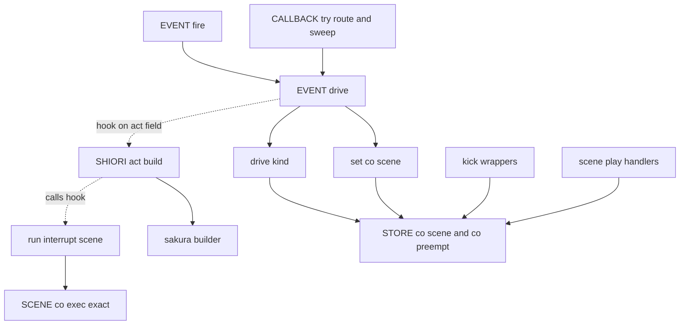
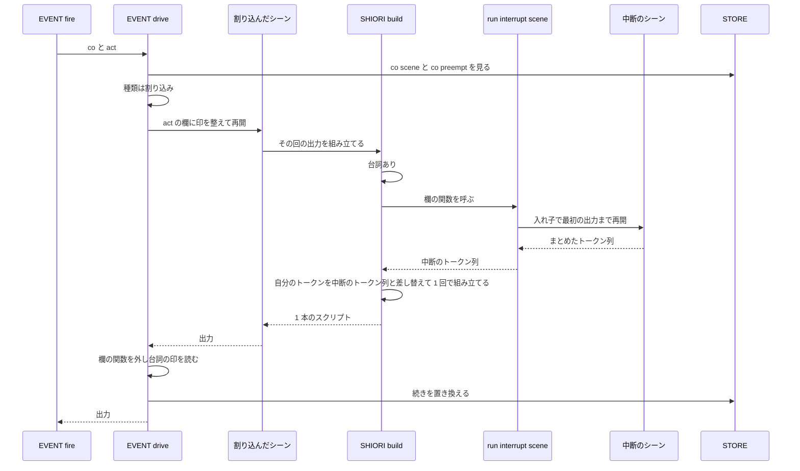

# 設計: chain-talk-interrupt

## Overview

**目的**: 待っているチェイントークの続きを捨てる決まりを狭める。続きを捨てるのは、続きとは別のシーンが台詞か選択肢を出したときだけにする。台詞を出して割り込んだときは、作者が `＊チェイントーク中断` を書いていれば、割り込んだシーンのその回の出力の代わりに、その出力を 1 本のさくらスクリプトで返す（中断の台詞が優先）。書いていなければ、割り込んだシーンの出力を今どおり返す。

**利用者**: `＞チェイントーク` で話を区切り、マウスの出入り・撫で・つつきなどのイベントにもシーンを書いているゴーストの作者。窓際のぱすたさんでは、何も出さない `＊OnMouseMove` などが動くたびに後半が消えていた。

**変えること**: 続きの置き換え（`shiori/event/init.lua` の `set_co_scene`・`EVENT.drive`）が、再開の前に「割り込みの種類」を決め、再開の後に「台詞を出したか」を読んで分岐する。台詞の印は、SHIORI の組み立て（`shiori/act.lua` の `build`）が act の欄に立てる。中断の台詞は、同じ組み立ての中で、割り込んだシーンのトークンと差し替えてから文字列にする。

位置の表記は `crates/pasta_lua/pasta_scripts/pasta/` からの相対パス（Lua）と、`book/src/` からの相対パス（マニュアル）。

### Goals

- 台詞を出さないシーンは、待っている続きに触れない（1.1〜1.7）。
- 台詞を出して割り込んだら続きを捨て、`＊チェイントーク中断` があれば反応の代わりに出す（2.1〜2.6、3.1〜3.12）。
- キック・`OnPastaScene`・`OnPastaSceneAt`・エラーは、今どおり捨てる（4.1〜4.5、5.1〜5.3）。
- 外から起こしたイベントも同じ決まりに従う（6.1・6.2）。
- Lua のテストとマニュアル・スキルの references を新しい決まりに合わせる（7.1・7.2、8.1〜8.6）。

### Non-Goals

- 捨てた続きを後で再開する仕組み（`＊チェイントーク再開` など）。
- イベントの種類ごとに中断の台詞を変える仕組み。
- 撫での受け口が `OnMouseMove` をシーンへ回すこと、`OnMouseEnterAll` の前方一致の見直し。
- `REG` が文字列を返すハンドラの扱い（今どおり続きに触れない）。
- `set_co_scene` の死んだ `coroutine.close` の分岐と `STORE.co_callback` の整理（`ponytail-lua-scripts`）。
- 見本のゴースト（hello-pasta）の書き換え。

## Boundary Commitments

### This Spec Owns

- 続きの置き換えの決まり。割り込みの種類（再開・続きなし・はっきり捨てる・割り込み）と、台詞の有無による分岐。
- 台詞の印（act の欄 `_spoke`）と、その数え方（字のある台詞と選択肢だけ）。
- 中断の台詞の流し方。`＊チェイントーク中断` の完全一致の検索・入れ子の実行・割り込んだシーンの出力との差し替え・エラーの伝え方。
- はっきり捨てる印（`STORE.co_preempt`）と、キック・シーン再生がそれを付けること。
- 新しいテストと、直す 2 本のテスト。マニュアルの該当節とスキルの references の作り直し。

### Out of Boundary

- `EVENT.fire`・既定ハンドラの読み込みの並び・`event/init.lua` の冒頭の説明（L1〜66）。同じウェーブの `external-control-events`・`reg-handler-chain` の持ち場。
- `pasta/act.lua`（`ACT_IMPL.build`・`ACT_IMPL.yield`・トークンの積み方）。この spec は触らない。
- `pasta_check` の組み込みの名前の表（`crates/pasta_check/src/validate/builtins.rs` の `ACT_METHODS`・`SHIORI_ACT_METHODS`）。新しい act のメソッドを足さない。
- 仮想ディスパッチャ（`virtual_dispatcher.lua`）。続きを再開する道は変えない。
- `OnPastaCallFunction` のハンドラそのもの（`external-control-events`）。
- シーンの検索（`SCENE.co_exec_exact` と Rust の完全一致の検索）。使うだけで変えない。

### Allowed Dependencies

- `event/init.lua` → `pasta.store`・`pasta.shiori.act`・`pasta.shiori.event.callback`・`pasta.shiori.stop`（今の読み込み）。`pasta.scene`・`pasta.failure`・`pasta.act` は関数の中で呼んだ時点に読む（冒頭の読み込みの並びを変えない）。
- `shiori/act.lua` → `pasta.shiori.sakura_builder`（今の読み込み）。中断の流し方は、act の欄に置かれた関数として呼ぶだけで、`event/init.lua` を読まない（循環させない）。
- `kick.lua`・`scene_play.lua` → `pasta.store`（印を書くだけ）。`scene_play.lua` は今まで `pasta.store` を読んでいないので、読み込みを 1 行足す。
- `store.lua` は今どおり、ほかのモジュールを読まない。
- 依存の向き: `store` ← `sakura_builder` ← `shiori/act` ← `event/init`。`kick`・`scene_play` は `store` だけを読む。逆向きの読み込みは誤りとする。

### Revalidation Triggers

- `EVENT.drive` の引数・戻り値、または「再開の前に種類を決め、後に台詞を読む」順が変わるとき（`callback.lua`・`ponytail-lua-scripts`）。
- act の欄 `_spoke`・`_on_speech` の意味が変わるとき、または `SHIORI_ACT_IMPL.build` が別の形に分かれるとき（`cue-command-runtime`・`novel-talk-flow`）。
- 台詞の判定（`BUILDER.speaks` と `has_text`）や、組み立ての中の状態（表情・立ち位置の持ち越し）の持ち方が変わるとき（`sakura_builder.lua` を触る spec）。
- `STORE.co_preempt` の置き場所や、印を付ける所（キック・シーン再生）が増減するとき。新しく「開発者が指名する再生」を足す spec は、印を付けるかを決める。
- `OnPastaCallFunction` がコルーチンでなく文字列を返す形になるとき（要件 6.2 が効かなくなる）。あちらのハンドラは `scene_play.lua` の形を写すが、`STORE.co_preempt` の印は写さない（ふつうのイベントと同じ決まりにするため。要件 6.2）。どちらが先に入っても、後から入る側がこれを確かめる。
- `novel-talk-flow`: 「止まっている場面が捨てられる」の前提が、台詞を出したシーンだけに狭まる。

## Architecture

### Existing Architecture Analysis

- シーンの出力は、コルーチンの中の 3 か所（`scene.lua` の `wrap_scene` の最後、`ACT_IMPL.yield`、`get_property`）で `act:build()` を呼んで文字列になる。`EVENT.drive` には組み立て済みの文字列しか届かない。
- `SHIORI_ACT_IMPL.build` は、親の `build` でトークンをアクターごとにまとめた表（以下「まとめたトークン列」）にし、`BUILDER.build` で 1 回だけ文字列にする。組み立ての中の状態（直前の話し手・段落の区切りの保留・吹き出しの字の有無・列）は、この 1 回の中だけで持つ。`STORE.actor_spots`・`STORE.appearance` は表示の順に書き換わる。最後に `\e` を付ける。
- 表情の単語（`＠笑顔` など）は `talk` のトークン（字が `\s[5]` など）になる。台詞かどうかは、組み立てと同じ「字が出るか」の判定（`sakura_builder.lua` の `has_text`）で見分ける必要がある。
- シーンを書き込む act は、コルーチンを最初に動かしたときの act である。`act:init_scene` が `FAILURE.bind` で「コルーチン → act」を記録し、外からは `FAILURE.act_of(co)` で引ける。
- キックとシーン再生は、コルーチンを返すだけで、ふつうの道（`EVENT.fire` → `EVENT.drive` → `set_co_scene`）を通る。

### Architecture Pattern & Boundary Map

採るのは「組み立ての中で差し込む」形（`research.md` 4.3 の案 C）である。中断の台詞を流す本体は `event/init.lua` に置き、`EVENT.drive` が割り込みのときだけ act の欄に掛けておく。組み立てが台詞を見つけたら、その関数を呼んで中断のまとめたトークン列を受け取り、割り込んだシーンのトークンと差し替えてから 1 回だけ文字列にする。



**Architecture Integration**:

- 選んだ形: 組み立ての中で差し替える（案 C）。割り込んだシーンのトークンを文字列にしないので、その表情・立ち位置は `STORE` に残らない。中断の台詞は 1 本のシーンと同じ規則で組み立てる（3.6）。出力の受け渡しの形（コルーチンが文字列を渡す）は変えない。
- 持ち場の分け方: 続きの決まりと中断の流し方は `event/init.lua`、台詞の印と差し替えは `shiori/act.lua`、台詞の判定は `sakura_builder.lua`、はっきり捨てる印は `store.lua` に置き、付けるのはキックとシーン再生の 2 ファイル。
- 守る既存の形: `EVENT.drive` が 3 つの呼び出し元の唯一の再開の手順であること。コールバック待ちは `CALLBACK.pending` が持ち、`STORE.co_scene` に入れないこと。捨てるのは参照を外すだけで、GC に任せること（LuaJIT 2.1 に `coroutine.close` は無い）。
- 新しい部品の理由: 中断の流し方（`run_interrupt_scene`）は、続きを捨てる判断と同じ所に置くため `event/init.lua` の内部の関数にする。組み立てから呼べるように、act の欄に関数を掛ける。新しい act のメソッドは足さない。
- ステアリングとの整合: Lua の循環を作らない（`store` は何も読まない、`shiori/act` は `event/init` を読まない）。DSL の作者には特別な書き方を求めない（3.11）。

### Technology Stack

| Layer | Choice / Version | Role in Feature | Notes |
|-------|------------------|-----------------|-------|
| Runtime | LuaJIT 2.1（mlua 0.11） | 続きの決まり・入れ子のコルーチン・組み立て | 新しい依存なし。入れ子の `coroutine.resume` は LuaJIT で使える |
| Test | lua_test（`scriptlibs/`）・Rust の結合テスト | 決まりの確認 | 既存の形（`tests/lua_specs/`・`tests/scene_play_event_test.rs`）に倣う |
| Docs | mdBook（`book/`）・`book/tools/gen-skill-refs.mjs` | マニュアルとスキルの references | references は生成物。手で書かない |

## File Structure Plan

### Modified Files

- `crates/pasta_lua/pasta_scripts/pasta/shiori/event/init.lua` — L97〜208 の範囲だけを触る。`set_co_scene(co, keep)` に引数を 1 つ足す。新しい内部の関数 `drive_kind(co)` と `run_interrupt_scene(act)` を、`set_co_scene` と `EVENT.drive` の間に置く。`EVENT.drive` は、再開の前に種類を決めて act の欄を整え、再開の後に台詞を読んで `set_co_scene` を呼ぶ。`EVENT.fire`・読み込みの並び・冒頭の説明は触らない。
- `crates/pasta_lua/pasta_scripts/pasta/shiori/act.lua` — `SHIORI_ACT_IMPL.build` で、台詞の印 `_spoke` を立て、割り込みのときは `_on_speech` を呼んで、中断のまとめたトークン列があれば自分のトークンと差し替え、`_interrupted` を立てる。冒頭の `@field` に 3 つの欄を書き足す。新しいメソッドは足さない。
- `crates/pasta_lua/pasta_scripts/pasta/shiori/sakura_builder.lua` — `BUILDER.speaks(groups)` を足す（`has_text` を使う）。`BUILDER.build` は変えない。
- `crates/pasta_lua/pasta_scripts/pasta/shiori/event/callback.lua` — 消費されていない予約があるかを返す `CALLBACK.has_staged()` を足す（中断のシーンが待ちに入ったかを見るため）。ほかは触らない。
- `crates/pasta_lua/pasta_scripts/pasta/store.lua` — `STORE.co_preempt`（弱い参照のキーの表）を足し、`STORE.reset` で作り直す。
- `crates/pasta_lua/pasta_scripts/pasta/shiori/event/kick.lua` — `wrap_local_func`・`wrap_reload_func` が作ったコルーチンに印を付ける。
- `crates/pasta_lua/pasta_scripts/pasta/shiori/event/scene_play.lua` — `OnPastaScene`・`OnPastaSceneAt` が返すコルーチンに印を付ける。`pasta.store` の読み込みを 1 行足す。冒頭の説明の「続きは EVENT.fire に任せる」を、印を付けることに合わせて 1 行直す。

### New Files

- `crates/pasta_lua/tests/lua_specs/chain_talk_interrupt_test.lua` — 7.1 の各項目の Lua のテスト。
- `crates/pasta_lua/tests/chain_talk_interrupt_test.rs` — DSL から 1 本のスクリプトまでの結合テスト（実際の変換・完全一致の検索・組み立て）。

### Tests to Change

- `crates/pasta_lua/tests/lua_specs/init.lua` — 一覧に新しいテストを 1 行足す。
- `crates/pasta_lua/tests/lua_specs/shiori_entry_test.lua` — 「コールバック側のシーンが中断すれば、既存の継続を置き換える」と「コールバック側のシーンが終われば、既存の継続を空にする」の 2 本。どちらもコールバックから戻ったシーンが `raw_script`（台詞に数えない）だけを出すので、新しい決まりでは別のシーンの続きが残る。台詞を出す形に直して今の意図（置き換える・空にする）を保ち、台詞を出さない形の確認は新しいテストに入れる（7.2）。

ほかの既存のテストは変えない（`research.md` 7.2 の洗い出し）。続きを捨てることを見ているテストは、act を通らない素のコルーチンが空でない文字列を出す形か、エラー・キック・シーン再生の形で、新しい決まりでも同じ結果になる。

### Docs

- `book/src/grammar/call-jump.md` — チェイントークの節（L349・L364）を改め、割り込みと `＊チェイントーク中断` の小節を足す（8.1）。
- `book/src/getting-started/11-jump.md` — L87 を改める（8.4）。
- `book/src/lua/shiori-events.md` — シーン再生の「再生と続き」（L604〜607）と OnTalk の節（L943〜944）（8.2）。
- `book/src/internals/execution-model.md` — 続きの更新の規則（L247〜270）、コールバック待ちとの関係（L283〜293）、続きを置き換える記述（L108・L168・L212）（8.3）。
- `book/src/internals/shiori.md` — L388（OnHour とキックが続きを置き換える）（8.3）。
- `book/src/internals/debug.md` — L34（キックしたシーンが続きを置き換える）（8.3）。
- `book/src/internals/internal-modules.md` — L36 の `co_scene` の行を改め、`co_preempt` の行を足す（8.3）。
- `.claude/skills/pasta-ghost-authoring/references/`・`.claude/skills/pasta-lua-coding/references/` — `node book/tools/gen-skill-refs.mjs` で作り直す。手で書かない（8.5）。

`pasta_check` と `crates/pasta_check/src/validate/builtins.rs` は触らない（8.6）。

## System Flows

### 割り込みと中断の台詞



- 中断のシーンは、割り込んだシーンのコルーチンの中で、別のコルーチンとして、出力の無い区切りを飛ばして最初の出力まで再開する。最初に出力のある区切りまでの出力だけを使い、残りのコルーチンは参照を外して GC に任せる（3.9）。
- 中断のシーンは `EVENT.drive` を通らないので、続きにも割り込みの判断にも関わらない（3.8）。
- 組み立てが台詞を見つけたときだけ欄の関数を呼ぶ。台詞を出さない回・続きが無い回・はっきり捨てる回・続きの再開では、中断のシーンを探しもしない（3.2・3.3）。

### 続きの決まり

| 種類（再開の前） | 結果（再開の後） | 待っている続き | 中断の台詞 | 要件 |
| -- | -- | -- | -- | -- |
| 再開（`co` が待っている続きそのもの） | どれでも | 今どおり `co` の結果で置き換える | 流さない | 1.4 |
| 続きなし | どれでも | 今どおり（区切れば `co` の残りが続きになる） | 流さない | 1.5・3.2 |
| はっきり捨てる（`co` に印） | エラーでない | 捨てる。区切れば `co` の残りが続きになる | 流さない | 4.1〜4.3 |
| 割り込み | 台詞あり・中断の台詞が出た | 捨てる。`co` が区切っていても残りは捨てる（続きは無くなる） | 反応の代わりに流す | 2.1・3.1・3.12 |
| 割り込み | 台詞あり・中断が無いか空 | 捨てる。区切れば `co` の残りが続きになる | 流さない（反応を今どおり出す） | 2.1・2.2・2.4・3.7 |
| 割り込み | 台詞なし・最後まで | 残す | 流さない | 1.1・3.3 |
| 割り込み | 台詞なし・区切った | 残す。`co` の残りは捨てる | 流さない | 1.3 |
| 割り込み | 台詞なし・コールバック待ち | 残す。`co` は待ちの表が持つ | 流さない | 2.6 |
| どれでも | エラー | 捨てる | 流さない | 5.1・5.2・3.10 |

- コールバック待ちから戻ったシーンは、戻った回の `EVENT.drive` で同じ表を引く。待ちに入った回に続きを残していれば、戻った回は「割り込み」になり、台詞を出せば捨てて中断の台詞を流す（2.5）。
- 待っている続きそのものがコールバック待ちに入ったときは、今どおり `STORE.co_scene` を空にする（待っている間に次の自然なおしゃべりが同じコルーチンを再開しないように）。
- はっきり捨てる印は、コルーチンごとに 1 つで消さない。キックのシーンがコールバック待ちから戻った回も「はっきり捨てる」になる。2 回目以降の自然なおしゃべりでは「再開」が先に当たる。

## Requirements Traceability

| Requirement | Summary | Components | Interfaces | Flows |
|-------------|---------|------------|------------|-------|
| 1.1 | 台詞なしで最後まで動いたら続きを残す | ContinuationRule | `set_co_scene(co, keep)` | 続きの決まり |
| 1.2 | 台詞に数えるもの | SpeechMark・BuilderSpeaks | `BUILDER.speaks` | — |
| 1.3 | 台詞なしで区切ったら前の続きを残し自分の残りを捨てる | ContinuationRule | `set_co_scene(co, true)` | 続きの決まり |
| 1.4 | 再開は今どおり置き換える | ContinuationRule | `drive_kind` | 続きの決まり |
| 1.5 | 続きが無いときは今どおり | ContinuationRule | `drive_kind` | 続きの決まり |
| 1.6 | イベントの種類によらない | ContinuationRule | `EVENT.drive` | — |
| 1.7 | シーンでないコルーチンは出力の有無で決める | ContinuationRule | `EVENT.drive` の読み方 | — |
| 2.1 | 台詞を出した割り込みは続きを捨てる | ContinuationRule | `set_co_scene(co, false)` | 続きの決まり |
| 2.2 | 割り込んだシーンが区切れば新しい続き（中断の台詞が出なければ） | ContinuationRule | 同上 | 続きの決まり |
| 2.3 | 捨てた続きを再開しない | ContinuationRule | 参照を外すだけ | — |
| 2.4 | 中断が無ければ今と同じ | InterruptRunner | `run_interrupt_scene` が nil | 割り込みと中断の台詞 |
| 2.5 | コールバックから戻って台詞を出したら捨てる | ContinuationRule | `EVENT.drive` | 続きの決まり |
| 2.6 | 台詞なしでコールバック待ちに入ったら残す | ContinuationRule | `set_co_scene(co, true)` | 続きの決まり |
| 3.1 | 中断の台詞を反応の代わりに返す | InterruptRunner・SpeechMark | `_on_speech`・`_interrupted` | 割り込みと中断の台詞 |
| 3.2 | 続きが無いときは流さない | ContinuationRule | `drive_kind` | 続きの決まり |
| 3.3 | 台詞を出さないときは流さない | SpeechMark | `BUILDER.speaks` | 割り込みと中断の台詞 |
| 3.4 | 完全一致で探す | InterruptRunner | `SCENE.co_exec_exact` | — |
| 3.5 | 同名から選ぶ | InterruptRunner | `SCENE.co_exec_exact` | — |
| 3.6 | 1 本のスクリプト・出さなかった表情を持ち越さない | SpeechMark | 差し替えてから 1 回だけ組み立てる | 割り込みと中断の台詞 |
| 3.7 | 中断の出力が空なら無いときと同じ | InterruptRunner | `run_interrupt_scene` が nil | — |
| 3.8 | 中断を入れ子に呼ばない | InterruptRunner・SpeechMark | `_on_speech` を使う前に外す | 割り込みと中断の台詞 |
| 3.9 | 中断の中の区切りは最初の出力まで | InterruptRunner | `resume_until_valid` | 割り込みと中断の台詞 |
| 3.10 | 中断のエラーは止まるエラーの応答 | InterruptRunner・ContinuationRule | エラーを投げ直す | 続きの決まり |
| 3.11 | ふつうの DSL で書ける | InterruptRunner | ふつうのシーンの検索 | — |
| 3.12 | 中断の台詞が出たら続きを残さない | ContinuationRule・SpeechMark | `_interrupted` → `set_co_scene(nil, false)` | 続きの決まり |
| 4.1 | キックは捨てて流さない | PreemptMark・ContinuationRule | `STORE.co_preempt` | 続きの決まり |
| 4.2 | シーン再生は捨てて流さない | PreemptMark・ContinuationRule | `STORE.co_preempt` | 続きの決まり |
| 4.3 | 指名した再生が区切れば新しい続き | ContinuationRule | `set_co_scene(co, false)` | 続きの決まり |
| 4.4 | シーン再生が再生しなければ触れない | PreemptMark | 文字列か nil を返す今の形 | — |
| 4.5 | キックが引き当てられなければ触れない | PreemptMark | nil を返す今の形 | — |
| 5.1 | 別のシーンのエラーは捨てて流さない | ContinuationRule | 失敗の枝 | 続きの決まり |
| 5.2 | 続き自身のエラーは捨てる | ContinuationRule | 失敗の枝 | 続きの決まり |
| 5.3 | 止まるエラーの応答は今と同じ | ContinuationRule | `STOP.hold`（今のまま） | — |
| 6.1 | 外から起こした OnTalk も同じ | ContinuationRule | `EVENT.no_entry` → `EVENT.drive` | — |
| 6.2 | OnPastaCallFunction も同じ | ContinuationRule | コルーチンを返す前提 | — |
| 7.1 | 新しい決まりのテスト | Tests | `chain_talk_interrupt_test.lua`・`.rs` | — |
| 7.2 | 前提が変わるテストを直す | Tests | `shiori_entry_test.lua` の 2 本 | — |
| 8.1 | チェイントークの節 | Docs | `grammar/call-jump.md` | — |
| 8.2 | SHIORI イベントの章 | Docs | `lua/shiori-events.md` | — |
| 8.3 | 内部設計の章 | Docs | `internals/*.md` | — |
| 8.4 | 入門ガイド | Docs | `getting-started/11-jump.md` | — |
| 8.5 | スキルの references | Docs | `gen-skill-refs.mjs` | — |
| 8.6 | pasta_check は特別に扱わない | Docs | 触らないことの確認 | — |

## Components and Interfaces

| Component | Domain/Layer | Intent | Req Coverage | Key Dependencies (P0/P1) | Contracts |
|-----------|--------------|--------|--------------|--------------------------|-----------|
| ContinuationRule | `shiori/event/init.lua` | 種類と台詞で続きを置き換える | 1.1, 1.3, 1.4, 1.5, 1.6, 1.7, 2.1, 2.2, 2.3, 2.5, 2.6, 3.2, 3.10, 3.12, 4.1, 4.2, 4.3, 5.1, 5.2, 5.3, 6.1, 6.2 | STORE (P0), FAILURE.act_of (P0), CALLBACK (P1) | Service, State |
| InterruptRunner | `shiori/event/init.lua` | 中断のシーンを入れ子で 1 回動かしトークン列を返す | 2.4, 3.1, 3.4, 3.5, 3.7, 3.8, 3.9, 3.10, 3.11 | SCENE.co_exec_exact (P0), SHIORI_ACT (P0), FAILURE.bind (P1) | Service |
| SpeechMark | `shiori/act.lua` | 台詞の印を立て、割り込みのとき中断の台詞と差し替える | 1.2, 3.1, 3.3, 3.6, 3.8, 3.12 | BUILDER (P0) | State |
| BuilderSpeaks | `shiori/sakura_builder.lua` | 台詞の判定 | 1.2 | — | Service |
| PreemptMark | `store.lua`・`kick.lua`・`scene_play.lua` | 指名した再生のコルーチンに印を付ける | 4.1, 4.2, 4.4, 4.5 | STORE (P0) | State |
| Tests | `tests/` | 決まりを確かめる | 7.1, 7.2 | lua_test・PastaLoader (P1) | — |
| Docs | `book/src/`・references | 決まりを書く | 8.1〜8.6 | gen-skill-refs.mjs (P1) | — |

型は Lua の注釈（`---@param` など）で書く。実装もこの注釈を付ける。

### Event 層

#### ContinuationRule（`set_co_scene`・`drive_kind`・`EVENT.drive`）

| Field | Detail |
|-------|--------|
| Intent | 再開の前に割り込みの種類を決め、再開の後に台詞の有無で続きを置き換える |
| Requirements | 1.1, 1.3, 1.4, 1.5, 1.6, 1.7, 2.1, 2.2, 2.3, 2.5, 2.6, 3.2, 3.10, 4.1, 4.2, 4.3, 5.1, 5.2, 5.3, 6.1, 6.2 |

**Responsibilities & Constraints**

- `STORE.co_scene` を書くのは、今どおり `set_co_scene` だけ。
- 3 つの呼び出し元（`EVENT.fire`・`CALLBACK.try_route`・`CALLBACK.sweep`）は変えない。`EVENT.drive` の引数と戻り値は今のまま。
- act の欄 `_on_speech` は、再開の後すぐに、成否にかかわらず外す。止まるエラーの応答（`STOP.response`）が後で `act:build()` を呼んでも、中断のシーンが動かないようにするため（5.1）。

**Dependencies**

- Outbound: `STORE.co_scene`・`STORE.co_preempt`・`STORE.co_callback` — 読み書き（P0）
- Outbound: `FAILURE.act_of(co)` — シーンの act を引く（P0。関数の中で `require("pasta.failure")`）
- Outbound: `CALLBACK.consume_staged`・`CALLBACK.discard_staged` — 今どおり（P1）
- Outbound: `STOP.hold` — 今どおり（P1）

**Contracts**: Service [x] / State [x]

##### Service Interface

```lua
---@alias DriveKind "resume"|"none"|"preempt"|"interrupt"

--- 再開の前に、このコルーチンの割り込みの種類を決める（判定の順はこのとおり）
---   STORE.co_scene が nil            → "none"
---   co == STORE.co_scene             → "resume"
---   STORE.co_preempt[co] が真        → "preempt"
---   それ以外                         → "interrupt"
---@param co thread
---@return DriveKind
local function drive_kind(co) end

--- 続きを置き換える。keep が真なら待っている続きをそのまま残し、co の残りは捨てる
---@param co thread|nil 再開したコルーチン（dead なら nil として扱う）
---@param keep boolean
local function set_co_scene(co, keep) end

--- 引数と戻り値は今のまま
---@param co thread
---@param act table|nil
---@return boolean ok
---@return any value
function EVENT.drive(co, act, ...) end
```

`set_co_scene(co, keep)` の手順:

1. `co` が suspended でなければ `co = nil` として扱う（今どおり）。
2. `keep` が真なら、`STORE.co_scene` は触らずに終わる。`STORE.co_callback == co` のときは、その印だけ `nil` に戻す（`co` は待ちの表が持つ）。区切った `co` の残りは、どこにも置かないので捨てられる。
3. `STORE.co_callback == co` なら、`STORE.co_scene = nil`・`STORE.co_callback = nil` として終わる（今どおり）。
4. `STORE.co_scene == co` なら何もしない（今どおり）。
5. `STORE.co_scene = co`（古い続きは参照を外すだけ）。

`coroutine.close` の分岐は今のまま残す（整理は `ponytail-lua-scripts`）。

`EVENT.drive(co, act, ...)` の手順:

1. `kind = drive_kind(co)`。
2. `target = FAILURE.act_of(co) or act`。`target` があれば `target._spoke = nil`・`target._interrupted = nil` とし、`kind == "interrupt"` なら `target._on_speech = run_interrupt_scene`。
3. `ok, value = resume_until_valid(co, ...)`（今のまま）。
4. `scene_act = FAILURE.act_of(co) or act`。`target` と `scene_act` の `_on_speech` を `nil` に戻す。
5. 失敗なら、今どおり `STOP.hold(co, value)`・`CALLBACK.discard_staged()` の後、`set_co_scene(co, false)` を呼んで `false, value` を返す。
6. 成功なら、今どおり `CALLBACK.consume_staged(co, act)`。
7. `spoke = scene_act and scene_act._spoke`。`spoke == nil`（act の印が無い）なら `spoke = value ~= nil and value ~= ""`（1.7）。
8. `scene_act and scene_act._interrupted` なら `set_co_scene(nil, false)`（中断の台詞が出たので、古い続きも `co` の残りも捨てる。3.12）。それ以外は `set_co_scene(co, kind == "interrupt" and not spoke)`。どちらの後も `true, value` を返す。

- Preconditions: `co` は suspended（今どおり）。
- Postconditions: 表「続きの決まり」のとおりに `STORE.co_scene` が決まる。`target`・`scene_act` の `_on_speech` は `nil`。
- Invariants: 待っている続きは高々 1 つ。中断のシーンのコルーチンは `STORE.co_scene` にも `CALLBACK.pending` にも入らない。

##### State Management

- `target` は、再開の前に引ける act。新しいシーンでは `FAILURE.act_of(co)` がまだ無いので、最初の再開の引数として渡す `act` になる（`EVENT.fire` は `EVENT.drive(result, act, act)` と呼ぶので、シーンが書き込む act と同じ）。
- `scene_act` は、再開の後に引ける act。新しいシーンは `init_scene` で記録されている。
- act を通らない素のコルーチン（テスト・ゴーストが Lua で作ったもの）は、`_spoke` が `nil` のままなので、出力の有無で決める（1.7）。素のコルーチンでも、渡された act に積んで `act:build()` するものは、組み立てが印を立てるので、ふつうのシーンと同じに数える。

**Implementation Notes**

- Integration: `set_co_scene` と `EVENT.drive` の間に `drive_kind`・`run_interrupt_scene` を置く。L97〜208 の範囲の外は触らない。
- Validation: 表「続きの決まり」の各行を 1 つずつテストする（Testing Strategy）。
- Risks: `EVENT.drive` の中の順（種類 → 欄 → 再開 → 欄を外す → 読む）を崩すと、捨て間違いや中断の二重実行が起きる。テストで順を固定する。順に意味がある所（`EVENT.drive` の各手順・`build` で欄を外してから呼ぶ所・`run_interrupt_scene` の結び直し）には、理由を 1 行のコメントで書く。

#### InterruptRunner（`run_interrupt_scene`）

| Field | Detail |
|-------|--------|
| Intent | `＊チェイントーク中断` を入れ子のコルーチンで 1 回だけ動かし、まとめたトークン列を返す |
| Requirements | 2.4, 3.1, 3.4, 3.5, 3.7, 3.8, 3.9, 3.10, 3.11 |

**Responsibilities & Constraints**

- 割り込んだシーンの組み立ての中から呼ばれる（いま動いているのは割り込んだシーンのコルーチン）。
- 中断のシーンは、ふつうのシーンとして完全一致で探す。名前は固定の文字列 `"チェイントーク中断"` とし、設定や別名表の特別扱いは足さない（3.4・3.5・3.11）。
- 中断の act は、割り込んだシーンの `act.req` を持つ新しい SHIORI の act とする。組み立ては文字列にせず、まとめたトークン列を返すようにする（インスタンスに親の `build` を置く）。

**Dependencies**

- Outbound: `SCENE.co_exec_exact(name)` — 完全一致の検索と同名からの選択（P0。関数の中で `require("pasta.scene")`）
- Outbound: `SHIORI_ACT.new(STORE.actors, req)` — 中断の act（P0）
- Outbound: `require("pasta.act").IMPL.build` — 文字列にしない組み立て（P0）
- Outbound: `FAILURE.bind` — エラーの止まった場所を中断のシーンにする（P1）
- Outbound: `CALLBACK.has_staged`・`CALLBACK.discard_staged` — 中断の中の待ちを見つけて捨てる（P1）
- Outbound: `resume_until_valid` — 同じファイルの、出力の無い区切りを飛ばす再開（P0）

**Contracts**: Service [x]

##### Service Interface

```lua
--- 中断のシーンを動かして、まとめたトークン列を返す。
--- 見つからない・出力が無い・待ちに入ったなら nil を返す。
--- 中断のシーンがエラーで止まったら、そのエラーを投げ直す（割り込んだシーンのコルーチンが止まる）
---@param act table 割り込んだシーンの act（act.req を中断の act に渡す）
---@return table[]|nil
local function run_interrupt_scene(act) end
```

手順:

1. `ico = SCENE.co_exec_exact("チェイントーク中断")`。無ければ `nil` を返す（2.4）。
2. `iact = SHIORI_ACT.new(STORE.actors, act.req)`。`iact.build = ACT.IMPL.build`（文字列にせず、まとめたトークン列で受け取る）。
3. `ok, groups = resume_until_valid(ico, iact)`。ふつうのシーンと同じく出力の無い区切りを飛ばし、最初に出力のある区切りで止める。区切っても残りは捨てる（3.9）。
4. `waited = CALLBACK.has_staged()` を控えてから `CALLBACK.discard_staged()`。中断の中で `get_property` を使っても、割り込んだシーンが待ちに登録されないようにする。
5. 失敗なら、`iact.build = nil`（止まるエラーの表記をふつうの組み立てで作るため）、`FAILURE.bind(iact)`（いま動いている割り込んだシーンのコルーチンを中断の act に結び直し、`STOP.hold` が中断のシーンを止まった場所として控えるため）の後、`error(groups, 0)` で投げ直す（3.10）。
6. `waited` なら `nil` を返す（get のタグも出さない。`get_property` は待つ前に台詞をよけるので、出力は宛先の無いタグだけになるため）。
7. それ以外は `groups` を返す。`nil` なら中断の台詞は無い（3.7）。

- Preconditions: 割り込んだシーンのコルーチンの中で呼ばれる。`act._on_speech` は呼ぶ前に外されている（入れ子にしない。3.8）。
- Postconditions: `STORE.co_scene`・`CALLBACK.pending` は変わらない。中断のコルーチンへの参照は残さない。
- Invariants: 中断のシーンは `EVENT.drive` を通らない。

**Implementation Notes**

- Integration: エラーで止まったときの応答は、ふつうのシーンのエラーと同じ道（`EVENT.drive` の失敗の枝 → `SHIORI.request` の `xpcall` → `STOP.response`）を通る。表記の止まった場所は `＊チェイントーク中断`、中身は中断のシーンが止まるまでに積んだ出力と表記になる。割り込んだシーンのその回の出力は応答に載らない。
- Validation: 中断のシーンが見つからない・空・区切る・頭が空の区切り・エラー・`get_property` の 6 つをテストする。
- Risks: `STORE.last_global_scene` は中断のシーンの名前になる。選択肢の検索の親は Reference2 が持つので、戻さない（`research.md` 7.4）。

### SHIORI act 層

#### SpeechMark（`SHIORI_ACT_IMPL.build`）

| Field | Detail |
|-------|--------|
| Intent | その回の出力に台詞があったかを act の欄に記録し、割り込みのときは中断の台詞と差し替える |
| Requirements | 1.2, 3.1, 3.3, 3.6, 3.8, 3.12 |

**Responsibilities & Constraints**

- act のメソッドを足さない。印と関数は act の欄に置く（`SHIORI_ACT.IMPL` の関数の一覧と `SHIORI_ACT_METHODS` の一致を保つ）。
- 組み立ては今どおり 1 回だけ（`BUILDER.build` を 1 回呼ぶ）。

**Contracts**: State [x]

##### State Management

act の欄（`ShioriAct` の `@field` に書き足す）:

| 欄 | 型 | 書く所 | 意味 |
| -- | -- | -- | -- |
| `_spoke` | `boolean\|nil` | `EVENT.drive` が再開の前に `nil`、`build` が `self._spoke or 台詞あり` | この再開の間に組み立てた出力に台詞があったか。`nil` は「組み立てていない」 |
| `_on_speech` | `(fun(act: table): table[]\|nil)\|nil` | `EVENT.drive` が割り込みのときに掛け、使う前の `build` と再開の後の `EVENT.drive` が外す | 台詞を見つけたときに呼ぶ、中断の流し方 |
| `_interrupted` | `boolean\|nil` | `EVENT.drive` が再開の前に `nil`、`build` が差し替えたときに `true` | この再開で、中断の台詞を反応の代わりに出したか |

`build` の手順:

1. `token = ACT.IMPL.build(self)`（今どおり）。
2. `spoke = token ~= nil and BUILDER.speaks(token)`。`self._spoke = self._spoke or spoke`。
3. `token == nil` なら `nil` を返す（今どおり）。
4. `spoke` で `self._on_speech` があれば、欄を `nil` に戻してから呼ぶ。返ったトークン列 `head` があれば、`token = head` と差し替え、`self._interrupted = true` とする。割り込んだシーンのトークンは文字列にしないので、その表情・立ち位置は `STORE.appearance`・`STORE.actor_spots` に残らない（3.6）。
5. `BUILDER.build(token, …)` で 1 回だけ文字列にする（今どおり）。

- `get_property` が出す `\![get,property,…]` だけの回は台詞を数えない。退避した台詞は、まだ出していないので数えない。

#### BuilderSpeaks（`BUILDER.speaks`）

| Field | Detail |
|-------|--------|
| Intent | まとめたトークン列に、台詞か選択肢があるかを判定する |
| Requirements | 1.2 |

**Contracts**: Service [x]

##### Service Interface

```lua
--- まとめたトークン列に、字のある台詞か選択肢があるか。
--- 台詞は talk のトークンで、テキストに字が出るもの（has_text。組み立ての段落の区切りと同じ判定）。
--- 表情の単語（字が \s[5] だけの talk）・空の talk・sakura_script・raw_script（失敗の表記を含む）・
--- surface・wait・newline・clear・choice_timeout・spot・clear_spot は数えない
---@param groups table[]
---@return boolean
function BUILDER.speaks(groups) end
```

`BUILDER.build` は変えない。中断の台詞は、ふつうのシーンの 1 回の出力と同じに組み立てる（`\e` は最後に 1 つ）。

### 印の層

#### PreemptMark（`STORE.co_preempt`）

| Field | Detail |
|-------|--------|
| Intent | 開発者が指名した再生のコルーチンを「はっきり捨てる」と記録する |
| Requirements | 4.1, 4.2, 4.4, 4.5 |

**Contracts**: State [x]

##### State Management

- `STORE.co_preempt`: `table<thread, true>`。キーを弱い参照にした表（`setmetatable({}, { __mode = "k" })`）。捨てたコルーチンは GC で消える。`STORE.reset` で作り直す。
- 付ける所は 4 つだけ: `kick.lua` の `wrap_local_func`・`wrap_reload_func` が作ったコルーチン、`scene_play.lua` の `OnPastaScene`・`OnPastaSceneAt` が返すコルーチン。
- 再生しないとき（見つからない・引数の誤り・断り・引き当てられない）は、今どおりコルーチンを返さないので、印も付かず続きに触れない（4.4・4.5）。
- 読むのは `drive_kind` だけ。

## Error Handling

### Error Strategy

- 割り込んだシーン・待っている続き・はっきり捨てるシーンのエラー: 今どおり `EVENT.drive` の失敗の枝で控え、続きを捨てる。中断の台詞は流さない。台詞を出す組み立ての前に止まるので、欄の関数は呼ばれず、再開の後すぐに外すので、止まるエラーの応答の組み立てでも呼ばれない（5.1〜5.3）。
- 中断のシーンのエラー: 割り込んだシーンのコルーチンの中で投げ直し、ふつうのエラーと同じ道に乗せる。止まった場所は `＊チェイントーク中断`。待っている続きは失敗の枝で捨てる（3.10）。
- 中断のシーンが見つからない・空: エラーにしない。中断の台詞が無いときと同じ応答（2.4・3.7）。

### Monitoring

新しいログは足さない。エラーのログと表記は、今の止まるエラーの道のまま出る。

## Testing Strategy

### Lua のテスト（`chain_talk_interrupt_test.lua`）

検索は `scene_play_event_test.lua` と同じく `@pasta_search` の `search_scene_exact` を差し替えて引く。組み立ては本物の `sakura_builder` を使う。

- 何も出さないシーン（`＊OnMouseMove` の代わりに、何も積まないシーン）を `EVENT.fire` で動かしても `STORE.co_scene` が同じコルーチンのまま残り、次に続きを返すハンドラで後半が出る（1.1・7.1）。
- 表情の単語（字が `\s[5]` の `talk`）・`sakura_script` の `\![bind,…]`・失敗の表記だけのシーンでも続きが残る（1.2・7.1）。
- 台詞を出すシーンと、選択肢だけを出すシーンは続きを捨てる（2.1・7.1）。台詞を出さずに区切ったシーンは、前の続きを残し、自分の残りを捨てる（1.3）。
- 中断のシーンがあるとき、応答の Value が中断の台詞だけの 1 本で、割り込んだシーンの台詞・表情が含まれない。その次の応答で、割り込んだシーンの表情が持ち越されていない（3.1・3.6・7.1）。中断のシーンが無いときと空のときは、今と同じ応答（2.4・3.7）。
- 検索の差し替えが `チェイントーク中断ごっこ` だけを持つとき、中断の台詞が付かない（3.4・7.1）。
- 割り込んだシーン自身が区切ったとき、中断の台詞が出れば続きは残らない（3.12）。中断が無ければ新しい方の続きが残る（2.2・7.1）。
- 中断のシーンが区切ると、最初に出力のある区切りまでだけが付き（頭が空の区切りは飛ばす）、続きは残らない（3.9・3.12）。中断のシーンが `get_property` で待ちに入ると中断の台詞は出ず、反応が今どおり出る（3.7 と同じ扱い）。中断のシーンがエラーで止まると、止まるエラーの応答（止まった場所が `＊チェイントーク中断`）になり、続きは捨てられる（3.10）。
- キック（`KICK.try_dispatch` が返すコルーチン）・`OnPastaScene`・`OnPastaSceneAt` は、台詞が無くても続きを捨て、中断の台詞を付けない（4.1〜4.3・7.1）。
- エラーで止まったシーンは、台詞を積んでいても続きを捨て、表記に中断の台詞が混ざらない（5.1・7.1）。
- コールバック待ち: 台詞を出さずに待ちに入ったシーンは続きを残し（2.6）、戻った回に台詞を出せば続きを捨てて中断の台詞を付ける（2.5・7.1）。
- 素のコルーチン: 空でない文字列を出せば続きを捨て、出さなければ残す（1.7）。

### 既存のテストの直し（7.2）

- `shiori_entry_test.lua` の 2 本を、コールバックから戻ったシーンが台詞を出す形に直す。

### Rust の結合テスト（`chain_talk_interrupt_test.rs`）

`scene_play_event_test.rs` と同じく、実際のゴーストの一時フォルダーと `PastaLoader` で動かす。

- DSL に `＊OnTalk`（前半・`＞チェイントーク`・後半）、`＊チェイントーク中断`、台詞を出すシーンと出さないシーンを書く。台詞を出さないシーンの後は後半が出て、台詞を出すシーンの後は中断の台詞だけが返り（反応は出ない）、後半も出ない（1.1・3.1・3.6）。
- `＊チェイントーク中断ごっこ` だけを書いたゴーストでは、中断の台詞が付かない（3.4）。

### 確かめ方

- `cargo test -p pasta_lua`（Lua のテストの一覧と結合テスト）と `cargo clippy`。
- マニュアル: `node book/tools/gen-skill-refs.mjs --check`・`node book/tools/link-check.mjs`・マニュアルの CI と同じ検査。

## Migration Strategy

- 作者の書いたゴーストは変えなくてよい。`＊チェイントーク中断` を書かなければ、台詞を出して割り込んだときの応答は今と同じ（2.4）。
- 振る舞いが変わるのは、台詞を出さないシーンが続きを捨てなくなること（1.1・1.3）と、台詞を出さずにコールバック待ちに入ったシーンが続きを捨てなくなること（2.6）の 2 つ。マニュアルとリリースノートに書く。
- `ponytail-lua-scripts` が後から `set_co_scene` を整理するときは、`keep` の引数と表「続きの決まり」を保つ。

## 決めたこと（設計ディスカッション、2026-10-23）

議題はすべて推奨案で確定した（開発者の承認）。番号は生成時の未決事項の番号である。

1. **act を通らないコルーチンの中断の台詞**（1.7 と 3.1）: 出力が空でなければ台詞に数えて続きを捨てるが、中断の台詞は流さない（組み立てを通らないので、差し替えられない）。マニュアル（`lua/shiori-events.md` の OnTalk かチェイントークの所）に「Lua で作ったコルーチンでは中断の台詞は付かない」と 1 行書く。文字列でつなぐ案は、`\e` と表情の持ち越しが崩れるので採らない。
2. **中断の台詞と反応の関係**（3.1・3.6・3.12）: 下書きは「中断の台詞を反応の前に添え、つなぎ目（`seam`）で話し手を切り替え直す」だったが、開発者が改めた。中断の台詞を反応に添えると会話がうまくつながらないため、中断の台詞があれば反応の代わりに出す（優先）。無ければ反応を今どおり出す。中断の台詞が出た回は、割り込んだシーンが区切った残りも捨て、続きを残さない。`seam` のトークンは足さない。メニューや `OnClose` のように反応に役目があるイベントでも同じで、もう一度操作すれば今どおり反応することを、マニュアルに書く。
3. **中断のエラーの応答の中身**（3.10）: 止まった場所は `＊チェイントーク中断`、中身は中断が止まるまでの出力と表記で、割り込んだシーンのその回の出力は載せない。表示の順で中断が先にあるので、「止まった所までを出す」決まりがそのまま当てはまる。
4. **中断の中の区切りと待ち**（3.9）: 前提の案を改めた。出力の無い区切りは、ふつうのシーンと同じく `resume_until_valid` で飛ばし、最初に出力のある区切りまでを使う。中断のシーンが待ちに入った回は、中断の台詞を付けない（get のタグも出さない）。要件 3.9 の文言も合わせて直した。
5. **台詞に数えるさくらスクリプト**（1.2）: `sakura_script` は字を表示するもの（`\_u[…]` など）も数えない。台詞は `talk` だけを字の判定で数える。brief の決まりのとおりで、判定も単純に保てる。
6. **同じウェーブの約束の読み方**: 中断の流し方の本体は `event/init.lua` の約束の範囲（L97〜208 の間の新しい内部の関数）に置き、組み立てからは act の欄の関数として呼ぶ。`shiori/act.lua`・`sakura_builder.lua`・`store.lua`・`kick.lua`・`scene_play.lua`・`callback.lua` も小さく触る。2026-10-23 に `external-control-events`・`reg-handler-chain` の brief を確かめた。両方とも `kick.lua`・`scene_play.lua` は先例として名前を挙げるだけで、書き換えない。ほかのファイルには触れない。
