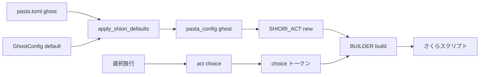
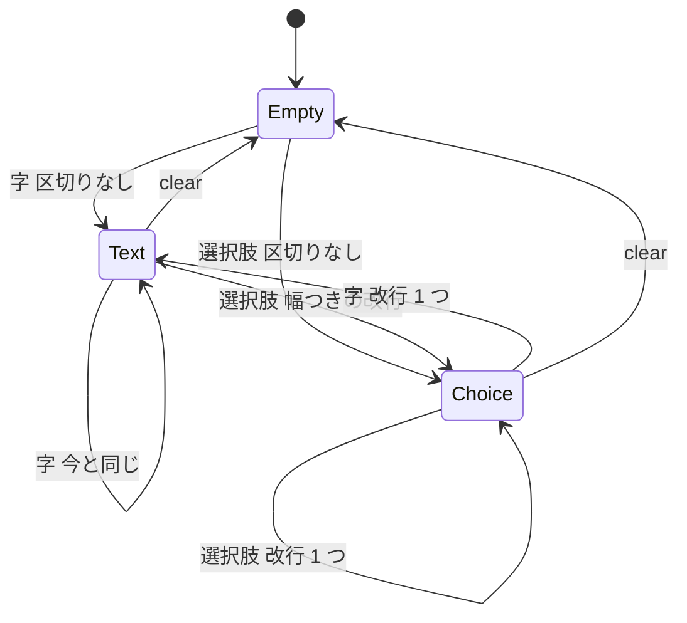

# 設計書: choice-line-layout

## Overview

**Purpose**: 選択肢行（または `act:choice`）を書くだけで、選択肢が 1 つずつ別の行に並ぶようにする。入門ガイドの 9 段目を章のとおりに写した読者が、切れた選択肢を見て自分の書き間違いを疑わずに済む。

**Users**: 読者（入門ガイドを写して初めてゴーストを作る人）、ゴースト作者（選択肢行または `act:choice` を使う人）、開発者（pasta を直す人）。

**Impact**: さくらスクリプトの組み立て（`sakura_builder.lua` の `BUILDER.build`）が、選択肢の前と、選択肢の後に続く台詞の前に、行の区切りを出すようになる。`pasta.toml` の `[ghost]` に `choice_newlines`（字の後の選択肢の前の改行幅。既定 `1.5`）が増える。選択肢のタグの形（`\![*]\q[…]`）、選択肢が選ばれたときの進み先、選択肢を 1 つも出さないトークの出力は変えない。

9 段目の選択肢のシーンの出力は、次のように変わる（増えるのは `\n[150]` と `\n` の 2 つだけである）。

```text
今:   \p[0]\s[0]ねえ、\_w[450]ユーザーさん。\_w[950]なんの話をしよっか？\_w[450]\![*]\q[おやつの話をする,おやつの話,OnMouseDoubleClick_4]\![*]\q[おでかけの話,おでかけの話,OnMouseDoubleClick_4]\![set,choicetimeout,10000]\e
直す: \p[0]\s[0]ねえ、\_w[450]ユーザーさん。\_w[950]なんの話をしよっか？\_w[450]\n[150]\![*]\q[おやつの話をする,おやつの話,OnMouseDoubleClick_4]\n\![*]\q[おでかけの話,おでかけの話,OnMouseDoubleClick_4]\![set,choicetimeout,10000]\e
```

### Goals

- 選択肢が、字または別の選択肢の後に出るとき、新しい行の先頭から出る（2.1・2.2）。吹き出しの最初に出るときは、区切りを入れない（2.3）。
- 選択肢の後に続く台詞が、新しい行の先頭から出る（2.5）。
- 字の後の選択肢の前の幅を、`pasta.toml` の `[ghost]` の `choice_newlines` で変えられる（2.8〜2.10）。読み方・既定値の持ち方・換算は、既にある `spot_newlines` と同じにする。
- 選択肢行と `act:choice` に、同じ配置が当たる（2.6）。
- 選択肢を出さないトークの出力が、1 文字も変わらない（3.5）。
- 9 段目の辞書・章・段階表を変えずに、9 段目の見え方が直る（4.1〜4.6）。

### Non-Goals

- 選択肢のタグの形を変えること（`\__q` にして長い表示を折り返すことを含む）。
- 作者が選択肢の直前に書いた改行を見つけて、pasta の区切りを省くこと（2.7）。
- `BUILDER.build` を分割して複雑度を下げること。
- 話し手の切り替えの段落の区切り（`spot_newlines`）の規則を変えること。
- 選択肢の文法、選択肢の振り分け、バルーンの絵、文節での折り返し、シェルの絵、スクリーンショット。

## Boundary Commitments

### This Spec Owns

- 選択肢の行の配置の規則（区切りを出す条件と幅）と、その判定に使う組み立ての状態（吹き出しごとの「最後に表示したもの」）。
- `pasta.toml` の `[ghost]` の `choice_newlines`（既定値、省略したときの補完、組み立てへの受け渡し）。
- 選択肢の出力を完全一致で照合している既存のテストの期待値 9 件の追従と、配置の新しいテスト。
- マニュアルの選択肢の説明・`pasta.toml` のリファレンス・組み立ての内部の説明と、そこから生成するスキルの参照資料。
- 直した後の実機での確認と、直した場所・理由・既存のゴーストでの見え方の変化の記録（`research.md`）。

### Out of Boundary

- 選択肢のタグの中身（`choice_to_script`・エスケープ・3 番目の引数）。読むだけで、変えない。
- 選択肢のトークンを積む側（`pasta/act.lua` の `ACT_IMPL.choice`・`group_by_actor`、`scope_gen.rs`）と、選ばれた後の振り分け（`pasta/shiori/event/choice_select.lua`）。
- 字の定義（`emits_text`）と、話し手の切り替えの段落の区切りの判定（`spot_has_text`・`pending_break` の決め方）。読むだけで、決め方は変えない。
- `BUILDER.build` の分割（リファクタ）。
- 9 段目の辞書（`dic/09-choice.pasta`）・章（`book/src/getting-started/09-choice.md`）・段階表（`STAGES.md`）・`tests/tutorial_stages_test.rs`。
- 作者が書いた改行の検出、台詞の行に書いた `\c` の検出（「未決の事項」の 2）。
- 台詞の中に作者が手で書いた `\q[…]`・`\__q[…]` の配置。
- 1 行に収まらない長い表示の選択肢の折り返し。
- シェルのファイル、`tests/integration_test.rs`、`book/tools/`。

### Allowed Dependencies

- `GhostConfig`（`crates/pasta_lua/src/loader/config/sections.rs`）— `[ghost]` の既定値の出どころ（SSOT）。`choice_newlines` の既定値はここに 1 つだけ置く。
- `pasta.config`（`@pasta_config`）— `pasta/shiori/act.lua` からだけ読む。`sakura_builder.lua` は設定を読まず、引数の表（`BuildConfig`）で受け取る。
- `pasta.shiori.appearance` の `tag_at` — 既にある `emits_text` を通してだけ使う。新しい呼び出しは足さない。
- 依存の向きは `pasta.shiori.act` → `pasta.shiori.sakura_builder` のままにする。逆向きの依存、新しい Lua モジュール、新しいクレート、外部ライブラリを足さない。
- 実機の確認は SSP と SSP の MCP を使う（`research.md` の「実機での確認」と同じ手順）。

### Revalidation Triggers

- 選択肢のタグの形、または選択肢として出すトークンの種類が変わる（`scene-anchor-link` が台詞の中のアンカーを足すとき）。区切りの対象を見直す。
- 字の定義（`emits_text`）が変わる。
- `spot_newlines` の読み方・補完の経路・換算が変わる。`choice_newlines` を同じに直す。
- 話し手なしのグループの作り方（`group_by_actor`）が変わる。
- 吹き出しを消したことの数え方（`clear` のトークン、`\c`）が変わる。

## Architecture

### Existing Architecture Analysis

- **選択肢の経路**: 選択肢行 `＠？ジャンプ先「表示」` は `act:choice(ジャンプ先, 表示)` に変わり、`{ type = "choice", … }` のトークンを積む。`act:choice` を Lua から直接呼んでも同じトークンである。`group_by_actor` は、選択肢を直前の話し手のグループに入れる。グループが無ければ（出力の先頭か `clear_spot` の後）、話し手なしのグループを開く。`BUILDER.build` は、選択肢を「字を出さないトークン」として `\![*]\q[…]` に変えて出すだけで、前後に何も足さない。
- **組み立ての状態**: `BUILDER.build` は、1 回の出力の中だけで生きる状態（`last_actor`・`last_spot`・`spot_has_text`・`pending_break`）を持つ。話し手が切り替わって、字のある吹き出しへ戻ると、次の字の直前に `\n[spot_newlines × 100]` を出す。`clear` のトークン（`act:clear()`）と `clear_spot` で、状態が戻る。
- **設定の経路**: `[ghost]` の既定値は Rust の `GhostConfig` が持ち、`apply_shiori_defaults` が書かれていないキーだけを補う。Lua は `pasta/shiori/act.lua` の `SHIORI_ACT.new` が `CONFIG.get("ghost", "spot_newlines", 1.5)` で読み、`BUILDER.build` の設定の表に入れて渡す。`config_defaults_test.rs` が、Rust の既定値・Lua の既定値のリテラル・マニュアルの `pasta.toml` のリファレンスの 3 つが食い違わないことを検査している。
- **複雑度**: `BUILDER.build` は luacheck の複雑度の上限（15）を越えており（22）、関数の行の `-- luacheck: ignore 561` と、その上の `ponytail:` のコメントで許している。`.luacheckrc` の側に例外は書いていない。
- **吹き出しの消去**: 台詞の行に書いた `\c` は `sakura_script` のトークンになり、`clear` のトークンにはならない。今の段落の区切りの規則も、`act:clear()` だけを吹き出しの消去として数えている。

### Architecture Pattern & Boundary Map

既にある状態機械に、吹き出しごとの状態を 1 つ足す。新しい層・モジュール・抽象は作らない。



**Architecture Integration**:

- **選んだ型**: 既存の状態機械の拡張。区切りを出す場所は、吹き出しの状態（字を出したか・消したか）を既に知っている `BUILDER.build` だけである。
- **責任の分け方**: 配置の規則と状態は `sakura_builder.lua`。値の読み込みは `pasta/shiori/act.lua`。既定値は `GhostConfig`。選択肢を積む側は触らない。
- **保つ型**: 設定は引数の表で組み立てへ渡す。既定値は Rust に 1 つ。幅の換算は 100 倍して切り捨て。
- **新しい部品**: 無い。局所関数を 2 つ足す（幅つきの改行のタグを作る関数、選択肢の前の区切りを決める関数）。
- **steering との整合**: 既定値の出どころを 1 つにする（SSOT）。マニュアルが正で、スキルの参照資料は生成する。

### Technology Stack

| Layer | Choice / Version | Role in Feature | Notes |
| ----- | ---------------- | --------------- | ----- |
| Lua ランタイム | LuaJIT 2.1（mlua 0.11） | 組み立ての状態機械、設定の読み込み | 新しい依存なし |
| 設定 | Rust（`pasta_lua` の loader、toml 1.1.2） | `choice_newlines` の既定値と補完 | `GhostConfig` に 1 フィールド |
| テスト | `lua_test`（同梱）、`cargo test` | 配置の完全一致、設定の受け渡し、既定値の一致 | 既存の枠組みのまま |
| 静的解析 | luacheck v1.2.0（同梱） | 複雑度の例外の行を保つ | 上限は変えない |
| マニュアル | mdBook、`book/tools/gen-skill-refs.mjs` | 選択肢と設定の説明、スキルの参照資料の生成 | 生成先は `.claude/skills/` |

## File Structure Plan

### Directory Structure

```text
crates/pasta_lua/
├── pasta_scripts/pasta/shiori/
│   ├── sakura_builder.lua        # 配置の規則と状態（本体）
│   └── act.lua                   # choice_newlines を読んで BUILDER.build へ渡す
├── src/loader/
│   ├── config/sections.rs        # GhostConfig.choice_newlines・default_choice_newlines()
│   ├── config/mod.rs             # apply_shiori_defaults に 1 キー
│   ├── mod.rs                    # default_choice_newlines の再公開
│   └── config_tests.rs           # 補完のテストに 1 キー
└── tests/
    ├── lua_specs/sakura_builder_test.lua   # 配置の新しいテスト
    ├── lua_specs/shiori_act_test.lua       # 期待値 1 件（751 行）、act:choice の配置
    ├── loader/startup_test.rs              # 設定が出力に届くこと
    ├── loader/config_defaults_test.rs      # 既定値・Lua のリテラル・リファレンスの一致
    ├── loader/config_sections_test.rs      # 既定値と補完
    └── fixtures/loader/with_ghost_config/pasta.toml   # choice_newlines を 1 行
crates/pasta_shiori/tests/
└── call_execution_correctness_e2e_test.rs  # 期待値 8 件
book/
├── AUTHORING.md                            # 検査するキーの一覧の 1 行
└── src/
    ├── grammar/block-structure.md          # 選択肢行の配置
    ├── lua/script-api.md                   # act:choice の配置
    ├── lua/modules/pasta-config.md         # 補うキーの一覧
    ├── reference/pasta-toml.md             # choice_newlines
    └── internals/
        ├── talk-output.md                  # 組み立ての状態と規則
        ├── internal-modules.md             # SHIORI_ACT.new が足すフィールド
        └── loader.md                       # 補うキーの一覧
.claude/skills/                             # 生成物（開発者の許可を得てから再生成する）
├── pasta-ghost-authoring/references/{block-structure.md,pasta-toml.md}
└── pasta-lua-coding/references/{script-api.md,pasta-config.md,internal-modules.md}
.kiro/specs/choice-line-layout/research.md  # 実機の確認と記録
```

### Modified Files

- `crates/pasta_lua/pasta_scripts/pasta/shiori/sakura_builder.lua` — 吹き出しごとの「最後に表示したもの」の状態を足し、選択肢の前と、選択肢の後の字の前に区切りを出す。`BuildConfig` に `choice_newlines` を足す。幅つきの改行のタグを作る式を、局所関数 1 つにまとめる。`ponytail:` のコメントの複雑度の数字を、測った値に直す。
- `crates/pasta_lua/pasta_scripts/pasta/shiori/act.lua` — `SHIORI_ACT.new` で `CONFIG.get("ghost", "choice_newlines", 1.5)` を読み、`build` で設定の表に入れる（`spot_newlines` の隣に 1 行ずつ）。
- `crates/pasta_lua/src/loader/config/sections.rs`・`config/mod.rs`・`mod.rs` — `GhostConfig` に `choice_newlines: f64`、`default_choice_newlines()`、`apply_shiori_defaults` の補完、再公開。コメントの「4 キー」を直す。
- `crates/pasta_lua/tests/lua_specs/sakura_builder_test.lua` — 配置のテストを 1 つの `describe` に足す。既存のテストは直さない。
- `crates/pasta_lua/tests/lua_specs/shiori_act_test.lua` — 751 行の期待値を直す。`act:choice` の配置のテストを 1 件足す。
- `crates/pasta_shiori/tests/call_execution_correctness_e2e_test.rs` — 期待値 8 件を、規則を手で当てて直す（「Supporting References」の表）。
- `crates/pasta_lua/tests/loader/*`・`fixtures/loader/with_ghost_config/pasta.toml`・`src/loader/config_tests.rs` — `spot_newlines` を検査している場所に、`choice_newlines` の検査を並べる。
- `book/src/` の 7 ページと `book/AUTHORING.md` — 「Components and Interfaces」の ManualPages を参照。
- `.claude/skills/` の 5 ファイル — `node book/tools/gen-skill-refs.mjs` の生成物。手で編集しない。

### 変えないファイル

- `crates/pasta_sample_ghost/ghosts/hello-pasta/ghost/master/dic/09-choice.pasta`、`book/src/getting-started/09-choice.md`、`crates/pasta_sample_ghost/STAGES.md`、`crates/pasta_sample_ghost/tests/tutorial_stages_test.rs`（4.3・4.5）。
- `crates/pasta_lua/pasta_scripts/pasta/act.lua`、`crates/pasta_lua/src/code_gen/`、`crates/pasta_lua/pasta_scripts/pasta/shiori/event/choice_select.lua`（3.1〜3.3）。
- `crates/pasta_lua/.luacheckrc`（上限も例外の書き方も変えない）。
- `book/src/lua/shiori-events.md` — 選択肢のタグの形だけを書いており、形は変わらない。実装のときに読み直して、行の配置に触れる文が無いことを確かめる。

## System Flows

### 吹き出しの状態と区切り

組み立ては、吹き出し（スポット）ごとに「最後に表示したもの」を持つ。値は、無し・字・選択肢の 3 つである。



区切りは、次の表で決まる。「字」は、今の字の定義（`emits_text` が真のトークン）である。「保留」は、話し手が切り替わって字のある吹き出しへ戻ったときに立つ、段落の区切りの保留（`pending_break`）である。

| 次に出すもの | 条件 | 直前に出す区切り | 出した後の状態 | 要件 |
| ------------ | ---- | ---------------- | -------------- | ---- |
| 選択肢 | 最後が無し | 出さない | 最後＝選択肢。保留には触らない | 2.3 |
| 選択肢 | 最後が字 | `\n[choice_newlines × 100 の切り捨て]` | 同上 | 2.1・2.8 |
| 選択肢 | 最後が選択肢 | `\n` | 同上 | 2.2・2.11 |
| 字 | 保留がある | `\n[spot_newlines × 100 の切り捨て]`（今と同じ） | 最後＝字。保留を消す（今と同じ） | 2.5 |
| 字 | 保留が無く、最後が選択肢 | `\n` | 最後＝字 | 2.5・2.11 |
| 字 | それ以外 | 出さない（今と同じ） | 最後＝字 | 3.5 |
| `clear`（`act:clear()`） | — | — | 最後＝無し（今のリセットに足す） | 2.3 |
| `clear_spot` | — | — | 全部の吹き出しの最後＝無し（今のリセットに足す） | — |
| 上のどれでもない | — | — | 変えない | 2.4・2.7 |

- 区切りは、選択肢のマーカー（`\![*]`）の前、台詞のテキストの先頭の前に入る。`\p[N]` と外見の復旧タグよりは後ろである（今の段落の区切りと同じ位置）。
- 表情・ウェイト・`choice_timeout`・`newline`・`raw_script`・字の無い `talk`・字を表示しない `sakura_script` は、状態を変えない。間に挟まっても、挟まっていないときと同じ区切りになる（2.4）。作者が書いた改行もここに入るので、pasta の区切りと重なって出る（2.7）。
- 選択肢を 1 つも出さない出力では、最後が選択肢になることが無い。表の「今と同じ」の行だけが働くので、出力は変わらない（3.5）。

### 並びごとの出力

ウェイトのタグと `\q` の 3 番目の引数は省いて書く。`A` はスポット 0、`B` はスポット 1 の話し手である。

| 並び | 出力 |
| ---- | ---- |
| A の字 → 選択肢 → 選択肢 | `\p[0]どれ？\n[150]\![*]\q[甲,…]\n\![*]\q[乙,…]\e` |
| A の字 → 選択肢 → A の字 | `\p[0]選んで\n[150]\![*]\q[前,…]\nつづき\e` |
| A の字 → 表情 → 選択肢 → `!select` → 選択肢 | `\p[0]どれ？\s[5]\n[150]\![*]\q[甲,…]\![set,choicetimeout,10000]\n\![*]\q[乙,…]\e` |
| A の字 → `act:clear()` → 選択肢 | `\p[0]どれ？\c\![*]\q[甲,…]\e` |
| 選択肢 → 選択肢（話し手なし） | `\![*]\q[甲,…]\n\![*]\q[乙,…]\e` |
| 選択肢（話し手なし）→ A の字 | `\![*]\q[甲,…]\p[0]\nつづき\e` |
| A の字・選択肢 → B の字 → A の字 | `\p[0]どれ？\n[150]\![*]\q[甲,…]\p[1]はやく\p[0]\n[150]うーん\e`（2 つ目の `\n[150]` は `spot_newlines`） |
| A の字 → B の字 → A の選択肢・字 | `\p[0]やあ\p[1]はい\p[0]\n[150]\![*]\q[甲,…]\n[150]どう？\e`（1 つ目は `choice_newlines`、2 つ目は今も出ている `spot_newlines`） |
| A の選択肢だけ → B の字 → A の字 | `\p[0]\![*]\q[甲,…]\p[1]はやく\p[0]\nうーん\e` |

## Requirements Traceability

| Requirement | Summary | Components | Interfaces | Flows |
| ----------- | ------- | ---------- | ---------- | ----- |
| 1.1 | 実機で採ったさくらスクリプトの記録 | FieldRecord | `research.md`「実機での確認」の 1（記録済み） | — |
| 1.2 | 原因と根拠の記録 | FieldRecord | 同「実機での確認」の Implications、「ベースウェアの仕様」（記録済み） | — |
| 1.3 | 2 つ目だけが次の行に出た理由 | FieldRecord | 同「実機での確認」の 3（記録済み） | — |
| 2.1 | 字の後の選択肢の前を区切る | ChoiceLineLayout | `BUILDER.build` | 区切りの表 2 行目 |
| 2.2 | 選択肢の後の選択肢の前を区切る | ChoiceLineLayout | `BUILDER.build` | 区切りの表 3 行目 |
| 2.3 | 最初の選択肢は区切らない | ChoiceLineLayout | `BUILDER.build` | 区切りの表 1 行目・`clear` の行 |
| 2.4 | 字を表示しない指定は配置を変えない | ChoiceLineLayout | `BUILDER.build` | 区切りの表「上のどれでもない」 |
| 2.5 | 選択肢の後の台詞の前を区切る | ChoiceLineLayout | `BUILDER.build` | 区切りの表 4・5 行目 |
| 2.6 | 選択肢行と `act:choice` に同じ配置 | ChoiceLineLayout | `choice` のトークン（どちらも同じ） | — |
| 2.7 | 作者の改行を取り除かない | ChoiceLineLayout | `BUILDER.build` | 区切りの表「上のどれでもない」 |
| 2.8 | 幅は `choice_newlines`、換算は `spot_newlines` と同じ | ChoiceLineLayout、ChoiceNewlinesConfig | `BuildConfig.choice_newlines`、幅つきの改行の局所関数 | 設定の経路 |
| 2.9 | 書かれていなければ `1.5` | ChoiceNewlinesConfig | `GhostConfig::default()`、`apply_shiori_defaults` | 設定の経路 |
| 2.10 | 値の扱いは `spot_newlines` と同じ | ChoiceNewlinesConfig | `CONFIG.get`、`BuildConfig` | 設定の経路 |
| 2.11 | 選択肢の後の区切りは `\n` | ChoiceLineLayout | `BUILDER.build` | 区切りの表 3・5 行目 |
| 3.1 | 選択肢の文字・ジャンプ先・シーン名を変えない | ChoiceLineLayout | `choice_to_script`（触らない） | — |
| 3.2 | 進み先の規則を変えない | —（`choice_select.lua` を触らない） | ExpectationUpdates の 8 件が進み先も照合する | — |
| 3.3 | 制限時間を変えない | —（`choice_timeout` の変換を触らない） | — | 区切りの表「上のどれでもない」 |
| 3.4 | 手で書いた `\q[…]` の出力を変えない | ChoiceLineLayout | 台詞の中の `\q` は `talk` として通る | — |
| 3.5 | 選択肢の無いトークの出力を変えない | ChoiceLineLayout | 既存のテストを直さずに通す | 区切りの表「今と同じ」 |
| 4.1 | 9 段目が 3 行に分かれる | ChoiceLineLayout、FieldVerification | — | Overview の出力 |
| 4.2 | 既定のバルーンで切れない | FieldVerification | 実機の確認 | — |
| 4.3 | 9 段目の辞書に改行・位置の指定が無い | —（辞書を変えない） | 「変えないファイル」 | — |
| 4.4 | 入門ガイドに回避の書き方を載せない | ManualPages | `book/src/getting-started/` を触らない | — |
| 4.5 | 辞書・章の作例・段階表を変えない | —（変えない） | 「変えないファイル」、`tutorial-check.mjs` | — |
| 4.6 | 「成功の目印」が実機と食い違わない | FieldVerification | 章の文（「続けて選択肢…が出る」）を実機と読み合わせる | — |
| 5.1 | 選択肢行の説明に配置を記す | ManualPages | `grammar/block-structure.md` | — |
| 5.2 | `act:choice` の説明に同じ配置を記す | ManualPages | `lua/script-api.md` | — |
| 5.3 | スキルの参照資料を同じ内容に | SkillReferences | `gen-skill-refs.mjs` | — |
| 5.4 | 回避の書き方を載せない | ManualPages | — | — |
| 5.5 | `choice_newlines` をリファレンスに記す | ManualPages | `reference/pasta-toml.md` の 3 か所と節 | — |
| 6.1 | 直した後の見え方を実機で確かめて記録 | FieldVerification | `research.md`「直した後の実機での確認」 | — |
| 6.2 | クリックと時間切れを実機で確かめて記録 | FieldVerification | 同上 | — |
| 6.3 | 直した場所と、辞書・バルーンで直さなかった理由 | FieldRecord | `research.md`（Architecture Pattern Evaluation と「決定の記録」） | — |
| 6.4 | 既存のゴーストで増える区切りの場所 | FieldRecord | 本書「既存のゴーストでの見え方の変化」、`research.md` | — |
| 6.5 | リポジトリ内の辞書と作例の洗い出し | FieldVerification | `research.md`「既存のゴーストへの影響」の一覧を、直した後に見直す | — |

## Components and Interfaces

| Component | Domain/Layer | Intent | Req Coverage | Key Dependencies (P0/P1) | Contracts |
| --------- | ------------ | ------ | ------------ | ------------------------ | --------- |
| ChoiceLineLayout | 出力（Lua） | 選択肢の前後の区切りを決めて出す | 2.1〜2.8、2.11、3.1、3.4、3.5、4.1 | `emits_text`（P0）、`BuildConfig`（P0） | Service、State |
| ChoiceNewlinesConfig | 設定（Rust・Lua） | `choice_newlines` を既定値つきで組み立てへ届ける | 2.8〜2.10 | `GhostConfig`（P0）、`pasta.config`（P0） | Service |
| ExpectationUpdates | 検証 | 完全一致の期待値 9 件を規則どおりに直し、新しい配置を固定する | 2.x、3.x | ChoiceLineLayout（P0） | — |
| ManualPages | 文書 | 配置と設定をマニュアルに記す | 4.4、5.1、5.2、5.4、5.5 | ChoiceLineLayout（P0） | — |
| SkillReferences | 文書（生成物） | マニュアルからスキルの参照資料を作り直す | 5.3 | ManualPages（P0）、開発者の許可（P0） | Batch |
| FieldVerification・FieldRecord | 記録 | 実機で確かめ、場所・理由・影響を残す | 1.1〜1.3、4.1、4.2、4.6、6.1〜6.5 | SSP（P0）、直した `pasta.dll`（P0） | — |

### 出力層

#### ChoiceLineLayout（`pasta/shiori/sakura_builder.lua`）

| Field | Detail |
| ----- | ------ |
| Intent | 吹き出しごとの「最後に表示したもの」を見て、選択肢の前と、選択肢の後の字の前に区切りを出す |
| Requirements | 2.1、2.2、2.3、2.4、2.5、2.6、2.7、2.8、2.11、3.1、3.4、3.5、4.1 |

**Responsibilities & Constraints**

- 区切りを出す条件と幅は、「System Flows」の表のとおりである。
- 吹き出しの単位はスポットである。話し手なしのグループの中（スポットが決まっていない間）は、スポット 0 として数える。さくらスクリプトは、スコープを切り替えるタグが出るまでスコープ 0 の吹き出しに出るためである。
- 状態は 1 回の出力（1 回の `BUILDER.build`）の中だけで生きる。出力をまたいで持ち越さない（`spot_has_text` と同じ）。
- 選択肢は字に数えない。`emits_text`・`spot_has_text`・`pending_break` の決め方（話し手が切り替わったときに、戻り先に字があれば保留を立てる）は変えない。選択肢は保留に触らない。保留は、今までどおり次の字の直前で出る。
- `choice_to_script`・`inner_token_to_string`・`emit_inner_token`・`emit_actor_switch` は変えない。
- `BUILDER.build` を分割しない。判定は局所関数に出し、`build` の中に足す枝を最小にする。複雑度は 22 から 26 前後に上がる見込みで、関数の行の `-- luacheck: ignore 561` はそのまま働く。`ponytail:` のコメントの数字は、luacheck で測った値に直す。

**Dependencies**

- Inbound: `pasta.shiori.act` の `SHIORI_ACT_IMPL.build` — 設定の表を渡して呼ぶ（P0）
- Outbound: `emits_text`（同じファイルの局所関数）— 字かどうかの判定（P0）
- External: なし

**Contracts**: Service [x] / API [ ] / Event [ ] / Batch [ ] / State [x]

##### Service Interface

```lua
--- @class BuildConfig
--- @field spot_newlines number|nil    話し手の切り替えで字のある吹き出しへ戻るときの改行幅（既定 1.5）
--- @field choice_newlines number|nil  字の後の選択肢の前の改行幅（既定 1.5）
--- @field buffer_factory (fun(): table)|nil

--- @param grouped_tokens table[]
--- @param config BuildConfig|nil
--- @param input_actor_spots table<string, integer>|nil
--- @param appearance table|nil
--- @return string
function BUILDER.build(grouped_tokens, config, input_actor_spots, appearance) end

--- 幅つきの改行のタグ。spot_newlines と choice_newlines の両方がこれを使う
--- @param ratio number 行の高さに対する倍率
--- @return string `\n[N]`（N は ratio を 100 倍して小数点以下を切り捨てた整数）
local function newline_tag(ratio) end

--- 選択肢の直前に出す区切り
--- @param tail "text"|"choice"|nil その吹き出しに最後に表示したもの
--- @param choice_newlines number
--- @return string 空文字列、`\n[N]`、`\n` のどれか
local function choice_break(tail, choice_newlines) end
```

- Preconditions: 引数の形は今と同じ。`config.choice_newlines` が `nil`（または偽）なら `1.5` を使う（`spot_newlines` と同じ式）。
- Postconditions: 戻り値は `\e` で終わる。選択肢のトークンが 1 つも無い入力では、今と同じ文字列を返す。
- Invariants: 区切りは 1 か所に 1 つだけ出す。pasta が区切りを 2 つ続けて出すことは無い（作者の改行と並ぶことはある）。今の出力に出ている区切りは、場所も幅も変えない。

##### State Management

- State model: `spot_tail`（スポットの番号 → `"text"` または `"choice"`。無ければ何も表示していない）。添え字は `last_spot`、決まっていなければ 0。既にある `spot_has_text`・`pending_break` と並べて持つ。
- Persistence & consistency: `BUILDER.build` の呼び出しごとに作り直す。`clear` で現在の吹き出しの値を消し、`clear_spot` で全部を消す。
- Concurrency strategy: なし（1 回の呼び出しの中の局所変数）。

**Implementation Notes**

- Integration: 既にある `\n[%d]` の式（1 か所）を `newline_tag` に置き換える。出力は変わらない。既存のテスト（`\n[150]`・`\n[200]` を見るもの）がそのまま守る。
- Validation: 新しいテストは完全一致で書く。ウェイトのタグが入らないよう、台詞には句読点を含めない（既存の特性化テストと同じ書き方）。
- Risks: `clear_spot` の後は、吹き出しに既に出ているものを組み立てが知らない（今の段落の区切りと同じ）。同じ出力の途中で `clear_spot` を通った直後の選択肢は、前に字が出ていても区切られない。話し手なしの選択肢をスポット 0 として数えるのも、`clear_spot` の後では当たらないことがある。どちらも、シーンの先頭で話し手を宣言したシーンを、台詞の後で呼び、その最初が選択肢である場合だけに起きる。本 spec では救済しない。

### 設定層

#### ChoiceNewlinesConfig（`loader/config/`・`pasta/shiori/act.lua`）

| Field | Detail |
| ----- | ------ |
| Intent | `[ghost]` の `choice_newlines` を、既定値つきで `BUILDER.build` へ届ける |
| Requirements | 2.8、2.9、2.10 |

**Responsibilities & Constraints**

- 既定値 `1.5` の出どころは `GhostConfig` の 1 か所である。`apply_shiori_defaults` が、書かれていないときだけ `[ghost]` に補う。書かれた値は上書きしない。
- Lua は `SHIORI_ACT.new` が `CONFIG.get("ghost", "choice_newlines", 1.5)` で読み、`_choice_newlines` に持つ。`build` が `{ spot_newlines = …, choice_newlines = … }` として渡す。
- 値の検査・丸め・範囲の制限をしない。`spot_newlines` が今していないためである（2.10）。数値として計算できない値を書くと、区切りを出す時点で Lua のエラーになる見込みである（コードの読みによる。テストでは、同じ値を `spot_newlines` に書いたときと結果が同じであることを比べる）。
- `sakura_builder.lua` は設定のモジュールを読まない。

**Dependencies**

- Inbound: `pasta.toml` の `[ghost]`（P0）
- Outbound: ChoiceLineLayout — `BuildConfig.choice_newlines`（P0）
- External: なし

**Contracts**: Service [x] / API [ ] / Event [ ] / Batch [ ] / State [ ]

##### Service Interface

```rust
pub struct GhostConfig {
    pub talk_interval_min: i64,
    pub talk_interval_max: i64,
    pub hour_margin: i64,
    pub spot_newlines: f64,
    /// 字の後の選択肢の前の改行幅（行の高さに対する倍率）。既定 1.5
    pub choice_newlines: f64,
}

pub const fn default_choice_newlines() -> f64; // 1.5
```

```lua
--- @class ShioriAct : Act
--- @field _spot_newlines number
--- @field _choice_newlines number  字の後の選択肢の前の改行幅（既定 1.5）
```

- Preconditions: なし。
- Postconditions: `[ghost]` を省いても、`choice_newlines` を省いても、`@pasta_config.ghost.choice_newlines` は `1.5` である。書いた値はそのまま届く。
- Invariants: Rust の既定値、`pasta/shiori/act.lua` の既定値のリテラル、`pasta-toml.md` の既定値の 3 つが同じである（`config_defaults_test.rs` が検査する）。

**Implementation Notes**

- Integration: `spot_newlines` を足している場所に、同じ形で 1 行ずつ足す。`apply_shiori_defaults` が補うキーは 4 つから 5 つになる。
- Validation: `config_defaults_test.rs` の「最小の構成と、既定値を全部書いた構成が同じになる」テストは、全部書いた側の文字列に `choice_newlines = 1.5` を足さないと落ちる。
- Risks: 持ち場が Rust の loader と `pasta/shiori/act.lua` に広がる（「未決の事項」の 3・4）。

### 検証層

#### ExpectationUpdates

- 直す期待値は 9 件である（`call_execution_correctness_e2e_test.rs` の 8 件と `shiori_act_test.lua` の 1 件。2026-10-10 に grep で数え直した）。新しい期待値は「Supporting References」の表にある。出力を写して書かず、区切りの表を手で当てた値と、走らせた結果を比べる。
- `sakura_builder_test.lua` の選択肢のテスト、`scene_alias_search_test.rs`・`symbol_name_search_test.rs` は部分一致で、直さなくても通る。
- 新しいテストは「Testing Strategy」にある。

### 文書層

#### ManualPages

| ページ | 直すこと | 要件 |
| ------ | -------- | ---- |
| `book/src/grammar/block-structure.md`「選択肢行」 | 「その行の位置に出力する」の後ろに、選択肢が 1 行に 1 つ表示されることと、区切りの条件と幅を書く。字の後は `choice_newlines` の幅、選択肢の後と、選択肢の後の台詞の前は改行 1 つ、吹き出しの最初は区切らない、表情・ウェイト・`!select` は配置を変えない、自分で書いた改行はそのまま出て重なる。出力の例を 1 つ（`text` のフェンス）。`choice_newlines` へのリンク | 5.1、5.4 |
| `book/src/lua/script-api.md`「choice」 | 選択肢行と同じ配置になることと、選択肢行の節へのリンク。話し手より前に積んだ選択肢は、スコープ 0 の吹き出しに出たものとして数えること | 5.2、5.4 |
| `book/src/reference/pasta-toml.md` | `spot_newlines` がある 3 か所（3 分類表・記述例・`[ghost]` のキーの表）に `choice_newlines` を足す。節「choice_newlines」を「spot_newlines」の後ろに足し、型・既定・単位（100 倍して切り捨てた `\n[N]`）・効く場所（字の後の選択肢の前だけ）・出力の例を書く | 5.5 |
| `book/src/internals/talk-output.md` | 組み立ての状態の表に `spot_tail`、規則の段落に区切りの表、`BUILDER.build` の設定に `choice_newlines`、「`choice` の出力には…改行も入らない」の文、境界の表の `{ spot_newlines }` | 5.1 に付いて変わる |
| `book/src/internals/internal-modules.md` | `SHIORI_ACT.new` が足すフィールドに `_choice_newlines` | 同上 |
| `book/src/lua/modules/pasta-config.md`・`book/src/internals/loader.md` | 補うキーの一覧（4 キー → 5 キー） | 5.5 に付いて変わる |
| `book/AUTHORING.md` | `pasta.toml` のリファレンスの検査するキーの一覧（4 キー → 5 キー）の 1 行 | 同上 |

- 入門ガイド（`book/src/getting-started/`）は触らない（4.4・4.5）。
- 区切りを避ける書き方・足す書き方の手順は、どのページにも書かない（5.4）。
- `pasta-toml.md` は、キーの名前を含む表の行すべてに既定値を書く（`config_reference_doc_matches_ssot` が照合する。`book/AUTHORING.md` の決まり）。

#### SkillReferences

##### Batch / Job Contract

- Trigger: マニュアルを直した後に、`node book/tools/gen-skill-refs.mjs` を走らせる。
- Input / validation: `book/src/` の生成元の 5 ページ（`grammar/block-structure.md`・`reference/pasta-toml.md`・`lua/script-api.md`・`lua/modules/pasta-config.md`・`internals/internal-modules.md`）。
- Output / destination: `.claude/skills/pasta-ghost-authoring/references/` と `.claude/skills/pasta-lua-coding/references/` の同名のファイル。
- Idempotency & recovery: 同じ入力なら同じ出力で、差が無ければ書き換えない。`--check` が CI で食い違いを落とす。`.claude/skills/` への書き込みは開発者の許可が要る。許可が出るまで再生成のタスクは止め、マニュアルと生成物の食い違いを残したまま完了にしない。同じウェーブの他の spec が先に入っていれば、その後で再生成する（ロードマップの約束）。

### 記録層

#### FieldVerification・FieldRecord

- **1.1〜1.3**: `research.md` の「実機での確認」に記録済みである。実装では、記録が 3 つの条件を満たすことを読み合わせるだけで、書き足さない。
- **6.1・6.2・4.1・4.2・4.6**: 配布している形の hello-pasta に、直した `pasta.dll` を入れて SSP で動かす。手順は `research.md` の「実機での確認」と同じである（`--option readonly --ghost` で起動し、SSP の MCP で `OnMouseDoubleClick` を起こす。9 段目は同名の 4 シーンから 1 つ選ばれるので、選択肢が出るまで繰り返す）。返ったさくらスクリプトと吹き出しの絵を見て、3 行に分かれること・切れないこと・マーカーが各行の先頭に出ることを確かめる。選択肢のクリックで掛け合いへ進むことと、10 秒で時間切れになることを確かめる。結果は `research.md` に節「直した後の実機での確認」を足して書く。
- **6.3**: 直した場所は出力（`sakura_builder.lua`）である。辞書で直さなかった理由（回避の書き方を載せない方針。選択肢と選択肢の間は直らない。作例どおりに書いた他の作者は直らない）と、バルーンで直さなかった理由（既定のバルーンで収まる。幅を広げても長い問いかけで再発する）は、`research.md` の Architecture Pattern Evaluation にある。
- **6.4**: 下の「既存のゴーストでの見え方の変化」を `research.md` に写す。
- **6.5**: このリポジトリで選択肢行を使う辞書は、hello-pasta の `09-choice.pasta` と、`pasta_shiori` のテスト用の 2 枚（`choice_scope.pasta`・`characterization.pasta`）である。`act:choice` を使うのは、マニュアルの作例（`lua/script-api.md`・`lua/patterns.md`）とテストである。直した後に同じ検索をやり直し、選択肢の直前に作者の改行を書いたものが無いことを確かめる。

## Error Handling

### Error Strategy

新しいエラーの経路は作らない。

- `choice_newlines` を書かない、`[ghost]` が無い: 既定の `1.5` を使う（2.9）。
- `choice_newlines` に数値でない値を書く: 検査しない。`spot_newlines` に同じ値を書いたときと同じ結果になる（2.10）。起動は止めず、警告も出さない（`spot_newlines` が今そうである）。
- 選択肢のトークンの中身が欠けている: 今と同じ（`choice_to_script` を触らない）。

### Monitoring

ログは足さない。

## Testing Strategy

実装は、テストを先に書いてから本体を直す。既存のテストのうち、選択肢を含まないものは 1 件も直さない（3.5 の確認になる）。

### Unit Tests（`sakura_builder_test.lua`。完全一致）

1. 字 → 選択肢 → 選択肢で、`\n[150]` と `\n` が 1 つずつ、選択肢の直前に出る（2.1・2.2・2.9・2.11）。
2. 吹き出しの最初の選択肢は区切らない。選択肢だけのグループ、`clear` の直後、別の吹き出しにだけ字がある場合の 3 つ（2.3）。
3. 字と選択肢の間、選択肢と選択肢の間に、表情・ウェイト・`choice_timeout`・`raw_script` が挟まっても、区切りの数と幅が変わらない（2.4）。
4. 選択肢 → 字で、字の直前に `\n` が 1 つ出る。続く字の前には出ない（2.5・2.11）。
5. `choice_newlines = 2.0` で `\n[200]` になる。`spot_newlines` を変えても選択肢の前の幅は変わらず、`choice_newlines` を変えても話し手の切り替えの幅は変わらない（2.8）。
6. 台詞の末尾の `\n` と `newline` のトークンが、区切りと並んで両方出る（2.7）。
7. 話し手の切り替えと重なる 3 つの並び（「並びごとの出力」の下 3 行）。区切りが 2 つ続かない。
8. 話し手なしのグループの選択肢 2 つ、その後の話し手の字（スポット 0 として数える）。
9. `choice_newlines` に数値でない値を渡したときの結果が、同じ値を `spot_newlines` に渡したときと同じである（2.10）。
10. 選択肢を含む並びで、2 種類のバッファ（既定と `buf.new_fallback`）の出力が一致する。
11. 台詞の中に手で書いた `\q[…]` を含む `talk` だけの出力が、今と同じである（3.4。本体を直す前に置く）。

### Integration Tests

1. `shiori_act_test.lua`: 751 行の期待値を直す。`SHIORI_ACT` で `act:talk` → `act:choice` → `act:choice` を積んだ出力が、Unit の 1 と同じ配置になる（2.6）。
2. `startup_test.rs`: `with_ghost_config` の `pasta.toml` に `choice_newlines = 2.5` を足し、`SHIORI_ACT` の出力に `\n[250]` が出る（2.8）。`spot_newlines = 2.0` の既存のテストはそのまま通る。
3. `config_defaults_test.rs`・`config_sections_test.rs`・`config_tests.rs`: 既定値が `1.5`、省いたときに補われる、書いた値を上書きしない、Lua のリテラルとリファレンスが既定値と一致する（2.9）。
4. `call_execution_correctness_e2e_test.rs`: 8 件の期待値を直す。選択肢行（DSL）から出た配置と、選んだ後の進み先が今と同じであることを、同じテストが確かめる（2.6・3.1・3.2）。

### 静的な検査

- luacheck（`pasta_scripts`・`tests`）が警告なしで通る。`BUILDER.build` の複雑度を測り、コメントの数字と合わせる。
- `node book/tools/gen-skill-refs.mjs --check` が通る（5.3）。マニュアルの検査は `book/AUTHORING.md` の「CI と同じ順」で走らせる。`tutorial-check.mjs` が通ることで、9 段目の辞書と章が変わっていないことを確かめる（4.5）。
- `cargo test`（ワークスペース全体）と `cargo clippy` が通る。

### 手動の確認（実機）

- 9 段目の選択肢の吹き出しが 3 行に分かれ、どの行も切れない（4.1・4.2・6.1）。
- 選択肢をクリックすると掛け合いへ進む。選ばずに 10 秒待つと時間切れになる（6.2）。
- 章の「成功の目印」の文が、見え方と食い違わない（4.6）。

## 既存のゴーストでの見え方の変化

選択肢行または `act:choice` を使うゴーストで、pasta を更新すると区切りが増える場所は、次の 3 つである（6.4）。

| 場所 | 増えるもの | 見え方 |
| ---- | ---------- | ------ |
| 字の後の選択肢の前 | `\n[150]`（`choice_newlines` で変えられる） | 選択肢が、台詞から半行ぶん空けた次の行から出る |
| 選択肢の後の選択肢の前 | `\n` | 選択肢が 1 行に 1 つになる |
| 選択肢の後の台詞の前 | `\n`（話し手が切り替わって戻った直後なら、今も出ている `\n[spot_newlines × 100]` のまま） | 台詞が選択肢の次の行から出る |

- 選択肢の直前や直後に自分で改行を書いていたゴーストは、空の行が 1 行増える。
- 台詞の中に `\q[…]` を手で書いているゴースト（emo2 など）は、変わらない。
- 選択肢を使わないトークは、変わらない。
- 元の見え方へ戻す設定は無い（`choice_newlines` は幅だけを変える）。

## 決定の記録

### 設計で決めたこと（2026-10-10）

`research.md` が設計へ送った 5 つを、次のように決めた。

- **(a) 区切りを入れる場所**: `BUILDER.build` の内側のトークンのループ。選択肢のための枝を 1 つ足し、字の枝に「最後が選択肢なら `\n`」を足す。区切りの文字列は局所関数が決める。理由: 吹き出しの状態（字を出したか・消したか・話し手が切り替わったか）を知っているのはここだけである。`act:choice` や生成コードの側で改行を足すと、吹き出しの最初の選択肢にも改行が出る。
- **(b) 選択肢を字に数えるか**: 数えない。`emits_text`・`spot_has_text` と、保留を立てる条件は変えない。別の状態（吹き出しごとの「最後に表示したもの」）を 1 つ足す。話し手の切り替えの区切りと重なるときは、区切りを 1 つだけ出す。字の前では、今も出ている `\n[spot_newlines × 100]` をそのまま出し、`\n` を重ねない。選択肢の前では、選択肢の規則（`\n[choice_newlines × 100]` または `\n`）で出し、保留には触らない（保留は、今までどおり次の字の直前で出る）。理由: 今の出力に区切りを足すだけになり、既に出ている区切りは場所も幅も変わらない。選択肢の無いトークの出力が変わらないことが、状態の持ち方から言える。`spot_newlines` の説明（「すでに台詞を出したスポットへ戻るとき」）も変えずに済む。
- **(c) 話し手なしのグループの選択肢**: スポット 0 の吹き出しに出たものとして数える。`shiori_act_test.lua` の 751 行の期待値は、選択肢の後の `\p[0]` と `A` の間に `\n` が入る形に変わる。理由: 選択肢だけのシーンは話し手なしのグループになるので、ここで数えないと、選択肢どうしが同じ行に並ぶ（2.2 を満たせない）。実機でも、スコープを切り替える前の出力はスコープ 0 の吹き出しに出る。
- **(d) `BUILDER.build` の複雑度**: 分割しない。今の例外の書き方（関数の行の `-- luacheck: ignore 561` と `ponytail:` のコメント）のまま、判定を局所関数に出して増分を小さくし、コメントの数字を測った値に直す。理由: 分割は特性化テストを先に置く別の作業で、この修正に要らない。`.luacheckrc` は関数ごとの例外を持っておらず、上限を変えると他のファイルの検査が緩む。
- **(e) `choice_newlines` の受け渡し**: `spot_newlines` と同じ経路にする（`GhostConfig` の既定値 → `apply_shiori_defaults` の補完 → `pasta/shiori/act.lua` の `SHIORI_ACT.new` が読む → `BUILDER.build` の設定の表）。理由: 組み立てが設定のモジュールを読まない今の形（設定は引数で受け取り、テストは表を渡すだけ）を保てる。`[ghost]` の既定値は Rust に 1 つという決まりと、それを守る検査（`config_defaults_test.rs`）に乗れる。リファレンスに「書かなくても必ず `@pasta_config` に現れる」と書いてある `[ghost]` の説明が、新しいキーでも成り立つ。

あわせて決めたこと。

- 幅つきの改行のタグを作る式を、局所関数 1 つにまとめて両方が使う。換算が同じであること（2.8）が、作りから言える。
- 吹き出しを消したことは、今の規則と同じく `clear` のトークン（`act:clear()`）で数える（「未決の事項」の 2）。
- `tutorial_stages_test.rs` に 9 段目の出力の照合は足さない。同じ並び（字 → 選択肢 → 選択肢）は `pasta_shiori` の結合テストが完全一致で見ており、見え方は実機でしか確かめられない。

## 未決の事項（設計ディスカッションで決める）

設計は、下の「仮定」で書いてある。

1. **話し手の切り替えの区切りと重なるとき**。選択肢を出した吹き出しへ、別の話し手の後で戻って台詞を出す並びで、要件 2.5・2.11 の文面は `\n` だが、今の規則は同じ場所に `\n[spot_newlines × 100]` を出している。**仮定**: 区切りは 1 つだけにし、字の前は今の `\n[spot_newlines × 100]` を残す（保留の扱いは 1 行も変えない）。戻った直後が選択肢で、その後に台詞が続く並びでは、選択肢の前に `\n[choice_newlines × 100]`、台詞の前に今も出ている `\n[spot_newlines × 100]` が出る。別の案: 最後が選択肢なら、いつも `\n` にする（要件の文面どおり。今 `\n[150]` が出ている場所が `\n` に変わる）。
2. **台詞の行に書いた `\c`**。台詞の行の `\c` は `sakura_script` のトークンになり、組み立ては吹き出しの消去として数えない（今の段落の区切りも同じで、`pasta-toml.md` の「`\c` でバルーンを消去した後…改行を出さない」は `act:clear()` にしか当たらない）。台詞 → `\c` → 選択肢行と書くと、消した吹き出しの最初に `\n[150]` が出る。要件 2.3 の「吹き出しを消した直後」を、DSL の書き方では満たせない。**仮定**: 本 spec は今の規則にそろえ（`act:clear()` だけ）、台詞の行の `\c` を両方の規則で数える修正は別の spec にする。別の案: 本 spec で、字を表示しない `sakura_script` の中の `\c` を、選択肢の状態についてだけ数える（段落の区切りの規則とずれる）。
3. **`pasta/shiori/act.lua` を触ること**。ロードマップの同じウェーブの約束は「`act.lua` を触らない」と書いている。同じ roadmap の「共有接点」は `crates/pasta_lua/pasta_scripts/pasta/act.lua` を名指ししているので、約束は選択肢を積む側の `pasta/act.lua` を指すと読んだ。**仮定**: `pasta/shiori/act.lua` に 2 行足す（読む 1 行、渡す 1 行）。別の案: 組み立てが `pasta.config` を直接読む（`act.lua` という名前のファイルを一切触らないが、組み立てに設定への依存が増える）。
4. **持ち場の広がり**。ロードマップは本 spec の持ち場を「`sakura_builder.lua` とそのテスト」と書いている。`choice_newlines` を `spot_newlines` と同じ形にすると、Rust の loader（`config/sections.rs`・`config/mod.rs`・`mod.rs`）、loader のテスト 4 ファイルとフィクスチャ 1 枚、マニュアルの内部のページ（`talk-output.md`・`internal-modules.md`・`loader.md`・`pasta-config.md`）、`book/AUTHORING.md` の 1 行まで広がる。`AUTHORING.md` は、同じウェーブの `manual-print-media-refs` が別の節（「CI と同じ順」の一覧）を持っている。**仮定**: 広げる（既定値の出どころを 1 つにする決まりと、その検査に乗る）。別の案: Lua の既定値だけにする（Rust を触らない。`@pasta_config.ghost.choice_newlines` は書かなければ `nil` になり、リファレンスの `[ghost]` の説明と、このキーだけ食い違う）。
5. **話し手なしの選択肢をスポット 0 として数えること**。`shiori_act_test.lua` の 751 行の期待値が `…\![set,choicetimeout,30000]\p[0]\nA\e` に変わる。**仮定**: 数える（決定の (c)）。`clear_spot` を出力の途中で通った後は当たらないことがあるが、救済しない。

## Supporting References

### 直す期待値（9 件）

`crates/pasta_shiori/tests/call_execution_correctness_e2e_test.rs`（選択肢を出す側の応答。選んだ後の応答は変わらない）。

| イベント | 新しい期待値 |
| -------- | ------------ |
| `OnCsAfterMid` | `\p[0]Ｂ通過選んで\n[150]\![*]\q[後,後選先,OnCsAfterMid_1]\n\![*]\q[外,後選外,OnCsAfterMid_1]\e` |
| `OnCsBeforeMid` | `\p[0]選んで\n[150]\![*]\q[前,前選先,OnCsBeforeMid_1]\nＢ通過Ａ再開\e` |
| `OnCsFromCallee` | `\p[0]選んで\n[150]\![*]\q[出,出選先,出選Ｂ_1]\n\![*]\q[外,出選外,出選Ｂ_1]\nＡ通過\e` |
| `OnCsBoth` | `\p[0]Ａから\n[150]\![*]\q[Ａの,両選先,OnCsBoth_1]\nＢから\n[150]\![*]\q[Ｂの,両選先,両選Ｂ_1]\nＡ再開\e` |
| `OnCsTail` | `\p[0]Ａ通過選んで\n[150]\![*]\q[末,末選先,末選Ｂ_1]\e` |
| `OnChoiceMenu` | `\p[0]どれ？\_w[450]\n[150]\![*]\q[甲,選択肢甲,OnChoiceMenu_1]\n\![*]\q[乙,選択肢乙,OnChoiceMenu_1]\e` |
| `OnCsSuspend` | `\p[0]選んで\n[150]\![*]\q[止,止選先,止選Ｂ_1]\e` |
| `OnCsExpr` | `\p[0]Ｂから\n[150]\![*]\q[Ｂの,式選先,式選Ｂ_1]\nＡから\n[150]\![*]\q[Ａの,式選先,OnCsExpr_1]\e` |

`crates/pasta_lua/tests/lua_specs/shiori_act_test.lua` の 751 行（Lua の文字列ではなく、出力の文字列で書く）。

| テスト | 新しい期待値 |
| ------ | ------------ |
| 「2: シーン冒頭の表示制御は積んだ順に切替タグなしで出る」 | `\s[5]\_w[500]\n\c\![*]\q[d,t]\![set,choicetimeout,30000]\p[0]\nA\e` |
