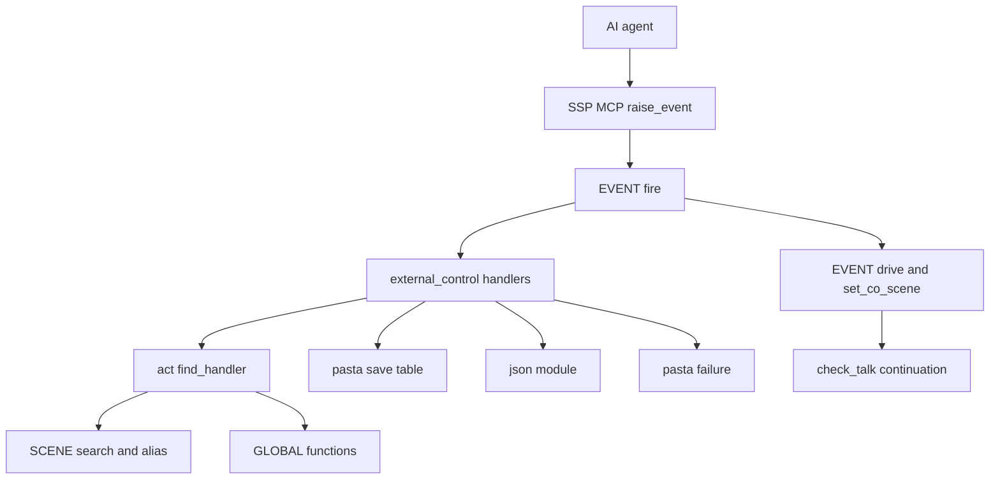
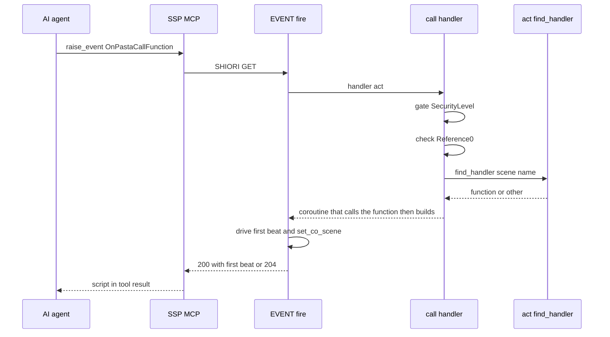
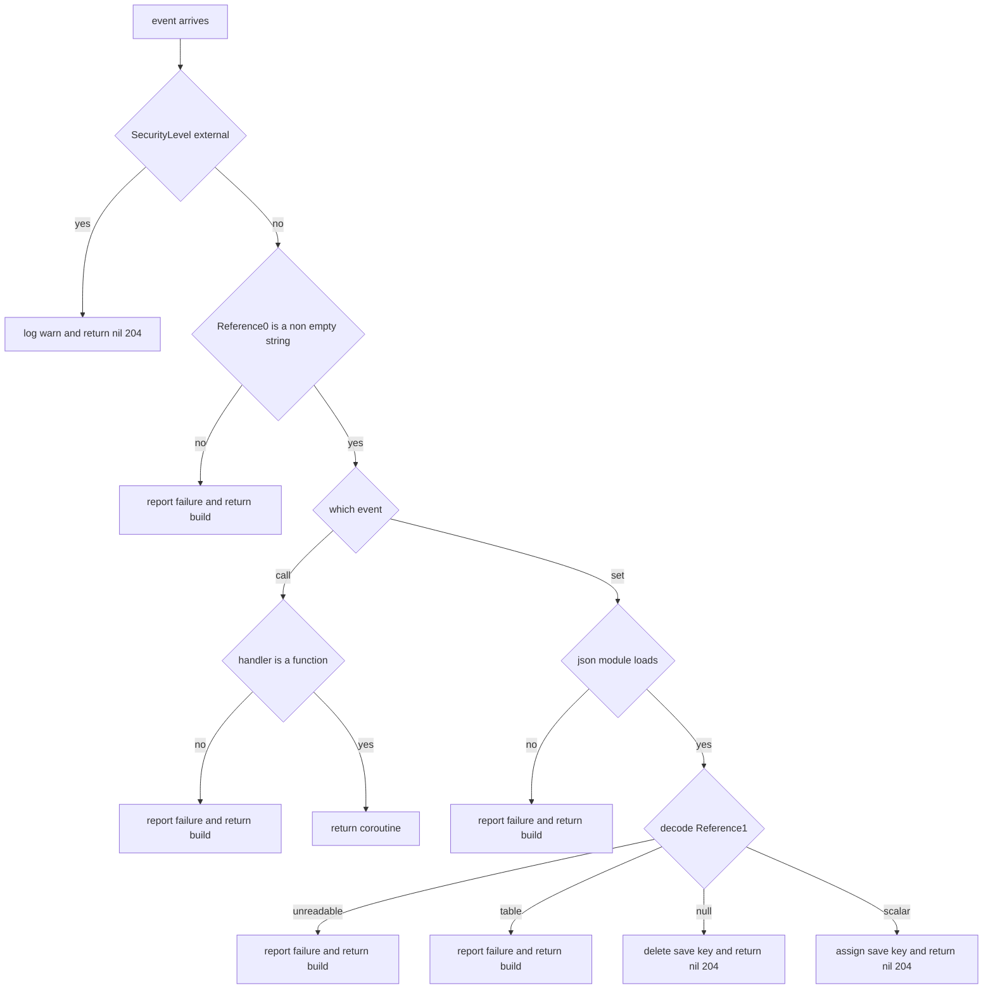

# 設計書: external-control-events

## Overview

**目的**: SSP の MCP サーバーの `raise_event` などの外から、イベントを 1 つ送るだけで、辞書の `＞名前` と同じ呼び出し（`OnPastaCallFunction`）と、グローバル変数 `＄＊名前` への代入（`OnPastaSetSaveVariable`）ができるようにする。いちばんの用途は、試験の間だけ `自動トーク停止` を呼ぶことと、`＄＊pasta_talk_interval_min` を縮めることである。

**利用者**: 外から試験・操作する人（AI エージェントを含む）と、2 つのイベントを止めたり差し替えたりしたいゴーストの作者。

**変わること**: 既定のハンドラを 2 つ、新しいファイルに足す。失敗の種類の名前の表（`failure.lua` の `FAILURE.LABEL`）に 2 行足す。Rust の本体、`act.lua`・`scene.lua`・シーン再生のファイル・`pasta_check` は触らない。ほかのイベントの動きは変えない。

```
raise_event("OnPastaCallFunction",    ["自動トーク停止"])               → 204（停止する）
raise_event("OnPastaCallFunction",    ["初回起動"])                     → 200（＊初回起動 の 1 ビート目）
raise_event("OnPastaCallFunction",    ["好感度を足す", "10"])           → GLOBAL["好感度を足す"](act, "10")
raise_event("OnPastaSetSaveVariable", ["pasta_talk_interval_min", "60"]) → ＄＊pasta_talk_interval_min ＝ 60（204）
raise_event("OnPastaSetSaveVariable", ["会員番号", "\"01\""])           → ＄＊会員番号 ＝ "01"（204）
raise_event("OnPastaSetSaveVariable", ["初回済み", "null"])             → ＄＊初回済み を消す（204）
```

### Goals

- Reference0 の名前を、辞書のシーンの外に書いた `＞名前` と同じ段と順で探して呼ぶ。探し方は作らない。
- 呼び先のシーンの 1 ビート目をイベントの応答で返し、続き・中断・エラーはふつうのイベントと同じ道（`EVENT.fire` → `EVENT.drive`）に任せる。
- Reference1 を JSON の値として読み、グローバル変数の一段目のキーに代入する・消す。
- 誤りと見つからないときを、今の失敗の表記とログの警告に、イベント名付きで出す。
- デバッグの有無によらず働き、`SecurityLevel: external` だけを断る。作者のハンドラを上書きしない。

### Non-Goals

- 値の読み出し、呼び出しの戻り値を応答に載せること。
- ローカルシーン・ローカル変数・`STORE`・入れ子のパスの書き換え。
- 有効・無効を切り替える設定。書き換えるたびのディスクへの保存。
- SSP の MCP サーバーの側の変更。
- `scene_play.lua` との共通の部品の切り出し（ウェーブの約束。後の `ponytail-lua-scripts` の題材）。

## Boundary Commitments

### This Spec Owns

- `REG.OnPastaCallFunction`・`REG.OnPastaSetSaveVariable` の既定のハンドラ（新しいファイル `pasta/shiori/event/external_control.lua`）。門（`SecurityLevel`）、引数の確かめ、呼び先をコルーチンで包むこと、JSON の値の分け方、失敗の表記とログの警告の文言。
- 2 つの失敗の種類の名前（`NOT_JSON = "JSON として読めない値"`・`NOT_ASSIGNABLE = "代入できない値"`）。`FAILURE.LABEL` の表の末尾に足し（表の決まり「後続 spec は自分の名前を足す」どおり）、`failure_test.lua` の数のテストを 10 から 12 に直し、2 つの文言のテストを足す。
- Lua の単体テストの土台に `@json` を登録すること（`tests/lua_unittest_runner.rs` の 1 行）。
- 2 つのイベントのテスト（Lua の単体テスト 1 本、Rust の結合テスト 1 本）。
- マニュアルの 2 つの節と比べ読みの節、既定ハンドラの表の 2 行と数の文、主要イベントの表の 2 行、変数の章からの案内、内部設計の章の 2 か所の追記、スキルの references の作り直し。

### Out of Boundary

- `＞名前` の解決そのもの（`ACT_IMPL.find_act_handler`・`find_handler`・`SCENE.search`・`[scene.alias]`）。使うだけで変えない。
- イベントの振り分け（`EVENT.fire`・`EVENT.drive`・`set_co_scene`）。今のまま使う。チェイントークの続きを残すか捨てるかの決まりは `chain-talk-interrupt` が持つ。
- 鎖でのハンドラの登録（`REG:register`）は `reg-handler-chain` が持つ。
- 自動トークの停止と再開そのもの（`ontalk-suppression` の `GLOBAL` の 4 つの名前）。
- 失敗の表記の仕組み（`pasta/failure.lua` の `report`・`format`・`value_of` など。触るのは `FAILURE.LABEL` の 2 行だけ）、シーン再生の既定のハンドラ（`scene_play.lua`）、`act.lua`、`scene.lua`、`pasta_check` の組み込みの名前。
- グローバル変数の保存（`@pasta_persistence`・`save.json`）。

### Allowed Dependencies

- ハンドラ → `pasta.shiori.event.register`（REG）、`pasta.failure`（`report`・`LABEL.BAD_NAME`・`LABEL.SCENE_NOT_FOUND`・`LABEL.NOT_JSON`・`LABEL.NOT_ASSIGNABLE`・`kind_of`）、`@pasta_log`、`pasta.save`、`@json`（`pcall` で読む）、`act:find_handler`・`act:build`（ShioriAct が受け継ぐ `ACT_IMPL` の口）。
- ハンドラは呼んだ時に `@pasta_log`・`pasta.save`・`@json` を `require` する（テストが差し替えられるように。`scene_play.lua` と同じ）。
- `event/init.lua` → ハンドラ（`require` の 1 行）。ハンドラは `event/init.lua` を `require` しない（循環させない）。
- 依存の向き: `pasta.failure`・`pasta.save`・`act` → ハンドラ → `event/init.lua` の読み込み。逆向きの依存は作らない。

### Revalidation Triggers

- `ACT_IMPL.find_act_handler` の段・順・`skip_methods` の意味を変えたとき — 「`＞名前` と同じ」（要件 1.1・1.2）を確かめ直す。
- `ACT_IMPL.call` が関数でない値を呼ぶようになったとき — このハンドラの「関数でなければ見つからない」を揃え直す。
- `EVENT.fire` のコルーチンの扱いと `set_co_scene` の決まりを変えたとき（`chain-talk-interrupt`） — 要件 2.4 はあちらに従うだけなので、このハンドラは変えない。結合テストが続きを確かめる所だけ見直す。
- `REG` の引き方を変えたとき（`reg-handler-chain`） — 作者の鎖のハンドラが既定より先に呼ばれること（要件 5.3）を確かめ直す。
- 同じウェーブのほかの spec が `FAILURE.LABEL` に名前を足したとき — 後から入る側が数のテストの数を rebase で合わせる。
- `@json`（mlua-stdlib）の版を上げたとき — `null` の返り方（light userdata）と `decode` の戻り値を確かめ直す。
- SSP の MCP の `raise_event` が GET・`local` で届かなくなったとき — 応答の載り方と門を見直す。

## Architecture

### Existing Architecture Analysis

- **イベントの振り分け**: `EVENT.fire` は `CALLBACK.try_route`・`CLOCK.observe` の後に `REG[req.id] or EVENT.no_entry` を呼ぶ。コルーチンが返ると `EVENT.drive(co, act, act)` が 1 ビート目まで進めて 200 にし、`set_co_scene` が続きを `STORE.co_scene` に置く（今は前の続きを捨てる）。文字列は 200（空なら 204）、`nil` は 204 で、`STORE.co_scene` は変わらない。エラーは `error` で投げ、`SHIORI.request` の `xpcall` が止まるエラーの応答にする。
- **`＞名前` の探し方**: `ACT_IMPL.find_act_handler(act, "scene", key)` は L1 今のシーン → L2 ローカル辞書 → L3 `act` のメソッド → L4 `GLOBAL` の完全一致 → L5 グローバルシーンの前方一致（別名は L5 の検索の中で当たる）。外からの act には今のシーンが無いので L1・L2 は飛ぶ。`ACT_IMPL.call` は見つかった値が関数のときだけ `handler(act, ...)` で直接呼ぶ。
- **既定のハンドラの形**: `REG.X = REG.X or function(act) … end`。先例の `scene_play.lua` は、門を引数より前に置き、失敗は `FAILURE.report` の後に `act:build()` を返し、成功はコルーチンを返す。
- **グローバル変数**: `＄＊名前` は `require("pasta.save")` の表の一段目のキー。`act:init_scene` が同じ表を `save` として渡す。保存はランタイムの終了時。
- **失敗の表記**: `FAILURE.report(act, record)` はログの警告を必ず出し、`[logging] balloon_warning`（既定 `true`）なら表記を act のトークンに積む。デバッグの有無は見ない。

### Architecture Pattern & Boundary Map



**Architecture Integration**:
- **選んだ形**: 新しい既定のハンドラのファイル 1 つ（research.md 4 の Option B）。呼び出しは「引いて包む」（research.md 3.1 の (a)）。
- **境界の分け方**: ハンドラは「門・引数・呼び先を包む・値を分ける・失敗の出し方」だけを持つ。探し方は `act:find_handler`、1 ビート目と続きは `EVENT.fire`、保存は `pasta.save` が持つ。
- **守る今の形**: 既定のハンドラの置き方、`scene_play.lua` の門と失敗の形とログの英語の並び、`wrap_scene` と同じ包み方、`FAILURE.report` の表記。
- **新しい部品の理由**: 外から 1 回で `＞名前` と同じ呼び出しと `＄＊名前` の代入をする口は、どこにも無い。
- **steering との整合**: Lua に集める、作者の上書きを優先する、非 ASCII の名前は文字列のキーで扱う（ハンドラの中に非 ASCII の識別子は無い）。

### Technology Stack

| 層 | 選んだもの | この機能での役割 | 備考 |
| --- | --- | --- | --- |
| Lua ランタイムのスクリプト | LuaJIT 2.1（mlua 0.11） | 2 つの既定のハンドラ | 新しい依存なし |
| JSON | mlua-stdlib 0.1 の `@json`（`decode`） | Reference1 を値に読む | 設定で外す口は無い（`[lua] libs` は撤去済み）。`pcall(require, "@json")` で確かめる |
| テスト | `lua_test`（Lua）、`cargo test`（Rust の結合） | 単体と結合 | 単体の土台に `@json` を登録する |
| マニュアル | mdBook、`book/tools/gen-skill-refs.mjs` | 使い方と references | 今の手順のまま |

## File Structure Plan

### Directory Structure

```
crates/pasta_lua/pasta_scripts/pasta/shiori/event/
└── external_control.lua              # 新規。REG.OnPastaCallFunction・REG.OnPastaSetSaveVariable の既定のハンドラ
crates/pasta_lua/tests/lua_specs/
└── external_control_event_test.lua   # 新規。2 つのハンドラの Lua の単体テスト（act・検索・ログ・設定を差し替え、@json は本物）
crates/pasta_lua/tests/
└── external_control_events_test.rs   # 新規。一時ゴーストを読み込み、SHIORI.request で 2 つのイベントを通す結合テスト
```

### Modified Files

- `crates/pasta_lua/pasta_scripts/pasta/shiori/event/init.lua` — 既定のハンドラの `require` の並びの末尾（今は L82 の `scene_play` の次）に `require("pasta.shiori.event.external_control")` を 1 行足す。ほかは触らない（ウェーブの約束）。
- `crates/pasta_lua/tests/lua_specs/init.lua` — テストの一覧の `scene_play_event_test` の次に `"external_control_event_test"` を 1 行足す。
- `crates/pasta_lua/pasta_scripts/pasta/failure.lua` — `FAILURE.LABEL` の表の末尾に `NOT_JSON`・`NOT_ASSIGNABLE` の 2 行を足す。ほかは触らない。
- `crates/pasta_lua/tests/lua_specs/failure_test.lua` — 「種類の名前の表は 10 種」を 12 種に直し、2 つの文言のテストを足す（決定 1。振る舞いのテストは触らない）。
- `.claude/skills/pasta-lua-coding/SKILL.md` — L174 の要約に 2 つのイベントを足す。分類器が止めるので、実装のこの手順で開発者に許可を求める（決定 6）。
- `crates/pasta_lua/tests/lua_unittest_runner.rs` — `@pasta_log` の登録の後に `mlua_stdlib::json::register(&lua, None)?;`（コメント 1 行付き）を足す。`register_module` が `package.loaded["@json"]` に置く。
- `book/src/lua/shiori-events.md`
  - 「既定ハンドラと上書き」: 表の末尾に 2 行、数の文を「次の 7 つ」から「次の 9 つ」に。表の下の包み方の段落は触らない。
  - 「主要イベント」の表: 分類「外からの操作」で 2 行。
  - 新しい節を「MCP からの呼び方」の後、「## つつき・撫でのショートカット」の前に 3 つ足す: `### OnPastaCallFunction（＞名前を外から呼ぶ）`、`### OnPastaSetSaveVariable（グローバル変数に代入）`、`### OnPastaCallFunction と OnPastaScene の違い`。「シーンを再生するイベントの共通の決まり」と、今の「MCP からの呼び方」は触らない。
- `book/src/grammar/variables.md` — 「グローバル変数」と「予約グローバル変数」の説明に、`OnPastaSetSaveVariable` の節への案内を 1 文ずつ足す。
- `book/src/internals/shiori.md` — モジュールの表に `pasta.shiori.event.external_control` の 1 行を足す（`scene_play` の行の次）。
- `book/src/internals/execution-model.md` — 「ハンドラがコルーチンを返す経路」の列挙（L174）に `OnPastaCallFunction` を足す。
- `.claude/skills/pasta-lua-coding/references/`・`.claude/skills/pasta-ghost-authoring/references/` — `node book/tools/gen-skill-refs.mjs` で作り直す（手で直さない）。

## System Flows

### OnPastaCallFunction の流れ（GET・`SecurityLevel: local` を前提）



- 呼び先はコルーチンの中で呼ぶ。呼び先のシーンが `＞チェイントーク` で区切っても、コルーチンの外での中断にならない。
- 出力が無ければ `act:build()` が `nil` になり、`EVENT.fire` が 204 を返す（要件 1.6）。

### 2 つのハンドラの判定の順



- 門は引数を見る前に置く。断るときは表記を出さず、ログの警告だけを書く（要件 5.2）。
- 失敗の道ではコルーチンを返さないので、`STORE.co_scene` は変わらない（要件 4.8）。`act:build()` は、表記を出さない設定なら `nil` で、204 になる（要件 4.6）。
- Status による抑止の判定は置かない（要件 2.2）。デバッグの門も置かない（要件 5.1）。

## Requirements Traceability

| 要件 | 内容 | 部品 | 口 | 流れ |
| --- | --- | --- | --- | --- |
| 1.1 | `＞名前` と同じ探し方で呼ぶ | CallFunctionHandler | `act:find_handler("scene", name)` | OnPastaCallFunction の流れ |
| 1.2 | 段・順・候補の選び方を揃え、除かない | CallFunctionHandler | `skip_methods` を渡さない（メソッドにも届く） | 同上 |
| 1.3 | ローカルを探さない | CallFunctionHandler | 外からの act に今のシーンが無い（L1・L2 が飛ぶ） | — |
| 1.4 | Reference1 から文字列のまま渡す | CallFunctionHandler | `collect_args` → `fn(a, table.unpack(args, 1, n))` | — |
| 1.5 | 台詞は 1 ビート目を 200 | CallFunctionHandler, EVENT.fire | コルーチンを返す | 同上 |
| 1.6 | 出力が無ければ 204 | 同上 | `act:build()` が `nil` | 同上 |
| 1.7 | 戻り値を載せない | CallFunctionHandler | 包む関数が戻り値を捨てる | — |
| 2.1 | 続きはふだんの時機 | EVENT.fire（今のまま） | `EVENT.drive`・`set_co_scene`・`check_talk` | 同上 |
| 2.2 | Status で止めない | ExternalControlCommon | 抑止の判定を置かない | 判定の順 |
| 2.3 | 実行時のエラー | EVENT.fire（今のまま） | `EVENT.drive` が偽 → `error` | — |
| 2.4 | チェイントークの続きはふだんの決まり | EVENT.fire（今のまま） | コルーチンを返すだけ（決まりは `chain-talk-interrupt`） | — |
| 3.1 | 数値・文字列・真偽値を代入 | SetSaveVariableHandler | `save[name] = value` | 判定の順 |
| 3.2 | `"01"` は文字列 | SetSaveVariableHandler | `json.decode` の結果をそのまま | — |
| 3.3 | `null` で消す | SetSaveVariableHandler | `type(value) == "userdata"` → `save[name] = nil` | 判定の順 |
| 3.4 | 名前を区切らない | SetSaveVariableHandler | `save[name]` に Reference0 をそのまま | — |
| 3.5 | 予約変数にも代入できる | SetSaveVariableHandler | 名前で除かない。効き目は `virtual_dispatcher` の今の `resolve` | — |
| 3.6 | すぐに見える | SetSaveVariableHandler | `pasta.save` の 1 つの表 | — |
| 3.7 | 終了時の自動保存に任せる | SetSaveVariableHandler | 書き出しをしない | — |
| 3.8 | 成功は 204 | SetSaveVariableHandler | `nil` を返す | 判定の順 |
| 3.9 | 配列・オブジェクトは断る | SetSaveVariableHandler | `type(value) == "table"` → 失敗 | 判定の順 |
| 4.1 | 呼び出しの Reference0 の誤り | ExternalControlCommon | `bad_reference0` | 判定の順 |
| 4.2 | 呼び先が見つからない | CallFunctionHandler | `SCENE_NOT_FOUND`、対象 `OnPastaCallFunction ＞名前` | 判定の順 |
| 4.3 | 代入の Reference0 の誤り | ExternalControlCommon | `bad_reference0` | 判定の順 |
| 4.4 | Reference1 が無い・読めない | SetSaveVariableHandler | `read_json` → `unreadable` | 判定の順 |
| 4.5 | `@json` が無い | SetSaveVariableHandler | `pcall(require, "@json")` | 判定の順 |
| 4.6 | 表記の形と設定 | ExternalControlCommon | `fail` = `FAILURE.report` → `act:build()` | 判定の順 |
| 4.7 | ログの警告は常に出す | ExternalControlCommon | `FAILURE.report` の今の決まり | — |
| 4.8 | 失敗では続きを残す | ExternalControlCommon | コルーチンを返さない | 判定の順 |
| 5.1 | デバッグによらず働く | ExternalControlCommon | デバッグの門を置かない | 判定の順 |
| 5.2 | external は断る | ExternalControlCommon | `refused(act, event)` | 判定の順 |
| 5.3 | 作者のハンドラを優先 | CallFunctionHandler, SetSaveVariableHandler | `REG.X = REG.X or function` | — |
| 5.4 | 前方一致のフォールバックをしない | 同上 | `REG` にキーがあるので `EVENT.no_entry` は通らない | — |
| 6.1 | 表と数の文と主要イベントの表 | Manual | `shiori-events.md` | — |
| 6.2 | 2 つの節 | Manual | 同上 | — |
| 6.3 | `OnPastaScene` との比べ読み | Manual | 同上の比べ読みの節 | — |
| 6.4 | MCP からの例 | Manual | 同上の 2 つの節 | — |
| 6.5 | 変数の章からの案内 | Manual | `variables.md` | — |
| 6.6 | references の作り直し | Manual | `gen-skill-refs.mjs`（`--check` で照合） | — |
| 7.1 | ほかのイベントは不変 | 全部品 | 足すのは `REG` の 2 つのキーだけ | — |
| 7.2 | `＞名前`・キック・`OnPastaScene` は不変 | 全部品 | `act.lua`・`kick.lua`・`scene_play.lua` を触らない | — |
| 7.3 | 今のテストを書き換えない | 全部品 | 振る舞いのテストは触らない。直すのは `FAILURE.LABEL` の数のテスト（10 → 12）だけ | — |
| 7.4 | 自動テスト | Tests | Testing Strategy の各項 | — |

## Components and Interfaces

| 部品 | 層 | 役目 | 要件 | 主な依存 | 契約 |
| --- | --- | --- | --- | --- | --- |
| ExternalControlCommon | Lua ハンドラ（同じファイルの内部の関数） | 門・失敗・Reference0 の確かめ | 2.2, 4.1, 4.3, 4.6〜4.8, 5.1, 5.2 | FAILURE (P0), `@pasta_log` (P1) | Service |
| CallFunctionHandler | Lua ハンドラ | `OnPastaCallFunction` | 1.1〜1.7, 2.1〜2.4, 4.2, 5.3, 5.4 | `act:find_handler` (P0), EVENT.fire (P0) | Service, Event |
| SetSaveVariableHandler | Lua ハンドラ | `OnPastaSetSaveVariable` | 3.1〜3.9, 4.4, 4.5, 5.3, 5.4 | `pasta.save` (P0), `@json` (P0) | Service, Event, State |
| UnitTestJsonHarness | Rust のテストの土台 | 単体テストに本物の `@json` を出す | 7.4 | mlua-stdlib (P1) | — |
| Tests | Lua・Rust のテスト | 確かめ | 7.3, 7.4 | 上の部品 | — |
| Manual | `book/` | 使い方と内部設計 | 6.1〜6.6 | gen-skill-refs (P1) | — |

### Lua ハンドラ（`crates/pasta_lua/pasta_scripts/pasta/shiori/event/external_control.lua`）

#### ExternalControlCommon

| 欄 | 内容 |
| --- | --- |
| Intent | 2 つのハンドラが共有する、門・失敗・Reference0 の確かめの小さな関数 |
| Requirements | 2.2, 4.1, 4.3, 4.6, 4.7, 4.8, 5.1, 5.2 |

**役目と決まり**
- `scene_play.lua` の `fail`・`quoted`・`bad_reference0`・`is_name` を写す（数行。共通のモジュールには出さない）。門は `refused` として新しく書く（デバッグの門は写さない）。
- `STORE` を触らない。Status を見ない。

##### Service Interface（Lua）

```lua
---@param act ShioriAct
---@param event string  "OnPastaCallFunction" | "OnPastaSetSaveVariable"
---@return boolean refused  external なら log.warn(event .. ": SecurityLevel external is refused; nothing done") を出して true
local function refused(act, event) end

---@param act ShioriAct
---@param record FailureRecord
---@return string|nil  FAILURE.report の後の act:build()（表記を出さない設定なら nil）
local function fail(act, record) end

---@param value any
---@return string  nil → "nil"、それ以外 → "'" .. tostring(value) .. "'"
local function quoted(value) end

---@param value any
---@return boolean  空でない文字列なら true
local function is_name(value) end

---@param act ShioriAct
---@param event string
---@param value any  Reference0 の値
---@return string|nil  label = BAD_NAME、subject = event .. " Reference0"、detail = FAILURE.kind_of(value)
local function bad_reference0(act, event, value) end
```

#### CallFunctionHandler

| 欄 | 内容 |
| --- | --- |
| Intent | Reference0 の名前を `＞名前` と同じに引き、呼ぶコルーチンを返す |
| Requirements | 1.1〜1.7, 2.1〜2.4, 4.2, 5.3, 5.4 |

**役目と決まり**
- `REG.OnPastaCallFunction = REG.OnPastaCallFunction or function(act) … end`（5.3）。
- 呼び先は `act:find_handler("scene", name)` で引く。`skip_methods` は渡さない（決定 4。`act` のメソッドにも届く）。見つかった値が関数でなければ、`ACT_IMPL.call` と同じく見つからないとする。
- 引数は `act.req.reference[1]` から、値が `nil` の最初の添字の手前まで、受け取った文字列のまま集める（1.4・決定 9）。空の文字列も渡す。
- 返すのは、呼び先を `(a, 引数…)` で呼び、戻り値を捨てて `a:build()` を返す関数のコルーチン（1.5〜1.7）。`EVENT.fire` が最初の再開に act を渡す。可変長は `table.unpack(args, 1, n)`（`shiori/act.lua` L322 の先例）。
- 見つける段で前方一致の順送りの状態は進む（`＞名前` と同じ）。

**依存**
- Inbound: `EVENT.fire` — `REG[req.id]` として呼ばれる（P0）
- Outbound: `act:find_handler`（`ACT_IMPL`）— 呼び先を引く（P0）
- Outbound: ExternalControlCommon — 門と失敗（P0）

**Contracts**: Service [x] / API [ ] / Event [x] / Batch [ ] / State [ ]

##### Event Contract

| イベント | Reference0 | Reference1 以降 | 応答 |
| --- | --- | --- | --- |
| `OnPastaCallFunction` | 呼ぶ名前（必須・空でない）。`＞` の後ろに書く名前 | 引数。Reference1 から、値の無い最初の Reference の手前まで。文字列のまま | 呼び先が台詞を出す: 200（1 ビート目）。出さない: 204。失敗: 200（表記）か 204。断り: 204。呼び先のエラー: 今の止まるエラーの応答 |

- 前提: SHIORI の GET で `SecurityLevel: local` で届く（`scene-play-event` の実機の確かめ）。NOTIFY で届いても動きは同じで、応答は `pasta_shiori` が捨てる。
- 冪等ではない: 呼ぶたびに順送りが進み、呼び先の副作用が起きる。

##### Service Interface（Lua）

```lua
---@alias ExternalControlResult thread|string|nil
--- thread: 呼び先を呼ぶコルーチン（EVENT.fire が 1 ビート目を応答にする）
--- string: 失敗の表記を積んだ act:build() の結果
--- nil:    204（門で断った、出力の無い成功、表記を出さない設定の失敗）

---@param act ShioriAct
---@return ExternalControlResult
REG.OnPastaCallFunction = REG.OnPastaCallFunction or function(act) end

---@param reference table<integer, string>  act.req.reference（0 から数える）
---@return string[] args, integer n  reference[1] から最初の nil の手前まで
local function collect_args(reference) end
```

- 事前条件: `act.req.reference` は 0 から数える表。
- 事後条件: コルーチンを返したときだけ `STORE.co_scene` が変わりうる（`EVENT.drive` による）。

**失敗の表記とログ**

| 場合 | 種類 | 対象 | 説明 | 表記の例 | ログの警告 |
| --- | --- | --- | --- | --- | --- |
| Reference0 が無い（4.1） | `BAD_NAME` | `OnPastaCallFunction Reference0` | `値なし` | `【名前にならない値：OnPastaCallFunction Reference0（値なし）】` | `OnPastaCallFunction: bad argument: Reference0=nil` |
| Reference0 が空（4.1） | `BAD_NAME` | 同上 | `空文字列` | `【名前にならない値：OnPastaCallFunction Reference0（空文字列）】` | `OnPastaCallFunction: bad argument: Reference0=''` |
| 呼び先が無い・関数でない（4.2） | `SCENE_NOT_FOUND` | `OnPastaCallFunction ＞名前` | なし | `【シーンが見つからない：OnPastaCallFunction ＞無い名前】` | `OnPastaCallFunction: handler not found: name='無い名前'` |

- 別名を当てたときは、検索の中の今のログ（両名）も出る。
- `ACT_IMPL.call` の「見つからない」の報告は通らない（呼ばないため）。表記は 1 つだけ出る。

#### SetSaveVariableHandler

| 欄 | 内容 |
| --- | --- |
| Intent | Reference1 を JSON の値として読み、`＄＊名前` に代入するか消す |
| Requirements | 3.1〜3.9, 4.4, 4.5, 5.3, 5.4 |

**役目と決まり**
- `REG.OnPastaSetSaveVariable = REG.OnPastaSetSaveVariable or function(act) … end`（5.3）。
- 判定の順: 門 → Reference0（`bad_reference0`）→ `pcall(require, "@json")`（4.5）→ `read_json(Reference1)` → 型で分ける。
- `read_json` は `pcall(json.decode, text)` で読む。`decode` の失敗（`nil, メッセージ`）も、投げられたエラーも「読めない」にする。`type(text) ~= "string"` なら `decode` を呼ばない。
- 型で分ける（`and`/`or` の書き方は使わない。JSON の `false` が消えるため）:
  - `"number"`・`"string"`・`"boolean"` → `save[name] = value`（3.1・3.2）
  - `"userdata"`（JSON の `null`。mlua の light userdata）→ `save[name] = nil`（3.3）
  - `"table"`（配列・オブジェクト）→ 失敗、値は変えない（3.9）
  - それ以外（`nil` を含む）→ 失敗、値は変えない（4.4）
- `save` は呼んだ時に `require("pasta.save")` で引く。名前は Reference0 をそのまま一段目のキーにする（3.4）。`pasta_` で始まる名前も除かない（3.5）。
- 成功では `nil` を返す（3.8）。書き出しはしない（3.7）。成功のログは出さない。
- 循環の複雑度（luacheck の 15）を超えないよう、`read_json` を別の関数にする。

**依存**
- Inbound: `EVENT.fire`（P0）
- Outbound: `pasta.save` — 代入と削除（P0）、`@json` — 読み取り（P0、無ければ失敗）、ExternalControlCommon（P0）

**Contracts**: Service [x] / API [ ] / Event [x] / Batch [ ] / State [x]

##### Event Contract

| イベント | Reference0 | Reference1 | 応答 |
| --- | --- | --- | --- |
| `OnPastaSetSaveVariable` | 変数の名前（必須・空でない）。`＄＊` の後ろの名前。区切らない | JSON の値 1 つ（必須）。数値 `60`・文字列 `"01"`（引用符を含む）・真偽値 `true`・`null` | 代入・削除: 204。失敗: 200（表記）か 204。断り: 204 |

- 冪等: 同じ値を何度送っても結果は同じ。

##### Service Interface（Lua）

```lua
---@alias JsonKind "value"|"null"|"table"|"unreadable"

---@param json table  require("@json")
---@param text string|nil  Reference1
---@return JsonKind kind
---@return number|string|boolean|nil value  kind == "value" のときだけ
local function read_json(json, text) end

---@param act ShioriAct
---@return string|nil  成功・断りは nil（204）、失敗は act:build()
REG.OnPastaSetSaveVariable = REG.OnPastaSetSaveVariable or function(act) end
```

##### State Management

- 状態: `pasta.save` の表の一段目のキー 1 つ。ハンドラは状態を持たない。
- 一貫性: 失敗の道では表を読むだけで書かない。代入はキー 1 つの置き換えだけ。
- 保存: ランタイムの終了時の今の自動保存（`src/runtime/lifecycle.rs`）。

**失敗の表記とログ**

種類の名前は、`FAILURE.LABEL` に足す `NOT_JSON = "JSON として読めない値"`・`NOT_ASSIGNABLE = "代入できない値"`（決定 1）。

| 場合 | 種類 | 対象 | 説明 | 表記の例 | ログの警告 |
| --- | --- | --- | --- | --- | --- |
| Reference0 が無い・空（4.3） | `BAD_NAME` | `OnPastaSetSaveVariable Reference0` | `FAILURE.kind_of` | `【名前にならない値：OnPastaSetSaveVariable Reference0（値なし）】` | `OnPastaSetSaveVariable: bad argument: Reference0=nil` |
| `@json` が無い（4.5） | `JSON として読めない値` | `OnPastaSetSaveVariable ＄＊名前` | `JSON の部品が無い` | `【JSON として読めない値：OnPastaSetSaveVariable ＄＊会員番号（JSON の部品が無い）】` | `OnPastaSetSaveVariable: @json is not available; variable not set: name='会員番号'` |
| Reference1 が無い（4.4） | 同上 | 同上 | `値なし` | `【JSON として読めない値：OnPastaSetSaveVariable ＄＊会員番号（値なし）】` | `OnPastaSetSaveVariable: not JSON: name='会員番号', Reference1=nil` |
| Reference1 が空（4.4） | 同上 | 同上 | `空文字列` | `【JSON として読めない値：OnPastaSetSaveVariable ＄＊会員番号（空文字列）】` | `OnPastaSetSaveVariable: not JSON: name='会員番号', Reference1=''` |
| JSON として読めない（4.4） | 同上 | 同上 | 受け取った文字列そのまま（引用符で包まない） | `【JSON として読めない値：OnPastaSetSaveVariable ＄＊会員番号（01）】`（引用符なしの `01` を送ったとき） | `OnPastaSetSaveVariable: not JSON: name='会員番号', Reference1='01'` |
| 配列・オブジェクト（3.9） | `代入できない値` | 同上 | `表` | `【代入できない値：OnPastaSetSaveVariable ＄＊会員番号（表）】` | `OnPastaSetSaveVariable: JSON array or object is refused: name='会員番号', Reference1='[1,2]'` |

- 読めない値の説明だけは `FAILURE.value_of` を使わず、受け取った文字列を引用符で包まずにそのまま入れる（決定 2）。`value_of` は文字列を `"…"` で囲むので、引用符なしの `01` が `（"01"）` と出て、正しい送り方と見分けがつかなくなるため。種類の名前が「JSON として読めない値」なので、届いたものがそのまま見えれば足りる。マニュアルでは、引用符なしの `01` を送るとこの表記になり、文字列にするには `"01"` と送ることを例で示す。
- 名前・値の `\`・`%` は `FAILURE.format` がエスケープする。

### Rust のテストの土台

#### UnitTestJsonHarness（要約）

- `tests/lua_unittest_runner.rs` に `mlua_stdlib::json::register(&lua, None)?;` を足す。本物の `null`（light userdata）と `false` の扱いを単体テストで確かめるため。ほかのテストは `@json` を読まないので影響は無い。
- `@json` が無いゴーストの場合は、テストの中で `package.loaded["@json"]` を一時的に外して確かめる（`require` が失敗する）。

### マニュアル（要約）

- **既定ハンドラの表**: `OnPastaCallFunction`「Reference0 の名前を、辞書の `＞名前` と同じ探し方で呼ぶ（[OnPastaCallFunction](#…)）」、`OnPastaSetSaveVariable`「Reference1 を JSON の値として読み、グローバル変数に代入する（[OnPastaSetSaveVariable](#…)）」。数の文は 9 つ。
- **主要イベントの表**: 分類「外からの操作」で 2 行（「あり（`＞名前` と同じ呼び出し。いつでも）」「あり（グローバル変数への代入。いつでも）」）。
- **`OnPastaCallFunction` の節**: Reference の表、探し方（`＞名前` を辞書のシーンの外に書いたのと同じ。前方一致・`GLOBAL` の関数・`[scene.alias]`・`act` のメソッド。ローカルは探さない）、引数（文字列のまま・値の無い最初の Reference の手前まで）、応答（1 ビート目・出力が無ければ 204・戻り値は載らない・続きは次の自然なおしゃべりの機会）、Status で止めないこと、チェイントークの続きはふつうのイベントと同じ決まり、失敗の表記の表、`SecurityLevel: external` は 204 とログ、作者のハンドラでの止め方（`REG.OnPastaCallFunction = function() end` の例）、`＊OnPastaCallFunction…` のフォールバックは起きないこと、MCP の例（`raise_event(event = "OnPastaCallFunction", references = ["自動トーク停止"])`）。
- **`OnPastaSetSaveVariable` の節**: Reference の表、値の読み方（JSON の値 1 つ・`60`・`"01"`・`true`・`null` の例と結果の型・配列とオブジェクトは断る・`a.b` は区切らない・予約変数の効き目は次にトーク間隔を計算するとき・保存は終了時）、応答、失敗の表記の表（引用符なし `01` の例を含む）、`@json` を読み込めないとき、`external` の断り、作者のハンドラでの止め方、MCP の例（`raise_event(event = "OnPastaSetSaveVariable", references = ["pasta_talk_interval_min", "60"])` と引用符付き文字列の書き方 `"\"01\""`）。
- **比べ読みの節**: `OnPastaCallFunction` と `OnPastaScene` を表で並べる（いつ働くか: いつでも／デバッグのときだけ、探し方: `＞名前` と同じ前方一致・関数・メソッド／完全一致のシーンだけ、ローカル: 指せない／指せる、引数: 渡せる／渡せない、見つからないとき: どちらも表記）。
- **変数の章**: 「グローバル変数」と「予約グローバル変数」に、外から代入する口として `OnPastaSetSaveVariable` へのリンクを 1 文ずつ。
- **内部設計の章**: `internals/shiori.md` のモジュールの表に 1 行、`internals/execution-model.md` のコルーチンを返す経路の列挙に `OnPastaCallFunction` を足す。

## Error Handling

### Error Strategy

| 誤り | 判定する場所 | 応答 | ログ | 表記 |
| --- | --- | --- | --- | --- |
| `SecurityLevel` が external | 門 | 204 | `warn`: SecurityLevel external is refused | 出さない |
| Reference0 が無い・空 | ExternalControlCommon | 200（表記）か 204 | `warn`: bad argument | `名前にならない値` |
| 呼び先が見つからない・関数でない | CallFunctionHandler | 同上 | `warn`: handler not found | `シーンが見つからない` |
| `@json` が無い | SetSaveVariableHandler | 同上 | `warn`: @json is not available | `JSON として読めない値` |
| Reference1 が無い・空・読めない | SetSaveVariableHandler | 同上 | `warn`: not JSON | `JSON として読めない値` |
| 配列・オブジェクト | SetSaveVariableHandler | 同上 | `warn`: JSON array or object is refused | `代入できない値` |
| 呼び先の実行時エラー | 今の `EVENT.fire` | 今の止まるエラーの応答 | 今のとおり | 今の止まるエラーの表記 |

- 失敗では、変数を変えず、チェイントークの続きも残す（4.8）。
- 表記は `[logging] balloon_warning` に従い、ログの警告は常に出す（4.6・4.7）。

### Monitoring

- どの失敗も pasta のログに warn で 1 行残る。既定では表記が応答に載るので、`raise_event` の結果だけで理由が分かる。`external` で断ったときと、出力の無い成功（204）だけは、ログを読まないと区別できない。成功の 204 はログを出さない。

## Testing Strategy

### Unit Tests（`crates/pasta_lua/tests/lua_specs/external_control_event_test.lua`）

`scene_play_event_test.lua` の形に従い、`@pasta_log`・`pasta.config`（`balloon_warning`）・`pasta.save` を差し替え、act は `req`・`token`・`find_handler`・`build` を持つ代役で作る。`@json` は本物（土台に登録）。

1. 門: `security_level = "external"` で 2 つのイベントとも `nil` を返し、呼び先を引かず（`find_handler` が呼ばれない）、`save` を変えず、警告が 1 行出ること（5.2）。デバッグの代役が無くても動くこと（5.1）。
2. 呼び出しの引数: Reference0 の無し・空で `BAD_NAME` の表記と警告（4.1）。`balloon_warning = false` で `nil` と警告（4.6・4.7）。
3. 呼び出しの成功: `find_handler` が返した関数がコルーチンの中で `(act, "10")` を受け取ること、引数が文字列のままで、空の文字列も渡り、値の無い最初の Reference で止まること（`[1]="a", [2]="", [4]="b"` → `"a", ""`）（1.4）。`skip_methods` を渡していないこと（1.2）。戻り値が応答に載らず、1 回目の再開で `build` の結果が返ること（1.5〜1.7）。呼び先が `coroutine.yield` で区切っても、再開で続きが進むこと（2.1）。
4. 呼び出しの見つからない: `find_handler` が `nil`・文字列を返したとき、`SCENE_NOT_FOUND` の表記（対象 `OnPastaCallFunction ＞名前`）と警告、コルーチンを返さないこと（4.2・4.8）。
5. 代入: `60` → 数値 60、`"\"01\""` → 文字列 `"01"`、`true`・`false` → 真偽値（`false` が消えないこと）、`null` → キーが消えること、`a.b` → キー `"a.b"`、`pasta_talk_interval_min` も代入できること、いずれも `nil`（204）を返すこと（3.1〜3.5・3.8）。
6. 代入の失敗: Reference0 の無し・空、Reference1 の無し・空・`nul`・`01`・`{`、`[1,2]`・`{"a":1}` で、それぞれの種類と説明の表記と警告が出て、前の値が残ること（`null` でない限り消えない）（3.9・4.3・4.4・4.8）。`package.loaded["@json"]` を外したとき `JSON の部品が無い` の表記（4.5）。
7. 作者の優先: `REG.OnPastaCallFunction`・`REG.OnPastaSetSaveVariable` を先に置いてからハンドラのファイルを読み直しても、作者のものが残ること（5.3）。

### Integration Tests（`crates/pasta_lua/tests/external_control_events_test.rs`）

`scene_play_event_test.rs` と同じく、一時ゴースト（デバッグは無効のまま）を `PastaLoader::load_with_config` で読み込み、`SHIORI.request` に GET・`SecurityLevel: local` のリクエストを渡す。フィクスチャは、2 ビートの `＊初回起動`、前方一致で当たる `＊挨拶朝`、既定の別名で当たる `＊OnTalk`、`＄＊会員番号` を話す `＊会員番号を話す`、Lua ブロックの `GLOBAL["好感度を足す"]`（受けた引数の型と値を `save` に控える）。

1. `初回起動` で 200 の Value が 1 ビート目だけで、続きが `STORE.co_scene` に置かれること（1.5・2.1）。デバッグが無効でも働くこと（5.1）。
2. `挨拶` で `＊挨拶朝` が、`会話` で `＊OnTalk` が再生されること（1.1・1.2）。
3. `好感度を足す`・`10` で、関数が文字列 `"10"` を受け取り、204 になること（1.4・1.6・1.7）。
4. `自動トーク停止` で 204 になり、`STORE.auto_talk_paused` が真になること（1.6）。
5. `OnPastaSetSaveVariable` の `会員番号`・`"01"` の後に `OnPastaCallFunction` の `会員番号を話す` を送ると、Value に `01` が出て、`save["会員番号"]` が文字列であること（3.2・3.6）。
6. 無い名前で 200 と `【シーンが見つからない：OnPastaCallFunction ＞無い名前】` の表記が返ること（4.2・4.6）。

### 実機での確かめ（実装の最後）

この設計では SSP を動かしていない。実装の最後に、起動中の SSP とは別の SSP（readonly・別ポート）で、試験用のゴーストに MCP の `raise_event` を送り、次を確かめる。

1. `OnPastaCallFunction` の `自動トーク停止` が効き、`初回起動` の台本がツールの結果に載ること。
2. `OnPastaSetSaveVariable` の `references = ["会員番号", "\"01\""]` で、SHIORI に `Reference1: "01"`（引用符付き）のまま届き、文字列として代入されること（pasta のログか、続けて呼ぶシーンの台詞で見る）。崩れて届いたときは、マニュアルに SSP の側の制約として書き、設計の話し合いに戻す（未決事項 4）。

### Regression

- 今のテスト（Rust・Lua・luacheck）を書き換えずに通す（7.3）。例外は `failure_test.lua` の「種類の名前の表は 10 種」だけで、12 種に直す（決定 1）。とくに `scene_play_event_test.lua`・`scene_play_event_test.rs`、`auto_talk_pause_test.lua`、キックの Lua のテスト（7.2）。
- `node book/tools/gen-skill-refs.mjs --check` とリンクの検証（`link-check.mjs`）を通す（6.6）。
- `pasta_lua` のテストが `sample.generated.lua` の改行を書き換えることがあるので、コミットに混ぜない。ローカルの `cargo test` の前に `NoDefaultCurrentDirectoryInExePath` を外す（LuaJIT のビルドのため）。

## Security Considerations

- 2 つのイベントは、デバッグの有無によらず働く。SSTP の SEND で任意のさくらスクリプト（終了の `\-` を含む）を流せるのと同じ信頼の範囲とする（requirements の Introduction）。
- `SecurityLevel: external` は断る。ほかの機械から変数の書き換えや `ゴースト終了` などを呼べないようにする。MCP は `local` で届く。
- `OnPastaCallFunction` は `act` のメソッドと `GLOBAL` の関数にも届く（`＞名前` と同じ）。断る名前の表は作らない（決定 4）。止めたい作者は同じイベントのハンドラを登録する。
- 表記に入る名前と値は `FAILURE.format` がエスケープするので、さくらスクリプトとして働かない。
- `OnPastaSetSaveVariable` は `save` の一段目だけを書き、入れ子や `STORE` には届かない。JSON の配列・オブジェクトを断るので、表の値は入らない。

## 未決事項（設計の話し合いで決める）

1. **読めない JSON の種類の名前**: **決定（2026-10-23 設計の話し合い・推奨案で承認）**。`FAILURE.LABEL` に `NOT_JSON = "JSON として読めない値"`（無い・空・読めない・`@json` が無い）と `NOT_ASSIGNABLE = "代入できない値"`（配列・オブジェクト）を足し、`failure_test.lua` の数のテストを 10 から 12 に直す。表は「後続 spec は自分の名前を足す」作りで、数のテストはその足し忘れを見張る役なので、数を直すのは表の決まりどおりである。表の外に置くと名前の一覧が 2 か所に分かれる。要件 7.3 は、この読み方に合わせて書き直した。
2. **`null` の見分け方**: **閉じた（2026-10-23 設計の話し合い）**。既定の `json.decode` の結果の `type` が `"userdata"` なら `null`。`json.null` は `@json` に無く（research.md 3.3 の訂正）、`null_as_nil` にすると読めない値との見分けを 2 つ目の戻り値に頼ることになり、`pcall` の戻り値と重なって紛れる。
3. **Lua の単体テストの土台に `@json` を足すか**: **閉じた**。足す（`tests/lua_unittest_runner.rs` に 1 行）。本物の `null` と `false` の扱いを単体テストで確かめられ、ほかのテストは `@json` を読まないので影響が無い。
4. **MCP の `raise_event` で引用符付きの文字列が崩れないか**: **閉じた**。実装の最後に実機で確かめる手順を残す（Testing Strategy の「実機での確かめ」）。崩れたときは SSP の側の制約としてマニュアルに書く（SSP の側の変更は範囲の外）。今決めることは無い。
5. **内部設計の章の 2 か所の追記**: **閉じた**。古くならないように `internals/shiori.md` のモジュールの表と `internals/execution-model.md` の列挙にも足す（`reg-handler-chain` が触る行とは別）。既定のハンドラが増えるのに内部設計の表が古くなるのを避けるのは、要件 6 の趣旨の内側。
6. **手書きのスキル `pasta-lua-coding/SKILL.md` の要約の 1 文**: **決定（推奨案で承認）**。範囲に入れ、L174 の要約（今は `OnPastaScene`・`OnPastaSceneAt` を挙げる）に 2 つのイベントを足す。`.claude/skills` の SKILL.md の書き換えは分類器が止めるので、実装のその手順で開発者に 1 度許可を求めて入れる（回避策は探さない）。要約から漏れると、AI エージェントがこのイベントに気づけない。
7. **マニュアルの MCP の例の置き場所**: **閉じた**。今の「MCP からの呼び方」（シーン再生の 2 つの例）を触らず、新しい 2 つの節の中にそれぞれの例を置く。ウェーブの約束（シーン再生の節は触らない）に合い、読む人は節を開けばその場で呼び方が分かる。
8. **読めない値の表記の説明**: **決定（推奨案で承認）**。引用符なしの `01` を送ると、今の `FAILURE.value_of` の決まりでは説明が `（"01"）` になり、正しい送り方と見分けがつかない（設計の検証の指摘 3）。この種類だけは、受け取った文字列を引用符で包まずにそのまま説明に入れる（エスケープは `FAILURE.format` に任せる）。
