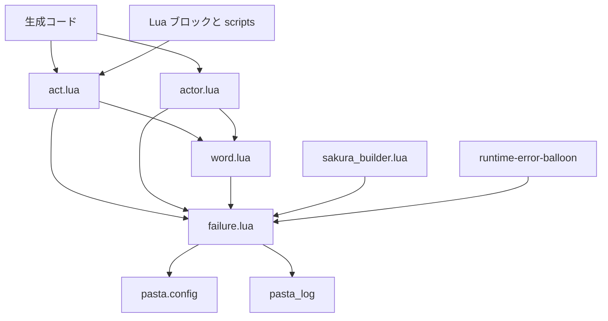
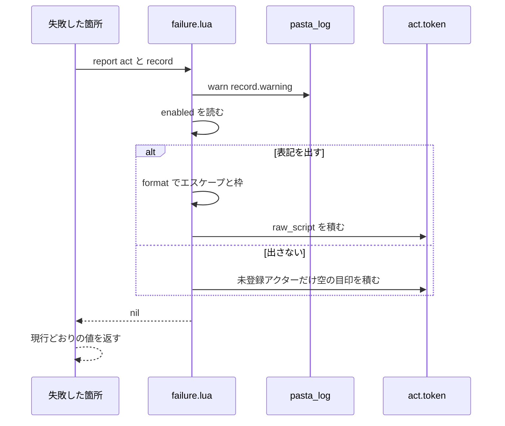
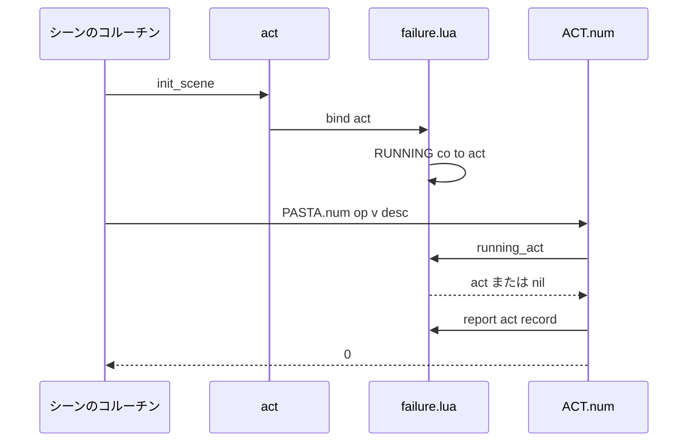
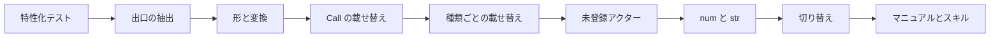

# 技術設計: failure-output-unification

## Overview

**Purpose**: ゴーストを動かしている最中に起きる辞書の書き間違い（実行時の失敗）を、ログの警告と、バルーンに見える失敗表記の両方へ、1 つの出口から出す。今はログにしか出ない失敗（値の無い変数・見つからない単語や関数・名前にならない動的参照の値・数や文字列にできない被演算子）も、Call の失敗と同じようにバルーンへ出す。

**Users**: Pasta DSL で辞書を書くゴースト作者。ゴーストを動かすだけで、バルーンの `【何が起きたか：対象】` から辞書のどこを直せばよいかが分かる。配るゴーストでは pasta.toml の 1 キーで表記を消せる。後続 spec（`runtime-error-balloon`・`call-attribute-filter`）は、同じ出口・形・切り替えを使う。

**Impact**: Lua ランタイム（`crates/pasta_lua/pasta_scripts/pasta/`）に失敗の報告モジュール `pasta/failure.lua` を 1 つ足し、`act.lua`・`actor.lua`・`word.lua` の警告 14 か所をこのモジュールへ寄せる。既定で失敗表記を出すため、これまで空で展開していた箇所に表記が出る（破壊的変更）。既存 2 種の表記の文言も新しい形に変わる。生成する Lua の形・失敗後の制御の流れ・ログの文言は変えない。

### Goals
- 実行時の失敗 1 件につき、ログの警告 1 行と失敗表記 1 つを、`FAILURE.report` の 1 経路から出す（1.1〜1.4・5.1）。
- 失敗表記の形 `【種類：対象（説明）】`、辞書の書き方への名前の変換、さくらスクリプトの無効化を `pasta/failure.lua` の 1 か所で定める（3.1〜3.8）。
- 生成する Lua を変えずに、`act` を受け取らない `PASTA.num`・`PASTA.str` からも、失敗した位置に表記を出す（2.7・2.8・10.1）。
- pasta.toml `[logging] balloon_warning` の 1 キーで、バルーンに警告（失敗表記）を出すかどうかを切り替える（7.1〜7.6）。
- `act` の無い場所から表記の文字列とログを得る関数を用意する（8.2）。

### Non-Goals
- 500 の応答になる実行時エラーをバルーンに出すこと（`runtime-error-balloon`）。
- 失敗した後の制御の流れ（空で続ける・Call を飛ばす・0 や空文字列で計算する）の変更（6.1）。
- 今は警告を出さない状況（式の中の値なし、静的な単語参照の空の名前など）を新たに失敗として扱うこと（2.11）。
- アクション行の変数展開のエスケープ（失敗表記だけをエスケープする。3.7）。
- 失敗表記への行番号の付与（3.8）。
- トランスパイル時・`pasta_check` での静的な検出、DAP への通知。

## Boundary Commitments

### This Spec Owns
- 失敗の報告の出口 `pasta/failure.lua`（形・種類の名前の表・名前の変換・エスケープ・切り替えの読み取り・ログ出力・トークンの積み方・実行中の act の対応表・未登録アクターの印）。
- `act.lua`・`actor.lua`・`word.lua` の実行時の失敗 14 か所の報告の仕方（何を報告の出口へ渡すか）。
- 未登録アクターの目印のトークンの形（アクター付きの `raw_script`）と、それを扱う `group_by_actor`・`actor_proxy` の遡りの変更。
- `shiori/sakura_builder.lua` の `actor_spots fallback` の警告を、未登録アクターのときに出さない規則（5.4）。
- pasta.toml `[logging] balloon_warning` の定義（既定値・型・型が合わないときの扱い・`level`/`filter` との独立）。Lua 側だけで読み、Rust の型には足さない。
- `act:failure(text, warning)` の互換の維持（8.3）。
- マニュアルの「実行時の失敗の出力」ページの新設、関係する章の書き換え、スキル `references/` の再生成。

### Out of Boundary
- `pasta/shiori/` の `entry.lua`・`res.lua`・`event/init.lua`・`event/callback.lua`、`crates/pasta_shiori/src/`（`runtime-error-balloon` の領分）。`pasta_shiori` の結合テストは期待値の文字列だけを更新する。
- 生成する Lua（`code_gen/expr_gen.rs`・`code_gen/element_gen.rs`、`tests/fixtures/sample.generated.lua`・`sample.expected.lua`）。
- 制御の流れ（展開する値・飛ばすかどうか）、シーン・単語の検索アルゴリズム、別名の解決と Rust 側の両名ログ（`search/context.rs`。触らずに残す。5.6）。
- 起動・読み込み時の失敗、ログの設定、`pasta_check`。
- アクション行の変数展開・台詞のエスケープ。

### Allowed Dependencies
- `pasta/failure.lua` が require してよいのは `@pasta_log` と `pasta.config` だけである。`pasta.act`・`pasta.actor`・`pasta.word`・`pasta.shiori.*` を require しない（循環を作らない。`word.lua` が `act` を require しないのと同じ理由）。
- `act.lua`・`actor.lua`・`word.lua`・`shiori/sakura_builder.lua` は `pasta.failure` を require してよい。
- Rust 側（`crates/pasta_lua/src/loader/config/`）は変えない。`[logging]` は `[loader]` 以外の節と同じく `custom_fields` のまま Lua の `@pasta_config` へ流れ、`LoggingConfig` は知らないキーを無視して読む。
- 依存の向き: `@pasta_log`・`pasta.config` → `pasta.failure` → `pasta.word` → `pasta.actor` → `pasta.act` → `pasta.shiori.*`。左の層は右の層を require しない。

### Revalidation Triggers
- `FAILURE.report`・`FAILURE.notation`・`FAILURE.format` の引数の形、または失敗レコードのフィールドを変えたとき（`runtime-error-balloon`・`call-attribute-filter` が使う）。
- 失敗表記の枠・種類の名前・説明の並びを変えたとき（マニュアル・結合テストの期待値・後続 spec）。
- pasta.toml のキーの名前・既定値・置き場所を変えたとき（`runtime-error-balloon` が同じ切り替えに従う）。
- 生成する Lua が `act:init_scene` をシーン関数の先頭で呼ばなくなったとき（実行中の act の対応表の前提）。
- 生成する Lua の動的コール `act:call_key(act:expr_fn(…), nil, "@名前()")` で、関数の参照を `call_key` の直前に評価する順序（`code_gen/element_gen.rs` の `call_key`）が変わったとき（FnResultFlag の前提。`failure_output_test.rs` の `＞＠無い関数（）` で固定する）。
- `raw_script` のグループ化・`sakura_builder` の has-text の判定を変えたとき（4.6 の前提）。

## Architecture

### Existing Architecture Analysis
- 失敗の出口は今 2 つある。`act:failure(text, warning)`（`raw_script` に `【text】` を積む。呼ぶのは `act:call`・`act:call_key`）と、`act:actor_proxy` の目印（アクター付きの `talk` トークン）。残り 12 か所は `log.warn` だけを出す。
- 「内側が報告済みなら外側は黙る」は、`act:talk` が `var_name` の無い nil で黙ること、`word`・`expr_fn_var` が `WORD.dynamic_key` の nil で止まること、`call_key` の「呼ばない」印 `SKIP_CALL` で実現している。この性質は保つ。
- `ACT.num`・`ACT.str`（生成コードの `PASTA.num`・`PASTA.str`）と `WORD.dynamic_key` は `act` を受け取らない。
- 生成するシーン関数は、すべて先頭で `act:init_scene(SCENE)` を呼ぶ（`code_gen/scope_gen.rs` 268 行）。シーン関数はシーンのコルーチン（`SCENE.co_exec`・`choice_select.lua`・`kick.lua` が作る）の中で、そのコルーチンの act を受けて動く。チェイントークで再開したときも、同じコルーチン・同じ act のままである。
- `raw_script` は `group_by_actor` で直前のアクターのグループに入り（無ければトップレベル）、`sakura_builder` はそのまま出して字のある発言に数えない。`act:build()` はトークン 0 件で nil を返す。
- pasta.toml の `[loader]` 以外の節は書いたまま `custom_fields` として Lua へ流れ、Lua は `pasta.config.get(section, key, default)` で読む。`[logging]` は Rust の `LoggingConfig`（`file_path`・`level`・`filter`。`deny_unknown_fields` なし）にも読まれ、型が合わないと Rust 側では節全体が既定値になる。
- マニュアルには `\\`・`\%` を台詞の外のエスケープとして説明した節がある（`grammar/sakura-script.md`「タグの外のエスケープ」）。

### Architecture Pattern & Boundary Map



**Architecture Integration**:
- 選んだ形: 新しいモジュールに出口を置き、既存の箇所は呼び出しを置き換えるだけにする（research.md 選択肢 B。進め方は選択肢 C の段階的な抽出）。
- 責務の分け方: 「何が失敗したか」（種類・対象・値・警告文）は各箇所が持ち、「どう見せるか」（形・変換・エスケープ・切り替え・積み方・ログ）は `failure.lua` だけが持つ。
- 保つ慣行: 内側が報告したら外側は黙る、`raw_script` のグループ化、警告の文言、`SKIP_CALL`、失敗後の戻り値。
- 新しい部品の理由: `failure.lua` だけ。`act.lua` に入れない理由は、形・変換・エスケープ・対応表を 1 ファイルにまとめ、共有接点の `act.lua`（726 行）の差分を呼び出しの置き換えに留めるためである。`word.lua`・`sakura_builder.lua` からも循環なしに使える。
- steering との整合: Lua 集約（さくらスクリプトの組み立ては pasta_lua に置く）・UI 独立性（トークンは構造化データのまま）を保つ。

### Technology Stack

| Layer | Choice / Version | Role in Feature | Notes |
|-------|------------------|-----------------|-------|
| Runtime | LuaJIT 2.1（mlua 0.11、`luajit52`） | `failure.lua` と既存モジュールの変更 | 新しい依存なし。`coroutine.running()` と弱参照の表（`__mode = "k"`）を使う |
| Config | Lua `pasta.config` | `[logging] balloon_warning` の読み取り | Rust は変えない（既定値は Lua 側） |
| Docs | mdBook・`book/tools/gen-skill-refs.mjs` | 新ページとスキルの再生成 | `GENERATION_MAP` に 1 件足す |

## File Structure Plan

### Directory Structure
```
crates/pasta_lua/pasta_scripts/pasta/
└── failure.lua            # 新規。失敗の報告の唯一の出口（形・変換・エスケープ・切り替え・ログ・積み方・実行中の act の対応表・未登録アクターの印）
crates/pasta_lua/tests/lua_specs/
└── failure_test.lua       # 新規。failure.lua の単体テスト（init.lua の specs に登録）
crates/pasta_lua/tests/transpiler/
└── failure_output_test.rs # 新規。DSL → 実行で、種類・位置・重ねない規則・切り替えを確かめる
book/src/reference/
└── runtime-failures.md    # 新規。「実行時の失敗の出力」の 1 か所
```

### Modified Files
- `crates/pasta_lua/pasta_scripts/pasta/act.lua` — `talk`・`word`・`call_expr`・`global_fn`・`actor_proxy`・`num`・`str`・`call`・`call_key`・`failure` の報告を `FAILURE.report` へ置き換える。`init_scene` で `FAILURE.bind(self)`。`group_by_actor` の `raw_script` の分岐と、`actor_proxy` の遡りが、アクター付きの `raw_script` を発言と同じに扱う。`build` は、トークンがすべて空文字列の `raw_script`（出さない設定の未登録アクターの目印だけ）のとき nil を返す。`WORD.dynamic_key` へ `self` を渡す。
- `crates/pasta_lua/pasta_scripts/pasta/actor.lua` — `proxy:word`・`proxy:expr_fn` の警告を `FAILURE.report(self.act, …)` に置き換え、`WORD.dynamic_key` へ `self.act` を渡す。
- `crates/pasta_lua/pasta_scripts/pasta/word.lua` — `WORD.dynamic_key(value, var_path, via, act)` の 4 番目の引数（省略可）を足し、警告を `FAILURE.report`（act 無しならログだけ）から出す。戻り値は変えない。
- `crates/pasta_lua/pasta_scripts/pasta/shiori/sakura_builder.lua` — `emit_actor_switch` が `FAILURE.is_unregistered_actor(actor)` のとき `actor_spots fallback` を出さない（1 行の条件）。
- `crates/pasta_lua/tests/lua_specs/init.lua` — `failure_test` を登録。
- 既存テストの期待値（意図は変えない。10.3）: `tests/lua_specs/act_call_restore_test.lua`・`act_runtime_safety_test.lua`・`act_test.lua`・`actor_proxy_act_delegation_test.lua`・`act_dynamic_ref_test.lua`・`act_concat_test.lua`・`act_grouping_test.lua`・`sakura_builder_test.lua`、`tests/scene_alias_search_test.rs`・`symbol_name_search_test.rs`・`transpiler/dynamic_call_test.rs`・`transpiler/runtime_safety_test.rs`・`transpiler/scene_test.rs`、`crates/pasta_shiori/tests/call_execution_correctness_e2e_test.rs`・`codegen_runtime_safety_e2e_test.rs`。
- `crates/pasta_sample_ghost/tests/tutorial_stages_test.rs` — `assert_responds` に「失敗表記の種類の名前を含まない」を足す（10.4）。
- マニュアル: `book/src/SUMMARY.md`（新ページ）、`reference/pasta-toml.md`（`[logging]` のキーの表・テンプレート・分類表の行・「値の型が合わないとき」で `balloon_warning` だけはキー単位で既定値に戻ること）、`grammar/action-line.md`・`grammar/call-jump.md`・`grammar/variables.md`・`grammar/words.md`・`grammar/actor-dictionary.md`・`lua/script-api.md`（`act:failure`・`WORD.dynamic_key`・`PASTA.num/str`）・`internals/talk-output.md`（トークン表）・`internals/internal-modules.md`（`pasta.failure`）ほか、失敗時の挙動を書いている章（タスクで grep して確定する）。
- `book/tools/gen-skill-refs.mjs` — `GENERATION_MAP` に `['reference/runtime-failures.md', GA]`（件数を数えるテスト・説明の「23」を更新）。生成物 `.claude/skills/pasta-ghost-authoring/references/` を再生成。

## System Flows

### 報告の流れ（1 件の失敗）



- 警告は切り替えにかかわらず必ず出す（7.4）。積むのは act があるときだけで、act が無ければログだけになる。
- 出さない設定で未登録アクターの目印だけ空文字列で積む理由: 目印のトークンはグループの開始と「直前の話者」の遡りを担う。空で積めば、グループ化・`\p[…]` の切り替え・警告の回数が出す設定と同じになり、6.4（表記を除いて同じ出力）と 7.4（ログは同じ）を両方満たす。
- 出さない設定で、積んだトークンが空の目印だけになったとき、`act:build` は nil を返す（表記を除けば何も残らないので空の出力。204）。出す設定では表記だけでも返す（4.5）。

### 実行中の act の見つけ方（`PASTA.num`・`PASTA.str`）



- 対応表 `RUNNING` は、キーを `coroutine.running()` のスレッドにした弱参照の表である。生成するシーン関数は必ず先頭で `init_scene` を呼ぶので、コルーチンを作る側（`scene.lua`・`choice_select.lua`・`kick.lua`）を触らずに済む。チェイントークの再開では同じスレッドで同じ act が見つかる（4.4）。
- `coroutine.running()` が nil を返す環境、または対応が無いとき（シーンの外の Lua から `PASTA.num` を直接呼んだ、Lua ブロックが自分で作ったコルーチンの中など）は、ログだけを出す。

## Requirements Traceability

| Requirement | Summary | Components | Interfaces | Flows |
|-------------|---------|------------|------------|-------|
| 1.1 | 1 件の失敗をログと表記の両方へ 1 つの出口から | FailureReporter | `FAILURE.report` | 報告の流れ |
| 1.2 | 種類ごとの出し方を持たない | FailureReporter, 報告箇所 | 失敗レコード | 報告の流れ |
| 1.3 | 3 ファイルの警告をすべて出口から | ActSites, ProxySites, DynamicKey | `FAILURE.report` | 報告の流れ |
| 1.4 | 既存 2 種も出口から | ActSites | `FAILURE.report` | 報告の流れ |
| 1.5 | 重大度は warn | FailureReporter | `log.warn` | 報告の流れ |
| 2.1 | 値の無い変数 | ActSites `talk` | 失敗の対応表 #1 | 報告の流れ |
| 2.2 | 単語が見つからない | ActSites `word`, ProxySites `word` | 対応表 #2・#3 | 報告の流れ |
| 2.3 | 関数が見つからない | ActSites `call_expr`, ProxySites `call_expr` | 対応表 #4・#5 | 報告の流れ |
| 2.4 | グローバル関数が見つからない | ActSites `global_fn` | 対応表 #6 | 報告の流れ |
| 2.5 | 動的参照の値が名前にならない | DynamicKey | 対応表 #7 | 報告の流れ |
| 2.6 | 未登録アクターの目印 | ActSites `actor_proxy`, ActGrouping | 対応表 #8 | 報告の流れ |
| 2.7 | 数にできない値 | ActSites `num`, RunningActRegistry | 対応表 #9 | 実行中の act |
| 2.8 | 文字列にできない値 | ActSites `str`, RunningActRegistry | 対応表 #10 | 実行中の act |
| 2.9 | Call の失敗・別名は書いた名前 | ActSites `call`・`call_key` | 対応表 #12・#13 | 報告の流れ |
| 2.10 | Lua から `act:call(nil)` | ActSites `call` | 対応表 #11 | 報告の流れ |
| 2.11 | 警告の無い状況を足さない | 報告箇所（条件を変えない） | — | — |
| 2.12 | アクション行以外でも起きた位置に | FailureReporter（積んだ位置がそのまま出力の位置） | `FAILURE.report` | 報告の流れ |
| 3.1 | `【種類：対象（説明）】` と文言 | NotationFormat | `FAILURE.format`, 種類の名前の表 | — |
| 3.2 | 形を 1 か所で | NotationFormat | `FAILURE.format` | — |
| 3.3 | 変数を辞書の書き方で | NameConversion | `FAILURE.var` | — |
| 3.4 | 関数を辞書の書き方で | NameConversion | `FAILURE.fn` | — |
| 3.5 | ログの文言を保つ | 報告箇所（警告文はそのまま渡す） | 失敗レコード `warning` | — |
| 3.6 | ウェイト・自動改行なし | FailureReporter（`raw_script`）, ActGrouping | トークンの形 | — |
| 3.7 | タグを実行させない | NotationFormat | `FAILURE.escape` | — |
| 3.8 | 行番号を含めない | NotationFormat | — | — |
| 4.1 | 発言の途中の位置 | FailureReporter（呼んだ時点で積む） | — | 報告の流れ |
| 4.2 | 直前の話者のバルーンに続けて・目印は先頭 | ActGrouping | トークンの形 | — |
| 4.3 | 出力の先頭ではスコープを切り替えない | ActGrouping（既存の `raw_script` の性質） | — | — |
| 4.4 | チェイントークの再開後 | RunningActRegistry, FailureReporter | `FAILURE.bind` | 実行中の act |
| 4.5 | 表記だけの出力を返す | `act:build`（空の目印だけなら nil） | — | — |
| 4.6 | 前後の判定を変えない | ActGrouping, SpotFallbackGuard | トークンの形 | — |
| 5.1 | 1 原因に 1 表記・1 警告 | 報告箇所, FnResultFlag | 重ねない規則の表 | — |
| 5.2 | 内側が報告したら外側は黙る | 報告箇所, FnResultFlag | 重ねない規則の表 | — |
| 5.3 | 未登録アクターは切り替わりで 1 回 | ActSites `actor_proxy` | 遡りの規則 | — |
| 5.4 | 立ち位置の警告を重ねない | SpotFallbackGuard | `FAILURE.is_unregistered_actor` | — |
| 5.5 | 回ごとに報告する | FailureReporter（抑止の記憶を持たない） | — | — |
| 5.6 | 別名の両名ログを残す | 境界（`search/context.rs` を触らない） | — | — |
| 6.1 | 制御の流れを保つ | 報告箇所（戻り値を変えない） | — | — |
| 6.2 | 値に表記を混ぜない | FailureReporter（トークンにだけ積む） | — | — |
| 6.3 | 状態を変えない | FailureReporter, SpotFallbackGuard | — | — |
| 6.4 | 切り替えは表記の有無だけ | FailureReporter | `FAILURE.enabled` | 報告の流れ |
| 7.1 | pasta.toml で切り替え | NotationSwitch | `[logging] balloon_warning` | — |
| 7.2 | 既定は出す | NotationSwitch | 既定値 `true` | — |
| 7.3 | 出さない設定ではすべて消す | FailureReporter | `FAILURE.enabled` | 報告の流れ |
| 7.4 | 設定にかかわらずログは出す | FailureReporter | — | 報告の流れ |
| 7.5 | 型が合わないときは既定値 | NotationSwitch | `FAILURE.enabled` | — |
| 7.6 | `pasta_check` を変えない | 境界（`pasta_check` を触らない） | — | — |
| 8.1 | Lua から act を通じて報告 | ActSites `failure` | `act:failure` | 報告の流れ |
| 8.2 | act の無い場所から文字列とログ | FailureReporter | `FAILURE.notation` | — |
| 8.3 | `act:failure` の互換 | ActSites `failure` | `act:failure(text, warning)` | — |
| 9.1 | 1 か所のページ | ManualPage | `reference/runtime-failures.md` | — |
| 9.2 | 各章を直し 1 か所を参照 | ManualPage | 章の一覧 | — |
| 9.3 | pasta.toml の説明 | ManualPage | `reference/pasta-toml.md` | — |
| 9.4 | 再生成・`--check`・リンク検証 | SkillRefs | `GENERATION_MAP` | — |
| 9.5 | 回避の書き方を載せない | ManualPage | — | — |
| 10.1 | 生成 Lua を変えない | 境界, RunningActRegistry | — | 実行中の act |
| 10.2 | 自動テスト | Testing Strategy | — | — |
| 10.3 | 既存テストの期待値だけを更新 | Testing Strategy | — | — |
| 10.4 | hello-pasta は表記を出さない | Testing Strategy | `tutorial_stages_test.rs` | — |
| 10.5 | 失敗の無い辞書は同じ出力 | Testing Strategy | — | — |
| 10.6 | `feat!` とリリースノート | Migration Strategy | PR タイトル | — |

## Components and Interfaces

| Component | Domain/Layer | Intent | Req Coverage | Key Dependencies (P0/P1) | Contracts |
|-----------|--------------|--------|--------------|--------------------------|-----------|
| FailureReporter | `failure.lua` | ログと表記の唯一の出口 | 1.1〜1.5, 2.12, 4.1, 5.5, 6.2〜6.4, 7.3, 7.4, 8.2 | pasta_log (P0), NotationFormat (P0), NotationSwitch (P0) | Service |
| NotationFormat | `failure.lua` | 枠・種類の名前・説明の並び・エスケープ | 3.1, 3.2, 3.7, 3.8 | — | Service |
| NameConversion | `failure.lua` | Lua の書き方 → 辞書の書き方 | 3.3, 3.4 | — | Service |
| NotationSwitch | `failure.lua` | `[logging] balloon_warning` の読み取り | 7.1〜7.5 | pasta.config (P0) | Service |
| RunningActRegistry | `failure.lua` | コルーチン → 実行中の act | 2.7, 2.8, 4.4, 10.1 | `act:init_scene` (P0) | State |
| FnResultFlag | `failure.lua` | 直前の関数呼び出しが報告済みか | 5.1, 5.2 | — | State |
| UnregisteredActorMark | `failure.lua` | 未登録アクターの印 | 5.4 | — | State |
| ActSites | `act.lua` | act の 11 か所の報告と `act:failure` | 1.3, 1.4, 2.1〜2.4, 2.6〜2.10, 5.3, 8.1, 8.3 | FailureReporter (P0) | Service |
| ActGrouping | `act.lua` | アクター付き `raw_script` のグループ化と遡り | 2.6, 3.6, 4.2, 4.3, 4.6 | — | State |
| ProxySites | `actor.lua` | proxy の 2 か所 | 1.3, 2.2, 2.3 | FailureReporter (P0) | Service |
| DynamicKey | `word.lua` | 動的参照の値の判定と報告 | 1.3, 2.5, 5.2 | FailureReporter (P0) | Service |
| SpotFallbackGuard | `sakura_builder.lua` | 未登録アクターの立ち位置の警告を出さない | 5.4, 6.3 | UnregisteredActorMark (P0) | — |
| ManualPage / SkillRefs | `book/` | 1 か所の説明と生成 | 9.1〜9.5 | gen-skill-refs (P1) | — |

### Lua ランタイム: `pasta/failure.lua`

#### FailureReporter・NotationFormat・NameConversion・NotationSwitch

| Field | Detail |
|-------|--------|
| Intent | 実行時の失敗 1 件を、ログの警告と失敗表記に変える唯一の場所 |
| Requirements | 1.1〜1.5, 2.12, 3.1〜3.8, 4.1, 5.5, 6.2〜6.4, 7.1〜7.5, 8.2 |

**Responsibilities & Constraints**
- 失敗レコードを受け、`warning` を `log.warn` へ出し、切り替えが有効なら表記を積む（act があるとき）か返す（act が無いとき）。
- 形はこのモジュールだけが組み立てる。各箇所は文字列の表記を作らない（1.2・3.2）。
- 抑止の記憶（同じ名前を一度報告したら黙る）を持たない（5.5）。
- 戻り値・act の状態（`var`・`save`・`current_scene`・`actors`）に触らない（6.2・6.3）。

**Dependencies**
- Inbound: ActSites・ProxySites・DynamicKey・SpotFallbackGuard・後続 spec — 報告（P0）
- Outbound: `@pasta_log`（warn）・`pasta.config`（切り替え）（P0）

**Contracts**: Service [x] / State [x]

##### Service Interface（LuaLS 注釈）

```lua
---@class FailureRecord
---@field label string        種類の名前（FAILURE.LABEL の値。後続 spec は自分の名前を足す）
---@field subject string|nil  対象（辞書の書き方に変換済み。無ければ説明を対象の位置に出す）
---@field detail string|nil   説明（値なし・空文字列・型の名前・値）
---@field warning string|nil  ログの警告文（現行の文言のまま。nil ならログを出さない）
---@field actor table|nil     未登録アクターの目印のとき、そのアクター

---@type table<string, string>
FAILURE.LABEL = {
    UNDEFINED_VAR      = "値の無い変数",
    WORD_NOT_FOUND     = "単語が見つからない",
    FN_NOT_FOUND       = "関数が見つからない",
    BAD_NAME           = "名前にならない値",
    UNREGISTERED_ACTOR = "未登録アクター",
    NOT_NUMBER         = "数にできない値",
    NOT_STRING         = "文字列にできない値",
    SCENE_NOT_FOUND    = "シーンが見つからない",
}

--- 表記の文字列（枠付き・エスケープ済み）。切り替えを見ない純粋な関数
---@param label string
---@param subject string|nil
---@param detail string|nil
---@return string  例 "【数にできない値：＄y（\"abc\"）】"
function FAILURE.format(label, subject, detail) end

--- さくらスクリプトとして働く文字を無効にする: "\" → "\\"、"%" → "\%"、CR・LF → 空白
---@param s string
---@return string
function FAILURE.escape(s) end

--- Lua の書き方の変数パスを辞書の書き方へ。知らない形はそのまま返す
--- "var.x" → "＄x"、"save.x" → "＄＊x"、"args[1]" → "＄０"（添字 - 1 を全角数字で）
---@param var_path string
---@return string
function FAILURE.var(var_path) end

--- 被演算子・関数の説明を辞書の書き方へ。知らない形はそのまま返す
--- "@名前()" → "＠名前（）"、"@*名前()" → "＠＊名前（）"、"@$var.x()" → "＠＄x（）"、
--- 変数パス（"var.x" など）は FAILURE.var と同じ
---@param desc string
---@return string
function FAILURE.fn(desc) end

--- 名前にならない値の説明: nil → "値なし"、"" → "空文字列"、真偽値 → "真偽値"、表 → "表"、関数 → "関数"、それ以外 → Lua の型の名前（読み手は DSL の作者のため日本語にする）
---@param v any
---@return string
function FAILURE.kind_of(v) end

--- 数・文字列にできない値の説明: 文字列 → "\"abc\""、真偽値 → "true"/"false"、それ以外 → 型の名前
---@param v any
---@return string
function FAILURE.value_of(v) end

--- [logging] balloon_warning。真偽値でなければ既定値 true
---@return boolean
function FAILURE.enabled() end

--- act の無い場所からの報告: 警告を出し、表記の文字列を返す（出さない設定なら nil）。トークンに積まない
---@param record FailureRecord
---@return string|nil
function FAILURE.notation(record) end

--- act を通じた報告: 警告を出し、表記を act.token に raw_script として積む。act が nil なら notation と同じ
---@param act table|nil
---@param record FailureRecord
---@return nil
function FAILURE.report(act, record) end
```

- Preconditions: `record.label` は空でない文字列。`subject`・`detail` は表示用の文字列（エスケープ前）。
- Postconditions:
  - `warning` が nil でなければ必ず `log.warn(warning)` を 1 回呼ぶ（切り替えにかかわらず）。
  - 有効なとき、act があれば `{ type = "raw_script", text = FAILURE.format(…), actor = record.actor }` を 1 つ積む。無効なとき、`record.actor` があるときだけ `text = ""` で同じトークンを積み、それ以外は積まない。
  - 戻り値は常に nil（`report`）。
- Invariants: 表記は必ず `【` で始まり `】` で終わる。中身にエスケープされない `\`・`%`・CR・LF は無い。

**形の規則（3.1）**: `【label：subject（detail）】`。`detail` が無ければ `（…）` を付けない。`subject` が無ければ `【label：detail】`。両方無ければ `【label】`（`act:failure(text)` の互換）。エスケープは中身全体（label・subject・detail を並べたもの）にかけ、枠はその後で付ける。

##### State Management
- `RUNNING`（RunningActRegistry）: `setmetatable({}, { __mode = "k" })`。キーはスレッド、値は act。`FAILURE.bind(act)` が `coroutine.running()` のスレッドに対応させ（nil なら何もしない）、`FAILURE.running_act()` が引く。シーン関数を抜けても消さない（同じコルーチンの続きのため）。メインスレッドのキーは次の `init_scene` で上書きされる。`act:call` で別のシーンへ入っても同じ act を渡すので対応は変わらない。同じコルーチンの中で Lua が**別の act** でシーン関数を呼んだ場合は、戻った後も内側の act が対応に残る（制限。`init_scene` に対になる終わりの呼び出しが無く、生成コードの経路では起きないため戻す仕組みは持たない。マニュアルの Lua の節に書く）。
- `FN_FAILED`（FnResultFlag）: `setmetatable({}, { __mode = "k" })`。キーは act、値は真偽値。`FAILURE.set_fn_failed(act, failed)` を関数呼び出しの参照（`call_expr`・`global_fn`・`expr_fn_var`）が成功・失敗のたびに書き、`FAILURE.take_fn_failed(act)` が読んで偽に戻す。
- `UNREGISTERED`（UnregisteredActorMark）: `setmetatable({}, { __mode = "k" })`。`FAILURE.mark_unregistered_actor(actor)`・`FAILURE.is_unregistered_actor(actor)`。印はアクターの表のフィールドに書かない（辞書の単語名と衝突させないため。`find_actor_handler` の A1 は `actor[key]` を引く）。

```lua
---@param act table
function FAILURE.bind(act) end
---@return table|nil
function FAILURE.running_act() end
---@param act table
---@param failed boolean
function FAILURE.set_fn_failed(act, failed) end
---@param act table
---@return boolean
function FAILURE.take_fn_failed(act) end
---@param actor table
function FAILURE.mark_unregistered_actor(actor) end
---@param actor table|nil
---@return boolean
function FAILURE.is_unregistered_actor(actor) end
```

**Implementation Notes**
- Integration: `pasta_scripts` は木全体を自己展開 zip にし、luacheck も木全体を見るので、新しいファイルは置くだけで入る。
- Validation: `failure_test.lua` で形・エスケープ・変換の全形・切り替え（型違いを含む）・`notation`/`report` の積み方・3 つの弱参照の表を確かめる。
- Risks: `coroutine.running()` の戻り値は `luajit52`（5.2 互換）でメインスレッドでも thread を返す想定である。どちらの戻り方でも動くよう nil を確かめる。テストで両方の経路を通す。

### Lua ランタイム: 報告箇所（ActSites・ProxySites・DynamicKey）

**失敗の対応表**（警告文はすべて現行のまま。3.5）

| # | 箇所 | 条件（現行と同じ） | label | subject | detail | 戻り値（現行と同じ） |
|---|------|------|-------|---------|--------|------|
| 1 | `act:talk` | `text == nil` かつ `var_name` あり | 値の無い変数 | `FAILURE.var(var_name)` | — | self |
| 2 | `act:word` | 検索で見つからない | 単語が見つからない | `"＠" .. name` | — | nil |
| 3 | `proxy:word` | 同上 | 単語が見つからない | `"＠" .. name` | — | nil |
| 4 | `act` の `call_expr` | 関数が見つからない | 関数が見つからない | `"＠" .. key .. "（）"` | — | nil |
| 5 | `proxy` の `call_expr` | 同上 | 関数が見つからない | `"＠" .. key .. "（）"` | — | nil |
| 6 | `act:global_fn` | 関数でない | 関数が見つからない | `"＠＊" .. name .. "（）"` | — | nil |
| 7 | `WORD.dynamic_key` | 名前にならない | 名前にならない値 | `FAILURE.var(var_path)` | `FAILURE.kind_of(value)` | nil |
| 8 | `act:actor_proxy` | 未登録で、直前の話者が別 | 未登録アクター | `name` | — | proxy（`actor` を付ける） |
| 9 | `ACT.num` | nil 以外で数にならない | 数にできない値 | `desc and FAILURE.fn(desc)` | `FAILURE.value_of(v)` | 0 |
| 10 | `ACT.str` | nil 以外で文字列にならない | 文字列にできない値 | `desc and FAILURE.fn(desc)` | `FAILURE.value_of(v)` | `""` |
| 11 | `act:call` | `key == nil` | 名前にならない値 | — | `"値なし"` | nil |
| 12 | `act:call` | 見つからない | シーンが見つからない | `"＞" .. tostring(key)`（書いた名前） | — | nil |
| 13 | `act:call_key` | 変数パスなしで名前にならない | 名前にならない値 | `desc and FAILURE.fn(desc)` | `FAILURE.kind_of(value)` | `SKIP_CALL` |

- 変数パスがある `call_key` は `WORD.dynamic_key(value, var_path, "act:call", self)` だけが報告する（#7。今の「警告だけ出す」呼び出しに act を渡す）。
- `ACT.num`・`ACT.str` は `FAILURE.report(FAILURE.running_act(), record)` を呼ぶ。
- 対象が分からないとき（#11、#9・#10・#13 で `desc` が無いとき）は説明を対象の位置に出す（形の規則の「`subject` が無ければ `【label：detail】`」）。例: `act:call(nil)` → `【名前にならない値：値なし】`、`＄y＝（＄a＆＄b）＋１` → `【数にできない値："xy"】`。空の括弧の形は作らない。
- `WORD.dynamic_key(value, var_path, via, act)`: `act` を省略したとき（Lua から直接呼んだとき）は `FAILURE.report(nil, …)` でログだけ出す。戻り値・警告の文言は今と同じ（マニュアルに載った公開の関数の互換）。
- 表示の例:

| 辞書 | バルーンの表記 |
|------|---------------|
| `さくら：今日は＄話題の話` （話題が未代入） | `今日は【値の無い変数：＄話題】の話` |
| `さくら：＠挨拶` （単語が無い） | `【単語が見つからない：＠挨拶】` |
| `さくら：＠＊計算（１）` | `【関数が見つからない：＠＊計算（）】` |
| `さくら：＠＄名前` （名前＝真偽値） | `【名前にならない値：＄名前（真偽値）】` |
| `ぱすたー：こんにちは` （未登録） | `\p[0]【未登録アクター：ぱすたー】こんにちは` |
| `＄y＝＄x＋１` （x＝"abc"） | `【数にできない値：＄x（"abc"）】` |
| `＞会話２` （シーンが無い） | `【シーンが見つからない：＞会話２】` |
| `＞＄行き先` （値なし） | `【名前にならない値：＄行き先（値なし）】` |
| `＄n＝\-` を `＠＄n` で参照（単語が無い） | `【単語が見つからない：＠\\-】`（タグとして働かない） |

**重ねない規則の表**（5.1・5.2。どれも「内側が報告し、外側は値の無さを受けて黙る」）

| 内側 | 外側 | 外側が黙る仕組み |
|------|------|------------------|
| 単語・関数・グローバル関数が見つからない | アクション行の `talk` | `talk` は `var_name` を持たない nil で黙る（現行） |
| 動的参照の値が名前にならない | 単語・関数の検索 | `dynamic_key` が nil なら検索しない（現行） |
| 動的コールの変数の値が名前にならない | Call の検索 | `SKIP_CALL`（現行） |
| 動的コールの式が関数 1 つで、その関数が見つからない | `call_key` | `FAILURE.take_fn_failed(self)` が真なら報告せず `SKIP_CALL`（新規） |
| 被演算子の関数が見つからない | `ACT.num`・`ACT.str` | nil は黙って 0・空文字列（現行） |
| 未登録アクター | 立ち位置の警告 | SpotFallbackGuard（新規） |

- `call_key` の新しい規則: 生成コードは `act:call_key(act:expr_fn(…), nil, "@名前()")` の形で、関数の参照を `call_key` の直前に評価する。関数の引数の中の関数はそれより先に評価されるので、`FN_FAILED[act]` は「`call_key` に渡した値を作った関数呼び出し」の結果を指す。関数が見つかって nil を返したときは偽なので、現行どおり `名前にならない値` を報告する。成功の偽は、呼んだ関数が戻った後に書く（関数の中で別の参照が失敗して真にしても、戻った時点で偽に戻す）。`expr_fn_var` は `dynamic_key` が nil を返したときも真を書く。
- 値なしを代入した変数を後で展開した場合（`＄x＝＠無い単語` の後の `＄x`）は、代入の行と展開の行で別々に報告する（要件 2.1 が「値なしを代入した変数」を対象に挙げているため。どの変数が失敗から来たかは追わない）。

#### ActSites: `act:failure`（8.1・8.3）
- 署名は今のまま `act:failure(text, warning) -> nil`。`FAILURE.report(self, { label = text, warning = warning })` を呼ぶだけにする。表記は `【text】`（エスケープ済み）になり、切り替えに従う。
- `text` もエスケープする（要件 3.7 はすべての失敗表記の中身に及ぶ）。今 `text` にタグを入れて呼んでいる Lua はタグが文字として出るようになる。この変化はリリースノートの破壊的変更に書く（10.6）。

### Lua ランタイム: ActGrouping（`act.lua`）

| Field | Detail |
|-------|--------|
| Intent | 未登録アクターの目印を、そのアクターの発言の先頭に、ウェイト・改行なしで出す |
| Requirements | 2.6, 3.6, 4.2, 4.3, 4.6, 5.3 |

**Responsibilities & Constraints**
- トークンの形: 目印は `{ type = "raw_script", actor = <その場限りのアクター>, text = "【未登録アクター：名前】" }`。他の失敗表記は `actor` を持たない `raw_script`（現行の Call の表記と同じ）。
- `group_by_actor`: `actor` を持つ `raw_script` は、`talk`・`sakura_script` と同じ分岐に入る（アクターが変われば新しいグループを開く）。`actor` の無い `raw_script` は今のまま。
- `merge_consecutive_talks`: 変えない（`raw_script` は結合しない）。
- `sakura_builder`: 変えない。グループの切り替えで `\p[…]` を出し、`raw_script` は文字のまま出して字のある発言に数えない（段落区切り・has-text を変えない。4.6）。
- `actor_proxy` の遡り: 末尾から見て最初の「`talk`・`sakura_script`・`actor` を持つ `raw_script`」の話者が同じ名前なら目印を出さない。`actor` の無い失敗表記では止まらない（現行の性質を引き継ぐ）。
- `actor_proxy` はその場限りのアクター `{ name = name }` を作ったとき `FAILURE.mark_unregistered_actor(actor)` を呼ぶ。
- `act:build`: トークン 0 件に加え、すべてが `text == ""` の `raw_script` のときも nil を返す（出さない設定の空の目印だけの出力を 204 にする）。
- 要件 4.2 の帰結: 他のアクターの行の先頭で起きた失敗（目印を除く）は、直前の話者のバルーンに出る。例: `さくら：やあ` の次の `うにゅう：＄未定義だね` は `\p[0]やあ【値の無い変数：＄未定義】\p[1]だね`。表記でアクターを切り替えないことで 4.6 の判定を保つ（現行の Call の失敗表記と同じ）。設計議論で受け入れを確定した。

**Implementation Notes**
- 出さない設定で未登録アクターの行が他に何も積まないとき（`ぱすたー：＄未定義` だけ）は、空の目印だけになるので `build` が nil を返す（204）。警告は出す設定と同じ 1 回ずつ。

### Lua ランタイム: SpotFallbackGuard（`sakura_builder.lua`）
- `emit_actor_switch` の警告の条件を `if actor_name and not FAILURE.is_unregistered_actor(actor) then` にする。spot 0 で出す挙動と `actor_spots` は変えない（6.3）。切り替えにかかわらず効く（7.4 のとおり、ログは表記の有無で変わらない）。

### 設定: NotationSwitch

- キー: `[logging] balloon_warning`（真偽値、既定 `true`、分類「SHIORI デフォルト有」）。意味は「バルーンに警告を出すかどうか」。バルーンをログの出力先の 1 つと見て `[logging]` に置く（設計議論で確定）。
  ```toml
  [logging]
  level = "info"
  balloon_warning = false   # バルーンに警告を出さない（ログには出る）
  ```
- Rust: 変えない。`LoggingConfig` に足さないので、`balloon_warning` の型の間違いが `file_path`・`level`・`filter` を既定値に落とすことはなく、逆に `level` の型の間違いで `balloon_warning` が消えることもない（Lua は `custom_fields` の生の値を読む）。
- `level`・`filter` とは独立させる。`level = "error"` でログから警告が消えても、バルーンの表示は `balloon_warning` だけで決まる。ログに出すかどうかは今までどおり `level`・`filter` が決める（7.4）。
- Lua: `FAILURE.enabled()` は `pasta.config.get("logging", "balloon_warning", true)` を読み、真偽値でなければ `true`（7.5。キー単位で既定値に戻る。マニュアルの「値の型が合わないとき」の表に、`[logging]` の中で `balloon_warning` だけはキー単位で既定値に戻ることを書く）。報告のたびに読む（キャッシュしない。読み込み直しで古い値が残らない）。
- `pasta_check` は pasta.toml を読まないので変えない（7.6）。

### マニュアル: ManualPage・SkillRefs

- 新ページ `book/src/reference/runtime-failures.md`「実行時の失敗の出力」: 種類ごとの表記とログの警告の対応表、出る位置（発言の途中・直前の話者のバルーン・出力の先頭・チェイントーク）、重ねない規則、表記だけの出力、切り替えの設定、Lua からの報告（`act:failure`）。章の構造（冒頭・末尾の台詞、本文に台詞を置かない）は既存の生成対象の章と同じ決まりに従う。失敗は文法・Lua・pasta.toml にまたがるので reference に 1 ページで置き、作者向けスキルの生成対象に足す。
- 各章は挙動を 1 文で述べ、表記の説明は新ページへリンクする。回避の書き方（Lua の関数など）を載せない（9.5）。
- `GENERATION_MAP` に `['reference/runtime-failures.md', GA]` を足し、`node book/tools/gen-skill-refs.mjs` で再生成、`--check` とリンク検証を通す（9.4）。

## Data Models

### Domain Model
- **失敗レコード**（値オブジェクト）: `label`・`subject`・`detail`・`warning`・`actor`。報告のたびに作って捨てる。保存しない。
- **失敗表記トークン**: `raw_script`（`actor` は未登録アクターの目印だけ）。act のトークン列の一要素で、`build` で消費される。
- **対応表 3 つ**（`RUNNING`・`FN_FAILED`・`UNREGISTERED`）: 弱参照で、GC にまかせる。永続化しない。

## Error Handling

### Error Strategy
- 報告の関数そのものは例外を投げない。`label` 以外のフィールドが nil・非文字列でも `tostring` して形を作る（失敗の報告が新しい失敗を作らない）。
- 名前の変換で知らない形はそのまま出す（Lua から渡された任意の文字列を壊さない）。
- 実行中の act が見つからないときはログだけにする（落とさない）。

### Monitoring
- ログの警告の文言・重大度・行数（1 原因に 1 行）は現行どおり。新しいログは足さない。`actor_spots fallback` は未登録アクターでは出なくなる（5.4）。

## Testing Strategy

### Unit Tests（Lua: `failure_test.lua`）
- `FAILURE.format`: 対象と説明の有無の 4 通り、要件 3.1 の 9 つの文言の例と一字一句一致。
- `FAILURE.escape`: `\`・`%`・CR・LF を含む名前と値が、タグとして働かない文字列になる（3.7）。
- `FAILURE.var`・`FAILURE.fn`: `var.x`・`save.x`・`args[1]`→`＄０`・`args[11]`→`＄１０`・`@f()`・`@*f()`・`@$var.x()`・`@$args[2]()`・知らない形（3.3・3.4）。
- `FAILURE.enabled`: 未設定 → true、false → false、文字列や数 → true（7.2・7.5）。
- `FAILURE.report`・`notation`: 有効・無効 × act あり・なし × `actor` あり・なしで、積むトークン・戻り値・警告の回数（7.3・7.4・8.2）。`bind`/`running_act`（別のコルーチンでは別の act・nil の扱い）、`take_fn_failed`、`is_unregistered_actor`。

### Integration Tests（Lua spec・Rust の DSL → 実行）
- 対応表 #1〜#13 の各箇所が、警告 1 行（現行の文言）と表記 1 つを出し、戻り値が現行どおり（2.1〜2.10・3.5・6.1・6.2）。`failure_output_test.rs` で DSL から通す。
- 位置: 発言の途中・代入行・Call 行の引数・式の中・Lua ブロックから呼んだ `act:word`・出力の先頭・チェイントークの再開後の `PASTA.num`（2.12・4.1〜4.4）。
- `coroutine.running()`: シーンのコルーチンの中とメインスレッドの両方で `bind`/`running_act` を通し、`luajit52` での戻り値の想定を確かめる。
- 生成コードの順序の固定: `＞＠無い関数（）` が表記 1 つ・警告 1 行になること（FnResultFlag の前提を codegen の変更から守る）。
- 重ねない規則の表の 6 行それぞれで、表記 1 つ・警告 1 行（5.1〜5.4）。同じ書き間違いを 2 回通ると 2 回出る（5.5）。
- 未登録アクター: 目印がそのアクターの `\p[…]` の直後に出て、ウェイト・改行が入らず、続く台詞の段落区切りが目印の無い場合と同じ（3.6・4.2・4.6）。継続行で 1 回だけ（5.3）。
- 切り替え: 出さない設定の出力が、出す設定の出力から表記を除いたものと一致し、ログは同じ（6.4・7.3・7.4）。出さない設定で `ぱすたー：＄未定義` だけのシーンが nil（204）を返す。

### E2E Tests
- `pasta_shiori` の既存 2 本（`call_execution_correctness_e2e_test.rs`・`codegen_runtime_safety_e2e_test.rs`）の期待値を新しい文言に合わせる（10.3）。表記だけのシーンが 200 で返る（4.5）。
- hello-pasta の全段（`tutorial_stages_test.rs` の `every_stage_loads_and_responds`）で、応答に種類の名前が 1 つも含まれない（10.4）。
- 失敗の無い辞書: `sample.generated.lua` を使う既存のスナップショット・出力のテストが変わらない（10.5）。

## Migration Strategy



- **S0 特性化テスト**: 14 か所の現行の警告の文言・戻り値・積むトークンを固定する（この後も 3.5・6.1 の回帰として残す）。
- **S1 出口の抽出**: `failure.lua` に `report` を置き、`act:failure` の中身を移す。出力は 1 文字も変えない（既存テスト不変）。1 抽出 = 1 検証 = 1 コミット。
- **S2 形と変換**: `format`・`escape`・`var`・`fn`・`kind_of`・`value_of`・`notation` を足す（呼び出し元は変えない）。
- **S3〜S6 載せ替え**: 1 種類 = 1 コミット（Call 3 か所 → `talk` → `word`/`call_expr`/`global_fn`（act と proxy）→ `dynamic_key` → 未登録アクターと立ち位置の警告 → `num`/`str` と `bind`）。各コミットで、その種類の期待値だけを更新する。
- **S7 切り替え**: `FAILURE.enabled`（`[logging] balloon_warning`）。
- **S8**: マニュアル・`GENERATION_MAP`・スキルの再生成。
- どのコミットで止めても main を壊さない。巻き戻しは逆順の revert で済む（後のコミットが前のコミットの関数を使うだけ）。
- **破壊的変更の記録（10.6）**: main への squash の PR タイトルを `feat!(failure-output-unification): …` にし、本文に「空で展開していた箇所に失敗表記が出る」「既存 2 種の文言が変わる」「`[logging] balloon_warning = false` で消せる」を書く。リリース CI の「動きが変わる変更」に載り、リリースの見どころは `release` スキルが書く。

## Open Questions / Risks

- **Risk**: `tutorial_stages_test.rs` は同じ時期の `touch-poke-shortcuts` も触る。後から入る側が rebase で合わせる（足すのは `assert_responds` の 1 条件）。
- **Risk**: OnTalk のように無作為に選ぶシーンは、hello-pasta のテストで全部を通らない。全段の全イベントを通すことで網羅に近づける。
- **Risk**: シーンの外（Lua で作ったコルーチン・メインスレッドの古い対応）での `PASTA.num` は表記を出さずログだけになる。生成コードの経路では起きない。
