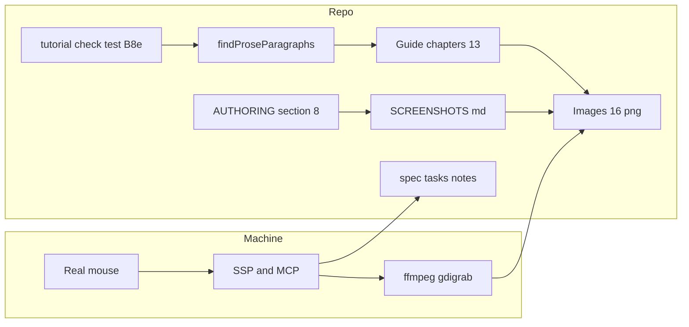
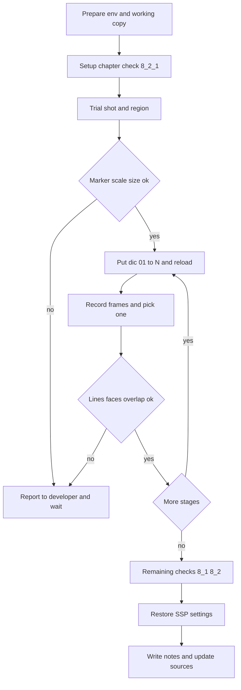

# 設計: getting-started-screenshots

## Overview

**目的**: 入門ガイドの段の章 1〜12 と入口の章に、ゴーストがしゃべっている画面の絵（新しい絵ファイル 16 枚）を載せる。読者は、自分で起動する前に、その章の表現が画面でどう見えるかを知ることができる。

**使う人**: 入門ガイドの読者は、章の「成功の目印」の近くで絵を見て、自分の画面と見比べる。入門ガイドを書く人は、執筆規約（`book/AUTHORING.md` 第 8 節）の画像の行の決まりと、撮影の手順の記録（`book/SCREENSHOTS.md`）を使って、絵を足す・撮り直す。

**変わること**: 本文の検査（`C-prose`）が、決まった形の画像の行を「指示の一文でない段落」として報告しなくなる。執筆規約の「画像を置かない」を、画像の行の決まりに書き直す。動作のコード（`crates/` の下）は変えない。同じ実機の作業の中で、8 段目の実機の確かめと、残っている人手の確認を済ませて記録する。

### Goals

- 「載せる絵の一覧」（要件 1.1）の 16 枚を、実機の SSP で写した本物の画面としてそろえ、13 章に画像の行と代わりの文を足す。
- 画像の行を、`findProseParagraphs` の除外 1 つで検査に通す。代わりの文が空の行は、今までどおり報告させる。
- 同じ手順で撮り直せる記録を `book/SCREENSHOTS.md` に置き、撮り直す決まりを執筆規約に置く。
- 8 段目の実機の確かめと、人手の確認（`sakura-script-newline` 5.1・`getting-started-story-guide` の 4 点）を済ませ、記録と元の場所を更新する。

### Non-Goals

- 章の本文・章立て・作例、段階表、辞書、シェルの絵・当たり判定・吹き出しの位置を変えること。
- 撮影を自動検査で行う仕組み、撮影用の常設のスクリプト、絵の台詞と辞書の機械照合、画像の大きさの検査。
- 実機の確かめで見つかった不具合の修正（記録して開発者に報告する）。
- `book/tools/verify-content.mjs` の変更（`stripCodeFences` の 4 本フェンス対応を含む。要件 5.9 は「変えるときだけ」なので、変えない本設計では発動しない）。

## Boundary Commitments

### This Spec Owns

- 画像の行の判定の規則（`book/tools/tutorial-check.mjs` の `findProseParagraphs` に足す除外 1 つ）と、その自己テストの例（`book/tools/tutorial-check-test.mjs` の B-8e）。
- 執筆規約の画像の行の決まり（`book/AUTHORING.md` 第 8 節の「語りの形」・新しい小節「画像の行」・「事実の範囲」・段の章の雛形・チェックリスト）。
- 撮影の手順の記録 `book/SCREENSHOTS.md`（新規）。
- 絵ファイル 16 枚（`book/src/img/getting-started/`。新しいフォルダ）。
- 13 章への画像の行（`index.md`・`01-boot.md`〜`12-lua.md`。画像の行だけを足す）。
- 実機の作業の記録（本 spec の `tasks.md` の実装メモ）と、元の場所の更新（`.kiro/specs/completed/sakura-script-newline/tasks.md` の 5.1・`.kiro/steering/roadmap.md` の「人手の確認が残っている項目」）。

### Out of Boundary

- `crates/` の下のすべてのファイル（辞書・`STAGES.md`・シェル・`shell_assets_test.rs`）。リファレンス・内部設計のページ。
- `book/src/img/claudia/`・`book/src/img/hello-pasta/`・`book/src/img/ogp.png`（触らない）。
- `setup.md`・`prerequisites.md`・`13-nar.md` の本文と、`setup.md` の見本の絵 2 枚（今のまま）。
- `verify-content.mjs`・`verify-static.mjs`・`link-check.mjs`・`verify-scripts-test.mjs` などほかの検査と、章の数の決め打ち。
- mdBook のテーマ（`book/theme/`）と `book.toml`。
- 確かめで見つかった食い違いの修正。

### Allowed Dependencies

- 完了した spec の成果物（main にある辞書 `dic/01-boot.pasta`〜`12-lua.pasta`・シェル・`pasta.dll`）を、作業用の複製に写して読むだけ。
- 実機の道具: SSP（`C:/wintools/ssp`、2.9.11）、SSP の MCP（`sakurascript`・`raise_event`・`get_status`・`get_property`・`reload`）、ShareX 同梱の `ffmpeg.exe`（`gdigrab`）、実際のマウス（手、またはエージェントのデスクトップ操作）。リポジトリには持ち込まない。
- mdBook の既定の CSS（`.content img { max-width: 100%; }`）。
- 依存の向き: 章の画像の行 → 絵ファイル（参照）。検査 → 章（読むだけ）。記録 → 絵ファイル（名前で指す）。絵ファイルと章は、撮影の道具に依存しない。

### Revalidation Triggers

- `findProseParagraphs` の判定の変更（画像の行の除外の形が変わると、13 章の画像の行が報告されうる）。
- 段の辞書・シェルの絵・吹き出しの位置（`descript.txt`）・既定の起動の見え方の変更（影響する絵を撮り直す。撮り直す決まりに従う）。
- 絵の置き場所・名前の決まりの変更（章の画像の行と `book/SCREENSHOTS.md` の一覧を一緒に直す）。
- 入門ガイドの章の数・章立ての変更（画像の行の置き場所が変わる）。
- `tutorial-ssp-gaps`（旧 `baseware-virtual-time`・`boot-surface-without-dic`。2026-10-17 にまとめられた）が入ったとき（6 段目の撮り方・準備の終わりの見え方が変わりうる）。

## Architecture

### Existing Architecture Analysis

- 画像の参照先の実在と外部画像の禁止は、`verify-static.mjs` が出力の HTML の `img` で見ている。`.png` は許可されている。要件 5.6 は変更なしで満たす。
- `findProseParagraphs` は、先頭が `>`・`|`・字下げ・箇条書きの段落を除き、残りから「1 行・末尾が句点・インラインコードの外の句点が 1 つ」でないものを返す。`` だけの段落は今は報告される。フェンスの開きの長さを覚えて閉じを判定しているので、4 本フェンスの中の ``` は閉じにならない（関数の中では要件 5.9 の問題は起きていない）。
- `verify-content.mjs` の `C-prose` は `findProseParagraphs` を 16 章に回し、`章:行「先頭行」` で名指しする。判定を変えれば追従する。
- `T-assets` は `book/src/img/claudia/` だけ、`shell_assets_test.rs` は `book/src/img/hello-pasta/` の 2 枚だけを見る。新しいフォルダの絵は、どちらにも当たらない。
- 開発機の画面の倍率は 200%（`AppliedDPI` 192）、SSP は `HighDPIAware,1`。既定のバルーンは `ssp`（「SSPデフォルト+」、`balloons0.png` 335×169・`balloonk0.png` 335×96・文字の高さ 12 px）。

### Architecture Pattern & Boundary Map



- 方式: リポジトリの中は「置いてある絵とその参照だけ」を持ち、撮影は実機の手順として外に置く。CI はリポジトリの中だけを見る（要件 5.7）。
- 新しい部品は 2 つだけ（除外の規則 1 つ、手順の記録 1 つ）。撮影の補助スクリプトは作らない。範囲の計算はプロパティ 4 つの最小・最大で済み、写すのは ffmpeg の 1 行で済むため、記録に手順として書けば足りる（研究ログの「補助スクリプトを作らない」）。

### Technology Stack

| 層 | 選択 / 版 | 役目 | 備考 |
| -- | -- | -- | -- |
| 検査 | Node.js（既存の `book/tools`） | 画像の行の除外と自己テスト | 新しい依存なし |
| 文書 | mdBook v0.5.3（既存） | 画像の行の表示 | 既定の CSS で幅に収まる |
| 実機 | SSP 2.9.11・既定のバルーン `ssp` | 画面を出す | 版とバルーンは記録に書く |
| 実機 | SSP の MCP | きっかけ・状態・位置の読み取り | `127.0.0.1:9801`。SSP の起動中だけ |
| 実機 | ffmpeg n8.1.1（ShareX 同梱、`gdigrab`） | 画面の範囲を PNG の連番で写す | PATH に無い。フルパスで呼ぶ |

## File Structure Plan

### Directory Structure

```
book/
├── SCREENSHOTS.md                  # 新規。撮影の手順の記録（環境・準備・写し方・16 枚の一覧・後片付け・撮り直す決まり）
├── AUTHORING.md                    # 第 8 節を書き直す
├── tools/
│   ├── tutorial-check.mjs          # findProseParagraphs に画像の行の除外を 1 つ足す
│   └── tutorial-check-test.mjs     # B-8e に画像の行の例を足す
└── src/
    ├── img/getting-started/        # 新規。撮った絵 16 枚（名前は「データ」の一覧）
    └── getting-started/
        ├── index.md                # 「このガイドで作るもの」に画像の行 1 つ
        └── 01-boot.md 〜 12-lua.md  # 「起動して確かめる」の成功の目印の近くに画像の行 1〜2 つ
.kiro/
├── specs/getting-started-screenshots/tasks.md        # 実装メモに実機の作業の記録（tasks 生成後）
├── specs/completed/sakura-script-newline/tasks.md    # 5.1 のチェックと結果
└── steering/roadmap.md                                # 「人手の確認が残っている項目」を結果に合わせて更新
```

### Modified Files

- `book/tools/tutorial-check.mjs` — `findProseParagraphs` の除外の条件に「1 行で、空でない代わりの文の画像 1 つだけの段落」を足す。コメントに要件 5.3〜5.5 を書く。
- `book/tools/tutorial-check-test.mjs` — B-8e に例を足す（除外する・混ざった段落を報告する・空の代わりの文を報告する・章の形の縮図に画像の行を入れても 0 件）。
- `book/AUTHORING.md` — 第 8 節を書き直す（「画像の行」の小節を足し、681 行の「画像を置かない」と 719 行の「画像の行が無い」を置き換え、雛形に画像の行を 1 つ足す）。
- `book/src/getting-started/index.md`・`01-boot.md`〜`12-lua.md` — 画像の行だけを足す。
- `.kiro/specs/completed/sakura-script-newline/tasks.md`・`.kiro/steering/roadmap.md` — 確認の結果に合わせて更新する。

## System Flows

実機の作業の 1 回の流れ（要件 2・6・7・8）。



- 試し撮りの関門（Gate）: 送り主の表示が出ない・立ち絵が 1:1（`scope(0).rect` の幅が 333）・1 枚の大きさと幅の見込み、の 3 つを最初の 1 枚で確かめる。外れたら先へ進まず報告する。
- 8 段目の実機の確かめ（要件 7）は、8 段目と 9 段目の辞書を置いたときに、撮影と同じ流れの中で行う。`sakura-script-newline` 5.1 の (a)(b) は、段の辞書の掛け合いで見る。

## Requirements Traceability

| 要件 | 要約 | 部品 | 契約 / データ | 流れ |
| -- | -- | -- | -- | -- |
| 1.1 | 一覧の 16 枚を 13 章に載せる | 絵ファイル・章の画像の行 | 絵の一覧 | Stage→Shoot |
| 1.2 | 準備・13 段目に足さない | 章の画像の行 | 置き場所の決まり | — |
| 1.3 | 立ち絵と吹き出しだけ | 撮影の手順の記録 | 写す範囲 | Trial |
| 1.4 | 成功の目印の近く・index は作るもの | 章の画像の行 | 置き場所の表 | — |
| 1.5 | 全部そろうまで完了しない | 実機の作業 | 絵の一覧（16 行） | Next |
| 2.1 | 実機の画面そのもの | 撮影の手順の記録 | ffmpeg の 1 枚をそのまま置く | Shoot |
| 2.2 | その段の辞書の集まり | 撮影の手順の記録 | 作業用の複製の `dic/` | Stage |
| 2.3 | 台詞が成功の目印と一字一句同じ | 撮影の手順の記録 | 狙った台詞の出し方 | Look |
| 2.4 | 表情が辞書の指定と同じ | 撮影の手順の記録 | 写す瞬間 | Look |
| 2.5 | 読者に見えないものを写さない | 撮影の手順の記録 | 送り主の表示の関門・パレットを範囲の外に | Gate |
| 2.6 | 環境の情報を写さない | 撮影の手順の記録 | 無地の背景・範囲・カーソルを写さない | Trial |
| 2.7 | 見え方の問題は報告して待つ | 実機の作業 | 止める点 | Look→Report |
| 2.8 | 食い違いは直さず記録して確かめる | 実機の作業 | 止める点 | Look→Report |
| 3.1 | 空でない代わりの文 | 章の画像の行・除外の規則 | 画像の行の形 | — |
| 3.2 | 台詞を話し手つきで一字一句 | 章の画像の行 | 代わりの文の型 | — |
| 3.3 | 表情の様子を言葉で | 章の画像の行 | 代わりの文の型 | — |
| 3.4 | 絵に頼らない本文 | 執筆規約・章の画像の行 | 本文を変えない | — |
| 3.5 | 狭い画面で幅に収める | mdBook の既定の CSS | 確かめの手順 | — |
| 3.6 | 広い画面で文字が読める | 撮影の手順の記録 | 倍率 1:1・範囲の幅の目安 | Gate |
| 4.1 | リポジトリの中・外部画像なし | 絵ファイル | `book/src/img/getting-started/` | — |
| 4.2 | PNG・上限なし・減色縮小なし・検査なし | 撮影の手順の記録 | ffmpeg の PNG 出力 | Shoot |
| 4.3 | 文字をにじませない形式 | 撮影の手順の記録 | 可逆の PNG | Shoot |
| 4.4 | claudia・hello-pasta の決まりを崩さない | 絵ファイル | 別のフォルダ | — |
| 4.5 | 名前で章と場面が分かる | 絵ファイル | 名前の決まり | — |
| 4.6 | 1 MB 超は範囲を見直して報告 | 実機の作業 | 止める点 | Gate |
| 5.1 | 規約の書き直し | 執筆規約 | 画像の行の小節 | — |
| 5.2 | 雛形に画像の行の例 | 執筆規約 | 1 段目の雛形 | — |
| 5.3 | 画像の行を報告しない | 除外の規則 | `isImageLine` | — |
| 5.4 | 混ざった段落は報告 | 除外の規則 | `isImageLine` | — |
| 5.5 | 空の代わりの文で失敗し名指し | 除外の規則・`C-prose`（既存） | `章:行「先頭行」` | — |
| 5.6 | 参照先の実在・外部画像 | `verify-static.mjs`（既存・変えない） | — | — |
| 5.7 | 撮影の道具なしで通る | 除外の規則・自己テスト | ファイルを読むだけ | — |
| 5.8 | 自己テストで確かめる | 自己テスト | B-8e の例 | — |
| 5.9 | `verify-content.mjs` を変えるならフェンス | 対象外の宣言 | 変えない | — |
| 5.10 | 章の数・章立てを変えない | 章の画像の行 | 画像の行だけを足す | — |
| 6.1 | 記録をリポジトリに・環境を書く | 撮影の手順の記録 | 「撮る環境」の欄 | — |
| 6.2 | 1 枚ごとの辞書・出し方・瞬間・範囲・名前 | 撮影の手順の記録 | 絵の一覧 | — |
| 6.3 | 狙った台詞を出す方法 | 撮影の手順の記録 | 一巡の決まり | — |
| 6.4 | 待つ場面（6・10・11 段目） | 撮影の手順の記録 | 待つ場面の表 | — |
| 6.5 | 8 段目の触り方 | 撮影の手順の記録 | 触る所・抽選・撫で | — |
| 6.6 | SSP に残るものと戻し方 | 撮影の手順の記録 | 後片付けの表 | Restore |
| 6.7 | 撮り直す決まり | 執筆規約・撮影の手順の記録 | 撮り直す決まり | — |
| 6.8 | 撮影を自動検査でしない | 対象外の宣言 | — | — |
| 7.1 | 手順 3〜8 の台詞 | 実機の作業 | 確かめの記録 | Stage 8 |
| 7.2 | 裏の取れていない部位 | 実機の作業 | 部位の表 | Stage 8 |
| 7.3 | 9 段目の抽選 | 実機の作業 | 確かめの記録 | Stage 9 |
| 7.4 | 撫での手触り | 実機の作業 | 確かめの記録 | Stage 8 |
| 7.5 | 日・環境・操作・結果を記録 | 実機の作業の記録 | `tasks.md` の実装メモ | Notes |
| 7.6 | 食い違いは記録して報告・8 段目の絵は保留 | 実機の作業 | 止める点 | Report |
| 8.1 | 5.1 の 3 項目 | 実機の作業 | 確かめ用の辞書（複製の中だけ） | Checks |
| 8.2 | 公開後の確認 4 点 | 実機の作業 | 確かめの記録 | Check1・Checks |
| 8.3 | 結果の記録と元の場所の更新 | 実機の作業の記録 | 5.1 のチェック・roadmap | Notes |
| 8.4 | 食い違いは直さず報告 | 実機の作業 | 止める点 | Report |

## Components and Interfaces

| 部品 | 層 | 役目 | 要件 | 主な依存 | 契約 |
| -- | -- | -- | -- | -- | -- |
| 除外の規則 | 検査 | 画像の行を `C-prose` の対象から外す | 3.1, 5.3, 5.4, 5.5, 5.7 | `verify-content.mjs` の `C-prose`（P0・既存） | Service |
| 自己テスト | 検査 | 除外の規則の例を固定する | 5.8 | 除外の規則（P0） | — |
| 執筆規約 | 文書 | 画像の行の書き方と撮り直す決まり | 3.4, 5.1, 5.2, 6.7 | 撮影の手順の記録（P1） | — |
| 撮影の手順の記録 | 文書 | 同じ絵を同じ手順で撮る | 1.3, 2.1〜2.6, 3.6, 4.2, 4.3, 6.1〜6.7 | SSP・MCP・ffmpeg（外部・P0） | Batch |
| 絵ファイル | 資産 | 16 枚の画面 | 1.1, 4.1, 4.4, 4.5 | 撮影の手順の記録（P0） | — |
| 章の画像の行 | 文書 | 絵を章に置く | 1.1, 1.2, 1.4, 3.1〜3.5, 5.10 | 絵ファイル（P0） | — |
| 実機の作業と記録 | 運用 | 撮影・確かめ・止める点・記録 | 1.5, 2.7, 2.8, 4.6, 7.1〜7.6, 8.1〜8.4 | SSP・実際のマウス（外部・P0） | Batch |

### 検査

#### 除外の規則（`findProseParagraphs` の画像の行）

| 項目 | 内容 |
| -- | -- |
| 役目 | 1 行で、空でない代わりの文を持つ画像 1 つだけの段落を、指示の一文でない段落として返さない |
| 要件 | 3.1, 5.3, 5.4, 5.5, 5.7 |

**責務と制約**
- 判定は段落の行の並びだけで決まる純粋な関数のまま。ファイルも画像も読まない（要件 5.7）。
- 画像の行の形: 段落が 1 行で、行全体（行末の空白を除く）が `` の 1 つだけ。代わりの文は空白以外の字を 1 つ以上含み、`]` を含まない。参照先は空白と `)` を含まない（題名の `"…"` は付けない）。
- 次は除外しない（今までどおり報告する）: 代わりの文が空か空白だけ（要件 5.5）、同じ行に画像と地の文がある、画像の行の次の行に地の文が続く（2 行の段落）、1 行に画像が 2 つ（要件 5.4）。
- 表のセル・箇条書きの中の画像は、今の除外（先頭の `|`・箇条書きの印）で見ないまま（`setup.md` の見本の絵）。

**契約**: Service [x]

```typescript
// tutorial-check.mjs の中の私的な判定（JSDoc で型を書く。export しない）
type IsImageLine = (lines: readonly string[]) => boolean;
// true になるのは lines.length === 1 かつ lines[0].trimEnd() が
//   /^!\[[^\]]*[^\]\s][^\]]*\]\([^\s)]+\)$/ に一致するときだけ。
//   （\S だと `![]](x.png)` の `]` を代わりの文の字と見て通してしまうので、`]` と空白を除いた字を 1 つ要る形にする）
// findProseParagraphs の filter は、今の除外（> | 字下げ 箇条書き）と isInstruction に加えて
//   !isImageLine(lines) を条件に足す。返り値の型 ProseProblem[] は変えない。
```

- 事前条件: `lines` はフェンスの外の 1 段落の行（今の段落分けのまま）。
- 事後条件: 画像の行の段落は返り値に入らない。それ以外の段落の判定は変わらない（既存の B-8e の例は全部同じ結果）。
- 空の代わりの文の報告は、`C-prose` の既存の文言（`指示の一文でない段落: 章:行「」`）で出る。先頭行がそのまま出るので、原因は読み取れる。`verify-content.mjs` の対処の文は変えない（決めた事項）。

**実装メモ**
- 統合: `verify-content.mjs` は変えずに追従する。`verify-scripts-test.mjs` の `C-prose` の PASS 16 件は変わらない。
- 確かめ: `node book/tools/tutorial-check-test.mjs`・`node book/tools/verify-content.mjs`。
- 危険: 代わりの文に `]` を書くと除外されず報告される。執筆規約で「代わりの文に `[` `]` を使わない」と書く。

#### 自己テスト（B-8e の例）

- 足す例（`same(…)` の形）: (1) 画像の行だけの段落は 0 件、(2) 代わりの文が空 `` は報告、(3) 代わりの文が空白だけは報告、(4) 同じ行に画像と地の文は報告、(5) 画像の行の次の行に地の文（2 行の段落）は報告、(6) 1 行に画像 2 つは報告、(7) 「章の形」の縮図の成功の目印の後に画像の行を足しても 0 件。
- 要件 5.8 の 3 点（報告しない・混ざった段落・空の代わりの文）を (1)(2)(4)(5) が直接押さえる。

### 文書

#### 執筆規約（`book/AUTHORING.md` 第 8 節）

- 「語りの形」: 台詞以外に置けるものに 6 つ目として「画像の行（1 行に画像 1 つだけの段落）」を足す。数の文言（「次の 5 つだけ」）を「6 つ」に直す。
- 新しい小節「### 画像の行」（「事実の範囲」の後に置く）:
  - 置ける章と枚数は `book/SCREENSHOTS.md` の絵の一覧に従う。段の章は `## 起動して確かめる` の、写した台詞を挙げた成功の目印の直後（箇条書きか表の後に空行を 1 つ置く）。入口の章は `## このガイドで作るもの` の箇条書きの後。
  - 書き方: ``。前後に空行を置き、1 行に画像 1 つだけ。表や箇条書きに入れない（`setup.md` の見本の表は例外として今のまま）。
  - 代わりの文: 話し手（女の子・男の子）と台詞を一字一句（`「…」`）、選択肢が写るときは選択肢の文言、意味に関わる表情（驚いた顔・照れた顔など）を書く。`[` `]` を使わない。空にしない（`C-prose` が報告する）。
  - 絵に頼らない: 絵だけにある事実を作らない。絵を消しても、手順と成功の目印で確かめられる本文にする。
  - 絵は実機の画面だけ（立ち絵と吹き出し）。SSP の設定の画面・ファイルの絵は載せない。PNG で、減色・縮小をしない。
  - 撮り直す決まり（要件 6.7）: 段の辞書・シェルの絵・吹き出しの位置・既定の起動の見え方を変えて画面が変わるときは、影響する絵を撮り直す。同じ変更で撮れないときは、roadmap の「人手の確認が残っている項目」に「撮り直しが要る絵（ファイル名）と理由」を足し、後で撮る。台詞と辞書の機械照合の検査は置かない。
  - 手順の正本は `book/SCREENSHOTS.md`（相対リンク）。
- 「事実の範囲」の「画像を置かない。…」を「スクリーンショットに頼らない文章で、章を完結させる（画像の行は「画像の行」の決まりで置く）。」に書き直す。
- 雛形（1 段目）: 成功の目印の箇条書きの後に `` を足す。「この雛形で確かめる要点」に 1 行足す。
- チェックリスト: 「画像の行が無い。」を 3 行に置き換える（画像の行は 1 行に画像 1 つだけで、代わりの文に話し手と台詞がある／絵だけにある事実が無い／画面を変えた変更では撮り直したか、roadmap に撮り直しを記録した）。

#### 撮影の手順の記録（`book/SCREENSHOTS.md`）

| 項目 | 内容 |
| -- | -- |
| 役目 | 16 枚を同じ手順で撮り直せるようにする |
| 要件 | 1.3, 2.1〜2.6, 3.6, 4.2, 4.3, 6.1〜6.7 |

**責務と制約**
- `book/` の直下に置く（`book/src/` の外なので mdBook とリンク検査の対象に入らない。`crates/` は触らない約束）。執筆規約から相対リンクで指す。
- 中身は手順と一覧だけ。撮影のスクリプトは置かない（ffmpeg の 1 行とプロパティの読み方を本文に書く）。

**契約**: Batch [x]（実機の作業の入力と出力）

- きっかけ: 絵を足す・撮り直すとき。
- 入力: main の辞書・シェル・`pasta.dll`、SSP、作業用の複製。
- 出力: `book/src/img/getting-started/` の PNG（ffmpeg が書いた 1 枚をそのまま写す）。
- やり直し: 同じ節を最初からたどれば同じ構図になる（範囲と位置を記録するため）。

**節の構成**（見出しの順）

1. この文書の役目 — 入門ガイドの絵の撮り方。撮影は手作業（自動検査ではしない）。
2. 撮る環境 — 記録欄: 撮った日、SSP の版、バルーン（名前・フォルダ）、`pasta.dll` の版とコミット、画面の倍率、写す範囲（左・上・幅・高さ）。撮り直したら書き換える。
3. 準備
   - 作業用の複製: `crates/pasta_sample_ghost/ghosts/hello-pasta/` をリポジトリの外へ複製し、`ghost/master/descript.txt` の `name` を変える（例 `hello-pasta-shot`。SSP に入っている同じ名前のゴーストとぶつかるため。名前は画面に写らない）。`ssp.exe --ghost <複製の絶対パス>` で起動する。
   - 段の辞書: 段 N を撮るときは、複製の `ghost/master/dic/` を `01-boot.pasta`〜N 段目のファイルだけにして、ゴーストを読み込み直す（MCP の `reload`）。
   - 画面の倍率: 立ち絵が 1:1 で出ること（`currentghost.scope(0).rect` の幅が 333、高さが 500）。外れたら、SSP の側の拡大率（シェルとバルーン）を変えて合わせ、立ち絵と吹き出しの配置を調整し直す。Windows の表示の拡大は変えない。合わせた拡大率は「撮る環境」に書く。
   - バルーン: SSP の既定の `ssp`（「SSPデフォルト+」）。読者が SSP を入れたときと同じ。
   - 背景: ゴーストの後ろに、無地の白の全画面の窓を置く（例: ブラウザーで空のページを全画面表示。マニュアルの明るいテーマの地と同じ色）。吹き出しの縁が白に溶けて見えにくいときだけ、薄い灰色にする。写す前に、ゴーストと吹き出しが手前にあることと、開発用パレットなどのほかの窓が範囲に入っていないことを確かめる。
   - 位置: 試し撮りで決めた位置から立ち絵を動かさない（ドラッグしない）。SSP を起動し直したら、範囲を読み直して同じことを確かめる。
4. 範囲の決め方 — 幅は 900 px までにする（本文の幅 750 px に縮めて表示しても、吹き出しの文字が 10 px 以上残る）。超えたら男の子を女の子に寄せて（読者のドラッグと同じ操作）読み直し、それでも超えたら報告する。2 人が話した直後（吹き出しが 2 つとも出ている間）に、MCP の `get_property` で `currentghost.scope(0).rect`・`currentghost.scope(1).rect`・`currentghost.balloon.scope(0).rect`・`currentghost.balloon.scope(1).rect` を読む。左 = 4 つの左の最小 − 8、上 = 上の最小 − 8、右 = 右の最大 + 8、下 = 立ち絵の下（タスクバーを入れない）。16 枚とも同じ範囲で写す。
5. 写し方 — 台詞を出す直前に次の 1 行で連番を写し始め、話し終わってから止める。

   ```text
   "C:\Program Files\ShareX\ffmpeg.exe" -hide_banner -f gdigrab -framerate 10 -draw_mouse 0 -offset_x <左> -offset_y <上> -video_size <幅>x<高さ> -i desktop -t 30 -pix_fmt rgb24 <作業フォルダ>\%03d.png
   ```

   - 連番から「写す瞬間」の 1 枚を選び、名前を変えて `book/src/img/getting-started/` に写す。選んだ 1 枚は加工しない（切り抜き直し・減色・縮小・合成をしない）。
   - `-t`（秒）は待つ長さに合わせる。外から起こす絵は 30、自然なおしゃべり・正時を待つ絵は待ち始めから 120 などにし、写した後の連番は選んだ 1 枚を除いて消す。
   - `-draw_mouse 0` でマウスのカーソルを写さない。`-pix_fmt rgb24` で透過の無い PNG にする（可逆）。
6. 狙った台詞を出す方法（要件 6.3〜6.5）
   - 台詞のきっかけ: MCP の `sakurascript` で `\![raise,イベント名,Reference0,…]` を送る（7 段目でも読者が同じさくらスクリプトをスクリプト入力で使う）。最初のタスクの試し撮りを関門にして、`sakurascript` の raise と `raise_event` の両方を試し、送り主の表示が出ないほうを使う。両方とも出るなら、起動・自然なおしゃべり・実際のマウスで出す方法に切り替え、作業時間が延びることを開発者に報告する。
   - 同じ名前のシーンは、一巡するまで同じものが出ない。狙った掛け合いが出るまで同じきっかけを繰り返す（最大で、その名前のシーンの数の回数）。表示される台詞を書き換える方法は使わない。
   - 待つ場面: 6 段目は実際の正時を待つ（仮想時刻は pasta に届かない）。11 段目の続きは自然なおしゃべりを待つ（外から起こしたおしゃべりでは出ない）。10 段目は保存を消してから始め、数が「1回目」のうちに SSP を起動し直す。
   - 8 段目: 女の子の `Head` は頬の横の髪、`Face` は顔の真ん中。つつきは実際のマウスでダブルクリックする。撫では、話し終わってから同じ所の上でボタンを押さずに 2 秒以上ゆっくり動かす（2 秒たった後の最初の動きで 1 回だけ反応・トーク中は反応しない）。9 段目の辞書では、体のつつきは 8 段目の `その他` と選択肢が一緒に抽選される（2 つで一巡）。
7. 絵の一覧 — 「データ」の 16 行の表（ファイル・章・辞書・台詞の出し方・写す瞬間）。
8. 写す前の確かめ — 台詞が成功の目印と一字一句同じ・表情が辞書どおり・送り主の表示・開発用パレット・エラーの表示・ほかのゴースト・デスクトップ・タスクバー・カーソルが写っていない・吹き出しが顔にかかっていない・1 枚が 1 MB を超えていない。外れたら章に載せず、開発者に報告する。
9. 後片付け（要件 6.6）

   | SSP に残るもの | 戻し方 |
   | -- | -- |
   | `data/profile/app.dat` の `Ghost.0` が作業用の複製を指す | 作業の前に `Ghost.0` を控える。終わったら、メニューからそのゴーストに切り替えてから SSP を終了する（終了のときに書き戻される） |
   | 準備の章の確かめで `ghost/` の下に置いたフォルダ | フォルダを消す |
   | 本体設定の「開発者用機能を有効にする」・「フォルダをドロップした際に更新ファイルやNARを作成」 | 作業の前の値に戻す |
   | 開発用パレットの「`\-` タグで終了しない」 | OFF に戻す（設定はゴーストごと） |
   | SSP の拡大率（シェル・バルーン）と立ち絵の位置（変えたとき） | 作業の前の値に戻す（作業の前に控える） |
   | 作業用の複製と連番のフォルダ | 消す（リポジトリの外） |

10. 撮り直す決まり — 執筆規約の「画像の行」と同じ文言を置き、どの変更でどの絵が影響を受けるか（辞書 → その段より後の絵、シェル・`descript.txt`・バルーン → 全部）を書く。

### 資産と章

#### 絵ファイル・章の画像の行（要約）

- 絵ファイルは「データ」の一覧の 16 枚。名前は `NN-name.png`（1 枚の章）と `NN-name-場面.png`（2 枚の章。場面は英小文字の短い語）。`index.md` は `09-choice-menu.png` を使う。
- 章の画像の行は、執筆規約の書き方で 1 行ずつ足す。章の本文・H2・作例・箇条書きは変えない。置き場所は「データ」の「置き場所」の列。

### 運用

#### 実機の作業と記録

| 項目 | 内容 |
| -- | -- |
| 役目 | 撮影と、8 段目・人手の確認を 1 回の実機の作業で済ませ、記録する |
| 要件 | 1.5, 2.7, 2.8, 4.6, 7.1〜7.6, 8.1〜8.4 |

**責務と制約**
- 操作するのは、開発者か、開発者が許したエージェント（MCP・ffmpeg・デスクトップ操作）。エージェントは MCP・ffmpeg・デスクトップ操作（ダブルクリック・撫で）と、SSP の拡大率（シェル・バルーン）の調整と立ち絵の配置を受け持つ。Windows の設定・SSP の本体設定のそのほかの項目（開発者用機能・NAR の作成）・`ghost/` の下へのフォルダの出し入れは、開発者が行う。
- 止める点（要件 2.7・2.8・4.6・7.6・8.4）: 次のときは、その絵を章に載せず、内容と理由を実装メモに書いて開発者に報告し、判断を待つ。本文・辞書・シェルは直さない。
  - 吹き出しが顔にかかる・持ち主が分からないほど離れる。
  - 画面の台詞・表情・動きが章・段階表・辞書と食い違う。8 段目で食い違ったときは、8 段目の絵 2 枚を判断が出るまで載せない。
  - 1 枚が 1 MB を超える（範囲を見直してから報告する）。
  - 送り主の表示が、どのきっかけでも消せない。
  - 人手の確認の結果が本文や期待と食い違う。
- 1 枚でも欠けたら完了しない（要件 1.5）。

**契約**: Batch [x]

- 8 段目の確かめ（要件 7）: 8 段目の辞書で `08-touch.md` の手順 3〜8 を実際のマウスでたどり、手順ごとに表の台詞を見る。次の部位は、開発用パレットの「当たり判定を表示」で部位の名前を画面で読み、さらにダブルクリックして呼ばれたシーン（出た台詞）を見る。台詞だけでは、女の子の `Body` と空、男の子の部位どうしの区別が付かないため、部位の名前は当たり判定の表示で確かめる。当たり判定の表示は確かめのときだけ使い、撮影では OFF にする（要件 2.5）。

  | 人物 | 部位（shell-art の書き起こし） | 期待する部位の名前 | 期待するシーン |
  | -- | -- | -- | -- |
  | 女の子 | 首の隙間・びっくりの上げた手・靴 | 空（判定の外） | `＊つっつき反応その他` |
  | 男の子 | 顔 | `Face` | `＊つっつき反応男の子その他` |
  | 男の子 | 胴・横の髪・靴・首の隙間 | `Body`・`Head`・空・空 | `＊つっつき反応男の子その他` |

  - 9 段目の辞書で女の子の体をくり返しダブルクリックし、2 回ごとに選択肢と `その他` が 1 回ずつ出ることを見る（要件 7.3）。
  - 撫で: 2 秒未満では反応しない・2 秒たった後の最初の動きで 1 回だけ・話している間は反応しない、の 3 つを見る（要件 7.4）。
- `sakura-script-newline` 5.1（要件 8.1）: (a) は 2 段目の掛け合い（女の子 → 男の子で終わる）、(b) は 11 段目の「今日も寄り道する？」の掛け合い（女の子 → 男の子 → 女の子）で見る。(c) は、作業用の複製の中だけに、スポット 0 を共有する 2 人目のアクター（`pasta.toml` の `[actor]`）と確かめ用の辞書 1 つを一時的に足して見る。リポジトリには残さない。
- 公開後の確認 4 点（要件 8.2）: (1) は撮影の前に、準備の章の状態（辞書なし）の複製を SSP の `ghost/` の下へ置いて章のとおりにたどる。(2) は公開ページを実際のブラウザーで幅を狭めて開く。(3) は 7 段目の辞書の複製で、メニューから emo2（`えも？？`）と切り替える。(4) は 12 段目の辞書の複製（10 段目の保存がある状態）で 13 段目の章のとおりに `.nar` を作り、中に `profile/` が入るかを見る。
- 記録（要件 7.5・8.3）: 本 spec の `tasks.md` の実装メモに、日・環境（SSP の版・バルーン・`pasta.dll` のコミット・倍率）・操作・結果を書く。`sakura-script-newline` の `tasks.md` の 5.1 にチェックと結果の要約を、roadmap の「人手の確認が残っている項目」の 2 項目を結果に合わせて消すか書き換える。

## Data Models

### 絵の一覧（`book/SCREENSHOTS.md` の表と同じ）

「出し方」の `raise` は、MCP の `sakurascript` で送る `\![raise,…]`。「話し終わり」は、最後の台詞が出そろった後の 1 枚。

| # | ファイル | 章 | 辞書 | 出し方 | 写す瞬間 | 置き場所 |
| -- | -- | -- | -- | -- | -- | -- |
| 1 | `01-boot.png` | `01-boot.md` | 01 | `raise,OnBoot` | 話し終わり | 成功の目印の後 |
| 2 | `02-talk.png` | `02-talk.md` | 01〜02 | `raise,OnTalk`（1 つだけ） | 話し終わり | 成功の目印の後 |
| 3 | `03-face-surprised.png` | `03-face.md` | 01〜03 | `raise,OnTalk` を 3 段目の掛け合いが出るまで（最大 2 回） | 女の子の 1 文目が出そろい、驚いた顔のまま（`\w9` の間） | 成功の目印の後 |
| 4 | `03-face-shy.png` | `03-face.md` | 同じ回 | 同じ回 | 話し終わり（照れた顔・男の子は困った顔） | 3 の後 |
| 5 | `04-variety.png` | `04-variety.md` | 01〜04 | `raise,OnTalk` を 4 段目の 3 つのどれかが出るまで（最大 5 回） | 話し終わり | 成功の目印の後 |
| 6 | `05-words.png` | `05-words.md` | 01〜05 | `raise,OnTalk` を 5 段目の 2 つのどれかが出るまで（最大 7 回） | 話し終わり | 成功の目印の後 |
| 7 | `06-hour.png` | `06-hour.md` | 01〜06 | 正時を待つ（時刻は撮影の作業の進み具合で、撮る直前に決める。12 時なら `＊時報12`、ほかの時刻なら `＊時報その他`） | 話し終わり | 「12 時以外」の目印の後 |
| 8 | `07-greeting.png` | `07-greeting.md` | 01〜07 | `raise,OnGhostChanged,むらさき` | 話し終わり | 「メニューから emo2 と切り替える」の手順 5 の後の目印の後 |
| 9 | `08-touch-poke.png` | `08-touch.md` | 01〜08 | 女の子の頬の横の髪をダブルクリック | 話し終わり | 表の後 |
| 10 | `08-touch-stroke.png` | `08-touch.md` | 01〜08 | 話し終わってから、女の子の頬の横の髪の上で 2 秒以上撫でる | 話し終わり | 9 の後 |
| 11 | `09-choice-menu.png` | `09-choice.md`・`index.md` | 01〜09 | 女の子の体を選択肢が出るまでダブルクリック（最大 2 回） | 選択肢が出そろった所（時間切れの前） | 手順 3 の目印の後（index は「このガイドで作るもの」の箇条書きの後） |
| 12 | `09-choice-snack.png` | `09-choice.md` | 同じ回 | 「おやつの話をする」をクリック | 話し終わり | 手順 4 の目印の後 |
| 13 | `10-save.png` | `10-save.md` | 01〜10 | 複製の `profile/pasta/save/` を消して読み込む（`profile/ghost.dat` には SSP の倍率が入るので残す）→ `raise,OnTalk` をこの章の掛け合いが出るまで（最大 9 回。「1回目」で止める）→ SSP を終了して起動し直す → 同じく出るまで | 「2回目」の回の話し終わり | 手順 5 の目印の後 |
| 14 | `11-jump-detour.png` | `11-jump.md` | 01〜11 | `raise,OnTalk` を寄り道の掛け合いが出るまで（最大 11 回） | 話し終わり（行き先の掛け合いまで） | 手順 3 の目印の後 |
| 15 | `11-jump-continue.png` | `11-jump.md` | 同じ | 14 の後、触らずに自然なおしゃべりを待つ | 話し終わり | 手順 4 の目印の後 |
| 16 | `12-lua.png` | `12-lua.md` | 01〜12 | `raise,OnTalk` をこの章の掛け合いが出るまで（最大 13 回） | 「そこで止めるの！？」まで出そろった所 | 成功の目印の後 |

- 15 の前提: 外から起こした寄り道の掛け合いの後でも、次の自然なおしゃべりで続きが出る。出なければ、14 も自然なおしゃべりで待って撮り直す（研究ログの危険 R3）。
- 13 の前提: `--ghost` で起動した複製でも、`＄＊回数` が終了をまたいで残る。残らなければ止める点として報告する（危険 R4）。

### 代わりの文の型

- 2 人の掛け合い: `女の子「…」、男の子「…」と吹き出しに出ている画面`
- 表情が意味に関わる絵: `女の子が驚いた顔で「えっ、ユーザーさん、見てたの？」と話している画面` のように、話し手の後に表情を書く。
- 選択肢: `女の子「ねえ、ユーザーさん。なんの話をしよっか？」と、選択肢「おやつの話をする」「おでかけの話」が吹き出しに出ている画面`
- 台詞は写った絵のとおりに書く（4・5・6・7・11 段目は、写った掛け合いに合わせて書く）。

## Error Handling

- 検査の失敗: 空の代わりの文・混ざった段落は `C-prose` が `章:行「先頭行」` で名指しする（要件 5.5）。参照先の欠け・外部画像は `verify-static.mjs` が名指しする（要件 5.6）。
- 実機の作業の失敗: 「止める点」のとおり、載せずに記録して報告する。部分的な出荷はしない（要件 1.5）。
- 道具が無い環境: 検査はファイルを読むだけなので、SSP・MCP・ffmpeg が無くても通る（要件 5.7）。

## Testing Strategy

- 単体（`node book/tools/tutorial-check-test.mjs`）: B-8e に足した 7 つの例。画像の行が 0 件・空の代わりの文と空白だけの代わりの文を報告・同じ行の地の文を報告・次の行の地の文を報告・1 行に画像 2 つを報告・章の縮図に画像の行を足しても 0 件。既存の B-8e の例が全部同じ結果のまま。
- 結合（`node book/tools/verify-content.mjs`・`node book/tools/verify-scripts-test.mjs`）: 13 章に画像の行を足した後も `C-prose` が 16 章で PASS、`C-sections` が変わらない。
- 出力（`mdbook build` の後に `node book/tools/verify-static.mjs`・`node book/tools/link-check.mjs`）: 16 枚の参照先が実在し、外部画像が無い。`gen-skill-refs.mjs --check` が変わらない。
- 回帰: `T-assets`（`claudia/`）と `shell_assets_test.rs`（`hello-pasta/` の 2 枚）が通る（新しいフォルダに置くので当たらない。要件 4.4）。
- 見た目（手で）: ビルドしたページをブラウザーで、スマートフォンの幅（375 px）で開いて絵が横にはみ出さないこと（要件 3.5）、広い画面で吹き出しの文字が拡大せずに読めること（要件 3.6）を 13 章で見る。16 枚の大きさを一覧にして 1 MB を超えないことを見る（自動検査は置かない）。
- 実機: 8 段目・人手の確認は「実機の作業と記録」のとおり。

## Security Considerations

- 環境の情報（要件 2.6）: 範囲をゴーストと吹き出しの外接の矩形に限り、後ろに無地の窓を置き、カーソルを写さない。ユーザー名・フォルダのパスが出る窓（エクスプローラー・パレット・ログ）を範囲に入れない。`book/SCREENSHOTS.md` と実装メモには、作業用の複製の場所を `<作業フォルダ>` の形で書き、ユーザー名を含むパスを書かない。

## Open Questions / Risks

設計ディスカッション（2026-10-17）で決めた事項:

1. 写す範囲の幅（要件 3.6）— 16 枚とも 2 人と吹き出し 2 つを含む同じ範囲で、幅は 900 px まで。超えたら男の子を女の子に寄せて撮り直し、それでも超えたら報告する。
2. 画面の倍率 — 開発機の Windows は 200%。Windows の設定は変えず、立ち絵が 1:1（333×500）で写らないときは、エージェントが SSP の側の拡大率（シェル・バルーン）を変えて合わせ、配置を調整する（開発者の提案）。変えた値は「撮る環境」に書き、後片付けで戻す。
3. 送り主の表示（要件 2.5）— 最初のタスクの試し撮りを関門にする。`sakurascript` の raise と `raise_event` を両方試し、出ないほうを使う。両方出るなら、外から起こさない出し方に切り替えて報告する。
4. 6 段目を撮る時刻 — 設計では決めない。撮影の作業の進み具合を見て、撮る直前に決める（開発者の判断）。時刻の所は撮った時刻のままでよい（本文が「そのときの時刻になる」と書いているため。要件 2.3）。
5. 実機を操作する人の分担 — エージェントが MCP・ffmpeg・デスクトップ操作・SSP の拡大率と配置を受け持つ。Windows の設定・SSP の本体設定のそのほかの項目・`ghost/` の下へのフォルダの出し入れは開発者が行う。止める点では、エージェントが記録して開発者の判断を待つ。
6. 背景の色 — 無地の白。吹き出しの縁が白に溶けて見えにくいときだけ薄い灰色。

危険と対策:

- R1 送り主の表示がどのきっかけでも出る → 外から起こさずに出せる場面（起動・自然なおしゃべり・実際のマウス）に寄せ、残りは開発者に報告する。
- R2 範囲が広すぎて文字が小さい → 立ち絵の位置（男の子を女の子に寄せる）を変えて試し、だめなら報告する。
- R3 外から起こした寄り道の後に続きが出ない → 寄り道も自然なおしゃべりで待つ（最大 12 回・15 分ほど）。
- R4 `--ghost` の起動で保存が残らない → 止める点として報告する。
- R5 人手の確認で不具合が見つかる → 記録して報告し、本 spec では直さない。完了の判断は開発者に任せる。
