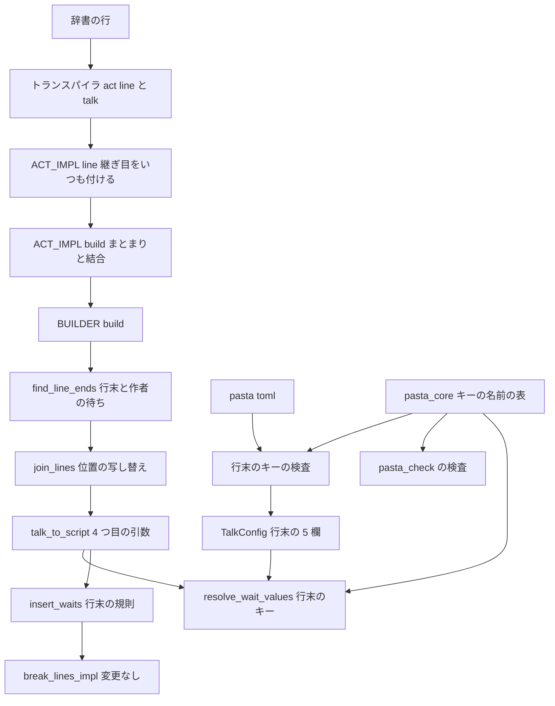
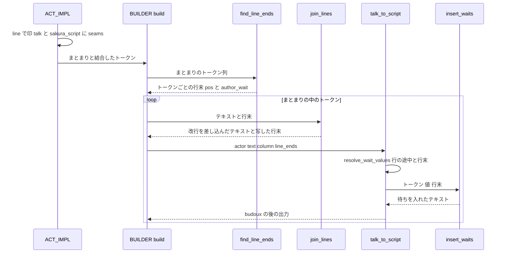
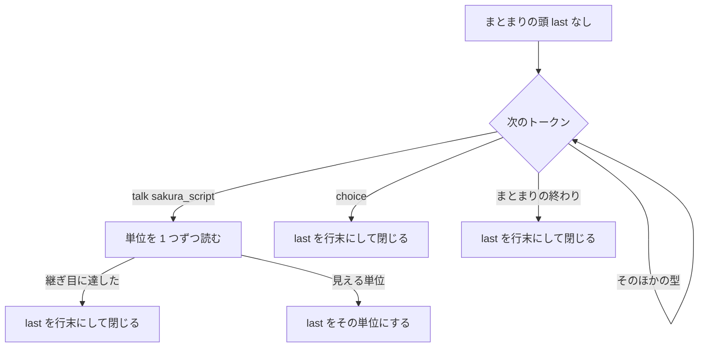

# 設計: line-end-wait

## Overview

**目的**: ゴースト作者が、行末の字の後の待ちを、行の途中とは別に、字の種類ごとに `[talk]` と `[actor."名前"]` で決められるようにする。縦書きのバルーンでは辞書の 1 行が画面の 1 列になるので、行の途中の「？」の短い間を保ったまま、列の終わりでは「。」でも「？」でも同じくらいの間を取れる。

**使う人**: ゴースト作者は `pasta.toml` に行末のキー（例: `script_wait_strong_eol = 1200`）を書き、辞書の行末に手で足していた `\_w[…]` を外す。演出で特定の行末の間を変えたいときは、その行末に欲しい長さの `\_w[…]` を書く（行末のキーが効く行末では、自動の待ちを置き換える）。

**変わること**: 行の頭の印（`seams`）を `line_newlines` によらずいつも付け、組み立て（`sakura_builder.lua`）が各テキストの中の行末の位置を求めて `talk_to_script` の新しい 4 つ目の引数で渡す。待ちの規則（`wait_inserter.rs`）は、行末のキーが効く行末だけ、行末の値を使う。行末のキーを 1 つも書かないゴーストの出力は、バイト単位で今と同じである。

### Goals

- 行末のキー 5 つ（`script_wait_normal_eol`・`script_wait_period_eol`・`script_wait_comma_eol`・`script_wait_strong_eol`・`script_wait_leader_eol`）を `[talk]` と `[actor."名前"]` で読み、アクター → `[talk]` → 行の途中の値の順で値を決める。
- アクション行・継続行の終わり（行の最後の見える字）と、行の印の無い台詞ではアクターのまとまりの最後の見える字を、行末として変換に届ける。
- 行末のキーが効く行末では、行末の並びのすぐ後ろの作者の `\_w[…]` が自動の待ちを置き換える。
- 行末のキーの書き間違いを、`pasta.dll` の読み込みと `pasta_check validate` の両方でキーの名前と場所を示して報告する。
- 行末のキーを書かないゴーストの出力を、特性化テストで先に固め、x86・x64 の両方で確かめる。

### Non-Goals

- 行の途中の待ちの規則（`script_wait_*` の意味・並びの扱い）と、行の途中の作者の `\_w[…]` の扱い（今のまま足される）。
- `chars_*` の既定値・アクターごとの字の集合・今の 5 キーや `chars_*` の型違いの落ち方。
- `line_newlines` の改行の規則、budoux の改行の位置と幅、話し手の切り替え・選択肢の前後の改行。
- ノベル向けの出力のクリック待ち（`\x`）を足すこと。
- ghost_dev の辞書と `pasta.toml` の書き換え。

## Boundary Commitments

### This Spec Owns

- 行末のキー 5 つの名前・型（整数・ミリ秒）・既定（書かなければ行の途中の値）・決まる順。
- 「行末」の判定（どの見える字が行末か、作者の `\_w[…]` がその直後に続くか）。判定は組み立て（Lua）が持つ。
- 行末の待ちの規則（値・位置・置き換え）。規則は待ちの挿入（Rust）が持つ。
- `talk_to_script` の 4 つ目の引数 `line_ends` の形と、省いたときの既定。
- 行末のキーの読み込みのエラーと、`pasta_check` の報告の種類 `config-line-end-wait`。
- 行の頭の印（`seams`）を `line_newlines` によらず付けること（意味は今のまま）。
- マニュアルの該当の節と、マニュアルから作るスキルの参照・辞書の書き方のスキルのウェイトの説明。

### Out of Boundary

- `line_newlines` の改行の差し込み方（`join_lines` の改行の規則）。この spec は `join_lines` に位置の写し替えを足すだけで、改行の入り方は変えない。
- budoux の改行（`line_breaker.rs`）。触らない。
- 字の分類（`CharSets::classify`）とタグの読み取り（`SAKURA_TAG_PATTERN`・`APPEARANCE.tag_at`）。使うだけで変えない。
- ノベル向けの出力・高速再生の扱い（`novel-talk-flow`・`novel-areka-contract`）。行末の待ちは自動の待ちの 1 つとして同じ出力に入るだけで、別に扱う口を作らない。
- `cue-command-runtime`・`novel-checkpoint-rollback`・`scene-anchor-link` が触る組み立ての部分。

### Allowed Dependencies

- `pasta_core`（キーの名前の表を置く。`pasta_lua` と `pasta_check` の両方がこれを読む。`pasta_core` は TOML も Lua も知らないまま）。
- `pasta_lua` の既存の部品: `TalkConfig`・`PastaConfig::parse`・`Tokenizer`・`insert_waits`・`resolve_wait_values`・`ACT_IMPL.line`・`merge_consecutive_talks`・`read_unit`・`join_lines`・`APPEARANCE.tag_at`。
- `toml` 1.1（`DeTable` の span で行番号を取る。`actor_font.rs` と同じ）・`mlua` 0.12（`Table::get::<i64>` の今の読み方）。
- 依存の向き: `pasta_core` ← `pasta_lua`・`pasta_check`。Lua の組み立て → `@pasta_sakura_script`（`talk_to_script` の引数だけで渡す）。Rust の待ちの規則は Lua の継ぎ目や見える字の判定を読まない。

### Revalidation Triggers

- `seams` の意味（行の頭のバイト位置）や付ける条件を変えるとき（`line_newlines` と行末の両方が読む）。
- `talk_to_script` の引数の形を変えるとき（直接呼ぶゴーストの Lua に効く）。
- `read_unit`・`unit_shows_text`（見える字の定義）を変えるとき。Rust の写し（`Token::shows_text`）と適合テストも直す。
- `TokenKind` の分類や「並び」の規則（`insert_waits`）を変えるとき。
- `FindingKind` の並びを変えるとき（報告の表・VS Code 拡張の診断）。
- 組み立てのまとまり（`group_by_actor`）や台詞の結合（`merge_consecutive_talks`）の切れ目を変えるとき（行の印の無い台詞の行末が変わる）。

## Architecture

### Existing Architecture Analysis

- 辞書の 1 行は、トランスパイラが `act:line()` を頭に出し、`actor:talk("…")`・`actor:sakura_script("\_w[500]")`・`actor:talk(actor:word("笑顔"))` のトークンに分かれて積まれる。辞書に直接書いたタグは talk と別のトークンになる。
- `ACT_IMPL.build` がアクターごとのまとまりに分け、続く talk だけをつなぐ（継ぎ目はずらしてつなぐ）。組み立ては、まとまりの中のトークンを 1 つずつ `talk_to_script` に渡す。1 回の変換は行の切れ目を知らない。
- 今の継ぎ目は `line_newlines` が nil・0 でないときだけ付く。読むのは `join_lines` だけ。
- 待ちの規則は `insert_waits` 1 か所。値は `resolve_wait_values` がアクターの表 → `[talk]` → 既定で毎回決める。
- `[talk]` は `get_custom_config` の `try_into().ok()` で読むので、型が合わないと全体が既定に戻る。`[actor.*.font]` は `PastaConfig::parse` の中で検査し、読み込みのエラーにしている（`pasta_check` に同じ検査の写しがある）。

### Architecture Pattern & Boundary Map



- **選んだ形**: 行末の位置は Lua の組み立てが求め、待ちの規則は Rust が持つ（`research.md` 11 章の案 C）。見える字の定義（`read_unit`）と待ちの規則（`insert_waits`）が、どちらも 1 か所のまま。
- **持ち場の分け方**: Lua は「どこが行末か」「その直後に作者の `\_w[…]` があるか」だけを答える。Rust は「その行末に何を入れるか」（字の種類・値・効くかどうか）だけを決める。受け渡しは `line_ends` の位置と真偽だけ。
- **守る今の形**: 継ぎ目の意味とずらし方、`join_lines` の早い戻り、`insert_waits` の並び、`resolve_wait_values` の毎回の読み直し、`actor_font` の検査の前例。
- **足す部品の理由**: キーの名前の表（`pasta.dll` と `pasta_check` で同じ名前を使うため）、読み込みの検査（7.1・7.2）、`find_line_ends`（トークンをまたぐ行末と作者の待ちを求めるため）、`Token::shows_text`（直接の呼び出しの既定のため）。

### Technology Stack

| Layer | Choice / Version | Role in Feature | Notes |
|-------|------------------|-----------------|-------|
| Runtime（Rust） | `pasta_lua`（Rust 2024）・`mlua` 0.12（LuaJIT 2.1） | 待ちの規則・`talk_to_script` の口・アクターの表の読み出し | 新しい依存なし |
| Runtime（Lua） | `pasta_scripts`（LuaJIT 2.1） | 行の印・行末の判定・位置の写し替え | `luacheck` の複雑度 15 を守る |
| 設定 | `toml` 1.1.2・`serde` 1 | `TalkConfig` の行末の欄・span つきの検査 | `actor_font.rs` と同じ読み方 |
| 共有の規則 | `pasta_core` | 行末のキーの名前の表 | TOML・Lua を知らない |
| 検査 | `pasta_check`（WASM でも動く） | `config-line-end-wait` の報告 | VS Code 拡張にも同じ報告が届く |

## File Structure Plan

### New Files

```
crates/
├── pasta_core/src/
│   └── line_end_wait.rs              # 行末のキー 5 つの名前の表（LINE_END_WAIT_KEYS）
├── pasta_lua/src/loader/config/
│   └── line_end_wait.rs              # [talk]・[actor."名前"] の行末のキーの型の検査（読み込みのエラー）
└── pasta_lua/tests/
    ├── line_end_wait_e2e_test.rs     # DSL → SHIORI.request の出力。特性化（先に置く）と要件の例
    ├── sakura_script/line_end_test.rs # talk_to_script の 4 つ目の引数・既定・アクターの順
    └── lua_specs/line_end_wait_test.lua # find_line_ends・join_lines の位置の写し替え
```

### Modified Files

- `crates/pasta_core/src/lib.rs` — `line_end_wait` のモジュールと `LINE_END_WAIT_KEYS` の再公開。
- `crates/pasta_lua/src/loader/config/sections.rs` — `TalkConfig` に `Option<i64>` の欄 5 つ（既定 None）。
- `crates/pasta_lua/src/loader/config/mod.rs` — `parse` で `actor_font::apply` の後に `line_end_wait::check` を呼ぶ。`mod line_end_wait;`。
- `crates/pasta_lua/src/sakura_script/wait_inserter.rs` — `LineEndWaits`・`LineEnd`、`WaitValues.line_end`、`insert_waits` の行末の規則と単体テスト（今のテストは `&[]` を渡して残す）。
- `crates/pasta_lua/src/sakura_script/mod.rs` — `talk_to_script` の 4 つ目の引数（形の違いを決めた文言のエラーにするため `Value` で受ける）、`resolve_wait_values` の行末のキー（`WaitValues` の構造体の書き方に `line_end` を足す）、省いたときの既定の行末。モジュールの説明の例。
- `crates/pasta_lua/src/sakura_script/line_breaker.rs` — テストの補助（835〜844 行目付近）の `WaitValues`・`insert_waits` の呼び方だけを合わせる（改行の規則は触らない）。
- `crates/pasta_lua/tests/sakura_script/edge_case_test.rs` — `insert_waits` の呼び出し（5 か所）に `&[]`、`WaitValues` の構造体の書き方に `line_end`。
- `crates/pasta_lua/src/sakura_script/tokenizer.rs` — `Token::shows_text`（Lua の `unit_shows_text` の写し）。
- `crates/pasta_lua/pasta_scripts/pasta/act.lua` — `ACT_IMPL.line` が `_line_newlines` を見ずに印を立てる。
- `crates/pasta_lua/pasta_scripts/pasta/shiori/sakura_builder.lua` — `find_line_ends`、`join_lines` の位置の写し替え、`inner_token_to_string`・`emit_inner_token` に行末を渡す、`BUILDER.build` がまとまりごとに 1 回求める。
- `crates/pasta_lua/tests/lua_specs/line_newlines_test.lua` — 継ぎ目の欄が無いことを確かめる 3 つのテストを、欄がいつも付く表に直す。
- `crates/pasta_lua/tests/lua_specs/init.lua` — `line_end_wait_test` を足す（本物の `@pasta_sakura_script` を使うので `mocks_test` より前）。
- `crates/pasta_lua/tests/sakura_script/main.rs` — `mod line_end_test;`。
- `crates/pasta_lua/tests/sakura_script/conformance_test.rs` — Lua の見える字の判定と `Token::shows_text` を同じ単位の並びで比べる段。
- `crates/pasta_lua/tests/loader/config_sections_test.rs` — 行末のキーの読み込みと読み込みのエラー（場所・行・ほかのキーを落とさない）。
- `crates/pasta_check/src/validate/config.rs` — `read_line_end_waits`、`type_label` に文字列・真偽値。
- `crates/pasta_check/src/validate/report.rs` — `FindingKind::ConfigLineEndWait`（`ConfigActorFont` の次）、`msg::config_line_end_wait`、種類の一覧。
- `crates/pasta_check/tests/validate_config_test.rs`・`validate_report_test.rs`・`validate_parity_test.rs` — 報告の行・文言・種類の表・読み込みを止める種類。
- `book/src/reference/pasta-toml.md` — `[talk]` の表に行末のキー、`[talk]` の節に行末の定義・決まる順・置き換え・出力の例、アクターの表の `script_wait_*` の行、「値の型が合わないとき」の表。
- `book/src/lua/modules/pasta-sakura-script.md` — `talk_to_script(actor, talk, column, line_ends)` と行末の扱い、アクター表のウェイト設定の表。
- `book/src/internals/talk-output.md` — 行末の位置が変換に届くまでの流れ・行末の待ちの規則・継ぎ目がいつも付くこと・境界の表。
- `book/src/debug/validate.md` — 報告の種類の表に `config-line-end-wait`。
- `.claude/skills/pasta-ghost-authoring/references/pasta-toml.md`・`.claude/skills/pasta-lua-coding/references/pasta-sakura-script.md` — `book/tools/gen-skill-refs.mjs` で作り直す（手で書かない）。
- `.claude/skills/pasta-ghost-authoring/SKILL.md` — `[talk]` の行とウェイトの説明に行末のキー（手書き）。

> `.claude/skills` への書き込みは、この環境では開発者の許可が要ることがある。タスクでは独立した段に分ける。

## System Flows



- 行末のキーが 1 つも効かないアクターでは、`insert_waits` は行末を見ずに今の経路だけを通る（6.1 を作りで守る）。
- `find_line_ends` は、まとまりのトークンを先に 1 回読む。組み立ての出力の順と状態（`pending_break` など）には触れない。

### 行末の判定（Lua）



- 「閉じる」は、last があれば、その単位の終わりを行末として記録し、last を無くす。継ぎ目から次の継ぎ目までに見える単位が無い行は、行末を持たない（3.5）。

## Requirements Traceability

| Requirement | Summary | Components | Interfaces | Flows |
|-------------|---------|------------|------------|-------|
| 1.1 | 行末のキー 5 つを `[talk]` で読む | LineEndKeyNames, TalkConfigExt | `TalkConfig.script_wait_*_eol` | 設定 |
| 1.2 | 書かなければ行の途中の値 | WaitRules | `WaitValues::line_end_value` | 待ちの規則 |
| 1.3 | `値−50`、0 以下なら入れない | WaitRules | `flush_pending` と同じ計算 | 待ちの規則 |
| 1.4 | 行の途中の値は今のまま | WaitRules, TalkToScript | `WaitValues` の 5 値 | 待ちの規則 |
| 1.5 | バルーンの向きで分けない | WaitRules | 向きを入力に持たない | — |
| 2.1 | アクターの行末のキー | TalkToScript | `resolve_wait_values` | 変換 |
| 2.2 | アクター → `[talk]` → 行の途中 | TalkToScript, WaitRules | `resolve_wait_values`・`line_end_value` | 変換 |
| 2.3 | Lua の書き換えは次の台詞から | TalkToScript | 毎回 `get::<i64>` | 変換 |
| 2.4 | 行を話すアクターの設定 | LineEndFinder, TalkToScript | まとまりのアクターで呼ぶ | 組み立て |
| 3.1 | アクション行・継続行の終わり | ActLine, LineEndFinder | `seams`・`find_line_ends` | 行末の判定 |
| 3.2 | 話し手の切り替え・同じ話し手・最後を区別しない | LineEndFinder | 継ぎ目とまとまりの終わりで閉じる | 行末の判定 |
| 3.3 | 行の途中は行の途中の値 | WaitRules | 行末の位置だけを特別に扱う | 待ちの規則 |
| 3.4 | タグだけが続く行は前の見える字 | LineEndFinder | `read_unit` の見える単位 | 行末の判定 |
| 3.5 | 見える字の無い行は行末を持たない | LineEndFinder | 閉じるときに last が無い | 行末の判定 |
| 3.6 | `＠単語`・`＄変数` の中身を数える | LineEndFinder | 結合後の talk のテキストを読む | 行末の判定 |
| 3.7 | 行の印の無い台詞はまとまりの最後 | LineEndFinder | 継ぎ目が無ければ閉じない | 行末の判定 |
| 3.8 | `line_newlines` によらない | ActLine, LineEndFinder | 印をいつも立てる | 行末の判定 |
| 3.9 | 空行・コメント・代入・Call を数えない | ActLine, LineEndFinder | `act:line()` の出る行だけが継ぎ目 | 行末の判定 |
| 4.1 | 並びの最後に 1 つ、一番長い行末の値 | WaitRules | 並びの字の種類ごとの `line_end_value` の最大 | 待ちの規則 |
| 4.2 | ふつうの字の行末 | WaitRules | 行末の字に行の途中の待ちを入れない | 待ちの規則 |
| 4.3 | リーダーの行末 | WaitRules | 最後のリーダーだけ | 待ちの規則 |
| 4.4 | `す」` は「」」の後ろに 1 つ | WaitRules | 並びの頭のふつうの字・リーダー | 待ちの規則 |
| 4.5 | タグの前に入れる | WaitRules | 行末の位置で吐き出す | 待ちの規則 |
| 4.6 | 行末禁則・エスケープ・囲みは入れない | WaitRules, ShowsText | 待ちを持てない字の行末は無視 | 待ちの規則 |
| 4.7 | 効かない行末は今と同じ | WaitRules | 効かない行末では何もしない | 待ちの規則 |
| 5.1 | 直後の作者の `\_w` が置き換える | LineEndFinder, WaitRules | `author_wait` | 行末の判定・待ちの規則 |
| 5.2 | 2 つ以上でも自動だけを入れない | LineEndFinder, WaitRules | 最初の単位だけを見る | 行末の判定 |
| 5.3 | 効かない行末では足す | WaitRules | 効かなければ `author_wait` を見ない | 待ちの規則 |
| 5.4 | 行の途中の作者の `\_w` は足す | WaitRules | 行末だけが対象 | 待ちの規則 |
| 5.5 | 同じ行の `\_w` だけ | LineEndFinder | 継ぎ目・ほかのタグ・`wait` のトークンを数えない | 行末の判定 |
| 5.6 | 間にタグがあれば足す | LineEndFinder | 最初の単位が `\_w` のときだけ | 行末の判定 |
| 6.1 | キーが無ければバイト単位で同じ | WaitRules, ActLine, CharacterizationTests | キーが無ければ行末を見ない・`join_lines` の早い戻り | 全体 |
| 6.2 | 改行の位置と幅を変えない | WaitRules | budoux はタグを幅 0 で運ぶ（変更なし） | 変換 |
| 6.3 | 行の途中の待ちを変えない | WaitRules | 行末の位置だけを特別に扱う | 待ちの規則 |
| 6.4 | 外した `\_w` と同じ長さを出せる | WaitRules | `値−50` | 待ちの規則 |
| 7.1 | 読み込みのエラー（キー・場所） | LineEndKeyCheck | `line_end_wait::check` | 設定 |
| 7.2 | ほかのキーを既定に戻さない | LineEndKeyCheck, TalkConfigExt | 検査が先に止める・`Option<i64>` | 設定 |
| 7.3 | Lua の値は今と同じ読み方 | TalkToScript | `get::<i64>(key).ok()` | 変換 |
| 7.4 | `pasta_check` でも報告 | ValidateLineEndKeys | `config-line-end-wait` | 検査 |
| 8.1 | 同じ `\_w` として同じ出力に入れる | WaitRules | 自動の待ちと同じ形 | 待ちの規則 |
| 8.2 | クリック待ちの前に置く | WaitRules | 行末の並びの直後に入れる | 待ちの規則 |
| 8.3 | 直接呼んだら最後の見える字 | TalkToScript, ShowsText | `line_ends` が nil の既定 | 変換 |
| 8.4 | 今の 3 つの引数の呼び方 | TalkToScript | 4 つ目は省ける | 変換 |
| 9.1 | `[talk]`・アクターの表に載せる | Docs | `reference/pasta-toml.md` | — |
| 9.2 | 行末の定義・順・置き換えと例 | Docs | `reference/pasta-toml.md` | — |
| 9.3 | `talk_to_script` の行末 | Docs | `lua/modules/pasta-sakura-script.md` | — |
| 9.4 | 内部設計の流れと規則 | Docs | `internals/talk-output.md` | — |
| 9.5 | スキルの参照とウェイトの説明 | Docs | `gen-skill-refs.mjs`・`SKILL.md` | — |
| 9.6 | 避ける手順のレシピを載せない | Docs | 書かない | — |
| 10.1 | 特性化テストを先に置く | CharacterizationTests | `line_end_wait_e2e_test.rs` | 検証 |
| 10.2 | 例を出力の比較で確かめる | 各テスト | 単体・結合・Lua・検査 | 検証 |
| 10.3 | x86・x64 の両方 | 各テスト | 型の幅に頼らない・cfg で省かない | 検証 |

## Components and Interfaces

| Component | Domain/Layer | Intent | Req Coverage | Key Dependencies (P0/P1) | Contracts |
|-----------|--------------|--------|--------------|--------------------------|-----------|
| LineEndKeyNames | pasta_core | 行末のキーの名前の表 | 1.1, 7.1, 7.4 | — | State |
| TalkConfigExt | pasta_lua 設定 | `[talk]` の行末の 5 欄 | 1.1, 1.2, 7.2 | serde (P0) | State |
| LineEndKeyCheck | pasta_lua 設定 | 行末のキーの型を読み込みで検査 | 7.1, 7.2 | toml DeTable (P0), LineEndKeyNames (P0) | Service |
| WaitRules | pasta_lua Rust 変換 | 行末の待ちの値・位置・置き換え | 1.2〜1.5, 3.3, 4.1〜4.7, 5.1〜5.4, 6.1〜6.4, 8.1, 8.2 | Tokenizer (P0) | Service |
| TalkToScript | pasta_lua Rust 変換 | 4 つ目の引数・行末の値の決まり方・既定の行末 | 2.1〜2.4, 7.3, 8.3, 8.4 | mlua (P0), WaitRules (P0), ShowsText (P1) | Service |
| ShowsText | pasta_lua Rust 変換 | Lua の見える字の判定の写し | 4.6, 8.3 | Tokenizer (P0) | Service |
| ActLine | pasta_lua Lua | 行の頭の印をいつも立てる | 3.1, 3.8, 3.9, 6.1 | — | State |
| LineEndFinder | pasta_lua Lua 組み立て | 行末と作者の `\_w` を求め、変換に渡す | 2.4, 3.1〜3.9, 5.1, 5.2, 5.5, 5.6 | read_unit (P0), talk_to_script (P0) | Service |
| ValidateLineEndKeys | pasta_check | 同じ検査を報告にする | 7.4 | LineEndKeyNames (P0) | Service |
| Docs | マニュアル・スキル | 行末のキーと規則の説明 | 9.1〜9.6 | gen-skill-refs (P1) | — |
| CharacterizationTests | テスト | 今の出力を先に固める | 6.1, 10.1〜10.3 | SHIORI.request (P0) | Batch |

### pasta_core

#### LineEndKeyNames

| Field | Detail |
|-------|--------|
| Intent | 行末のキー 5 つの名前を 1 か所に持つ |
| Requirements | 1.1, 7.1, 7.4 |

**Responsibilities & Constraints**
- 名前の表だけを持つ（`FONT_ATTRIBUTES` と同じ置き方）。型の検査の規則（「TOML の整数だけ」）は短いので、読む側（`pasta.dll`・`pasta_check`）がそれぞれ書く。
- 並びは字の種類の順（ふつうの字・句点・読点・強調・リーダー）で、`script_wait_*` の並びと同じ。

**Contracts**: State [x]

```rust
/// 行末の待ちのキー（字の種類の順: ふつうの字・句点・読点・強調・リーダー）
pub const LINE_END_WAIT_KEYS: [&str; 5] = [
    "script_wait_normal_eol",
    "script_wait_period_eol",
    "script_wait_comma_eol",
    "script_wait_strong_eol",
    "script_wait_leader_eol",
];
```

### pasta_lua 設定

#### TalkConfigExt（`sections.rs`）

- `TalkConfig` に `script_wait_normal_eol: Option<i64>` から `script_wait_leader_eol: Option<i64>` の 5 欄を足す。既定は `None`（書かれていない）。`#[serde(default)]` のまま。
- 欄の名前は `LINE_END_WAIT_KEYS` と同じ。`register` が `WaitValues::from_config` で `LineEndWaits` に写す。
- 実装の注意: `TalkConfig` の `Default` は手で書いた impl なので、5 欄の `None` を足す。テストの `TalkConfig { … }` の書き方は、ほとんどが `..TalkConfig::default()` を使う。使っていない所があれば足す。

#### LineEndKeyCheck（`loader/config/line_end_wait.rs`）

| Field | Detail |
|-------|--------|
| Intent | `[talk]` と各 `[actor."名前"]` の行末のキーが TOML の整数かを、読み込みで確かめる |
| Requirements | 7.1, 7.2 |

**Responsibilities & Constraints**
- `PastaConfig::parse` の中、`actor_font::apply` の後で 1 回呼ぶ。`custom_fields` は書き換えない。
- `[talk]` が表でないとき・`[actor."名前"]` が表でないときは何もしない（今の扱いのまま）。
- 誤りは 1 つの `toml::de::Error` にまとめて返す（`actor_font` と同じく `", "` でつなぐ）。読む順は `[talk]` → アクター（名前順）→ キーの表の順。
- 行番号は `DeTable::parse(content)` の span から取る（`actor_font.rs` の `entry`・`line` と同じ取り方）。

**Contracts**: Service [x]

```rust
/// [talk] と [actor."名前"] の行末のキーが整数かを確かめる
pub(super) fn check(content: &str, custom_fields: &toml::Table) -> Result<(), toml::de::Error>;
```

- エラーの文言の形: `script_wait_strong_eol は整数（ミリ秒）で書いてください: 浮動小数点数が書かれています; at [talk] (line 12)`、アクターは `at [actor."妹"] (line 20)`。型の言い方は `pasta_check` の `type_label` と同じ（文字列・浮動小数点数・真偽値・配列・表・日時）。
- Preconditions: `content` は `toml::from_str` で読めた本文（`parse` の先頭で確かめ済み）。
- Postconditions: `Ok` なら、`[talk]` の行末のキーはすべて整数で、`talk()` は `[talk]` のほかのキーを落とさずに読める。

### pasta_lua Rust 変換

#### WaitRules（`wait_inserter.rs`）

| Field | Detail |
|-------|--------|
| Intent | 行末の位置を受け取り、効く行末だけ行末の値・位置・置き換えを当てる |
| Requirements | 1.2, 1.3, 1.4, 1.5, 3.3, 4.1, 4.2, 4.3, 4.4, 4.5, 4.6, 4.7, 5.1, 5.2, 5.3, 5.4, 6.1, 6.2, 6.3, 6.4, 8.1, 8.2 |

**Responsibilities & Constraints**
- 行末の待ちの規則の唯一の持ち主。継ぎ目や見える字は知らない。
- 行末のキーが 1 つも効かない（`line_end.any()` が偽）か、行末が 1 つも無いときは、今の `insert_waits` と同じ経路だけを通る。
- 行末の待ちは、行の途中の待ちと同じ `\_w[値−50]` で、`値−50 > 0` のときだけ入れる。単独の `\` の後ろには入れない（`append_with_wait` と同じ）。

**Contracts**: Service [x]

```rust
/// 行末の待ちの値（書かれていなければ None）
#[derive(Debug, Clone, Default, PartialEq, Eq)]
pub struct LineEndWaits {
    pub normal: Option<i64>,
    pub period: Option<i64>,
    pub comma: Option<i64>,
    pub strong: Option<i64>,
    pub leader: Option<i64>,
}

impl LineEndWaits {
    /// どれか 1 つでも書かれているか
    pub fn any(&self) -> bool;
}

#[derive(Debug, Clone, Default)]
pub struct WaitValues {
    pub normal: i64,
    pub period: i64,
    pub comma: i64,
    pub strong: i64,
    pub leader: i64,
    /// 行末の待ち（アクター → [talk] で決めたもの）
    pub line_end: LineEndWaits,
}

impl WaitValues {
    /// 字の種類の行末の値（行末のキーが無ければ行の途中の値）。待ちを持たない種類は None
    pub fn line_end_value(&self, kind: &TokenKind) -> Option<i64>;
}

/// テキストの中の 1 つの行末
#[derive(Debug, Clone, Copy, PartialEq, Eq)]
pub struct LineEnd {
    /// 行末の字の終わりのバイト位置（テキストの頭からのバイト数）
    pub end: usize,
    /// 行末の並びのすぐ後ろに作者の `\_w[…]` が続くか
    pub author_wait: bool,
}

/// 待ちを入れる。line_ends が空なら今と同じ
pub fn insert_waits(tokens: &[Token], wait_values: &WaitValues, line_ends: &[LineEnd]) -> String;
```

**行末の扱い（規則）**

用語: トークンの終わりのバイト位置を、トークンの長さを足して求める。「待ちを持てる字」は `General`・`Leader`・`Period`・`Comma`・`Strong`・`LineStartProhibited`。

1. **行末のトークン**: `end` がトークンの終わりに当たり、そのトークンが待ちを持てる字なら、そのトークンを行末のトークン k とする。当たらないとき・k が `SakuraScript`（エスケープ・囲み・字を表示するタグを含む）か `LineEndProhibited` のときは、その行末を無視する（4.6。今と同じ）。同じ k の行末が 2 つあれば 1 つにする（`author_wait` はどちらかが真なら真）。
2. **行末の並び**:
   - k が `General`・`Leader` なら、並びは k だけ。字の種類は k の種類。
   - k が句読点・行頭禁則の字なら、並びは今の「並び」（k までに続けてたまった `Period`・`Comma`・`Strong`・`LineStartProhibited`）。並びに句読点が 1 つでもあれば、字の種類は並びの中の句読点の種類。
   - 並びが行頭禁則の字（`chars_line_start_prohibited` の字。今の `LineStartProhibited`）だけで、その直前のトークン j が `General`・`Leader` で、j が別の行末のトークンでなければ、並びは j と行頭禁則の字（4.4）。字の種類は j の種類。それ以外（直前がタグ・行末禁則の字・頭）なら字の種類は無い。
3. **効くかどうか**: 並びの字の種類のどれかに、行末の値が書かれている（`line_end` のその種類が `Some`）とき、その行末に行末のキーが効く。効かない行末では、ここから下を何もしない（4.7・5.3。今と同じ位置・値）。
4. **値**: 字の種類ごとに `line_end` の値、無ければ行の途中の値（`WaitValues` の 5 値。2.2 の順の最後）。並びの値は、その中の一番長いもの（4.1）。
5. **位置と出し方**（効く行末だけ）:
   - k が `General`・`Leader`: k の字を出し、行の途中の待ちは入れない（4.2・4.3）。それより前のリーダーは今のまま 1 字ごとに入れる。
   - 並びの頭が j（4.4）: j の字の行の途中の待ちを入れず、行頭禁則の字をためて、k で吐き出す。
   - 句読点の並び: 今のとおりためて、k で吐き出す。次の行の頭の句読点とはつながらない（並びはここで切れる）。
   - 吐き出すとき、`author_wait` が偽なら `\_w[値−50]`（0 以下なら無し）を並びの直後に入れる。真なら自動の待ちを入れない（5.1・5.2）。作者の `\_w[…]` は、同じテキストの中ならタグとしてそのまま続き、次のトークンなら次の変換がそのまま出す。
6. 行の途中の字・行の途中の作者の `\_w[…]` には触れない（3.3・5.4・6.3）。

**出力の例**（ghost_dev の値 `normal=90, period=1200, comma=600, strong=750, leader=300`）

| 設定 | 入力（行末に印） | 出力 |
|---|---|---|
| `strong_eol = 1200` | `雨？`（行末） | `雨\_w[40]？\_w[1150]` |
| `strong_eol = 1200` | `晴れ？それとも`（行の途中） | `晴\_w[40]れ\_w[40]？\_w[700]そ…` |
| `strong_eol = 1200` | `…だよね？」` | `…ね\_w[40]？」\_w[1150]` |
| `normal_eol = 1250` | `…ちは` | `…ち\_w[40]は\_w[1200]` |
| `leader_eol = 1250` | `た‥‥` | `た\_w[40]‥\_w[250]‥\_w[1200]` |
| `normal_eol = 1250` | `す」`（行末） | `す」\_w[1200]` |
| `normal_eol = 1250` | `す」と`（行の途中） | `す\_w[40]」と\_w[40]` |
| `strong_eol = 1200` | `雨？` ＋ 作者の待ち | `雨\_w[40]？` ＋ `\_w[500]`（自動の待ちなし） |
| なし | `雨？` ＋ 作者の待ち | `雨\_w[40]？\_w[700]` ＋ `\_w[500]`（今のまま） |
| `period_eol = 1200` | `。＠笑顔` | `。\_w[1150]\s[5]` |

**計画と出力の分け方**
- `insert_waits` は、トークンを出す前に `plan_line_ends(tokens, wait_values, line_ends) -> Vec<LineEndPlan>` で規則 1〜4（行末のトークン k・並びの頭・効くかどうか・値・`author_wait`）を 1 回で決める。計画が空なら、今のループそのものを通る（6.1・4.7・5.3 を作りで守る）。
- 出力のループは、計画の添字（並びの頭・行末のトークン）と比べるだけで、先を読まない。
- 単体テストは `plan_line_ends` に直接当てる（どの行末が効くか・値・並びの頭）。出力の文字列のテストは別に置く。

```rust
/// 1 つの効く行末の計画
struct LineEndPlan {
    /// 並びの頭のトークンの添字（4.4 の j、句読点の並びの頭、または k 自身）
    start: usize,
    /// 行末のトークン k の添字
    end: usize,
    /// 入れる値（値−50 する前）。author_wait なら None
    wait: Option<i64>,
}
```

**Implementation Notes**
- Integration: 呼ぶのは `talk_to_script_impl` だけ。今の単体テストは `&[]` を渡し、`default_wait_values()` に `line_end: LineEndWaits::default()` か `..Default::default()` を足す。
- Validation: 行末のキーが無いときは、どの入力でも今の出力と同じになることを、単体テストと特性化テストで確かめる。
- ノベル向けの出力（8.1・8.2）: 行末の待ちは自動の待ちと同じ `\_w[…]` として同じ出力に入り、出力の種類で分けない。クリック待ち（`\x`）は組み立ての出力の末尾に付く（`novel-talk-flow` の仮の設計）ので、行末の待ちはその前に来る。この spec は `\x` を足さない。
- Risks: 並びの頭の判定（4.4）でトークンを後ろから読む。行末のトークンの添字を先に求め、ループの中では添字の比べだけにする。

#### TalkToScript（`sakura_script/mod.rs`）

| Field | Detail |
|-------|--------|
| Intent | 4 つ目の引数を読み、行末の値をアクター → `[talk]` で決め、待ちの規則に渡す |
| Requirements | 2.1, 2.2, 2.3, 2.4, 7.3, 8.3, 8.4 |

**Responsibilities & Constraints**
- 行末のキーをアクターの表から、今の `script_wait_*` と同じ `get::<i64>(key).ok()` で毎回読む（2.3・7.3）。読めなければ `[talk]` の値（`register` のときの `TalkConfig`）。どちらも無ければ `None`（行の途中の値に落ちるのは `insert_waits` の中）。
- mlua 0.12（LuaJIT）の読み方: `1200`・`1200.0` は 1200、`1200.5` は切り捨てて 1200、`"1200"` は 1200、`"abc"`・`true`・表は読めない（書かれていない）。`research.md` 9.1。
- `actor` が表でないとき（nil など）は `[talk]` の値だけを使う（今と同じ）。
- 組み立ては、まとまりのアクター（その行を話すアクター）で呼ぶ（2.4）。

**Contracts**: Service [x]

```lua
--- talk_to_script(actor, talk, column, line_ends) -> string
--- line_ends: nil | { { pos = integer, author_wait = boolean|nil }, ... }
```

- `pos`: テキストの頭から、行末の字の最後のバイトまでのバイト数（Lua の 1 始まりで数えた、行末の字の最後のバイトの位置と同じ数）。並びの順は問わない。
- `author_wait`: その行末のすぐ後ろに作者の `\_w[…]` が続くか。nil は偽。
- **nil のとき（今の 3 つの引数の呼び方）**: テキストの最後の見える字（`Token::shows_text` が真の最後のトークン）を行末とする。その直後のトークンが `\_w[…]` の `SakuraScript` なら `author_wait` を真とする（直接の呼び出しのテキストには継ぎ目が無いので、直後の `\_w` は同じ行のもの）。見える字が無ければ行末なし（8.3）。
- **表のとき**: 書かれた行末だけを使う。空の表は「行末なし」。
- エラー: 4 つ目が nil でも表でもない・項目が表でない・`pos` が整数として読めないときは Lua のエラー（`talk_to_script の line_ends は { pos = 整数, author_wait = 真偽 } の並びで渡してください`）。`pos` が 0 以下・テキストより長い・トークンの終わりに当たらないときは、その項目を無視する（Rust では `usize` に直す前に範囲を見る）。
- Postconditions: 行末のキーが無いアクターでは、`line_ends` によらず今と同じ出力（8.4）。

```rust
fn talk_to_script_impl(
    state: &SakuraScriptState,
    actor: Value,
    talk: Option<String>,
    column: Option<Table>,
    line_ends: Value,
) -> LuaResult<String>;
fn read_line_ends(t: &Table) -> LuaResult<Vec<LineEnd>>;
fn default_line_ends(tokens: &[Token]) -> Vec<LineEnd>;
```

#### ShowsText（`tokenizer.rs`）

- `impl Token { pub fn shows_text(&self) -> bool }`: `SakuraScript` でないトークンは真。`SakuraScript` のうち、エスケープ（`\\`・`\%`）、中身のある囲み（`\_?…\_?`・`\_!…\_!`）、字を表示するタグ（名前が `_u`・`_m`・`&`）は真、ほかは偽。
- `sakura_builder.lua` の `unit_shows_text` と talk の見える字の判定の写し。使うのは `talk_to_script` を 4 つ目の引数なしで呼んだときの既定だけ。
- 適合テスト（`conformance_test.rs`）で、同じ単位の並びについて Lua の判定と一致することを確かめる（写しの前例は `column_move`）。

### pasta_lua Lua

#### ActLine（`act.lua`）

- `ACT_IMPL.line` は `_line_newlines` を見ずに `_seam_next = true` を立てる。`take_seam`・`merge_consecutive_talks` は今のまま。
- 継ぎ目の意味（行の頭のバイト位置）は変えない。`line_newlines` が nil・0 なら `join_lines` は台詞を読まずに返すので、出力は変わらない。変わるのは `act:build()` のトークンの表に `seams` の欄がいつも現れることだけ（設計ディスカッションで承認）。
- 3.9: 空行・コメント行・変数代入行・Call 行は `act:line()` を出さないので継ぎ目にならない。Call の先のシーンの行は自分の `act:line()` を出す。Call の先が Lua の関数で `act:line()` を出さずに台詞を積めば、前の行の続きになる。

#### LineEndFinder（`sakura_builder.lua`）

| Field | Detail |
|-------|--------|
| Intent | まとまりのトークンを先に読み、各テキストの中の行末と、その直後の作者の `\_w[…]` を求めて変換に渡す |
| Requirements | 2.4, 3.1, 3.2, 3.3, 3.4, 3.5, 3.6, 3.7, 3.8, 3.9, 5.1, 5.2, 5.5, 5.6 |

**Responsibilities & Constraints**
- 見える字の判定は `read_unit` をそのまま使う（talk は見える単位すべて、sakura_script は字を表示するタグと中身のある囲みだけ）。空白（全角・半角）も見える字なので、行の終わりに空白を書いた行（`雨？　`）の行末は空白である。救う規則は足さない。
- 行を閉じる所: 継ぎ目に達したとき、`choice` のトークン、まとまりの終わり。閉じるとき、その行の最後の見える単位の終わりを行末として記録する。見える単位が無ければ記録しない（3.5）。
- 読み飛ばすトークン: `surface`・`wait`・`newline`・`clear`・`raw_script`・`choice_timeout`（見える字を出さない。3.4）。
- 作者の `\_w[…]` が続くか（`author_wait`）: 行末の単位の直後の最初の単位が、名前 `_w` で引数のあるタグなら真。ただし、その位置に継ぎ目があれば次の行の頭なので偽（5.5）。直後がテキストの終わりなら、次のトークンが継ぎ目の無い sakura_script で、その頭の単位が `\_w[…]` のときだけ真。`\w1`〜`\w9`・`\__w[…]`・`wait` のトークン・`raw_script` は数えない（5.5）。間に別のタグがあれば偽（5.6）。
- 組み立ての出力の順と状態（`pending_break`・`spot_has_text`・`spot_tail`・列の状態）は変えない。

**Contracts**: Service [x]

```lua
--- @class LineEnd
--- @field pos integer 行末の字の最後のバイトの位置（そのテキストの 1 始まり）
--- @field author_wait boolean 行末のすぐ後ろに作者の \_w[…] が続くか

--- まとまりの内側トークン列から、トークンごとの行末を求める
--- @param tokens table[] まとまりの内側トークン（結合済み）
--- @return table<integer, LineEnd[]> トークンの添字 → そのテキストの中の行末（元のテキストの位置）
local function find_line_ends(tokens) end

--- 台詞に行の改行を差し込み、行末の位置を差し込んだ後のテキストの位置に写す
--- @return any text 変換に渡すテキスト
--- @return LineEnd[] ends 写した行末（差し込まなければ受け取ったまま）
local function join_lines(inner, column, ratio, ends) end
```

- `BUILDER.build` は、まとまりごとに `find_line_ends(token.tokens)` を 1 回呼び、内側のループで添字ごとの行末を `emit_inner_token` → `inner_token_to_string` に渡す。行末の無いトークンには、共有の空の表を渡す（nil は `talk_to_script` の既定になるので渡さない）。
- `join_lines` は、差し込んだ片の元の位置と長さを控え、各行末の `pos` に「元の位置が `pos` 以下の片の長さの合計」を足して写す。差し込む片は単位の頭（継ぎ目・budoux の切れ目）にしか入らないので、`find_line_ends` と `join_lines` の単位の切り方が一致しているかに頼らない。
- 実装の注意: `BUILDER.build` は複雑度 28 で luacheck を外している。先読みは `find_line_ends` と小さな下請け（行を閉じる・作者の待ちを見る）に出し、`BUILDER.build` の分岐は増やさない。`emit_inner_token` の引数が 1 つ増える。

### pasta_check

#### ValidateLineEndKeys（`validate/config.rs`・`validate/report.rs`）

| Field | Detail |
|-------|--------|
| Intent | pasta.dll と同じ規則で行末のキーの型を検査し、報告にする |
| Requirements | 7.4 |

**Contracts**: Service [x]

```rust
/// pasta.dll（loader/config/line_end_wait.rs）と同じ取り出し方で行末のキーを読み、誤りを 1 つずつ返す
fn read_line_end_waits(text: &str) -> Vec<Finding>;

// report.rs
pub enum FindingKind { /* … */ ConfigActorFont, ConfigLineEndWait, /* … */ }
pub fn config_line_end_wait(place: &str, key: &str, written: &str) -> String;
```

- 報告の種類 `config-line-end-wait`（誤り）。`read_config` の `read_actor_fonts` の後で足す。`GhostConfig` は変えない。
- 文言: `[talk] の script_wait_strong_eol は整数（ミリ秒）で書いてください: 浮動小数点数が書かれています`、アクターは `[actor."妹"] の script_wait_normal_eol は…`。行は値の行。
- 読み込みを止める種類（`validate_parity_test.rs` の `stops_loading`）に入れる。飛び先の検査を省く理由（`skip_reasons`）には入れない（`config-actor-font` と同じ）。
- `type_label` に `"string" => "文字列"`・`"boolean" => "真偽値"` を足す（装いの検査はこの 2 つを通さないので影響しない）。

### マニュアルとスキル

#### Docs

- `reference/pasta-toml.md`: `[talk]` の表に行末のキー 5 つ（整数・既定＝行の途中の値・行末の字の後の待ち）。`[talk]` の節に「行末の待ち」の小節: 行末になる所（アクション行・継続行の最後の見える字、タグだけが続く行、行頭禁則の字の並びで終わる行、行の印の無い台詞はまとまりの最後）、ならない所（見える字の無い行、行の途中）、値の決まる順、行末のキーが効く行末で作者の `\_w[…]` が置き換えること、出力の例。アクターの表の `script_wait_*` の行に `script_wait_*_eol` を含める。「値の型が合わないとき」の表に行末のキー（読み込みのエラー）。冒頭の例は増やさない。
- `lua/modules/pasta-sakura-script.md`: `talk_to_script(actor, talk, column, line_ends)` の 4 つ目の引数の形と、省いたときの扱い（最後の見える字が行末）。アクター表のウェイト設定の表に行末のキー。
- `internals/talk-output.md`: 継ぎ目がいつも付くこと、`find_line_ends` から `talk_to_script` までの流れ、行末の待ちの規則、境界の受け渡しの表と不変条件（行末のキーが無ければ行末を見ない）。
- `debug/validate.md`: 報告の種類の表に `config-line-end-wait`。
- スキル: `node book/tools/gen-skill-refs.mjs` で `pasta-ghost-authoring/references/pasta-toml.md`・`pasta-lua-coding/references/pasta-sakura-script.md` を作り直す。`pasta-ghost-authoring/SKILL.md` の `[talk]` の行とウェイトの説明に、行末のキーと「行末に欲しい長さの `\_w` を書く」ことを 1〜2 行で足す。
- 載せないもの: ある書き方の代わりの書き方のレシピ（9.6）。

## Data Models

### 設定（`pasta.toml`）

| キー | 置き場所 | 型 | 既定 | 意味 |
|---|---|---|---|---|
| `script_wait_normal_eol` | `[talk]`・`[actor."名前"]` | 整数（ミリ秒） | なし（行の途中の値） | ふつうの字で終わる行末の後の待ち |
| `script_wait_period_eol` | 同上 | 同上 | 同上 | 句点を含む行末の並びの後の待ち |
| `script_wait_comma_eol` | 同上 | 同上 | 同上 | 読点を含む行末の並びの後の待ち |
| `script_wait_strong_eol` | 同上 | 同上 | 同上 | 強調（？！）を含む行末の並びの後の待ち |
| `script_wait_leader_eol` | 同上 | 同上 | 同上 | リーダーで終わる行末の後の待ち |

- 値の決まる順（字の種類ごと）: そのアクターの行末のキー → `[talk]` の行末のキー → そのアクターの `script_wait_*` → `[talk]` の `script_wait_*` → 既定。
- 「効く」: 行末の並びの字の種類のどれかについて、前の 2 つ（行末のキー）のどちらかが書かれていること。

### トークンの表（Lua）

- `talk`・`sakura_script` のトークンの `seams`（行の頭のバイト位置の昇順）は、`act:line()` の後に積んだものにいつも付く。結合した talk では、結合前の長さだけずらしてつながる（今のまま）。

### 受け渡し（Lua → Rust）

- `line_ends` の項目 `{ pos, author_wait }`。`pos` は `join_lines` の後のテキストでの位置。

## Error Handling

| 場面 | 扱い | 報告 |
|---|---|---|
| `pasta.toml` の行末のキーが整数でない（`[talk]`） | 読み込みのエラー | `… は整数（ミリ秒）で書いてください: …が書かれています; at [talk] (line N)` |
| 同（`[actor."名前"]`） | 読み込みのエラー | `…; at [actor."名前"] (line N)` |
| 同（`pasta_check validate`） | 誤り・読み込みを止める | `config-line-end-wait` |
| Lua でアクターの表に読めない値を入れた | 書かれていないとして扱う | 無し（今の `script_wait_*` と同じ） |
| `talk_to_script` の 4 つ目の形が違う | Lua のエラー | `talk_to_script の line_ends は … の並びで渡してください` |
| `pos` が範囲の外・トークンの境目に当たらない | その行末を無視（今と同じ出力） | 無し |
| 行末が行末禁則の字・エスケープ・囲み・字を表示するタグ・単独の `\` | 行末の待ちを入れない | 無し |

## Testing Strategy

テストはどれも型の幅に頼らず、x86 と x64 の両方の CI で同じものを走らせる（`cfg` で省かない。位置は `i64` で受け取り、範囲を見てから `usize` に直す）。

### 特性化テスト（変更より先に置く。10.1）

1. `line_end_wait_e2e_test.rs`（DSL → `SHIORI.request`。`line_newlines_e2e_test.rs` の作り）: 行末のキーの無い ghost_dev の値で、行の途中と行末の「？」、`。」`・`！？`、ふつうの字の行末、`‥‥` の行末、行末の `す」` と行の途中の `す」と`、行末の後ろの `＠笑顔`、行末に直接書いた `\_w[500]`、`＠間`（`\_w[500]` に展開）、`＠左` で始まる継続行、表情だけの行、Call、`\\` で終わる行、`「` で終わる行の今の出力を、そのままの文字列で固める。同じ辞書を `line_newlines = 1.8` でも固める。
2. 既にある `tests/loader/sakura_script_identity_test.rs`・`line_newlines_e2e_test.rs`・`tests/sakura_script/*` が変わらずに通ること。

### 単体テスト（`wait_inserter.rs`）

1. 字の種類ごとの行末の値と `値−50`（1.2・1.3。`50` と `0` で待ちが消える）。
2. 並びの一番長い値（4.1: `？」`・`！？`・`？。` で行末の値と行の途中の値が混ざる場合）。
3. ふつうの字・リーダーの行末（4.2・4.3）、`す」` の位置（4.4）、行の途中の `す」と` が今のまま。
4. `author_wait` で自動の待ちが消える（5.1）、効かない行末では `author_wait` を見ない（5.3）。
5. 行末のキーが無いとき・行末が空のとき・効かない行末・境目に当たらない `end`・行末禁則の字・`SakuraScript`・単独の `\` の行末で、今の出力と同じ（4.6・4.7・6.1）。効く行末の後ろに次の行の句読点が続いても、並びがつながらない。

### 結合テスト（`tests/sakura_script/line_end_test.rs`・`tests/loader/config_sections_test.rs`）

1. `talk_to_script` の 4 つ目の引数: nil の既定（`雨？\s[5]` の行末は「？」、`あ\\` は待ちなし、`雨？\_w[500]` は作者の待ち）、空の表、形の違うときの Lua のエラー（8.3・8.4）。
2. 値の決まる順（2.2: アクターの行末だけ・`[talk]` の行末だけ・行の途中だけを変えたアクター）と、Lua でアクターの表を書き換えた次の呼び出し（2.3）、`1200.0`・`"1200"`・`"abc"`・`true` の読み方（7.3）。
3. 読み込みの検査: `[talk]` と `[actor."名前"]` に文字列・小数・真偽値・表を書いたときのエラーの文言と行（7.1）、正しい行末のキーと一緒に書いた `script_wait_*`・`chars_*` が既定に戻らないこと（7.2）。
4. 適合テスト: `Token::shows_text` と Lua の見える字の判定が同じ単位の並びで一致する。

### Lua のテスト（`lua_specs/line_end_wait_test.lua`・`line_newlines_test.lua`）

1. `find_line_ends`: アクション行と継続行（3.1）、話し手の切り替え・同じ話し手・まとまりの最後（3.2）、タグだけが続く行と `＠左` で始まる次の行（3.4）、表情だけの行（3.5）、単語の展開（3.6）、行の印の無い台詞（3.7）、`line_newlines` の有無で同じ（3.8）、Call と Lua の関数の先（3.9）、選択肢の前、`surface`・`wait`・`raw_script` の読み飛ばし。
2. `author_wait`: 辞書に直接書いた `\_w` の道と `＠単語` の道（5.1）、2 つ続く `\_w`（5.2）、次の行の頭・`\w5`・`\__w[…]`・`act:wait`（5.5）、間に `\s[5]`（5.6）。
3. `join_lines` の位置の写し替え（`line_newlines = 1.8`）。
4. `line_newlines_test.lua` の 3 つのテストを「継ぎ目がいつも付く」表に直す（出力の比べは今のまま）。

### 出力の比較の結合テスト（`line_end_wait_e2e_test.rs`。10.2）

1. 要件の導入の例（`script_wait_strong_eol = 1200` で行の途中は 700・行末は 1150）と、4.1〜4.5・5.1〜5.4・6.4 の例を、行末のキーを書いたゴーストの `SHIORI.request` の出力で比べる。
2. アクターごとの行末（妹だけ `script_wait_normal_eol`。2.1・2.4）。
3. budoux の幅を持つアクターで、行末のキーの有無で `\_w[…]` を取り除いた出力が同じ（6.2）。行の途中の待ちの位置と値が同じ（6.3）。
4. 行末のキー・`line_newlines = 1.8`・budoux の幅を一緒に持つゴーストで、4.5（行末の後ろの `＠笑顔`）・5.1 の 2 つの道（辞書に直接書いた `\_w` と `＠単語`）・`＠左` で始まる継続行の行末が効くこと（`join_lines` の位置の写し替え）。
5. 行の終わりに空白を書いた行（`雨？　`）の行末が空白であること（今の振る舞いを固める）。

### 検査のテスト（`pasta_check`）

1. `validate_config_test.rs`: `config-line-end-wait` の行と文言（`[talk]`・アクター・複数の誤り）。
2. `validate_report_test.rs`: 種類の表（code・誤り）と一覧の件数。
3. `validate_parity_test.rs`: 読み込みを止める種類に入れ、pasta.dll の読み込みのエラーと一致する例を足す。

## Open Questions / Risks

設計ディスカッション（2026-11-26）の決定（どちらも推奨どおり承認）:

- **議題 1（継ぎ目をいつも付ける）**: トークンの表に `seams` がいつも現れる。`actor-line-newlines` の「既定ではトークンの表が今と同じ」を改め、`line_newlines_test.lua` の 3 つのテストを直す。出力は変わらない。行末のための別の欄は足さない。
- **議題 2（4 つ目の引数の形と、Rust の見える字の写し）**: `{ pos, author_wait }` の並び、nil は最後の見える字、直接の呼び出しでは直後の `\_w` も作者の待ちとみなす。nil の既定のために `unit_shows_text` の写し（`Token::shows_text`）を Rust に置き、適合テストで保つ。

自明として閉じたもの:

- 選択肢（`choice`）は行を閉じる。選択肢は辞書のアクション行・継続行ではない（3.1）ので、選択肢の前の最後の見える字がその行の行末。
- 報告の種類は `config-line-end-wait`（誤り・読み込みを止める・飛び先の検査は省かない）、pasta.dll のエラーの文言は上の形。どちらも `config-actor-font` の前例どおり。
- 句読点だけの行が、効かなかった前の行末の並びに続くときは、今の並びのまま扱う（値は並び全体の字の種類で決める）。まれな形で、今の出力に倒れる。
- 行の終わりの空白は見える字なので行末になる。救う規則は足さない（想定外の書き方を意図の推測で救わない）。e2e で今の振る舞いを固める。
- 危険: Lua の単位の切り方と Rust のトークンの境目がずれると行末を無視する（今と同じ出力に倒れる）。タグの読み取りの適合テストと、行末の例の結合テストで確かめる。
- 危険: `.claude/skills` の生成物の書き込みが止められることがある。タスクで独立した段にし、止められたら開発者の許可を求める。
