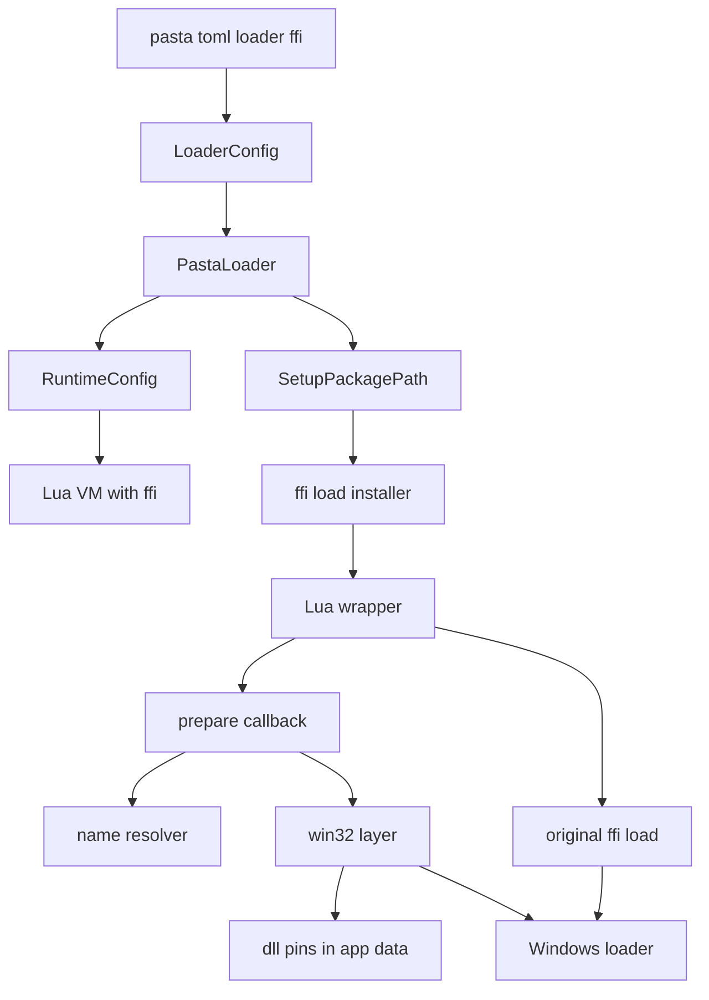
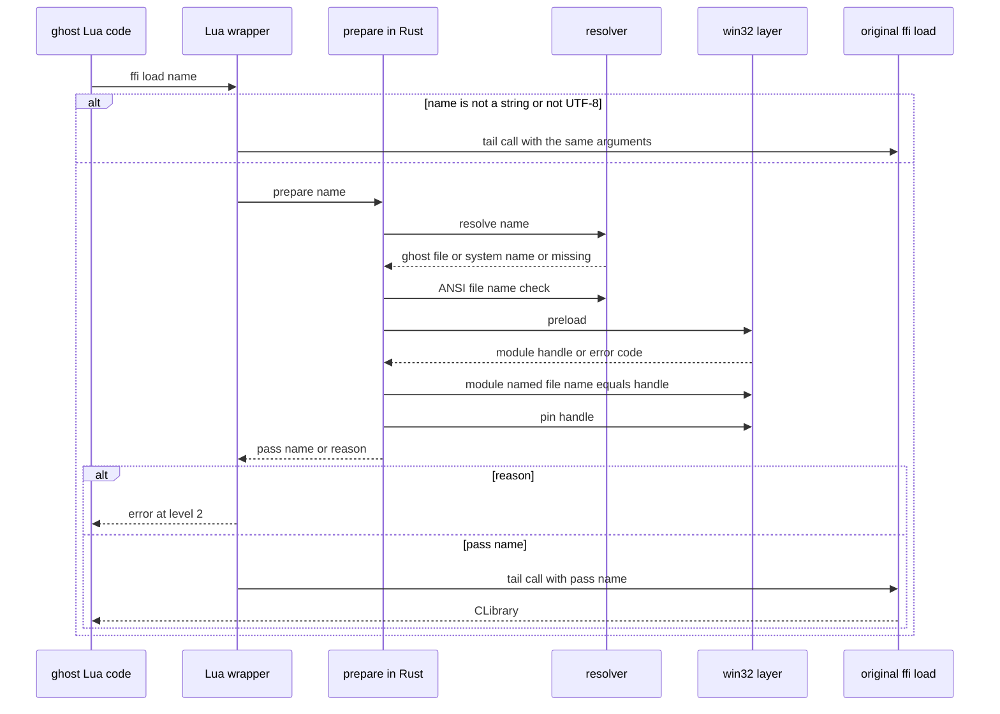
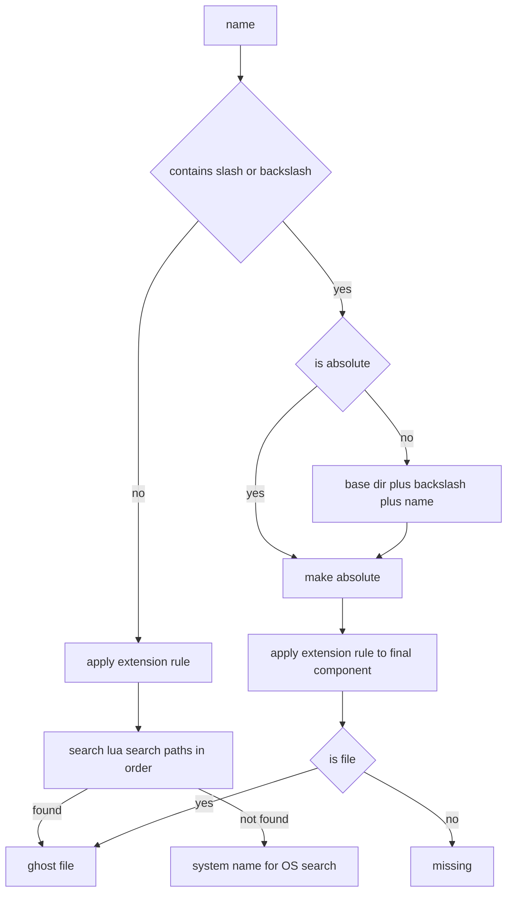

# 設計書: lua-cmodule-robustness

## Overview

**Purpose**: ゴーストの作者が、Lua を知らない普通の C の DLL の関数を、LuaJIT の FFI（`ffi.cdef`・`ffi.load`）でゴーストから呼べるようにする。pasta.toml の `[loader] ffi = true` で FFI を開き、`ffi.load` を pasta の側で包んで、ゴーストのフォルダが深くても・ANSI に無い文字を含んでも、隣の依存 DLL ごと読めるようにする。

**Users**: DLL を呼びたいゴーストの作者。FFI を有効にしないゴーストの作者と利用者には、何も変わらない。

**Impact**: 今は FFI を開く手段が無く、開いても `ffi.load` が `LoadLibraryExA(name, NULL, 0)` で読むため、深いパス・ANSI に無い文字のフォルダ・隣の依存 DLL で失敗し、名前だけの指定は SSP の側を探す。この設計は、LuaJIT を改造せず、`ffi` の表の `load` だけを「先に `LoadLibraryExW` で読んでから元の `ffi.load` に短い名前を渡す」関数に置き換える。`lua-require-robustness` が `.lua` の `require` に対して取った方針（ホストの側で包む）を、DLL へ広げる。

### Goals

- `[loader] ffi`（真偽値・既定 `false`）で FFI を開けること。
- FFI を開いたゴーストで、`ffi.load` がゴーストのフォルダの DLL を、パスの長さ・文字種・隣の依存 DLL に左右されず読めること。
- 名前だけの指定は `lua_search_paths` を `package.path` と同じ順で探し、相対パスは `ghost/master` を基点にすること。
- 別のゴーストの同じ名前の DLL に黙って結びつかないこと。
- 失敗の文言が LuaJIT と同じ形（`<位置>: cannot load module '<名前>': <理由>`）で、理由が UTF-8 であること。
- FFI を開かないゴーストは、SHIORI の応答がバイト単位で変わらないこと。

### Non-Goals

- C モジュールを `require` で読む道（`package.loaders[3]`・`[4]`・`package.loadlib`・`package.cpath`）と、Lua の C API の公開。
- LuaJIT のソースの改造。
- `io.open`・`loadfile`・`dofile`・`package.searchpath` の長パス・非 ANSI 対応。
- DLL の中身（DLL が中で ANSI 版の API を使う場合）と、依存 DLL どうしの同名の取り違え（Windows の規則のまま）。
- DLL の `.nar` への同梱。
- Windows 以外の OS での `ffi.load`。
- ローダーを通らずに作った VM（`PastaLuaRuntime::with_config` に `std_ffi` を渡したもの）の `ffi.load`。LuaJIT のまま。

## Boundary Commitments

### This Spec Owns

- `[loader] ffi` のキー（`LoaderConfig::ffi`）と、それを VM の標準ライブラリ（`std_ffi`）へ渡す配線。
- ローダーの経路（`setup_package_path`）で作る VM の `ffi.load` の置き換え。名前の解き方・拡張子の規則・相対パスの基点・探索の順。
- DLL を先に読む Windows の層（`LoadLibraryExW` のフラグ・`\\?\` を付ける条件・取り違えの判定・理由の文言の取り出し）。
- 先に読んだ DLL の寿命（Lua の状態を閉じ終えてから `FreeLibrary` する）。
- pasta が自分で見つけた失敗（ファイル名が ANSI で表せない・同名の別 DLL が読み込み済み・パスのファイルが無い）の理由の文言。
- テスト用の DLL をテストの中で作る仕組み（`cc` の dev 依存）と、`LongPathsEnabled=0` を確かめる CI の手順。
- 利用者向けマニュアル・内部設計の文書の該当箇所。

### Out of Boundary

- `.lua` の `require`（`searcher.rs`・`package.path`・`@pasta_chunks`）。読むだけで変えない。
- `package.cpath`・`package.loaders[3]`・`[4]`・`package.loadlib`。
- `default_libs()` の中身と、FFI 以外のライブラリの選び方。
- LuaJIT の `ffi.load` の中身（`clib_loadlib`・`CLibrary` の型・`ffi.cdef` の解釈）。
- 依存 DLL の解決そのもの（Windows のローダーの仕事）。読み込み済みの同名の依存 DLL に結びつく Windows の規則は変えない。
- 名前だけで指定し、ゴーストのフォルダに無かった DLL の探索（今の LuaJIT と同じ OS の既定の探索に任せる）。
- 配布物（`pasta_check release`）の扱い。

### Allowed Dependencies

- `mlua` 0.11（`Lua::create_function`・`Lua::load`・`Lua::set_app_data`／`app_data_mut`）。
- `windows-sys` 0.61。`pasta_lua` の側で機能 `Win32_System_LibraryLoader`・`Win32_System_Diagnostics_Debug` を足す（`pasta_shiori` が `Win32_System_Threading` を足しているのと同じ形）。
- `crate::encoding`（`Encoding::ANSI` の `to_bytes`・`to_string`）。
- `crate::loader::LoaderContext`（`base_dir`・`absolute_search_paths()`）。
- dev 依存: `cc`（lock に 1.6.0 が既にある）・`tempfile`・`ctor`（既存）。
- 依存の向き: `loader`（設定）→ `runtime::runtime_config`（ライブラリの選択）→ `runtime::module_registry`（設置の呼び出し）→ `runtime::ffi_load`（置き換え）→ `ffi_load::resolve`（純粋な規則）・`ffi_load::win32`（unsafe の層）。`resolve` と `win32` は互いに依存しない。`ffi_load` は `searcher.rs` に依存しない。

### Revalidation Triggers

- `mlua` の更新で、FFI の開き方（`requiref(…, "ffi", …, 1)`）か、app data を落とす時（`lua_close` の後）が変わったとき。
- LuaJIT の更新で、`clib_loadlib`・`clib_error` の文言・`ffi.load` の引数の扱い・`lua_close` の後始末の順が変わったとき。
- `[loader] lua_search_paths` の意味や `LoaderContext::absolute_search_paths` が変わったとき（`package.path` と同じフォルダを指す前提）。
- GitHub の windows-latest のイメージで、`LongPathsEnabled` の既定や管理者権限が変わったとき（CI の手順の前提）。
- pasta.toml の `[loader]` の節の形が変わったとき。

## Architecture

### Existing Architecture Analysis

- 本番の VM は `PastaLoader::load_with_config(base_dir, RuntimeConfig::new())`（`pasta_shiori/src/shiori.rs`）で作る。ローダーは `PastaConfig` を読み、`runtime_config.with_scene_aliases(…)` を足して `PastaLuaRuntime::from_loader_with_scene_dic` に渡す。ライブラリの組み合わせ（`StdLib` のフラグ）は VM を作る前に決まるので、`[loader] ffi` もこの時点で `RuntimeConfig` に載せる。
- `RuntimeConfig::libs` は既に `std_ffi`（`StdLib::FFI`）を受け付ける。足すのは「`ffi` が真なら `std_ffi` を足す」builder だけで済む。
- `[loader]` の節は `PastaConfig::parse` が `custom_fields` から取り除くので、`@pasta_config` に現れない（1.5 はそのまま満たされる）。型の誤りは serde が `toml::de::Error` にし、`LoaderError::Config` で読み込みが失敗する（1.4 もそのまま）。
- `setup_package_path` は両方のファクトリ（`from_loader`・`from_loader_with_scene_dic`）から、利用者のコード（`main.lua`）より前に呼ばれる。`.lua` の searcher の設置もここにある。`ffi.load` の置き換えもここから呼ぶ。
- `searcher.rs` は「Rust は値を返すだけ、送出は Lua のラッパ」の形を取る（Rust の `Err` をそのまま返すと `pcall` が受け取る値が文字列から userdata に変わるため）。`ffi.load` の置き換えも同じ形を取る。
- `PastaLuaRuntime` の再読み込みは、古い VM を落としてから新しい VM を作る（`release_runtime` → `load`）。

### Architecture Pattern & Boundary Map



**Architecture Integration**:
- 採った形: 「先に読んでから元の関数に短い名前を渡す」包み（2026-10-18 の実測で、`LoadLibraryExW` で先に読んだモジュールを `LoadLibraryExA("foo.dll", NULL, 0)` が同じハンドルで返すことを確かめた）。LuaJIT の `CLibrary` の型・`ffi.cdef` の解決・後始末は元の `ffi.load` に任せる。
- 責務の分け方: 規則（純粋な Rust・`resolve.rs`）／Windows の呼び出し（unsafe・`win32.rs`）／Lua への登録と組み立て（`mod.rs`）。
- 残す既存の形: `searcher.rs` の「Rust は値を返し Lua が送出する」形、`setup_package_path` を唯一の設置の場所にすること、`std::path::absolute`（8.3 名を変えない）による絶対化、`#[ctor]` の `PASTA_DEBUG` 中和。
- 新しい部品の理由: `searcher.rs` は 622 行で目安の 600 行を超えているので足さない（structure.md）。Windows 専用の unsafe を OS に依らない部分から切り離す。
- steering との整合: 静的 CRT のリンク・単一 DLL の配布は変えない。依存は既存の crate とその機能だけ（dev 依存の `cc` は lock に既にある）。

### Technology Stack

| Layer | Choice / Version | Role in Feature | Notes |
|-------|------------------|-----------------|-------|
| Lua ランタイム | mlua 0.11.6・LuaJIT 2.1（luajit-src 210.6.6） | `StdLib::FFI` で FFI を開く。`set_app_data` で DLL の参照を VM に持たせる | 変更なし |
| Windows API | windows-sys 0.61 | `LoadLibraryExW`・`GetModuleHandleW`・`FreeLibrary`・`FormatMessageW` | `pasta_lua` の側で `Win32_System_LibraryLoader`・`Win32_System_Diagnostics_Debug` を足す。lock は変わらない |
| 文字コード | `crate::encoding`（既存） | ファイル名が ANSI で表せるかの判定と、元の `ffi.load` に渡すバイト列 | 往復の比較で best-fit の置き換えも弾く |
| テスト | cc 1.6.0（dev）・tempfile・ctor | `cc::windows_registry::find_tool` で対象の `cl.exe` を得て、テスト用の DLL を作る | `Cargo.lock` は `pasta_lua` の依存の 1 行だけ変わる |
| CI | GitHub Actions windows-latest（x86・x64） | 通常のテストに加え、`LongPathsEnabled=0` にしてから FFI のテストを走らせる | 開発機のレジストリは変えない |

## File Structure Plan

### Directory Structure

```
crates/pasta_lua/
├── src/runtime/ffi_load/        # cfg(windows)。ffi.load の置き換え
│   ├── mod.rs                   # 設置（install）・Lua のラッパ・prepare の組み立て・pasta の理由の文言
│   ├── resolve.rs               # 純粋な規則: 名前の分類・拡張子・探索・相対パスの基点・ANSI の判定・読むときのパスの形
│   └── win32.rs                 # unsafe の層: 先読み・同名の確かめ・解放・FormatMessageW・DllPins
└── tests/ffi/                   # 新しいテストのバイナリ（DLL のモジュールの状態を他のテストから切り離す）
    ├── main.rs                  # mod 宣言だけ（#[path] で common を参照）
    ├── dll_fixture.rs           # テスト用 DLL のビルド・直列化の鍵・ゴーストの雛形・長パス無効の前提の確かめ
    ├── load_test.rs             # 2.x・3.x・4.x
    ├── collision_test.rs        # 5.x
    ├── lifetime_test.rs         # 7.x
    ├── compare_test.rs          # 6.x（元の ffi.load と並べて比べる）
    └── config_test.rs           # 1.x
```

### Modified Files

- `crates/pasta_lua/src/loader/config/mod.rs` — `LoaderConfig` に `ffi: bool`（`#[serde(default)]`・既定 `false`）を足す。`Default` も更新する。
- `crates/pasta_lua/src/loader/config_tests.rs` — `ffi` の既定・`true`・真偽値でない値の読み取りのテストを足す。
- `crates/pasta_lua/src/loader/mod.rs` — `load_with_config` で `runtime_config.with_ffi(config.loader.ffi)` を足す（`with_scene_aliases` の隣）。
- `crates/pasta_lua/src/runtime/runtime_config.rs` — builder `with_ffi(self, enabled: bool) -> Self` を足す（真なら `libs` に `"std_ffi"` を足す）。
- `crates/pasta_lua/src/runtime/mod.rs` — `#[cfg(windows)] mod ffi_load;` を足す。
- `crates/pasta_lua/src/runtime/module_registry.rs` — `setup_package_path` の searcher の設置の直後に、`#[cfg(windows)] ffi_load::install(lua, loader_context)?` を足す。doc コメントの「`package.cpath` は変更しない」はそのまま残し、`ffi.load` の置き換えを書き足す。
- `crates/pasta_lua/Cargo.toml` — `[target.'cfg(windows)'.dependencies] windows-sys` に機能 2 つ、`[dev-dependencies]` に `cc = "1"`、`[target.'cfg(windows)'.dev-dependencies] windows-sys` に `Win32_Storage_FileSystem` と `Win32_System_Registry`（長パス無効の前提の確かめ用）。
- `Cargo.lock` — `pasta_lua` の依存に `cc` が 1 行増える。
- `.github/workflows/build.yml` — 「Run tests」の後に、`LongPathsEnabled=0` にして FFI のテストを走らせる手順を足す。
- `book/src/reference/pasta-toml.md` — `[loader] ffi` の 3 分類表の行・フルリファレンステンプレートの行・任意のメモリに触れる注意。
- `book/src/reference/startup.md` — 「DLL を FFI で使う」節（探すフォルダと順・相対パスの基点・依存 DLL を探す場所・C モジュールの `require` は使えないこと）と、「既知の制限」の項目。
- `book/src/internals/loader.md` — `ffi.load` の置き換えの流れ・LuaJIT と違う点・ソースの所在の表。
- `.claude/skills/pasta-lua-coding/references/startup.md`・`.claude/skills/pasta-ghost-authoring/references/pasta-toml.md` — `gen-skill-refs.mjs` で再生成する（手で書かない）。
- `.kiro/steering/tech.md`・`.kiro/steering/structure.md` — 依存（`cc` の dev 依存・windows-sys の機能）と新しいファイルを書き足す。

## System Flows

### `ffi.load(name, …)` の流れ



**流れの決まり**:
- `prepare` は Lua のエラーを投げない。`(pass, nil)`・`(nil, reason)`・`(nil, nil)` のどれかを返す。送出はラッパの `error(msg, 2)` だけが行う（`pcall` が受け取る値を文字列に保つ。6.4）。
- 元の `ffi.load` は**末尾呼び出し**で呼ぶ。ラッパの枠が消えるので、元の関数が投げる文言（`bad argument …`・`cannot load module …`）の位置は作者のコードの位置になり、LuaJIT と同じになる（6.1・6.4）。
- `error(msg, 2)` の位置はラッパを呼んだ作者のコードの位置で、LuaJIT の `lj_err_callermsg` と同じ書式（`<短いチャンク名>:<行>: `）になる。`pcall(ffi.load, …)` のように C の関数から直接呼ばれたときは、どちらも位置が付かない。
- 確かめの順は「規則 → ANSI の判定 → 先読み → 同名の確かめ → 参照の保持」。ANSI の判定までに失敗すれば何も読まない。同名の確かめで失敗すれば、読んだものをその場で解放する（7.4）。

### 名前の解き方



**規則の決まり**:
- 拡張子の規則（3.1）: 最後の部分（区切りの後ろ）に `.` が無ければ `.dll` を足す。区切りの無い名前では LuaJIT の `clib_needext` と同じ結果になり、区切りのある名前では Windows の `LoadLibraryEx` が拡張子を補う規則と同じ結果になる（`ffi.load("lib/foo")` は今も `lib/foo.dll` を読む）。
- 絶対パスの判定（3.5・3.6）: `Path::is_absolute()`（ドライブ文字＋区切り、`\\` で始まるもの）。それ以外は、`base_dir` の後ろに `\` と名前を**文字列としてつなぐ**（`Path::join` は使わない。`\foo` や `C:foo` を基点の外へ逃がさないため）。そのあと `std::path::absolute` で `.`・`..`・`/` を正規化する（8.3 名とシンボリックリンクは解かない）。SSP のカレントと SSP.exe のフォルダは基点にしない。
- 探索のフォルダ（3.2・3.3）: `LoaderContext::absolute_search_paths()` をそのまま使う。`package.path` も同じ `lua_search_paths` から作られるので、同じフォルダを同じ順で指す。実行中に `package.path` を書き換えても、`ffi.load` の探索は変わらない（設定の `lua_search_paths` が正）。
- 存在の確かめ: `Path::is_file()`（std は長いパスに内部で拡張長の接頭辞を付ける）。フォルダは見つからない扱い。

## Requirements Traceability

| Requirement | Summary | Components | Interfaces | Flows |
|-------------|---------|------------|------------|-------|
| 1.1 | `[loader] ffi` 真偽値・既定 false | FfiConfigGate | `LoaderConfig::ffi` | — |
| 1.2 | true で FFI を開き `require "ffi"` とグローバルが同じ表 | FfiConfigGate | `RuntimeConfig::with_ffi` | — |
| 1.3 | false・未記入では今と同じ | FfiConfigGate | `with_ffi(false)` は何もしない | — |
| 1.4 | 真偽値でない値は読み込みの失敗 | FfiConfigGate | serde の `bool` | — |
| 1.5 | `@pasta_config` に載せない | FfiConfigGate | `PastaConfig::parse` が `[loader]` を除く（既存） | — |
| 1.6 | `ffi.load` 以外の FFI は LuaJIT のまま | FfiLoadInstaller | `ffi.load` の 1 つだけを置き換える | — |
| 2.1 | 元の `ffi.load` と同じ種類の値を返す | FfiLoadInstaller | 末尾呼び出しで元の関数が `CLibrary` を作る | ffi.load の流れ |
| 2.2 | 260 文字超えを読む | DllNameResolver・Win32DllLoader | `load_path_form`・`load_ghost_dll` | ffi.load の流れ |
| 2.3 | ANSI に無い文字のフォルダを読む | Win32DllLoader | UTF-16 の `LoadLibraryExW` | ffi.load の流れ |
| 2.4 | 長い＋ANSI に無い文字 | DllNameResolver・Win32DllLoader | 同上 | ffi.load の流れ |
| 2.5 | 長いパスの設定が無効な環境 | DllNameResolver・LongPathCiStep | 260 文字以上は `\\?\` の形・CI の `LongPathsEnabled=0` | — |
| 2.6 | 独自の上限を設けない | DllNameResolver | 長さで弾かない | — |
| 2.7 | `\\?\` を外に出さない | DllNameResolver・FfiLoadInstaller | 接頭辞は読むときの UTF-16 だけ。文言は作者の名前とファイル名だけ | — |
| 2.8 | ファイル名が ANSI で表せなければ失敗 | DllNameResolver | `ansi_file_name` | ffi.load の流れ |
| 2.9 | `/` と `\` を受け付ける | DllNameResolver | 区切りの判定と `std::path::absolute` | 名前の解き方 |
| 3.1 | 区切りも `.` も無ければ `.dll` を足す | DllNameResolver | `with_extension_rule` | 名前の解き方 |
| 3.2 | 名前だけは `lua_search_paths` の順で探す | DllNameResolver | `resolve` | 名前の解き方 |
| 3.3 | `package.path` と同じフォルダ・同じ順 | DllNameResolver | `absolute_search_paths()` を共有 | 名前の解き方 |
| 3.4 | 見つからない名前だけは OS の探索へ | DllNameResolver・Win32DllLoader | `Resolved::System`・`load_system_dll` | 名前の解き方 |
| 3.5 | 相対パスは `ghost/master` が基点 | DllNameResolver | 文字列でつなぐ | 名前の解き方 |
| 3.6 | 絶対パスはそのまま | DllNameResolver | `is_absolute` | 名前の解き方 |
| 3.7 | 区切りのある名前のファイルが無ければ元へ渡さず失敗 | DllNameResolver・FfiLoadInstaller | `Resolved::Missing` → `ERROR_MOD_NOT_FOUND` の理由 | 名前の解き方 |
| 3.8 | 2 番目の引数を受け付け、影響させない | FfiLoadInstaller | ラッパは `...` をそのまま元へ渡す | ffi.load の流れ |
| 4.1 | 隣の依存 DLL を見つける | Win32DllLoader | `LOAD_LIBRARY_SEARCH_DLL_LOAD_DIR` | — |
| 4.2 | System32 の DLL を見つける | Win32DllLoader | `LOAD_LIBRARY_SEARCH_DEFAULT_DIRS` | — |
| 4.3 | カレントと `PATH` を探さない | Win32DllLoader | 上の 2 つのフラグだけ | — |
| 4.4 | DLL のフォルダのものを優先 | Win32DllLoader | `DLL_LOAD_DIR` は探索の先頭 | — |
| 4.5 | 依存 DLL が無ければ文言どおり失敗 | Win32DllLoader・FfiLoadInstaller | `system_message(GetLastError())` | ffi.load の流れ |
| 5.1 | 読み込み済みの別のファイルを返さない | Win32DllLoader | `module_named(file) == Some(h)` の確かめ | ffi.load の流れ |
| 5.2 | 分かる文言で失敗 | FfiLoadInstaller | `REASON_COLLISION` | ffi.load の流れ |
| 5.3 | 同じファイルを 2 回以上読める | Win32DllLoader | ローダーが同じハンドルを返す・`DllPins` は重複を持たない | — |
| 5.4 | 再読み込みで前の状態と同じファイルを読める | Win32DllLoader | 同上（ハンドルの一致で判定） | — |
| 6.1 | `<位置>: cannot load module '<名前>': <理由>` | FfiLoadInstaller | `error(msg, 2)`・元の関数の末尾呼び出し | ffi.load の流れ |
| 6.2 | 理由は Windows の理由を UTF-8 で | Win32DllLoader | `system_message`（`FormatMessageW`） | — |
| 6.3 | pasta が見つけた失敗も同じ形 | FfiLoadInstaller | 理由の文言の定数 | — |
| 6.4 | `pcall` で受け取る型と文言が LuaJIT と同じ | FfiLoadInstaller | Lua 側で送出・末尾呼び出し | ffi.load の流れ |
| 6.5 | 名前とパスを欠けずに出す | FfiLoadInstaller | 作者の文字列（UTF-8）をそのまま連結 | — |
| 7.1 | 生きている間は解放しない | DllPins | `set_app_data` | — |
| 7.2 | 後始末が全部終わってから解放 | DllPins | app data は `lua_close` の後に落ちる | — |
| 7.3 | 再読み込みで読み直せる | DllPins | VM ごとに別の `DllPins` | — |
| 7.4 | 失敗したら途中のものを残さない | Win32DllLoader・FfiLoadInstaller | 確かめの順・同名で失敗したら即 `FreeLibrary` | ffi.load の流れ |
| 8.1 | ffi が true でなければ応答はバイト不変 | FfiConfigGate | `with_ffi(false)` は何もしない・設置は `ffi` の表があるときだけ | — |
| 8.2 | `.lua` の `require` を変えない | FfiLoadInstaller | `searcher.rs` に触らない | — |
| 8.3 | `package.*` を変えない | FfiLoadInstaller | `ffi.load` だけを置き換える | — |
| 8.4 | `default_libs` を変えない | FfiConfigGate | ローダーで足すだけ | — |
| 8.5 | x86 と x64 で同じ結果 | 全部・FfiTestSuite | CI の行列 | — |
| 9.1 | 300 文字超えのテスト | FfiTestSuite | `load_test.rs` | — |
| 9.2 | `NON_ANSI_DIR_NAME` のテスト | FfiTestSuite | `load_test.rs` | — |
| 9.3 | 依存 DLL あり・無しのテスト | FfiTestSuite | `load_test.rs` | — |
| 9.4 | 探索の順・OS の DLL・相対パスのテスト | FfiTestSuite | `load_test.rs` | — |
| 9.5 | 2 つのゴーストの取り違えのテスト | FfiTestSuite | `collision_test.rs` | — |
| 9.6 | 元の `ffi.load` と並べて比べる | FfiTestSuite | `compare_test.rs` | — |
| 9.7 | `[loader] ffi` の各場合 | FfiTestSuite | `config_test.rs`・`config_tests.rs` | — |
| 9.8 | 閉じた後の解放・`ffi.gc`・読み直し | FfiTestSuite | `lifetime_test.rs` | — |
| 9.9 | テスト用 DLL を人手なしで作る | FfiTestSuite | `dll_fixture.rs`（`cc`） | — |
| 9.10 | x86・x64 で毎回走らせる | LongPathCiStep・FfiTestSuite | `build.yml`（`#[ignore]` にしない） | — |
| 9.11 | `PASTA_DEBUG` に左右されない | FfiTestSuite | `common` の `#[ctor]` を共有 | — |
| 10.1 | `[loader] ffi` の文書と注意 | Docs | `pasta-toml.md` | — |
| 10.2 | 探すフォルダ・順・基点・依存 DLL | Docs | `startup.md` | — |
| 10.3 | 保証の範囲と既知の制限 | Docs | `startup.md` の「既知の制限」 | — |
| 10.4 | C モジュールの `require` は使えない | Docs | `startup.md` | — |
| 10.5 | 置き換えの流れと LuaJIT との違い | Docs | `internals/loader.md` | — |
| 10.6 | スキルの `references/` の再生成 | Docs | `gen-skill-refs.mjs`・`--check` | — |

## Components and Interfaces

| Component | Domain/Layer | Intent | Req Coverage | Key Dependencies (P0/P1) | Contracts |
|-----------|--------------|--------|--------------|--------------------------|-----------|
| FfiConfigGate | loader → runtime_config | `[loader] ffi` を読み、VM に `std_ffi` を足す | 1.1–1.5, 8.1, 8.4 | serde (P0), RuntimeConfig (P0) | State |
| FfiLoadInstaller | runtime（`ffi_load/mod.rs`） | `ffi.load` を包むラッパを設置し、`prepare` を組み立てる | 1.6, 2.1, 2.7, 3.7, 3.8, 5.2, 6.1–6.5, 7.4, 8.2, 8.3 | mlua (P0), DllNameResolver (P0), Win32DllLoader (P0) | Service |
| DllNameResolver | runtime（`ffi_load/resolve.rs`） | 名前をファイルへ解く純粋な規則 | 2.2–2.9, 3.1–3.7 | LoaderContext (P0), crate::encoding (P1) | Service |
| Win32DllLoader | runtime（`ffi_load/win32.rs`） | 先読み・同名の確かめ・理由の文言・参照の保持 | 2.2–2.4, 4.1–4.5, 5.1, 5.3, 5.4, 6.2, 7.1–7.4 | windows-sys (P0), mlua app data (P0) | Service, State |
| FfiTestSuite | tests（`tests/ffi/`・`config_tests.rs`） | 再現しにくい条件を毎回確かめる | 9.1–9.11, 8.5 | cc (P0), tempfile (P1) | Batch |
| LongPathCiStep | CI（`build.yml`） | `LongPathsEnabled=0` の環境で FFI のテストを走らせる | 2.5, 9.10 | windows-latest の管理者権限 (P1) | Batch |
| Docs | book・skills | 利用者と保守する人への説明 | 10.1–10.6 | gen-skill-refs.mjs (P1) | — |

### loader → runtime_config

#### FfiConfigGate

| Field | Detail |
|-------|--------|
| Intent | `[loader] ffi` を読み、真のときだけ VM の標準ライブラリに `std_ffi` を足す |
| Requirements | 1.1, 1.2, 1.3, 1.4, 1.5, 8.1, 8.4 |

**Responsibilities & Constraints**
- `LoaderConfig::ffi: bool`（`#[serde(default)]`）。既定は `false`。
- `RuntimeConfig::with_ffi(enabled)` は、`enabled` が真なら `libs` に `"std_ffi"` を 1 つ足し、偽なら何もしない。`default_libs()` は変えない。
- ローダー（`load_with_config`）だけがこれを呼ぶ。`[loader]` は `@pasta_config` に現れない（既存の除外）。
- FFI を開くのは mlua の `requiref(…, "ffi", luaopen_ffi, 1)` なので、グローバルの `ffi` と `package.loaded.ffi` は同じ表になる（1.2）。

**Contracts**: State [x]

##### State Management
```rust
// loader/config/mod.rs
pub struct LoaderConfig {
    // 既存のフィールドは省略
    /// LuaJIT の FFI を開く（既定 false）。
    #[serde(default)]
    pub ffi: bool,
}

// runtime/runtime_config.rs
impl RuntimeConfig {
    /// `enabled` が真なら `libs` に "std_ffi" を足す。偽なら何もしない。
    pub fn with_ffi(self, enabled: bool) -> Self;
}
```
- Preconditions: `PastaConfig::parse` が成功している（型の誤りはここまでに `toml::de::Error`）。
- Postconditions: 偽のとき `RuntimeConfig` は呼ぶ前と等しい。
- Invariants: `libs` に `-std_ffi` があれば引き算が勝つ（既存の `to_stdlib` の規則）。

**Implementation Notes**
- Integration: `load_with_config` の `with_scene_aliases` の隣で `.with_ffi(config.loader.ffi)` を足す。
- Validation: `config_tests.rs`（読み取り）と `tests/ffi/config_test.rs`（VM の `ffi`・`require "ffi"`）。
- Risks: なし（既存の `std_ffi` の名前を使うだけ）。

### runtime（`ffi_load`）

#### FfiLoadInstaller

| Field | Detail |
|-------|--------|
| Intent | `ffi.load` を包むラッパを 1 回だけ設置し、Rust の `prepare` と元の `ffi.load` を結ぶ |
| Requirements | 1.6, 2.1, 2.7, 3.7, 3.8, 5.2, 6.1, 6.2, 6.3, 6.4, 6.5, 7.4, 8.2, 8.3 |

**Responsibilities & Constraints**
- `package.loaded.ffi` が表のときだけ設置する（FFI を開いていない VM には何もしない。8.1）。表の `load` が関数でなければ起動の失敗にする（`install_module_searcher` が並びの崩れを失敗にするのと同じ考え方）。
- ラッパは Lua のチャンク（名前 `=pasta_ffi_load`）で、元の `ffi.load` と `prepare` を上値として受け取る。

```lua
local orig, prepare = ...
local type, tostring, select, error = type, tostring, select, error
return function(...)
  local name = ...
  if type(name) == "number" then
    name = tostring(name)
  end
  if type(name) == "string" then
    local pass, reason = prepare(name)
    if reason then
      error("cannot load module '" .. name .. "': " .. reason, 2)
    end
    if pass then
      return orig(pass, select(2, ...))
    end
  end
  return orig(...)
end
```

- 引数は `...` のまま渡す。`function(name, ...)` の形だと、引数なしの `pcall(ffi.load)` に `nil` を足して `got nil` になり、LuaJIT の `got no value` と変わる（6.4）。
- `type` などは設置のときに local に取り込む。ゴーストがグローバルを書き換えても `ffi.load` の動きは変わらない（元の `ffi.load` は C の関数で、その影響を受けないのと同じにする）。

- 数の名前は、LuaJIT（`lj_lib_checkstr`）と同じく `tostring` で文字列にしてから文字列の名前と同じに扱う（どちらも `lj_strfmt_number` なので同じ文字列）。数でも Windows の理由になるので、理由は UTF-8 にする（6.2）。
- 数でも文字列でもない引数（`nil`・表など）と UTF-8 でない文字列は、元の関数へ**同じ引数で**末尾呼び出しする。`bad argument #1 to 'load'` の文言は LuaJIT のまま（6.4）。
- `ffi` の表の `load` の 1 つだけを書き換える。`ffi.cdef`・`ffi.new`・`ffi.C`・`package.*` には触らない（1.6・8.3）。
- 失敗の理由（`reason`）は 3 種類。Windows の理由は `Win32DllLoader::system_message` の UTF-8、pasta の理由は次の英語の定数（Rust の側の他の文言と同じく英語）。
  - ファイル名が ANSI で表せない（2.8）: `the file name '<file>' cannot be represented in the ANSI code page`
  - 同名の別 DLL が読み込み済み（5.2）: `a different DLL named '<file>' is already loaded in this process`
  - 区切りのある名前のファイルが無い（3.7）: `system_message(ERROR_MOD_NOT_FOUND)`（LuaJIT がそのパスを読んで失敗したときと同じ理由）
- `<名前>` は作者が渡した文字列そのもの、`<file>` は解いたファイル名（UTF-8）。どちらも欠けず置き換わらない（6.5）。`\\?\` は文言に入らない（2.7）。

**Dependencies**
- Inbound: `PastaLuaRuntime::setup_package_path` — 設置（P0）
- Outbound: DllNameResolver — 名前の解決（P0）、Win32DllLoader — 先読みと保持（P0）
- External: mlua — `create_function`・`load`・`app_data_mut`（P0）

**Contracts**: Service [x]

##### Service Interface
```rust
// runtime/ffi_load/mod.rs（cfg(windows)）

/// `package.loaded.ffi` があれば `ffi.load` を置き換え、`DllPins` を VM に持たせる。
/// FFI を開いていない VM では何もしない。
pub(crate) fn install(lua: &Lua, ctx: &LoaderContext) -> mlua::Result<()>;

/// ラッパから呼ぶ。Lua のエラーは投げない。
/// 戻り値: (Some(pass), None) = 元の ffi.load に pass を渡す
///         (None, Some(reason)) = ラッパが error(msg, 2) で送出する
///         (None, None) = UTF-8 でない名前。元の ffi.load に同じ引数で渡す
fn prepare(lua: &Lua, name: mlua::String) -> mlua::Result<(Option<mlua::String>, Option<String>)>;
```
- Preconditions: `install` は利用者のコードより前（`setup_package_path` の中）に 1 回だけ呼ばれる。
- Postconditions: `pass` は元の `ffi.load` が `LoadLibraryExA` で開ける ANSI のバイト列（拡張子つきのファイル名）で、そのモジュールは既に読み込まれ `DllPins` に保たれている。
- Invariants: `prepare` が `Some(pass)` を返したとき、`GetModuleHandleW(<file>)` は今回読んだハンドルを返す（ゴーストのファイルの場合）。

**Implementation Notes**
- Integration: `setup_package_path` の `install_module_searcher` の直後に呼ぶ。`searcher.rs` には足さない。
- Validation: `compare_test.rs` が、元の `ffi.load` だけの VM と並べて、位置・文言・型をバイトで比べる。
- Risks: 元の関数を末尾呼び出しにすることで位置が作者のコードになる点は、LuaJIT の枠の作りに頼る（比べるテストで確かめる）。`prepare` が参照を保った後に元の関数が失敗した場合（同じ名前で読み込み済みなので起きない見込み）は、その参照は Lua の状態を閉じるまで残る。

#### DllNameResolver

| Field | Detail |
|-------|--------|
| Intent | 作者が渡した名前を、読むファイル・OS に探させる名前・無いことのどれかへ解く |
| Requirements | 2.2, 2.3, 2.4, 2.5, 2.6, 2.7, 2.8, 2.9, 3.1, 3.2, 3.3, 3.4, 3.5, 3.6, 3.7 |

**Responsibilities & Constraints**
- unsafe を持たない。ファイルシステムは std（`is_file`・`std::path::absolute`）だけで触る。
- 名前の規則は「名前の解き方」の図と規則の決まりのとおり。長さで弾かない（2.6）。
- ANSI の判定（2.8）: `Encoding::ANSI.to_bytes(file)` で変換し、`Encoding::ANSI.to_string(bytes)` で戻したものが元と同じときだけ表せるとする。往復で比べるので、best-fit の置き換え（似た文字への黙った置き換え）も表せない扱いになる。ANSI が UTF-8（65001）の機械では常に表せる。
- 読むときのパスの形（2.2・2.5・2.7）: 絶対パスを UTF-16 にし、長さが `MAX_PATH`（260）未満ならそのまま、260 以上なら `\\?\`（UNC は `\\?\UNC\`）を前に付ける。既に `\\?\` で始まるものはそのまま。この形は `LoadLibraryExW` に渡すときだけ使い、文言・ログ・結果には出さない。

**Dependencies**
- Inbound: FfiLoadInstaller — `prepare` から呼ぶ（P0）
- Outbound: `LoaderContext::absolute_search_paths`（P0）、`crate::encoding`（P1）

**Contracts**: Service [x]

##### Service Interface
```rust
// runtime/ffi_load/resolve.rs

pub(super) enum Resolved {
    /// ゴーストのフォルダ（探索のフォルダ・基点・絶対パス）にあるファイル。
    Ghost { path: PathBuf, file_name: String },
    /// 名前だけで、探索のフォルダのどこにも無い。OS の既定の探索に任せる（3.4）。
    System { file_name: String },
    /// 区切りのある名前で、そのファイルが無い（3.7）。
    Missing,
}

/// 名前を解く。`search_dirs` は `absolute_search_paths()` の順。
pub(super) fn resolve(name: &str, base_dir: &Path, search_dirs: &[PathBuf]) -> Resolved;

/// 最後の部分に `.` が無ければ `.dll` を足す（3.1）。
pub(super) fn with_extension_rule(name: &str) -> String;

/// ファイル名を ANSI のバイト列にする。往復で一致しなければ None（2.8）。
pub(super) fn ansi_file_name(file_name: &str) -> Option<Vec<u8>>;

/// LoadLibraryExW に渡す NUL 終端の UTF-16。260 以上なら `\\?\` を付ける。
pub(super) fn load_path_form(path: &Path) -> Vec<u16>;
```
- Preconditions: `base_dir` は `LoaderContext::from_config` の絶対パス（8.3 名を解かない形）。
- Postconditions: `Ghost::path` は `\` 区切りの絶対パスで、`is_file()` が真だった。
- Invariants: `resolve` は Lua にも Win32 の読み込みにも触らない。

**Implementation Notes**
- Integration: 探索のフォルダは `install` のときに `absolute_search_paths()` から 1 回作り、`prepare` の閉包に持たせる。
- Validation: `resolve.rs` の単体テスト（拡張子の規則・相対の判定・`\foo`・`C:foo` が基点の外へ出ないこと・往復の判定・接頭辞の付く長さ）。
- Risks: `\\?\` の形と `LOAD_LIBRARY_SEARCH_DLL_LOAD_DIR` の組み合わせ、およびその下での依存 DLL の解決は、`LongPathsEnabled=0` の CI（run 39141129339、x86・x64）で読めることを確かめた（LongPathCiStep が毎回見張る。決定事項の 3）。

#### Win32DllLoader

| Field | Detail |
|-------|--------|
| Intent | DLL を先に読み、同名の取り違えを確かめ、Lua の状態を閉じ終えるまで参照を保つ |
| Requirements | 2.2, 2.3, 2.4, 4.1, 4.2, 4.3, 4.4, 4.5, 5.1, 5.3, 5.4, 6.2, 7.1, 7.2, 7.3, 7.4 |

**Responsibilities & Constraints**
- ゴーストのファイル: `LoadLibraryExW(path, NULL, LOAD_LIBRARY_SEARCH_DLL_LOAD_DIR | LOAD_LIBRARY_SEARCH_DEFAULT_DIRS)`。依存 DLL は DLL のフォルダ → アプリのフォルダ・System32・`AddDllDirectory` のフォルダの順で探し、カレントと `PATH` は探さない（4.1–4.4）。
- OS に探させる名前（3.4）: `LoadLibraryExW(file_name, NULL, 0)`。LuaJIT の `LoadLibraryExA(name, NULL, 0)` と同じ探索で、名前だけを正しく UTF-16 にする。先に読むのは、失敗の理由を UTF-8 で得るため（6.2）。
- 同名の確かめ（5.1・5.3・5.4）: 読んだ後に `GetModuleHandleW(file_name)` を呼び、今回のハンドルと**同じハンドル**なら成功、違えば取り違えとする。元の `ffi.load` が名前で開いたときに返るものを、そのまま確かめる形になる。同じファイルを読んだときは Windows のローダーが同じハンドルを返すので、2 回目以降の読み込み（5.3）と、前の Lua の状態がまだ持っている同じファイル（5.4）は成功する。パスの文字列は比べない（8.3 名・大文字小文字・`\\?\` の違いはローダーの同一判定に任せる）。取り違えなら今回のハンドルをその場で `FreeLibrary` する（7.4）。OS に探させる名前では確かめない（OS の規則のまま）。
- 理由の文言（6.2）: `FormatMessageW(FORMAT_MESSAGE_FROM_SYSTEM | FORMAT_MESSAGE_IGNORE_INSERTS, NULL, code, 0, …)` を UTF-8 にする。言語の指定（0）と末尾の `\r\n` は LuaJIT の `FormatMessageA` と同じに残す。文言が得られなければ空文字列（LuaJIT と同じ）。
- 参照の保持（7.1–7.3）: `DllPins`（ハンドルの並び）を `lua.set_app_data` で VM に持たせる。同じハンドルが既にあれば、今回の参照はその場で `FreeLibrary` し、1 つの VM で 1 モジュールにつき 1 つだけ持つ。`DllPins` の `Drop` で全部を `FreeLibrary` する。mlua の app data は `RawLua` が `lua_close` を呼び終えた後に落ちるので、`CLibrary` の `__gc`・`ffi.gc` の後始末がすべて済んでから解放される（7.2）。`PastaLuaRuntime` のフィールドの並びや、`Lua` の複製の数に左右されない。VM ごとに別の `DllPins` なので、再読み込みの後の新しい VM は改めて読む（7.3）。

**Dependencies**
- Inbound: FfiLoadInstaller（P0）
- External: windows-sys 0.61 `Win32_System_LibraryLoader`・`Win32_System_Diagnostics_Debug`（P0）、mlua の app data（P0）

**Contracts**: Service [x] / State [x]

##### Service Interface
```rust
// runtime/ffi_load/win32.rs

/// 読み込んだモジュール（NULL でない HMODULE）。
#[derive(Clone, Copy, PartialEq, Eq)]
pub(super) struct Module(NonNull<c_void>);

/// ゴーストのファイルを読む（DLL_LOAD_DIR | DEFAULT_DIRS）。失敗は GetLastError の番号。
pub(super) fn load_ghost_dll(path: &[u16]) -> Result<Module, u32>;

/// OS の既定の探索で読む（flags 0）。
pub(super) fn load_system_dll(file_name: &[u16]) -> Result<Module, u32>;

/// GetModuleHandleW(file_name)。
pub(super) fn module_named(file_name: &[u16]) -> Option<Module>;

/// FreeLibrary。
pub(super) fn free(module: Module);

/// FormatMessageW の UTF-8（末尾の \r\n を残す）。
pub(super) fn system_message(code: u32) -> String;

/// VM が持つ参照。Drop で全部を FreeLibrary する。
pub(super) struct DllPins(Vec<Module>);
impl DllPins {
    /// 既にあれば今回の参照を解放して false、無ければ保って true。
    pub(super) fn pin(&mut self, module: Module) -> bool;
}
impl Drop for DllPins { fn drop(&mut self); }
```

##### State Management
- State model: VM 1 つにつき `DllPins` 1 つ（app data）。`install` が空で作り、`prepare` が足す。
- Persistence & consistency: プロセスの中の参照の数だけを持つ。ファイルにもレジストリにも書かない。
- Concurrency strategy: Lua の VM は 1 つのスレッドで動くので、`app_data_mut` の借用だけで足りる（mlua の `send` 機能は使っていない）。

**Implementation Notes**
- Integration: `pasta_lua/Cargo.toml` の windows-sys に機能を 2 つ足す。`unsafe` はこのファイルに閉じ込め、各呼び出しに SAFETY のコメントを付ける。
- Validation: `collision_test.rs`・`lifetime_test.rs`・`load_test.rs`。
- Risks: 確かめ（`GetModuleHandleW`）と元の `ffi.load` の `LoadLibraryExA` の間に、別のスレッドが同名の別 DLL を読む競合は防がない（同じ SSP の別のゴーストが同じ瞬間に同名の DLL を読む場合だけ。既知の制限として書く）。同じファイルを別の綴り（8.3 名と長い名前）で読んだときにローダーが同じハンドルを返すことは、`collision_test.rs` の 8.3 名のテストで確かめた（開発機と CI。決定事項の 2 のファイルの識別子での比較は足していない）。

### tests・CI・docs

#### FfiTestSuite

| Field | Detail |
|-------|--------|
| Intent | 長いパス・ANSI に無い文字・依存 DLL・取り違え・寿命・文言を、x86・x64 で毎回確かめる |
| Requirements | 8.5, 9.1–9.11 |

**Responsibilities & Constraints**
- 新しいテストのバイナリ `tests/ffi/`。DLL のモジュールはプロセス全体で共有されるので、ほかのテストのバイナリから切り離し、バイナリの中では 1 つの `static` の `Mutex` で全テストを直列にする（並列に走ると、同じ名前の `foo.dll`・`dep.dll` が互いに読み込み済みになり、取り違えや依存 DLL の無いことのテストが揺れるため）。
- `common` を `#[path]` で取り込み、`#[ctor]` の `PASTA_DEBUG` 中和を共有する（9.11）。

**Contracts**: Batch [x]

##### Batch / Job Contract
- Trigger: `cargo test --all --target <triple>`（CI の x86・x64 の行列）。
- Input / validation: `dll_fixture.rs` が、プロセスで 1 回だけ（`OnceLock`）、`tempfile` のフォルダで C のソース（文字列で持つ）から DLL を作る。`cc::windows_registry::find_tool(<triple>, "cl.exe")` の `Tool::to_command()`（環境変数つき）で `cl /nologo /MT /LD` を呼ぶ。`<triple>` は `cfg!(target_arch = "x86")` で `i686-pc-windows-msvc`・`x86_64-pc-windows-msvc` を選ぶ。
  - `dep.dll`: `int dep_value(void)`。
  - `foo.dll`（`dep.lib` をリンク）: `int add(int, int)`・`int via_dep(void)`・`int which(void)`（`/DWHICH=1` と `/DWHICH=2` の 2 種）・`void release(void*)`（`ffi.gc` の後始末用）。
- Output / destination: 各テストが、ゴーストの雛形のフォルダ（深いフォルダ・`NON_ANSI_DIR_NAME` のフォルダを含む）へ DLL を写し、`PastaLoader::load` で VM を作って Lua から呼ぶ。
- Idempotency & recovery: テストごとに別の一時フォルダ。VM を落とせば DLL は解放される（失敗で巻き戻るときも `Drop` が走る）。

| ファイル | 確かめること | 要件 |
|----------|--------------|------|
| `config_test.rs` | `ffi` が false・未記入では `ffi` が `nil` で `require "ffi"` の失敗が今と同じ。true では `ffi == require "ffi"` で `ffi.load` が置き換わっている。真偽値でない値は `LoaderError::Config` | 1.1–1.6, 9.7 |
| `load_test.rs` | 300 文字超えのフォルダ・`NON_ANSI_DIR_NAME`・その両方で `foo.add(1, 2) == 3`。`via_dep()` が隣の `dep.dll` を通る。`dep.dll` が無ければ `cannot load module 'foo': <理由>`。`scripts` と `scriptlibs` に `WHICH` の違う `foo.dll` を置き、先の方が読まれる。`ffi.load("kernel32")` で `GetCurrentProcessId` が呼べる。`ffi.load("lib/foo")` と `ffi.load([[lib\foo.dll]])` がゴーストの基点から解ける。ファイル名が ANSI に無い DLL は 2.8 の文言で失敗 | 2.1–2.9, 3.1–3.8, 4.1–4.5, 9.1–9.4 |
| `collision_test.rs` | ゴースト A（`WHICH=1`）を読んだまま、ゴースト B（`WHICH=2`・別のフォルダ）の `ffi.load("foo")` が 5.2 の文言で失敗し、B は A の DLL を返さない。A を落とした後は B が読める。A を読んだまま同じフォルダの A′ を作ると読める（5.4）。同じ VM で 2 回読める（5.3）。基点を 8.3 名で綴った VM と長い名前で綴った VM（同じフォルダ）を並べても読める（最初に `GetShortPathNameW` の結果が長い名前と違うことを確かめ、同じなら失敗にする） | 5.1–5.4, 9.5 |
| `lifetime_test.rs` | 戻り値を捨てて `collectgarbage()` しても関数が呼べる。`ffi.gc(ffi.new("int[1]"), lib.release)` を残したまま VM を落としても落ちない。落とした後は `GetModuleHandleW("foo.dll")` と `GetModuleHandleW("dep.dll")` が NULL。そのあと新しい VM で読み直せる。取り違えで失敗した後は B の DLL が残らない | 7.1–7.4, 9.8 |
| `compare_test.rs` | FFI だけを開いた素の mlua の VM（元の `ffi.load`）と、ローダーの VM を並べ、同じチャンク名の同じ Lua で `pcall` の結果の型と文言を比べる。場合: 名前だけで無いもの・相対パスで無いもの・`nil` と数の引数・関数の中から呼んだもの（位置が付く）・`pcall(ffi.load, …)` で直接呼んだもの（位置が付かない）。理由の部分は、元の側を ANSI から UTF-8 にしてからバイトで比べる | 6.1–6.5, 9.6 |

- 長いパスの設定が無効な前提（2.5）: 環境変数 `PASTA_TEST_LONG_PATHS_DISABLED=1` のとき、`load_test.rs` の深いパスのテストは、本体の前に 2 つを確かめる。プロセスの側は、接頭辞なしの 260 文字超えのパスへ `GetFileAttributesW` が失敗すること（マニフェストの無いテストの EXE ではレジストリによらず失敗するので、これだけでは手順が効いた証にならない）。OS の側は、`RegGetValueW` で読んだ `HKLM\SYSTEM\CurrentControlSet\Control\FileSystem` の `LongPathsEnabled` が無いか 0 であること。どちらかが崩れていれば失敗にし、CI の手順が効いていないのに緑になることを防ぐ。ローダー（`LoadLibrary*`）は長いパスの設定の外にあるので、接頭辞なしの `LoadLibraryExW` の成否は前提の確かめに使わない（記録だけ残す。research の「長いパスの設定が無効な環境」）。

#### LongPathCiStep

| Field | Detail |
|-------|--------|
| Intent | `LongPathsEnabled=0` の機械で、深いパスの DLL が読めることを毎回確かめる |
| Requirements | 2.5, 9.10 |

**Contracts**: Batch [x]

##### Batch / Job Contract
- Trigger: `build.yml` の各行列（x86・x64）で、「Run tests」の後。
- Input / validation: `Set-ItemProperty HKLM:\SYSTEM\CurrentControlSet\Control\FileSystem LongPathsEnabled 0` の後、`PASTA_TEST_LONG_PATHS_DISABLED=1` で `cargo test -p pasta_lua --target <triple> --test ffi` を走らせる（ビルド済みなので作り直さない）。
- Output / destination: CI の結果だけ。ランナーは使い捨てなので元に戻さない。開発機のレジストリは変えない。
- Idempotency & recovery: 前提の確かめ（FfiTestSuite。レジストリの値を直に読む）が、設定が効いていないことを失敗として見せる。
- 順序: この手順と前提の確かめ・深いパス＋依存 DLL のテストを、実装の**最初のタスク**（試し打ち）として作り、CI で結果を見てから残りを進める。依存 DLL が解けなければ 8.3 名のパスで読む道を試し、それでも満たせなければ開発者の判断を仰ぐ（決定事項の 3）。

#### Docs

- `pasta-toml.md`: 3 分類表に `[loader]` › `ffi`（SHIORI デフォルト有・`false`）、フルリファレンステンプレートに `# ffi = false` と、有効にすると Lua から任意のメモリに触れられ、書き間違いで SSP ごと落ちうる注意（10.1）。
- `startup.md`: 「DLL を FFI で使う」節に、例（`foo.c`・`[loader] ffi = true`・`ffi.load("foo")`）、名前だけ → `lua_search_paths` の順 → 見つからなければ OS の探索、相対パス → `ghost/master` が基点、依存 DLL → DLL のフォルダ・SSP.exe のフォルダ・System32（カレントと `PATH` は探さない）、C モジュールの `require` は使えず C の DLL は FFI で使うこと（10.2・10.4）。「既知の制限」に、DLL のファイル名は ANSI で表せる文字に限ること、同名の別 DLL が読み込み済みなら失敗すること（名前を変えれば避けられる）、依存 DLL の同名の取り違えは防がないこと、名前だけで OS の探索に任せた DLL は Windows の規則のままであること、DLL の中で ANSI 版の API を使えば深いパス・ANSI に無い文字のフォルダで失敗すること、`PATH` の依存 DLL は見つからないこと（10.3）。
- `internals/loader.md`: 置き換えの流れ（シーケンスの図の要点）、LuaJIT と違う点（UTF-16 で先に読む・探索のフォルダ・基点・理由の UTF-8・pasta の理由の文言・参照の保持）、ソースの所在（`runtime/ffi_load/`）（10.5）。
- `gen-skill-refs.mjs` で `pasta-lua-coding`（`startup.md` から）と `pasta-ghost-authoring`（`pasta-toml.md` から）の `references/` を再生成し、`--check` を通す（10.6）。スキルの書き込みが分類器に拒まれたら、開発者に頼む。

## Data Models

### Domain Model
- `Resolved`（値オブジェクト）: `Ghost { path, file_name }`・`System { file_name }`・`Missing`。1 回の `ffi.load` の中だけで使う。
- `DllPins`（VM 1 つにつき 1 つの集約）: 不変条件は「同じモジュールを 2 つ持たない」「VM が閉じ終わるまで減らない」。

Data Contracts・物理のデータは無い（ファイル・レジストリに書かない）。

## Error Handling

### Error Strategy
- すべての読み込みの失敗は、Lua のエラー（文字列）として `ffi.load` の呼び出し元へ返す。SSP は落ちない（4.5）。ゴーストの起動は止めない（`ffi.load` を `pcall` するかは作者が決める）。
- 設置の失敗（`ffi` の表に `load` が無いなど）は、起動の失敗（`mlua::Error`）として伝える。LuaJIT の構成が想定と違うことを黙って見逃さない。

### Error Categories and Responses

| 失敗 | 判定する所 | 文言の理由の部分 |
|------|------------|------------------|
| 区切りのある名前のファイルが無い（3.7） | DllNameResolver | `ERROR_MOD_NOT_FOUND` の Windows の理由 |
| ファイル名が ANSI で表せない（2.8） | DllNameResolver | `the file name '<file>' cannot be represented in the ANSI code page` |
| 読み込みの失敗（依存 DLL が無い・形式が違うなど。4.5） | Win32DllLoader | `GetLastError()` の Windows の理由 |
| 同名の別 DLL が読み込み済み（5.2） | Win32DllLoader | `a different DLL named '<file>' is already loaded in this process` |
| 名前だけで OS の探索でも無い（3.4） | Win32DllLoader | `GetLastError()` の Windows の理由 |
| 引数が数でも文字列でもない・UTF-8 でない（数は文字列にして上の行のとおり） | 元の `ffi.load` | LuaJIT のまま |

### Monitoring
- 成功した先読みは `tracing::debug!`（作者の名前・解いたパス）。失敗は Lua のエラーとして作者へ届くので、Rust の側では重ねて記録しない（`runtime-error-balloon` などの既存の経路に任せる）。

## Testing Strategy

- **Unit Tests**（`resolve.rs`）: 拡張子の規則（`foo`・`foo.dll`・`lib/foo`・`foo.bar`）／相対の判定と文字列でつなぐこと（`\foo`・`C:foo` が基点の下に留まる）／`absolute_search_paths()` の順に探すこと／往復の ANSI の判定（ASCII・CP の範囲の日本語・絵文字）／`load_path_form` が 260 以上で `\\?\`、UNC で `\\?\UNC\` を付け、259 以下では付けないこと。
- **Unit Tests**（`runtime_config.rs`・`config_tests.rs`）: `with_ffi(false)` が等しいこと・`with_ffi(true)` で `to_stdlib()` に `FFI` が入ること／`ffi` の既定・`true`・`"yes"` の読み取り。
- **Integration Tests**（`tests/ffi/`）: 上の表の 5 ファイル。ゴーストの雛形を `PastaLoader::load` で読み、Lua から DLL の関数を呼ぶ。
- **Comparison**（`compare_test.rs`）: 元の `ffi.load` との位置・文言・型のバイト比較（6.4 の守り）。
- **Environment**（LongPathCiStep）: `LongPathsEnabled=0` での深いパスと依存 DLL（2.5）。既存の `byte_invariant_test.rs`（`pasta_shiori`）と `module_searcher_test.rs` がそのまま通ること（8.1・8.2）。

## Security Considerations

- FFI は Lua から任意のメモリと任意の関数に触れる道具なので、既定で閉じ、`[loader] ffi = true` を書いたゴーストだけが開く（`debug`・`env` を既定で閉じているのと同じ考え方）。`@pasta_config` から見えない。
- ゴーストのフォルダから読む DLL の依存 DLL は、カレントと `PATH` から探さない（DLL の差し込みの経路を減らす）。
- 名前だけで OS の探索に任せる経路は、LuaJIT と同じ既定の探索のまま（今の挙動を変えない）。既知の制限として書く。
- 同名の別のゴーストの DLL を黙って使わない（5.1）。

## Performance & Scalability

- `ffi.load` はゴーストの起動時などに数回呼ぶだけ。1 回につき、`is_file` を探索のフォルダの数まで・`LoadLibraryExW`・`GetModuleHandleW` を 1 回ずつ。目標値は置かない。

## 決定事項（2026-10-18 設計の話し合い・全議題を推奨案で確定）

1. **取り違えの決め方（5.2）**: いつもファイル名を元の `ffi.load` に渡し、同名の別 DLL が読み込み済みなら失敗させる。パスが ANSI で表せるときにフルパスを渡して取り違えを避ける案は採らない（フォルダ名の文字種で結果が変わり、深いパスでは `LoadLibraryExA` の長さの制限にかかるため）。作者は DLL の名前を変えれば避けられる。
2. **同じファイルの判定（5.3・5.4）**: パスの文字列を比べず、Windows のローダーが同じハンドルを返すかで判定する。`collision_test.rs` の 8.3 名の場合は、最初に `GetShortPathNameW` の結果が長い名前と**違う文字列であること**を確かめ、同じ（8.3 名を作らないボリューム）ならテストを失敗にする（空振りの緑を防ぐ）。ローダーが同じファイルを別のモジュールとして読んだと分かったら、ファイルの識別子（`GetFileInformationByHandle` のボリュームとファイルの番号）での比較を `win32.rs` に足す。
3. **`LongPathsEnabled=0`（2.5）**: 260 文字以上のパスだけ `\\?\` の形で `LoadLibraryExW` に渡す。これで設定が無効でも読め、隣の依存 DLL も解けるという前提は未計測なので、**タスクの 1 番目を CI での試し打ち**にする（LongPathCiStep と前提の確かめを先に作り、深いパス＋依存 DLL を走らせる）。依存 DLL が解けなければ、次に 8.3 名のパス（`GetShortPathNameW`）で読む道を試す。それでも満たせなければ、要件を黙って弱めず、開発者の判断を仰ぐ。
4. **名前だけで見つからない場合（3.4）**: 元の `ffi.load` へ渡す前に `LoadLibraryExW(name, NULL, 0)` で先に読む。OS の DLL が今までどおり読めること（3.4 の目的）は変わらず、失敗の理由を UTF-8 にできる（6.2）。要件 3.4 の文言はこの目的の書き方に直した。`compare_test.rs` の位置の比べ（関数の中から呼んだもの・`pcall(ffi.load, …)` で直接呼んだもの）は必須とする。
5. **理由の末尾の `\r\n`（6.2）**: LuaJIT と同じく残す。比べるテストが、元の側を UTF-8 にしたものとバイトで比べられる。
6. **pasta の理由の言葉（6.3）**: 英語（`searcher.rs` の `cannot read …` など、Rust の側の他の文言と同じ）。
7. **依存 DLL の同名の取り違え**: 防がない（Windows の規則のまま。防ぐには PE の import 表を読み解く必要があり、見合わない）。マニュアルの既知の制限に書く。
8. **先読みの後に元の `ffi.load` が失敗した場合（7.4）**: 先に読んだ DLL は Lua の状態を閉じるまで残す。要件 7.4 に例外として書いた。元の関数の末尾呼び出し（6.1・6.4 の位置のため）は外せず、同じ名前で読み込み済みなので起きない見込み。
9. **スキルの再生成（10.6）**: `pasta-toml.md` は `pasta-ghost-authoring` の `references/` の元でもあるので、`pasta-lua-coding` と両方を再生成する。

### 残る危険

- 確かめ（`GetModuleHandleW`）と元の `ffi.load` の間に、別のスレッドが同名の別 DLL を読む競合は防がない（既知の制限）。
- 決定 3 の試し打ちの結果しだいで、`DllNameResolver::load_path_form` の形（`\\?\` か 8.3 名か）が変わる。
