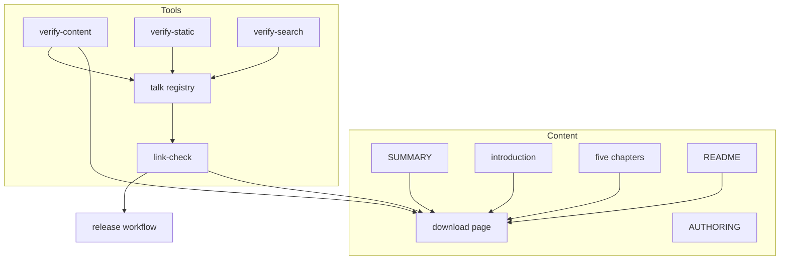
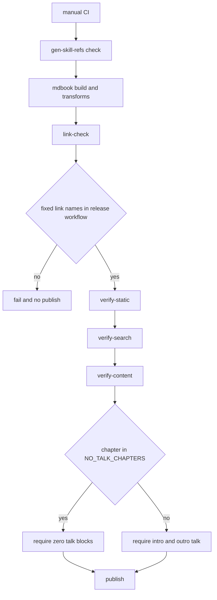

# 設計: manual-download-page

## Overview

**目的**: pasta の利用者マニュアルに「ダウンロード」のページ（`book/src/download.md`）を足し、ゴースト作者がやりたいことから取るファイルを 1 つの表で選び、最新版をそのまま落とせるようにする。トップページ（`introduction.md`）は削り込み、「まずダウンロード → 入門ガイド」へすぐ進める形にする。

**利用者**: ゴースト作者（マニュアルの読者）と、GitHub でリポジトリを最初に開いた人（README の読者）。マニュアルの保守者は、変更後もマニュアルの CI がすべて通り、規約が実態と合っている状態を受け取る。

**影響**: 変更の大半は Markdown（新しいページ 1 枚・目次・トップページ・5 章・README・執筆規約）である。検査ツールには、(1) 台詞を置かない章の一覧を 1 つ足してそれを 3 つのツールが読む変更と、(2) 最新版の固定リンクの名前をリリース CI の添付の名前と照らす検査を `link-check.mjs` に足す変更だけを入れる。新しい依存・新しいツールのファイルは作らない。

### Goals

- 目次の「はじめに」のすぐ下と扉の案内の先頭から、ダウンロードのページへ 1 手で行ける（1.1〜1.4）。
- ダウンロードのページの先頭の表で、6 つのやりたいことから 7 つの配布物へ直接たどれる（2.1〜2.5）。
- 入手の説明がダウンロードのページの 1 か所にまとまり、5 章と README はそこを指す（3.x・5.x・6.x）。
- トップページが、扉・説明・案内・対象バージョン・「将来変更あり」・締めだけになる（4.x）。
- マニュアルの CI の検査がすべて通り、台詞を置かない章の例外と固定リンクの綴りが機械で守られる（7.x）。

### Non-Goals

- 配布物そのものの名前・中身・リリース CI の変更（`release.yml` は読むだけで書き換えない）。
- 扉の意匠（CSS・顔アイコン）の作り直し。8 項目でも今の格子のまま収まる。
- 入門ガイドの本文の書き直し（入手先の案内の差し替えと、5.6 の台詞 1 か所だけ）。
- `crates/pasta_check/README.md` と配るスキル `pasta-check` の本文の入手の説明（単体で読まれる文書なので今のまま）。
- 英語版・他言語のページ、`doc/release-notes/` の過去の記述。
- ダウンロードのページに全配布物が載っていることを確かめる逆向きの検査（要件に無い。決定の記録の 6）。

## Boundary Commitments

### This Spec Owns

- `book/src/download.md` の中身（表・配布物ごとの説明・`pasta-skills.zip` の節・過去の版の節）と、その見出しの名前（＝アンカー。ほかの章と README が指す契約）。
- 目次（`SUMMARY.md`）と扉の案内（`introduction.md` の `<nav class="hero-toc">`）の「ダウンロード」の項目。
- トップページの節の取捨と並び（対象バージョンの行の形は変えない）。
- 5 章（`getting-started/prerequisites.md`・`getting-started/setup.md`・`debug/recipe.md`・`debug/validate.md`・`debug/vscode-setup.md`）と `README.md` の、入手先の案内の部分だけ。
- 台詞を置かない章の一覧 `NO_TALK_CHAPTERS`（`book/tools/talk/talk.mjs`）と、それを読む 3 つの検査の分岐。
- 最新版の固定リンクの名前の検査（`link-check.mjs` の `release-asset`）と、その自己テスト。
- 執筆規約（`book/AUTHORING.md`）の、台詞を置かない章の例外の記述。

### Out of Boundary

- 配布物の形と名前（リリース CI・`pasta-dll-multiarch` が持つ）。この spec は今の 7 つだけを載せる。
- 入門ガイドの段の章の作例と段階辞書の照合（`tutorial-check.mjs` の持ち場）。
- スキルの写しの生成規則（`GENERATION_MAP`）。触る章は生成対象ではないので、`--check` を通すだけ。
- 扉の CSS・`theme-test.mjs`・`talk-html.mjs`・`gen-skill-refs.mjs` の中身。
- リリース手順（`.claude/skills/release/procedure.md`）。行の形を保つことで手順を変えずに済ませる。

### Allowed Dependencies

- 依存の向きは今のまま: `link-check.mjs` ← `talk/talk.mjs` ← `verify-content.mjs`・`verify-static.mjs`・`verify-search.mjs`（左が下の層。右から左へだけ import する）。`link-check.mjs` は `talk.mjs` を import しない（循環になる）。
- `link-check.mjs` は `.github/workflows/release.yml` をテキストとして読むだけ（YAML の解釈器は入れない）。
- mdBook 0.5.4 の前付けの章の扱い（番号なし・検索の索引に入る）と、`headingSlug` の見出しの slug の規則をそのまま使う。
- 新しい npm パッケージ・新しいツールのファイルは足さない。

### Revalidation Triggers

- ダウンロードのページの見出し（アンカー）の名前を変えるとき: 5 章のリンクが `link-check` の `internal-anchor` で止まる。名前は下の「見出しとアンカー」の表を正とし、変えるならリンクも同じコミットで直す。
- 配布物を足す・名前を変える spec（`pasta-dll-multiarch` など）: ダウンロードのページの表と説明を直す。古い名前の固定リンクが残れば `release-asset` が止める。
- `release.yml` の「Upload release-assets」の `path:` の書き方（1 行 1 つの `release/<名前>`）を変えるとき: `release-asset` の読み取りを合わせて直す（読めなければ検査が失敗で知らせる）。
- `NO_TALK_CHAPTERS` に章を足すとき: 規約（`AUTHORING.md` 第 7 節）が「ダウンロードのページだけ」としているので、規約の改訂を伴う。
- 対象バージョンの行（`| 対象 pasta バージョン | **vX.Y.Z** |`）の形・数: リリース手順と `F-version` が依存する。この spec は変えない。

## Architecture

### Existing Architecture Analysis

- マニュアルは mdBook のソース `book/src/` と、`book/tools/` の検査（Node の ESM・依存ゼロ）で成り立つ。CI（`manual.yml`）は `gen-skill-refs --check` → ビルド → 着色 → 台詞の変換 → 索引 → `link-check` → `tutorial-check` → `verify-static`・`verify-search`・`verify-content` → 自己テストの順に走り、1 つでも落ちれば公開しない。
- 台詞の登録簿 `talk/talk.mjs` は話し手と表情の唯一の定義で、3 つの検査がすでに import している。表紙の例外（`checkRegion` の `cover`）は `verify-content` の側で章の名前から決めている。
- 4 つの検査（`D-voice`・`T-intro`/`T-outro`・`verify-static` の `8.4/8.6`・`verify-search` の `8.2`）が全章に台詞を求める。台詞の無い章を目次に足すと 5 件落ちることを、ギャップ分析で試して確かめた。
- `link-check.mjs` は GitHub の `blob`/`tree` の URL だけをローカルに照らし、`releases/…` の URL は見ていない。

### Architecture Pattern & Boundary Map



**Architecture Integration**:
- 採る形: 既存の章と検査の延長（ギャップ分析の候補 A）。例外の定義は登録簿に 1 つだけ置き、3 つの検査はそれを読んで分岐する。
- 持ち場の分け方: 中身（Markdown）と検査（`book/tools`）は別のファイルで、同じ契約（見出しの名前・`NO_TALK_CHAPTERS`・固定リンクの名前）でつながる。
- 守る既存の型: 表紙の `cover` の例外と同じく「章の名前で決まる例外」を検査の側に持つ。`detectBrokenLinks` と同じ走査（`listMarkdownFiles`＋`maskFences`）で固定リンクを拾う。`BOOK_KINDS` の [1] 区分に種別を 1 つ足す。
- 新しく足す理由: `NO_TALK_CHAPTERS` は 4 か所に同じ例外を散らさないため（候補 B を採らない理由）。`release-asset` は、要件 7.8 を満たす検査が今どこにも無いため。
- steering との整合: マニュアルが利用者向けの唯一の権威（tech.md）・ツールは依存ゼロの Node スクリプト・CI で止める（警告で続行しない）。

### Technology Stack

| Layer | Choice / Version | Role in Feature | Notes |
|-------|------------------|-----------------|-------|
| 文書 | mdBook 0.5.4（既存） | 前付けの章としてダウンロードのページを出し、検索の索引に入れる | 設定の変更なし |
| 検査 | Node（ESM・既存の `book/tools/*.mjs`） | 例外の分岐と固定リンクの検査 | 新しい依存なし |
| CI | GitHub Actions `manual.yml`（既存） | 検査を走らせ、失敗で公開を止める | `paths` に `release.yml` を足す |

## File Structure Plan

### Directory Structure

```
book/
├── src/
│   ├── SUMMARY.md                  # 「はじめに」の次に [ダウンロード](download.md)
│   ├── download.md                 # 新規: 表・配布物ごとの説明・スキルの節・過去の版
│   ├── introduction.md             # 扉の案内の先頭に項目・節の削り込み
│   ├── getting-started/
│   │   ├── prerequisites.md        # 入手先の箇条書き・Claudia の台詞 1 か所
│   │   └── setup.md                # 手順 1 のリンク
│   └── debug/
│       ├── recipe.md               # 「入手と置き方」の固定リンク 2 つ
│       ├── validate.md             # 「使い方」の固定リンク
│       └── vscode-setup.md         # VSIX の入手先のリンクを添える
├── AUTHORING.md                    # 台詞を置かない章の例外
└── tools/
    ├── talk/talk.mjs               # NO_TALK_CHAPTERS を export
    ├── verify-content.mjs          # D-voice・T-intro/T-outro の分岐と T-notalk
    ├── verify-static.mjs           # 8.4/8.6 の対象から一覧の章を外す
    ├── verify-search.mjs           # 8.2 で一覧の章は固有の語で検索する
    ├── link-check.mjs              # checkReleaseAssetLinks・種別 release-asset
    ├── link-check-test.mjs         # release-asset の自己テストの節
    ├── verify-scripts-test.mjs     # T-intro/T-outro の期待件数から一覧の章を除き、T-notalk の件数を確かめる
    └── gen-skill-refs-test.mjs     # 全章の chapterRegions の照合（K）から一覧の章を除く
README.md                           # 配布物の一覧をページへのリンクに・パートの表の先頭に行
.github/workflows/manual.yml        # paths に .github/workflows/release.yml
```

### Modified Files

- `book/src/download.md`（新規） — 中身は「Components and Interfaces / DownloadPage」のとおり。台詞・`---` の区切りを置かない。
- `book/src/SUMMARY.md` — 3 行目 `[はじめに](introduction.md)` の次の行に `[ダウンロード](download.md)` を足す（パートの見出し `# 入門 / チュートリアル` より前）。
- `book/src/introduction.md` — 「CoverTrim」のとおり。
- `book/src/getting-started/prerequisites.md`・`setup.md`、`book/src/debug/recipe.md`・`validate.md`・`vscode-setup.md` — 「ChapterRelinks」のとおり。入手先の案内だけを差し替える。
- `README.md` — 「ReadmeEntry」のとおり。
- `book/AUTHORING.md` — 「AuthoringRules」のとおり。
- `book/tools/talk/talk.mjs` — `NO_TALK_CHAPTERS` を足し、冒頭の共用 export の一覧に書き足す。
- `book/tools/verify-content.mjs`・`verify-static.mjs`・`verify-search.mjs` — 「NoTalkExemption」のとおり。冒頭の説明コメントにも例外を 1 行書く。
- `book/tools/link-check.mjs`・`link-check-test.mjs` — 「ReleaseAssetLinkCheck」のとおり。冒頭の説明コメントに検出の項を足す。
- `book/tools/verify-scripts-test.mjs`・`gen-skill-refs-test.mjs` — 「NoTalkExemption」の Implementation Notes のとおり。目次の全章を数える・回す自己テストから一覧の章を除く（直さないと CI の「Book tools self-tests」が落ちる）。
- `.github/workflows/manual.yml` — `on.push.paths` と `on.pull_request.paths` に `'.github/workflows/release.yml'` を足し、冒頭のコメントの起動条件に書き足す（添付の名前を変えたときにもマニュアルの検査が走るように）。

## System Flows



- 分岐は `NO_TALK_CHAPTERS` に載る章かどうかだけで決まる。載る章には、外した要求の代わりに「台詞が 0」（verify-content）と「固有の語で検索がヒット」（verify-search）を課す。載らない章への要求は変えない。
- どの検査も警告で続行せず、1 件でも失敗すれば公開しない（既存の流れのまま）。

## Requirements Traceability

| Requirement | Summary | Components | Interfaces | Flows |
|-------------|---------|------------|------------|-------|
| 1.1 | 目次の「はじめに」の下に番号なしの項目 | Entrances | `SUMMARY.md` の前付けの章 | — |
| 1.2 | 扉の案内の先頭に「ダウンロード Download」 | Entrances | `hero-toc` の先頭の `li` | — |
| 1.3 | 選ぶとページが開く | Entrances, ReleaseAssetLinkCheck（既存の internal-md） | `download.md` へのリンク | CI |
| 1.4 | 検索の対象に入る | Entrances, NoTalkExemption | mdBook の索引・`NO_TALK_CHAPTERS` の語 | CI |
| 2.1 | 2 列の表・6 行・この順 | DownloadPage | 表の行の契約 | — |
| 2.2 | 7 つの配布物が全部出る | DownloadPage | 表の行の契約 | — |
| 2.3 | ファイル名は固定リンクで落とす | DownloadPage, ReleaseAssetLinkCheck | `releases/latest/download/<名前>` | CI |
| 2.4 | VS Code の行は Marketplace | DownloadPage | Marketplace の URL | — |
| 2.5 | VSIX は `releases/latest` へ | DownloadPage | `releases/latest` の URL | — |
| 3.1 | 配布物ごとの 2〜4 行の説明 | DownloadPage | 節の契約 | — |
| 3.2 | 説明から詳しい章へリンク | DownloadPage | 章へのリンク | CI |
| 3.3 | recipe は種類で選び、見分け方の節へ | DownloadPage | `debug/recipe.md#入手と置き方` | CI |
| 3.4 | 固定リンクは最新・過去の版はリリースページ | DownloadPage | 「過去の版」の節 | — |
| 3.5 | スキルの節を欠けなく移す | DownloadPage, CoverTrim | 「AI 向けのスキル」の節 | — |
| 3.6 | 台詞を置かず常体で書く | DownloadPage, NoTalkExemption | `T-notalk` | CI |
| 3.7 | 安定した見出し | DownloadPage | 見出しとアンカーの表 | CI |
| 3.8 | 詳しい章の内容を写さない | DownloadPage | 節の契約 | — |
| 4.1 | 残す節 | CoverTrim | トップページの節の並び | — |
| 4.2 | 「ダウンロード → 入門ガイド」の順のリンク | CoverTrim | 案内の 1 行 | — |
| 4.3 | 「AI に…」と「歩き方」の節を置かない | CoverTrim | — | — |
| 4.4 | 関連リンクから配布物のセルを除く | CoverTrim | 関連リンクの表 | — |
| 4.5 | 対象バージョンの行を同じ形で 1 つ | CoverTrim | `F-version`・リリース手順 | CI |
| 4.6 | LuaJIT 2.1 と「将来変更あり」を残す | CoverTrim | `F-luajit`・`F-future` | CI |
| 4.7 | 権威の一文を説明のすぐ後ろに 1 行 | CoverTrim | — | — |
| 4.8 | 削った節を指すリンクの付け替え | CoverTrim, ReleaseAssetLinkCheck（既存の anchor 検査） | `internal-anchor`・`readme-manual-url` | CI |
| 5.1 | 入門 2 章の入手先をページへ | ChapterRelinks | `../download.md#…` | CI |
| 5.2 | recipe の入手先をページへ | ChapterRelinks | `../download.md#…` | CI |
| 5.3 | validate の入手先をページへ | ChapterRelinks | `../download.md#…` | CI |
| 5.4 | vscode-setup に VSIX の入手先のリンク | ChapterRelinks | `../download.md#…` | CI |
| 5.5 | 各章だけで作業が進む | ChapterRelinks | ファイル名を残してリンクする | — |
| 5.6 | Claudia の台詞を 1 か所言い直す | ChapterRelinks | `prerequisites.md` の台詞 | CI（T-syntax） |
| 6.1 | README にページへのリンク | ReadmeEntry | 公開 URL `download.html` | CI（readme-manual-url） |
| 6.2 | 一覧を置かず短い案内 | ReadmeEntry | — | — |
| 6.3 | パートの表の先頭に行 | ReadmeEntry | — | CI |
| 7.1 | CI の検査がすべて通る | NoTalkExemption, ReleaseAssetLinkCheck, 全 Content | 既存の全検査 | CI |
| 7.2 | 一覧の章だけ 4 つの要求から外す | NoTalkRegistry, NoTalkExemption | `NO_TALK_CHAPTERS` | CI |
| 7.3 | 規約に例外を書き、全章向けの記述を合わせる | AuthoringRules | `AUTHORING.md` の 6 か所 | — |
| 7.4 | 写しに影響があれば再生成 | （影響なし。`--check` を通す） | `gen-skill-refs --check` | CI |
| 7.5 | 残ったアンカーのリンクを止める | 既存の link-check | `internal-anchor` | CI |
| 7.6 | 台詞が 1 つでもあれば止める | NoTalkExemption | `T-notalk` | CI |
| 7.7 | 固有の語で検索がヒット | NoTalkRegistry, NoTalkExemption | `NO_TALK_CHAPTERS` の値・verify-search 8.2 | CI |
| 7.8 | 固定リンクの名前を添付の名前と照らす | ReleaseAssetLinkCheck | `checkReleaseAssetLinks`・`release-asset` | CI |

## Components and Interfaces

| Component | Domain/Layer | Intent | Req Coverage | Key Dependencies | Contracts |
|-----------|--------------|--------|--------------|------------------|-----------|
| DownloadPage | 中身 | やりたいこと → ファイルの表と配布物ごとの説明 | 2.1–2.5, 3.1–3.8, 1.4 | release.yml の名前（P0）・5 章の見出し（P1） | State（見出しの契約） |
| Entrances | 中身 | 目次と扉からの入口 | 1.1–1.4 | DownloadPage（P0） | — |
| CoverTrim | 中身 | トップページの削り込み | 4.1–4.8, 3.5 | リリース手順・F 検査（P0） | — |
| ChapterRelinks | 中身 | 5 章の入手先の案内の付け替え | 5.1–5.6 | DownloadPage の見出し（P0） | — |
| ReadmeEntry | 中身 | README の入手の案内 | 6.1–6.3 | 公開 URL の検査（P1） | — |
| AuthoringRules | 規約 | 台詞を置かない章の例外を規約に書く | 7.3 | NoTalkRegistry（P1） | — |
| NoTalkRegistry | 検査（登録簿） | 台詞を置かない章とその検索の語の唯一の定義 | 7.2, 7.7 | — | Service |
| NoTalkExemption | 検査 | 3 つの検査で一覧の章を外し、代わりの要求を課す | 3.6, 7.1, 7.2, 7.6, 7.7, 1.4 | NoTalkRegistry（P0） | Batch |
| ReleaseAssetLinkCheck | 検査 | 固定リンクの名前をリリース CI の添付と照らす | 7.8, 2.3, 7.1 | release.yml（P0）・manual.yml（P1） | Service, Batch |

### 中身

#### DownloadPage（`book/src/download.md`）

| Field | Detail |
|-------|--------|
| Intent | 入手の説明の唯一の置き場所 |
| Requirements | 1.4, 2.1, 2.2, 2.3, 2.4, 2.5, 3.1, 3.2, 3.3, 3.4, 3.5, 3.6, 3.7, 3.8 |

**Responsibilities & Constraints**
- ページの並び（上から）: H1 `# ダウンロード` → 表（本文の先頭。前置きの文を置かない） → 表の直後の 1 行（「ファイル名のリンクは最新版を直接落とす。過去の版は[過去の版](#過去の版)を見る。」の趣旨） → 配布物ごとの H2 の節（表の行の順） → `## 過去の版`。
- 台詞（`> 【…】`）・`---` の区切りを置かない。地の文は常体（`getting-started` 以外の章と同じ）。
- 版の番号を書かない（リリース手順が書き換えないため）。VSIX の名前は `pasta-vscode-<版>.vsix` の形で書く。
- 詳しい章が受け持つ内容（zip の中身の表・展開の手順・Windows の種類の見分け方・起動や呼び方・`cargo install`・SmartScreen）を写さず、その章へリンクする（3.8）。

**表の行の契約**（2.1・2.2・2.3・2.4・2.5。左の列は節の見出しへの同じページの中のリンクにする）

| やりたいこと | ファイル |
|---|---|
| [まずゴーストを動かしてみる](#サンプルゴースト) | `hello-pasta.nar`（固定リンク） |
| [自分のゴーストの `pasta.dll` を差し替える](#shiori-の本体) | `pasta.dll.zip`（固定リンク） |
| [VS Code を使わずに書く](#vs-code-を使わずに書くアプリ) | `pasta-recipe.x64.zip`・`pasta-recipe.arm64.zip`（固定リンク 2 つ） |
| [VS Code で書く](#vs-code-の拡張) | [Marketplace の拡張](https://marketplace.visualstudio.com/items?itemName=ekicyou.pasta-vscode)（VSIX は手動で入れるとき。[最新のリリース](https://github.com/ekicyou/pasta/releases/latest)の Assets にある） |
| [辞書を検査する・.nar を作る](#検査の-cli) | `pasta_check.zip`（固定リンク） |
| [AI に書かせる](#ai-向けのスキル) | `pasta-skills.zip`（固定リンク） |

固定リンクは `https://github.com/ekicyou/pasta/releases/latest/download/<名前>` で、`<名前>` は `release.yml` の添付の名前と完全一致させる（`release-asset` が確かめる）。

**見出しとアンカー**（3.7。ほかの章が指す契約。ファイル名を見出しにしないので、配布物の名前が変わってもアンカーは変わらない）

| 見出し（H2） | アンカー（`headingSlug`） | 中身（2〜4 行） | 詳しい章へのリンク |
|---|---|---|---|
| `## サンプルゴースト` | `#サンプルゴースト` | `hello-pasta.nar` は `pasta.dll`・シェルを含む完成版のゴースト一式。SSP のウィンドウへドロップして入れる。自分のゴーストへ写す元にもなる。同梱の `pasta.dll` の版はマニュアルの対象バージョンと同じ | `getting-started/prerequisites.md`・`getting-started/setup.md#hello-pasta-から写す` |
| `## SHIORI の本体` | `#shiori-の本体` | `pasta.dll.zip` は `pasta.dll` とライセンス表示。自分のゴーストの `ghost/master/` の `pasta.dll` を差し替える。マニュアルの対象バージョンと同じ版を使う | `getting-started/setup.md#hello-pasta-から写す`・`introduction.md#このマニュアルが対象とするバージョン` |
| `## VS Code を使わずに書くアプリ` | `#vs-code-を使わずに書くアプリ` | pasta-recipe の zip は Windows の種類ごとに 2 つ。自分の Windows（x64 か arm64）に合うほうを選ぶ。見分け方は詳しい章の節にある。使っている pasta と同じ版を使う | `debug/recipe.md#入手と置き方`（3.3） |
| `## VS Code の拡張` | `#vs-code-の拡張` | 通常は Marketplace から入れる。手動で入れるときは、最新のリリースのページの Assets にある `pasta-vscode-<版>.vsix` を使う。使っている pasta と同じ版を選ぶ | `debug/vscode-setup.md` |
| `## 検査の CLI` | `#検査の-cli` | `pasta_check.zip` は辞書の検査と `.nar` を作る CLI。使っている pasta と同じ版を使う | `debug/validate.md#使い方` |
| `## AI 向けのスキル` | `#ai-向けのスキル` | 下の「スキルの節の移設」のとおり | — （受け持つ章が無い） |
| `## 過去の版` | `#過去の版` | 固定リンクは常に最新版を落とす。過去の版は[リリースページ](https://github.com/ekicyou/pasta/releases)の各版の Assets から落とす | — |

- 各節は中身・展開や置く場所・版をそろえる注意の 3 点を含める（3.1。上の表の中身の欄の最後の文が版の注意）。

**スキルの節の移設**（3.5。`introduction.md` L41-65 から欠けなく移す）
- 3 つのスキルとその役目の表（`pasta-ghost-authoring`・`pasta-lua-coding`・`pasta-check`）。
- ゴーストの開発フォルダの `.claude/skills/` へ展開すること、展開後の木（`text` のフェンス）。
- 使っている pasta と同じ版の `pasta-skills.zip` を使うこと。
- 版を上げるときは 3 つのフォルダを消してから展開し直すことと、その理由（上書きで展開すると消えたファイルが古いまま残る）。
- 移す元の「最新版への固定のリンクか、リリースページの各版の添付から入手する」の文は、表と「過去の版」の節が受け持つので、1 行の指し示しに縮めてよい。

**Implementation Notes**
- Validation: `link-check`（同じページの中の `#…`・5 章の `../download.md#…`・固定リンクの名前）、`verify-content` の `T-syntax`・`T-notalk`、`verify-search` の固有の語で確かめる。
- Risks: 見出しの文言を後で直すとアンカーが変わる。直すときは 5 章のリンクも同じコミットで直す（`link-check` が止めるので取りこぼしは残らない）。

#### Entrances（`SUMMARY.md`・扉の案内）

- `SUMMARY.md`: `[はじめに](introduction.md)` の次の行に `[ダウンロード](download.md)`。前付けの章なので番号が付かない（1.1）。mdBook は目次の全章を索引に入れるので、検索の対象になる（1.4）。
- `introduction.md` の `<nav class="hero-toc">` の先頭に `- [ダウンロード <small>Download</small>](download.md)`。ほかの 7 項目は今の順のまま（1.2）。CSS は変えない。
- Requirements: 1.1, 1.2, 1.3, 1.4

#### CoverTrim（`book/src/introduction.md`）

| Field | Detail |
|-------|--------|
| Intent | トップページを扉・説明・案内・対象バージョン・注記・締めに絞る |
| Requirements | 3.5, 4.1, 4.2, 4.3, 4.4, 4.5, 4.6, 4.7, 4.8 |

**削り込んだ後の並び**（上から）

1. H1・扉（`<section class="claudia-hero">`。掛け合いと案内。案内の先頭に「ダウンロード」）・最初の `---`（今のまま）。
2. pasta の説明の 3 行（今の L30-32 のまま）。
3. 権威の一文を 1 行（今の L108-109 の 2 行を 1 行にまとめる。4.7）。
4. 「まずダウンロード → 入門ガイド」の案内を 1 行の段落で置く。リンクは `download.md` → `getting-started/index.md` の順（4.2）。見出しは付けない。
5. `## 関連リンク` — 表の 2 行目（配布物のセル）を消し、1 行目（GitHub リポジトリと README）だけを残す（4.4）。
6. `## このマニュアルが対象とするバージョン` — 表と LuaJIT 2.1 の説明を残す。対象バージョンの行は 1 文字も変えず、ファイルの中で 1 つのまま（4.5・4.6）。L76 の「[リリースページ](…)から新しい版を入手すること」は、入手の説明を 1 か所に寄せるため `download.md` へのリンクに替える。
7. `## 安定機能と「将来変更あり」の区別について` — 今のまま（4.6）。
8. 最後の `---`・締めの掛け合い・クレジット — 今のまま。

- 消す: 「AI にゴーストを書かせるとき」（DownloadPage へ移す。3.5）、「このマニュアルの歩き方」（内部設計パートの一文も残さない。4.3）。
- 4.8: 消す節を見出しのアンカーで指すリンクは、`book/src`・README 類・`doc/SOUL.md`・3 スキルに 0 件（ギャップ分析で確かめた）。実装時に `link-check` を通して 0 件を確かめる。見つかれば `download.md#ai-向けのスキル` へ付け替える。
- 区切りの `---` の 2 本は残す（表紙の `T-intro`・`T-outro` が最初と最後の `---` で導入・締めを切る）。

#### ChapterRelinks（5 章）

| Field | Detail |
|-------|--------|
| Intent | 各章の手順を残したまま、入手先の案内だけをダウンロードのページへのリンクにする |
| Requirements | 5.1, 5.2, 5.3, 5.4, 5.5, 5.6 |

| 章 | 今 | 付け替えた後 |
|---|---|---|
| `getting-started/prerequisites.md` L37（台詞） | 「リリースページの `hello-pasta.nar` をお取りなさいまし」 | 「リリースページ」の語だけを「ダウンロードのページ」を指す言い方に替える。話し手・表情・前後の台詞は変えない（5.6） |
| 同 L39（箇条書き） | `hello-pasta.nar` の固定リンクと過去の版のリリースページ | 「入手先: `hello-pasta.nar` は[ダウンロード](../download.md#サンプルゴースト)のページにある（過去の版もそこから辿れる）」の趣旨。直接のダウンロードのリンクは残さない（5.1） |
| 同 L42（箇条書き） | `pasta.dll.zip` の固定リンク | `pasta.dll` だけを入れ替えるときは `pasta.dll.zip` を使う（[ダウンロード](../download.md#shiori-の本体)）（5.1） |
| `getting-started/setup.md` L148（手順 1） | `hello-pasta.nar` の固定リンク | 「`hello-pasta.nar`（最新版）を[ダウンロード](../download.md#サンプルゴースト)のページから落とす。」の趣旨。手順の番号と流れは変えない（5.1） |
| `debug/recipe.md` L17-20（「入手と置き方」） | 固定リンク 2 つの箇条書き | zip が Windows の種類ごとに 2 つあることと、[ダウンロード](../download.md#vs-code-を使わずに書くアプリ)のページから落とすことを 1〜2 文で書く。見分け方・対応する Windows・中身・置き方・起動はこの節に残す（5.2） |
| `debug/validate.md` L20-22（「使い方」） | 固定リンク（裸の URL） | `pasta_check.zip` を[ダウンロード](../download.md#検査の-cli)のページから落とす旨の 1 文。展開・中身・呼び方・`cargo install` は残す（5.3） |
| `debug/vscode-setup.md` L33（代替経路） | VSIX の名前の形だけ | 「VSIX は[ダウンロード](../download.md#vs-code-の拡張)のページから辿れる最新のリリースの Assets にある」の趣旨の 1 文を添える。Marketplace と手動導入の手順は残す（5.4） |

- 5.5: どの差し替えも、取るファイルの名前を本文に残したうえでリンクする。読者は章の手順だけで「どのファイルを取るか」が分かり、リンク先で落として戻れる。
- 入門ガイドの章の決まり（`AUTHORING.md` 第 8 節）: 差し替えは箇条書きと手順の中で、台詞以外の段落を増やさない（`C-prose` に当たらない）。`C-utf8`・`C-sjis`・`C-env` の語は消さない。

#### ReadmeEntry（`README.md`）

- パートの表（L33-39）の先頭に `| [ダウンロード](https://ekicyou.github.io/pasta/download.html) | やりたいことから取るファイルを選んで、最新版を落とす |` の行を足す（6.3）。
- L41-48（「最新版の配布物は…」の文と 7 行の一覧）を、「配布物は、マニュアルの[ダウンロード](https://ekicyou.github.io/pasta/download.html)のページから入手できます（過去の版は[リリースページ](https://github.com/ekicyou/pasta/releases)）。」の 1 文にする（6.1・6.2。README の文体のです・ます）。
- `readme-manual-url` の検査が `download.html` を `book/src/download.md` に写して照らす。
- Requirements: 6.1, 6.2, 6.3

### 規約

#### AuthoringRules（`book/AUTHORING.md`）

- 7.3 のために、全章に掛け合いを求める記述 6 か所を例外と合わせる。
  1. 冒頭のコメント（L4-7）: ダウンロードのページ（`download.md`）は掛け合いを置かない旨を 1 行足す。
  2. 第 1 節「鉄則」（L45-49）: 入門ガイドの例外の文の後ろに「ダウンロードのページ（`book/src/download.md`）だけは掛け合いを置かず、本体だけで書く（第 7 節）」の趣旨を足す。
  3. 第 5 節「執筆チェックリスト」の最初の項目に「ダウンロードのページを除く」を添える。
  4. 第 7 節の冒頭（L327）の「章の導入と締めは…掛け合いで書く」に例外の参照を添える。
  5. 第 7 節「置ける場所」の表に行を足す: `| 台詞を置かない章（ダウンロードのページ。talk.mjs の NO_TALK_CHAPTERS） | 置かない | 置かない |`。表の下に「この一覧に章を足さない。足すなら規約を改める」の 1 行。
  6. 第 7 節「検査と表情の集計」の表に `T-notalk`（`verify-content.mjs`・一覧の章に台詞が 1 つも無い）の行を足し、`T-intro`・`T-outro`・出力・検索の行の「見る内容」に「一覧の章を除く（検索は一覧の語で確かめる）」を添える。`D-voice` に触れている第 7 節「掛け合いの書き方」の項にも、一覧の章は対象外と添える。
- Requirements: 7.3

### 検査

#### NoTalkRegistry（`book/tools/talk/talk.mjs`）

| Field | Detail |
|-------|--------|
| Intent | 台詞を置かない章と、その章を検索で確かめる語の唯一の定義 |
| Requirements | 7.2, 7.7 |

**Contracts**: Service [x]

##### Service Interface

```typescript
// キー: book/src からの章のパス（SUMMARY.md のリンク先と同じ書き方）。
// 値: 台詞の最初の語の代わりに verify-search が使う、その章に固有の語（4 文字以上の日本語）。
export const NO_TALK_CHAPTERS: Readonly<Record<string, string>>;
// 内容: Object.freeze({ 'download.md': 'やりたいこと' })
```
- 不変条件: キーは目次に載る章。値はその章の Markdown に現れ、ほかの章に現れない語。
- 読み手は `Object.hasOwn(NO_TALK_CHAPTERS, ch)` で判定し、値を検索の語に使う。
- `link-check.mjs` からは読まない（`talk.mjs` が `link-check.mjs` を import しているため）。

#### NoTalkExemption（`verify-content.mjs`・`verify-static.mjs`・`verify-search.mjs`）

| Field | Detail |
|-------|--------|
| Intent | 一覧の章だけを全章向けの台詞の要求から外し、代わりの要求を課す |
| Requirements | 1.4, 3.6, 7.1, 7.2, 7.6, 7.7 |

**Contracts**: Batch [x]

##### Batch / Job Contract

| ツール | 検査 | 一覧に載らない章（今のまま） | 一覧の章 |
|---|---|---|---|
| `verify-content.mjs` | `D-voice` | 散文に口調がある | 検査しない（記録もしない） |
| `verify-content.mjs` | `T-syntax` | 記法の不正なし | 同じ（外さない） |
| `verify-content.mjs` | `T-intro`・`T-outro` | `chapterRegions`＋`checkRegion` | 呼ばない。代わりに `T-notalk:<章>` で `scanTalk(md).blocks.length === 0` を求め、失敗なら台詞の行番号を並べる（3.6・7.6） |
| `verify-static.mjs` | `8.4/8.6` 全章に両方の話し手の台詞部品 | `analyzeTheme` の `missingTalk` | `missingTalk` から一覧の章（`.html` → `.md` で照らす）を除いて数える。CSS・JS・メニュー id の検査の対象には残す |
| `verify-search.mjs` | `8.2` 最初の台詞の語で章がヒット | `talkQuery` | 語を `NO_TALK_CHAPTERS[md]` にして、結果にその章の HTML が含まれることを求める。検査名は「固有の語「…」で章がヒットする」（1.4・7.7） |

- 入力の検証: 一覧の章が目次に無くても何もしない（目次に載せるのは Entrances の持ち場で、`verify-static` の全章の生成の検査が章の欠落を報告する）。
- 冪等: 同じ入力に同じ結果（既存の検査と同じ）。
- `T-syntax` を外さないので、`【` で始まる引用（名前の誤りを含む）は一覧の章でも必ず失敗になる。`T-notalk` と合わせて、台詞が 1 つでも置かれれば止まる。

**Implementation Notes**
- Integration: `verify-content` の D と T の二つのループに 1 つずつ分岐を足す（`ch = rel.slice(SRC.length + 1)`）。`verify-static` は 715 行目の検査の直前で除外した配列を作る。`verify-search` は 8.2 のループの語の取り方に分岐を足す。
- Validation: 自己テストのうち 2 本が目次の全章に縛られているので、合わせて直す（設計の検証で見つかった。コードで確かめた）。
  - `verify-scripts-test.mjs`（L82-85）は `T-intro`・`T-outro` の実行件数が目次の章の数と等しいことを求める。期待件数を「目次の章 − `NO_TALK_CHAPTERS` の章」にし、`T-notalk` が一覧の章の数だけ走ることを確かめる行を足す。`T-syntax` の件数と章の集合の照合は今のまま（外さないため）。
  - `gen-skill-refs-test.mjs`（L596-612 の K）は `book/src` の全章で `chapterRegions` が投げないことを求める。`---` の無い一覧の章は `bad-structure` で投げるので、ループから `NO_TALK_CHAPTERS` の章を除く（`gen-skill-refs.mjs` は既に `talk.mjs` を import しているので依存の向きは変わらない）。K-10（ファイルと目次の章の一致）は今のまま。
  - `verify-static` の自己テストは `grammar/index.html` を壊す型、`verify-search` の自己テストは自前の写し、`talk-test` の J-9 は区切りの無い章を飛ばすので、どれも影響しない。
- Risks: 一覧が逃げ道に使われ得る。規約（AuthoringRules の 5）で「ダウンロードのページだけ」と縛る。

#### ReleaseAssetLinkCheck（`book/tools/link-check.mjs`・`link-check-test.mjs`）

| Field | Detail |
|-------|--------|
| Intent | マニュアルの最新版の固定リンクの名前が、リリース CI の添付の名前のどれかと一致することを確かめる |
| Requirements | 2.3, 7.1, 7.8 |

**Responsibilities & Constraints**
- 走査の対象は `book/src/**/*.md` と、`checkReadmeManualLinks` と同じ読者に届く文書（各クレートの `README.md`・ルートの `README.md`・`doc/SOUL.md`・`CHECKED_SKILLS` の 3 スキルの `*.md`）。対象の一覧は `checkReadmeManualLinks` の中から関数 `readerDocs(repoRoot)` に切り出して両方で使う（同じ一覧を 2 つ書かない）。フェンスの中は `maskFences` で外す。リンク記法・`<…>` の自動リンク・裸の URL のどれも拾うため、`extractLinks` ではなく正規表現で URL を探す。
- 添付の名前の正は `.github/workflows/release.yml` の「Upload release-assets」の `path:` の行（今は 7 行）。字下げの後ろが `release/<名前>` だけの行から `<名前>` を取る。`${{ … }}` を含む行（VSIX）は名前が固まらないので取らない。
- 添付の一覧は、固定リンクが 1 つでも見つかったときだけ読む（フィクスチャの自己テストに `release.yml` を要らせないため）。

**Contracts**: Service [x] / Batch [x]

##### Service Interface

```typescript
type BrokenLink = {
  file: string;    // リポジトリルートからの相対パス（/ 区切り）
  target: string;  // 見つけた URL
  kind: 'release-asset';
  detail: string;  // 行番号・名前・添付の名前の一覧を含む
};

// 固定リンクの URL: https://github.com/${REPO_SLUG}/releases/latest/download/<名前>
// <名前> は [\w.-]* で取り、末尾の . を落とす（裸の URL の直後の句点を名前に含めない）。空の名前も違反。
export function checkReleaseAssetLinks(repoRoot?: string): BrokenLink[];
```
- 事前条件: なし（`book/src` が無ければ空を返す。既存の `listMarkdownFiles` と同じ）。
- 事後条件: 見つけた固定リンクのうち、名前が添付の名前に無いものを 1 件ずつ返す。`release.yml` が無い、または名前が 1 つも取れないときは、`file: '.github/workflows/release.yml'` の 1 件（「リリース CI の添付の一覧が読めない」）を返し、個々の照合はしない（書き方が変わったことを黙って通さない）。
- 不変条件: `book/src` と `release.yml` は読むだけ。
- `BOOK_KINDS` に `'release-asset'` を足し、`runLinkCheck` の `broken` に結果を足す。`reportLinkCheck` の [1] の見出しの説明に「最新版の固定リンク」を足す。終了コードの規則は今のまま（違反あり exit 1）。

**Implementation Notes**
- Integration: 名前の取り出しは行の正規表現で済ませる。`shortcut: release.yml の upload の path: が 1 行 1 つの release/<名前> であることに頼る。書き方を変えたら読み取りも直す`のコメントを付ける。
- Validation: `link-check-test.mjs` に節を 1 つ足す。一時フォルダに `book/src/*.md` と `.github/workflows/release.yml` の最小のフィクスチャを置き、(1) 一致するリンク（リンク記法と `<…>`）は 0 件、(2) 綴りの違う名前は `release-asset` 1 件（行番号つき）、(3) フェンスの中は数えない、(4) `${{ … }}` の行の名前は添付に入らない、(5) `release.yml` が無ければ読めない旨の 1 件、(6) 固定リンクが 1 つも無ければ `release.yml` が無くても 0 件、(7) `book/src` の外の読者に届く文書（フィクスチャの `README.md`）の綴りの違う名前も 1 件、を確かめる。実リポジトリが 0 件であることは既存の (A) の検査（`BOOK_KINDS` の種別が 0 件）が確かめる。
- Risks: 名前を変える spec が `release.yml` だけを直すと、マニュアルの CI が走らずに古いリンクが残る。`manual.yml` の `paths` に `release.yml` を足して防ぐ。

## Data Models

### Domain Model

- **配布物**（7 つ）: 名前（`release.yml` の添付の名前が正）・やりたいこと（表の左の列）・節の見出し（アンカー）・詳しい章。名前と見出しを分けて持つので、名前の変更が見出しに響かない。
- **台詞を置かない章**: 章のパスと検索の語の組。今は 1 組。
- 不変条件:
  - 表の 6 行と節の 6 つは同じ順で 1 対 1（「過去の版」の節は表に対応しない）。
  - マニュアルの中の固定リンクの名前は、すべて添付の名前に含まれる（`release-asset`）。
  - 対象バージョンの行は `introduction.md` に 1 つだけ（リリース手順・`F-version`）。ダウンロードのページに版の番号を書かない。

## Error Handling

### Error Strategy

- どの検査も、違反を全件並べてから失敗（exit 1）で止める。公開は `manual.yml` の `needs: build` で止まる（既存の型）。
- 失敗の文面は、章のパス・行番号（取れるもの）・種別・直し方の手がかりを含める。

### Error Categories and Responses

| 失敗 | 出る場所 | 直し方 |
|---|---|---|
| `release-asset`（名前の不一致） | `link-check` の [1] | 名前を `release.yml` の添付の名前に合わせる（またはページから外す） |
| `release-asset`（一覧が読めない） | `link-check` の [1] | `release.yml` の upload の書き方に合わせて読み取りを直す |
| `T-notalk` | `verify-content` | ダウンロードのページから台詞を消す |
| `8.2` の固有の語でヒットしない | `verify-search` | 語がページに在り、ほかの章に無いかを確かめ、`NO_TALK_CHAPTERS` の語を直す |
| `internal-anchor` | `link-check` の [1] | 見出しの名前とリンクを合わせる |
| `F-version` | `verify-content` | 対象バージョンの行の形を戻す |

### Monitoring

- 追加の監視は無い。CI の失敗のログが一次情報である。

## Testing Strategy

### Unit Tests（自己テスト）

- `link-check-test.mjs` の新しい節: ReleaseAssetLinkCheck の (1)〜(7)（上の Implementation Notes）。`BOOK_KINDS` に `release-asset` が入り、`reportLinkCheck` が [1] に出すことも 1 件確かめる。
- `verify-scripts-test.mjs`・`gen-skill-refs-test.mjs`: 一覧の章を除いた期待で、`node book/tools/verify-scripts-test.mjs`・`node book/tools/gen-skill-refs-test.mjs` が通る（NoTalkExemption の Implementation Notes）。

### Integration Tests（実リポジトリでの CI の検査）

- `node book/tools/link-check.mjs`: ダウンロードのページの同じページの中のリンク 6 つ、5 章の `../download.md#…` の 6 つ、README の `download.html`、すべての固定リンクの名前が通る（1.3・3.2・3.3・3.7・5.x・6.1・7.5・7.8）。
- `node book/tools/verify-content.mjs`: `F-version`・`F-luajit`・`F-future` が通り（4.5・4.6）、`T-notalk:download.md` が PASS、`D-voice`・`T-intro`・`T-outro` の `download.md` の項目が出ず、ほかの章の件数が変わらない（3.6・7.2・7.6）。`C-*`（入門ガイド）が通る（5.1・5.6）。
- `node book/tools/verify-static.mjs --no-build --self-test`: 目次の全章の生成に `download.html` が入り、`8.4/8.6` が通る。CSS・JS・メニュー id の検査の対象に `download.html` が残る（1.1・7.2）。
- `node book/tools/verify-search.mjs --no-build --self-test`: 「8.2: download.md の固有の語「やりたいこと」で章がヒットする」が PASS（1.4・7.7）。
- `node book/tools/gen-skill-refs.mjs --check` と `node book/tools/tutorial-check.mjs` が今のまま通る（7.1・7.4）。

### Review（人が見る点。要件の文言で機械にしないもの）

- ダウンロードのページの表が 6 行・この順で、7 つの配布物が全部出ている（2.1・2.2）。各節が 2〜4 行で、詳しい章の内容を写していない（3.1・3.8）。スキルの節が 4 点そろっている（3.5）。地の文が常体（3.6）。
- トップページの並びが「CoverTrim」の 1〜8 のとおりで、対象バージョンの行が `grep -cF '| 対象 pasta バージョン | **v0.6.0** |' book/src/introduction.md` で 1（4.1〜4.7）。
- 5 章を、リンクの先へ行かずに読んでも、取るファイルの名前と手順の流れが分かる（5.5）。

## 決定の記録

2026-11-14 の設計ディスカッションで、6 件すべてを推奨案で確定した。

1. **台詞を置かない章の除外の方式**: 候補 A（`talk.mjs` に `NO_TALK_CHAPTERS` を 1 つ置き、3 つのツールが読む）。`D-voice` は外すだけで、「口調が無いこと」を求める逆の検査は作らない（常体は人のレビュー）。
2. **検索の固有の語**: 表の見出しの「やりたいこと」。固有であること自体は検査せず、ヒットするかだけを見る。
3. **見出しとアンカーの名前**: 配布物の役目の日本語の見出し（上の「見出しとアンカー」の表）。表の左の列から各節へ同じページの中でリンクする。
4. **トップページの細部**: 案内は見出しなしの 1 行の段落、「関連リンク」は見出しと 1 行の表のまま、対象バージョンの節の入手のリンクは `download.md` へ替える。
5. **固定リンクの検査の範囲**: `book/src` に加えて、`checkReadmeManualLinks` が読者に届く文書として見ている一覧（各クレートの README・ルートの README・`doc/SOUL.md`・配る 3 スキル）にも掛ける。直接の固定リンクを残すと決めた `crates/pasta_check/README.md` と `pasta-check` のスキルを機械で守るため。要件 7.8 もこれに合わせて直した。
6. **逆向きの検査（全配布物がページに載る）**: 入れない。配布物を足す spec がページを直す（brief）。古い名前は 5 の検査が止める。
