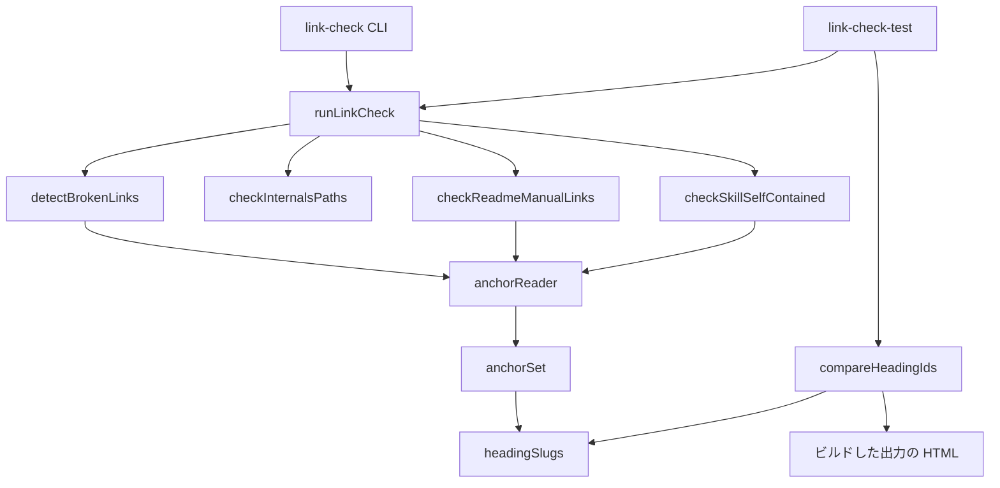
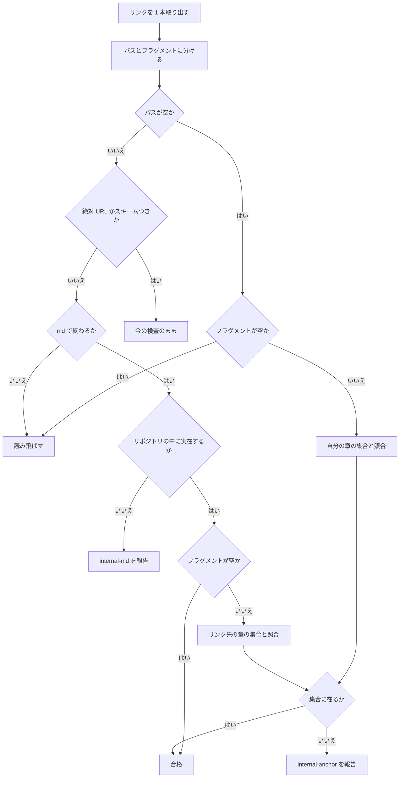

# Design Document: manual-link-anchor-check

## Overview

**Purpose**: マニュアルのリンク検証（`book/tools/link-check.mjs`）が、リンク先の章の実在に加えて、見出し（`#…`）の実在まで見るようにする。見出しの文言を変えたときに、そこを指すリンクの直し忘れを、DoD のゲートと CI が止める。

**Users**: マニュアルの執筆者（AI エージェントを含む）と、spec を完了させる開発者が、今と同じコマンド（`node book/tools/link-check.mjs`）で使う。恩恵を受けるのは、リンクをたどって目当ての節に着地するマニュアルの読者である。

**Impact**: 本の中のリンク 585 本（同じ章の中 162・他の章 423）が、新しく見出しの検査の対象になる。公開 URL の検査の対象が、クレートの README（7 ファイル・28 本）から、ルートの `README.md`（9 本）・`SOUL.md`（3 本）・2 スキルの Markdown（28 ファイル・193 本）へ広がる。今のリポジトリでは、どれも違反 0 件である（2026-10-10・`d8e88ba1` で計測）。

### Goals

- 本の中のリンク（`章.md#見出し`・`#見出し`）が実在しない見出しを指していたら、リンク検証が落ちる
- 公開 URL の検査を、読者に届く文書（ルートの `README.md`・`SOUL.md`・2 スキルの Markdown）へ広げ、本の中のリンクと同じ規則で判定する
- 今のリポジトリで誤検出 0 件。走らせ方（コマンド・依存・ビルド不要）を変えない
- 見出しの `id` の作り方が mdBook とずれたら、CI の自己テストが気づく

### Non-Goals

- 外部サイトの見出し、GitHub の URL のフラグメント（`#L10`）、印刷用ページ（`print.html`）の中のリンク
- 見出しの `id` の作り方（`headingSlug`）を変えること。食い違いうる形の見出しを禁じる決まりを足すこと
- リンクとして拾う記法を増やすこと（参照形式のリンク・HTML タグのリンク）
- `.github/workflows/manual.yml`・`book/tools/verify-static.mjs`・`book/AUTHORING.md`・`.kiro/steering/workflow.md` の変更
- `<a>` のほかの要素の `id`（`<span id>` など）を合格にすること

## Boundary Commitments

### This Spec Owns

- `detectBrokenLinks` の中の、本の中のリンクの見出しの照合と、違反の区分 `internal-anchor`
- 公開 URL の検査（`checkReadmeManualLinks`・`manualUrlProblem`）の対象の一覧と、裸の URL の終わりの決め方
- 違反の報告（`reportLinkCheck`）の [1] の区分に入る種別の一覧（`BOOK_KINDS`）
- 自己テスト（`book/tools/link-check-test.mjs`）の、見出しの検査の節と、ビルドした出力との `id` の突き合わせ
- 実装の時点で見つかった、実在しない見出しを指すリンクの行（今は 0 本）

### Out of Boundary

- 見出しから `id` を作る規則そのもの（`headingSlug`・`headingSlugs`・`anchorSet`・`decodeAnchor`・`maskFences`）。本 spec は呼ぶだけで、書き換えない
- スキルの自己完結の検査（`checkSkillSelfContained`）の規則と区分、内部設計章のパスの検査（`checkInternalsPaths`）
- マニュアルの CI の定義（起動する `paths`・手順の順）。ルートの `README.md`・`SOUL.md` だけを変えたときに CI を起動することは、本 spec では足さない。完了時の棚卸で、`manual.yml` の持ち主へ申し送る（下の「完了時の申し送り」）
- `gen-skill-refs.mjs` と、スキルの生成ファイルの中身
- 章の本文（切れたリンクの行のほか）

### Allowed Dependencies

- Node の標準モジュール（`node:fs`・`node:path`・`node:url`。自己テストは加えて `node:os`・`node:child_process`）だけ。npm の依存を足さない
- `link-check.mjs` は、マニュアルをビルドした出力（`book/book/`）を読まない。git もネットワークも使わない
- 自己テストだけが、`book/book/` を読んでよい（在るときだけ・読むだけ）
- `link-check.mjs` は `gen-skill-refs.mjs` を import しない（逆向きの import が既に在る）

### Revalidation Triggers

- mdBook の版を上げる（CI は 0.5.3 に固定）。見出しの `id` の作り方が変わると、自己テストの (I) が CI で落ちる。落ちたら `headingSlug` を合わせる spec を起こす
- `manual.yml` で「Book tools self-tests」を `mdbook build` より前へ動かす。(I) が CI で落ちる（7.8。黙って飛ぶことは無い）。落ちたら手順の順を戻す（`manual.yml` はこのウェーブでは `manual-print-media-refs` が持つ）
- テーマが、本文の外に `id` つきの `<h1>`〜`<h6>` を足す。(I) が落ちる
- `gen-skill-refs.mjs` が、生成ファイルの先頭のコメント（`（公開 URL）から自動生成…`）の形を変える。公開 URL の拾い方に響く
- 公開 URL を持つ文書が増える（対象の一覧に足すかを決める）
- 違反の区分の名前・`{ file, target, kind, detail }` の形を変える（自己テストが読む）

## 完了時の申し送り

本 spec の完了時の棚卸（`kiro-complete`）で、次を扱う。

- **`manual.yml` の `paths` に `README.md` と `SOUL.md` を足す**（`push` と `pull_request` の 2 か所）。公開 URL の検査をこの 2 つへ広げたが、今の `paths` には入っていないので、この 2 つだけを変えた PR では検査が走らない。切れた URL は、次に `book/` かスキルを触った無関係な PR で初めて落ちる
  - `manual-print-media-refs` が未完了なら、その brief に 1 行足して申し送る（`manual.yml` はこのウェーブでは相手が持つ）
  - `manual-print-media-refs` が完了済みなら、約束の理由（同じウェーブでの衝突を避ける）が消えているので、棚卸の場で足す
- DoD の Manual Sync Gate の発火条件（`workflow.md`）は変えない。CI が拾えば足りる

## Architecture

### Existing Architecture Analysis

`link-check.mjs`（479 行・依存なし）は、検査ごとの関数が違反の配列（`{ file, target, kind, detail }`）を返し、`runLinkCheck` が連結し、`reportLinkCheck` が [1] リンク切れ・[2] スキル自己完結に分けて表示する。方針は、git に依らない・決定的・`book/src` は読むだけ・終了コードは 0／1／2 である。

見出しの照合に要る部品は揃っている。`anchorSet`（見出しの `id` と、フェンスの外の `<a id>`・`<a name>` を合わせた集合）、`decodeAnchor`（パーセントエンコードの復号）、同じ形の照合の手本（スキルの検査の `skill-anchor`）である。使っていないのは、本の中のリンクの検査（`detectBrokenLinks`）だけである。

守る制約:

- DoD の Manual Sync Gate・Internals Sync Gate は、**ビルドなしで** `node book/tools/link-check.mjs` を走らせる。`link-check.mjs` はビルドした出力に依れない
- CI は、`mdbook build` と後処理（着色・台詞部品・検索索引）の後で、リンク検証、自己テストの順に走らせる。自己テストの時点で `book/book/` は在り、`book/book/classic/` はまだ無い
- `gen-skill-refs.mjs`・`verify-content.mjs`・`talk/talk.mjs` が `LINK_RE`・`maskFences`・`listMarkdownFiles`・`REPO_ROOT` を import している。これらの形を変えない

### Architecture Pattern & Boundary Map



**Architecture Integration**:

- 採る形: 既存の関数の拡張（`research.md` の Option A）。新しいファイル・依存・層は足さない
- 新しく足す部品は 2 つだけ。`anchorReader`（スキルの検査の中に在る `anchorsOf` を、3 つの検査が使えるように外へ出したもの）と、自己テストの中の `compareHeadingIds`
- 見出しの判定は、3 つの検査（本の中のリンク・公開 URL・スキル）のどれも `anchorReader` が返す集合と `decodeAnchor` を通る。「同じ規則で判定する」（4.2）を、同じ関数を通ることで満たす
- `link-check.mjs` から `book/book/` への矢印は無い。ビルドした出力を読むのは自己テストだけである

### Technology Stack

| Layer | Choice / Version | Role in Feature | Notes |
|-------|------------------|-----------------|-------|
| CLI | Node（CI は 20）・標準モジュールだけ | リンク検証と自己テスト | 依存を足さない |
| 突き合わせの相手 | mdBook 0.5.3（CI）・0.5.4（手元） | 自己テストの (I) が、出力の見出しの `id` と比べる | 0.5.3 と 0.5.4 で `id` の作り方は同じ（`research.md` RN1） |

## File Structure Plan

### Modified Files

- `book/tools/link-check.mjs` — 次の 5 か所。新しい export は `BOOK_KINDS` だけ
  - `detectBrokenLinks`: 見出しの照合と `internal-anchor` を足す
  - `anchorReader`（新設・非公開）: ファイルごとの `anchorSet` を、検査 1 回の間だけ覚える。`checkSkillSelfContained` の中の `anchorsOf` を、これに置き換える（動作は同じ）
  - `manualUrlProblem`・`checkReadmeManualLinks`: 対象の一覧を広げる。集合を `anchorReader` から取る
  - `BARE_MANUAL_URL_RE`: 裸の URL を全角の括弧で終える
  - `BOOK_KINDS`・`reportLinkCheck`: `internal-anchor` を [1] の区分に足す。[1] の見出しの文言を直す。先頭のコメントを直す
- `book/tools/link-check-test.mjs` — 見本の直し 3 か所（B-11・E-1・G-2）、`BOOK_KINDS` の写しを import に替える、節 (H)・(G-6)・(I) を足す（(I) は自己テストの中の関数 `compareHeadingIds` を使う）
- `book/src/**/*.md` — 実装の時点で `internal-anchor` が出たリンクの行だけ（今は 0 本。同じウェーブの spec が先に見出しを変えたときに限る）

新しいファイルは無い。

## System Flows

`detectBrokenLinks` が、リンク 1 本をどう判定するか。太い変更は、空のパスの枝（今は読み飛ばす）と、実在を確かめた後の枝の 2 つである。



- ファイルが無いときは `internal-md` だけを報告して終わる。見出しの違反を重ねない（1.3）
- 絶対 URL（GitHub の blob／tree を含む）のフラグメントは、今のまま見ない（`#L10` など）
- `.md` で終わらないパスにフラグメントが付いたリンクは、今のまま対象外である（今のマニュアルに 0 本）

## Requirements Traceability

| Requirement | Summary | Components | Interfaces | Flows |
|-------------|---------|------------|------------|-------|
| 1.1 | 他の章の無い見出しを報告 | detectBrokenLinks | `internal-anchor` | 実在 → 照合 → 報告 |
| 1.2 | 在る見出しは報告しない | detectBrokenLinks・anchorReader | — | 実在 → 照合 → 合格 |
| 1.3 | ファイルが無いときは重ねない | detectBrokenLinks | `internal-md` | 実在しない枝で終わる |
| 1.4 | 空のフラグメントは章の実在だけ | detectBrokenLinks | — | フラグメントが空 → 合格 |
| 1.5 | 台詞部品の中のリンクも同じ規則 | detectBrokenLinks（`extractLinks` は引用ブロックを区別しない） | — | 同じ流れ |
| 2.1 | 同じ章の無い見出しを報告 | detectBrokenLinks | `internal-anchor` | 空のパス → 自分の章と照合 |
| 2.2 | 同じ章の在る見出しは報告しない | detectBrokenLinks・anchorReader | — | 同上 → 合格 |
| 3.1 | 公開ページの `id` と同じ文字列で照合（大小を区別） | anchorReader（`anchorSet` の `Set` の一致） | — | — |
| 3.2 | パーセントエンコードは復号して照合 | `decodeAnchor`（既存） | — | — |
| 3.3 | 重複の付番 | `headingSlugs`（既存） | — | — |
| 3.4 | 記号・全角・インラインコード | `headingSlug`（既存。764 個で一致を計測） | — | — |
| 3.5 | フェンスの中の `#` 行は見出しでない | `headingSlugs`（`maskFences`。既存） | — | — |
| 3.6 | 明示のアンカー `<a id>` | `anchorSet`（既存） | — | — |
| 3.7 | 全章の全見出しがビルドの出力と同じ `id` | 自己テスト (I) `compareHeadingIds` | — | — |
| 4.1 | クレートの README の見出し（今の動作） | manualUrlProblem | `readme-manual-url` | — |
| 4.2 | 公開 URL と本の中のリンクは同じ規則 | anchorReader・`decodeAnchor` を 3 つの検査が共用 | — | — |
| 4.3 | 作業ツリーの今の章と照合 | manualUrlProblem（`book/src` を読む。今のまま） | — | — |
| 4.4 | 対象を README・SOUL.md・2 スキルへ広げる | checkReadmeManualLinks（対象の一覧） | — | — |
| 4.5 | 章が無いページを指す URL を報告 | manualUrlProblem | `readme-manual-url` | — |
| 4.6 | クレートの README と同じ区分・文面 | manualUrlProblem（対象に依らず 1 つの関数） | `readme-manual-url` | — |
| 4.7 | 広げた対象で違反 0 件 | BARE_MANUAL_URL_RE（全角の括弧で終える）・自己テスト G-4 | — | — |
| 5.1 | リンク元・書かれたとおりのリンク先・章・見出しを示す | detectBrokenLinks（違反の形） | `file`・`target`・`detail` | — |
| 5.2 | ファイルが無い違反と見分けられる区分 | `internal-anchor` と `internal-md` | `kind` | — |
| 5.3 | 違反が在れば失敗 | runLinkCheck（今のまま。配列が空でなければ失敗） | 終了コード 1 | — |
| 5.4 | 違反が無ければ成功 | runLinkCheck（今のまま） | 終了コード 0 | — |
| 5.5 | 同じ入力に同じ順 | detectBrokenLinks（リンクの出現順）・checkReadmeManualLinks（対象の順を固定） | — | — |
| 6.1 | 今のマニュアルで見出しの違反 0 件 | 計測（585 本・0 件）・自己テスト (A)・H-3 | — | — |
| 6.2 | ビルドの有無で結果が変わらない | `link-check.mjs` は `book/book/` を読まない・自己テスト I-1 | — | — |
| 6.3 | 同じコマンド・依存なし・ネットワークなし | import を足さない | — | — |
| 6.4 | これまでの判定を変えない | 既存の枝を動かさない・自己テスト A〜G | — | — |
| 6.5 | リンクを拾う範囲は今と同じ | detectBrokenLinks（`extractLinks(text)` のまま。フェンスもインラインコードも外さない） | — | — |
| 7.1 | 無い見出しの検出を確かめる | 自己テスト H-2・G-6 | — | — |
| 7.2 | 在る見出しで誤検出が無いことを確かめる | 自己テスト H-1 | — | — |
| 7.3 | 実リポジトリで違反 0 件を確かめる | 自己テスト (A)・H-3・G-4 | — | — |
| 7.4 | 見つかった切れリンクは行だけ直す | File Structure Plan（`book/src` はリンクの行だけ） | — | — |
| 7.5 | 依存なし・本物の `book/src` を書き換えない | 自己テスト（見本は一時フォルダ。(I) は読むだけ） | — | — |
| 7.6 | 出力が在れば全見出しを突き合わせる | 自己テスト I-2 `compareHeadingIds` | — | — |
| 7.7 | CI の外で出力が無ければ飛ばす | 自己テスト I-2（`null` で飛ばす） | — | — |
| 7.8 | CI の中では、出力が在り・飛ばし 0 章まで求める | 自己テスト I-2（環境変数 `CI`） | — | — |

## Components and Interfaces

| Component | Domain/Layer | Intent | Req Coverage | Key Dependencies | Contracts |
|-----------|--------------|--------|--------------|------------------|-----------|
| anchorReader | link-check・補助 | 章ごとのアンカーの集合を、検査 1 回の間だけ覚える | 3.1, 3.3〜3.6, 4.2 | `anchorSet`（P0） | Service |
| detectBrokenLinks | link-check・検査 | 本の中のリンクの見出しを照合する | 1.1〜1.5, 2.1, 2.2, 3.2, 5.1, 5.2, 5.5, 6.4, 6.5 | anchorReader・`decodeAnchor`（P0） | Service |
| checkReadmeManualLinks | link-check・検査 | 公開 URL の検査を、読者に届く文書へ広げる | 4.1〜4.7, 5.5 | manualUrlProblem・anchorReader（P0） | Service |
| reportLinkCheck | link-check・報告 | `internal-anchor` を [1] の区分に出す | 5.2〜5.4 | `BOOK_KINDS`（P0） | Service |
| link-check-test | 自己テスト | 見出しの検査と、`id` の突き合わせを守る | 3.7, 6.1, 6.2, 7.1〜7.8 | link-check の export（P0）・`book/book/`（P2・在るときだけ） | Batch |

### link-check.mjs

#### anchorReader（新設・非公開）

| Field | Detail |
|-------|--------|
| Intent | ファイルの絶対パスから、アンカーの集合（`anchorSet`）を返す。同じファイルは 1 度だけ読む |
| Requirements | 3.1, 3.3, 3.4, 3.5, 3.6, 4.2 |

**Responsibilities & Constraints**

- `checkSkillSelfContained` の中に今ある `anchorsOf`（`Map` と `anchorSet`）を、モジュールの中の関数に出したものである。規則は足さない
- 覚える期間は、検査の関数 1 回の呼び出しの間だけである。モジュールの変数には置かない（自己テストは同じプロセスで見本を書き換えて何度も走らせる。古い集合が残ると 5.5 が破れる）
- 3 つの検査（`detectBrokenLinks`・`checkReadmeManualLinks`・`checkSkillSelfContained`）が、それぞれ自分の 1 個を作る。検査の間で共有しない（60 章を 3 回読んでも数十ミリ秒で、共有のために `runLinkCheck` や export の引数を変える理由が無い）

##### Service Interface

```typescript
// 非公開。呼ぶたびに空の覚えを持つ読み手を返す。
function anchorReader(): (absPath: string) => Set<string>;
```

- Preconditions: `absPath` は実在する Markdown のファイル（呼ぶ側が実在を確かめた後で呼ぶ）
- Postconditions: フェンスの外の ATX 見出しの `id`（重複は `-1`・`-2`…）と、フェンスの外の `<a id>`・`<a name>` の値の集合を返す
- Invariants: 照合は `Set` の一致で、大文字と小文字を区別する

#### detectBrokenLinks（拡張）

| Field | Detail |
|-------|--------|
| Intent | 本の中のリンクが指す見出しの実在を確かめる |
| Requirements | 1.1, 1.2, 1.3, 1.4, 1.5, 2.1, 2.2, 3.2, 5.1, 5.2, 5.5, 6.4, 6.5 |

**Responsibilities & Constraints**

- 判定の流れは System Flows のとおり。今ある枝（GitHub の URL・外部 URL・トラバーサル・ファイルの実在）は、順番も文面も動かさない
- フラグメントは、書かれたリンク先の最初の `#` より後ろを `decodeAnchor` で復号したものである。パスは今の `stripFragment`（`#` と `?` を落とす）のままである
- リンクを拾う範囲は今と同じ（`extractLinks(text)`。フェンスの中・インラインコードの中・引用ブロックの中も拾う）
- 行番号は付けない（同じ関数が出す `internal-md` に無い。リンク元のファイルと書かれたとおりのリンク先で、検索して行に着ける）
- リンク先が `book/src` の外の `.md`（リポジトリの中）でも、同じ集合で照合する（今のマニュアルに 0 本。別の規則を足さない）

##### Service Interface

```typescript
type Broken = { file: string; target: string; kind: string; detail: string };

// シグネチャは今のまま。
export function detectBrokenLinks(repoRoot?: string): Broken[];
```

見出しの違反 1 件の形（5.1・5.2）:

| 欄 | 中身 |
|----|------|
| `file` | リンク元のファイル（リポジトリからの相対パス） |
| `target` | 書かれているとおりのリンク先（復号しない） |
| `kind` | `internal-anchor` |
| `detail` | `リンク先 <章のリポジトリからの相対パス> に見出し／明示アンカー "<復号した見出し>" が無い` |

`detail` の文面は、スキルの検査の `skill-anchor` と同じである。同じ章の中のリンクでは、章の欄にリンク元と同じパスが入る。表示の例:

```text
  BROKEN  book/src/getting-started/03-talk.md  ->  ../grammar/action-line.md#会話の書き方
          [internal-anchor] リンク先 book/src/grammar/action-line.md に見出し／明示アンカー "会話の書き方" が無い
```

- Postconditions: 違反は、ファイルの走査順・ファイルの中のリンクの出現順に並ぶ（今と同じ）
- Invariants: `book/src` は読むだけ。`book/book/` を読まない

**Implementation Notes**

- Risks: 同じウェーブの spec（`choice-line-layout`・`hello-pasta-shell-art`）が先に見出しを変えると、本 spec の PR で初めて違反が出る。出たらリンクの行だけを直す（7.4）

#### checkReadmeManualLinks・manualUrlProblem（拡張）

| Field | Detail |
|-------|--------|
| Intent | 公開マニュアルの URL の検査を、読者に届く文書へ広げる |
| Requirements | 4.1, 4.2, 4.3, 4.4, 4.5, 4.6, 4.7, 5.5 |

**Responsibilities & Constraints**

- 対象のファイル（この順。無いファイルは飛ばす）:
  1. `crates/*/README.md`（名前順。今のまま）
  2. `README.md`
  3. `SOUL.md`
  4. 2 スキル（`CHECKED_SKILLS` の順）の `**/*.md`（パス順）。生成ファイルも含める
- `.kiro/steering/roadmap.md` は入れない。入れ子の README（`crates/x/docs/README.md`）と、クレートの README のほかの Markdown も、今のまま対象外である
- `crates/` が無いときに空を返す今の早い戻りは外す（ルートの `README.md` だけでも検査する）
- URL を拾う範囲は、どの対象でも今の規則のまま（フェンスの外・インラインコードの外の、インラインリンクと裸の URL）。HTML コメントの中は外さない（生成ファイルの先頭のコメントにある章の URL も拾い、章の実在を見る）
- 区分は、どの対象でも `readme-manual-url` のまま。文面も `manualUrlProblem` が返すものをそのまま使う（4.6）。関数の名前（`checkReadmeManualLinks`）も変えない
- **裸の URL の終わり**: `BARE_MANUAL_URL_RE` の「URL に含めない文字」に、全角の括弧（`（` `）` `「` `」` `『` `』` `【` `】`）を足す。今の決め方のまま対象を広げると、誤検出が 24 件出る（`SOUL.md` 16 行目の `（公開: https://ekicyou.github.io/pasta/）` が 1 件、スキルの生成ファイル 23 本の先頭のコメント `（https://…/x.html）から自動生成…` が各 1 件）。足すと 0 件になる。公開ページの `id` は英数字・文字・`_`・`-` だけでできているので、全角の括弧で切っても、正しい URL が短くなることは無い。クレートの README から拾う URL は、足す前と後で 1 本も変わらない（7 ファイル・28 本で計測）
- スキルの生成ファイルを含める理由: 手書きと生成を見分けるには、生成の対応表（`gen-skill-refs.mjs`）を読むことになり、import が循環する。含めれば見分けが要らず、生成器が作る URL の写像も同じ検査で確かめられる。章のリンクが切れると、章の側（`internal-anchor`）と生成ファイルの側（`readme-manual-url`）の両方に出るが、直し方は同じである（章を直して再生成する）

##### Service Interface

```typescript
// シグネチャは今のまま。
export function checkReadmeManualLinks(repoRoot?: string): Broken[];

// 非公開。第 3 引数に読み手を足す。
function manualUrlProblem(repoRoot: string, url: string, anchorsOf: (absPath: string) => Set<string>): string | null;
```

- Postconditions: 違反は、対象のファイルの順・行の順に並ぶ。`detail` は `L<行番号>: <manualUrlProblem の文面>`（今のまま）
- Invariants: 照合の相手は作業ツリーの `book/src`（4.3）。ネットワークを使わない

#### BOOK_KINDS・reportLinkCheck（拡張）

| Field | Detail |
|-------|--------|
| Intent | 見出しの違反を [1] の区分に出す |
| Requirements | 5.2, 5.3, 5.4 |

- `BOOK_KINDS` に `internal-anchor` を足し、export する。自己テストが持つ写し（(A) の `BOOK_KINDS`）を消して import に替える（足し忘れる場所を 1 つ減らす）
- [1] の見出しの文言を、中身に合わせて直す: `[1] リンク切れ（book 内 .md・見出し / リポジトリ内 GitHub URL / 内部設計章のパス / マニュアルの公開 URL）: N 件`。自己テストは件数の部分（`[1]…: N 件`）だけを読むので、文言を変えても落ちない
- 終了コードの決め方（違反が 1 件でも在れば 1）は、今のまま

### link-check-test.mjs

#### 見本の直し（既存の節）

照合と対象の拡大で、今の見本のままでは落ちる所が 3 つある。直すのは見本だけで、確かめている中身は変えない。

| 節 | 今の見本 | 直し |
|----|----------|------|
| (B-11) | `block-structure.md` は `# block` だけなのに、`block-structure.md#sec` が通ることを確かめる | 見本に `## sec` を足す（確かめる中身は「フラグメントとクエリが付いても、実在するリンクは落とさない」のまま） |
| (E-1) | スキルの `SKILL.md` に `[ext](…/pasta/grammar/index.html#x)` が在り、見本に章が無い | 見本に `book/src/grammar/index.md`（`## x` を持つ）を足す。スキルの公開 URL が通る例を兼ねる |
| (G-2) | ルートの `README.md` の切れた URL（`root-nope.html`）を「対象外」として置く | この 1 行を外す（対象になったので、G-6 で検出を確かめる）。入れ子の README・README のほかの Markdown・`book/src` の章は、対象外のまま残す |

#### 足す節

- **(H) 本の中のリンクの見出し** — 一時フォルダの見本で確かめる
  - H-1 誤検出なし（7.2）: 日本語の見出し、記号を含む見出し（`## [package] 予約注記`）、インラインコードを含む見出し、重複の付番（`#例-1`）、パーセントエンコード、明示のアンカー（`<a id>`）、空のフラグメント（`章.md#`）、クエリつき（`章.md?x=1#例`）、同じ章の中（`#…`）、台詞部品の中のリンク。違反 0 件
  - H-2 検出（7.1）: 他の章の無い見出し、同じ章の無い見出し、大文字と小文字の違い（`## Overview` に `#Overview`）、フェンスの中にしか無い見出し、台詞部品の中の無い見出し。どれも `internal-anchor`。無いファイルにフラグメントが付いたリンクは `internal-md` の 1 件だけ（1.3）。`file`・`target`（書かれたとおり）・`detail`（章のパスと復号した見出し）を確かめる。報告の [1] に `[internal-anchor]` が出て、`failed` が真になる。2 回走らせて同じ結果（5.5）
  - H-3 実リポジトリで `internal-anchor` が 0 件（7.3・6.1）
- **(G-6) 広げた対象の公開 URL**（7.1・4.4〜4.6）: ルートの `README.md`・`SOUL.md`・スキルの `SKILL.md`・スキルの `references/` のファイルに、無い章・無い見出しの URL を入れ、どれも `readme-manual-url` で行番号つきで出ること、文面がクレートの README のときと同じであることを確かめる。全角の括弧で囲んだ裸の URL（`（公開: <URL>）`・`（<URL>）から自動生成…`）が違反にならないこと、`.kiro/steering/roadmap.md` の切れた URL が出ないことも確かめる。広げた対象の実リポジトリでの 0 件（4.7）は、今ある G-4 が同じ関数を呼んでいるので、そのまま確かめられる
- **(I) 見出しの `id` の突き合わせ**（7.6・7.7・3.7・6.2）: 次の `compareHeadingIds`

#### compareHeadingIds（自己テストの中の関数）

| Field | Detail |
|-------|--------|
| Intent | `headingSlugs` が導く `id` と、ビルドした出力の見出しの `id` を、章ごとに順番まで比べる |
| Requirements | 3.7, 6.2, 7.5, 7.6, 7.7, 7.8 |

**Responsibilities & Constraints**

- 置き場所は自己テストの中だけ。`link-check.mjs` には置かない（`link-check.mjs` は `book/book/` を読まない）
- 章は、`book/src/**/*.md` から `SUMMARY.md` を除いたもの（パス順）。出力は、`book/book/` の下の同じ相対パスの `.html` である。章から写像して読むので、`print.html`（章をまたいで `id` を付け直している）・`book/book/classic/`・リダイレクトのページ・先頭章の写し（`index.html`）は読まない
- 出力の側の `id` は、ページ全体から `<h1>`〜`<h6>` の開始タグの `id` を出現順に取る。本文の外（テーマの枠）に `id` つきの見出しは無い（60 ページで計測）
- **古い出力の扱い**: 章ごとに、出力が無いか、出力の更新時刻が章のソースより古いときは、その章を飛ばす。飛ばした章は名前を表示する。CI ではビルドがチェックアウトの後なので、飛ぶ章は無い
- **CI の中では飛ばさせない**（7.8）: I-2 は、環境変数 `CI` が立っているとき、`compareHeadingIds` の結果が `null` でなく、`skipped` が空であることまで求める。満たさなければ失敗にする。`compareHeadingIds` そのものは環境変数を見ない（判定は I-2 の側に置く）。`id` の食い違いを見張れる場所は CI だけなので、そこで黙って素通りさせない
- 食い違いは、章・何番目の見出しか・導いた `id`・出力の `id` を示す

##### Batch / Job Contract

```typescript
type HeadingIdReport = {
  checked: number;                 // 突き合わせた章の数
  skipped: string[];               // 飛ばした章（出力が無い・出力が章より古い）
  mismatches: { chapter: string; index: number; expected: string | undefined; actual: string | undefined }[];
};

// book/book が無ければ null（7.7）。
function compareHeadingIds(repoRoot: string): HeadingIdReport | null;
```

- Trigger: 自己テストの (I)。I-1 は一時フォルダの見本（いつでも走る）、I-2 は実リポジトリ
- Input / validation: `book/book` のフォルダが在るかどうかだけで、出力の有無を決める
- Output / destination:
  - I-1（見本）: `id` が合う出力 → 食い違い 0。合わない出力（例: 見出し `## 全角　空白` に、出力の `id` `全角-空白`）→ 章と見出しつきで食い違い 1。章より古い出力 → 飛ばす。`book/book` が無い → `null`。`book/book` の有無で `runLinkCheck` の結果が変わらない（6.2）
  - I-2（実リポジトリ）: CI の外では、`null` なら「ビルドした出力が無いので飛ばす」と表示し、確かめの数に入れない。そうでなければ、食い違い 0 を確かめ、突き合わせた章の数と飛ばした章を表示する。CI の中では、`null` か、飛ばした章が 1 つでも在れば失敗にする（`FAIL  I-2 CI では全章の突き合わせが要る（出力が無い、または飛ばし N 章）`）
- Idempotency & recovery: 読むだけ。食い違いで落ちたときの直し方は、`headingSlug` を mdBook に合わせるか、その見出しの書き方を変えるかで、別の判断になる（本 spec では決めない）

表示の例（手元に古い出力が残っているとき）:

```text
== (I) 見出しの id の突き合わせ（ビルドした出力が在るときだけ） ==
  PASS  I-2 実リポジトリ: 食い違い 0（突き合わせ 59 章・飛ばし 1 章）
        SKIP  book/src/getting-started/09-choice.md（出力が章より古い）
```

**Implementation Notes**

- Validation: 実装の完了時に、手元で `mdbook build book` の後に自己テストを走らせ、「突き合わせ 60 章・飛ばし 0 章・食い違い 0」を記録する（3.7）。`book/book/` は `.gitignore` に入っている
- Risks: 着色（`highlight-html.mjs`）の後の出力は、手元では確かめていない（`book/node_modules` が無い）。台詞部品の変換と検索索引の再生成の後は、764 個とも変わらなかった。公開サイト（3 つとも通した後）との一致は、ギャップ分析で確かめてある

## Error Handling

- **違反**（見出しが無い・章が無い）: 配列に積み、最後にまとめて表示して終了コード 1。1 件目で止めない（今のまま）
- **復号できないフラグメント**（`%E3%8` など）: `decodeAnchor` が元の文字列を返すので、集合に無ければ `internal-anchor` になる。例外にしない
- **予期しない例外**（読めないファイルなど）: 今のまま終了コード 2
- **自己テストの (I)**: CI の外では、出力が無い・古いは失敗にしない（飛ばして表示する）。CI の中では失敗にする。食い違いは、どちらでも失敗にする

## Testing Strategy

自己テスト（`node book/tools/link-check-test.mjs`）が、単体と結合を兼ねる。新しいテストの枠組みは足さない。

- **見出しの照合（単体・見本）**: H-1（誤検出なしの 10 通り）・H-2（検出の 6 通りと、違反の形・報告・決定性）。1.1〜1.5・2.1・2.2・3.1〜3.6・5.1〜5.5 を、見本の 1 本ずつに対応させる
- **公開 URL（単体・見本）**: G-6（4 種の文書 × 無い章・無い見出し、全角の括弧、対象外の文書）。既存の G-2・G-3 は、クレートの README の判定が変わっていないことを守る（4.1・6.4）
- **実リポジトリ（結合）**: (A)・(B-13)・H-3・G-4。見出しの違反 0 件・公開 URL の違反 0 件・CLI の終了コード 0（6.1・4.7・7.3）
- **これまでの判定（回帰）**: 節 A〜G を、上の 3 か所の見本の直しのほかは変えずに通す（6.4）
- **`id` の突き合わせ**: I-1（見本。食い違い・古い出力・出力なしの 3 つの枝）・I-2（実リポジトリ。CI では毎回全章で、出力が無い・飛ばしが在るは失敗）
- **ゲートと同じ走らせ方**: ビルドしていない作業ツリーで `node book/tools/link-check.mjs` が終了コード 0（6.2・6.3）。実装の完了時に、手元でビルドの前と後の両方で確かめる

## Security Considerations

- 見出しの照合でファイルを読むのは、今あるトラバーサルの検査（リポジトリの外を指すリンクは、実在しても違反）を通った後だけである。リポジトリの外のファイルの中身を、照合のために読むことは無い

## Performance & Scalability

- 見出しの照合を足した後の `detectBrokenLinks` は、今のマニュアル（60 章・585 本）で 0.1 秒ほど（試作で計測）。公開 URL の検査は、対象を広げた後（233 本）で 0.1 秒に満たない。目標の値は置かない

## 未決事項（設計ディスカッションで確かめる）

設計は、次の前提を置いて書いた下書きである。1〜5 のすべてが、設計ディスカッション（2026-10-10）で決まった。残っている未決事項は無い。

1. **手元に古い `book/book/` が残っているときの扱い**（RN2）。採った案: 章ごとに、出力が章のソースより古ければ飛ばす（更新時刻で比べる）。手元で見出しを直した後に自己テストを走らせても、古いプレビューのせいで落ちない。CI では飛ぶ章が無い。別の案: (a) いつも全章を比べ、食い違いは落とす（単純だが、ビルドし直すまで自己テストが落ち続ける）。(b) 採った案に加えて、CI の中（環境変数 `CI`）では「出力が在る・飛ばし 0 章」まで求める（`manual.yml` の手順が動いて (I) が黙って飛ぶのを防げるが、`manual-print-media-refs` が `manual.yml` を触るこのウェーブで、相手の PR を落としうる）。→ **決定（設計ディスカッション 2026-10-10・議題 1）**: (b)。手元では飛ばして表示し、CI の中では「出力が在る・飛ばし 0 章」まで求める（要件 7.8 を足した）。手順の入れ替えで相手の PR が落ちるのは、見張りを止める変更を止めているので正しい
2. **`README.md`・`SOUL.md` だけを変えたときは、検査が走らない**。マニュアルの CI の `paths` にも、Manual Sync Gate の発火条件にも、この 2 つは入っていない。切れた URL は、次に `book/` かスキルを触った PR で初めて落ちる。本 spec は `manual.yml` を触れない。受け入れるか、`manual.yml` の `paths` に足すことを `manual-print-media-refs`（このウェーブの持ち主）か後続へ申し送るか。→ **決定（設計ディスカッション 2026-10-10・議題 2）**: 申し送る。本 spec は `manual.yml` を触らず、完了時の棚卸で持ち主の brief に足す（「完了時の申し送り」の節）
3. **裸の URL を全角の括弧で終える**（既存の拾い方に手を入れる）。足さないと、広げた対象で誤検出が 24 件出る。クレートの README の今の結果は変わらないが、「これまでの判定を変えない」（6.4）に対して、拾い方の 1 文字集合を変えることになる。別の案: スキルの生成ファイルを対象から外し、`SOUL.md` の 16 行目を書き直す（検査の都合で文書を直すことになる）。→ **確定**: 全角の括弧を足す。公開ページの URL に全角の括弧が入ることは無いので、正しい URL の判定は 1 本も変わらない（6.4 は保たれる）。変わるのは、全角の括弧に続けて書いた URL を誤って違反にしていた点だけである。検査の都合で文書を書き直さない
4. **スキルの生成ファイルも公開 URL の検査に入れる**（要件が設計に委ねた点）。入れた。章のリンクが切れると、章と生成ファイルの両方に違反が出る。→ **確定**: 入れる（見分けの仕組みを足さない。直し方はどちらも「章を直して再生成」で同じ）
5. **`internal-anchor` に行番号を付けない**（RN3）。同じ関数が出す `internal-md` に合わせた。区分の名前は `internal-anchor` とした。→ **確定**: このまま（要件 5.1 は行番号を求めていない。リンク元のファイルと、書かれたとおりのリンク先で行に着ける）
