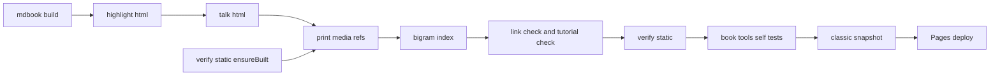
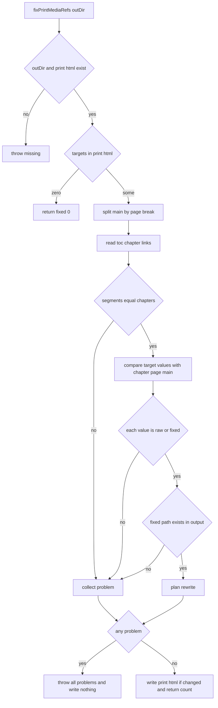

# Design Document: manual-print-media-refs

## Overview

**Purpose**: マニュアルの印刷用のページ（`print.html`）で、生の HTML で書いた動画の参照が壊れている問題を直す。ビルドの後に、`print.html` のメディア要素の参照だけを、その要素を書いた章の場所から出力の根から見た場所へ書き換える小さなツールを足し、出力の検査の `print.html` の例外を外す。

**Users**: 恩恵を受けるのは、印刷用のページで実演動画を見る読者である。執筆者（AI エージェントを含む）は、章に動画を足しても `print.html` の側まで自動検査に見てもらえる。開発者は、CI と手元（`AUTHORING.md` の一覧・`verify-static.mjs` の自分でビルドする形）で同じ段を通す。

**Impact**: 今の出力では、直す参照は `print.html` の `<video src="media/dev-actions-demo.mp4">` の 1 件だけで、`debug/media/dev-actions-demo.mp4` になる。章のページ・ソース・動画の置き場所は変わらない。CI の段が 1 つ、`AUTHORING.md` の一覧が 1 行増える。

### Goals

- `print.html` の `<video>` の `src`・`poster`、`<audio>`・`<source>`・`<track>` の `src` が、要素を書いた章のページで同じ参照が指すファイルを指す（同じ名前のファイルが別の章にあっても）
- 章が決まらない・写し先が無いときは、何も書かずに失敗し、公開の前に止まる
- 出力の検査が、`print.html` のメディア要素と、全ページの `poster` の参照も確かめる
- CI・`ensureBuilt`・`AUTHORING.md` の一覧が、同じ位置（台詞の変換の直後）で書き換えを通す

### Non-Goals

- 旧版（`classic/`）の同じ不具合。書き換えも当てない
- mdBook の変更・上流への報告。動画の撮り直し・形式の変更・字幕
- 着色・台詞の変換・検索の索引の各ツールの変更。テーマ
- `print.html` の中のリンクの見出し（`#…`）の検査。静的アセットの拡張子の追加（`.vtt`・`.mp3`）
- `book/src/introduction.md` の生の ``（mdBook が書き換える）

## Boundary Commitments

### This Spec Owns

- 新しいツール `book/tools/print-media-refs.mjs`（関数 `fixPrintMediaRefs` と CLI）と、その自己テスト `book/tools/print-media-refs-test.mjs`
- 直す対象の要素と属性の表（`video: src・poster` / `audio: src` / `source: src` / `track: src`）
- `verify-static.mjs` の 3 か所: `print.html` の例外の削除、`extractRefs` への `poster` の追加、`ensureBuilt` からの書き換えの呼び出し。あわせて自己テストの 2 つの場合
- `manual.yml` の書き換えの段、`paths` への `README.md`・`SOUL.md` の追加、先頭の説明とチュートリアルの照合の段の説明の直し
- `book/AUTHORING.md` の「CI と同じ順」の一覧の 1 行

### Out of Boundary

- `print.html` のほかのファイル（章のページ・`toc.html`・資材）の内容。本ツールは読むだけで、書くのは `print.html` だけ
- mdBook が書き換える参照（`<a href>`・``）と、`print.html` の本文の文字
- 台詞の変換・着色・索引の各ツール、`link-check.mjs`（`link-check-test.mjs` の節 I を含む）、`verify-search.mjs`・`verify-content.mjs`・`tutorial-check.mjs`
- 旧版の生成の段（`classic/`）。`verify-static.mjs` の `listFiles` が `classic/` を飛ばす決まりも変えない
- `book/src/` の章の本文（`debug/dev-actions.md` も変えない）
- steering（`.kiro/steering/tech.md` のパイプラインの記述）。spec の完了時の同期で 1 段足す

### Allowed Dependencies

- `print-media-refs.mjs` → Node 標準ライブラリ（`node:fs`・`node:path`・`node:url`）だけ。ほかの `book/tools` のモジュールを取り込まない
- `verify-static.mjs` → `print-media-refs.mjs`（`fixPrintMediaRefs`）。逆向きの依存は作らない
- 入力の前提: mdBook 0.5.x の HTML 出力（`print.html` の改ページの印・`toc.html` の章のリンク・章のページの `<main>`）。CI は v0.5.3、手元は v0.5.4（`print.rs` は同じ）
- 依存の向き: Node 標準ライブラリ → `print-media-refs.mjs` → `verify-static.mjs`・`manual.yml`・`AUTHORING.md`

### Revalidation Triggers

- mdBook の版を上げたとき（`print.html` の区切りの形・`toc.html` の形・`print.html` で書き換える要素の範囲）。形が変われば本ツールが失敗するので、CI で気づく
- `book.toml` で `[output.html.print] enable = false` にしたとき（`print.html` が無いので本ツールが失敗する）
- 出力を書き換える段を、本ツールの後ろに足すとき（その段が `print.html` のメディア要素を変えないこと）
- 直す対象の表に要素・属性を足すとき（`verify-static.mjs` の `extractRefs` も合わせる）

## Architecture

### Existing Architecture Analysis

- CI（`manual.yml`）は、`mdbook build` の後に出力を 3 回書き換える（着色 → 台詞の変換 → 索引の再生成）。それぞれ `book/tools` の依存ゼロのツールで、出力のフォルダを引数に取り、失敗で exit 1
- `talk-html.mjs` は、全ファイルを確かめてから書く。`verify-static.mjs` は `transformDir` を取り込み、自分でビルドする形（`ensureBuilt`）で呼ぶ
- mdBook 0.5 は `print.html` で `a`・`img` の `href`・`src`・`xlink:href` だけを章の場所に合わせて書き換え、章と章の間に改ページの `<div>` を 1 つ置く（v0.5.3 の `print.rs` で確かめた）。章のパスを持つ印は残らない
- 出力の検査は今、`print.html` の `<video>`・`<source>` の開きタグを消してから参照を集める（247〜249 行）

### Architecture Pattern & Boundary Map



**Architecture Integration**:
- Selected pattern: ビルド後の出力を書き換える段を 1 つ足す（既存の段と同じ型）
- 境界: 本ツールは `print.html` だけを書く。`verify-static.mjs` は検査が主で、自分でビルドする形のときだけ本ツールを呼ぶ
- 置き場所: 台詞の変換の直後・索引の再生成の前（brief の「台詞の変換の直後」と `AUTHORING.md` の一覧の並びに合わせる。索引はメディアの属性を読まないので、前後どちらでも結果は同じ）
- Steering compliance: 依存ゼロ・問題があれば止める・相対パスを保つ（`file://` と `site-url = "/pasta/"` の両立）

### Technology Stack

| Layer | Choice / Version | Role in Feature | Notes |
|-------|------------------|-----------------|-------|
| CLI / ツール | Node.js 20（CI の `setup-node`）・標準ライブラリだけ | 書き換えと自己テスト | 新しい依存なし。`book/node_modules` は使わない |
| 入力 | mdBook 0.5.3（CI）/ 0.5.4（手元） | `print.html`・`toc.html`・章のページ | 両版の `print.rs` は同じ |
| CI | GitHub Actions（`manual.yml`） | 段の追加 | 既存の段の型 |

## File Structure Plan

### Directory Structure

```
book/tools/
├── print-media-refs.mjs        # 新規: print.html のメディア要素の参照の書き換え（fixPrintMediaRefs と CLI）
└── print-media-refs-test.mjs   # 新規: 自己テスト（CI の「Book tools self-tests」が名前で拾う）
```

### Modified Files

- `book/tools/verify-static.mjs` — 例外（247〜249 行）の削除、`extractRefs` の属性に `poster` を追加、`ensureBuilt` で台詞の変換に続けて `fixPrintMediaRefs(outDir)` を呼ぶ、自己テストに `print.html` と章のページの壊したメディアの参照の検出を追加、旧版の自己テスト (a2) のフィクスチャに `poster` を足す、先頭の使い方のコメントの直し
- `.github/workflows/manual.yml` — 「Render talk components」の直後に「Fix print page media references」の段、`paths` 2 か所に `README.md`・`SOUL.md`、先頭の説明（1〜18 行）とチュートリアルの照合の段の説明（113〜117 行）の直し
- `book/AUTHORING.md` — 「CI と同じ順」の一覧（466〜474 行）の `talk-html.mjs` の行の次に 1 行

## System Flows



- 問題は全件集めてから 1 回で投げる（`talk-html` と同じ）。書き込みは問題が 0 件のときだけ、`print.html` の 1 ファイルに 1 回
- 0 件の判定は、`toc.html` や章のページを読む前に行う（前提 A2。対象が無いのに目次の形で落ちない）

## Requirements Traceability

| Requirement | Summary | Components | Interfaces | Flows |
|-------------|---------|------------|------------|-------|
| 1.1 | 要素を書いた章のファイルを根から指す | PrintMediaRefs | `fixPrintMediaRefs`・値の直し方 | 照合 → 直す |
| 1.2 | `file://` で再生・代わりのリンク | PrintMediaRefs・StaticVerifier | 相対パス | 実装時に手元で `print.html` を開いて確かめる |
| 1.3 | 公開サイトで再生 | PrintMediaRefs | 相対パス（`site-url` と無関係） | 公開後に確かめる |
| 1.4 | 相対パスのまま | PrintMediaRefs | 値の直し方（根からの相対） | — |
| 1.5 | 章のページを変えない | PrintMediaRefs | 書くのは `print.html` だけ | — |
| 1.6 | 動画は章のフォルダに 1 つ | PrintMediaRefs | ファイルを写さない | — |
| 2.1 | 対象を直し、ほかのファイルを変えない | PrintMediaRefs | 対象の表・書き込み先 | 書く |
| 2.2 | 対象外の参照と本文を変えない | PrintMediaRefs | 対象の表 | — |
| 2.3 | 外部 URL・見出し・根からの絶対パスを変えない | PrintMediaRefs | 直さない値の規則 | — |
| 2.4 | 章が決まらない・写し先が無いとき何も書かず失敗 | PrintMediaRefs | `Error`・問題の文面 | 全件集めて投げる |
| 2.5 | 出力のフォルダ・`print.html` が無いとき失敗 | PrintMediaRefs | `Error` | 最初の確かめ |
| 2.6 | 0 件で成功・0 件を表示 | PrintMediaRefs・CLI | `{ fixed: 0 }` | 0 件の早い戻り |
| 2.7 | 冪等 | PrintMediaRefs | 修正済みの値を見分ける | 照合 |
| 2.8 | 件数の表示 | CLI | 標準出力の 1 行 | — |
| 2.9 | 自己テストが CI で段の定義を変えずに走る | PrintMediaRefsTest | `*-test.mjs` の名前 | CI の自己テストの段 |
| 2.10 | 自己テストの場合 | PrintMediaRefsTest | — | Testing Strategy |
| 3.1 | `print.html` のメディア要素を除かない | StaticVerifier | `analyze` | — |
| 3.2 | `print.html` の壊れた参照で失敗 | StaticVerifier | `brokenRefs` | — |
| 3.3 | 全ページで `poster` も見る | StaticVerifier | `extractRefs` | — |
| 3.4 | 自分でビルドする形で書き換えを通し、失敗で止まる | StaticVerifier | `ensureBuilt` | — |
| 3.5 | 自己テスト（壊した出力で失敗・無傷で合格） | StaticVerifier | `runSelfTest` | — |
| 3.6 | `classic/` を見ない | StaticVerifier | `listFiles`（変えない） | — |
| 4.1 | 台詞の変換の後・出力の検査の前 | ManualWorkflow | 段の並び | CI |
| 4.2 | 失敗で以降と公開を行わない | ManualWorkflow | exit 1・`needs: build` | CI |
| 4.3 | 旧版に使わない | ManualWorkflow | 旧版の段は変えない | CI |
| 4.4 | 自己テストの段はビルドの後のまま | ManualWorkflow | 段を動かさない | CI |
| 4.5 | `paths` に `README.md`・`SOUL.md` | ManualWorkflow | `on.push/pull_request.paths` | — |
| 4.6 | 先頭の説明を今の段に合わせる | ManualWorkflow | コメント | — |
| 4.7 | チュートリアルの照合の説明を直す | ManualWorkflow | コメント | — |
| 5.1 | 一覧に同じ位置で 1 行 | AuthoringList | `AUTHORING.md` | — |
| 5.2 | 一覧のとおりで検査に合格 | AuthoringList・StaticVerifier | — | 手元の通し |
| 6.1 | 既存の検査がすべて合格 | 全体 | — | CI の通し |
| 6.2 | 2 つの閲覧の形で今までどおり | PrintMediaRefs | 相対パス・`print.html` のメディアの参照だけを変える | — |
| 6.3 | 章の本文を変えない | 全体 | `book/src/` を触らない | — |

## Components and Interfaces

| Component | Domain/Layer | Intent | Req Coverage | Key Dependencies (P0/P1) | Contracts |
|-----------|--------------|--------|--------------|--------------------------|-----------|
| PrintMediaRefs（`print-media-refs.mjs`） | ビルド後の段 | `print.html` のメディア要素の参照を直す | 1.1〜1.6, 2.1〜2.8, 6.2 | Node 標準ライブラリ (P0)・mdBook の出力の形 (P0) | Service, Batch |
| PrintMediaRefsTest（`print-media-refs-test.mjs`） | 自己テスト | 書き換えの規則と失敗を確かめる | 2.9, 2.10 | PrintMediaRefs (P0) | — |
| StaticVerifier（`verify-static.mjs` の変更） | 出力の検査 | `print.html` のメディアと `poster` まで検査する | 3.1〜3.6, 5.2 | PrintMediaRefs (P0) | Batch |
| ManualWorkflow（`manual.yml` の変更） | CI | 段の追加と申し送りの直し | 4.1〜4.7, 6.1 | PrintMediaRefs (P0) | Batch |
| AuthoringList（`AUTHORING.md` の変更） | 執筆規約 | 手元の手順に 1 行 | 5.1, 5.2 | — | — |

### ビルド後の段

#### PrintMediaRefs

| Field | Detail |
|-------|--------|
| Intent | `print.html` のメディア要素の参照を、その要素を書いた章の場所から、出力の根から見た相対パスへ直す |
| Requirements | 1.1, 1.2, 1.3, 1.4, 1.5, 1.6, 2.1, 2.2, 2.3, 2.4, 2.5, 2.6, 2.7, 2.8, 6.2 |

**Responsibilities & Constraints**
- 書くのは `print.html` の 1 ファイルだけ。`toc.html`・章のページは読むだけ
- 全部を確かめてから書く。問題が 1 件でもあれば何も書かずに `Error` を投げる
- 依存ゼロ（Node 標準ライブラリだけ）

**Dependencies**
- Inbound: `manual.yml` の段（CLI）・`verify-static.mjs` の `ensureBuilt`（関数） (P0)
- External: mdBook 0.5.x の出力の形（下の「入力の契約」） (P0)

**Contracts**: Service [x] / Batch [x]

##### Service Interface

```typescript
// JSDoc で書く（.mjs）。型は契約の説明のための TypeScript 表記。
interface FixResult {
  targets: number; // print.html の中の対象の参照の数（直したものと、すでに正しいものの合計）
  fixed: number;   // 書き換えた参照の数（2 回目の実行では 0）
}
// 失敗はすべて Error（message に問題を全件・1 行 1 件）。部分の結果は返さない。
export function fixPrintMediaRefs(outDir: string, options?: { write?: boolean }): FixResult;
```

- Preconditions: `outDir` は mdBook の HTML 出力のフォルダ（台詞の変換の後でも前でもよい）
- Postconditions: 成功なら、`print.html` の対象の参照はすべて、対応する章のページで同じ参照が指すファイルを根から指す。`write: false` のときは何も書かない（呼び出し側の確かめ用）
- Invariants: `print.html` のほかのファイルは 1 バイトも変わらない。`print.html` の中でも、対象の属性の値のほかは 1 バイトも変わらない

**入力の契約（mdBook 0.5.x の出力の形）**

| 読むもの | 形 | 使い方 |
|----------|----|--------|
| `print.html` | `<main>` から最後の `</main>` までに全章。章と章の間に `<div style="break-before: page; page-break-before: always;"></div>` が 1 つずつ | この文字列で分け、i 番目の部分を i 番目の章とする |
| `toc.html` | 章のリンク `<a href="….html">`（SUMMARY の順。下書きの章・区切り線・部の見出しはリンクを持たない） | `<a href="X">` のうち、X が `.html` で終わり、スキーム・`//`・`#`・`?` を含まず、`/` で始まらないものを出現の順に並べ、章の並びとする（同じ X が 2 度出れば、区切りの数とずれて失敗する） |
| 章のページ | `<main>`〜`</main>` が `print.html` の部分と同じ要素の並び（mdBook はメディア要素の `src`・`poster` を変えない） | 照合に使う |

**対象の表**

| 要素 | 属性 |
|------|------|
| `video` | `src`・`poster` |
| `audio` | `src` |
| `source` | `src` |
| `track` | `src` |

- 拾う形: 開きタグ `<要素名 …>` の中の `属性="値"`（mdBook 0.5 は属性を二重引用符で出す）。属性名の前は空白に限る（`\s(src|poster)\s*=\s*"`）。`data-src`・`data-poster` などは拾わない（2.2）。コードブロックの中は `&lt;` に逃がされているので拾わない
- `verify-static.mjs` の `extractRefs` は `\b` のままにする（既存の `data-src` を拾う性質も変えない。今の出力に `data-*` の参照は無い）
- 直さない値（そのまま残し、実在も見ない）: 空・`#` で始まる・スキーム付き（`https:`・`data:` など）・`//` で始まる・`/` で始まる（2.3。根からの絶対パスは出力の検査が落とす）
- 値の直し方: 章のページのパスのフォルダを `d`（根の章は空）、値のパスの部分（`#`・`?` の前）を `p` として、`posix.normalize(posix.join(d, p))` に、残り（`?…`・`#…`）をそのまま付ける。根の章では値は変わらない
- 2 回目の実行: `print.html` の値が、章のページの値そのもの（未修正）か、それを直した値（修正済み）なら一致とみなし、直した値を書く（修正済みなら変わらない）

**失敗の一覧（すべて 2.4 か 2.5。全件集めて投げる）**

| 場合 | 文面に出すもの |
|------|----------------|
| 出力のフォルダが無い | フォルダのパス |
| `print.html` が無い | `print.html` のパス |
| （対象が 1 件以上あり）`print.html` に `<main>` が無い・`toc.html` が無い・章のリンクが 0 本 | 無いもの |
| 区切りで分けた部分の数と、目次の章の数が違う | 両方の数 |
| 章のページが無い・`<main>` が無い | 章のパス |
| 部分の対象の並びと、章のページの対象の並びが合わない（数・要素・属性・値） | 章のパスと両方の並び |
| 直した後のパスが出力に無い・出力の根の外へ出る（`classic/` は除かない） | 章のパス・要素と属性・元の値・直した後のパス |

##### Batch / Job Contract

- Trigger: CLI `node book/tools/print-media-refs.mjs [book-out-dir]`（既定 `book/book`。`talk-html.mjs` と同じ）
- 成功: exit 0。標準出力に `print-media-refs: fixed N media reference(s) in print.html (M target(s))` の 1 行（0 件のときも同じ形で `fixed 0`。2.6・2.8）
- 失敗: exit 1。標準エラーに `print-media-refs failed: …` と問題の全件
- Idempotency & recovery: 同じ出力に何度実行しても、2 回目からは `fixed 0` で `print.html` は変わらない（2.7）

**Implementation Notes**
- Integration: 0 件の判定は `print.html` を読んだ直後に行い、`toc.html` と章のページは対象があるときだけ読む
- Validation: 書き換えは `print.html` の部分ごとに、対象の値を出現の順に置き換える。置き換えた後の文字列が元と同じなら書き込まない
- Risks: 属性の値に `>` を含む・章の本文に改ページの `<div>` と同じ文字列を書く、の 2 つは照合の食い違いとして失敗する（黙って誤らない）。HTML の文字参照（`&amp;`）は復号しない（今の書き方には無い。`verify-static.mjs` の `refPath` と同じく `decodeURIComponent` だけで実在を見る）

### 自己テスト

#### PrintMediaRefsTest

| Field | Detail |
|-------|--------|
| Intent | 書き換えの規則・失敗時に書かないこと・冪等・CLI を、一時フォルダのフィクスチャで確かめる |
| Requirements | 2.9, 2.10 |

- `talk-html-test.mjs` と同じ型（依存ゼロの `check()`・`os.tmpdir()` の下の一時フォルダ・最後に `process.exit`）
- フィクスチャは、mdBook 0.5.4 の形を写した最小の章のページ・`toc.html`・`print.html`（章の `<main>` の中身を改ページの印でつないだもの）を組み立てる小さな関数で作る
- 場合の一覧は Testing Strategy

### 出力の検査

#### StaticVerifier（`verify-static.mjs` の変更）

| Field | Detail |
|-------|--------|
| Intent | `print.html` のメディア要素と全ページの `poster` を、ほかの参照と同じ規則で検査する |
| Requirements | 3.1, 3.2, 3.3, 3.4, 3.5, 3.6, 5.2 |

**Responsibilities & Constraints**
- `analyze`: `print.html` の例外（247〜249 行）を外す。`print.html` も、ほかのページと同じく `extractRefs` の結果を全部検査する（3.1・3.2）
- `extractRefs`: 拾う属性を `href`・`src`・`poster` にする（3.3。全ページに効く。今の出力に `poster` は無い）
- `ensureBuilt`: `--no-build` なしのとき、台詞の変換に続けて `fixPrintMediaRefs(outDir)` を呼び、件数を表示する。例外なら `FATAL: print-media-refs の書き換えに失敗しました: …` を出して exit 1（3.4）
- `runSelfTest`（3.5）:
  - 既存 (a)「無傷コピーはリンク切れ無し」は、例外を外した後は `print.html` の動画の参照も含めて合格する（書き換え済みの確認を兼ねる）
  - 足す (e): コピーの `print.html` の `<main>` の中に `<video src="media/__missing__.mp4" poster="media/__missing__.png"></video>` を差し込み、`brokenRefs` が `print.html` からの 2 件を報告することを確かめる
  - 足す (f): コピーの章のページ（`grammar/index.html`）に `<video poster="__missing__.png"></video>` を差し込み、`brokenRefs` が報告することを確かめる（全ページの `poster`）
  - 既存 (a2) の `classic/print.html` のフィクスチャに `poster="missing.png"` を足し、報告しないことを確かめる（3.6）
  - 差し込みは実出力の動画の有無に頼らない（今後、章から動画を外しても自己テストは壊れない）
- `listFiles` の `classic/` を飛ばす決まりは変えない（3.6）

**Dependencies**
- Outbound: PrintMediaRefs（`fixPrintMediaRefs`） (P0)

**Contracts**: Batch [x]（既存の CLI。引数・終了コードは変えない）

### CI と執筆規約

#### ManualWorkflow（`manual.yml` の変更）

| Field | Detail |
|-------|--------|
| Intent | 書き換えの段を足し、申し送りの説明と起動の条件を直す |
| Requirements | 4.1, 4.2, 4.3, 4.4, 4.5, 4.6, 4.7, 6.1 |

- 段の追加（4.1・4.2）: 「Render talk components」の直後に、名前 `Fix print page media references`・`run: node book/tools/print-media-refs.mjs book/book` の段。上のコメントに、目的（mdBook は `print.html` で `<a href>`・`` だけを書き換える）・対象・失敗で exit 1＝公開前に止まること・旧版には使わないことを書く。失敗は既存の段と同じく job を止め、`deploy`（`needs: build`）が走らない
- 旧版の段・自己テストの段は動かさない（4.3・4.4）
- `paths`（4.5）: `push` と `pull_request` の両方に `'README.md'`・`'SOUL.md'` を足す
- 先頭の説明（4.6）: 起動の条件に、ルートの `README.md`・`SOUL.md`（公開マニュアル URL の検査のため。manual-link-anchor-check 要件 4）と hello-pasta の辞書（チュートリアルの照合のため）を書く。段の並びに「印刷用ページのメディアの参照の直し（print-media-refs）」を台詞の変換の直後に入れる。リンク検証の説明を「本の中のリンクと見出し（`#…`）・読者に届く文書（クレートの README・ルートの README.md・SOUL.md・スキル）の公開マニュアル URL・スキル自己完結」に直す。静的性の検査が `print.html` のメディアの参照も見ることを書く
- チュートリアルの照合の段の説明（4.7）: `first-ghost.md` の記述を、「入門の段の章 12 枚（`01-boot.md`〜`12-lua.md`）の ```pasta ブロックを、同じ名前の辞書（`hello-pasta/ghost/master/dic/X.pasta` ↔ `X.md`）と両方向に逐語照合する」に直す。段の動作は変えない

#### AuthoringList（`AUTHORING.md` の変更）

- 一覧の `node book/tools/talk/talk-html.mjs book/book            # 台詞部品の変換` の次に `node book/tools/print-media-refs.mjs book/book          # 印刷用ページの動画の参照の直し` を 1 行足す（コメントの桁は既存の行にそろえる）（5.1・5.2）

## Error Handling

### Error Strategy

- 本ツールは「作成ツールは問題があれば止める」の原則に従う。警告で続けず、問題を全件集めて 1 回で失敗し、何も書かない
- 0 件は失敗ではない（前提 A2）。`print.html` の不在は失敗（2.5）

### Error Categories and Responses

- 入力の不在（出力のフォルダ・`print.html`・`toc.html`・章のページ・`<main>`）: 無いもののパスを示す
- 構造の食い違い（区切りと目次の数・対象の並び）: 章のパスと両方の数・並びを示す。mdBook の版の上げで形が変わったときもここに当たる
- 写し先の不在: 章・要素・属性・元の値・直した後のパスを示す

### Monitoring

- CI のログに、成功時の件数の 1 行と、失敗時の問題の全件が残る

## Testing Strategy

### Unit Tests（`print-media-refs-test.mjs`。2.10 の場合を含む）

1. 深さの違う章: 根の章（`intro.html` の `media/a.mp4` は変わらない）・1 段下（`debug/x.html` の `media/a.mp4` → `debug/media/a.mp4`）・2 段下（`a/b/y.html` → `a/b/media/…`）。`poster`・`<source>`・`<track>`・`<audio>` の `src` も同じく直る。`../` を含む値は正規化される
2. 同じ名前の動画を持つ 2 つの章（`ch1/v.html` と `ch2/v.html` がどちらも `media/demo.mp4`）が、それぞれ `ch1/media/demo.mp4`・`ch2/media/demo.mp4` へ直る
3. 対象外は 1 バイトも変わらない: `<a href>`・``・外部 URL・`#…`・`/…`・`data:` の値・本文の文字、`print.html` のほかのファイル。`?`・`#` の付いた値は残りを保って直る。`print.html` で付け直された `id`（`id="demo-1"`）があっても直る
4. 対象が 0 件: 成功・`fixed 0`・何も変わらない（`toc.html` が無くても成功）
5. 直せないとき何も書かずに失敗: 写し先のファイルが無い・根の外へ出る・区切りと目次の数が違う・部分と章のページの並びが違う・章のページが無い。どれも全ファイルのスナップショットが変わらず、文面に章と参照が出る
6. 出力のフォルダ・`print.html` が無いと失敗
7. 2 回目の実行で `fixed 0`・全ファイル不変
8. CLI: 成功は exit 0 で件数の 1 行、失敗は exit 1 で標準エラーに問題

### Integration Tests

1. `verify-static.mjs --no-build --self-test` を、CI と同じ順で作った出力に対して実行し、`print.html` の動画の参照を含めて合格する（3.1・3.5・5.2）
2. 自己テスト (e)・(f) が、`print.html` と章のページの壊したメディアの参照（`src`・`poster`）を報告する（3.2・3.3・3.5）。(a2) が `classic/` を報告しない（3.6）
3. `verify-static.mjs`（`--no-build` なし）が、ビルド → 台詞の変換 → 書き換え → 検査の順で合格する（3.4）
4. 書き換えの前の出力に `verify-static.mjs --no-build` を当てると、`print.html` の `media/dev-actions-demo.mp4` で失敗する（例外を外したことの確認）

### E2E

1. 手元で CI と同じ順に出力を作り、`print.html` を `file://` で開いて、「開発支援アクション」の章の動画が再生でき、代わりのリンクから同じ動画が開けることを見る（1.2）
2. 公開後に `https://ekicyou.github.io/pasta/print.html` で同じことを見る（1.3。マージの後）

- E2E 1 は実装のタスクの完了の条件にする。E2E 2 はマージの後の確かめとして申し送る（自動の検査が見るのは「ファイルが在ること」と「章のページの値と対応すること」まで）
3. CI の全段（スキルの生成物の照合・リンク検証・チュートリアルの照合・出力の検査・検索の検査・コンテンツの検査・ツールの自己テスト・旧版の生成）が合格する（6.1）。着色の段は `book/node_modules` が要るので、ワークツリーに無ければ CI で確かめる

## Performance & Scalability

- `print.html` に対象が 1 件以上あるとき、読むのは `print.html`（約 1.3 万行）・`toc.html`・全章のページ（今は 60 枚）で、1 秒に満たない。並びの照合を対象のある章だけでなく全章で行うのは、章の側にだけ対象がある・`print.html` の側にだけ対象がある、というずれも見つけるため

## 決めたこと（設計ディスカッション・2026-10-16）

- **照合の強さ【確定】**: 区切りの数と目次の章の数が一致すること、そして章ごとに対象の値の並びが章のページと一致すること。数の一致だけでは、並びがずれたときに同じ名前の別の章のファイルを黙って指してしまい、出力の検査も気づかない（ファイルは在るため）。これは要件の A4・2.4 から決まる
- **段の位置【確定】**: 台詞の変換の直後で、索引の再生成の前（brief と `AUTHORING.md` の一覧の並びに合わせる）
- **ツールの名前と置き場所【確定】**: `book/tools/print-media-refs.mjs` に置く。モジュールは 1 つなので、`link-check.mjs`・`tutorial-check.mjs` と同じく直下にする
- **`verify-static.mjs` の自己テストの壊し方【確定】**: 架空の `<video src poster>` を差し込む。今の不具合そのもの（書き換える前の出力で失敗すること）は、Integration Tests の 4 で確かめる
- **章の並びの出どころ【確定】**: 出力の `toc.html` の章のリンクから取る。こうすると入力は出力のフォルダだけで済み、`talk-html` と同じ引数になる。並びも、mdBook が `print.html` に入れた章とそのまま同じになる。`book/src/SUMMARY.md` から取る案は採らない。ツールがソースの場所を知る必要があり、下書きの章の扱いも自分で真似ることになるためである。章のページの前後のリンクをたどる案も採らない。読むファイルが増えるのに、確かさは変わらないためである

**仮定（明示）**: mdBook v0.5.3 の `print.html` の形は、v0.5.4 と同じとした。根拠は 2 つある。v0.5.3 の `print.rs` を読むと、改ページの印と書き換えの範囲が同じであること。CI の出力の検査が、`toc.html` の章のリンクで合格していること。CI の初回の実行で本ツールが `fixed 1` を出せば、これが確かめられる。形が違えば本ツールが失敗して止まる（黙って壊れない）
