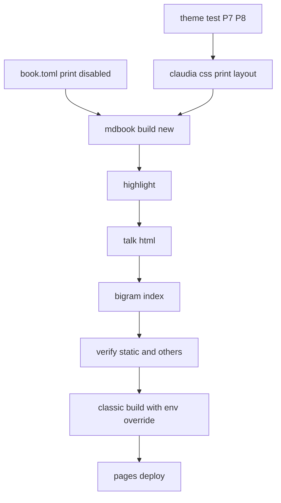
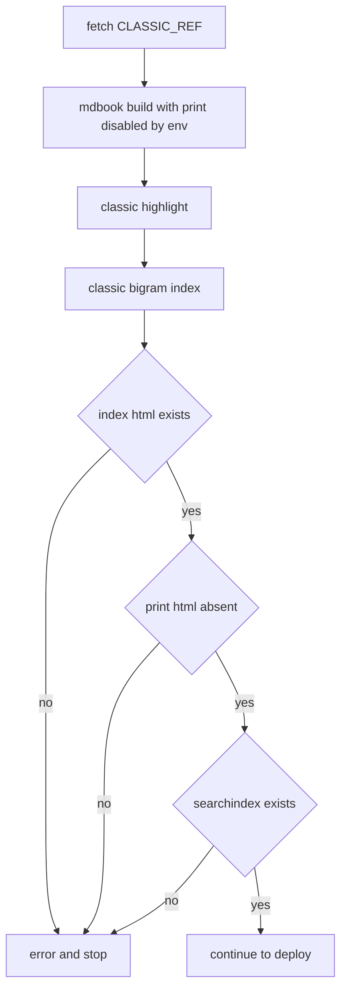

# Design Document

## Overview

**Purpose**: マニュアルの読者が、どのページを開いてもブラウザが固まらないようにする。全章を 1 枚につないだ印刷用のページ（`print.html`）と右上の印刷のボタンを、新版と旧版の両方で作らせない。章のページは今までどおりブラウザの印刷で 1 章ずつ刷れる。

**Users**: マニュアルの読者（ゴースト作者）と、マニュアルの保守者。

**Impact**: mdBook の設定で印刷用のページを止め、完了した `manual-print-media-refs`（PR#120）が足した書き換えの道具・CI の段・手引きの行を取り下げる。印刷を止めると mdBook が章のページへ読み込む印刷用の CSS も無くなるので、その働きを新版のテーマに持たせる。出力の検査（`verify-static.mjs`）は `print.html` の無い出力に合わせ、`print.html` と印刷のボタンが戻ったら気づく検査を足す。

### Goals
- 新版・旧版の出力に `print.html` が無く、章のページに印刷のボタンが無い（1.1, 1.2, 2.1, 2.2）
- 新版の章の印刷が今までどおり目次・メニュー・前後の矢印を隠す（1.3）
- `print.html` のためだけにあった道具・段・行・説明が残らない（3.1〜3.6）
- 検査が `print.html` の無い出力を正しく見て、戻ったら失敗する（4.1〜4.6）
- 1 つの PR で入り、CI と手元の検査が通る（5.1〜5.3）

### Non-Goals
- `/pasta/print.html` の転送（404 のまま。1.4）
- 章の印刷の新しい見た目（今までの章の印刷を保つ規則だけを足す）
- 旧版の章の印刷の見た目（旧版は固定のコミットのまま。2.3）
- mdBook の変更・上流への報告、章の本文（`book/src/`）、完了した spec の文書

## Boundary Commitments

### This Spec Owns
- `book/book.toml` の `[output.html.print]` の節と、`[output.html]` の説明
- `book/theme/claudia.css` の 7 節（印刷の規則）に足す、章の印刷のレイアウトの規則と、先頭と 7 節の説明
- `book/tools/theme-test.mjs` の印刷のレイアウトの検査（P-7・P-8）
- `book/tools/print-media-refs.mjs`・`print-media-refs-test.mjs` の削除
- `book/tools/verify-static.mjs` のビルドの段・検査するページの一覧・`print.html` の有無の検査・自己テスト
- `.github/workflows/manual.yml` の先頭の説明・段「Fix print page media references」の削除・段「Build classic manual snapshot」の印刷の停止と確かめ
- `book/AUTHORING.md` の「CI と同じ順」の一覧の行、`.kiro/steering/tech.md`・`structure.md` の説明、`book/theme/claudia.js`・`book/tools/talk/talk-html.mjs` の先頭の説明

### Out of Boundary
- 旧版の原稿とツール（固定のコミット `CLASSIC_REF` の `book/`）。生成のときの環境変数だけを足す
- 台詞の変換・着色・検索の索引・リンク検査の各ツールの動き（`print.html` が無くても今までどおり動く）
- `talk-html-test.mjs` の (D)、`link-check-test.mjs` の `print.html` を読まないことの確かめ（`print.html` の無い出力でも正しい）
- `theme-test.mjs` の既存の P-1〜P-6 と、テーマの色・字体・台詞部品
- `.kiro/steering/roadmap.md`（`/kiro-complete` が更新する）

### Allowed Dependencies
- mdBook（CI v0.5.3・手元 v0.5.4）の `[output.html.print] enable` と、`MDBOOK_` で始まる環境変数による設定の上書き
- mdBook の章のページの要素の id・class（`#mdbook-sidebar`・`#mdbook-menu-bar`・`.nav-chapters`・`.mobile-nav-chapters`・`#mdbook-page-wrapper`・`#mdbook-content`・`.page`）
- Node 標準ライブラリだけ（`verify-static.mjs`・`theme-test.mjs` は依存ゼロのまま）

### Revalidation Triggers
- mdBook の版を上げて、章のページの要素の id・class か、印刷用の CSS の働きが変わったとき（テーマの印刷の規則と P-7・P-8 を見直す）
- mdBook が `[output.html.print]` の設定名か、環境変数の上書きの形を変えたとき（新版の設定と旧版の段）
- `CLASSIC_REF` を別のコミットへ動かしたとき（旧版の段の確かめが通るか）
- 印刷用のページを再び作ることにしたとき（本 spec の検査 4.3・4.4 が失敗する。意図した変更なら検査を外す）

## Architecture

### Existing Architecture Analysis
- CI（`manual.yml`）と手元（`verify-static.mjs` の `ensureBuilt`・`AUTHORING.md` の一覧）は、ビルド → 着色 → 台詞の変換 → `print-media-refs` → 索引の再生成 → 検査、の同じ順を持つ。本 spec は 3 か所から同時に `print-media-refs` を抜く。
- 旧版の段は、新版の検査が終わった後に固定のコミットの `book/` を旧版のツールで `book/book/classic/` へ作り、`index.html`・`print.html`・検索の索引の有無だけを確かめる。新版の検査（`verify-static.mjs`）は `classic/` を対象に含めない。
- テーマの印刷の規則は `claudia.css` の 7 節の `@media print` に集まり、`theme-test.mjs` が P-1〜P-6 でその中身を確かめる。

### Architecture Pattern & Boundary Map



- `print-media-refs` の段は Talk と Index の間から消える。
- 新しい部品は無い。`verify-static.mjs` に関数を 1 つ、テーマに規則を、`theme-test.mjs` に検査を足す。

### Technology Stack

| Layer | Choice / Version | Role in Feature | Notes |
|-------|------------------|-----------------|-------|
| 静的サイト生成 | mdBook v0.5.3（CI）・v0.5.4（手元） | `[output.html.print] enable = false`、環境変数 `MDBOOK_OUTPUT__HTML__PRINT__ENABLE=false` | 新しい依存は無い |
| 検査 | Node（標準ライブラリだけ） | `verify-static.mjs`・`theme-test.mjs` | 依存ゼロのまま |
| CI | GitHub Actions `manual.yml` | 段の削除と旧版の段の直し | |

## File Structure Plan

### Deleted Files
- `book/tools/print-media-refs.mjs` — `print.html` のメディア要素の参照の直し（3.1）
- `book/tools/print-media-refs-test.mjs` — その自己テスト（3.1）

### Modified Files
- `book/book.toml` — `[output.html.print] enable = false` を足す（1.1, 1.2）。`additional-css` の上の説明を「全章に読み込まれる」に直す（3.6）
- `book/theme/claudia.css` — 7 節に章の印刷のレイアウトの規則を足す（1.3）。先頭の「全章と print.html に読み込まれる」と、7 節の `.content` の注の mdBook の `print.css` への言及を直す（3.6）
- `book/tools/theme-test.mjs` — P-7・P-8 と、その自己テスト（1.3）
- `book/tools/verify-static.mjs` — `print-media-refs` の import と呼び出しと説明を消す（3.3）。`pages` を全章だけにする（4.1）。`analyzePrint` と本検査（4.3, 4.4）。自己テストの (a2)・(d)・(e) を直す（4.5, 4.6）。(f) は残す（4.2）
- `.github/workflows/manual.yml` — 先頭の説明から `print-media-refs` と `print.html` を消す、段「Fix print page media references」を消す（3.2）。段「Build classic manual snapshot」で印刷を止めて、`print.html` が無いことを確かめる（2.1〜2.5）
- `book/AUTHORING.md` — 「手元での確かめ方」の一覧から `print-media-refs.mjs` の行を消す（3.4）
- `.kiro/steering/tech.md` — Manual CI のパイプラインから印刷用ページの段を消す（3.5）
- `.kiro/steering/structure.md` — `book/tools` の説明から `print-media-refs` を消す（3.5）
- `book/theme/claudia.js`・`book/tools/talk/talk-html.mjs` — 先頭の説明の `print.html` を消す（3.6）

## System Flows

旧版の段（`manual.yml`「Build classic manual snapshot」）の確かめの流れ:



- 確かめの失敗は、今までどおり `::error::` を出して `exit 1`。deploy は `needs: build` なので公開されない（2.4, 2.5）。

## Requirements Traceability

| Requirement | Summary | Components | Interfaces | Flows |
|-------------|---------|------------|------------|-------|
| 1.1 | 新版に print.html を作らない | ManualConfig | `[output.html.print]` | Pipeline |
| 1.2 | 新版の章に印刷のボタンを出さない | ManualConfig | 同上 | Pipeline |
| 1.3 | 章の印刷は目次・ボタンを隠す | ThemePrintLayout, ThemeTest | `@media print`・P-7・P-8 | — |
| 1.4 | /pasta/print.html は 404 | ManualConfig（転送を置かない） | — | — |
| 1.5 | file:// とサブパスの両立 | ManualConfig, StaticVerifier | 既存の `analyze()` | — |
| 2.1 | 旧版に print.html を作らない | ClassicStep | 環境変数 | 旧版の段 |
| 2.2 | 旧版の章に印刷のボタンを出さない | ClassicStep | 同上 | 旧版の段 |
| 2.3 | 旧版の原稿とツールを変えない | ClassicStep | — | 旧版の段 |
| 2.4 | 旧版に print.html があれば止まる | ClassicStep | `[ ! -e ]` | 旧版の段 |
| 2.5 | 入口・索引が無ければ止まる | ClassicStep | 既存の確かめ | 旧版の段 |
| 3.1 | 道具と自己テストを持たない | Removal | — | — |
| 3.2 | CI の段と説明を持たない | Pipeline | — | — |
| 3.3 | 手元のビルドが CI と同じ段 | StaticVerifier | `ensureBuilt` | — |
| 3.4 | AUTHORING の行を持たない | Docs | — | — |
| 3.5 | steering の説明を合わせる | Docs | — | — |
| 3.6 | print.html 前提の説明を書かない | ManualConfig, ThemePrintLayout, Docs | — | — |
| 4.1 | 検査するページは全章だけ | StaticVerifier | `pages` | — |
| 4.2 | 全ページの href・src・poster | StaticVerifier | 既存の `analyze()`・自己テスト (f) | — |
| 4.3 | print.html があれば失敗 | StaticVerifier | `analyzePrint` | — |
| 4.4 | 章に印刷のボタンがあれば失敗 | StaticVerifier | `analyzePrint` | — |
| 4.5 | 自己テストで検出を確かめる | StaticVerifier | `runSelfTest` (e') | — |
| 4.6 | 旧版を対象に含めない | StaticVerifier | `runSelfTest` (a2) | — |
| 5.1 | 1 つの PR で入れる | 全体 | — | — |
| 5.2 | PR の CI が通る | Pipeline | — | — |
| 5.3 | 手元の検査が CI と同じ結果 | StaticVerifier | `ensureBuilt` | — |

## Components and Interfaces

| Component | Domain/Layer | Intent | Req Coverage | Key Dependencies | Contracts |
|-----------|--------------|--------|--------------|------------------|-----------|
| ManualConfig | 設定 | 新版の印刷用のページを止める | 1.1, 1.2, 1.4, 1.5, 3.6 | mdBook (P0) | State |
| ThemePrintLayout | テーマ | 章の印刷で mdBook の枠を隠す | 1.3, 3.6 | mdBook の要素の id (P0) | State |
| ThemeTest | 検査 | テーマの印刷のレイアウトの規則を確かめる | 1.3 | claudia.css (P0) | Batch |
| StaticVerifier | 検査 | print.html の無い出力の検査と、戻ったときの検出 | 3.3, 4.1〜4.6, 5.3 | mdBook・talk-html (P0) | Service, Batch |
| Pipeline | CI | 新版の段から print-media-refs を外す | 3.2, 5.2 | GitHub Actions (P0) | Batch |
| ClassicStep | CI | 旧版の印刷用のページを止めて確かめる | 2.1〜2.5 | mdBook の環境変数 (P0) | Batch |
| Removal / Docs | 文書・道具 | 道具の削除と説明の直し | 3.1, 3.4〜3.6 | — | — |

### 設定

#### ManualConfig（`book/book.toml`）

**Responsibilities & Constraints**
- `[output.html.print]` の節を足し、`enable = false` にする。`[output.html.redirect]` に `print.html` を足さない（1.4）。
- `site-url = "/pasta/"` と相対リンクの出力は変えない（1.5）。
- `additional-css`・`additional-js` の上の説明を「全章に読み込まれる」にする（3.6）。

**Contracts**: State [x]
- 事後条件: 出力の根に `print.html` と `css/print-*.css` が無い。章のページに `print.html` へのリンクと `media="print"` の mdBook の CSS への `<link>` が無い。

### テーマ

#### ThemePrintLayout（`book/theme/claudia.css` の 7 節）

| Field | Detail |
|-------|--------|
| Intent | mdBook が読み込まなくなった章の印刷のレイアウトの規則を、テーマの `@media print` が受け持つ |
| Requirements | 1.3, 3.6 |

**Responsibilities & Constraints**
- 既存の `@media print` の中（7 節）に足す。新しいファイルは作らない。mdBook の `print.css` は写さず、同じ働きを書く。
- 足す規則（働きで書く。値は mdBook v0.5.4 の `print.css` と同じ働きになるもの）:
  - 目次・メニュー・前後の矢印を隠す: `#mdbook-sidebar`・`#mdbook-menu-bar`・`.nav-chapters`・`.mobile-nav-chapters` を `display: none`
  - 本文を紙幅に広げる: `#mdbook-page-wrapper.page-wrapper` の左の余白を 0・`transform` を `none`（目次を開いたままでも本文がずれない）・縦のスクロールを戻す。`#mdbook-content` の幅の上限と余白と外側の余白を外す。`.page` の縦のスクロールを戻す
  - 改ページと折り返し: 見出しの途中と直後で改ページしない。`pre`・`code` の途中で改ページせず、長い行は折り返す。`code` は左から右
  - コードの右上のボタン（`pre > .buttons`）は本文の上に重ねない
- 既存の P-1〜P-6 の規則（色のトークン・台詞と扉の改ページ・区切り線・`.content` のスクロール）は変えない。
- 先頭の説明の「全章と print.html に読み込まれる」を「全章に読み込まれる」へ、7 節の `.content` の注の「mdBook の print.css は .page などだけを戻す」を、本節の規則が戻す旨へ直す（3.6）。

**Contracts**: State [x]
- 不変条件: 印刷のときだけ効く（すべて `@media print` の中）。画面の見た目は 1 つも変わらない。

**Implementation Notes**
- Validation: ThemeTest の P-7・P-8。実装の後に、新版の章（例: `grammar/index.html`）のブラウザの印刷のプレビューで目次・メニュー・矢印が出ないことを目で確かめる。
- Risks: mdBook の版を上げると id がずれる（Revalidation Triggers）。

### 検査

#### ThemeTest（`book/tools/theme-test.mjs`）

**Responsibilities & Constraints**
- 既存の `inMedia(/^@media\s+print\b/)` で取った規則の一覧に対して、次を足す。
  - **P-7 印刷では mdBook の目次・メニュー・前後の矢印を隠す**: `#mdbook-sidebar`・`#mdbook-menu-bar`・`.nav-chapters`・`.mobile-nav-chapters` の 4 つがそれぞれ、`@media print` の中で `display: none` の規則のセレクタに含まれる。欠けたものを名前で表示する。
  - **P-8 印刷では本文の枠を紙幅に広げる**: `@media print` の中に、`#mdbook-page-wrapper` を含むセレクタで `margin-inline-start` が 0（`0`・`0px`）の規則と、`#mdbook-content` を含むセレクタで `max-width: none` の規則がある。
- 自己テスト: 既存の形（CSS の文字列を検査の関数に渡す）で、4 つのうち 1 つを欠いた CSS で P-7 が失敗し欠けた名前を出すこと、`max-width: none` の無い CSS で P-8 が失敗することを確かめる。

**Contracts**: Batch [x]
- 入力: `book/theme/claudia.css`。出力: 各検査の PASS/FAIL と、失敗の理由。失敗が 1 つでもあれば exit 1（既存どおり）。

#### StaticVerifier（`book/tools/verify-static.mjs`）

| Field | Detail |
|-------|--------|
| Intent | `print.html` の無い出力を今までどおり検査し、`print.html` と印刷のボタンが戻ったら失敗する |
| Requirements | 3.3, 4.1, 4.2, 4.3, 4.4, 4.5, 4.6, 5.3 |

**Responsibilities & Constraints**
- `ensureBuilt`: mdBook のビルド → 台詞の変換、だけにする。`print-media-refs` の import と呼び出しを消す（3.3）。先頭の「使い方」の説明も同じにする。
- `analyze()`: 変えない（4.2）。中の `print.html` に触れた説明（8 行・256〜257 行）を消す。
- 本検査の `pages` を `chapters`（SUMMARY の全章）だけにし、各 `check` の文言から「と print.html」を消す（4.1）。`analyzeTheme` の説明（303 行）も同じ。
- 新しい関数 `analyzePrint(root, pages)` と、それを使う本検査の節「(4.3/4.4) 全章の印刷用のページ」を足す。

**Dependencies**
- Inbound: CI の段「Verify static output」・手元の実行 — 検査（P0）
- Outbound: `talk/talk-html.mjs` の `transformDir`（ビルドモードだけ。P0）
- External: mdBook（ビルドモードだけ。P0）

**Contracts**: Service [x] / Batch [x]

##### Service Interface
```typescript
// 出力の根から見た印刷用のページの検査結果。
interface PrintFindings {
  /** 出力の根に print.html がある（classic/ の下は見ない） */
  printPage: boolean;
  /** print.html へのリンク（参照のパスの最後が print.html）を持つページ（出力根からの相対） */
  pagesLinkingPrint: string[];
}
declare function analyzePrint(root: string, pages: readonly string[]): PrintFindings;
```
- 事前条件: `root` は出力の根。`pages` は SUMMARY の全章（出力根からの相対）。存在しないページは読み飛ばす（章の欠落は既存の「全章の生成」の検査が報告する）。
- 事後条件: `printPage` は `root/print.html` の有無だけで決まる。`pagesLinkingPrint` は既存の `extractRefs`・`isLocalRef`・`refPath` で取った参照のうち、パスの最後の部分が `print.html` のものを持つページ。外部 URL は見ない。
- 不変条件: 出力を書き換えない。

##### Batch / Job Contract
- 本検査に足す `check`:
  - `4.3: 出力に全章の印刷用のページ（print.html）が無い` — 失敗のとき `print.html があります` を出す
  - `4.4: 章のページに全章の印刷用のページへのリンク（印刷のボタン）が無い` — 失敗のとき該当ページを最大 6 件出す
- 自己テスト（`runSelfTest`）:
  - **(a2)** 旧版のフィクスチャの `classic/print.html` は残し、`analyzePrint(tmp, summaryChapters())` が `printPage === false` であることを足して確かめる（旧版を対象に含めない。4.6）。`analyzeTheme` に渡す一覧から `print.html` を外す。
  - **(d)** `pages` を `summaryChapters()` だけにし、「全章と print.html が」の文言を「全章が」にする（4.1）。
  - **(e)**（置き換え）無傷のコピーで `analyzePrint` が `printPage === false`・`pagesLinkingPrint` が空。根に `print.html` を書くと `printPage === true`。`grammar/index.html` に `<a href="../print.html">` を足すと `pagesLinkingPrint` がそれを含む。それぞれ元に戻す（4.3, 4.4, 4.5）。
  - **(f)** 章のページの壊れた `poster` の検出は残す（4.2, 4.5）。
  - `print.html` が出力にある前提の自己テスト（旧 (e)）は残さない（4.5）。

**Implementation Notes**
- Validation: `node book/tools/verify-static.mjs --self-test`（ビルドモード）と、CI と同じ順での `--no-build --self-test`。
- Risks: 無い。ボタンが残って `print.html` が無い場合は、既存の壊れた参照の検査と 4.4 の両方が失敗する（どちらも正しい報告）。

### CI

#### Pipeline（`.github/workflows/manual.yml` の新版の段）

- 段「Fix print page media references」とその上の説明を消す（3.2）。
- 先頭のパイプラインの説明: 11 行の「manual-print-media-refs 要件 4」を消し、14 行の「-> 印刷用ページのメディアの参照の直し（print-media-refs）」を消して「台詞部品の変換（talk-html）-> 日本語 bigram 索引を再生成」とつなぐ。18 行の「静的性（print.html のメディアの参照も含む）」を「静的性」にする。旧版の行に「印刷用のページは作らない」を足す（3.2）。

#### ClassicStep（`.github/workflows/manual.yml`「Build classic manual snapshot」）

| Field | Detail |
|-------|--------|
| Intent | 旧版の原稿とツールを変えずに、印刷用のページとボタンを作らせず、作られていないことを確かめる |
| Requirements | 2.1, 2.2, 2.3, 2.4, 2.5 |

**Responsibilities & Constraints**
- 旧版の `mdbook build` だけに環境変数 `MDBOOK_OUTPUT__HTML__PRINT__ENABLE=false` を付ける（その行の前置き）。旧版の着色・索引の再生成のツールと、固定のコミットの `book/` には手を入れない（2.3）。
- 確かめ: `index.html` が無ければ `::error::classic snapshot is missing index.html`（今までどおり）。`print.html` があれば `::error::classic snapshot must not have print.html`。`searchindex*.js` が無ければ今までどおり。どれも `exit 1`（2.4, 2.5）。
- 段の上の説明に「印刷用のページは、生成のときの設定で作らせない（manual-print-page-removal 要件 2）。旧版の章の印刷では目次とメニューも刷られる」を足す。

**Contracts**: Batch [x]
- 入力: `CLASSIC_REF`。出力: `book/book/classic/`。失敗で `exit 1`、deploy は走らない。

**Implementation Notes**
- Validation: 手元で `git worktree add` した固定のコミットに対し、同じ環境変数で生成して `print.html` が無く、章のページに `print.html` の文字列が無いことを確かめる。PR の CI の旧版の段が通ること。
- Risks: CI の mdBook v0.5.3 で上書きが効かなければ、この段の確かめで止まる。そのときは設計を見直す（research.md の Risks）。

### 文書・道具

#### Removal / Docs（summary-only）
- `book/tools/print-media-refs.mjs`・`print-media-refs-test.mjs` を消す（3.1）。CI の「Book tools self-tests」は `*-test.mjs` を探すので、段の変更は要らない。
- `book/AUTHORING.md` の「手元での確かめ方」の一覧から `print-media-refs.mjs` の行を消す（3.4）。
- `.kiro/steering/tech.md` の Manual CI の説明から「→ 印刷用ページのメディア参照の直し（…）」を消す。`structure.md` の `book/tools` の説明から「印刷用ページのメディア参照の直し print-media-refs・」を消す（3.5）。
- `book/theme/claudia.js` 3 行の「全章と print.html に読み込まれ」を「全章に読み込まれ」、`book/tools/talk/talk-html.mjs` 4 行の「（print.html を含む・名前順）」を「（名前順）」にする（3.6）。

## Error Handling

- 新版: `print.html` か印刷のボタンが戻ると、`verify-static.mjs` の 4.3・4.4 が失敗し、CI の build ジョブが止まって公開されない。
- 旧版: 生成の後の確かめのどれかが失敗すると、`::error::` を出して止まり、公開されない。
- 途中の状態を作らない: 設定・道具の削除・`verify-static.mjs`・`manual.yml` を 1 つの PR に入れる（5.1）。

## Testing Strategy

### 自動の検査（CI と手元）
- `node book/tools/theme-test.mjs` — P-7・P-8 が実物の `claudia.css` で通り、自己テストで欠けた規則を検出する（1.3）
- `node book/tools/verify-static.mjs --self-test`（ビルドモード） — 新しい設定で `print.html` の無い出力を作り、4.1〜4.6 と既存の検査が通る。CI と同じ段だけを踏む（3.3, 5.3）
- CI と同じ順（`AUTHORING.md` の一覧）で出力を作り直して `verify-static.mjs --no-build --self-test`・`verify-search.mjs --no-build --self-test`・`link-check.mjs`・`verify-content.mjs`・`book/tools` の `*-test.mjs` 全件が通る（5.2, 5.3）
- `print-media-refs` の名前が `book/`・`.github/`・`.kiro/steering/` に残っていない（`grep`。3.1〜3.5）。完了した spec の文書は除く

### 手元での確かめ（実装の後に一度）
- 固定のコミットを `git worktree add` し、`MDBOOK_OUTPUT__HTML__PRINT__ENABLE=false` で生成して、`classic` の出力に `print.html` が無く、章のページに `print.html` の文字列が無いこと（2.1, 2.2）
- 新版の章のページ（例: `book/book/grammar/index.html`）をブラウザで開き、印刷のプレビューで目次・メニュー・前後の矢印が出ず、本文が紙幅に広がること。自分から印刷の画面を開かないこと（1.3）
- `file://` で `book/book/index.html` を開き、章の移動と画像・動画が今までどおりであること（1.5）

### 公開の後（マージの後に一度）
- `https://ekicyou.github.io/pasta/print.html` が 404 のページになり、章のページに印刷のボタンが無いこと（1.2, 1.4）
- `https://ekicyou.github.io/pasta/classic/print.html` も 404 になること（2.1）
