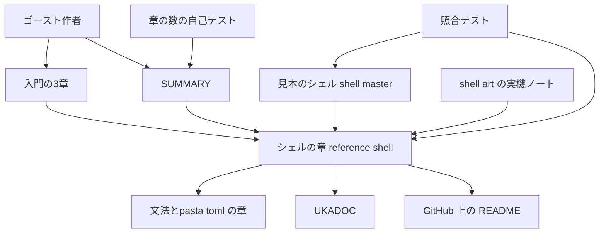
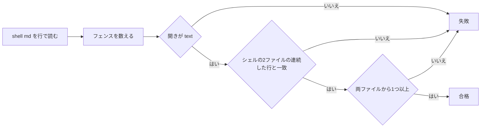

# 設計書: manual-shell-guide

## Overview

**Purpose**: 入門ガイドを終えたゴースト作者に、見本のシェル（hello-pasta の `shell/master/`）を題材として、絵の差し替え・表情の追加・当たり判定の追加・吹き出し（バルーン）の扱いと、辞書とシェルの接点を 1 か所で示す章を届ける。

**Users**: ゴースト作者（入門ガイドを終えた人）が「自分の絵にしたい」「表情を増やしたい」「触れる場所を足したい」ときに読む。マニュアルの執筆者（AI エージェントを含む）は、章の事実が見本のシェルとずれていないことを `cargo test -p pasta_sample_ghost` で確かめる。

**Impact**: マニュアルの「リファレンス」パートに章が 1 つ増える（60 章 → 61 章）。入門の 3 章（`setup.md`・`03-face.md`・`08-touch.md`）に、シェルの章へのリンクを 1 行ずつ足す。`shell_assets_test.rs` に、章の抜き出しと見本のシェルを照合するテストを 1 つ足す。pasta 本体（`pasta.dll`・Lua ランタイム）と見本のシェルは変えない。

### Goals

- 章 `book/src/reference/shell.md` を、通常の章の規約（導入と締めだけ台詞）で書き、目次のリファレンスに載せる（1.1〜1.5, 2.1）
- 辞書とシェルの接点（サーフェス番号と表情名・当たり判定の名前と `＄ｒ４`・吹き出しと `spot`）を 1 つの H2 にまとめる（3.1〜3.7）
- 章のコードブロックはすべて見本のシェルの逐語の抜き出しとし、Rust のテストが実物との一致を確かめる（10.1〜10.4）
- 章を足しても、既存の検査（台詞・本文・リンク・ビルド・静的性・検索・生成物の照合）がすべて通る（11.1〜11.6）

### Non-Goals

- 絵の描き方・画像生成の手順（2.6）
- 着せ替え・アニメーションなどの網羅（8.1）。存在と UKADOC の読み先だけを書く
- 利用者向けのシェル検査の道具（8.2）。本 spec が足すテストは、マニュアルの整合を確かめる開発用の検査である
- 見本のシェル・`descript.txt`・当たり判定の変更（`hello-pasta-shell-art` の持ち場。本 spec は読むだけ）
- 入門の章の本文の書き直し（9.6）
- スキルの生成対象への追加（11.5）

## Boundary Commitments

### This Spec Owns

- 新しい章 `book/src/reference/shell.md` の構成・本文・リンク・抜き出し
- `book/src/SUMMARY.md` のリファレンスへの 1 行
- 入門の 3 章に足すリンクの 1 行ずつ（足す位置と文言）
- 章の数を決め打ちした自己テストの数（60 → 61）と、同じ数を書いたコメント
- `shell_assets_test.rs` に足す照合テスト 1 つ（章のコードブロックが見本のシェルの連続した行と逐語で一致すること）

### Out of Boundary

- 見本のシェルのファイル（`crates/pasta_sample_ghost/ghosts/hello-pasta/shell/master/` の全ファイル）。読むだけで変えない
- 既存の `shell_assets_test.rs` のテストと定数（`CANVAS`・`SAKURA`・`KERO`・当たり判定の順の検査）。変えない（定数の doc コメントに章を指す 1 行を足すことだけは除く。決定 D4）
- 入門の章の台詞・作例・成功の目印・「もっと詳しく」・段階表 `STAGES.md`
- `book/AUTHORING.md`（変えない。決定 D6）、`reference/external-links.md`（変えない。決定 D7）
- 検査ツールの判定ロジック（`verify-content.mjs`・`link-check.mjs`・`talk.mjs`・`gen-skill-refs.mjs`・`tutorial-check.mjs`）。数の決め打ちとコメントの数字以外は触らない
- `.github/workflows/manual.yml` の `paths`（触らない。理由は「CI での照合の走り方」）
- 同梱バルーンの仕組み（`pasta_check`）、スクリーンショット（`getting-started-screenshots`）、辞書が無いときの立ち絵（`boot-surface-without-dic`）

### Allowed Dependencies

- 見本のシェルの実物（`descript.txt`・`surfaces.txt`・PNG の枚数と寸法）を事実の出どころとして読む
- `.kiro/specs/completed/hello-pasta-shell-art/tasks.md` の Implementation Notes 6.1（SSP の実機で確かめた当たり判定の部位名・重なり・吹き出しの値）を、実機の事実の出どころとして使う
- UKADOC（`https://ssp.shillest.net/ukadoc/manual/`）を仕様の正本としてリンクする
- マニュアルの既存の章（`getting-started/03-face.md`・`08-touch.md`・`grammar/actor-dictionary.md`・`grammar/variables.md`・`reference/pasta-toml.md`）へリンクする
- GitHub 上のリポジトリのファイル（`crates/pasta_sample_ghost/art/README.md`・`crates/pasta_check/README.md`）を絶対 URL で指す
- テストは `crates/pasta_sample_ghost/tests/common/mod.rs` の `workspace_root()` と標準ライブラリだけを使う（新しい依存を足さない）

### Revalidation Triggers

- 見本のシェルの `descript.txt`・`surfaces.txt` の変更（照合テストが落ちる。章の抜き出しを直す）
- 見本のシェルの枚数・寸法・番号・当たり判定の名前と順の変更（既存の `shell_assets_test.rs` が落ちる。章の本文の数も直す。決定 D4）
- `hello-pasta` の `pasta.toml` の `spot`、`03-face.pasta` の表情名、`08-touch.pasta` の使い方の変更
- 章を足す・消す別の spec（`pasta-check-dic-validate` など）が入ったとき（後から入る側が 3 つの数と `SUMMARY.md` を合わせる）
- `touch-poke-shortcuts` が `08-touch.md` の本文を変えたとき（後から入る側が、足したリンクの行を保つ）
- `pasta_check` などが将来サーフェス番号や当たり判定の名前を検査するようになったとき（章の「pasta は検出しない」「名前を照合しない」の記述を見直す）
- 見出しの文言を変えたとき（入門の 3 章からのアンカー付きリンクが変わる）

## Architecture

### Existing Architecture Analysis

- マニュアルは mdBook で、`book/src/SUMMARY.md` が目次の正本である。リファレンスのパートは平たい 3 章（`startup.md`・`pasta-toml.md`・`external-links.md`）で、`reference/` の直下に置いた章は、口調の検査（`D-voice`）・台詞部品の検査（`T-syntax`・`T-intro`・`T-outro`）・リンク検証・静的性・検索の検査の対象に自動で入る（`verify-content.mjs` の `VOICE_DIRS` は非再帰で、`reference` を含む）。
- 章の数は 4 か所で決め打ちされている。`verify-scripts-test.mjs`（T 系の件数 60）、`talk/talk-test.mjs`（J-9）、`gen-skill-refs-test.mjs`（K-10）、`verify-content.mjs` の冒頭コメント（数字だけ）。`link-check-test.mjs` の I-2 の「60 章」は判定関数に渡す見本のデータで、実リポジトリの章の数ではないため直さない。
- `gen-skill-refs-test.mjs` の K-10 は、全章について `chapterRegions`（H1 で始まり、フェンス外の `---` が 2 本以上）と旧来の判定の一致を確かめる。新しい章は「H1 → 導入 → `---` → 本体 → `---` → 締め」で、本体に `---` を置かない。
- 見本のシェルの形は `shell_assets_test.rs` が保証している。同じファイルにある `book_sample_images_are_byte_identical_to_shell` が、マニュアルの写しと見本の実物を照合する前例である。このテストは main の CI（`build.yml` の `cargo test --all`。パスの絞り込みなし）と、マニュアルの CI（`manual.yml` の `cargo test -p pasta_sample_ghost`。`book/**` の変更で走る）の両方で走る。
- 作業ツリーの `descript.txt`・`surfaces.txt` は CRLF（リポジトリ内は LF。autocrlf）。照合は行単位（`str::lines`）で行い、改行の種類に依存しない。

### Architecture Pattern & Boundary Map



**Architecture Integration**:
- 採る形: 既存のリファレンスのパートに章を 1 つ足し、入門から箇条書きのリンクで送り出す（ギャップ分析の Option C-2）。仕組みの追加は照合テスト 1 つだけである。
- 境界: 章は事実を「見本のシェル」「UKADOC」「マニュアルの既存の章」「shell-art の実機ノート」からだけ取る（2.3, 2.7）。仕様の一覧は UKADOC に任せ、章はリンクで送る（2.2）。
- 守る既存の型: 通常の章の型（導入 → `---` → 本体 → `---` → 締め）、台詞部品の記法、`shell_assets_test.rs` の「形が崩れていれば panic にする」流儀。
- 新しい部品の理由: 照合テストは 10.3 が求める。マニュアルの道具（`book/tools/`）に置くと、シェルだけを変えたときにマニュアルの CI が走らない（`manual.yml` の `paths` に `shell/**` が無い）。Rust のテストなら main の CI で必ず走る。

**Dependency direction**: 見本のシェル → シェルの章 → 入門の 3 章のリンク。照合テストは章とシェルの両方を読むが、どちらも書き換えない。入門の章はシェルの章を指すだけで、シェルの章は入門の章の本文に依存しない（リンク先の見出しだけに依存する）。

### Technology Stack

| Layer | Choice / Version | Role in Feature | Notes |
|-------|------------------|-----------------|-------|
| 文書 | mdBook（既存の版）・Markdown | 章の本文と目次 | 新しい依存なし |
| 検査（文書） | Node.js 20 の既存ツール（`book/tools/`） | 台詞・本文・リンク・静的性・検索 | 変えるのは数の決め打ちとコメントだけ |
| 検査（照合） | Rust の結合テスト（`pasta_sample_ghost`、標準ライブラリのみ） | 章の抜き出しと見本のシェルの逐語の一致 | 新しいクレートを足さない |
| 外部仕様 | UKADOC | シェルの書式の正本 | 絶対 URL でリンクする |

## File Structure Plan

### Directory Structure

```
book/src/
├── SUMMARY.md                      # リファレンスに 1 行足す（変更）
├── reference/
│   └── shell.md                    # 新しい章（作成）。本文の構成は「ShellChapter」
└── getting-started/
    ├── setup.md                    # 節「シェルの中身」に箇条書きを 1 行足す（変更）
    ├── 03-face.md                  # 「新しく覚える表現」に箇条書きを 1 行足す（変更）
    └── 08-touch.md                 # 「新しく覚える表現」に箇条書きを 1 行足す（変更）
crates/pasta_sample_ghost/tests/
└── shell_assets_test.rs            # 照合テストを 1 つ足す（変更）
book/tools/
├── verify-scripts-test.mjs         # T 系の件数 60 → 61（コメントを含む）（変更）
├── talk/talk-test.mjs              # J-9 の 60 → 61（変更）
├── gen-skill-refs-test.mjs         # K-10 の 60 → 61（変更）
└── verify-content.mjs              # 冒頭コメントの「全 60 章」→「全 61 章」（コメントだけ）（変更）
```

### Modified Files

- `book/src/SUMMARY.md` — `# リファレンス` の末尾（`external-links.md` の後）に `- [シェルを自分の絵にする](reference/shell.md)` を足す。題は章の H1 と同じ（1.2）
- `book/src/getting-started/setup.md` — 節「シェルの中身」の箇条書きの末尾（UKADOC の 2 ページの行の後）に 1 行足す。表と既存の箇条書きは変えない（9.1）
- `book/src/getting-started/03-face.md` — 「新しく覚える表現」の「表情に名前を付ける」の箇条書きの末尾（「同じ `＠笑顔` でも…」の行の後）に 1 行足す（9.2）
- `book/src/getting-started/08-touch.md` — 「新しく覚える表現」の「触られた部位の名前を台詞に入れる」の最初の箇条書きの末尾（「上の男の子の台詞は…」の行の後）に 1 行足す（9.3）
- `crates/pasta_sample_ghost/tests/shell_assets_test.rs` — 照合テスト `book_shell_chapter_code_blocks_are_shell_excerpts` を足す。ファイル冒頭の doc コメントに 1 行足す（10.3）。定数 `CANVAS`・`SAKURA`・`KERO` の doc コメントに「変えたら book/src/reference/shell.md の本文も直す」を 1 行ずつ足す（10.2。決定 D4）
- `book/tools/verify-scripts-test.mjs`・`book/tools/talk/talk-test.mjs`・`book/tools/gen-skill-refs-test.mjs` — 章の数の決め打ちを 61 にする（11.1）
- `book/tools/verify-content.mjs` — 冒頭コメントの章の数を 61 にする（判定は変えない）

## Requirements Traceability

| Requirement | Summary | Components | Interfaces | Flows |
|-------------|---------|------------|------------|-------|
| 1.1 | リファレンスの直下に置く | ShellChapter, SummaryEntry | `reference/shell.md` | — |
| 1.2 | 目次に H1 と同じ題で載せる | SummaryEntry | 題「シェルを自分の絵にする」 | — |
| 1.3 | 題と導入で目的を示す | ShellChapter | H1・導入の台詞 | — |
| 1.4 | 入門の章の数と並びを変えない | SummaryEntry | 入門パートは触らない | — |
| 1.5 | 読者の前提を冒頭で示す | ShellChapter | 本体の最初の段落 | — |
| 2.1 | 導入・締めだけ台詞、本体は普通文体 | ShellChapter | 章の型 | — |
| 2.2 | 書式を写さずリンクする | ShellChapter | UKADOC リンク表 | — |
| 2.3 | 事実の出どころを限る | ShellChapter | 事実の出どころ表 | — |
| 2.4 | 部品の働きだけ、レシピなし | ShellChapter | 各 H2 の書く内容 | — |
| 2.5 | 現行の文法だけ、Lua で補わない | ShellChapter | `pasta` ブロックを置かない | — |
| 2.6 | 描き方を書かない | ShellChapter | Non-Goals | — |
| 2.7 | 実機の事実は確かめたものだけ | ShellChapter | 事実の出どころ表 | 実機確認 |
| 2.8 | 作り込みの知見を書かない | ShellChapter | 各 H2 の書く内容 | — |
| 2.9 | 既存の絵 2 枚だけ、新しい画像なし | ShellChapter | 決定 D5（図を置かない） | — |
| 3.1 | 接点 3 つを 1 か所に | ShellChapter | `## 辞書とシェルの接点` の表 | — |
| 3.2 | pasta.dll はシェルを読まない | ShellChapter | 同上 | — |
| 3.3 | 番号と表情名の対応 | ShellChapter | `### サーフェス番号と表情名` | — |
| 3.4 | 当たり判定の名前と返る場所 | ShellChapter | `### 当たり判定の名前と ＄ｒ４` | — |
| 3.5 | spot と吹き出し位置の行の対応 | ShellChapter | `### 吹き出しとアクターの spot` | — |
| 3.6 | 無い番号を指したとき | ShellChapter | `### 辞書とシェルが食い違ったとき` | 実機確認 |
| 3.7 | 名前が食い違ったとき | ShellChapter | 同上 | — |
| 4.1, 4.2, 4.3, 4.4, 4.5, 4.6 | 絵を差し替える（同じ番号で置換・見本の形・座標と吹き出しの見直し・UKADOC・ライセンス・突き合わせ） | ShellChapter | `## 絵を差し替える`・抜き出し E1 | — |
| 5.1, 5.2, 5.3, 5.4, 5.5 | 表情を足す（触る 3 か所・番号の選び方・当たり判定・正本・確かめ方） | ShellChapter | `## 表情を足す` | — |
| 6.1, 6.2, 6.3, 6.4, 6.5, 6.6 | 当たり判定（1 行の意味・`＄ｒ４`・重なり・サーフェスごと・形は UKADOC・確かめ方） | ShellChapter, ExcerptMatchTest | `## 当たり判定を足す・直す`・抜き出し E1 | — |
| 7.1, 7.2, 7.3, 7.4, 7.5 | バルーン（同梱なし・4 行と向き・既定の大きさ前提・配る読み先・`spot`） | ShellChapter, ExcerptMatchTest | `## 吹き出し（バルーン）`・抜き出し E2 | — |
| 8.1, 8.2, 8.3 | 範囲の外の機能（存在と読み先・検査の道具なし・接点は不変） | ShellChapter | `## この章で扱わないこと` | — |
| 9.1 | setup.md にリンクを足す | GuideLinks | 箇条書き L1 | — |
| 9.2 | 03-face.md にリンクを足す | GuideLinks | 箇条書き L2 | — |
| 9.3 | 08-touch.md にリンクを足す | GuideLinks | 箇条書き L3 | — |
| 9.4 | 入門の規約と検査に通る | GuideLinks | 1 行の箇条書き（`C-prose` の対象外） | — |
| 9.5 | 「もっと詳しく」に置かない | GuideLinks | 置く節の指定 | — |
| 9.6 | 他の本文を変えない | GuideLinks | 足すのは 1 行だけ | — |
| 10.1 | 抜き出しを逐語で一致 | ExcerptMatchTest | 照合の規則 | 照合の流れ |
| 10.2 | 数を実物と一致 | ShellChapter, ExcerptMatchTest | 決定 D4 | — |
| 10.3 | 食い違いを失敗にする | ExcerptMatchTest | `cargo test -p pasta_sample_ghost` | 照合の流れ |
| 10.4 | 抜き出しに留める | ShellChapter, ExcerptMatchTest | 抜き出し E1・E2 | — |
| 11.1 | 章の数の自己テスト | ChapterCountTests | 60 → 61 | — |
| 11.2 | 台詞・本文検査 | ShellChapter | 章の型 | — |
| 11.3 | リンク検証 | ShellChapter, GuideLinks | 相対リンクとアンカー | — |
| 11.4 | ビルドと公開の検査 | ShellChapter | 既存の CI | — |
| 11.5 | 生成対象にしない | ShellChapter | `GENERATION_MAP` を触らない | — |
| 11.6 | 表情の偏りを確かめる | ShellChapter | `talk.mjs --stats` | — |

## Components and Interfaces

| Component | Domain/Layer | Intent | Req Coverage | Key Dependencies (P0/P1) | Contracts |
|-----------|--------------|--------|--------------|--------------------------|-----------|
| ShellChapter | 文書 | シェルの章の本文 | 1.1, 1.3, 1.5, 2.1〜2.9, 3.1〜3.7, 4.1〜4.6, 5.1〜5.5, 6.1〜6.6, 7.1〜7.5, 8.1〜8.3, 10.2, 10.4, 11.2〜11.6 | 見本のシェル (P0), UKADOC (P1), shell-art の実機ノート (P0) | 文書の契約 |
| SummaryEntry | 文書 | 目次への 1 行 | 1.1, 1.2, 1.4 | ShellChapter の H1 (P0) | — |
| GuideLinks | 文書 | 入門の 3 章からの導線 | 9.1〜9.6 | ShellChapter の見出し (P0) | 文書の契約 |
| ExcerptMatchTest | 検査（Rust） | 章のコードブロックと見本のシェルの照合 | 10.1, 10.3, 10.4, 6.1, 7.2 | ShellChapter (P0), 見本のシェル (P0) | Batch |
| ChapterCountTests | 検査（Node） | 章の数の決め打ちを 61 にする | 11.1 | SUMMARY・`book/src` の章 (P0) | — |

### 文書

#### ShellChapter（`book/src/reference/shell.md`）

| Field | Detail |
|-------|--------|
| Intent | 見本のシェルを題材に、差し替え・表情・当たり判定・吹き出しと、辞書との接点を示す |
| Requirements | 1.1, 1.3, 1.5, 2.1〜2.9, 3.1〜3.7, 4.1〜4.6, 5.1〜5.5, 6.1〜6.6, 7.1〜7.5, 8.1〜8.3, 10.2, 10.4, 11.2〜11.6 |

**Responsibilities & Constraints**

- 章の型: 先頭行は H1「`# シェルを自分の絵にする`」。導入（台詞 2〜3 吹き出し・両方の話し手）→ `---` → 本体（普通文体）→ `---` → 締め（台詞 2 吹き出し・両方の話し手）。本体は普通文体で書き、台詞部品と区切り `---` を置かない（2.1。区切りを 2 本に限るのは K-10 の章構造の判定に合わせるため）。
- 最初の台詞は、この章に固有の 4 文字以上の日本語で始める（検索の検査）。導入の台詞で、章が「自分の絵にする・表情を足す・触れる場所を足す」ための章であることを示す（1.3）。各台詞の表情は第 7 節の目安に従い、`talk.mjs --stats` で既存の章との偏りを確かめる（11.6）。
- コードブロックは、情報文字列 `text` の見本のシェルの抜き出しだけにする。`pasta`・`toml`・情報文字列なしのブロックを置かない（2.5, 10.1。ExcerptMatchTest が確かめる）。辞書側の書き方は表とインラインコードで示し、正本へリンクする。
- 画像を置かない（2.9。決定 D5）。
- 見出しは、入門からのアンカー（`#表情を足す`・`#当たり判定を足す直す`）が変わらないよう、下の表の文言に固定する。

**本体の構成（H2 はこの順）**

| 順 | 見出し | 書く内容（事実だけ） | 要件 |
| -- | ------ | -------------------- | ---- |
| 1 | `## この章の前提` | 入門ガイドの準備の章を終え、見本のシェルを `shell/master/` に写した人が読者であること。準備の章の節「シェルの中身」へのリンク | 1.5 |
| 2 | `## 辞書とシェルの接点` | 接点 3 つ（サーフェス番号と表情名・当たり判定の名前と `＄ｒ４`・吹き出しと `spot`）の表（列: 辞書の側／シェルの側／決めるもの）。`pasta.dll` はシェルのファイルを読まず、絵を出す・当たり判定を決める・吹き出しを置くのは SSP であること | 3.1, 3.2 |
| 2.1 | `### サーフェス番号と表情名` | 見本の番号（女の子 0〜8・男の子 10〜18、9 は無い）と 3 段目の表情名 9 つの対応表（`03-face.md` の表と同じ値）。正本として 3 段目と [アクター辞書](../grammar/actor-dictionary.md#グローバルアクター辞書定義) へリンク | 3.3 |
| 2.2 | `### 当たり判定の名前と ＄ｒ４` | 名前 `Face`・`Head`・`Body` と返る場所（女の子: 顔の中央 `Face`・頬の横の髪 `Head`・胴 `Body`。男の子: 顔 `Face`・コック帽と横の髪 `Head`・胴 `Body`）。当たり判定の無い所（首の隙間・靴・足元）では `＄ｒ４` が空。8 段目と [リクエスト変数](../grammar/variables.md#リクエスト変数reference) へリンク | 3.4 |
| 2.3 | `### 吹き出しとアクターの spot` | `spot` `0` = メイン（sakura 側）＝ `sakura.balloon.*` の行、`1` = サブ（kero 側）＝ `kero.balloon.*` の行。見本は女の子が `0`、男の子が `1`。[バルーン連携](../grammar/actor-dictionary.md#バルーン連携) と [`spot`](pasta-toml.md#spot) へリンク | 3.5, 7.5 |
| 2.4 | `### 辞書とシェルが食い違ったとき` | (a) 表情名がシェルに無い番号を指していても pasta は検出しない（`pasta.dll` はシェルを読まず、`\s[番号]` をそのまま出す）。そのとき SSP は前の絵を出したまま台詞を続け、立ち絵は消えず、ふだんの設定ではエラーも出ない。気づく手がかりは表情が替わらないことだけ（SSP 2.9.11 の実機で確認。research.md「R3.6 の実機確認」）。(b) `＄ｒ４` にはシェルが付けた名前がそのまま入り、pasta は名前を変換・照合しない（大文字小文字も区別したまま） | 3.6, 3.7, 2.7 |
| 3 | `## 絵を差し替える` | 同じ番号のファイル名（`surfaceN.png`）の画像を置き換えれば辞書を書き換えずに絵が替わる。見本の形（333×500 の透過 PNG、女の子 9 枚・男の子 9 枚）を目安として示す。大きさや立ち位置を変えたら当たり判定の座標と吹き出しの位置の行も見直す。各サーフェスの定義の `element0` の行がファイル名を指すので、ファイル名や番号が合わないときは画像のファイル名と `surfaces.txt` の `surfaceN` と `element0` の行を突き合わせる（抜き出し E1 を参照）。正本は UKADOC の「シェルの作成」・`element*`・`seriko.use_self_alpha` の項（下の UKADOC リンク表）。ライセンス（Unlicense）と出どころの記録 `art/README.md` を GitHub の絶対 URL で示し、`.nar` に入らないことを書く | 4.1〜4.6 |
| 4 | `## 表情を足す` | 触る所は 3 つ（新しい番号の画像・`surfaces.txt` のそのサーフェスの定義・アクター辞書の表情名の行）。番号の選び方: 見本の割り当て（0〜8・10〜18）と、UKADOC の決まり（`surface0` と `surface10` が基本サーフェス、番号は 0 以上）。新しいサーフェスにも当たり判定を書かなければ、その表情のあいだは触っても部位名が出ない。表情名の書き方の正本は 3 段目とアクター辞書。確かめ方: 辞書の台詞で `＠表情名` を呼び、SSP で表情が替わる。成功の目印: その台詞のときに新しい絵が出る | 5.1〜5.5 |
| 5 | `## 当たり判定を足す・直す` | 抜き出し E1 を例に、1 行が「名前・形・座標」を決めること（`collisionexN,名前,rect,左,上,右,下`）。名前が `＄ｒ４` に入る（8 段目と文法リファレンスへリンク）。重なった所は先に書いた定義が返る（UKADOC `collision-sort` の既定。見本では顔の真ん中が `Face`、髪と帽子が `Head`）。当たり判定はサーフェスごとに要り、表情が替わるとそのサーフェスのものに替わる。形の種類と座標の書き方は UKADOC の `collisionex` へリンクし、形の一覧を写さない。確かめ方: 8 段目の辞書のままダブルクリックし、台詞に入る部位名を見る。SSP の開発用パレットの「当たり判定を表示」で枠を見られる（UKADOC「シェルの作成」に記載） | 6.1〜6.6 |
| 6 | `## 吹き出し（バルーン）` | 見本のゴーストにバルーンは入っておらず、SSP で選ばれているバルーンが使われる。位置はシェルの `descript.txt` の 4 行（抜き出し E2）で決まり、X の＋はシェルに近づく向き、Y の＋は下（UKADOC `sakura.balloon.offsetx` へリンク）。見本の値は SSP の既定のバルーンの大きさを前提に決めてある。どのアクターの台詞がどちらに出るかは `spot` で決まる（2.3 節を指す）。配りたいときの読み先: UKADOC の [インストール](https://ssp.shillest.net/ukadoc/manual/manual_install.html) と `pasta_check` の README（GitHub の絶対 URL）。手順そのものは書かない | 7.1〜7.5 |
| 7 | `## この章で扱わないこと` | 着せ替え・アニメーションなどの機能があることと UKADOC の読み先（[アニメーション/着せ替えの設定](https://ssp.shillest.net/ukadoc/manual/dev_bind.html)）を 1〜2 行。高度な機能を使っても辞書との接点（番号・名前・`spot`）は変わらない。pasta はシェルの書き間違いを検査する道具を持たず、確かめ方は SSP での表示であること | 8.1〜8.3 |

**抜き出し（章に置くコードブロックはこの 2 つだけ）**

| ID | 置く節 | 元のファイル | 行 | 内容 |
| -- | ------ | ------------ | -- | ---- |
| E1 | `## 当たり判定を足す・直す`（`## 絵を差し替える` と `## 表情を足す` はこれを参照する） | `shell/master/surfaces.txt` | `surface0` から最初の `}` まで（実物の 3〜9 行目） | `surface0` の定義（`element0` 1 行・`collisionex0〜2` の 3 行） |
| E2 | `## 吹き出し（バルーン）` | `shell/master/descript.txt` | `sakura.balloon.offsetx,100` から `kero.balloon.offsety,120` まで（実物の 7〜10 行目） | 吹き出しの位置の 4 行 |

- 男の子の座標は抜き出しに入れない。「男の子のサーフェス（10〜18）も同じ形で、座標が違う」とだけ書く（10.4）。
- 吹き出しの値・当たり判定の座標を本文や表に書き写さない。数値は抜き出しの中にだけ置く（決定 D4）。

**事実の出どころ**

| 事実 | 出どころ |
| ---- | -------- |
| 枚数・寸法・番号・当たり判定の名前と順・吹き出しの値 | 見本のシェルの実物（`shell_assets_test.rs` が形を保証） |
| 部位名が返る場所・重なりで先の定義が勝つ・当たり判定の外で空 | `hello-pasta-shell-art` の Implementation Notes 6.1（SSP 実機・2026-10-10。画面の写しと書き起こし `dblclick-log.txt` の両方。決定 D8）と UKADOC `collision-sort` |
| 吹き出しの値が SSP の既定のバルーンの大きさを前提にしている | 同 6.1 の「吹き出しの最終値」「残るリスク」 |
| 表情名と番号の対応・`spot` | `03-face.pasta`・`pasta.toml`（hello-pasta）と、マニュアルの `03-face.md`・`actor-dictionary.md`・`pasta-toml.md` |
| `＄ｒ４` に名前がそのまま入る | `08-touch.md`・`grammar/variables.md`（pasta は値を加工しない） |
| 無い番号を指したときの画面 | SSP 2.9.11 の実機（2026-10-16。research.md「R3.6 の実機確認」） |
| `surface0`・`surface10` が基本サーフェス、番号は 0 以上、開発用パレットで当たり判定を表示できる | UKADOC「シェルの作成」 |

**UKADOC リンク表（章で使う絶対 URL）**

| 対象 | URL |
| ---- | --- |
| シェルの作成（画像の形式・番号・透過・当たり判定の表示） | `https://ssp.shillest.net/ukadoc/manual/dev_shell.html` |
| シェルの descript.txt | `https://ssp.shillest.net/ukadoc/manual/descript_shell.html` |
| `sakura.balloon.offsetx` | `https://ssp.shillest.net/ukadoc/manual/descript_shell.html#_1_sakura.balloon.offsetx%2C%E5%BA%A7%E6%A8%99` |
| `seriko.use_self_alpha` | `https://ssp.shillest.net/ukadoc/manual/descript_shell.html#seriko.use_self_alpha%2C%E5%80%A4` |
| surfaces.txt | `https://ssp.shillest.net/ukadoc/manual/descript_shell_surfaces.html` |
| `element*` | `https://ssp.shillest.net/ukadoc/manual/descript_shell_surfaces.html#element*%2C%E6%8F%8F%E7%94%BB%E3%83%A1%E3%82%BD%E3%83%83%E3%83%89%2C%E3%83%95%E3%82%A1%E3%82%A4%E3%83%AB%E5%90%8D%2CX%E5%BA%A7%E6%A8%99%2CY%E5%BA%A7%E6%A8%99` |
| `collisionex*` | `https://ssp.shillest.net/ukadoc/manual/descript_shell_surfaces.html#collisionex*%2CID%2C%E3%82%BF%E3%82%A4%E3%83%97%2C%E5%BA%A7%E6%A8%991%2C%E5%BA%A7%E6%A8%992...` |
| `collision-sort` | `https://ssp.shillest.net/ukadoc/manual/descript_shell_surfaces.html#collision-sort%2C%E3%82%BD%E3%83%BC%E3%83%88%E9%A0%86%E5%BA%8F` |
| `\s[ID]` | `https://ssp.shillest.net/ukadoc/manual/list_sakura_script.html#_s_ID%E7%95%AA%E5%8F%B7_` |
| インストール（バルーンの同梱の構成） | `https://ssp.shillest.net/ukadoc/manual/manual_install.html` |
| アニメーション/着せ替えの設定 | `https://ssp.shillest.net/ukadoc/manual/dev_bind.html` |

（UKADOC のアンカーはリンク検証の対象外。実装のとき、ブラウザで開いて項に飛ぶことを確かめる。）

**GitHub の絶対 URL**

| 対象 | URL |
| ---- | --- |
| 見本の絵の出どころとライセンス | `https://github.com/ekicyou/pasta/blob/main/crates/pasta_sample_ghost/art/README.md` |
| 同梱バルーン（`pasta_check`） | `https://github.com/ekicyou/pasta/blob/main/crates/pasta_check/README.md#同梱バルーン` |

（`link-check.mjs` がファイルの実在を確かめる。GitHub 側のアンカーは検査されない。）

**Implementation Notes**
- Integration: `reference/` の直下に置くだけで、台詞・口調・リンク・静的性・検索の検査が自動でかかる。生成対象の対応表（`GENERATION_MAP`）には載せない（11.5）。
- Validation: `node book/tools/verify-content.mjs`・`node book/tools/link-check.mjs`・`node book/tools/gen-skill-refs.mjs --check`・`mdbook build book` 以下の CI と同じ手順（AUTHORING 第 7 節「手元での確かめ方」）・`cargo test -p pasta_sample_ghost`。
- Risks: 章の最初の台詞の語が他の章にもあると検索の検査が弱まる。

#### SummaryEntry（`book/src/SUMMARY.md`）

- `# リファレンス` の末尾に `- [シェルを自分の絵にする](reference/shell.md)` を足す。題は ShellChapter の H1 と同じ文字列（1.2）。入門パートの行は触らない（1.4）。表紙 `introduction.md` の扉のナビは `reference/startup.md` を指したままでよい。

#### GuideLinks（入門の 3 章）

| ID | 章 | 置く場所 | 足す 1 行（文言は実装で整えてよいが、リンク先は固定） |
| -- | -- | -------- | ----------------------------------------------------- |
| L1 | `setup.md` | 節「シェルの中身」の箇条書きの末尾 | `- 絵の差し替え・表情の追加・当たり判定・吹き出しの位置は、[シェルを自分の絵にする](../reference/shell.md) にまとめてある` |
| L2 | `03-face.md` | 「表情に名前を付ける」の 2 つ目の箇条書き（表の後）の末尾 | `- 見本に無い表情を足すときは、[シェルを自分の絵にする](../reference/shell.md#表情を足す) を読む` |
| L3 | `08-touch.md` | 「触られた部位の名前を台詞に入れる」の最初の箇条書きの末尾 | `- 見本のシェルの当たり判定の名前と、当たり判定を足す・直す方法は、[シェルを自分の絵にする](../reference/shell.md#当たり判定を足す直す) にある` |

- どれも箇条書き（第 8 節の「台詞以外に置けるもの」）で、`C-prose` の対象の段落ではない。台詞・作例・成功の目印・「もっと詳しく」は変えない（9.4〜9.6）。
- アンカーは mdBook の見出し id（`・` などの記号を落とす）。リンク検証（`internal-anchor`）が確かめる。
- `08-touch.md` は `touch-poke-shortcuts` も本文を触る。後から入る側が、この 1 行を保って rebase する。

### 検査

#### ExcerptMatchTest（`shell_assets_test.rs` に足すテスト）

| Field | Detail |
|-------|--------|
| Intent | シェルの章のコードブロックが、見本のシェルの `descript.txt` か `surfaces.txt` の連続した行と逐語で一致することを確かめる |
| Requirements | 10.1, 10.3, 10.4（6.1・7.2 の抜き出しの正しさ） |

**Responsibilities & Constraints**

- 読むのは `book/src/reference/shell.md` と `shell/master/descript.txt`・`surfaces.txt` だけ。どれも書き換えない。新しい依存を足さない。
- 失敗は panic（`assert!`）で、ファイル・ブロックの開始行番号・理由を出す。0 件で素通りしない。

**Contracts**: Batch [x]

##### Batch / Job Contract

- Trigger: `cargo test -p pasta_sample_ghost`（main の CI の `cargo test --all` と、マニュアルの CI の `cargo test -p pasta_sample_ghost`）
- Input / validation:
  - 章を行単位（`str::lines`）で読み、行頭の ```` ``` ```` で始まる行をフェンスの開きと閉じとして数える（章の規約でフェンスは行頭・バッククォート 3 本）。
  - 開きの行は ```` ```text ```` と完全に一致しなければ失敗（「章のコードブロックは見本のシェルの抜き出し（`text`）だけ」）。
  - ブロックの中身（開きと閉じの間の行）が空なら失敗。
  - シェルの 2 ファイルをそれぞれ `str::lines` で行の列にし、ブロックの行の列がどちらかの連続した部分列と完全に一致しなければ失敗（どのファイルにも見つからないブロックの 1 行目を示す）。
  - 閉じられていないフェンスがあれば失敗。
  - ブロックが 1 つも無い、または `descript.txt` と一致したブロックと `surfaces.txt` と一致したブロックのどちらかが 1 つも無ければ失敗（抜き出し E1・E2 が消えたことを検出する）。
- Output / destination: テストの合否だけ。
- Idempotency & recovery: 読むだけで副作用なし。改行は `str::lines` が CRLF・LF を同じに扱う。

```rust
/// シェルの章（book/src/reference/shell.md）のコードブロックは、すべて見本のシェルの
/// descript.txt か surfaces.txt の連続した行の逐語の抜き出しである。
#[test]
fn book_shell_chapter_code_blocks_are_shell_excerpts();

/// 章の本文から ```text ブロックを (開きの行番号, 中身の行) で取り出す。形が崩れていれば panic。
fn text_blocks(chapter: &str) -> Vec<(usize, Vec<&str>)>;

/// needle が haystack の連続した部分列として現れるか。
fn contains_run(haystack: &[&str], needle: &[&str]) -> bool;
```

- Preconditions: 章と 2 ファイルが読める（読めなければ panic）。
- Postconditions: 章の全コードブロックが実物の逐語の抜き出しで、2 ファイルの両方から 1 つ以上ある。
- Invariants: シェルの章にもシェルにも書き込まない。

**Implementation Notes**
- Integration: ファイル冒頭の doc コメントに「マニュアルのシェルの章の抜き出しが実物と同じかも見る」を 1 行足す。既存の `book_sample_images_are_byte_identical_to_shell` の直後に置く。
- Validation: 実装のとき、抜き出しの 1 文字を変えて失敗すること、`pasta` ブロックを足して失敗することを手元で一度ずつ確かめ、元に戻す（記録はタスクの Implementation Notes に書く）。
- Risks: 失敗の修正方法がテストのメッセージに無いと迷うため、メッセージに「見本のシェルから写し直す（book/src/reference/shell.md）」を含める。

#### ChapterCountTests

- `verify-scripts-test.mjs` の `['T-syntax', 60], ['T-intro', 60], ['T-outro', 60]` を 61 に、78 行目のコメント「全 60 章」を「全 61 章」にする。
- `talk/talk-test.mjs` の J-9 の題と `chapterRows.length === 60` を 61 にする。
- `gen-skill-refs-test.mjs` の K-10 の題と `chapters.length === 60` を 61 にする。
- `verify-content.mjs` 冒頭コメントの「全 60 章」を「全 61 章」にする（判定には関わらない）。
- `link-check-test.mjs` の I-2 の「60 章」は見本のデータなので変えない。
- `pasta-check-dic-validate` が先に章を足していた場合は、その時点の数に 1 を足す（後から入る側が合わせる）。

## System Flows

### 照合の流れ



### 実機確認（3.6・2026-10-16 済み）

- 本体側に `\s[9]`、相方側に `\s[19]` を送り、画面とエラーログを見た。両方とも前の絵のまま、立ち絵は消えなかった。スクリプトは止まらず最後まで進んだ。ふだんの送り方では、エラーログにも何も残らなかった。pasta は表情名の値の `\s[9]` をそのまま出すので、さくらスクリプトを直接送った結果と同じになる。手順と記録は research.md「R3.6 の実機確認」にある。
- 章の 2.4 節 (a) には、この結果だけを書く（2.7, 3.6）。

## Error Handling

- 章の誤り（書式・リンク・台詞・数）は既存の検査が失敗で止める。どれも警告で続行しない。
- 抜き出しのずれは ExcerptMatchTest が失敗で止める。メッセージは「どのブロックが・どのファイルにも一致しない」と「写し直す場所」を示す。
- 本文の数（333×500・18 枚・0〜8・10〜18・`Face`/`Head`/`Body`）は、見本のシェルが変わると既存の `shell_assets_test.rs` が先に失敗する（決定 D4）。そのとき章の本文も直す。

## Testing Strategy

### 照合（Rust・`cargo test -p pasta_sample_ghost`）
- 章のコードブロックが E1（`surfaces.txt` の `surface0` の定義）と E2（`descript.txt` の吹き出しの 4 行）の逐語の抜き出しで、両方そろうこと（10.1, 10.3, 10.4）
- `text` 以外のコードブロックがあると失敗すること（2.5, 10.1）。実装のときに一度だけ手元で崩して確かめる
- 既存のテスト（枚数・寸法・当たり判定・本の写し 2 枚）がそのまま通ること（10.2 の数の土台）

### 文書の検査（Node・既存のツール）
- `verify-content.mjs`: 新しい章の `D-voice`・`T-syntax`・`T-intro`・`T-outro` が PASS。入門の 3 章の `C-prose`・`C-sections`・`C-tutorial-check` が従来どおり PASS（9.4, 11.2）
- `link-check.mjs`: 新しい章の相対リンク（`../grammar/…#…`・`pasta-toml.md#spot`・`../getting-started/…`）、入門からの `../reference/shell.md#表情を足す`・`#当たり判定を足す直す`、GitHub の 2 つの URL の実在が通る（11.3）
- 自己テスト: `verify-scripts-test.mjs`・`talk/talk-test.mjs`・`gen-skill-refs-test.mjs` が 61 章で通る（11.1）
- `gen-skill-refs.mjs --check`: 生成物が変わらない（11.5）

### 出力と公開（CI と同じ手順）
- `mdbook build book` → 着色 → `talk-html.mjs` → 索引 → `verify-static.mjs --no-build`・`verify-search.mjs --no-build` が通り、新しい章が最初の台詞の語で検索に出る（11.4）
- `talk.mjs --stats` で新しい章の導入・締めの表情の組み合わせが既存の章と偏っていないことを人が確かめる（11.6）

### 人の確認（機械検査の無い所）
- 本体に、UKADOC の書式の一覧（キー・値・形の一覧）を写していない（2.2）。レシピ・作り込みの知見・描き方が無い（2.4, 2.6, 2.8）
- UKADOC の各リンクが該当の項に飛ぶ（アンカーは機械検査されない）
- 2.4 節の画面の挙動が、記録した実機の結果と一致している（2.7, 3.6）

## Design Decisions（要約。詳細は research.md）

- **D1 置き場所と名前**: `book/src/reference/shell.md`（`reference/` の直下。下のフォルダに置くと口調・台詞の検査から外れる）。題は「シェルを自分の絵にする」。
- **D2 照合の置き場所**: `shell_assets_test.rs` の Rust のテスト（ギャップ分析 C-2）。シェルだけの変更でも main の CI で落ちる。`manual.yml` の `paths` は触らない。
- **D3 照合の印**: 印を付けない。章のコードブロックはすべて `text` の抜き出しとし、全ブロックを照合する。HTML コメントなどの印の規約を増やさずに、照合漏れも起きない。
- **D4 数の照合**: 数値（座標・吹き出しの値）は抜き出しの中にだけ置き、逐語の照合で守る。本文に残る数（333×500・18 枚・番号・当たり判定の名前）は、既存の `shell_assets_test.rs` の定数と検査が守る。章の本文から数を拾う照合は足さない。その代わり、定数 `CANVAS`・`SAKURA`・`KERO` の doc コメントに「変えたら book/src/reference/shell.md の本文も直す」を 1 行ずつ足す。定数を直す人に、章も直す必要があることを伝えるためである。
- **D5 当たり判定の図**: 置かない。新しい画像とその照合（`[0, 10]` の列の拡張）が要り、座標は抜き出し E1 と「返る場所」の表で足りる。
- **D6 AUTHORING.md**: 変えない。抜き出しの規則は照合テストの doc コメントと失敗メッセージで示す。
- **D7 外部リンク集**: 変えない。UKADOC のシェルのページは章の中から直接リンクする。
- **D8 部位名の根拠**: shell-art の Implementation Notes 6.1 にある部位名は、すべて実機の事実として書く。画面の写しで裏が取れたのは女の子の 4 か所と男の子の帽子だけで、残りは実装者の書き起こし（`dblclick-log.txt`）が根拠である。ただし書き起こしも、SSP で実際にダブルクリックした結果を写した記録であり、推測ではない（2.7 を満たす）。

## Open Questions / Risks

- **OQ-1（3.6）**: 解決済み。2026-10-16 に SSP 2.9.11 の実機で確かめた（前の絵のまま・スクリプトは続く・ふだんはエラーも出ない）。
- **OQ-2〜OQ-5**: 設計ディスカッション（2026-10-16）で、すべて推奨案のとおり確定した。OQ-2 は D4 のとおりで、定数の doc コメントに 1 行を足す。OQ-3 は題を「シェルを自分の絵にする」とする（D1）。OQ-4 は AUTHORING を変えない（D6）。OQ-5 は書き起こしも実機の記録として認める（D8）。
- Risk: 章の最初の台詞の語の選び方で、検索の検査が弱まる（実装で章に固有の語を選ぶ）。
- Risk: `08-touch.md` を `touch-poke-shortcuts` と同時に触る（後から入る側が rebase で合わせる取り決め）。
