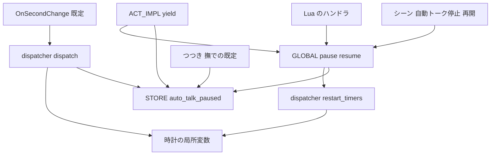
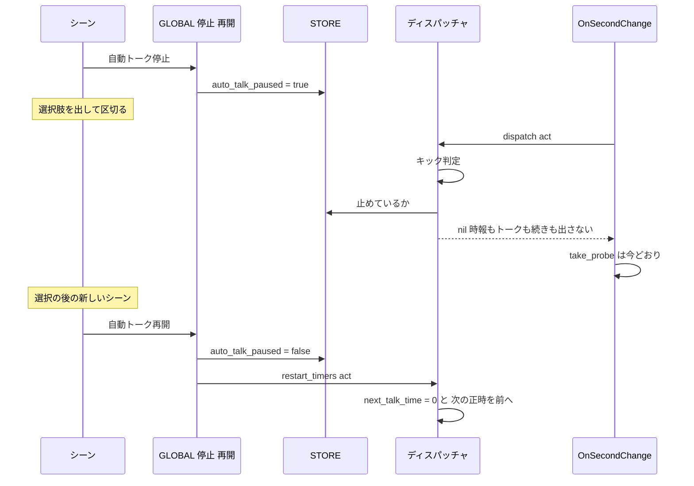
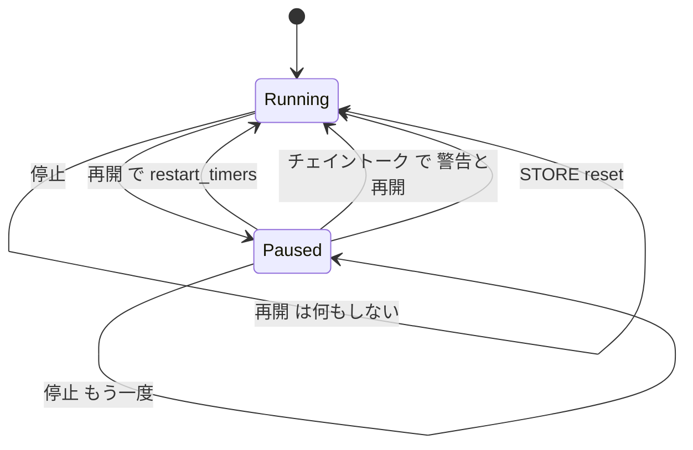

# 設計書: ontalk-suppression

## Overview

**目的**: 選択肢やイベントで区切りながら進むトーク（初回起動の案内など）を書く作者が、シーンから 1 行で「自動トーク」（ランダムトーク・時報・止まっているシーンの続き・ふだんのつつき・撫での反応）を止め、また再開できるようにする。`REG.OnSecondChange` を包む Lua の回り道を要らなくする。

**利用者**: Pasta DSL でゴーストを書く作者。Lua からも同じ関数を呼べる。後から入る `external-control-events`（外から `自動トーク停止` を呼ぶ口）と `novel-talk-flow`（ノベル向けの設定で常に止める）が、このスイッチを再利用する。

**変えること**: 既存のファイルを小さく広げる（新しいモジュールは作らない）。止めている印を `STORE` に 1 つ置き、`GLOBAL` に 4 つの名前（停止・再開と日本語の別名）を登録する。仮想ディスパッチャの `dispatch` にキックの後・時報の前の門を 1 つ、つつき・撫での既定ハンドラに 1〜8 段を飛ばす条件を 1 つずつ足す。再開したときは、ディスパッチャが自分の時計（次のランダムトーク・次の正時）を決め直す。`＞チェイントーク` は止めている間に呼ばれたら警告して再開する。`pasta_check` の組み込みの名前を 4→8 にし、マニュアルとスキルの references を直す。

### Goals

- `＞自動トーク停止`／`＞自動トーク再開`（`＠` の形・Lua の `GLOBAL.pause_auto_talk`／`GLOBAL.resume_auto_talk` も同じ）で、止めている状態を呼んだ時点ですぐに切り替える（1.1〜1.7）。
- 止めている間は、ランダムトーク・時報・止まっているシーンの続き・つつき・撫での 1〜8 段を出さない。キックの最初の出力・ベースウェアのイベント・コールバックの時間切れ・仮想時刻の読み取り・9 段目のイベント名のシーン・ゴースト自前の `REG` ハンドラは今どおり（2.1〜2.11）。
- 再開した後は、ランダムトークの間隔を数え直し、止めている間に過ぎた時報を出さず、次の正時からは今どおり出す（3.1〜3.4）。
- 入れ子を数えない・セッションの間だけ・全リセットで解ける（4.1〜4.5）。
- 停止を使わないゴーストの挙動はバイト不変（5.1〜5.3）。
- `pasta_check` が 4 つの名前を組み込みの飛び先として知り、マニュアル・スキルが使い方を説明する（6.1〜6.8）。

### Non-Goals

- 時間が経つと自動で解ける機能、止まっているかを問い合わせる関数、保存データへの保存、回数を数える入れ子。
- 見本のゴースト（hello-pasta）の書き換え。
- Status による抑止の語の一覧（`BLOCKED_STATUSES`）と、止めていないときのつつき・撫での抑止の変更。
- ゴースト自身の毎秒のフック（`REG.OnSecondChange` を包んだ作者の処理）を止める門、`REG` に複数のハンドラを重ねる仕組み。
- ベースウェアや外部から明示的に送られたイベント（選択肢・外から送られた OnTalk など）を止めること。
- 止まっているシーンの続きを捨てる決まり（`chain-talk-interrupt`）。

## Boundary Commitments

### This Spec Owns

- 止めている印 `STORE.auto_talk_paused`（真偽。既定 `false`）の意味と、その唯一の書き手（停止・再開の関数と `STORE.reset`）。
- `GLOBAL` の 4 つの名前（`pause_auto_talk`・`自動トーク停止`・`resume_auto_talk`・`自動トーク再開`）の契約: 引数 `act`（`nil` 可）、戻り値なし、出力を積まない、入れ子を数えない、止めていないときの再開は何もしない。
- 仮想ディスパッチャの「止めている間の門」の位置（キックの後・時報の前）と、再開したときの時計の決め直し（`restart_timers`）の契約。
- 止めている間のチェイントーク（`ACT_IMPL.yield`。`＞チェイントーク`・`＞yield`・`＠` の形・Lua から直接の `act:yield()` がすべて通る）の扱い（ログの警告＋再開）。
- つつき・撫での既定ハンドラで、止めている間に 1〜8 段を飛ばす条件。
- `pasta_check` の `GLOBAL_NAMES` の 4 つの追加と、その書き写し・一致のテスト。
- マニュアルの該当の節（呼び出し・SHIORI イベント・Lua の API・検査・内部設計）と、生成するスキル references、手書きの `pasta-ghost-authoring/SKILL.md` の特殊 Call の一覧。

### Out of Boundary

- `BLOCKED_STATUSES`・`is_blocked`・`KICK.try_dispatch`・`STORE.kick_force` の挙動。触らない。
- `EVENT.fire`・`EVENT.drive`・`set_co_scene`（続きを捨てる決まり）。触らない。
- `GLOBAL.yield`（`global.lua`）。`act:yield()` を呼ぶだけなので触らない（見張りは `ACT_IMPL.yield` に置く）。
- `CALLBACK.sweep`・`CLOCK.take_probe`・`OnSecondChange` の既定ハンドラ（`second_change.lua`）。`dispatch` が `nil` を返すことで今どおり動くので、触らない。
- `get_config`（`hour_margin` の型・毎秒の読み込み）。隙間の spec `ponytail-lua-scripts` が後から触る。
- 外から呼ぶ口（`external-control-events`）・ノベル向けの常時停止（`novel-talk-flow`）・シーン再生のイベント（`scene-play-event`）。

### Allowed Dependencies

- `pasta/shiori/entry.lua`（停止・再開）→ `pasta.store`（印）、`pasta.shiori.event.virtual_dispatcher`（`restart_timers`）。
- `pasta/act.lua`（`ACT_IMPL.yield`）→ `pasta.store`（印を読む。関数の中で遅延ロード）、`@pasta_log`（warn）と `pasta.global` の `resume_auto_talk`（どちらも止めているときだけ遅延ロード）。
- `virtual_dispatcher.lua` → `pasta.store`（既存の遅延ロード）、`CLOCK`（既存）。
- `mouse.lua` → `pasta.store`（既存の require）。
- `pasta.store` はほかのモジュールを require しない（既存の方針を保つ）。
- 新しい外部の crate・Lua ライブラリは足さない。

### Revalidation Triggers

- `STORE.auto_talk_paused` の名前・型・既定値を変えるとき（`novel-talk-flow` が常に立てる想定、`external-control-events` が呼ぶ関数の効き目）。
- `dispatch` の判定の順（キック → 止める門 → 時報 → ランダムトーク）を変えるとき（`scene-play-event`・`novel-talk-flow`・`scene-exact-match`・`ponytail-lua-scripts`）。
- `GLOBAL` の 4 つの名前を変えるとき（`pasta_check` の `GLOBAL_NAMES`・マニュアル・`external-control-events` の例）。
- `restart_timers` の契約（同じ基準の中では前へだけ進める・基準が変われば置き換える・時刻が無ければ初回扱い）を変えるとき。
- 続きの再開の経路（`check_talk` の `STORE.co_scene`）を変えるとき（`chain-talk-interrupt`・`scene-play-event`）。

## Architecture

### Existing Architecture Analysis

- `OnSecondChange` の既定ハンドラ（`second_change.lua`）: `CALLBACK.sweep` → `dispatcher.dispatch(act)` → `is_blocked` なら `nil` → `CLOCK.take_probe`。`dispatch` が `nil` を返せば、時間切れと仮想時刻の読み取りは今どおり動く（2.6）。
- `dispatch`: `act.req.date` の確認 → `STORE.kick_force` の消費 → Status の抑止 → `KICK.try_dispatch` → `check_hour` → `check_talk`（続き `STORE.co_scene` もここから）。止まっているシーンの続きを出す道は `check_talk` だけである（2.3・2.7）。
- 時計の状態（`next_hour_unix`・`seen_epoch`・`next_talk_time`）は `virtual_dispatcher.lua` の局所変数で、外からは書けない。
- `GLOBAL` の別名の先例: `entry.lua` の `GLOBAL.close_ghost`／`GLOBAL["ゴースト終了"]`、`global.lua` の `GLOBAL.yield`／`GLOBAL["チェイントーク"]`（非 ASCII はブラケット記法）。
- `STORE.kick_force` の先例: 「既定は偽、偽のときは分岐が素通りしてバイト不変」。
- すべての SHIORI リクエストの `req` に `date` がある（`crates/pasta_shiori/src/lua_request.rs` の `parse_request` が常に `date` を置く）。シーンの外の `REG` ハンドラ（`external-control-events` の口を含む）から呼ぶ `act` にも時刻がある。
- **注意**: チェイントークの続き（2 回目以降の出力）を実行しているシーンの `act` は、最初のリクエストのまま（`ACT_IMPL.yield` は再開の引数を捨てる）。続きの中で読む `act.req.date` は古い時刻である。

### Architecture Pattern & Boundary Map



**Architecture Integration**:
- 採る形: 既存の拡張（案 A＋R1）。印は `STORE`、名前は `GLOBAL`、判定と時計は `virtual_dispatcher.lua`。新しいモジュールは作らない。
- 境界: 印を書くのは停止・再開の関数と `STORE.reset` だけ。読むのは `dispatch`・`ACT_IMPL.yield`・`mouse.lua`。時計を書くのはディスパッチャだけ（`restart_timers` もディスパッチャの関数）。
- 守る先例: `kick_force` のバイト不変、`close_ghost` の別名の書き方、ディスパッチャの遅延ロード、`REG.X = REG.X or 既定`（自前のハンドラが優先）。
- 依存の向き: `entry.lua` → `virtual_dispatcher.lua` は、既に `entry.lua` → `pasta.shiori.event` → `second_change.lua` → `virtual_dispatcher.lua` と間接に依存しており、`mouse.lua` も直接読む。向きは今と同じで、循環しない（ディスパッチャは先頭で `CLOCK` だけを読む）。

### Technology Stack

| Layer | Choice / Version | Role in Feature | Notes |
|-------|------------------|-----------------|-------|
| ランタイム | LuaJIT 2.1（mlua）、`pasta_scripts` | 印・関数・門・時計の決め直し | 新しい依存なし |
| 検査 | `pasta_check`（Rust） | 組み込みの名前の表 | 定数の配列を 4→8 |
| 文書 | mdBook（`book/src`）、`book/tools/gen-skill-refs.mjs` | マニュアルと references の生成 | 既存の手順 |
| 静的解析 | luacheck（`crates/pasta_lua/.luacheckrc`、`max_cyclomatic_complexity = 15`） | 非 ASCII はブラケット記法、`dispatch` の複雑度 | `dispatch` は 8→9 の見込み |

## File Structure Plan

### Modified Files

- `crates/pasta_lua/pasta_scripts/pasta/store.lua` — `STORE.auto_talk_paused = false` の宣言（`@field` の注釈つき）と、`STORE.reset` で `false` に戻す 1 行（4.3〜4.5）。
- `crates/pasta_lua/pasta_scripts/pasta/shiori/entry.lua` — `GLOBAL.pause_auto_talk`・`GLOBAL.resume_auto_talk` と、ブラケット記法の別名 `GLOBAL["自動トーク停止"]`・`GLOBAL["自動トーク再開"]`。`close_ghost` の直後に置く（1.1〜1.7・3.4・4.1・4.2）。
- `crates/pasta_lua/pasta_scripts/pasta/shiori/event/virtual_dispatcher.lua` — `dispatch` のキックの後・`check_hour` の前に「止めていれば `nil`」の門。公開関数 `M.restart_timers(act)`（2.1〜2.4・2.6・2.7・3.1〜3.3）。
- `crates/pasta_lua/pasta_scripts/pasta/act.lua` — `ACT_IMPL.yield` の先頭で、止めていれば警告のログを出して `GLOBAL.resume_auto_talk(self)` を呼び、その後は今どおり `build` して `coroutine.yield`（2.8）。
- `crates/pasta_lua/pasta_scripts/pasta/shiori/event/mouse.lua` — `on_poke` は止めていれば `find_shortcut` を飛ばす。`on_touch` は `check_stroke` の `blocked` に印を足す（2.9〜2.11）。
- `crates/pasta_check/src/validate/builtins.rs` — `GLOBAL_NAMES: [&str; 8]` に 4 つを足し、doc コメントの出どころを直す（6.1・6.2）。
- `crates/pasta_check/tests/validate_scenes_test.rs` — `builtin_names_are_listed` の書き写しを 8 つに。`call_to_builtin_name_is_found` に `＞自動トーク停止`・`＞resume_auto_talk` を足す。`＞自動トーク`・`＞ｐａｕｓｅ＿ａｕｔｏ＿ｔａｌｋ` が見つからないと報告されることを 1 本足す（6.1〜6.3）。
- `crates/pasta_check/tests/validate_parity_test.rs` — `static_call_lookup_matches_runtime` の表に `("挨拶", "自動トーク停止", true)`・`("挨拶", "自動トーク", false)` を足す。`builtin_names_match_runtime` は実行時の `GLOBAL` を列挙するので書き換え不要（6.3）。
- `crates/pasta_lua/tests/lua_specs/init.lua` — 新しいテストの 1 行（5.4）。
- `book/src/grammar/call-jump.md` — L213 の 5 段の表の例、L326〜334 の特別な呼び出しの表と `＠` の形の段落、新しい節「自動トーク停止・自動トーク再開」、チェイントークの節に注意（6.4・6.5）。
- `book/src/lua/shiori-events.md` — 仮想ディスパッチャの節（`dispatch` の判定の順に「止めていれば `nil`」を挟む、Status による抑止との違い、`restart_timers`）、OnMouseDoubleClick・OnMouseMove とつつき・撫での「抑止」の節（6.4）。
- `book/src/lua/script-api.md` — `GLOBAL` の表（L621〜624）に 4 つの名前と、`main.lua` で上書きしても戻る注意（6.4）。
- `book/src/debug/validate.md` — L155 の組み込みの名前の一覧（6.4）。
- `book/src/internals/shiori.md`（L94・L299）、`book/src/internals/registry-search.md`（L254） — `GLOBAL` に登録する名前の列挙（6.6）。
- `.claude/skills/pasta-ghost-authoring/references/call-jump.md`、`.claude/skills/pasta-lua-coding/references/{script-api,shiori-events}.md` ほか — `node book/tools/gen-skill-refs.mjs` で作り直す（6.7）。
- `.claude/skills/pasta-ghost-authoring/SKILL.md` — L207 あたりの特殊 Call の一覧に 1 行（6.8。編集が分類器に拒まれたら開発者の許可を得る）。

### New Files

- `crates/pasta_lua/tests/lua_specs/auto_talk_pause_test.lua` — 停止・再開・門・時計の決め直し・チェイントークの警告・つつき・撫で・入れ子・リセットの Lua テスト（5.4）。`virtual_dispatcher_kick_force_test.lua` の作り（`package.loaded` の一括新規ロード・`_set_scene_executor`・`_get_internal_state`）と、`kick_try_dispatch_test.lua` の `@pasta_log` のモックに倣う。
- `crates/pasta_lua/tests/lua_specs/virtual_dispatcher_pause_gate_test.lua` — 止める門と `restart_timers` の事後条件のテスト（実装のタスク 2.1 で分けて作った）。
- `crates/pasta_lua/tests/lua_specs/mouse_pause_test.lua` — 止めている間のつつき・撫でのテスト（タスク 2.2 で分けて作った）。
- 既存の `store_save_test.lua` に、読み込み直後・リセット後の印と `pasta.save` に置かないことのテストを足した。

## System Flows



**判定の要点**:
- 門は `dispatch` の中で、Status の抑止とキックの後、`check_hour` の前に置く。止めている間は `check_hour`・`check_talk` を呼ばないので、時計も続きも動かない（2.1〜2.3・2.7）。キックは門の前なので最初の出力は出る（2.4）。
- 停止と再開が 1 つのシーンの組み立ての中で続けて呼ばれても、再開の関数が直接 `restart_timers` を呼ぶので、数え直しは必ず起きる（3.1）。



## Requirements Traceability

| Requirement | Summary | Components | Interfaces | Flows |
|-------------|---------|------------|------------|-------|
| 1.1 | `＞自動トーク停止` で止める | AutoTalkSwitch, PauseFlag | `GLOBAL.pause_auto_talk` | 状態図 |
| 1.2 | `＞自動トーク再開` で解く | AutoTalkSwitch, PauseFlag | `GLOBAL.resume_auto_talk` | 状態図 |
| 1.3 | Lua 名と日本語の別名が同じ関数 | AutoTalkSwitch | `GLOBAL["自動トーク停止"]`・`GLOBAL["自動トーク再開"]` | — |
| 1.4 | `＠` の形も同じ | AutoTalkSwitch（既存の単語参照 L4） | `GLOBAL[key]` | — |
| 1.5 | 出力を加えない | AutoTalkSwitch | 戻り値なし・`act` に積まない | — |
| 1.6 | 呼んだ時点で切り替える | AutoTalkSwitch, DispatcherGate | 印の即時書き換え | シーケンス図 |
| 1.7 | シーンの外から呼んでも同じ | AutoTalkSwitch, TimerRestart | `act` は `nil` 可、時刻は取れれば使う | — |
| 2.1 | ランダムトークを出さない | DispatcherGate | `dispatch` | シーケンス図 |
| 2.2 | 時報を出さない | DispatcherGate | `dispatch` | シーケンス図 |
| 2.3 | 続きを再開しない | DispatcherGate | `dispatch`（`check_talk` を呼ばない） | シーケンス図 |
| 2.4 | キックの最初の出力は出す | DispatcherGate | 門をキックの後に置く | — |
| 2.5 | ベースウェアのイベントは今どおり | （変更なし。`dispatch` だけが門を持つ） | — | — |
| 2.6 | 時間切れ・仮想時刻の読み取りは今どおり | DispatcherGate | `dispatch` が `nil` → `take_probe` | シーケンス図 |
| 2.7 | 止めている理由では続きを捨てない | DispatcherGate | `set_co_scene` を通らない | — |
| 2.8 | 止めている間のチェイントークは警告して再開 | ChainTalkGuard | `ACT_IMPL.yield` | 状態図 |
| 2.9 | つつきの 1〜8 段を飛ばし 9 段目は動かす | MouseGate | `on_poke` | — |
| 2.10 | 撫でを決めず 9 段目は動かす | MouseGate | `on_touch` → `check_stroke(blocked)` | — |
| 2.11 | 自前の `REG` ハンドラは変えない | MouseGate（`REG.X or 既定`） | — | — |
| 3.1 | 間隔を再開の時点から数え直す | TimerRestart | `restart_timers`（`next_talk_time = 0`） | シーケンス図 |
| 3.2 | 止めている間に過ぎた時報を出さない | TimerRestart | `restart_timers`（次の正時を前へ） | シーケンス図 |
| 3.3 | 次の正時からは今どおり | TimerRestart | 再開の時刻から数えた次の正時 | — |
| 3.4 | 止めていないときの再開は何もしない | AutoTalkSwitch | 印を見て早く返る | 状態図 |
| 4.1 | 重ねて止めても数えない | AutoTalkSwitch, PauseFlag | 真偽 1 つ | 状態図 |
| 4.2 | 1 回の再開で解ける | AutoTalkSwitch | — | 状態図 |
| 4.3 | セッションの間だけ・保存しない | PauseFlag | `STORE`（`pasta.save` に置かない） | — |
| 4.4 | 再起動で止めていない状態から | PauseFlag | 既定 `false` | — |
| 4.5 | 全リセットで解く | PauseFlag | `STORE.reset` | 状態図 |
| 5.1 | 止めていないときは判定が同じ | DispatcherGate, MouseGate, ChainTalkGuard | 印が偽なら素通り | — |
| 5.2 | Status の抑止の決まりは同じ | DispatcherGate（門は抑止の後）、TimerRestart | — | — |
| 5.3 | 既存のテストを書き換えずに通す | 全 Lua コンポーネント | — | — |
| 5.4 | Lua の自動テスト | AutoTalkPauseTest | `auto_talk_pause_test.lua` | — |
| 6.1 | 4 つの名前を報告しない | BuiltinNames | `GLOBAL_NAMES` | — |
| 6.2 | 完全一致だけ | BuiltinNames（既存の `is_builtin`） | — | — |
| 6.3 | 一覧と実行時の一致のテスト | BuiltinNames, 検査のテスト | `builtin_names_match_runtime` ほか | — |
| 6.4 | マニュアルの説明 | ManualAndSkills | 6 ページ | — |
| 6.5 | 止めた区間のチェイントークの注意 | ManualAndSkills | `call-jump.md` | — |
| 6.6 | 内部設計のページの列挙 | ManualAndSkills | `internals/shiori.md`・`registry-search.md` | — |
| 6.7 | references の作り直し | ManualAndSkills | `gen-skill-refs.mjs` | — |
| 6.8 | 手書きの SKILL.md に足す | ManualAndSkills | `pasta-ghost-authoring/SKILL.md` | — |

## Components and Interfaces

| Component | Domain/Layer | Intent | Req Coverage | Key Dependencies | Contracts |
|-----------|--------------|--------|--------------|------------------|-----------|
| PauseFlag | ランタイムの状態（`store.lua`） | 止めている印の置き場所 | 4.1, 4.3, 4.4, 4.5 | なし | State |
| AutoTalkSwitch | DSL から呼べる関数（`entry.lua`） | 停止・再開と別名 | 1.1〜1.7, 3.4, 4.1, 4.2 | PauseFlag (P0), TimerRestart (P0) | Service |
| DispatcherGate | 仮想イベント（`virtual_dispatcher.lua`） | 止めている間は時報・トーク・続きを出さない | 2.1〜2.4, 2.6, 2.7, 5.1, 5.2 | PauseFlag (P0) | Service |
| TimerRestart | 仮想イベント（`virtual_dispatcher.lua`） | 再開したときの時計の決め直し | 3.1〜3.3, 1.7 | CLOCK (P0) | Service, State |
| ChainTalkGuard | act のメソッド（`act.lua`） | 止めている間のチェイントークを警告して再開 | 2.8, 5.1 | PauseFlag (P0), AutoTalkSwitch (P0), `@pasta_log` (P1) | Service |
| MouseGate | つつき・撫での既定ハンドラ（`mouse.lua`） | 止めている間は 1〜8 段を飛ばす | 2.9〜2.11, 5.1 | PauseFlag (P0) | Service |
| BuiltinNames | 辞書の検査（`builtins.rs`） | 4 つの名前を組み込みの飛び先として知る | 6.1〜6.3 | なし | State |
| AutoTalkPauseTest | テスト（`auto_talk_pause_test.lua`） | 振る舞いの自動テスト | 5.3, 5.4 | 上の Lua コンポーネント | — |
| ManualAndSkills | 文書（`book/src`・`.claude/skills`） | 使い方と注意の説明 | 6.4〜6.8 | `gen-skill-refs.mjs` | — |

### ランタイムの状態

#### PauseFlag

| Field | Detail |
|-------|--------|
| Intent | 止めている状態を、セッションの間だけ持つ真偽 1 つ |
| Requirements | 4.1, 4.3, 4.4, 4.5 |

**Responsibilities & Constraints**
- `STORE.auto_talk_paused: boolean`。モジュールの読み込みで `false`、`STORE.reset()` で `false`。
- `pasta.save` には置かない。unload で Lua の実行環境ごと破棄され、次の load で `false` から始まる（4.3・4.4）。
- 書き手は AutoTalkSwitch と `STORE.reset` だけ（下流の `novel-talk-flow` が書くなら、そちらの spec で AutoTalkSwitch の関数を呼ぶか、この契約を見直す）。

**Contracts**: State [x]

##### State Management
- 状態: `false`（止めていない）／`true`（止めている）。回数は持たない（4.1）。
- `STORE.reset` は印を解くだけで、ディスパッチャの時計は決め直さない（`STORE.reset` は今はテストだけが呼ぶ。決定事項 5）。

### DSL から呼べる関数

#### AutoTalkSwitch

| Field | Detail |
|-------|--------|
| Intent | `GLOBAL` の 4 つの名前で、止めている状態を切り替える |
| Requirements | 1.1〜1.7, 3.4, 4.1, 4.2 |

**Responsibilities & Constraints**
- `entry.lua` の `close_ghost` の直後に定義する。別名はブラケット記法（luacheck 互換）。
- `entry.lua` は `main.lua` の後に読まれるので、`main.lua` で同じ名前に代入しても上書きされる（`close_ghost` と同じ。マニュアルに注意を書く）。
- 呼び出しの効き目は `act` の中身に頼らない（1.7）。`act` が `nil` でも動く。時刻だけは取れれば使う（TimerRestart）。

**Dependencies**
- Inbound: DSL の Call・単語参照の L4（`GLOBAL[key]` の完全一致）、Lua のコード、ChainTalkGuard、将来の `external-control-events`（P0）
- Outbound: PauseFlag（P0）、TimerRestart（P0）

**Contracts**: Service [x]

##### Service Interface
```lua
--- 自動トークを止める。出力を積まない。止めていても何もしない（数えない）。
---@param act ShioriAct|nil 使わない（Call の呼び方に合わせて受け取るだけ）
---@return nil
function GLOBAL.pause_auto_talk(act) end
GLOBAL["自動トーク停止"] = GLOBAL.pause_auto_talk

--- 止めていれば解き、ディスパッチャの時計を決め直す。止めていなければ何もしない（3.4）。
---@param act ShioriAct|nil 時刻（act.req.date）が取れれば決め直しに使う
---@return nil
function GLOBAL.resume_auto_talk(act) end
GLOBAL["自動トーク再開"] = GLOBAL.resume_auto_talk
```
- 事前条件: なし。
- 事後条件: 停止の後は `STORE.auto_talk_paused == true`。再開の後は `false` で、止めていたときに限り `restart_timers(act)` が 1 回呼ばれている。どちらも `act.token` を変えない（1.5）。
- 不変条件: 停止・再開は印の書き換え以外の副作用を持たない（再開の時計の決め直しを除く）。

#### ChainTalkGuard

| Field | Detail |
|-------|--------|
| Intent | 止めている間の `＞チェイントーク`／`＞yield` を、誤りとして知らせて再開する |
| Requirements | 2.8, 5.1 |

**Responsibilities & Constraints**
- `act.lua` の `ACT_IMPL.yield` の先頭で `require("pasta.store").auto_talk_paused` を読む。偽なら今どおり `build` して `coroutine.yield` するだけ（5.1）。
- 真なら `require("@pasta_log").warn(...)` で 1 行の警告を出し（バルーンには出さない）、`require("pasta.global").resume_auto_talk(self)` を呼び、その後は今どおり区切る。
- 警告の文は日本語で、「自動トーク停止の間にチェイントークが呼ばれた」「自動トークを再開した」「止めた区間の区切りには選択肢やイベントを使う」が分かるものにする（テストは `自動トーク` と `チェイントーク` を含むことを確かめる）。
- `act:yield()` を呼ぶのは `GLOBAL.yield`（＝`GLOBAL["チェイントーク"]`）だけで、Lua から直接 `act:yield()` を書いても同じ所を通る。1 か所で、DSL の `＞チェイントーク`・`＞yield`・`＠` の形と Lua の直接の呼び出しをすべて見張れる（同じ根の穴を残さない）。SHIORI の act のプロパティの読み取り（`shiori/act.lua` L306）は `coroutine.yield` を直接使うので通らない。
- `resume_auto_talk` は呼び出しの時点で `GLOBAL` の表から引く（`entry.lua` が登録する）。印が真になるのは `entry.lua` の停止の関数を通ったときだけなので、そのときは必ず登録済みである。作者が Lua でこの名前を上書きした場合はその関数が呼ばれる（`main.lua` での上書きは `entry.lua` が戻すので、起きるのはシーンの Lua ブロックで書き換えたときだけ。受け入れる）。

**Contracts**: Service [x]

##### Service Interface
```lua
--- 既存の契約は変えない（build して coroutine.yield で区切る）。止めていれば先に警告と再開を行う。
---@param self Act
---@return Act self
function ACT_IMPL.yield(self) end
```

### 仮想イベント

#### DispatcherGate

| Field | Detail |
|-------|--------|
| Intent | 止めている間は、時報・ランダムトーク・続きの判定に進まない |
| Requirements | 2.1〜2.4, 2.6, 2.7, 5.1, 5.2 |

**Responsibilities & Constraints**
- `dispatch` の `KICK.try_dispatch` の後・`check_hour` の前に、`if STORE.auto_talk_paused then return nil end`（`STORE` は `dispatch` の中で既に読んでいる）。
- 判定の順は「`date` の確認 → `kick_force` の消費 → Status の抑止 → キック → **止める門** → 時報 → ランダムトーク」。Status の抑止は門の前のままなので、5.2 の決まりは変わらない。
- `nil` を返すので、`second_change.lua` は今どおり `is_blocked` を見てから `CLOCK.take_probe` に進む（2.6）。`set_co_scene` を通らないので続きは捨てない（2.7）。
- 循環的複雑度は 8 → 9 の見込み（上限 15）。

**Contracts**: Service [x]

##### Service Interface
```lua
--- 既存の契約（thread|nil を返す）は変えない。止めていればキックの後で nil。
---@param act ShioriAct
---@return thread|nil
function M.dispatch(act) end
```

#### TimerRestart

| Field | Detail |
|-------|--------|
| Intent | 再開したとき、ディスパッチャ自身の時計を決め直す |
| Requirements | 3.1, 3.2, 3.3, 1.7 |

**Responsibilities & Constraints**
- `virtual_dispatcher.lua` の公開関数 `M.restart_timers(act)`。時計の局所変数を書くのはディスパッチャだけ、という今の持ち方を保つ。
- ランダムトーク: `next_talk_time = 0`。次に `check_talk` が呼ばれたとき（Status の抑止が解けた最初の機会）に、その時点から `talk_interval_min`〜`max` の間隔を引き直す。再開から少なくとも `talk_interval_min` は出ない（3.1）。続きも同じ機会を待つ。
- 時報: `act.req` から `CLOCK.now` が取れれば、`calculate_next_hour_unix(now)` を求め、**今の `next_hour_unix` より後のとき、または仮想時刻の基準（`CLOCK.epoch()`）が `seen_epoch` から変わっていたとき** に置き換え、そのとき `seen_epoch = CLOCK.epoch()` にする（初回の分岐と同じ形）。基準が変わっていたのに置き換えないと、次の `check_hour` が基準の付け替え（70 秒の猶予）で、止めている間に過ぎた正時を出しうるため。止めている間に過ぎた正時は捨て（3.2）、再開の後の次の正時は、再開の後の台詞の表示中（Status の `talking`）にまたいでも、抑止が解けた最初の機会に今どおり出る（3.3・5.2）。
  - 「後のときだけ」にするのは、チェイントークの続きの中で呼ばれたとき `act.req.date` が最初のリクエストの古い時刻なので、すでに出した正時へ戻して二重に出すのを防ぐため。
- 時刻が取れない（`act` が `nil`、`act.req` や `date` が無い。SHIORI のリクエストでは起きず、Lua の単体テストや直接の呼び出しだけ）ときは `next_hour_unix = 0`（初回扱い）。次の `check_hour` がその時点から次の正時を決め、発行しない。再開からその時点までに正時をまたいだ場合だけ、その時報も出ない（受け入れる端の場合）。

**Contracts**: Service [x] / State [x]

##### Service Interface
```lua
--- 自動トークを再開したときの時計の決め直し（再開の関数が止めていたときだけ呼ぶ）。
---@param act ShioriAct|nil act.req.date があれば再開の時刻として使う
---@return nil
function M.restart_timers(act) end
```
- 事後条件: `next_talk_time == 0`。時刻が取れれば `next_hour_unix > now` かつ `seen_epoch == CLOCK.epoch()`（同じ基準の中では前へだけ進む）、取れなければ `next_hour_unix == 0`。
- テストは既存の `_get_internal_state()` で確かめる。

### つつき・撫で

#### MouseGate

| Field | Detail |
|-------|--------|
| Intent | 止めている間は、つつき・撫での 1〜8 段を探さず 9 段目だけを動かす |
| Requirements | 2.9, 2.10, 2.11, 5.1 |

**Responsibilities & Constraints**
- `on_poke`: `STORE.auto_talk_paused` が真なら、アクター名の解決と `find_shortcut` を飛ばし、`exec_event_scene(act, "OnMouseDoubleClick")` だけを返す（2.9）。
- `on_touch`: `M.check_stroke(ref[3], ref[4], request_time(req), STORE.auto_talk_paused or dispatcher.is_blocked(req.status))`。止めている間は判定の状態が Off に戻り「撫でた」と決めない。`OnMouseMove` のシーンは今どおり探す（2.10）。再開の後に改めて 2 秒撫で続けると決まる（Status の抑止と同じ）。
- `REG.OnMouseDoubleClick = REG.OnMouseDoubleClick or on_poke` の形は変えないので、ゴーストが先に置いた自前のハンドラは触らない（2.11）。
- 印が偽のとき、`on_touch` の `blocked` は今と同じ真偽、`on_poke` は今と同じ道（5.1）。

**Contracts**: Service [x]（既存の `REG` ハンドラの契約 `thread|nil` は変えない）

### 辞書の検査

#### BuiltinNames

| Field | Detail |
|-------|--------|
| Intent | `pasta_check` が 4 つの名前を組み込みの飛び先として知る |
| Requirements | 6.1, 6.2, 6.3 |

**Responsibilities & Constraints**
- `GLOBAL_NAMES: [&str; 8] = ["yield", "チェイントーク", "close_ghost", "ゴースト終了", "pause_auto_talk", "自動トーク停止", "resume_auto_talk", "自動トーク再開"]`。
- `is_builtin` の完全一致は変えない（6.2）。`＠` の単語参照は今も飛び先の検査の対象外なので、報告されない（6.1）。
- 帰結: 4 つの名前と同じ名前のグローバルシーンを書いたゴーストには、既存の `scene-shadowed-by-builtin`（警告）が新たに出る。既存の決まりどおりで、変えない。

**Contracts**: State [x]（定数の表）

### 文書

#### ManualAndSkills

- 呼び出し（`call-jump.md`）: 特別な呼び出しの表に 2 行、`＠` の形の段落に 2 つの名前、新しい節（効き目・止めるもの止めないもの・再開した後の決まり・入れ子を数えない・セッションの間だけ・`main.lua` で上書きしても戻る）。チェイントークの節に「止めた区間の中のチェイントークは誤り。ログに警告が出て止めている状態が解ける。区切りには選択肢やイベントを使う」（6.4・6.5）。
- SHIORI イベント（`shiori-events.md`）: `dispatch` の判定の順にキックの後の「止めていれば `nil`」を挟む。Status による抑止との違い（抑止は解けた最初の機会に時報を出す、止める門は止めている間に過ぎた時報を後から出さない）。`restart_timers` の短い説明。つつき・撫での「抑止」の節に、止めている間は 1〜8 段を探さず 9 段目だけが動くこと（6.4）。
- Lua の API（`script-api.md`）・検査（`validate.md`）・内部設計（`internals/shiori.md`・`registry-search.md`）の名前の列挙（6.4・6.6）。
- `node book/tools/gen-skill-refs.mjs` で references を作り直す（6.7）。手書きの `pasta-ghost-authoring/SKILL.md` に 1 行（6.8）。

## Error Handling

### Error Strategy

- 停止・再開は失敗しない（引数を検証しない。`act` は `nil` 可）。時刻が取れないときは TimerRestart の落としどころ（初回扱い）に従う。
- 止めている間のチェイントークは「スクリプトの誤り」だが、止めずに直す: ログに warn を 1 行、再開と同じ効き目、区切りは今どおり（2.8）。バルーンに失敗の表記は出さない（`FAILURE` は通さない）。
- 再開を書き忘れても、再起動（unload → load）で解ける（4.3・4.4）。

### Monitoring

- 警告は `@pasta_log` の warn（ゴーストのログ）。停止・再開そのものはログに出さない（毎回の切り替えでログを汚さない）。

## Testing Strategy

### Lua の単体テスト（`auto_talk_pause_test.lua`）

- 既定で素通り: 印が偽のとき、`dispatch` が今どおり OnHour・OnTalk・続きを返す（5.1。既存の 5 本のテストが書き換えなしで通ることと合わせて 5.3）。
- 停止: `＞自動トーク停止` 相当の呼び出しで印が真になり、`act.token` が空のまま（1.1・1.5）。`GLOBAL["自動トーク停止"] == GLOBAL.pause_auto_talk`・再開も同じ（1.3）。
- 止めている間: 正時を過ぎても・トーク時刻を過ぎても `dispatch` が `nil`。`STORE.co_scene` があっても返さず、捨てもしない（2.1〜2.3・2.7）。`STORE.kick_pending` があればキックのシーンは返る（2.4）。`second_change` の既定ハンドラ経由で `CLOCK.take_probe` の読み取りが返る（2.6）。
- 再開: 止めている間に正時を過ぎた後に再開 → 次の tick で時報が出ない、次の正時で出る（3.2・3.3）。再開の直後から `talk_interval_min` 未満ではトークも続きも出ない（3.1）。止めていないときの再開で `_get_internal_state()` が変わらない（3.4）。古い時刻の `act` で再開しても `next_hour_unix` が戻らない（TimerRestart の前へだけ）。止めている間に仮想時刻を巻き戻してから再開しても、過ぎた正時が出ない（基準が変わったら置き換える）。`act` が `nil` の再開で `next_hour_unix == 0`。
- 停止と再開を同じ組み立ての中で続けて呼んでも、間隔が数え直される（3.1・1.6）。
- 入れ子: 2 回停止 → 1 回再開で解ける（4.1・4.2）。`STORE.reset()` で解ける（4.5）。
- チェイントーク: 止めている間に `GLOBAL.yield`／`GLOBAL["チェイントーク"]`／直接の `act:yield()` → warn が 1 回（モックの `@pasta_log` で記録）、印が偽、区切り（`coroutine.yield`）は起きる。止めていないときは warn なし（2.8・5.1）。
- つつき・撫で: 止めている間、`＊つっつき反応その他` があっても `OnMouseDoubleClick` のシーンが返る。撫では 2 秒続けても決まらず `OnMouseMove` が返り、判定の状態が Off。`REG` に先に置いたハンドラはそのまま（2.9〜2.11）。`mouse_test.lua` の作りに倣う。
- 単語参照の形: `＠自動トーク停止` 相当（`act:word` の L4 で `GLOBAL` の関数を呼ぶ道）で止まる（1.4）。

### 検査のテスト（Rust）

- `builtin_names_are_listed`（書き写し 8 つ）、`builtin_names_match_runtime`（実行時の `GLOBAL` と一致。書き換え不要で 8 つに追従）、`static_call_lookup_matches_runtime`（`自動トーク停止` が見つかる・`自動トーク` は見つからない）、`call_to_builtin_name_is_found` の追加と、全角英字の名前が見つからないと報告されること（6.1〜6.3）。

### 文書

- `gen-skill-refs.mjs` の差分検査（references とマニュアルが同じ）、マニュアルのリンク検査（`link-check.mjs`）が通る（6.7）。

### 静的解析

- luacheck（ブラケット記法・`dispatch` の複雑度 ≤ 15）、`cargo test`（`NoDefaultCurrentDirectoryInExePath` を外して実行）。

## 決定事項（2026-10-22 設計ディスカッション）

1. **時計の決め直しの方式**: research.md §7 の推奨 H4＋R3 ではなく、**H1＋R1**（再開の関数がディスパッチャの `restart_timers` を直接呼ぶ）を採る。停止と再開が 1 つの組み立ての中で続いても確実に数え直し、状態（通し番号と前に見た値）を増やさず、依存の向きは既存と同じ。
2. **チェイントークの見張りの場所**: `ACT_IMPL.yield`。`act:yield()` を呼ぶのは `GLOBAL.yield` だけなので、1 か所で DSL と Lua の直接の呼び出しの両方を見張れる。
3. **時報の決め直しと仮想時刻の基準**: 同じ基準の中では前へだけ進め、基準（`CLOCK.epoch()`）が変わっていたら置き換える。
4. **止めている間のキックとチェイントーク**: キックしたシーンが最初の出力の中で `＞チェイントーク` を使うと、2.8 により警告が出て止めている状態が解ける（デバッグの経路だけ）。要件どおりの帰結として受け入れ、マニュアルには書かない。
5. **`STORE.reset` と時計**: リセットは印を解くだけで、時計は決め直さない（`STORE.reset` は今はテストだけが呼ぶ）。
6. **再開の後の間隔の起点**: `next_talk_time = 0` は「再開の後、Status の抑止が解けた最初の判定の時刻」から数える。再開の時刻そのものより遅いので、「少なくとも `talk_interval_min`」は満たす。
7. **関数の置き場所**: 停止・再開は `entry.lua`（`close_ghost` の先例。核の `global.lua` から SHIORI 層のディスパッチャを読まない）。
8. **組み込みの名前と同名のシーン**: 4 つの名前と同じ名前のグローバルシーンを書いたゴーストに、既存の `scene-shadowed-by-builtin`（警告）が新たに出る。既存の決まりどおりで変えない。
