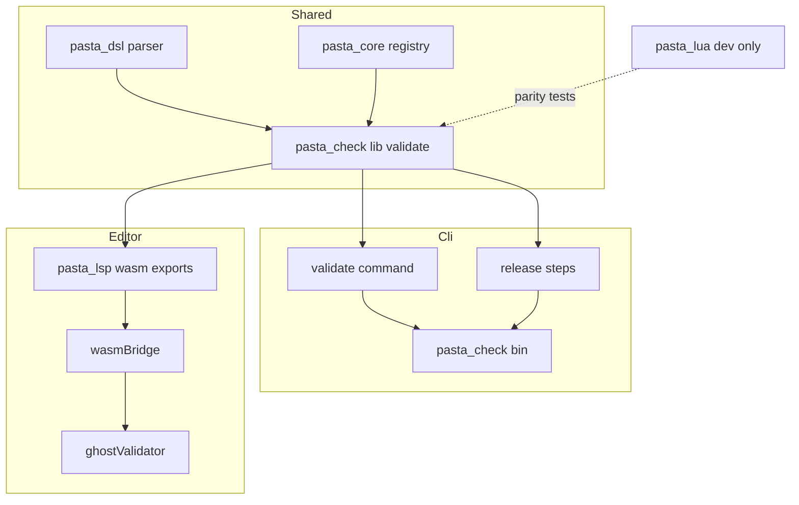
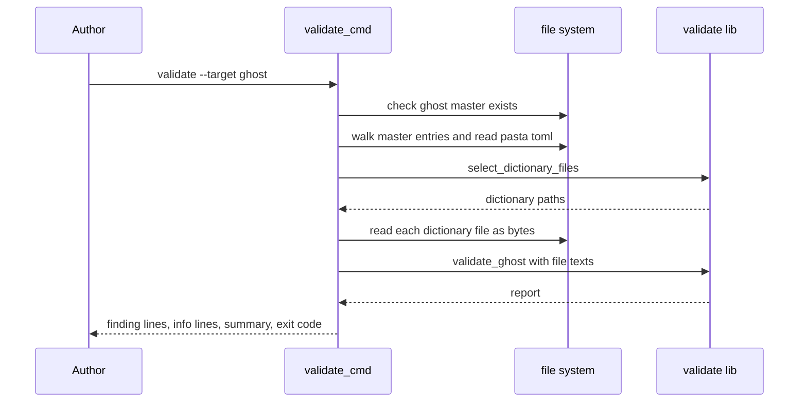
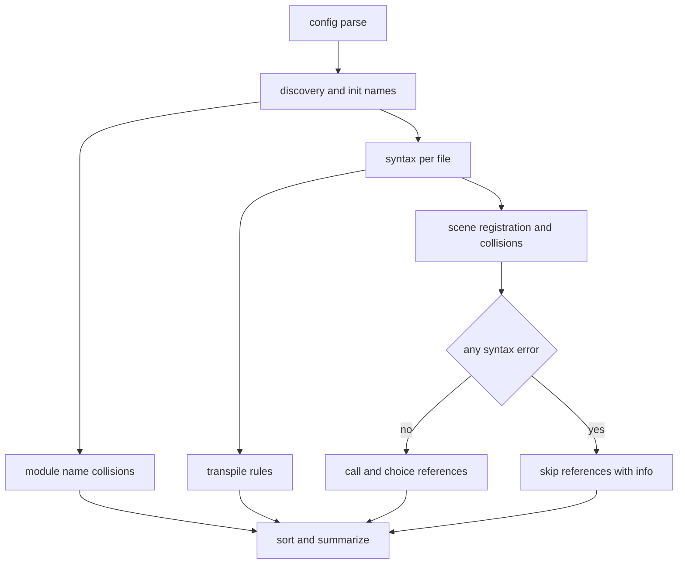
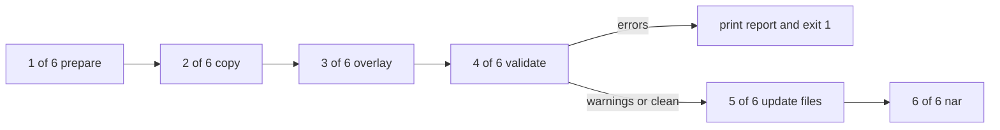
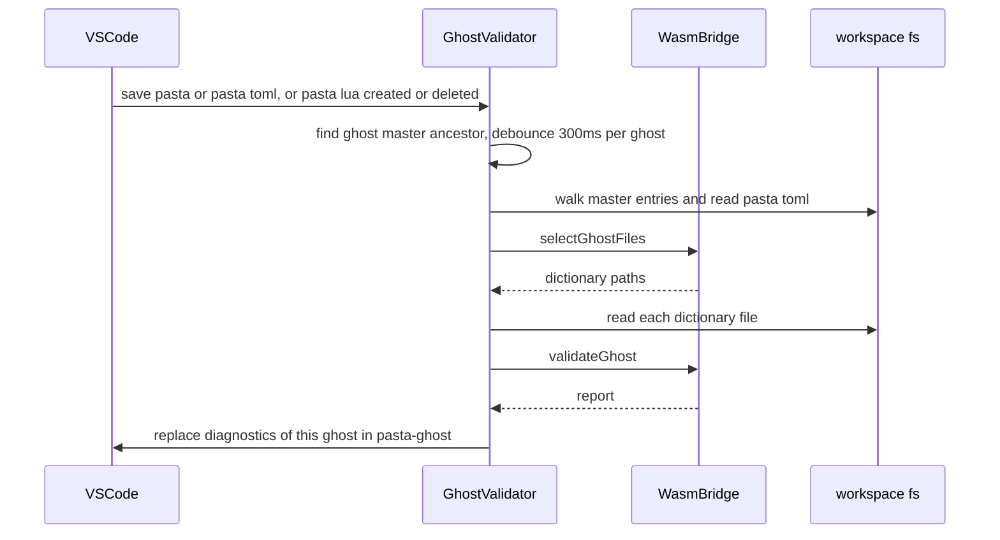

# 設計: pasta-check-dic-validate

## Overview

**Purpose**: ゴーストの作者が、SSP を起動せずに `pasta_check validate --target <ゴーストのフォルダ>` の 1 回で辞書（`.pasta`）を検査し、`pasta.dll` が読み込みに失敗する書き方（誤り）と、読み込みは通るが意図とずれやすい書き方（注意）を、ファイル・行・理由つきで受け取れるようにする。同じ検査を `pasta_check release` の関門と、VSCode 拡張の保存のたびの診断にも使う。

**Users**: ゴーストの作者（コマンドとエディタ）、作者を手伝う AI と自動検査（終了コードと 1 行 1 件の出力）、リリースの手順（hello-pasta の `release.ps1` とリリース CI）。

**Impact**: `pasta_check` は今、バイナリだけのクレートで辞書を読まない。この設計で `pasta_check` に **ライブラリ（検査の規則・ファイルシステムに触れない）** を足し、バイナリにサブコマンド `validate` と `release` の検査の段を足す。`pasta_lsp` の WASM の入口がそのライブラリを呼び、VSCode 拡張が保存のたびにゴースト全体の診断を出す。

### Goals

- 検査の規則（辞書の集め方・`pasta.toml`・構文・トランスパイルの 3 つ・モジュール名・シーン名・飛び先）を **1 か所（`pasta_check` のライブラリ）** に置き、CLI・`release`・VSCode 拡張が同じ規則・同じ文言で報告する。
- 規則が同じ版の `pasta.dll` と一致することを、`pasta_lua` を dev-dependency にした一致テストで守る（Approach C）。
- `cargo install pasta_check` に LuaJIT のビルドを持ち込まない。`pasta_core` のシーンのランダム選択の挙動を変えない。
- 後から入る spec が検査の項目を足しても、既存の項目の報告・誤りと注意の区別・終了コードが変わらない作りにする。

### Non-Goals

- 実行時の失敗の見せ方（`failure-output-unification`）、`pasta.dll` 側の警告の追加。
- 文字列リテラルの変換の失敗（`string_literalizer.rs`。`\` か `"` を含み、`]]` から `]==========]` の 11 通りを全部含む文字列）。現実の辞書には書かれないので検査しない（Requirement 3.5 の 3 つだけ）。
- Lua（`scripts/`・Lua ブロック・辞書モジュールの `.lua`）の中身の検査、単語参照の検査、`＠？シーン名`（文中のシーンリンク）の検査。
- JSON などの機械向けの出力、ネイティブの言語サーバー（tower-lsp の経路）へのゴースト全体の診断、VSCode 以外のエディタ。
- 入力のたびの構文の診断（`documentSync.ts`）の挙動の変更、拡張の起動直後の全体検査（保存・ファイルの増減でだけ走る）。
- 代用品（`manual.yml`・`tutorial_stages_test.rs`）の置き換え。

## Boundary Commitments

### This Spec Owns

- `pasta_check` のライブラリ `pasta_check::validate`（検査の規則・報告の型・文言・並び順・まとめの行）。ファイルシステムに触れず、WASM とネイティブの両方にビルドできる。
- `pasta_check` のバイナリ: サブコマンド `validate`（引数・終了コード・出力）、ゴーストのフォルダからファイルの一覧と中身を集める処理、`release` の検査の段（`[4/6]`）。
- `pasta_lsp` の WASM の入口 2 つ（`wasm_select_ghost_files`・`wasm_validate_ghost`）と、その JS の形。
- VSCode 拡張のゴースト全体の診断（`ghostValidator.ts`）: 起動の条件、ファイルの集め方、診断の集合 `pasta-ghost`、入力のたびの構文の診断との重複の消し方。
- 一致テスト（`pasta_lua` と規則が同じであること）、hello-pasta が誤りなしで通ること、CI の WASM のビルドの確認。
- 文書: マニュアルの章 `book/src/debug/validate.md`・`SUMMARY.md`・章の数の検査 4 つ・`reference/pasta-toml.md` の 1 文とスキル references の再生成、`crates/pasta_check/README.md`、`editors/vscode/README.md`、スキル `pasta-check`、steering（`tech.md`・`structure.md`）。
- `release.yml` の `pasta_check` の公開の段の `-DependsOn`。ルートの `Cargo.toml` の `[workspace.dependencies]` の `pasta_check` の行、`Cargo.lock`。
- 一致テストのためだけの `pasta_lua/src/loader/mod.rs` の 1 行（`discover_files` の `#[doc(hidden)]` の公開）。`pasta_lua` の振る舞いは変えない。

### Out of Boundary

- `pasta_lua` の読み込み・トランスパイル・シーン検索の規則そのもの（検査は写して一致テストで守るだけ）。`loader/config/`・`pasta/act.lua`・`actor.lua`・`word.lua` は触らない。
- `pasta_core`・`pasta_dsl` のソース（使うだけ。変えない）。
- `release` の既存の段の中身（準備・コピー・上書きコピー・更新ファイル・nar）と既存のオプションの意味。
- `documentSync.ts`・`diagnosticsManager.ts` の入力のたびの構文の診断。
- 検査の項目の追加（`scene-anchor-link`・`cue-command-runtime`・`call-attribute-filter`・`novel-talk-flow` が足す）。

### Allowed Dependencies

| 依存する側 | 依存してよいもの | 禁止 |
| ---------- | ---------------- | ---- |
| `pasta_check` ライブラリ（`src/lib.rs`・`src/validate/`） | `pasta_dsl`・`pasta_core`・`toml`・`serde`・`glob`、wasm32-unknown のときだけ `getrandom`（`wasm_js`） | `std::fs`・`std::process`・`pasta_lua`・`mlua`・バイナリのモジュール |
| `pasta_check` バイナリ（`src/main.rs` ほか） | ライブラリ、`lexopt`・`md5`・`zip`（feature `cli`）、`std::fs` | `pasta_lua`（通常の依存として） |
| `pasta_check` のテスト | `pasta_lua`（**path だけの dev-dependency**・版を書かない）、`tempfile` | — |
| `pasta_lsp` | `pasta_check`（`default-features = false`） | `pasta_check` の feature `cli` |
| VSCode 拡張 `ghostValidator.ts` | `wasmBridge.ts`・`vscode` API | 照合・パターンの規則を TypeScript で持つこと |

依存の向き: `pasta_dsl`・`pasta_core` → `pasta_check` ライブラリ → { `pasta_check` バイナリ, `pasta_lsp`（WASM） } → VSCode 拡張。逆向き（ライブラリからバイナリ・`pasta_lsp` から `pasta_check` のバイナリ）は誤りとして扱う。

### Revalidation Triggers

- `pasta_lua` の辞書の集め方（`loader/discovery.rs`・`process.rs`）・モジュール名（`cache.rs`）・`pasta.toml` の厳しく読む範囲（`loader/config/`）・トランスパイルの誤り（`code_gen/`）・シーンの登録と検索（`transpiler.rs`・`search/`）・組み込みの飛び先（`global.lua`・`shiori/entry.lua`・`act.lua`・`shiori/act.lua`）が変わったとき（一致テストが落ちる）。
- `FindingKind` の追加・削除、誤りと注意の分類、出力の 1 行の形・まとめの行の形を変えるとき（CI・作者のスクリプト・マニュアル・後から入る spec に効く）。
- WASM の入口の JS の形（`GhostInput`・`FileText`・`GhostReport`）を変えるとき（`wasmBridge.ts` と同時に直す）。
- `release` の段の表示（`[n/6]`）を変えるとき（`cli_test.rs`・README・スキル）。

## Architecture

### Existing Architecture Analysis

- `pasta_check`（`crates/pasta_check`）は `[[bin]]` だけ。入口は `lexopt` の手書きのループ（`main.rs` 76〜144 行）、`release` は `release.rs` 13〜59 行の 5 段で `io::Result<()>` を返し、`main` が `Error: {e}` を出して `exit(1)` にする。依存は `lexopt`・`md5`・`zip`。
- `pasta_dsl::parse_str` は `pasta.dll` と同じ最初の 1 件の構文エラーを `SyntaxError{line, column, message}` で返す（BOM は外す）。AST に `GlobalSceneScope{name, is_continuation, local_scenes, span}`・`LocalSceneItem::{VarSet, CallScene, ActionLine, ContinueAction, Choice, ..}`・`CallTarget::{Static, Dynamic}`・`ChoiceNode{target}` があり、全ノードに `Span`（1 始まりの行・列）がある。
- `pasta_core` は `SceneRegistry`（`register_global`・`register_local`・`sanitize_name`・`registered_name`）、`SceneAliasTable`（`from_entries`・`resolve`）、`SceneTable::from_scene_registry(registry, Box<dyn RandomSelector>)` と `collect_scene_candidates(module, prefix)`（乱数を使わない）を公開している。乱数は `DefaultRandomSelector::new()` の中だけ。
- `pasta_lsp` は `wasm-pack --target nodejs` で `editors/vscode/wasm/` に出力され、`transport.rs` の `wasm_analyze` だけを公開している。`pasta_lsp` は release.yml で公開されない。
- VSCode 拡張は LSP クライアントではなく、`documentSync.ts` が開いた文書の本文を `wasm_analyze` に渡し、診断の集合 `pasta` に構文の診断を出す（閉じると消す）。WASM が読めないときは TextMate だけで動く（`extension.ts`）。
- `getrandom 0.4.3` は wasm32-unknown-unknown で feature `wasm_js` が無いと `compile_error!` になる。`wasm_js` を有効にすれば `pasta_core`・`pasta_dsl`・`toml`・`glob` は wasm32 で通る（設計のときに一時のクレートで確かめた。`research.md`）。

### Architecture Pattern & Boundary Map



**Architecture Integration**:
- **選んだ形**: 「ファイルシステムに触れない純粋な検査の核」＋「ファイルを集める薄い殻（Rust の CLI と TypeScript の拡張）」。核は 2 つの関数（ファイルの選び出し・検査）だけを公開し、殻は一覧と中身を渡すだけにする。照合・パターンの規則は核にしか無い（11.8・9.2）。
- **共有の部品の置き場所**: `pasta_check` にライブラリを足す（新しいクレートは作らない）。リリースの仕組み（Trusted Publishing の新しい登録・初回の手での公開・release.yml の 4 か所の一覧）を増やさず、roadmap の約束（release.yml は `pasta_check` の公開の段だけ）に収まるため。バイナリだけの依存（`lexopt`・`md5`・`zip`）は feature `cli`（既定で有効）の後ろに置き、`pasta_lsp` は `default-features = false` で使う（設計ディスカッションで確定）。
- **WASM のビルド**: `pasta_check` の `[target.'cfg(all(target_arch = "wasm32", target_os = "unknown"))'.dependencies]` に `getrandom = { version = "0.4", features = ["wasm_js"] }` を置く。ネイティブのビルドには入らず、`pasta_core` は触らない。検査は `DefaultRandomSelector` を作らず `MockRandomSelector::new(vec![])` を渡すので、実行中に乱数源（`crypto.getRandomValues`）を呼ばない。
- **一致の守り方**: 規則は核の中に写し、`pasta_lua` を path だけの dev-dependency にした一致テストで結果を照らす（`cargo publish` は版の無い dev-dependency を外す）。
- **Steering compliance**: 2 パス（登録 → 検査）、`<feature>_test.rs` の命名、1 ファイル 600 行の目安、作成ツールは問題があれば止める、書いたとおりに読む。

### Technology Stack

| Layer | Choice / Version | Role in Feature | Notes |
|-------|------------------|-----------------|-------|
| 検査の核 | Rust 2024・`pasta_dsl`・`pasta_core`（workspace 0.3.8） | 構文・AST・照合用の名前・別名・前方一致 | 既存の部品をそのまま使う |
| 検査の核 | `toml` 1.1.2・`serde` 1・`glob` 0.3 | `pasta.toml` の一部を読む・`pasta_patterns` の照合（`glob::Pattern`、ファイルシステムは使わない） | どれも workspace にある。`Cargo.lock` に新しいパッケージは入らない見込み |
| 検査の核（WASM） | `getrandom` 0.4（`wasm_js`、wasm32-unknown だけ） | `rand` の依存を wasm32 でビルドできるようにする | 実行中は呼ばない |
| CLI | `lexopt` 0.3（既存） | `validate --target` | feature `cli` |
| エディタ | `wasm-bindgen` 0.2・`serde-wasm-bindgen` 0.6（既存） | WASM の入口 2 つ | `pasta_lsp/src/transport.rs` |
| エディタ | TypeScript・VSCode API `^1.85.0`（既存） | 保存・ファイルの増減で検査し診断を出す | 新しいファイル `ghostValidator.ts` |
| テスト | `pasta_lua`（path だけの dev-dependency）・`tempfile` | 一致テスト・CLI のテスト | LuaJIT はテストのときだけビルドされる |

## File Structure Plan

### Directory Structure

```
crates/pasta_check/
├── Cargo.toml                    # [lib]+[[bin]]・feature cli・依存の追加（下の Modified Files）
├── src/
│   ├── lib.rs                    # 新規: `pub mod validate;` だけ（ライブラリの入口）
│   ├── validate/                 # 新規: 検査の核（std::fs を使わない・WASM とネイティブ）
│   │   ├── mod.rs                # 公開 API: select_dictionary_files・validate_ghost、型の re-export、検査の順番
│   │   ├── input.rs              # GhostInput・TomlSource・FileText（serde）
│   │   ├── config.rs             # pasta.toml の [loader] と [scene] を pasta.dll と同じ厳しさで読む（2.4・2.5）
│   │   ├── discovery.rs          # pasta_patterns の照合・.lua パターン・.. と profile/ の除外・init 名（2.1〜2.3・2.6〜2.8）
│   │   ├── module_name.rs        # モジュール名の規則と重なり（4.1〜4.4）
│   │   ├── syntax.rs             # 構文の検査・読めないファイル（3.1〜3.4）
│   │   ├── transpile_rules.rs    # トランスパイルで失敗する 3 つの書き方（3.5）
│   │   ├── scenes.rs             # シーンの登録（別名・照合用の名前・単独の＊）・名前の重なり（5.1〜5.4）
│   │   ├── references.rs         # 静的な飛び先の Call・選択肢の検索、動的な Call の数（6.1〜6.9）
│   │   ├── builtins.rs           # 組み込みの飛び先の名前（GLOBAL・act・SHIORI act のメソッド）
│   │   └── report.rs             # Finding・FindingKind（誤り／注意の固定の対応）・文言・並び順・1 行の形・まとめの行（7.1〜7.8）
│   ├── validate_cmd.rs           # 新規（バイナリ）: --target の確かめ・ファイルの一覧と中身を集める・出力・終了コード
│   ├── main.rs                   # 変更: Command::Validate・使い方・オプションの検査
│   └── release.rs                # 変更: [4/6] 検査の段を足し、段の番号を 6 段にする
└── tests/
    ├── validate_config_test.rs        # 新規: pasta.toml・辞書の集め方・init 名
    ├── validate_rules_test.rs         # 新規: 構文・トランスパイルの 3 つ・モジュール名
    ├── validate_scenes_test.rs        # 新規: シーン名の重なり・飛び先・動的な Call・構文エラー時の省略
    ├── validate_report_test.rs        # 新規: 1 行の形・並び順・まとめの行・誤りと注意の固定
    ├── validate_parity_test.rs        # 新規: pasta_lua との一致テスト（dev-dependency）
    ├── validate_cli_test.rs           # 新規: validate のコマンドのテスト・hello-pasta・読むだけであること
    └── cli_test.rs                    # 変更: release の段の表示・検査の関門

crates/pasta_lsp/src/transport.rs      # 変更: wasm_select_ghost_files・wasm_validate_ghost（wasm モジュールの中）

editors/vscode/src/
├── ghostValidator.ts             # 新規: ゴースト全体の検査の起動・ファイル集め・診断の集合 pasta-ghost・重複の消し方
└── test/ghostValidator.test.ts   # 新規: 偽の bridge とモックの workspace.fs で振る舞いを確かめる

book/src/debug/validate.md        # 新規: マニュアルの章「辞書を検査する（pasta_check validate）」
```

### Modified Files

- `Cargo.toml`（ルート） — `[workspace.dependencies]` の `pasta_check` の行に `default-features = false` を足す（`pasta_lsp` が `cli` を引き込まないため。メンバーの側で `default-features = false` を書いても workspace 側が既定を有効にしていると効かない）。
- `Cargo.lock` — `pasta_check`・`pasta_lsp` の依存の行が増える。
- `crates/pasta_check/Cargo.toml` — `[lib] path = "src/lib.rs"`、`[[bin]] required-features = ["cli"]`、`[features] default = ["cli"]`・`cli = ["dep:lexopt", "dep:md5", "dep:zip"]`、依存 `pasta_dsl`・`pasta_core`・`toml`・`serde`・`glob`、wasm32-unknown の `getrandom`（`wasm_js`）、dev `pasta_lua = { path = "../pasta_lua" }`（版を書かない）。
- `crates/pasta_check/src/main.rs` — `Command::Validate(ValidateArgs)`、`validate` の解析（`--target` 以外は誤り）、使い方に `validate` を `release` と並べる。
- `crates/pasta_check/src/release.rs` — 段 3 と段 4 の間に `[4/6] Validating dictionaries...` を足し、表示を `[1/6]`〜`[6/6]` にする。誤りがあれば `io::Error` を返し、更新ファイルと nar を作らない。
- `crates/pasta_check/tests/cli_test.rs` — `[1/5]`・`[5/5]` の照合を `[1/6]`・`[6/6]` に直す。関門のテストを足す。
- `crates/pasta_check/README.md` — `validate` の使い方、`release` の実行フロー（6 段）と検査の関門、ソース構成・依存クレート。
- `crates/pasta_lsp/Cargo.toml` — 依存 `pasta_check = { workspace = true }`（workspace 側で `default-features = false`）。
- `crates/pasta_lsp/src/transport.rs` — WASM の入口 2 つと JS 向けの型（camelCase）。
- `crates/pasta_lua/src/loader/mod.rs` — 一致テストのために `#[doc(hidden)] pub use discovery::discover_files;` を 1 行足す（`loader/config/` には触らない。ウェーブの約束の範囲内）。
- `editors/vscode/src/wasmBridge.ts` — `selectGhostFiles`・`validateGhost` と型・形の検査。
- `editors/vscode/src/extension.ts` — WASM が読めたときだけ `GhostValidator` を登録する。
- `editors/vscode/src/test/mock/vscode.ts` — `workspace.fs`・`onDidSaveTextDocument`・`createFileSystemWatcher`・`FileType`・`Uri.joinPath` のモックを足す。
- `editors/vscode/package.json` — `test:unit` に `ghostValidator.test.ts` を足す。
- `editors/vscode/README.md` — 保存のときにゴースト全体の誤りと注意が出ること。
- `.github/workflows/build.yml` — `wasm` の job に `cargo check -p pasta_check --lib --no-default-features --target wasm32-unknown-unknown` を足す。
- `.github/workflows/release.yml` — `Publish pasta_check` の段に `-DependsOn pasta_core,pasta_dsl` を足す。
- `book/src/SUMMARY.md` — 「デバッグ」の部に章を足す。
- 章の数の検査 4 つ（`book/tools/verify-scripts-test.mjs`・`book/tools/talk/talk-test.mjs`・`book/tools/gen-skill-refs-test.mjs`・`book/tools/link-check-test.mjs`）— 60 を 61 にする（`manual-shell-guide` と後から入る側が合わせる）。
- `book/src/reference/pasta-toml.md` — 377 行「エディタの言語機能（LSP）と pasta_check は別名表を読まない」を、`pasta_check validate` と VSCode 拡張のゴースト全体の診断が別名表と `pasta_patterns` を読むことに直す。`node book/tools/gen-skill-refs.mjs` で再生成する。
- `.claude/skills/pasta-check/SKILL.md` — `validate` と関門。スキルの編集は分類器が止めることがあるので、実装のときに開発者の許可を取る。
- `.kiro/steering/tech.md`・`.kiro/steering/structure.md` — `pasta_check` のライブラリ・依存・`pasta_lsp` からの依存・VSCode 拡張の新しいファイル。

## System Flows

### `pasta_check validate`



- 殻は読むだけで、ファイルを作らない・書き換えない・消さない（1.6）。キャッシュも作らない。
- 一覧は `ghost/master` からの相対パス（区切りは `/`）。殻は最上位の `profile/` に入らず、シンボリックリンクをたどらない（費用を減らすための省略。`profile/` の除外の正しさは核が持つ）。

### 検査の核の中の順番



- `pasta.toml` が TOML として読めない・`[loader]` の型が違うときは、`pasta_patterns` を既定値で集めて検査を続ける（`pasta.dll` は読み込みに失敗するが、作者には辞書の問題も一度に見せる）。別名表が誤りのときは既定の別名表で続ける。
- 構文エラーのあるファイルは、そのファイルのシーンを登録しない。シーン名の重なりは読めたファイルだけで判定する。飛び先の検査は、どれか 1 つのファイルに構文エラーがあれば丸ごと省き、そのことを示す（6.8）。トランスパイルの 3 つの誤りは飛び先の検査を止めない（構文木は揃っている）。

### `release` の関門



- 検査の対象は、上書きコピーを当てた後の配布フォルダ（`--release`）の `ghost/master`（8.1）。出力は `validate` と同じ行の形（8.2）。注意だけなら続ける（8.3）。省くオプションは持たない（8.4）。
- 段 1 で前回の nar を消しているので、関門で止まると `--nar` の場所に nar は残らない。古い nar を新しいものと取り違えないための意図した挙動として README とマニュアルに書く。

### VSCode 拡張のゴースト全体の診断



- 起動の条件（11.3・11.6）: `.pasta` または `ghost/master/pasta.toml` の保存、`ghost/master` の配下の `.pasta`・`.lua` の作成・削除（名前の変更は削除と作成として届く）。保存した文書の祖先に `ghost/master`（`ghost` の中の `master`）が無ければ何もしない（11.10）。
- 同じゴーストで検査が走っている間に起動の条件が来たら、終わった後にもう 1 回だけ走らせる。
- 前回の結果にあって今回の結果に無い URI の診断は消す（11.7）。

## Requirements Traceability

| Requirement | Summary | Components | Interfaces | Flows |
|-------------|---------|------------|------------|-------|
| 1.1 | フォルダを指定して全部検査 | ValidateCommand・ValidateCore | `validate_ghost` | validate |
| 1.2 | `--target` は release と同じ意味 | ValidateCommand | `ValidateArgs` | validate |
| 1.3 | フォルダの誤りは理由つきで失敗 | ValidateCommand | `check_target` | validate |
| 1.4 | 知らないオプションは使い方つきで失敗 | CliEntry | `parse_args_from` | — |
| 1.5 | `--help` に validate を並べる | CliEntry | `print_usage` | — |
| 1.6 | ファイルを作らない・書き換えない | ValidateCommand | 殻は読むだけ | validate |
| 1.7 | SSP・pasta.dll・ネットワーク不要 | ValidateCore・ValidateCommand | 依存の制約 | — |
| 2.1 | pasta_patterns と .lua のパターンで集める | Discovery | `select_dictionary_files` | 核の順番 |
| 2.2 | 無ければ既定値 | Config・Discovery | `TomlSource::Missing` | 核の順番 |
| 2.3 | `..` を使わず profile/ を除く | Discovery | — | 核の順番 |
| 2.4 | 別名表を使う・無ければ既定 | Config・Scenes・References | `SceneAliasTable` | 核の順番 |
| 2.5 | pasta.toml の誤りをキー名・行つきで | Config | `FindingKind::Config*` | 核の順番 |
| 2.6 | init.pasta・init.lua は誤り | Discovery | `FindingKind::InitFileName` | 核の順番 |
| 2.7 | 辞書が 1 つも無ければ注意 | Discovery | `FindingKind::NoDictionaryFiles` | 核の順番 |
| 2.8 | `..`・.pasta で終わらないパターンは注意 | Discovery | `FindingKind::PatternIgnored`・`PatternNotPasta` | 核の順番 |
| 2.9 | 検査したファイルの数 | Report | `Stats::dictionary_files` | まとめの行 |
| 2.10 | pasta.toml が無いのは誤り | Config | `FindingKind::ConfigMissing` | 核の順番 |
| 3.1 | 構文エラーがあっても残りを続ける | Syntax | — | 核の順番 |
| 3.2 | パス・行・列・理由 | Syntax・Report | `FindingKind::Syntax` | — |
| 3.3 | pasta.dll と同じ最初のエラー | Syntax | `pasta_dsl::parse_str` | — |
| 3.4 | UTF-8 で読めない・読めない | Syntax・ValidateCommand・GhostValidator | `FileText` | — |
| 3.5 | トランスパイルで失敗する 3 つ | TranspileRules | `FindingKind::Transpile*` | 核の順番 |
| 4.1 | .pasta どうしの重なりは誤り | ModuleNames | `FindingKind::ModulePastaCollision` | 核の順番 |
| 4.2 | .lua と .pasta の重なりは注意 | ModuleNames | `FindingKind::ModuleLuaShadowed` | 核の順番 |
| 4.3 | .lua どうしの重なりは誤り | ModuleNames | `FindingKind::ModuleLuaCollision` | 核の順番 |
| 4.4 | モジュール名だけで判定 | ModuleNames | `module_name_of` | — |
| 5.1 | グローバルの照合用の名前の重なり | Scenes | `FindingKind::GlobalSceneCollision` | 核の順番 |
| 5.2 | ローカルの照合用の名前の重なり | Scenes | `FindingKind::LocalSceneCollision` | 核の順番 |
| 5.3 | 同名・別名・前方一致は報告しない | Scenes | — | — |
| 5.4 | 組み込みの名前と同じグローバルシーン | Scenes・Builtins | `FindingKind::SceneShadowedByBuiltin` | — |
| 6.1 | Call をローカル→グローバルの順に探す | References | `SceneTable::collect_scene_candidates` | 核の順番 |
| 6.2 | 選択肢を同じ順に探す | References | 同上 | 核の順番 |
| 6.3 | Call の飛び先なしは注意 | References・Builtins | `FindingKind::CallTargetMissing` | — |
| 6.4 | 選択肢の飛び先なしは注意 | References | `FindingKind::ChoiceTargetMissing` | — |
| 6.5 | On・script: は対象外 | References | — | — |
| 6.6 | 動的な Call は誤りにも注意にもしない | References | — | — |
| 6.7 | 動的な Call の数を示す | References・Report | `Stats::unchecked_dynamic_calls` | まとめの行 |
| 6.8 | 構文エラーがあれば飛び先を検査しない | ValidateCore・Report | `Stats::references_skipped` | 核の順番 |
| 6.9 | Lua の中身を候補にしない | References | — | — |
| 7.1 | 1 行 1 件 | Report | `Report::lines` | — |
| 7.2 | ゴーストのフォルダからの相対パス | Report | `ghost/master/` を前に付ける | — |
| 7.3 | パス・行の順で決まった並び | Report | `Finding` の順序 | — |
| 7.4 | まとめの行 | Report | `Report::summary_line` | — |
| 7.5 | 誤りがあれば失敗 | ValidateCommand・ReleaseGate | `Report::has_errors` | validate・release |
| 7.6 | 誤りが無ければ成功 | ValidateCommand | 同上 | validate |
| 7.7 | 分類を変えない | Report | `FindingKind::severity`（固定の対応） | — |
| 7.8 | 日本語 | Report | 文言の表 | — |
| 8.1 | 上書きコピーの後・更新ファイルの前に検査 | ReleaseGate | `execute_release` | release |
| 8.2 | 誤りなら同じ形で出して止める | ReleaseGate | `validate_cmd::run_on_master` | release |
| 8.3 | 注意だけなら続ける | ReleaseGate | 同上 | release |
| 8.4 | 省くオプションを持たない | CliEntry・ReleaseGate | — | — |
| 8.5 | 既存の段とオプションを変えない | ReleaseGate | 段の中身は不変（表示の番号だけ 6 段） | release |
| 9.1 | LuaJIT を持ち込まない | 依存の制約 | `Cargo.toml`・CI の確認 | — |
| 9.2 | 規則が pasta.dll と同じ | ValidateCore・ParityTests | 一致テスト | — |
| 9.3 | 読み込める辞書に誤りを出さない | ParityTests | 一致テスト | — |
| 9.4 | 読み込めない原因を誤りにする | ParityTests | 一致テスト | — |
| 9.5 | hello-pasta は誤りなし | ValidateCliTests | hello-pasta のテスト | — |
| 10.1 | マニュアルの章 | Docs | `book/src/debug/validate.md` | — |
| 10.2 | pasta-toml.md の書き換えと再生成 | Docs | `gen-skill-refs.mjs` | — |
| 10.3 | README とスキル | Docs | — | — |
| 10.4 | steering | Docs | — | — |
| 10.5 | 目次と章の数の検査 | Docs | `SUMMARY.md`・検査 4 つ | — |
| 10.6 | 拡張の README とマニュアルにエディタの診断 | Docs | — | — |
| 11.1 | WASM とネイティブの両方にビルド | ValidateCore・CI | `getrandom` の `wasm_js`・build.yml | — |
| 11.2 | 同じ規則・同じ文言 | WasmExports・GhostValidator | 核の `message` をそのまま出す | エディタ |
| 11.3 | 保存のたびにゴースト全体を検査 | GhostValidator | `onDidSaveTextDocument` | エディタ |
| 11.4 | 誤り=Error・注意=Warning | GhostValidator | `toDiagnostic` | エディタ |
| 11.5 | 開いていないファイル・pasta.toml も | GhostValidator | 診断の集合 `pasta-ghost` | エディタ |
| 11.6 | 増減・pasta.toml でやり直す | GhostValidator | `createFileSystemWatcher` | エディタ |
| 11.7 | 消えた問題の診断を消す | GhostValidator | 前回の URI の集合 | エディタ |
| 11.8 | 同じファイルの集合 | GhostValidator・WasmExports | `selectGhostFiles` | エディタ |
| 11.9 | 二重に表示しない | GhostValidator | 開いた文書の `syntax` を出さない | エディタ |
| 11.10 | ghost/master の外は全体検査しない | GhostValidator | `findGhostMaster` | エディタ |
| 11.11 | pasta_check・SSP・ネットワーク不要 | GhostValidator | WASM の中で完結 | エディタ |
| 11.12 | WASM が読めないときは何もしない | ExtensionActivation | `wasmReady` のときだけ登録 | — |

## Components and Interfaces

| Component | Domain/Layer | Intent | Req Coverage | Key Dependencies (P0/P1) | Contracts |
|-----------|--------------|--------|--------------|--------------------------|-----------|
| ValidateCore（`validate/mod.rs`・`input.rs`） | 検査の核 | 2 つの公開関数と検査の順番 | 1.1, 1.7, 6.8, 11.1 | pasta_dsl (P0), pasta_core (P0) | Service |
| Config（`config.rs`） | 検査の核 | `[loader]`・`[scene]` を pasta.dll と同じ厳しさで読む | 2.2, 2.4, 2.5 | toml (P0), SceneAliasTable (P0) | Service |
| Discovery（`discovery.rs`） | 検査の核 | 辞書と辞書モジュールの選び出し | 2.1〜2.3, 2.6〜2.8, 11.8 | glob::Pattern (P0) | Service |
| ModuleNames（`module_name.rs`） | 検査の核 | モジュール名と重なり | 4.1〜4.4 | — | Service |
| Syntax（`syntax.rs`） | 検査の核 | 構文と読めないファイル | 3.1〜3.4 | pasta_dsl::parse_str (P0) | Service |
| TranspileRules（`transpile_rules.rs`） | 検査の核 | トランスパイルで失敗する 3 つ | 3.5 | pasta_dsl AST (P0) | Service |
| Scenes（`scenes.rs`） | 検査の核 | シーンの登録と名前の重なり | 2.4, 5.1〜5.4 | SceneRegistry・SceneTable (P0) | Service |
| References（`references.rs`） | 検査の核 | 静的な飛び先の検索・動的な Call の数 | 6.1〜6.7, 6.9 | SceneTable (P0), Builtins (P1) | Service |
| Builtins（`builtins.rs`） | 検査の核 | 組み込みの飛び先の名前 | 5.4, 6.3 | — | State（定数） |
| Report（`report.rs`） | 検査の核 | 種類・分類・文言・並び・1 行・まとめ | 2.9, 6.7, 7.1〜7.8 | — | Service |
| CliEntry（`main.rs`） | CLI | サブコマンドの解析と使い方 | 1.4, 1.5, 8.4 | lexopt (P0) | Service |
| ValidateCommand（`validate_cmd.rs`） | CLI | フォルダの確かめ・集める・出力・終了コード | 1.1〜1.3, 1.6, 3.4, 7.5, 7.6 | ValidateCore (P0), std::fs (P0) | Service |
| ReleaseGate（`release.rs`） | CLI | `[4/6]` の検査の段 | 8.1〜8.5 | ValidateCommand (P0) | Batch |
| WasmExports（`pasta_lsp/src/transport.rs`） | エディタ | JS から核を呼ぶ入口 2 つ | 11.1, 11.2, 11.8 | ValidateCore (P0), serde-wasm-bindgen (P0) | API |
| WasmBridge 拡張（`wasmBridge.ts`） | エディタ | 型つきの呼び出しと形の検査 | 11.2 | WasmExports (P0) | Service |
| GhostValidator（`ghostValidator.ts`） | エディタ | 起動・集める・診断・重複の消し方 | 3.4, 11.3〜11.11 | WasmBridge (P0), vscode API (P0) | Service・Event・State |
| ExtensionActivation（`extension.ts`） | エディタ | WASM が読めたときだけ登録 | 11.12 | GhostValidator (P1) | — |
| ParityTests・ValidateCliTests（`tests/`） | テスト | 規則の一致・hello-pasta・CLI | 9.2〜9.5 | pasta_lua dev (P0) | — |
| Docs | 文書 | マニュアル・README・スキル・steering | 10.1〜10.6 | gen-skill-refs (P1) | — |

### 検査の核（`pasta_check::validate`）

#### ValidateCore

| Field | Detail |
|-------|--------|
| Intent | ファイルの一覧と中身を受け取り、報告を返す。ファイルシステムに触れない |
| Requirements | 1.1, 1.7, 6.8, 11.1 |

**Responsibilities & Constraints**
- 公開するのは `select_dictionary_files` と `validate_ghost` と型だけ。どちらも状態を持たず、同じ入力に同じ出力を返す（殻が 2 回に分けて呼んでも食い違わない）。
- `std::fs`・`std::time`・乱数源を使わない。`SceneTable` には `MockRandomSelector::new(vec![])` を渡す。
- パスはすべて `ghost/master` からの相対パスで、区切りは `/`。`\` は殻が `/` に直して渡す。

**Dependencies**
- Inbound: ValidateCommand・WasmExports — 呼び出し（P0）
- Outbound: Config・Discovery・ModuleNames・Syntax・TranspileRules・Scenes・References・Report（P0）
- External: `pasta_dsl`・`pasta_core`（P0）

**Contracts**: Service [x]

##### Service Interface

```rust
// crates/pasta_check/src/validate/input.rs
#[derive(Debug, Clone, serde::Deserialize)]
#[serde(rename_all = "camelCase")]
pub struct GhostInput {
    /// ghost/master/pasta.toml の状態
    pub pasta_toml: TomlSource,
    /// ghost/master の配下のファイルの相対パス（'/' 区切り）。順序は問わない
    pub entries: Vec<String>,
}

#[derive(Debug, Clone, serde::Deserialize)]
#[serde(tag = "kind", rename_all = "camelCase")]
pub enum TomlSource {
    Missing,
    Text { text: String },
    Unreadable { reason: String },
}

#[derive(Debug, Clone, serde::Deserialize)]
#[serde(tag = "kind", rename_all = "camelCase")]
pub enum FileText {
    /// UTF-8 として読めた本文（BOM は残したまま渡す。parse_str が外す）
    Text { text: String },
    NotUtf8,
    Unreadable { reason: String },
}

// crates/pasta_check/src/validate/mod.rs
/// 辞書ファイルとして読むべきパス（.pasta のパターンに一致したもの）を、決まった順で返す。
pub fn select_dictionary_files(input: &GhostInput) -> Vec<String>;

/// ゴースト全体を検査する。`files` には select_dictionary_files が返した全パスの中身を入れる。
pub fn validate_ghost(input: &GhostInput, files: &std::collections::BTreeMap<String, FileText>) -> Report;
```

- Preconditions: `files` は `select_dictionary_files(input)` の全パスを持つ。足りないパスは `FileText::Unreadable { reason: "読み込まれていません" }` として扱う（殻の不具合を黙って通さない）。
- Postconditions: `Report.findings` は 7.3 の順に並ぶ。`Report.stats.errors`・`warnings` は findings の数と一致する。
- Invariants: 同じ `FindingKind` は常に同じ `Severity`（7.7）。

#### Config

| Field | Detail |
|-------|--------|
| Intent | `pasta.toml` のうち `[loader]` と `[scene]` を、`pasta.dll` と同じものを受け付け、同じものを拒む |
| Requirements | 2.2, 2.4, 2.5 |

**Responsibilities & Constraints**
- `pasta.dll`（`loader/config/mod.rs` `parse`）が読み込みに失敗するのは次の 3 つで、これと同じ集合を誤りにする:
  1. TOML として読めない（`toml::from_str::<toml::Table>`）。行・列は toml のエラーの位置から取る。
  2. `[loader]` の型の誤り。`pasta_patterns: Vec<String>`・`lua_search_paths: Vec<String>`・`transpiled_output_dir: String`・`debug_mode: bool` の 4 つを、`pasta.dll` と同じ型で読む（知らないキーは無視）。行は `[loader]` を文字列から型つきで読み直したときのエラーの位置から取る（取れなければ行なし）。
  3. `[scene]` が表でない、`[scene.alias]` が表でない、値が文字列の配列でない、または `SceneAliasTable::from_entries` が拒む（空の名前・別名の重複・連鎖）。行は `toml::Spanned` の位置から、`pasta.dll` と同じく該当する別名の行を全部示す。
- `[loader]`・`[scene]` 以外のセクションは見ない（`pasta.dll` もそれらの型の誤りで読み込みを失敗させない。OQ-7）。
- `pasta.toml` が無いとき: `pasta_patterns` は既定値 `dic/**/*.pasta`、別名表は既定（2.2・2.4）。あわせて `pasta.dll` は `pasta.toml` が無いと読み込みに失敗する（`config/mod.rs` 58 行・マニュアル `pasta-toml.md` 17 行）ため、`ConfigMissing` を誤りとして報告する（2.10・9.4）。
- 誤りがあっても既定値で続け、残りの検査を行う。

**Contracts**: Service [x]

```rust
pub(crate) struct GhostConfig {
    pub pasta_patterns: Vec<String>,   // 既定 ["dic/**/*.pasta"]
    pub aliases: pasta_core::SceneAliasTable,
}
pub(crate) fn read_config(src: &TomlSource) -> (GhostConfig, Vec<Finding>);
```

#### Discovery

| Field | Detail |
|-------|--------|
| Intent | `pasta.dll` の `discover_files`・`discover_all_files` と同じファイルを選ぶ |
| Requirements | 2.1〜2.3, 2.6〜2.8, 11.8 |

**Responsibilities & Constraints**
- `pasta_patterns` を順に見る。`Path::components` に `..`・ルート・接頭辞を含むパターンは使わず、`PatternIgnored`（注意）。
- 使うパターンは `/` で成分に分け、`entries` の各パスの成分に当てる。`pasta.dll` が Windows で使う `glob::glob` の振る舞いを写す:
  - ワイルドカード（`*`・`?`・`[`）を含まない成分は、大文字・小文字を区別せずに比べる（`glob::glob` はこの成分をファイルシステムで引くので、Windows では区別されない）。
  - ワイルドカードを含む成分は `glob::Pattern::matches_with(成分, MatchOptions { case_sensitive: true, require_literal_separator: true, require_literal_leading_dot: false })` で比べる（`glob::glob` の既定と同じ）。
  - `**` だけの成分は 0 個以上の成分に一致する。
  - パターンとして読めなければ、`pasta.dll` と同じく読み込みの誤り（`ConfigPatternInvalid`、誤り）。
- 一致したファイルごとに「`pasta.dll` が見るパス」も作る。ワイルドカードの無い成分はパターンの綴り（`glob::glob` はパターンの文字列をそのまま繋ぐ）、ある成分は実物の綴りにする。例: 実物 `Dic/talk.pasta`・パターン `dic/**/*.pasta` → `pasta.dll` が見るパスは `dic/talk.pasta`。モジュール名（ModuleNames）はこのパスから作り、報告のパスは実物の綴りにする。
- `profile/` で始まるパスは除く。重複したパスは 1 つにまとめる（`pasta.dll` は同じファイルを 2 回処理するが、検査の結果は変わらない）。
- `.pasta` で終わるパターンからは末尾を `.lua` にしたパターンを作り、辞書モジュールの `.lua` を集める。`.pasta` で終わらないパターンは `.pasta` の検索には使い、`.lua` を作らず `PatternNotPasta`（注意）。
- ファイル名がちょうど `init.pasta`・`init.lua` のものは `InitFileName`（誤り）。
- `.pasta` のパターンに一致するファイルが 1 つも無ければ `NoDictionaryFiles`（注意）。
- 返す順は相対パスの文字列の昇順。

**Implementation Notes**
- Risks: 大文字・小文字を区別しない比較は Unicode の小文字化で近似する（NTFS の大文字の表と完全には同じでない。日本語の名前には大文字・小文字が無いので影響は小さい）。`pasta.dll` が見るパスの綴りは設計のときのコードの読みによるので、一致テスト (b) で `Dic/` のフォルダを Windows の CI で照らす。

#### ModuleNames

| Field | Detail |
|-------|--------|
| Intent | `CacheManager::source_to_module_name` と同じ規則でモジュール名を作り、重なりを分類する |
| Requirements | 4.1〜4.4 |

**Responsibilities & Constraints**
- 入力は Discovery が作る「`pasta.dll` が見るパス」。規則: 相対パスの先頭の成分がちょうど `dic` なら外す → 最後の拡張子だけを外す → `.` と `-` を `_` → 区切りを `.` → 前に `pasta.scene.` を付ける。例: `dic/a-b.pasta`・`dic/a.b.pasta`・`dic/a_b.pasta` → `pasta.scene.a_b`。
- `.pasta` が 2 つ以上同じ名前 → 関わる各ファイルに `ModulePastaCollision`（誤り）。`.lua` が 2 つ以上同じ名前 → `ModuleLuaCollision`（誤り）。`.lua` が `.pasta` と同じ名前 → その `.lua` に `ModuleLuaShadowed`（注意。`.lua` は読み込まれないと書く）。
- 判定はモジュール名が同じかどうかだけ（4.4）。

```rust
pub(crate) fn module_name_of(rel_path: &str) -> String;
```

#### Syntax

| Field | Detail |
|-------|--------|
| Intent | 各辞書ファイルを `pasta.dll` と同じ関数で読み、最初の構文エラーを報告する |
| Requirements | 3.1〜3.4 |

**Responsibilities & Constraints**
- `FileText::Text` は `pasta_dsl::parse_str(text, rel_path)` で読む。`SyntaxError { line, column, message }` を `Syntax`（誤り・行・列つき）にする。理由の文言は `message` から、`parse_str` が前に付ける `Parse error in {file} at {l}:{c}: ` を外した残りを `構文エラー: ` の後ろに付ける（位置は行の頭に出すので二重にしない）。
- 1 つのファイルで報告する構文エラーは最初の 1 つだけ（`pasta.dll` と同じ位置。3.3）。2 つ目以降を `parse_str_partial` で推測して出すことはしない（行頭の文字からの推測が入り、書いたとおりに読む原則に反するため）。
- `FileText::NotUtf8` → `FileNotUtf8`（誤り）、`Unreadable` → `FileUnreadable`（誤り。理由に OS の文言）。
- どのファイルで失敗しても残りのファイルを続ける（3.1）。読めた `PastaFile` を Scenes・TranspileRules に渡す。

#### TranspileRules

| Field | Detail |
|-------|--------|
| Intent | 構文としては読めるが `pasta_lua` のトランスパイルが失敗する 3 つの書き方を、AST の上で同じ条件で見つける |
| Requirements | 3.5 |

**Responsibilities & Constraints**
- `TranspileArgAssign`: `LocalSceneItem::VarSet` で `scope` が `VarScope::Args(_)`（`element_gen.rs` 81 行）。位置は VarSet の span。
- `TranspilePropertyInExpr`: 式の中の `VarScope::Property` の参照（`element_gen.rs` 41 行・`expr_gen.rs` 158・257・274 行）。許すのは、ローカル・グローバル変数への代入の右辺がそのままの `＄％名前` のとき、台詞の中の `＄％名前`、プロパティへの代入の左辺。動的な単語参照・動的な関数呼び出し・動的な Call のキーの `＄％名前` は誤り。位置は含む式・アクションの span。
- `TranspileContinuationWithoutActor`: ローカルシーンの中で、前に `ActionLine` が無い `ContinueAction`（`element_gen.rs` 309 行、ローカルシーンごとに取り直し）。
- 文言は構文エラーと同じ 1 行の形で、誤り（3.5）。条件の一致は一致テストで守る（ParityTests）。

#### Scenes

| Field | Detail |
|-------|--------|
| Intent | `pasta_lua` のトランスパイラと同じ手順でシーンを `SceneRegistry` に登録し、照合用の名前の重なりと組み込みの名前を見つける |
| Requirements | 2.4, 5.1〜5.4 |

**Responsibilities & Constraints**
- 登録（`transpiler.rs` 208〜236 行と同じ）: グローバルシーンごとに `declared = aliases.resolve(name).unwrap_or(name)`（単独の `＊` は parser が前の名前を入れている）、`register_global(declared)` で通し番号を得る。名前のあるローカルシーンを `register_local(name, declared, counter, local_counter)` で登録する（開始のブロックは登録しない）。全ファイルで 1 つの `SceneRegistry` を使う（実行時と同じく、同じ名前の別のグローバルシーンの配下のローカルシーンは混ざらない）。
- 登録した `SceneRegistry` から `SceneTable::from_scene_registry(reg, Box::new(MockRandomSelector::new(vec![])))` を作り、References に渡す。各グローバルシーンの登録名（`registered_name(declared, counter)`）と宣言の位置も持つ。
- `GlobalSceneCollision`（注意）: `sanitize_name(declared)` が同じで、`declared` が違うグローバルシーンが 2 つ以上あるとき、各宣言に 1 件ずつ。理由に照合用の名前と、ほかの宣言の位置を示す。
- `LocalSceneCollision`（注意）: 同じグローバルシーン（1 つの `GlobalSceneScope`）の配下で、`sanitize_name(name)` が同じで書いた名前が違うローカルシーン。
- 報告しない（5.3）: `declared` が同じ（同名のシーン・`＊会話` と `＊OnTalk` のように別名を置き換えて同じになったもの）、前方一致の関係。
- `SceneShadowedByBuiltin`（注意）: `declared` が Builtins のいずれかと完全に同じグローバルシーン。理由に「`＞名前` では組み込みの飛び先が先に呼ばれる」ことを示す。

#### References

| Field | Detail |
|-------|--------|
| Intent | 静的な飛び先を、辞書のシーンと組み込みの名前だけで探す |
| Requirements | 6.1〜6.7, 6.9 |

**Responsibilities & Constraints**
- 静的な飛び先: `CallTarget::Static(key)` と、`CallTarget::Dynamic` のうち式が文字列リテラルだけのもの。それ以外の `Dynamic` は数えるだけ（6.6・6.7）。
- Call の検索（`act.lua` 332〜379 行の 2〜5 段。1 段は Lua なので見ない）: (2) `collect_scene_candidates(書いたグローバルシーンの登録名, sanitize_name(key))`、(3・4) `key` が Builtins と完全に一致、(5) `collect_scene_candidates("", sanitize_name(aliases.resolve(key).unwrap_or(key)))`。どれかで見つかれば問題なし。どれも無ければ `CallTargetMissing`（注意。「Lua で定義していれば問題ありません」を添える）。
- 選択肢（`choice_select.lua` 70〜71 行）: ジャンプ先が `On` または `script:` で始まるものは見ない（6.5。`sakura_builder.lua` 31〜35 行）。(2) ローカル、(5) 別名を置き換えたグローバル、の順。無ければ `ChoiceTargetMissing`（注意。「Lua で定義・振り分けていれば問題ありません」）。
- 候補は辞書のシーンだけ（6.9）。

#### Builtins

| Field | Detail |
|-------|--------|
| Intent | `pasta.dll` が組み込みで持つ Call の飛び先の名前の一覧 |
| Requirements | 5.4, 6.3 |

- `GLOBAL`: `yield`・`チェイントーク`（`global.lua`）、`close_ghost`・`ゴースト終了`（`shiori/entry.lua`）。
- act のメソッド（`ACT_IMPL` の関数）: `init_scene`・`talk`・`sakura_script`・`raw_script`・`surface`・`wait`・`newline`・`clear`・`choice`・`choice_timeout`・`find_act_handler`・`find_handler`・`word`・`expr_fn`・`expr_fn_var`・`actor_proxy`・`global_fn`・`build`・`yield`・`find_scene`・`call`・`call_key`・`restore_scene`・`call_restore`・`failure`・`set_spot`・`clear_spot`。
- SHIORI 用の act のメソッド（`SHIORI_ACT_IMPL` の関数）: `build`・`transfer_date_to_var`・`transfer_req_to_var`・`set_property`・`get_property`。
- 一覧は Rust の定数で持ち、一致テストが実行時の `GLOBAL` と act の関数の名前（関数である値だけ）を列挙して照らす。一覧と実物がずれたらテストが落ちる。

#### Report

| Field | Detail |
|-------|--------|
| Intent | 報告の種類・分類・文言・並び順・出力の形を 1 か所で決める |
| Requirements | 2.9, 6.7, 6.8, 7.1〜7.8 |

**Contracts**: Service [x] / State [x]

```rust
#[derive(Debug, Clone, Copy, PartialEq, Eq, PartialOrd, Ord, serde::Serialize)]
#[serde(rename_all = "camelCase")]
pub enum Severity { Error, Warning }

#[derive(Debug, Clone, Copy, PartialEq, Eq, PartialOrd, Ord, serde::Serialize)]
#[serde(rename_all = "kebab-case")]
pub enum FindingKind {
    ConfigMissing, ConfigSyntax, ConfigLoaderType, ConfigSceneAlias, ConfigPatternInvalid,
    PatternIgnored, PatternNotPasta, NoDictionaryFiles, InitFileName,
    FileNotUtf8, FileUnreadable, Syntax,
    TranspileArgAssign, TranspilePropertyInExpr, TranspileContinuationWithoutActor,
    ModulePastaCollision, ModuleLuaCollision, ModuleLuaShadowed,
    GlobalSceneCollision, LocalSceneCollision, SceneShadowedByBuiltin,
    CallTargetMissing, ChoiceTargetMissing,
}
impl FindingKind {
    /// 固定の対応。オプションや状況で変えない（7.7）
    pub fn severity(self) -> Severity;
    /// 診断の code（例 "syntax"）。エディタの重複の判定に使う
    pub fn code(self) -> &'static str;
}

#[derive(Debug, Clone, serde::Serialize)]
#[serde(rename_all = "camelCase")]
pub struct Finding {
    pub code: FindingKind,
    pub severity: Severity,
    /// ghost/master からの相対パス（例 "dic/02-talk.pasta"、"pasta.toml"）
    pub path: String,
    pub line: Option<u32>,
    pub column: Option<u32>,
    /// 日本語の理由（CLI とエディタで同じ文字列）
    pub message: String,
}

#[derive(Debug, Clone, Default, serde::Serialize)]
#[serde(rename_all = "camelCase")]
pub struct Stats {
    pub dictionary_files: usize,
    pub errors: usize,
    pub warnings: usize,
    pub unchecked_dynamic_calls: usize,
    pub references_skipped: bool,
}

#[derive(Debug, Clone, serde::Serialize)]
pub struct Report { pub findings: Vec<Finding>, pub stats: Stats }
impl Report {
    pub fn has_errors(&self) -> bool;
    /// 問題の行（7.3 の順）、案内の行、まとめの行。CLI はこれを順に標準出力へ出す
    pub fn lines(&self) -> Vec<String>;
}
```

- **1 行の形**（7.1・7.2・7.8）: `ghost/master/{path}:{line}:{column}: {誤り|注意}: {message}`。列が無ければ `:{column}` を、行も無ければ `:{line}` を省く。
- **並び順**（7.3）: `(path, line（無いものが先）, column, code, message)` の昇順。
- **案内の行**: 飛び先を省いたとき `構文エラーがあるため、飛び先の検査をしていません。`（6.8）。
- **まとめの行**（7.4・2.9・6.7）: `検査した辞書ファイル {n} 個: 誤り {e} 件、注意 {w} 件、飛び先を検査しなかった Call {d} 件`。飛び先を省いたときは最後の項を出さない。
- **パスの無い問題は作らない**: パターン・辞書の数・`pasta.toml` の問題は `pasta.toml` に付ける（無くても同じパス）。
- **文言の表**（理由の例。`{}` は差し込み）:

| code | 分類 | 理由の例 |
| ---- | ---- | -------- |
| config-missing | 誤り | `pasta.toml がありません。pasta.dll はゴーストを読み込めません（辞書は既定の dic/**/*.pasta で集めました）` |
| config-syntax | 誤り | `pasta.toml を TOML として読めません: {toml の説明}` |
| config-loader-type | 誤り | `[loader] の {キー} の型が違います: {toml の説明}` |
| config-scene-alias | 誤り | `[scene.alias] の別名「{別名}」が {先1}・{先2} に重複しています` など（空の名前・連鎖・型の違いも同じ code） |
| config-pattern-invalid | 誤り | `pasta_patterns の「{パターン}」はパターンとして読めません: {説明}` |
| pattern-ignored | 注意 | `pasta_patterns の「{パターン}」は .. などを含むため使われません` |
| pattern-not-pasta | 注意 | `pasta_patterns の「{パターン}」は .pasta で終わらないため、.lua の辞書モジュールを探すのに使われません` |
| no-dictionary-files | 注意 | `pasta_patterns に一致する辞書ファイルが 1 つもありません` |
| init-file-name | 誤り | `ファイル名 {init.pasta} は使えません。pasta.dll はゴーストを読み込めません` |
| file-not-utf8 | 誤り | `UTF-8 として読めません` |
| file-unreadable | 誤り | `ファイルを読めません: {理由}` |
| syntax | 誤り | `構文エラー: {pest の説明}` |
| transpile-arg-assign | 誤り | `シーンの引数（＄０ など）には代入できません` |
| transpile-property-in-expr | 誤り | `プロパティ参照（＄％名前）は式の中で使えません。先に変数へ代入してください` |
| transpile-continuation-without-actor | 誤り | `アクターの無い継続行です。前の行にアクター行が必要です` |
| module-pasta-collision | 誤り | `モジュール名 {名前} が {ほかのパス} と同じです。どちらかの辞書の内容が失われます` |
| module-lua-collision | 誤り | `モジュール名 {名前} が {ほかのパス} と同じです。どちらかの .lua が読み込まれません` |
| module-lua-shadowed | 注意 | `モジュール名 {名前} が {.pasta のパス} と同じため、この .lua は読み込まれません` |
| global-scene-collision | 注意 | `シーン「{書いた名前}」は照合用の名前「{照合用}」が「{ほかの名前}」（{位置}）と同じになり、同じ名前のシーンとして選ばれます` |
| local-scene-collision | 注意 | 同上（ローカルシーン） |
| scene-shadowed-by-builtin | 注意 | `シーン「{名前}」は組み込みの飛び先と同じ名前のため、＞{名前} では呼ばれません` |
| call-target-missing | 注意 | `Call の飛び先「{キー}」が辞書のシーンにありません（Lua で定義していれば問題ありません）` |
| choice-target-missing | 注意 | `選択肢のジャンプ先「{先}」が辞書のシーンにありません（Lua で定義・振り分けていれば問題ありません）` |

- **後から足す項目**（Adjacent expectations）: 新しい `FindingKind` と、その判定の関数を `validate/mod.rs` の検査の順番に 1 つ足す。分類・形・まとめ・終了コードは Report が決めるので、既存の項目は変わらない。

**出力の例**

```
ghost/master/dic/02-talk.pasta:14:5: 誤り: 構文エラー: expected action_line
ghost/master/dic/a-b.pasta: 誤り: モジュール名 pasta.scene.a_b が ghost/master/dic/a_b.pasta と同じです。どちらかの辞書の内容が失われます
ghost/master/dic/a_b.pasta: 誤り: モジュール名 pasta.scene.a_b が ghost/master/dic/a-b.pasta と同じです。どちらかの辞書の内容が失われます
ghost/master/dic/11-jump.pasta:20:5: 注意: Call の飛び先「寄り道x」が辞書のシーンにありません（Lua で定義していれば問題ありません）
構文エラーがあるため、飛び先の検査をしていません。
検査した辞書ファイル 13 個: 誤り 3 件、注意 1 件
```

### CLI（`pasta_check` バイナリ）

#### CliEntry（`main.rs`）

| Field | Detail |
|-------|--------|
| Intent | `validate --target <path>` を解析し、使い方に並べる |
| Requirements | 1.4, 1.5, 8.4 |

- `enum Command { Release(ReleaseArgs), Validate(ValidateArgs), Help, Version }`、`pub struct ValidateArgs { pub target: PathBuf }`。
- `validate` に `--release`・`--nar`・`--copy` が渡されたら誤り（今のループはサブコマンドに関係なく受け付けるため、`validate` のときに検査する）。誤りは `Error: {理由}`・空行・使い方を標準エラー出力に出し `exit(1)`（1.4）。`--target` が無いときは今の `release` と同じく `Error:` だけ。
- 使い方に `validate    Check dictionaries without starting SSP` と `Options for 'validate': --target <path>` を足す（既存の英語の使い方に揃える）。`release` に検査を省くオプションは足さない（8.4）。

#### ValidateCommand（`validate_cmd.rs`）

| Field | Detail |
|-------|--------|
| Intent | ファイルシステムから GhostInput と FileText を作り、核を呼び、出力と終了コードを返す |
| Requirements | 1.1〜1.3, 1.6, 3.4, 7.5, 7.6 |

```rust
pub(crate) enum ValidateOutcome { Clean, WarningsOnly, HasErrors(usize) }
/// --target のゴーストのフォルダを確かめて検査する。フォルダの誤りは Err（理由）
pub(crate) fn run(args: &ValidateArgs) -> Result<ValidateOutcome, String>;
/// ghost/master を直接受けて検査し、行を標準出力に出す（release からも使う）
pub(crate) fn run_on_master(master: &Path) -> ValidateOutcome;
```

- `--target` が存在しない・ディレクトリでない・`ghost/master` を含まない → `Err`（1.3）。`ghost/master` そのものを渡しても読み替えない。
- 一覧: `master` から `read_dir` で再帰。最上位の `profile` には入らない。シンボリックリンクはたどらず含めない。パスは `to_string_lossy` して `/` で結ぶ。
- 中身: `fs::read`（バイト）→ `String::from_utf8`。失敗は `NotUtf8`、読み込みの失敗は `Unreadable { reason: e.to_string() }`。`pasta.toml` も同じ。
- 出力は `Report::lines()` を標準出力へ。終了コードは誤りがあれば 1、無ければ 0（7.5・7.6）。書き込みは一切しない（1.6）。

#### ReleaseGate（`release.rs`）

| Field | Detail |
|-------|--------|
| Intent | 上書きコピーの後・更新ファイルの前に、配布フォルダの辞書を検査し、誤りがあれば止める |
| Requirements | 8.1〜8.5 |

**Contracts**: Batch [x]
- Trigger: `execute_release` の段 3 の後。
- Input: `{--release}/ghost/master`。
- Output: `[4/6] Validating dictionaries...` の後に `Report::lines()`。`HasErrors(n)` なら `io::Error::other(format!("dictionary validation found {n} error(s); update files and NAR were not created"))` を返し、`main` の既存の処理で `Error: …` と `exit(1)`（8.2）。
- 段の表示は `[1/6]`〜`[6/6]` にする（中身は変えない。8.5）。
- 再実行: 同じ引数でやり直せる（段 1 が配布フォルダを作り直す）。

### エディタ

#### WasmExports（`pasta_lsp/src/transport.rs` の `wasm` モジュール）

**Contracts**: API [x]

| 関数 | 入力（JS） | 出力（JS） | 失敗 |
| ---- | ---------- | ---------- | ---- |
| `wasm_select_ghost_files(input)` | `GhostInput`（camelCase） | `string[]` | 入力の形が違う・panic → `null` |
| `wasm_validate_ghost(input, files)` | `GhostInput`、`Record<string, FileText>` | `GhostReport`（`Report` の serde 形） | 同上 → `null` |

- `wasm_analyze` と同じく `catch_unwind` で包み、`serde_wasm_bindgen` で読み書きする。核の結果をそのまま返し、文言を作り直さない（11.2）。

#### WasmBridge の拡張（`wasmBridge.ts`）

```typescript
export type TomlSource =
  | { kind: 'missing' }
  | { kind: 'text'; text: string }
  | { kind: 'unreadable'; reason: string };
export type FileText =
  | { kind: 'text'; text: string }
  | { kind: 'notUtf8' }
  | { kind: 'unreadable'; reason: string };
export interface GhostInput { pastaToml: TomlSource; entries: ReadonlyArray<string>; }
export type GhostSeverity = 'error' | 'warning';
export interface GhostFinding {
  code: string; severity: GhostSeverity; path: string;
  line: number | null; column: number | null; message: string;
}
export interface GhostStats {
  dictionaryFiles: number; errors: number; warnings: number;
  uncheckedDynamicCalls: number; referencesSkipped: boolean;
}
export interface GhostReport { findings: ReadonlyArray<GhostFinding>; stats: GhostStats; }

// class WasmBridge に足す
selectGhostFiles(input: GhostInput): string[];                                       // 形が違えば throw
validateGhost(input: GhostInput, files: Readonly<Record<string, FileText>>): GhostReport; // 形が違えば throw
```

#### GhostValidator（`ghostValidator.ts`）

| Field | Detail |
|-------|--------|
| Intent | 保存・ファイルの増減でゴースト全体を検査し、診断の集合 `pasta-ghost` を更新する |
| Requirements | 3.4, 11.2〜11.11 |

**Contracts**: Service [x] / Event [x] / State [x]

```typescript
export function findGhostMaster(fileUri: vscode.Uri): vscode.Uri | undefined; // 祖先の ".../ghost/master"
export class GhostValidator implements vscode.Disposable {
  constructor(bridge: WasmBridge);
  register(): void;                               // 下の購読を張る
  requestValidation(master: vscode.Uri): void;    // ゴーストごとに 300ms で束ね、走行中なら終わった後に 1 回
  dispose(): void;
}
```

- **購読**（Event）: `workspace.onDidSaveTextDocument`（`.pasta`、または `master` の直下の `pasta.toml`）、`workspace.createFileSystemWatcher('**/ghost/master/**/*.{pasta,lua}')` の `onDidCreate`・`onDidDelete`、`workspace.onDidOpenTextDocument`・`onDidCloseTextDocument`（下の重複の消し方の再表示だけ。検査はしない）。
- **集める**: `workspace.fs.readDirectory` で `master` から再帰（最上位の `profile` に入らず、`FileType.SymbolicLink` を含めない）。`pasta.toml` と辞書ファイルは `workspace.fs.readFile` → `new TextDecoder('utf-8', { fatal: true, ignoreBOM: true })`。失敗は `notUtf8`、読めなければ `unreadable`。ファイルの選び出しは `selectGhostFiles` に任せ、TypeScript はパターンを見ない（11.8）。中身はディスクのものを使う（CLI と同じ結果。11.2）。
- **表示**（State）: ゴーストごとに前回の `GhostReport` と、出した URI の集合を持つ。`Diagnostic(range = 行-1・列-1 の位置（無ければ 0）, message, severity = error→Error・warning→Warning)`、`source = 'pasta validate'`、`code = finding.code`（11.4）。前回の集合にあって今回に無い URI は `delete`（11.7）。開いていないファイル・`pasta.toml` にも出す（11.5）。
- **重複の消し方**（11.9）: `code === 'syntax'` の問題は、その URI の文書が開いているあいだは出さない（入力のたびの構文の診断が受け持つ）。文書を閉じると入力のたびの診断は消えるので、前回の結果から `syntax` を含めて出し直す。開いたら `syntax` を外して出し直す。ほかの code は入力のたびの診断に無いので常に出す。
- **失敗**: WASM の呼び出しが throw したら、そのゴーストの診断を消して出力チャンネルに記録する（拡張は止めない）。
- 必要としないもの: `pasta_check` のインストール・SSP・ネットワーク（11.11）。

#### ExtensionActivation（`extension.ts`）

- `wasmReady` のときだけ `GhostValidator` を作って登録し、`context.subscriptions` に入れる。WASM が読めないときは作らない（11.12）。

## Data Models

### Domain Model

- **GhostInput**（入力の集約）: `pasta.toml` の状態と、`ghost/master` の配下のパスの集合。殻が作り、核は読むだけ。
- **SceneModel**（核の内部）: `SceneRegistry` から作った `SceneTable`、グローバルシーンごとの `{書いた名前, declared, 登録名, 位置, ローカルシーンの一覧}`。Scenes が作り、References が読む。
- **Finding**（値オブジェクト）: `code` から `severity` が一意に決まる（不変条件）。パスは必ずある。
- **Report**: `findings` と `stats`。`stats.errors`・`warnings` は findings から数える。

### Data Contracts & Integration

- WASM の入口の JS の形は `GhostInput`・`FileText`・`GhostReport`（上の型）。serde の `rename_all = "camelCase"` とタグ `kind` で固定し、`pasta_lsp` のテストで形を照らす（`wasm_analyze` の形のテストと同じやり方）。

## Error Handling

### Error Strategy

- **使い方の誤り**（1.3・1.4）: `Error: {理由}` を標準エラー出力へ、終了コード 1。検査はしない。
- **検査の誤り・注意**: 報告であって処理の失敗ではない。全部集めてから出す。誤りがあれば終了コード 1、`release` は止まる。
- **核の中の想定外**: 核は `panic` しない作りにする（入力の欠けは `Unreadable` として報告）。WASM の入口は `catch_unwind` で `null` を返し、拡張はそのゴーストの診断を消して記録する。
- **読めないファイル**: 1 つのファイルの失敗で全体を止めない（3.1・3.4）。

### Monitoring

- CLI は出力そのもの。拡張は失敗を既存の出力チャンネル（`Pasta`）に 1 行記録する。

## Testing Strategy

### Unit Tests（`crates/pasta_check/tests/validate_*_test.rs`、GhostInput をメモリ上で作る）

1. **pasta.toml と集め方**（`validate_config_test.rs`）: TOML として読めない（行・列）、`[loader] pasta_patterns = "x"`（型の誤り）、`[scene.alias]` の重複・連鎖・空の名前（別名の行を全部示す）、`pasta.toml` が無い（既定値で集め、`config-missing`）、`..` と `.pasta` で終わらないパターン（注意）、`profile/` の除外、`Dic/` のフォルダが既定のパターンに一致し、モジュール名が `dic` の綴りで作られる、`dic/X.PASTA` は一致しない、辞書 0 件（注意）、`init.pasta`・`init.lua`（誤り）。
2. **構文・トランスパイル・モジュール名**（`validate_rules_test.rs`）: 構文エラーのある 2 ファイルの両方が報告され、位置が `parse_str` と同じ、UTF-8 で読めない、トランスパイルの 3 つと許される形（代入の右辺の `＄％名前`・台詞の中）、`a-b`・`a.b`・`a_b`（誤り・3 件）、`.lua` と `.pasta`（注意）、`.lua` どうし（誤り）、`dic/` の外のファイルと階層の違い。
3. **シーンと飛び先**（`validate_scenes_test.rs`）: `＊会話·A` と `＊会話_A`（注意 2 件）、`＊会話` と `＊OnTalk`・同名・`＊挨拶` と `＊挨拶朝`（報告しない）、ローカルの重なり、`＊yield`（注意）、ローカルが先に見つかる・別名を置き換えたグローバル・組み込み（`transfer_req_to_var`）・見つからない Call と選択肢（注意）、`＠？OnBoot`・`＠？script:…`（対象外）、`＞＄変数` の数、構文エラーがあると飛び先を省き案内の行が出る。
4. **出力**（`validate_report_test.rs`）: 1 行の形（列あり・なし・行なし）、パス・行の順、まとめの行、すべての `FindingKind` の分類の表を固定するテスト（7.7）。

### Integration Tests

1. **一致テスト**（`validate_parity_test.rs`、dev-dependency `pasta_lua`）: (a) `CacheManager::source_to_module_name` とモジュール名、(b) `discover_files` と選び出し（一時のフォルダ。`Dic/` のフォルダを含む。Windows の CI（`build.yml` の `windows-latest` の `cargo test --all`）で走るので、`pasta.dll` が動く環境のファイルシステムで照らせる）、(c) `PastaLoader::load` の成否と `pasta.toml`（`[loader]`・`[scene]` の誤りの見本）・`init.pasta` の誤り、(d) `LuaTranspiler::transpile` の成否とトランスパイルの 3 つ、(e) 読み込んだランタイムで `GLOBAL` と act・SHIORI act の関数の名前を列挙し Builtins と照らす、(f) 見本の辞書の静的な Call について、実行時の `SCENE.search` の有無と References の判定が同じ。`PastaLoader::load` を呼ぶテストは `PASTA_DEBUG` を中和するガードを置く。
2. **CLI**（`validate_cli_test.rs`）: 誤りあり→1・誤りなし（注意あり）→0、フォルダが無い・`ghost/master` を直接渡す・知らないオプション→1、出力が 2 回とも同じ、パスが `ghost/master/` から始まる、実行の前後でゴーストのフォルダの一覧と更新時刻が変わらない（1.6）、hello-pasta（`crates/pasta_sample_ghost/ghosts/hello-pasta`）で誤り 0（9.5）。
3. **release の関門**（`cli_test.rs`）: 誤りのある辞書 → 終了コード 1・`updates.txt` と nar が無い・出力に問題の行、注意だけ → nar ができる、表示が `[1/6]`〜`[6/6]`。
4. **WASM**: `build.yml` の `wasm` の job で `cargo check -p pasta_check --lib --no-default-features --target wasm32-unknown-unknown` と、既存の `cargo build -p pasta_lsp --target wasm32-unknown-unknown`。`pasta_lsp` のネイティブのテストで、入口の JS の形（serde の形）を照らす。

### E2E/UI Tests（`editors/vscode/src/test/ghostValidator.test.ts`、偽の bridge とモックの `workspace.fs`）

1. `ghost/master` の配下の `.pasta` を保存すると検査が 1 回走り、開いていないファイルと `pasta.toml` に Error・Warning の診断が出る。
2. 配下に無い `.pasta` の保存では検査しない。`pasta.toml` の保存、`.pasta`・`.lua` の作成・削除で検査が走る。
3. 前回あって今回無い URI の診断が消える。
4. 開いている文書の `syntax` は出さず、閉じると出る。
5. WASM が読めないとき `GhostValidator` は登録されない（`extension.ts` の既存のテストに足す）。

### Performance

- 検査は保存のたびにゴースト全体を読む。hello-pasta（12 ファイル）で 1 秒未満を目安にし、ゴーストごとに 300ms で束ねて連続の保存をまとめる。大きなゴーストで遅いときは、ファイルごとの解析の結果を中身のハッシュで覚える改善を後から入れられる（今は入れない）。

## Security Considerations

- 検査は読むだけで、書き込み・プロセスの起動・ネットワークを持たない（1.6・1.7・11.11）。
- `pasta_patterns` の `..`・絶対パスは使わない（`pasta.dll` と同じ）。一覧はゴーストのフォルダの中だけで、シンボリックリンクをたどらない。

## Migration Strategy

- 既存の利用者への移行は無い。`release` は検査の段が増えるので、hello-pasta の辞書が誤り 0 で通ることを先に確かめる（下の順番）。
- 実装の順番: (1) 核と単体テスト → (2) 一致テスト → (3) `validate` と CLI のテスト・hello-pasta → (4) `release` の関門 → (5) `pasta_lsp` の入口・CI の WASM → (6) VSCode 拡張 → (7) 文書。(1)〜(4) と (5)〜(6) は核の公開 API が決まれば並行できる。
- リリース: `release.yml` の `pasta_check` の段に `-DependsOn pasta_core,pasta_dsl`。`pasta_check` は今も最後に公開されるので順は変わらない。リリースの実行中は main へ入れない（roadmap）。

## Open Questions / Risks

設計ディスカッション（2026-10-16）で全件を確定した。本文は確定した案で書いてある。以下は経緯。

1. **（確定）共有の部品の置き場所**: `pasta_check` にライブラリを足す案で確定。推奨（本文）＝`pasta_check` にライブラリを足す（feature `cli` でバイナリの依存を分ける）。代案＝新しいクレート `pasta_validate`（名前と層は素直だが、crates.io の Trusted Publisher の登録・初回の手での公開・`release.yml` の結果の表 2 か所と outputs・`release-setup-check.yml`・`.github/release-ci-setup.md` の対応表が増え、roadmap の「release.yml は `pasta_check` の公開の段だけ」を越える）、または `pasta_dsl` の feature（`pasta_dsl` が `pasta_core`・`toml` に依存し、構文の層の責務がぼやける）。
2. **（確定）`pasta.toml` が無いとき**: 要件 2.10・9.4 を足して確定。以下は経緯。 Requirement 2.2 は既定値で集めるとだけ書くが、`pasta.dll` は `pasta.toml` が無いと読み込みに失敗する（`loader/config/mod.rs` 58 行・マニュアル `pasta-toml.md` 17 行）。推奨（本文）＝既定値で集めたうえで `config-missing` を誤りにする（検査を通ったのに起動しない穴を残さない）。要件の 2.2・9.4 の書き足しが要る。代案＝要件どおり何も報告しない。
3. **（確定）1 つのファイルの 2 つ目以降の構文エラー**: 最初の 1 つだけで確定。以下は経緯。 推奨（本文）＝最初の 1 つだけ（`parse_str`。`pasta.dll` と同じ位置で、推測を含まない）。代案＝`parse_str_partial` の結果も出す（列が無く、行頭からの推測が入る）。
4. **（確定）`release` の段の表示**: `[1/6]`〜`[6/6]` で確定。推奨（本文）＝`[1/6]`〜`[6/6]` に番号を振り直し、検査を `[4/6] Validating dictionaries...` にする（`cli_test.rs`・README・スキルを直す）。代案＝番号を変えず、段 3 と段 4 の間に番号なしの行を出す。関門で止めたときの `Error:` の文言は既存の `release` に揃えて英語にする。
5. **（確定）4 つ目のトランスパイルの誤り**: 範囲に入れないで確定（Non-Goals）。 `StringLiteralizer`（`string_literalizer.rs` 63〜70 行）は、`\` か `"` を含み、`]]` から `]==========]` までの 11 通りを全部含む文字列で失敗する。推奨（本文）＝現実には書かれないので範囲に入れない（Requirement 3.5 の 3 つだけ）。代案＝同じ条件の検査を足す。
6. **（確定）パターンの大文字・小文字**: Windows の `glob::glob` の振る舞いを核で写す案で確定（ワイルドカードの無い成分は区別しない・ある成分は区別する・モジュール名はパターンの綴り）。CLI とエディタが同じ結果のまま `pasta.dll` とも揃う。下書きの「すべて区別する」案は、`Dic/` のフォルダで辞書を 1 つも検査せずに成功し `release` の関門を素通りするため退けた。Windows の `glob::glob` はワイルドカードの無い成分（`dic`）をファイルシステムで引くため、`Dic/` のフォルダでは `pasta.dll` だけが一致する。代案＝CLI だけファイルシステムの `glob` を使う（CLI と `pasta.dll` は揃うが、エディタと食い違い 11.2 を守れない）。
7. **（確定）VSIX のテストの CI**: job を足さない案で確定。 今どのワークフローも `npm test` を走らせていない。推奨（本文）＝`ghostValidator.test.ts` を `test:unit` に足し、CI の job は足さない（WASM のビルドは `build.yml` の `cargo check` で確かめる）。代案＝`npm run test:unit` の job を足す（`vscodeModules.test.ts` の 1 本は組み立てた WASM を要るので、その準備も要る）。
8. **（確定）一致テストのための `pasta_lua` の 1 行**: `#[doc(hidden)] pub use` の 1 行で確定。以下は経緯。 推奨（本文）＝`loader/mod.rs` に `#[doc(hidden)] pub use discovery::discover_files;` を足す（`loader/config/` ではない）。代案＝`pasta_lua` を触らず、`PastaLoader::load` の結果（読み込まれたシーン）から間接に照らす（テストが重くなる）。
9. **（確定）細かな振る舞い**: 拡張の起動直後には全体の検査をしない（11.3）、シーン名の重なりは宣言 1 つにつき 1 件、組み込みの名前との衝突（5.4）は別名を置き換えた後の名前で比べる。
10. **リスク**: 一致テストの (e)(f) はランタイムを起動するので遅い。`pasta_lua` の規則の変更は一致テストが落ちるまで気付けないので、`pasta_lua` を変える spec は `cargo test -p pasta_check` を通す（Revalidation Triggers）。

## Supporting References

- 設計のときの調べ（`getrandom` の確かめ・`pasta.dll` の規則の行番号・hello-pasta の見積もり・置き場所の比較）は `research.md` の「設計フェーズの調査」にある。
