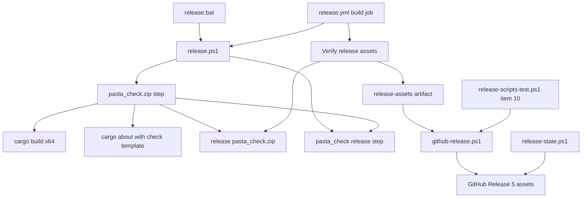
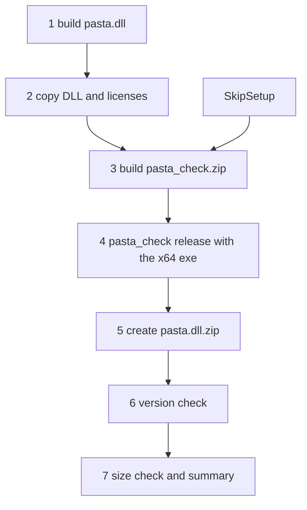
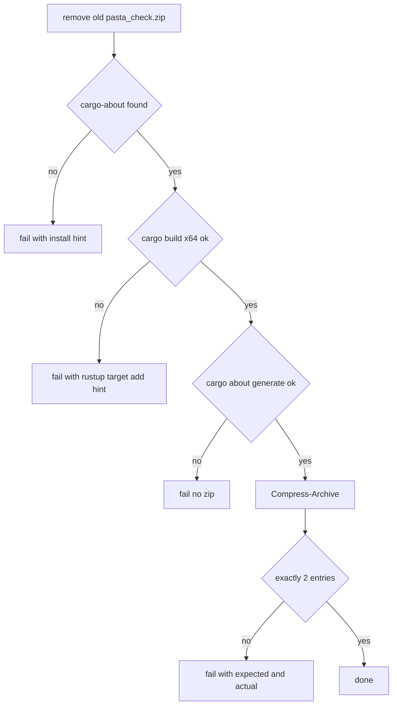

# 設計: pasta-check-release-asset

## Overview

**目的**: Rust を入れていないゴーストの作者が、GitHub Release から `pasta_check.zip` を落として展開するだけで、`pasta_check.exe`（辞書の検査とリリースビルド）を使えるようにする。

**利用者**: ゴーストの作者は、固定のリンク `https://github.com/ekicyou/pasta/releases/latest/download/pasta_check.zip` から最新版を落とす。pasta の開発者は、手元の `release.bat` とリリース CI で同じ `release.ps1` を使い、`pasta.dll.zip`・`hello-pasta.nar`・`pasta_check.zip` の 3 つを作って確かめる（VSIX はこれまでどおり別の手順が作る）。

**変わること**: 今のリリースビルド（`release.ps1`）に段を 1 つ足し、リリース CI の build の job・GitHub Release の添付・`release` スキルの状態の読み取り・入手の手順の文書を、配布物 4 つ（添付 5 つ）に合わせる。新しい仕組みは作らず、今の部品を伸ばす。

### Goals

- `pasta_check.zip`（`pasta_check.exe` と `THIRD_PARTY_LICENSES.txt` の 2 つだけ）を、手元とリリース CI の同じ手順で作り、中身を検査する。
- リリース CI が、中身と exe の版を確かめてから、5 つの添付で GitHub Release を公開する。
- 入手の手順の第一の道を「Release から `pasta_check.zip` を落として展開する」にする。

### Non-Goals

- コード署名・インストーラー・自動更新・PATH への登録。
- x86（i686）版の exe・Windows 以外のビルド。
- `pasta_check` の機能の変更（Rust のソースは触らない）。
- 過去の版（0.4.1 まで）の Release への `pasta_check.zip` の追加。
- 毎回の CI（`build.yml`）の構成の変更。

## Boundary Commitments

### This Spec Owns

- `release.ps1` の新しい段（x64 の exe のビルド・pasta_check 用のライセンス表示の生成・zip・中身の検査）と、段の並びと番号、`release.bat` の説明。
- pasta_check 用のライセンス表示のひな形 `about-pasta_check.hbs`。
- `release.yml` の build の job のうち、toolchain の targets・rust-cache の key・リリースビルドの段の名前・「Verify release assets」の `pasta_check.zip` の検査・「Upload release-assets」の path。冒頭の説明の 1 行（「3 つの配布物」）。
- `github-release.ps1` の添付の一覧（5 つ）と、その文言。`release-scripts-test.ps1` の添付の欠けのテスト（項目 10）。
- `release` スキルの状態の読み取り（`release-state.ps1`）と、手順書の読み方の表（`procedure.md`・`SKILL.md`）。
- 入手の手順と配布物の一覧を書いた文書（7 節の File Structure Plan に挙げたもの）。

### Out of Boundary

- `pasta_check` の Rust のソースと `Cargo.toml`（`ponytail-check-release` が持つ）。
- 今の `about.toml` の `accepted`・`targets`・clarify と、`about.hbs` の中身。pasta.dll 用・VSIX の WASM 用の表示は変えない。
- `release.yml` の verify・gate の job、公開系の job（publish-crates・publish-vsce・github-release・report）の行。とくに action の版の固定と Node の版（`ponytail-manual-ci` が持つ）。
- `build.yml` の構成（`release-scripts-test.ps1` を走らせる今の job は、そのまま項目 10 も走らせる）。
- `editors/vscode/scripts/build-wasm.ps1` と VSIX の作り方。

### Allowed Dependencies

- ルートの `.cargo/config.toml` の `x86_64-pc-windows-msvc` の `crt-static`（そのまま使う）。
- `pasta_check` の既定の機能（`default = ["cli"]`）。`--version` の出力の形 `pasta_check <版>`。
- cargo-about 0.9.2（リリース CI は版を固定して入れている）と、今の `about.toml`（設定は共用する）。
- PowerShell の標準（`Compress-Archive`・`System.IO.Compression.ZipFile`・`Expand-Archive`）。`release.ps1` は Windows PowerShell 5.1 と pwsh 7 の両方で動く書き方に限る。
- `github-release.ps1` の今の流れ（添付の有無の検査 → 下書き → 添付 → 公開・冪等な再実行）。

### Revalidation Triggers

- `pasta_check` の `--version` の出力の形が変わる（CI の版の検査が合わなくなる）。
- `pasta_check` の CLI の依存（`cli` の機能）が変わる、または許可に無いライセンスの依存が入る（ライセンス表示の生成が止まる）。
- `about.toml` の `accepted` を変える（pasta.dll 用と pasta_check 用の両方に効く）。
- 配布物の名前・数を変える（`release.ps1`・`release.yml`・`github-release.ps1`・`release-state.ps1`・文書の 5 か所を合わせる）。
- `ponytail-manual-ci` が `release.yml`・`github-release.ps1` を合わせるとき、本仕様が足した行を保つ。

## Architecture

### Existing Architecture Analysis

- 配布物は `crates/pasta_sample_ghost/release.ps1` が作る。手元では `release.bat`（`powershell.exe` 5.1）が、リリース CI では build の job（`pwsh`）が、同じスクリプトを呼ぶ。
- 今の段は 6 つ。段 1〜2 が準備（setup。`-SkipSetup` で飛ぶ）、段 3〜6 がリリース（`pasta_check release`・`pasta.dll.zip`・版の確認・`.nar` の大きさとまとめ）。
- 段 4 の「`Compress-Archive` で作り、`ZipFile.OpenRead` で中身がちょうど 2 つかを検査する」形と、CI の「Verify release assets」の `Get-ZipEntries` と `$errors` に積む形が、新しい zip の手本になる。
- 添付の名前と数は `github-release.ps1` の `$names` が持ち、後続の job は `release-assets` を丸ごと渡すだけである。

### Architecture Pattern & Boundary Map



**Architecture Integration**:
- 選んだ形: 今の部品を伸ばす（ギャップ分析の Option A）。ライセンス表示のひな形だけを分ける（Option B）。
- 分担: 作る（`release.ps1`）・検査して渡す（`release.yml` の build の job）・添付する（`github-release.ps1`）・状態を読む（`release-state.ps1`）の 4 つは今と同じ分担で、それぞれに `pasta_check.zip` を 1 つ足す。
- 守る形: 手元と CI が同じ `release.ps1`（R3.8）。中身の検査は「ちょうど N 個」。添付は gh を呼ぶ前に有無を検査する。
- 新しい物: ひな形 `about-pasta_check.hbs` だけ（今の `about.hbs` を変えずに LuaJIT の表示を外すため）。
- steering: 静的 CRT（`tech.md`）、release CI の分担（`tech.md` のリリースの節）を保つ。

### Technology Stack

| 層 | 選択 / 版 | 役目 | 備考 |
|---|---|---|---|
| ビルド | Rust stable・`x86_64-pc-windows-msvc`・`crt-static` | `pasta_check.exe` を作る | 既存の設定。新しい依存なし |
| ライセンス表示 | cargo-about 0.9.2 | pasta_check の依存だけの表示を作る | `-m`・`-c about.toml`・`--target` で範囲を絞る |
| スクリプト | Windows PowerShell 5.1 / pwsh 7 | `release.ps1` の段 | 5.1 で動く書き方に限る |
| CI | GitHub Actions（windows-latest）・`dtolnay/rust-toolchain`・`Swatinem/rust-cache@v2` | build の job | targets と key だけを変える |

## File Structure Plan

### New Files

```
about-pasta_check.hbs    # pasta_check.exe 用のライセンス表示のひな形（ルート。about.hbs の隣）
```

### Modified Files

作る（リリースビルド）:
- `crates/pasta_sample_ghost/release.ps1` — 新しい段（段 3）を足し、`pasta_check release` の段をその exe で走らせる。段の番号を `/7` に、冒頭の説明・頭とまとめの表示に `pasta_check.zip` を足す。
- `release.bat` — 冒頭の説明（作る物・段の並び）を合わせる。
- `about.toml` — 冒頭のコメントに「pasta_check.exe 用の表示（`about-pasta_check.hbs`）も同じ設定を使う」と書く。設定の値は変えない。

リリース CI:
- `.github/workflows/release.yml` — 冒頭の説明 1 行、build の job の targets・key・段の名前・検査・upload の path。
- `.github/scripts/release/github-release.ps1` — `$names` に `pasta_check.zip`、説明と文言を 5 つ（配布物 4 つ）に。
- `.github/scripts/release/release-scripts-test.ps1` — 冒頭の説明に `github-release.ps1` を足し、項目 10 を足す。

release スキル:
- `.claude/skills/release/scripts/release-state.ps1` — 配布物の配列に `pasta_check.zip`、`/3` → `/4`、公開済みの判定を 4 に。
- `.claude/skills/release/procedure.md` — 状態の表の読み方（L471・L477）を `4/4`・`n/4` に。0.4.1 までの版は `3/4` と出ることを一言。
- `.claude/skills/release/SKILL.md` — L166 の「添付 3/3」を「添付 4/4」に。

文書（入手の手順）:
- `book/src/debug/validate.md` — 「使い方」の入れ方（L18〜24）を、Release の zip（固定のリンク・64 ビット版・SmartScreen・パスで呼ぶ例 1 つ）を第一に、`cargo install pasta_check` を Rust の利用者向けの別の道にする。
- `crates/pasta_check/README.md` — 「インストール」を同じ順に（crates.io にも出るので絶対 URL）。
- `.claude/skills/pasta-check/SKILL.md` — 入れ方（L12〜18）を同じ順に。段の並び（L107）・出力の木（L133）・公開の説明（L153）に `pasta_check.zip` を足す。

文書（配布物の一覧）:
- `README.md`（L41〜44）・`book/src/introduction.md`（L38）— 直リンクに `pasta_check.zip` を足す。
- `crates/pasta_sample_ghost/RELEASE.md`（L6・L42・L106〜107 ほか）・`crates/pasta_sample_ghost/README.md`（L42・L72〜76）— 配布物・build の役目・`release.ps1` の段の並び。
- `.kiro/steering/tech.md`（L211）・`.kiro/steering/structure.md`（L279・L290）— 配布物 4 つ・添付 5 つ。

## System Flows

### リリースビルドの段の並び（変更後）



- 段 3 は準備（段 1〜2）の外に置く。`-SkipSetup`・`-SkipDllBuild` のときも必ず走り、作り直す（R3.6）。
- 段 4 は、段 3 が作った `target\x86_64-pc-windows-msvc\release\pasta_check.exe` を起動する（今の `cargo run -p pasta_check` を置き換える。2026-10-22 確定）。
- 段 5〜7 の中身は今の段 4〜6 と同じで、番号だけが変わる。

### 段 3 の中（どこで止まるか）



## Requirements Traceability

| 要件 | 要約 | 部品 | 取り決め | 流れ |
|---|---|---|---|---|
| 1.1 | zip の最上位に 2 つだけ | CheckZipStep | 段 3 の検査 | 段 3 の中 |
| 1.2 | x64 向け | CheckZipStep | `--target x86_64-pc-windows-msvc` | 段 3 の中 |
| 1.3 | ランタイム DLL 無しで起動 | CheckZipStep | ルートの `crt-static` | — |
| 1.4 | `cargo install` と同じ機能 | CheckZipStep・NarStep | 既定の機能（`cli`）でビルド。段 4 で exe が実際に `release` を走らせる | 段の並び |
| 1.5 | ワークスペースの版 | CheckZipStep・ReleaseBuildJob | `version.workspace = true`。CI の版の検査 | — |
| 2.1 | CLI の依存を含めて表示 | CheckLicenseTemplate・CheckZipStep | `-m crates/pasta_check/Cargo.toml`（既定の機能） | 段 3 の中 |
| 2.2 | LuaJIT・mlua・wasm を出さない | CheckLicenseTemplate・CheckZipStep | 専用のひな形・`--target x86_64-pc-windows-msvc` | 段 3 の中 |
| 2.3 | 冒頭に pasta_check.exe 用・MIT | CheckLicenseTemplate | ひな形の冒頭の文 | — |
| 2.4 | 今の表示を変えない | CheckLicenseTemplate | `about.hbs`・`about.toml` の値に触らない | — |
| 2.5 | 許可に無いライセンスで失敗 | CheckZipStep | `accepted` 共用・終了コードで止まる・古い zip を先に消す | 段 3 の中 |
| 2.6 | cargo-about が無いと失敗 | CheckZipStep | 段 3 の頭で有無を検査 | 段 3 の中 |
| 3.1 | `release/` に 3 つ・まとめに表示 | CheckZipStep・ReleaseScriptFrame | 頭とまとめの `Check Zip:` 行 | 段の並び |
| 3.2 | ちょうど 2 つを検査 | CheckZipStep | `ZipFile.OpenRead` と期待の一覧の比較 | 段 3 の中 |
| 3.3 | 期待と実際を示して失敗 | CheckZipStep | 段 4（今）と同じ文言の形 | 段 3 の中 |
| 3.4 | ビルド失敗で `rustup target add` | CheckZipStep | 失敗の案内 | 段 3 の中 |
| 3.5 | 段の番号・説明を合わせる | ReleaseScriptFrame | `/7`・冒頭・`release.bat` | 段の並び |
| 3.6 | `-Skip*` でも段 3 を行う | ReleaseScriptFrame | 段 3 を準備の外に置く | 段の並び |
| 3.7 | 今の配布物と検査を変えない | NarStep・ReleaseScriptFrame | 段 5 の中身は今の段 4 のまま。段 4 は同じソースの exe | 段の並び |
| 3.8 | 手元と CI で同じ手順 | ReleaseBuildJob | CI は `release.ps1` を呼ぶだけ | — |
| 4.1 | CI の build で作る | ReleaseBuildJob | targets に x64 を足す | — |
| 4.2 | CI で在ることと中身を検査 | ReleaseBuildJob | Verify に `pasta_check.zip` の項目 | — |
| 4.3 | exe の `--version` がタグの版 | ReleaseBuildJob | `pasta_check $env:VERSION` と完全一致 | — |
| 4.4 | 合わなければ公開しない | ReleaseBuildJob | `$errors` → `exit 1`。後続は needs で止まる | — |
| 4.5 | `release-assets` で渡す | ReleaseBuildJob | upload の path に 1 行 | — |
| 4.6 | `Cargo.lock` の不変検査を保つ | ReleaseBuildJob | 今の step のまま | — |
| 4.7 | `build.yml`・gate を変えない | ReleaseBuildJob | 触らない | — |
| 5.1 | 5 つを添付 | GitHubReleaseAssets | `$names` に `pasta_check.zip` | — |
| 5.2 | 版を含まない名前・固定のリンク | GitHubReleaseAssets・CheckZipStep | 名前は `pasta_check.zip` 固定 | — |
| 5.3 | 1 つでも無ければ作らず失敗 | GitHubReleaseAssets | gh の前の有無の検査（今のまま 5 つに広がる） | — |
| 5.4 | そろってから公開 | GitHubReleaseAssets | 下書き → 添付 → 公開（今のまま） | — |
| 5.5 | 再実行の規則を保つ | GitHubReleaseAssets | 判定は `$names` から出るので 5 つに広がる | — |
| 5.6 | 欠けのテスト | ReleaseScriptsTest | 項目 10 | — |
| 6.1 | `n/4` で数える | ReleaseStateReader | 配列に 1 つ足す | — |
| 6.2 | 4/4 の公開だけを公開済み | ReleaseStateReader | `$n -eq 4` | — |
| 6.3 | 手順書の読み方 | ReleaseSkillDocs | `procedure.md` L471・L477・`SKILL.md` L166 | — |
| 6.4 | 公開先 7 つは変えない | ReleaseSkillDocs | 「7/7」の記述に触らない | — |
| 7.1 | Release の zip が第一・固定のリンク | InstallDocs | `validate.md` の入れ方の節 | — |
| 7.2 | `cargo install` を別の道に | InstallDocs | 同上 | — |
| 7.3 | 64 ビット版と示す | InstallDocs | 同上 | — |
| 7.4 | SmartScreen の一言 | InstallDocs | 同上 | — |
| 7.5 | パスで呼ぶ例 1 つ | InstallDocs | 同上。ほかの節の例は変えない | — |
| 7.6 | README・スキルを同じ順に | InstallDocs | `crates/pasta_check/README.md`・`pasta-check/SKILL.md` | — |
| 7.7 | 配布物の一覧を 4 つ（添付 5 つ）に | AssetListDocs | File Structure Plan の文書（配布物の一覧） | — |
| 7.8 | `references/` の鮮度 | InstallDocs | `gen-skill-refs.mjs --check` を通す | — |
| 7.9 | マニュアルの検査を通す | InstallDocs | `link-check.mjs` を通す | — |

## Components and Interfaces

| 部品 | 層 | 役目 | 要件 | 主な依存 | 取り決め |
|---|---|---|---|---|---|
| CheckZipStep | リリースビルド | `release.ps1` の段 3。exe・表示・zip・検査 | 1.1〜1.5, 2.1, 2.2, 2.5, 2.6, 3.1〜3.4 | cargo (P0)・cargo-about (P0)・CheckLicenseTemplate (P0) | Batch |
| NarStep | リリースビルド | `release.ps1` の段 4。段 3 の exe で `release` を走らせる | 1.4, 3.7 | CheckZipStep (P0) | Batch |
| ReleaseScriptFrame | リリースビルド | 段の番号・説明・頭とまとめの表示・`release.bat` | 3.1, 3.5, 3.6, 3.7 | — | — |
| CheckLicenseTemplate | ライセンス表示 | `about-pasta_check.hbs` | 2.1〜2.4 | cargo-about (P0) | — |
| ReleaseBuildJob | リリース CI | build の job の targets・key・検査・upload | 1.5, 3.8, 4.1〜4.7 | `release.ps1` (P0) | Batch |
| GitHubReleaseAssets | リリース CI | `github-release.ps1` の添付 5 つ | 5.1〜5.5 | gh (P0) | Batch |
| ReleaseScriptsTest | リリース CI のテスト | 項目 10（添付の欠け） | 5.6 | GitHubReleaseAssets (P0) | — |
| ReleaseStateReader | release スキル | `release-state.ps1` の `n/4` | 6.1, 6.2 | gh (P1) | State |
| ReleaseSkillDocs | release スキル | `procedure.md`・`SKILL.md` の読み方 | 6.3, 6.4 | — | — |
| InstallDocs | 文書 | 入手の手順 3 か所 | 7.1〜7.6, 7.8, 7.9 | — | — |
| AssetListDocs | 文書 | 配布物の一覧・段の並び | 7.7 | — | — |

### リリースビルド

#### CheckZipStep（`release.ps1` 段 3「Building pasta_check.zip」）

| 項目 | 内容 |
|---|---|
| 役目 | x64 の `pasta_check.exe` とその依存だけのライセンス表示を作り、`release\pasta_check.zip` にまとめて中身を検査する |
| 要件 | 1.1, 1.2, 1.3, 1.4, 1.5, 2.1, 2.2, 2.5, 2.6, 3.1, 3.2, 3.3, 3.4 |

**責務と制約**
- 準備の段（1〜2）の外にあり、`-SkipSetup`・`-SkipDllBuild` に関わらず毎回走る。段だけを飛ばす指定は持たない（3.6）。
- 段 1〜2 の cargo-about の有無の検査に頼らず、自分で検査する（`-SkipSetup` のときは段 2 が走らないため。2.6）。
- Windows PowerShell 5.1 で動く書き方に限る（`??`・三項演算子・`&&` を使わない）。

**依存**
- External: cargo（`x86_64-pc-windows-msvc` のターゲット）— exe のビルド (P0)
- External: cargo-about — ライセンス表示の生成 (P0)
- Outbound: CheckLicenseTemplate — ひな形 (P0)
- Outbound: NarStep — 作った exe のパスを渡す (P0)

**Contracts**: Batch [x]

##### Batch / Job Contract
- **起動**: `release.ps1` の段 3。変数 `$CheckZipPath = <ws>\release\pasta_check.zip`、`$PastaCheckExe = <ws>\target\x86_64-pc-windows-msvc\release\pasta_check.exe` を冒頭のパスの設定に足す。
- **手順と失敗の扱い**（どれも失敗なら赤字の `ERROR:` と案内を出して `exit 1`）
  1. 前の実行の `$CheckZipPath` が在れば消す（失敗したときに古い zip を残さない。2.5）。
  2. `Get-Command cargo-about` が無ければ「`cargo install cargo-about`」を示して失敗（2.6。文言は段 2 と同じ）。
  3. ワークスペースのルートで `cargo build --release --target x86_64-pc-windows-msvc -p pasta_check --quiet`。失敗なら「`rustup target add x86_64-pc-windows-msvc`」を示す（3.4）。
  4. `cargo about generate -m crates\pasta_check\Cargo.toml -c about.toml --target x86_64-pc-windows-msvc --output-file <exe と同じフォルダ>\THIRD_PARTY_LICENSES.txt about-pasta_check.hbs`。失敗（許可に無いライセンスを含む）なら zip を作らずに失敗（2.5）。
  5. `release\` が無ければ作る（CI はまっさらのチェックアウトで、`release\` は今は後の段が作っている）。
  6. `Compress-Archive -Path <exe>, <表示> -DestinationPath $CheckZipPath -Force`（2 つとも最上位。1.1）。
  7. `[System.IO.Compression.ZipFile]::OpenRead` で中身の名前を並べ、`pasta_check.exe`・`THIRD_PARTY_LICENSES.txt` と比べる。違えば「`ERROR: pasta_check.zip must contain exactly: …`」と「`Actual: …`」を出して失敗（3.2・3.3）。
- **出力**: `release\pasta_check.zip`。成功の行 `Created pasta_check.zip (pasta_check.exe, THIRD_PARTY_LICENSES.txt)`。
- **冪等性**: 毎回作り直す（`-Force`・古い zip の削除）。exe と表示は `target\` の下に置き、`release\` と git の作業ツリーには zip だけが出る（`target\`・`release\` は `.gitignore` 済み）。

**Implementation Notes**
- 版（1.5）は `version.workspace = true` から決まる。手元では版の検査を足さない（2026-10-22 確定）。
- 段 4（今）の zip と検査の行は、関数に括り出さずに同じ形を写す（括り出すと今の段の行も変わり、3.7 の確かめが増える）。
- リスク: x64 の exe を起動できない手元では段 4 が動かない（開発機と CI は x64 なので受け入れる）。

#### NarStep（`release.ps1` 段 4「Running pasta_check release」）

| 項目 | 内容 |
|---|---|
| 役目 | 今の段 3。`cargo run -p pasta_check --quiet --` を `& $PastaCheckExe` に置き換え、引数（`release --target … --release … --nar …`）は変えない |
| 要件 | 1.4, 3.7 |

**Contracts**: Batch [x]
- **起動**: 段 3 の成功の後。
- **入力・出力**: 今と同じ（`release\hello-pasta\` と `release\hello-pasta.nar`）。失敗の扱い（`ERROR: pasta_check release failed` → `exit 1`）も今と同じ。
- **Implementation Notes**: `pasta_check` のソースは同じなので `.nar` の中身は変わらない。配布する exe そのものが検査と `.nar` の作成をこなせることを、リリースビルドのたびに確かめる（1.4 の裏付け）。

#### ReleaseScriptFrame（段の並びと表示）

- 段の見出しを `[1/7]`〜`[7/7]` に。準備は段 1〜2、リリースは段 3〜7（`# Release Phase (Steps 3-7)`）。
- 冒頭のコメント（2 行目の「creates .nar and pasta.dll.zip」）・パラメーターの説明（`-SkipSetup` は段 1〜2 を飛ばし、段 3 以降は行う）を合わせる。
- 頭の表示とまとめ（`Release Packages Ready!` の下）に `Check Zip: <パス>` の行を足す（3.1）。
- `release.bat` の 3 行目（作る物）と 9 行目（段の並び）を合わせる（3.5）。

### ライセンス表示

#### CheckLicenseTemplate（`about-pasta_check.hbs`）

| 項目 | 内容 |
|---|---|
| 役目 | pasta_check.exe 用の `THIRD_PARTY_LICENSES.txt` のひな形 |
| 要件 | 2.1, 2.2, 2.3, 2.4 |

- **冒頭**: 見出し `THIRD-PARTY SOFTWARE LICENSES`。日本語と英語で「pasta 自体は MIT License で配布されている（LICENSE への URL）」「pasta_check.exe には以下の第三者ソフトウェアが組み込まれている」と書く（2.3）。
- **本体**: `{{#each overview}}` の一覧と、`{{#each licenses}}` の節（今の `about.hbs` の L11〜13・L76〜86 と同じ形）。LuaJIT の固定の節は持たない（2.2）。
- **範囲を絞るのは呼び出し側**: `-m crates\pasta_check\Cargo.toml`（pasta_check だけを根にし、既定の機能 `cli` の依存を含める。2.1）と `--target x86_64-pc-windows-msvc`（`about.toml` の `targets` を置き換え、wasm 向けを外す。2.2）。
- **共用**: `about.toml` の `accepted` をそのまま使う（`deny.toml` と揃える所を 1 か所に保つ）。`about.toml` は冒頭のコメントだけを直し、値は変えない（2.4）。
- **既知の警告**: `[seahorse.clarify]` について「グラフに無いクレートの設定」の警告が出る。終了コードは 0 で、受け入れる。

### リリース CI

#### ReleaseBuildJob（`release.yml` の build の job）

| 項目 | 内容 |
|---|---|
| 役目 | タグのソースから 4 つの配布物を作り、検査して `release-assets` で渡す |
| 要件 | 1.5, 3.8, 4.1, 4.2, 4.3, 4.4, 4.5, 4.6, 4.7 |

**Contracts**: Batch [x]

##### Batch / Job Contract
- **起動**: 今と同じ（`needs: [verify, gate]`）。
- **変更点**
  - Install Rust toolchain: `targets: i686-pc-windows-msvc,x86_64-pc-windows-msvc`（4.1）。
  - Setup Rust cache: `key: i686-x86_64-pc-windows-msvc`（2026-10-22 確定。今の key でも復元できていないので遅くならない）。
  - 段の名前: `Build pasta.dll.zip, hello-pasta.nar and pasta_check.zip`。実行の行（`pwsh -NoProfile -File crates/pasta_sample_ghost/release.ps1`）は変えない（3.8）。
  - Verify release assets に `pasta_check.zip` の項目を足す（`pasta.dll.zip` の項目の直後）:
    - `Get-ZipEntries 'release/pasta_check.zip'` を並べ替え、`pasta_check.exe|THIRD_PARTY_LICENSES.txt` と比べる。無ければ `Get-ZipEntries` が「配布物が無い: …」で止まる（4.2・4.4）。
    - 中身が合うときだけ、`Expand-Archive` で `$env:RUNNER_TEMP` の下に展開し、`pasta_check.exe --version` を起動する。終了コードが 0 でないか、出力が `pasta_check $env:VERSION` と完全に一致しなければ `$errors` に「`pasta_check.zip` の `pasta_check.exe` の版が `<版>` でない: `<出力>`」を積む（4.3・4.4）。
  - Upload release-assets の `path` に `release/pasta_check.zip`（4.5）。
  - 冒頭の説明（3 行目の「build（3 つの配布物）」）を 4 つに。
- **変えない物**: Check Cargo.lock is unchanged（4.6）、verify・gate の job、`build.yml`（4.7）、公開系の job のすべての行。
- **失敗の伝わり方**: build の job が失敗すれば、publish-crates・publish-vsce・github-release は needs で走らない（今と同じ。4.4）。

#### GitHubReleaseAssets（`github-release.ps1`）

| 項目 | 内容 |
|---|---|
| 役目 | 5 つの添付で Release を作り・補い・公開する |
| 要件 | 5.1, 5.2, 5.3, 5.4, 5.5 |

**Contracts**: Batch [x]
- **変更点**: `$names` を `'pasta.dll.zip', 'hello-pasta.nar', "pasta-vscode-<版>.vsix", 'pasta_check.zip', "release-notes-<タグ>.md"` の 5 つに。L18 の `-AssetDir` の説明、L71 の注釈、L89 の skip の文言（「5 つ（配布物 4 つと詳しいリリースノート）」）、L103 の注釈を合わせる。
- **変えない流れ**: gh の前の有無の検査（無い名前を示して `failed publish`、5.3）、下書き → 足りない添付 → 公開（5.4）、再実行の判定（公開済みで 5 つ添付済みなら skipped・下書きなら未完了の添付を消して足りない物だけ・公開済みの添付は消さない、5.5）。どれも `$names` から決まるので、`$names` の 1 か所で 5 つに広がる。
- **名前**: `pasta_check.zip` は版を含まない固定の名前で、`releases/latest/download/pasta_check.zip` がそのまま効く（5.2）。

#### ReleaseScriptsTest（`release-scripts-test.ps1` 項目 10）

- **項目**: 「`github-release.ps1` が、添付 5 つのうち `pasta_check.zip` が無いとき、終了コード 1 で、出力にその名前を示す」。
- **作り**: 一時のフォルダ（`$tmp` の下）に `pasta.dll.zip`・`hello-pasta.nar`・`pasta-vscode-0.0.2.vsix`・`release-notes-v0.0.2.md` の 4 つ（中身は空でよい）と notes のファイルを置き、`Invoke-Script github-release.ps1 @('-Tag','v0.0.2','-NotesFile',<notes>,'-AssetDir',<dir>)` を呼ぶ。`Exit -ne 1` または出力に `pasta_check.zip` が無ければ NG。
- **前提**: `github-release.ps1` は添付の有無を gh の呼び出しより前に検査するので、ネットワークと gh を使わない。`GITHUB_OUTPUT`・`GITHUB_STEP_SUMMARY` はテストの冒頭で外してある。毎回の CI（`build.yml` の release-scripts の job、ubuntu）でもそのまま走る（5.6）。
- 冒頭の `.SYNOPSIS` に `github-release.ps1`（添付の欠け）を足す。

### release スキル

#### ReleaseStateReader（`release-state.ps1`）

**Contracts**: State [x]
- **状態**: GitHub Release の行の状態は `あり（公開・添付 4/4） <URL>`・`下書き（添付 n/4）`・`添付不足（公開・添付 n/4） <URL>`・`無し`・`不明`。
- **変更点**: 配列を `'pasta.dll.zip', 'hello-pasta.nar', "pasta-vscode-$V.vsix", 'pasta_check.zip'` に、`/3` を `/4` に、`$n -eq 3` を `$n -eq 4` に（6.1・6.2）。リリースノートの添付は数えない（今と同じ）。
- **注意**: 0.4.1 までの版に向けると `添付不足（公開・添付 3/4）` と出る。過去の版へは足さない（範囲外）。

#### ReleaseSkillDocs（`procedure.md`・`SKILL.md`）

- `procedure.md` L471 の表と L477 の文を `4/4`・`n/4` に。0.4.1 までの版は `3/4` の添付不足と出ることを一言足す（6.3）。L396 の F5 の案内は数を含まないので変えない。
- `SKILL.md` L166 の「添付 3/3」を「添付 4/4」に。公開先の「7/7」は変えない（6.4）。
- `.claude/skills/**` の編集は分類器が拒否することがある。拒否されたら、入った分と残りを示して開発者の許可を求める。

### 文書

#### InstallDocs（入手の手順）

- `book/src/debug/validate.md` の「使い方」の入れ方（今の L18〜24）を次の形にする（7.1〜7.5）:
  1. Release から `pasta_check.zip`（固定のリンク `https://github.com/ekicyou/pasta/releases/latest/download/pasta_check.zip`）を落として、好きなフォルダに展開する。中身は `pasta_check.exe` と `THIRD_PARTY_LICENSES.txt`。64 ビット版の Windows 向け。
  2. 署名が無いので、初めて起動するときに Windows の SmartScreen の警告が出ることがある、と一言。
  3. 展開した exe をパスで呼ぶ例を 1 つ（`C:\tools\pasta_check\pasta_check.exe validate --target ghosts\hello-pasta`）。PATH への登録は書かない。
  4. Rust を使っている人は `cargo install pasta_check` でも入れられる（別の道）。
  - ほかの節のコマンド例（`pasta_check validate …`）は変えない。
- `crates/pasta_check/README.md` の「インストール」と `.claude/skills/pasta-check/SKILL.md` の入れ方を同じ順にする（7.6）。README は crates.io にも出るので、リンクは絶対 URL。
- `book/src/debug/validate.md` は `gen-skill-refs.mjs` の対応表に無い。`node book/tools/gen-skill-refs.mjs --check` が通ることを確かめる（7.8）。
- 固定のリンクは 0.4.2 の公開まで 404 だが、`link-check.mjs` は自分のリポジトリの `blob/main`・`tree/main` 以外の絶対 URL を照合しないので、マニュアルの検査は落ちない（7.9）。

#### AssetListDocs（配布物の一覧・段の並び）

- File Structure Plan の「文書（配布物の一覧）」と `pasta-check/SKILL.md` の L107・L133・L153 に `pasta_check.zip` を足し、配布物 4 つ・添付 5 つ・`release.ps1` の段 7 つの並びに合わせる（7.7）。
- `book/src/debug/validate.md` L190 の「`release` は 6 段で進み」は `pasta_check release` 自身の段の数なので変えない。

## Error Handling

### Error Strategy

- リリースビルドは、どの失敗でも赤字の `ERROR:` と次にすることの案内を出して `exit 1`（今の段と同じ形）。失敗したときに `release\pasta_check.zip` を残さない。
- リリース CI の検査は、今と同じく `$errors` に積んで最後にまとめて `::error::` で出し、`exit 1`。build の job の失敗で後続の公開系の job は走らない。
- `github-release.ps1` は、添付が欠ければ gh を呼ぶ前に `failed publish` で止まり、無い名前を示す。

### Error Categories and Responses

| 失敗 | 場所 | 出す物 |
|---|---|---|
| cargo-about が無い | 段 3 | `ERROR: cargo-about not found. Install via: cargo install cargo-about` |
| x64 のビルドの失敗 | 段 3 | `ERROR: pasta_check build failed` と `rustup target add x86_64-pc-windows-msvc` |
| 表示の生成の失敗（許可に無いライセンスを含む） | 段 3 | `ERROR: cargo about generate failed (pasta_check)`。cargo-about のエラー（どのクレートのどのライセンスか）がその上に出る |
| zip の中身の違い | 段 3 | 期待する中身と実際の中身 |
| zip が無い・中身の違い・版の違い | CI の Verify | `::error::` の行（何が合わないか） |
| 添付の欠け | `github-release.ps1` | `添付がそろっていない（… に無い: pasta_check.zip）` |

## Testing Strategy

### スクリプトのテスト（自動）

- `release-scripts-test.ps1` 項目 10: `pasta_check.zip` だけが無いとき、`github-release.ps1` が終了コード 1 で、出力に `pasta_check.zip` を示す（5.3・5.6）。項目 1〜9 も今までどおり ok であること。

### 手元のリリースビルド（pwsh で `release.ps1` を直に）

- 通しの実行で、`release\` に `pasta.dll.zip`・`hello-pasta.nar`・`pasta_check.zip` ができ、まとめに `Check Zip:` が出る（3.1）。
- `pasta_check.zip` を展開し、中身が 2 つで最上位にあり（1.1）、`pasta_check.exe --version` が `pasta_check <ワークスペースの版>`（1.5）、`validate --help` と `release` が動く（1.4）。
- 展開した `THIRD_PARTY_LICENSES.txt` に `lexopt`・`md5`・`zip` があり、`LuaJIT`・`mlua`・`wasm-bindgen` が無く、冒頭に pasta_check.exe と MIT の文がある（2.1〜2.3）。
- `ghosts\hello-pasta\ghost\master\THIRD_PARTY_LICENSES.txt` と `pasta.dll.zip`・`.nar` の中身の名前の一覧が、変更の前の実行と同じ（2.4・3.7）。
- `-SkipSetup` で走らせても段 3 が行われ、`pasta_check.zip` が作り直される（3.6）。
- `Cargo.lock` が変わらない（4.6）。
- 失敗の道: スクラッチに `"Zlib"` を除いた `about.toml` の写しを作って同じ生成のコマンドを回し、終了コード 1 で出力のファイルができないことを確かめる（2.5。設計の調査で確かめ済み）。

### Windows PowerShell 5.1

- `powershell.exe -NoProfile -Command` で `[System.Management.Automation.Language.Parser]::ParseFile` を `release.ps1` に当て、構文のエラーが無いこと。7 だけの書き方（`??`・三項演算子・`&&`・`||`）を使っていないことを見直す。
- `release.bat` での通しの実行は、エージェントは `-ExecutionPolicy Bypass` を走らせられないので、開発者の確かめに回す。

### リリース CI

- `actionlint` を `release.yml` に当てる。
- 「Verify release assets」の `run` の中身をスクラッチの `.ps1` に写し、手元の `release\` と `$env:VERSION`・`$env:RUNNER_TEMP` を与えて走らせ、`pasta_check.zip` の項目が成功すること、版を違えたときに版の違いの行が出ることを確かめる（VSIX の項目は手元に VSIX が無ければ NG になるので、その行は除いて読む）。
- `github-release.ps1 -DryRun`（gh の認証が要る）は手元の補助の確かめ。
- 本番の確かめ（Release に 5 つが載り、固定のリンクで落ちる）は 0.4.2 のリリースで行う。

### 文書

- `node book/tools/gen-skill-refs.mjs --check` が通る（7.8）。
- `book/tools/link-check.mjs`（`manual.yml` が行う検査）が通る（7.9）。
- `release-state.ps1` を 0.4.1 に向け、`添付不足（公開・添付 3/4）` と出ること（6.1・6.2 の形の確かめ）。

## Security Considerations

- exe は署名しない（範囲外）。マニュアルで SmartScreen の警告が出ることを書く（7.4）。
- 利用者が受け取るのは、タグのソースからリリース CI が作り、版を検査した exe だけである。手元の `release\` の物は公開しない（今と同じ）。

## Decisions / Risks

2026-10-22 の設計ディスカッションで、次の 4 件を推奨案で確定した（根拠は `research.md` 11 節）。

1. **`pasta_check release` の段**（申し送り 2）: 段 3 で作った x64 の exe で段 4 を走らせる。
2. **exe の版の検査**（申し送り 3）: リリース CI の Verify だけで行い、手元の `release.ps1` には足さない。
3. **rust-cache の key**（申し送り 4）: `i686-x86_64-pc-windows-msvc` に変える（今の key でも復元できていない）。
4. **ひな形の分け方**（申し送り 1）: `about-pasta_check.hbs` を新しく置き、`about.toml` は共用する。

設計の検証（GO）が挙げた次の 3 つの確かめは、タスクに必ず入れる（Testing Strategy にある手順）。

- 変更の前後で、`.nar` と `pasta.dll.zip` の中身の名前の一覧が同じであること（段 4 を x64 の exe に替えるため）。
- 開発者が `release.bat`（Windows PowerShell 5.1）で 1 回通すこと（エージェントは走らせられない）。
- 「Verify release assets」の `run` をスクラッチの `.ps1` に写し、版が合う場合と違う場合の 2 通りを手元で走らせること（`actionlint` も当てる）。
- リスク: 0.4.1 までの版の状態の読み取りは `3/4` の添付不足と出る（手順書に一言書く）。
- リスク: `.claude/skills/**` の編集が分類器に拒否されると、6.3 と 7.6・7.7 の一部が止まる（開発者の許可で進める）。
