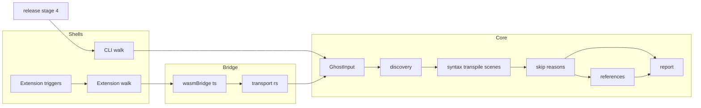
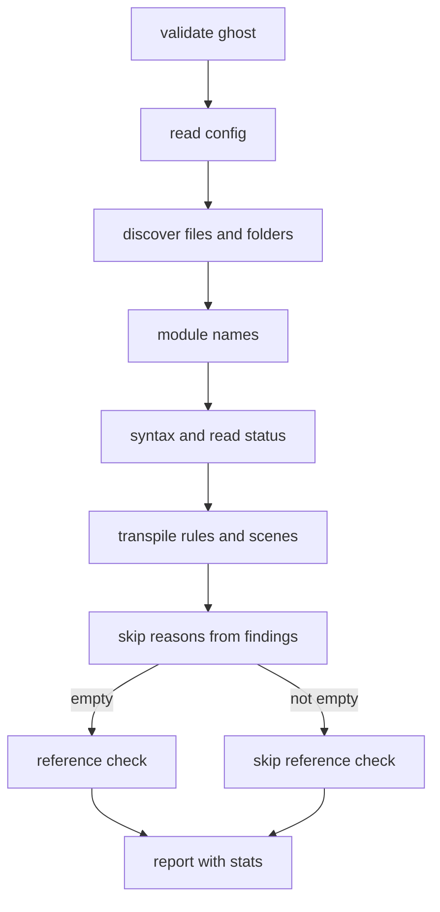
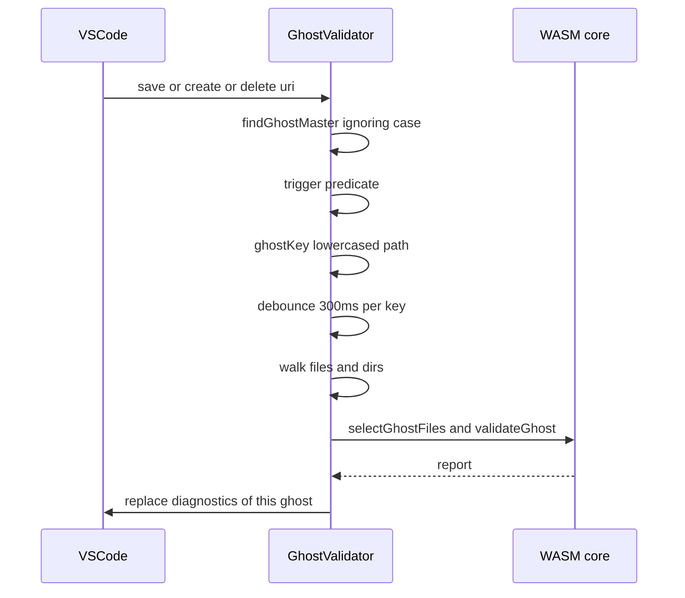

# Design Document: pasta-check-validate-edges

## Overview

**Purpose**: 辞書の検査（`pasta_check validate`・`pasta_check release` の段 4・VSCode 拡張のゴースト全体の診断）が、`pasta-check-dic-validate` で残した 3 つの端でも本当の原因を指す報告を出すようにする。あわせて、検査のコマンドが無かった頃の代用品（マニュアルの CI の段・hello-pasta のテストの一部）を `validate` に置き換える。

**Users**: ゴーストの作者が CLI とエディタで辞書を確かめるときに使う。pasta の開発者は、マニュアルの CI と hello-pasta のテストを通して使う。

**Impact**: 検査の核（`crates/pasta_check/src/validate/`）の 3 か所（入力の形・辞書の選び出し・報告）と、2 つの殻（CLI の `validate_cmd.rs`・拡張の `ghostValidator.ts`）、WASM の JS の形（`wasmBridge.ts`）を広げる。新しい依存・新しいファイルは無い。`Cargo.lock` は変わらない。

### Goals

- 辞書の中身が分からないとき（構文エラー・読めない辞書ファイル・`pasta.toml` の誤り）は飛び先の検査をまるごと省き、案内の行に理由をすべて出す。
- 辞書のパターンに一致するフォルダを、pasta.dll と同じ規則で誤りとして報告する（CLI・拡張・`release` で同じ）。
- VSCode 拡張が、大文字・小文字を問わない `ghost/master` のゴーストを、`engines` の範囲のどの版でも同じ条件で検査する。
- マニュアルの CI の段と hello-pasta のテストの組み込みの名前の部分を `validate` に置き換える。

### Non-Goals

- 新しい種類の検査を広げること（前方一致の重なりの注意も足さない。要件の OQ-9）。
- 機械向けの出力の形（JSON など）。`Stats` の JS の形は拡張とのやりとりにだけ使い、公開の約束にしない。
- `release` の段の中身・文法・ランタイムの読み込みとシーンの検索の規則の変更。
- エディタに案内の行・まとめの行を出すこと（今も出していない。確定 A-3）。
- `pasta.toml` の作成・削除での起動、Linux・macOS の CLI の大文字・小文字の扱いの変更（要件の OQ-5）。

## Boundary Commitments

### This Spec Owns

- 飛び先の検査を省く条件（種類 → 理由の対応）と、案内の行の文言。
- 新しい報告の種類 `folder-matches-pattern`（誤り）と、その判定の規則（辞書のパターンに一致するフォルダ）。
- 検査の核の入力 `GhostInput.dirs` と、報告の `Stats.skip_reasons` の形（Rust と JS の両方）。
- VSCode 拡張のゴースト全体の診断の起動の条件（保存・作成・削除）と、ゴーストの鍵のそろえ方。
- マニュアルの CI の「Tutorial syntax validation」の段の中身、`validate_cli_test.rs` の hello-pasta のテスト、`tutorial_stages_test.rs` の `scene_names_do_not_prefix_collide` の組み込みの名前の部分。
- マニュアル `book/src/debug/validate.md` の該当の節と、`editors/vscode/README.md` の「検査する時」。

### Out of Boundary

- pasta.dll（`pasta_lua`）の読み込み・辞書の集め方・シーンの検索の規則（写すだけで変えない）。
- `release` の段 1〜3・5・6、nar の作り方、配布フォルダへの写し方（`copy.rs`）。
- 構文の診断（入力のたびの `DocumentSync`）と、ほかの拡張の機能。
- hello-pasta の段階の辞書を読み込んで応答を確かめるテスト（`every_stage_loads_and_responds` など）。
- `crates/pasta_check/README.md`・スキル `pasta-check`（省く条件・報告の種類・検査する時を書いていないので変えない。要件 7.4 の Where に当たらない）。

### Allowed Dependencies

- 検査の核は `pasta_dsl`・`pasta_core`・`toml`・`serde`・`glob`（`Pattern` だけ）を使う。ファイルシステム・時刻・乱数に触れない（今の決まりのまま）。
- 殻（`validate_cmd.rs`）は `std::fs` で一覧を作る。拡張は `vscode.workspace.fs` と `createFileSystemWatcher` を使う。
- 一致テストは dev-dependency の `pasta_lua`（`discover_files`・`PastaLoader::load`）を使う。
- 依存の向き: 入力（`input.rs`）→ 設定（`config.rs`）→ 選び出し（`discovery.rs`）→ 構文・変換・シーン・飛び先 → 報告（`report.rs`）。殻 → 核。`ghostValidator.ts` → `wasmBridge.ts` → WASM（`transport.rs`）→ 核。逆向きの依存は誤りとする。

### Revalidation Triggers

- `FindingKind` に `folder-matches-pattern` を足し、`ALL` が 24 個になる（CI・作者のスクリプト・マニュアル・`wasmBridge.ts` に効く。上流の design の Revalidation Triggers に当たる）。
- 案内の行の文言が理由で変わる（構文エラーだけのときの文言は今と同じ）。
- WASM の JS の形: `GhostInput` に `dirs`（必須）を足し、`GhostStats.referencesSkipped` を `skipReasons` に置き換える。`wasmBridge.ts` と WASM を同時に作り直す。
- 後から検査を足す spec（`call-attribute-filter`・`scene-anchor-link`・`cue-command-runtime`・`novel-talk-flow`）は、辞書のシーンの集まりに頼る検査を `skip_reasons` が空のときだけ走らせる。辞書の中身が分からないことを表す誤りの種類を足すときは、`skip_reasons` の対応に入れる。
- `pasta_lua` の `loader/discovery.rs`・`process.rs` の変更（一致テストのフォルダの照らし合わせが落ちる）。
- 拡張の見張りのパターン・起動の関数の変更（`ghostValidator.test.ts`）。

## Architecture

### Existing Architecture Analysis

- 検査の核の `validate_ghost`（`mod.rs` 55〜91 行）は、設定 → 集め方 → モジュール名・構文 → トランスパイル・シーン → 飛び先の順に段を呼ぶ。省く条件は 74 行の `Syntax` だけ。
- 辞書の選び出し（`discovery.rs`）は、`glob::glob` の振る舞いをファイルの一覧の上で写す。ワイルドカードの無い成分は大文字・小文字を区別せずパターンの綴りで見え、ある成分は区別する。最後の `**` はファイルに一致しない。`/` で終わる・最後が `.` のパターンは捨てる（`parse` が `None`）。
- 殻は 2 か所（CLI の `walk`・拡張の `walk`）で、最上位の `profile` とリンクを除いてファイルの相対パスだけを集める。
- 拡張は `findGhostMaster`（小文字の `ghost/master` だけ）・見張り `**/ghost/master/**/*.{pasta,lua}`・保存の判定（区別する）・ゴーストの鍵 `master.toString()` で動く。
- 調べで確かめた pasta.dll の振る舞い（`research.md`「確かめた振る舞い」）: 辞書のパターンに一致するフォルダは、中身が無くても読み込み全体を失敗させる。最後の `**` は 1 段以上のフォルダに一致し、`/` で終わるパターンと最後が `.` のパターンはフォルダだけに一致する。

### Architecture Pattern & Boundary Map



**Architecture Integration**:
- Selected pattern: 今の「核が規則を持ち、殻は集めるだけ」をそのまま広げる。フォルダの判定も核に置き、TypeScript にパターンの照合を写さない（上流の OQ-6・要件の OQ-4）。
- Domain/feature boundaries: 核は入力の一覧から報告までを持つ。殻は一覧（ファイル・フォルダ）と中身を集め、出力する。拡張は起動の条件と診断の表示を持つ。
- Existing patterns preserved: 種類ごとに固定の分類（上流の要件 7.7）・1 行の形・並び順・JS の形（camelCase・タグ `kind`）・束ね（300ms）。
- New components rationale: 新しいモジュールは無い。`SkipReason`（省く理由）と `FolderMatchesPattern`（種類）は既存のファイルに足す。
- Steering compliance: 核は WASM でも動くようにファイルシステムに触れない（`tech.md`）。600 行の目安を超えるファイルは無い。

### Technology Stack

| Layer | Choice / Version | Role in Feature | Notes |
|-------|------------------|-----------------|-------|
| CLI / 核 | Rust 2024・`glob`（`Pattern`）・`serde` | 省く条件・フォルダの判定・報告 | 依存の追加なし |
| WASM | `pasta_lsp`（`wasm-bindgen`・`serde-wasm-bindgen`） | `GhostInput`・`Report` をそのまま受け渡す | 入口の関数は変えない。作り直しは要る |
| エディタ | TypeScript・VSCode API `^1.85.0` | 起動の条件・診断 | `engines` は上げない |
| CI | GitHub Actions（`manual.yml`・ubuntu） | hello-pasta を `validate` で検査 | `pasta_lua`（LuaJIT）のビルドが要らなくなる |

## File Structure Plan

### Directory Structure

新しいファイルは無い。変える場所は次のとおり。

```
crates/pasta_check/
├── src/
│   ├── validate/
│   │   ├── input.rs          # GhostInput に dirs を足す
│   │   ├── discovery.rs      # フォルダの照合と folder-matches-pattern の報告
│   │   ├── report.rs         # 種類・文言・SkipReason・Stats・案内の行
│   │   └── mod.rs            # 省く判定・一致テスト用の pasta_dll_folders
│   └── validate_cmd.rs       # walk がフォルダも集める
└── tests/
    ├── validate_config_test.rs   # フォルダの判定（メモリ上の入力）
    ├── validate_scenes_test.rs   # 省く条件と案内の行
    ├── validate_report_test.rs   # 案内の行の文言
    ├── validate_rules_test.rs    # GhostInput の式に dirs を足すだけ
    ├── validate_parity_test.rs   # フォルダの選び出し・読み込みの失敗を pasta.dll と照らす
    ├── validate_cli_test.rs      # hello-pasta の注意 0 件・フォルダの CLI の出力
    └── cli_test.rs               # release がフォルダで止まる
crates/pasta_lsp/src/transport.rs # JS の形のテストだけ
crates/pasta_sample_ghost/tests/tutorial_stages_test.rs  # GLOBAL_KEYS を外す
editors/vscode/
├── src/
│   ├── ghostValidator.ts     # 照合・鍵・起動の関数・見張り・walk
│   ├── wasmBridge.ts         # JS の型と形の検査
│   └── test/
│       ├── ghostValidator.test.ts
│       ├── vscodeModules.test.ts
│       └── mock/vscode.ts    # 中身の無いフォルダを置けるようにする（要るときだけ）
└── README.md                 # 検査する時
.github/workflows/manual.yml  # Tutorial syntax validation の段
book/src/debug/validate.md    # 報告の表・省く条件・検査する時
```

### Modified Files

- `crates/pasta_check/src/validate/input.rs` — `GhostInput.dirs: Vec<String>`（必須）。
- `crates/pasta_check/src/validate/discovery.rs` — パターンをファイル向けとフォルダだけ向けに分けて読み、フォルダの候補を照らす。`Discovered.folders` を返し、一致ごとに `FolderMatchesPattern` を報告する。
- `crates/pasta_check/src/validate/report.rs` — `FindingKind::FolderMatchesPattern`・`msg::folder_matches_pattern`・`SkipReason`・`skip_reasons`・`Stats.skip_reasons`・`Stats::references_skipped`・案内の行。
- `crates/pasta_check/src/validate/mod.rs` — 省く判定を `skip_reasons` に替え、`#[doc(hidden)] pasta_dll_folders` を足す。冒頭のコメント（6.8）を直す。
- `crates/pasta_check/src/validate_cmd.rs` — `walk` が入ったフォルダの相対パスも返し、`GhostInput.dirs` に入れる。
- `crates/pasta_lsp/src/transport.rs` — `test_ghost_validate_js_shape` の入力に `dirs`、stats のキーに `skipReasons`。
- `editors/vscode/src/wasmBridge.ts` — `GhostInput.dirs`・`SkipReason`・`GhostStats.skipReasons`・`isGhostReport`。
- `editors/vscode/src/ghostValidator.ts` — `findGhostMaster` を区別しない照合に、`ghostKey`・`isDictionaryLike` を足し、見張りを `**/*` に、`walk` がフォルダも集める。
- `.github/workflows/manual.yml` — 段の中身とコメント。
- `crates/pasta_sample_ghost/tests/tutorial_stages_test.rs` — `GLOBAL_KEYS` と比較を外し、ドキュメントのコメントを直す。
- `book/src/debug/validate.md`・`editors/vscode/README.md` — 文書。

## System Flows

### 検査の核の中の順番と省く判定



- 省く判定は、すべての段の findings がそろった後に 1 回だけ行う（`ConfigPatternInvalid` は選び出しの段で出るため）。
- フォルダの誤りは選び出しの段で出すが、省く理由には入れない（フォルダにシーンは無い。要件 1.6）。

### VSCode 拡張の起動



- 同じ鍵の起動は 1 つに束ねる。走行中の起動は、終わった後に 1 回だけ走らせる（今のまま）。
- 診断の URI は、その回の検査に使った `master`（最後に起動した URI の綴り）と報告のパスから作る。開いている文書に小文字で同じ URI があれば、その文書の URI を使う。前の回に出した URI で今回出ないものは消す（今のまま）ので、綴りが替わっても二重にならない。

## Requirements Traceability

| Requirement | Summary | Components | Interfaces | Flows |
|-------------|---------|------------|------------|-------|
| 1.1 | 読めない辞書で省く | Report（SkipReason）・Validate | `skip_reasons` | 核の順番 |
| 1.2 | `pasta.toml` の誤りで省く | Report（SkipReason）・Validate | `skip_reasons` | 核の順番 |
| 1.3 | 構文エラーで省く（今のまま） | Report（SkipReason）・Validate | `skip_reasons` | 核の順番 |
| 1.4 | 案内の行に理由をすべて | Report | `msg::references_skipped`・`Report::lines` | — |
| 1.5 | まとめの行に飛び先の項を出さない | Report | `Report::lines` | — |
| 1.6 | ほかの誤りでは省かない | Report（SkipReason の対応表） | `skip_reasons` | 核の順番 |
| 1.7 | 原因そのものは今までどおり報告 | Syntax・Config（変更なし） | — | — |
| 2.1 | 一致するフォルダを誤りとして報告 | Discovery・Report | `FolderMatchesPattern`・`msg::folder_matches_pattern` | 核の順番 |
| 2.2 | 選び出しと同じ規則 | Discovery | フォルダの照合の規則 | — |
| 2.3 | 中身の無いフォルダも | Discovery・殻の walk | `GhostInput.dirs` | — |
| 2.4 | 中のファイルは今までどおり集める | Discovery | `collect`（変更なし） | — |
| 2.5 | 数に含めない | Validate | `Stats.dictionary_files` | — |
| 2.6 | 一致しないフォルダは報告しない | Discovery | フォルダの照合の規則 | — |
| 2.7 | 同じ 1 行の形・並び順 | Report | `Finding::line_text`・`Report::new` | — |
| 3.1 | `Ghost/Master` の `.pasta` の保存で検査 | GhostValidator | `findGhostMaster` | 拡張の起動 |
| 3.2 | どの版でも作成・削除・名前の変更で検査 | GhostValidator | 見張り `**/*`・`isDictionaryLike` | 拡張の起動 |
| 3.3 | 直下の `pasta.toml`（区別しない）の保存 | GhostValidator | 保存の判定 | 拡張の起動 |
| 3.4 | 拡張子 `.pasta`（区別しない）の保存 | GhostValidator | 保存の判定 | 拡張の起動 |
| 3.5 | いちばん近い `ghost/master` | GhostValidator | `findGhostMaster` | — |
| 3.6 | 違う綴りでも 1 つのゴースト | GhostValidator | `ghostKey`・`render` | 拡張の起動 |
| 3.7 | `ghost/master` の外では検査しない | GhostValidator | `findGhostMaster` | 拡張の起動 |
| 4.1 | CLI とエディタで同じ規則・文言 | 核（共有）・ExtWalk・CliWalk | `GhostInput`・`Report` | 境界の図 |
| 4.2 | フォルダの誤りを Error で表示 | GhostValidator（`render`） | `Uri.joinPath(master, path)` | — |
| 4.3 | 直ると消す | GhostValidator（`render`） | `shown` の置き換え | — |
| 4.4 | `release` の段 4 で止まる | 核（共有）・`release.rs`（変更なし） | `run_on_master` | 境界の図 |
| 5.1 | マニュアルの CI を `validate` に | manual.yml | 段の `run` | — |
| 5.2 | 段のコメント | manual.yml | — | — |
| 5.3 | hello-pasta の誤り・注意 0 件 | validate_cli_test | — | — |
| 5.4 | 前方一致を報告しない（今のまま） | 核（変更なし） | — | — |
| 5.5 | 組み込みの名前を手書きで確かめない | tutorial_stages_test | — | — |
| 5.6 | 段階辞書の決まりは残す | tutorial_stages_test | — | — |
| 6.1 | 省く各条件のテスト | validate_scenes_test・validate_report_test | — | — |
| 6.2 | 1.6 の誤りだけで飛び先を検査するテスト | validate_scenes_test | — | — |
| 6.3 | フォルダで読み込みが失敗することの一致 | validate_parity_test | `stops_loading` | — |
| 6.4 | 選び出しの照らし合わせでフォルダも比べる | validate_parity_test | `pasta_dll_folders` | — |
| 6.5 | 拡張の大文字・小文字・二重のテスト | ghostValidator.test | — | — |
| 6.6 | フォルダの誤りの表示と消去のテスト | ghostValidator.test | — | — |
| 7.1 | 報告の表にフォルダの行 | validate.md | — | — |
| 7.2 | 省く条件と案内の行の説明 | validate.md | — | — |
| 7.3 | 検査する時の大文字・小文字 | validate.md | — | — |
| 7.4 | README・スキルを合わせる | editors/vscode/README.md | — | — |
| 7.5 | 章を足さない | validate.md（節の中だけ直す） | — | — |

## Components and Interfaces

| Component | Domain/Layer | Intent | Req Coverage | Key Dependencies (P0/P1) | Contracts |
|-----------|--------------|--------|--------------|--------------------------|-----------|
| GhostInput | 核・入力 | 一覧（ファイル・フォルダ）と `pasta.toml` を受け取る | 2.3, 4.1 | serde（P0） | State |
| Discovery | 核・選び出し | 辞書ファイル・辞書モジュール・一致するフォルダを選ぶ | 2.1〜2.6 | GhostConfig（P0）・glob Pattern（P0） | Service |
| Report | 核・報告 | 種類・文言・省く理由・案内の行 | 1.1〜1.6, 2.1, 2.7 | — | Service, State |
| Validate | 核・入口 | 段を呼び、省く判定をする | 1.1〜1.6, 2.5, 6.4 | Discovery・Report（P0） | Service |
| CliWalk | CLI の殻 | ファイルとフォルダの一覧を集める | 2.3, 4.1, 4.4 | std::fs（P0） | Service |
| WasmBridge | エディタ・橋渡し | JS の型と形の検査 | 4.1 | WASM（P0） | API |
| GhostValidator | エディタ | 起動の条件・鍵・一覧・診断 | 3.1〜3.7, 4.2, 4.3 | WasmBridge（P0）・vscode API（P0） | Service, Event, State |
| Substitutes | CI・テスト | 代用品の置き換え | 5.1〜5.6 | pasta_check バイナリ（P0） | Batch |
| Docs | 文書 | マニュアル・README | 7.1〜7.5 | — | — |

### 検査の核（`pasta_check::validate`）

#### GhostInput（`input.rs`）

| Field | Detail |
|-------|--------|
| Intent | 殻から受け取る一覧の形 |
| Requirements | 2.3, 4.1 |

**Responsibilities & Constraints**
- `entries` はファイルの相対パス（今のまま）。`dirs` は殻が入ったフォルダの相対パス（`/` 区切り・末尾に `/` を付けない・`ghost/master` そのものは入れない）。順序は問わない。
- 殻は最上位の `profile` とその下、シンボリックリンク（フォルダへのリンクを含む）を `entries` にも `dirs` にも入れない（今の `walk` の決まりと同じ）。
- `dirs` は必須で、既定値を持たない。JS の側が付け忘れると入力の形の誤り（WASM の入口が `null`）になる。

**Contracts**: State [x]

```rust
#[derive(Debug, Clone, Deserialize)]
#[serde(rename_all = "camelCase")]
pub struct GhostInput {
    pub pasta_toml: TomlSource,
    /// ghost/master の配下のファイルの相対パス（'/' 区切り）
    pub entries: Vec<String>,
    /// ghost/master の配下のフォルダの相対パス（'/' 区切り・末尾の '/' なし）
    pub dirs: Vec<String>,
}
```

#### Discovery（`discovery.rs`）

| Field | Detail |
|-------|--------|
| Intent | pasta.dll と同じ規則で、辞書ファイル・辞書モジュール・辞書のパターンに一致するフォルダを選ぶ |
| Requirements | 2.1, 2.2, 2.3, 2.4, 2.6 |

**Responsibilities & Constraints**
- ファイルの選び出し（`pasta`・`lua`）は今のまま変えない（2.4）。
- フォルダの候補は、`ghost/master` そのもの（空のパス。確定 A-1）と `dirs` の各要素。
- フォルダを照らすパターンは、`.pasta` のパターン（`pasta_patterns` のうち、`..` などを含まず、パターンとして読めるもの）と、そこから作る `.lua` のパターンの両方（2.1・OQ-3）。
- フォルダの照合の規則（pasta.dll の `glob::glob` を写す。`research.md`「確かめた振る舞い」）:

| 規則 | ファイル（今） | フォルダ（足す） |
| ---- | -------------- | ---------------- |
| `\` を `/` に替え、空の成分と `.` の成分を捨てる | 同じ | 同じ |
| `/` で終わる・最後の成分が `.` のパターン | 使わない | 使う（フォルダだけに一致） |
| ワイルドカードの無い成分 | 大文字・小文字を区別しない・pasta.dll はパターンの綴りで見る | 同じ |
| ワイルドカードのある成分 | `Pattern::matches`（区別する） | 同じ |
| 途中の `**` | 0 段以上のフォルダ | 同じ |
| 最後の `**` | 一致しない | 1 段以上のフォルダ（`dic/**` は `dic` そのものに一致しない） |
| 成分が 0 個のパターン（`""`・`.`・`./`） | 使わない | `ghost/master` そのものに一致（確定 A-1） |
| `profile` | pasta.dll が見るパスが `profile/` で始まれば除く | pasta.dll が見るパスが `profile` か `profile/` で始まれば除く |

- 一致したフォルダごとに `FolderMatchesPattern` を 1 件（パスは実物の綴り・行と列なし）報告する。`.pasta` と `.lua` の両方のパターンに一致しても 1 件にまとめる。入れ子（`dic/a.pasta/b.pasta/`）はそれぞれ報告する（pasta.dll がそれぞれ読もうとして失敗するため）。
- 一致しないフォルダ（既定のパターンで `dic/sub/`・`dic/x.txt/`・`dic/X.PASTA/`）は報告しない（2.6）。

**Dependencies**
- Inbound: Validate — 選び出しを呼ぶ（P0）
- Outbound: GhostConfig — パターン（P0）
- External: `glob::Pattern` — 成分の照合（P0）

**Contracts**: Service [x]

```rust
pub(crate) struct Discovered {
    pub pasta: Vec<DictFile>,
    pub lua: Vec<DictFile>,
    /// 辞書のパターンに一致したフォルダ（実物の綴りの相対パス・昇順・重複なし。ghost/master そのものは "")
    pub folders: Vec<DictFile>, // 実物の綴りと pasta.dll が見る綴り（pasta_dll_folders が使う）
}

/// findings には FolderMatchesPattern を含む（今の PatternNotPasta などに足す）
pub(crate) fn discover(input: &GhostInput, config: &GhostConfig) -> (Discovered, Vec<Finding>);
```

- Preconditions: パスは `/` 区切りの相対パス。
- Postconditions: `pasta`・`lua` は今と同じ。`folders` はファイルを含まない。
- Invariants: 同じ入力には同じ結果（ファイルシステムに触れない）。

**Implementation Notes**
- Integration: `parse` を「成分の並びと、フォルダだけに一致するか」を返す形にし、ファイルの `collect` はフォルダだけのパターンを飛ばす。フォルダは、最後の `**` を 1 段以上として照らす切り替えを `matches` に足す。
- Validation: 一致テスト（6.4）が `discover_files` の結果のフォルダと照らす。
- Risks: 成分が 0 個のパターンの振る舞いは、一致テスト（validate_parity_test のパターン `""`）で pasta.dll が `ghost/master` そのものを返すことを確かめた（確定 A-1・タスク 2.3）。

#### Report（`report.rs`）

| Field | Detail |
|-------|--------|
| Intent | 新しい種類・省く理由・案内の行の文言を持つ |
| Requirements | 1.1, 1.2, 1.3, 1.4, 1.5, 1.6, 2.1, 2.7 |

**Responsibilities & Constraints**
- `FindingKind::FolderMatchesPattern`（code `folder-matches-pattern`・分類は誤り）を `NoDictionaryFiles` と `InitFileName` の間に足し、`ALL` を 24 個にする。分類は `severity` の既定の腕（誤り）で決まる。
- 省く理由の対応表（1.1〜1.3・1.6。要件の OQ-1・OQ-2）:

| 理由（`SkipReason`） | 案内の行の言い方 | 当たる種類 |
| -------------------- | ---------------- | ---------- |
| `Syntax` | 構文エラー | `syntax` |
| `UnreadableFile` | 読めない辞書ファイル | `file-not-utf8`、パスが `pasta.toml` でない `file-unreadable`（殻が渡し忘れた・一覧に無いものを含む） |
| `Config` | pasta.toml の誤り | パスが `pasta.toml` の `file-unreadable`、`config-syntax`、`config-loader-type`、`config-pattern-invalid`、`config-scene-alias` |

  - 入れない種類: `config-missing`・`pattern-ignored`・`pattern-not-pasta`・`no-dictionary-files`・`init-file-name`・`folder-matches-pattern`・トランスパイルの 3 つ・モジュール名の 3 つ・シーンの 3 つ・飛び先の 2 つ（1.6）。
- 案内の行: 理由を表の順（構文エラー → 読めない辞書ファイル → pasta.toml の誤り）に並べ、「と」でつなぎ、「〜があるため、飛び先の検査をしていません。」とする（1.4・OQ-11。3 つのつなぎ方は確定 A-2）。

| 理由 | 案内の行 |
| ---- | -------- |
| 構文エラー | 構文エラーがあるため、飛び先の検査をしていません。（今と同じ） |
| 読めない辞書ファイル | 読めない辞書ファイルがあるため、飛び先の検査をしていません。 |
| pasta.toml の誤り | pasta.toml の誤りがあるため、飛び先の検査をしていません。 |
| 構文エラー・pasta.toml の誤り | 構文エラーと pasta.toml の誤りがあるため、飛び先の検査をしていません。 |
| 3 つとも | 構文エラーと読めない辞書ファイルと pasta.toml の誤りがあるため、飛び先の検査をしていません。 |

- 省いたときは、まとめの行に「飛び先を検査しなかった Call」の項を出さない（1.5。今のまま）。
- フォルダの誤りの文言（2.1）: 「辞書のパターンに一致するフォルダです。pasta.dll はこのフォルダを辞書として読めず、ゴーストを読み込めません」。1 行の形は今のまま（2.7）で、例えば次のようになる（パスの形は確定 A-5）。

```
ghost/master/dic/x.pasta: 誤り: 辞書のパターンに一致するフォルダです。pasta.dll はこのフォルダを辞書として読めず、ゴーストを読み込めません
```

**Contracts**: Service [x] / State [x]

```rust
/// 飛び先の検査を省いた理由。宣言の順が案内の行の順
#[derive(Debug, Clone, Copy, PartialEq, Eq, PartialOrd, Ord, Serialize)]
#[serde(rename_all = "kebab-case")]
pub enum SkipReason {
    Syntax,
    UnreadableFile,
    Config,
}

impl SkipReason {
    /// 案内の行の言い方（構文エラー・読めない辞書ファイル・pasta.toml の誤り）
    pub fn label(self) -> &'static str;
}

/// findings から省く理由を決める（昇順・重複なし）。空なら飛び先を検査する
pub(crate) fn skip_reasons(findings: &[Finding]) -> Vec<SkipReason>;

#[derive(Debug, Clone, Default, Serialize)]
#[serde(rename_all = "camelCase")]
pub struct Stats {
    pub dictionary_files: usize,
    pub errors: usize,
    pub warnings: usize,
    pub unchecked_dynamic_calls: usize,
    /// 空なら飛び先を検査した（references_skipped: bool を置き換える）
    pub skip_reasons: Vec<SkipReason>,
}

impl Stats {
    pub fn references_skipped(&self) -> bool; // !skip_reasons.is_empty()
}

pub mod msg {
    pub fn folder_matches_pattern() -> String;
    /// reasons は空でないこと
    pub fn references_skipped(reasons: &[super::SkipReason]) -> String;
}
```

- Invariants: 分類は種類ごとに固定（上流の要件 7.7）。`skip_reasons` は findings だけから決まる。

#### Validate（`mod.rs`）

| Field | Detail |
|-------|--------|
| Intent | 段を順に呼び、省く判定をして報告を作る |
| Requirements | 1.1, 1.2, 1.3, 1.6, 2.5, 6.4 |

**Responsibilities & Constraints**
- 74 行の判定を `let reasons = report::skip_reasons(&findings);` に替え、`reasons` が空のときだけ `references::check` を呼ぶ。`Stats.skip_reasons` に入れる。
- `Stats.dictionary_files` は今のまま `.pasta` の辞書ファイルの数（フォルダは含めない。2.5）。
- 一致テスト用に、pasta.dll が見る綴りのフォルダの一覧を返す関数を足す（6.4）。

**Contracts**: Service [x]

```rust
pub fn validate_ghost(input: &GhostInput, files: &BTreeMap<String, FileText>) -> Report; // 形は今のまま

/// 一致テスト用: 辞書のパターンに一致したフォルダの、pasta.dll が見る綴りの相対パス（昇順・重複なし）
#[doc(hidden)]
pub fn pasta_dll_folders(input: &GhostInput) -> Vec<String>;
```

### CLI（`pasta_check` バイナリ）

#### CliWalk（`validate_cmd.rs`）

| Field | Detail |
|-------|--------|
| Intent | ghost/master のファイルとフォルダの一覧を集める |
| Requirements | 2.3, 4.1, 4.4 |

- `walk` は入ったフォルダの相対パスも返す（最上位の `profile` には入らず、リンクはたどらず含めない。今の決まりのまま）。`collect` は `GhostInput { pasta_toml, entries, dirs }` を作る。
- `release` の段 4（`run_on_master`）は同じ関数を通るので、配布フォルダに一致するフォルダがあれば誤りで止まり、更新ファイルと nar を作らない（4.4）。配布フォルダへの写し（`copy.rs`）は中身の無いフォルダも写す（`research.md`）。
- 出力は今のまま。案内の行の文言だけが理由で変わる。

### エディタ（`editors/vscode/src/`）

#### WasmBridge（`wasmBridge.ts`）

| Field | Detail |
|-------|--------|
| Intent | 核の JS の形の型と、受け取った報告の形の検査 |
| Requirements | 4.1 |

**Contracts**: API [x]

```typescript
export interface GhostInput {
  pastaToml: TomlSource;
  entries: ReadonlyArray<string>;
  /** ghost/master の配下のフォルダの相対パス（'/' 区切り・末尾の '/' なし） */
  dirs: ReadonlyArray<string>;
}
export type SkipReason = 'syntax' | 'unreadable-file' | 'config';
export interface GhostStats {
  dictionaryFiles: number;
  errors: number;
  warnings: number;
  uncheckedDynamicCalls: number;
  skipReasons: ReadonlyArray<SkipReason>;
}
```

- `isGhostReport` は `skipReasons` が配列で、各要素が `SkipReason` のどれかであることを確かめる（`referencesSkipped` の検査を置き換える）。形が違えば今までどおり throw する。

#### GhostValidator（`ghostValidator.ts`）

| Field | Detail |
|-------|--------|
| Intent | 起動の条件を決め、ゴーストごとに束ねて検査し、診断を置き換える |
| Requirements | 3.1, 3.2, 3.3, 3.4, 3.5, 3.6, 3.7, 4.2, 4.3 |

**Responsibilities & Constraints**
- `findGhostMaster` は、親から上へ、`segments[i].toLowerCase() === 'master' && segments[i - 1].toLowerCase() === 'ghost'` の最初のもの（いちばん近いもの）を返す（3.1・3.5・3.7）。返す URI は届いた URI の綴りのまま。
- 起動の条件:

| 知らせ | 起動する条件（大文字・小文字を区別しない） | 要件 |
| ------ | ------------------------------------------ | ---- |
| 見張りの作成・削除（名前の変更は削除と作成として届く） | 祖先に `ghost/master` があり、名前が `.pasta` か `.lua` で終わる（フォルダの名前も同じ規則） | 3.2 |
| 保存 | 祖先に `ghost/master` があり、名前が `.pasta` で終わる | 3.1・3.4 |
| 保存 | `ghost/master` の直下の `pasta.toml` | 3.3 |

- 見張りは `createFileSystemWatcher('**/*')` で 1 つ張り、上の表の関数で絞る（OQ-6。パターンの大文字・小文字の扱いに頼らないので、1.85〜1.106 と 1.107 以降で同じに動く）。
- 束ね（`schedules`）と前回の報告（`ghosts`）の鍵は `ghostKey(master)`（パスを小文字にした URI の文字列）にする（3.6）。状態の `master` は、その回の起動の URI の綴りで上書きする。
- `walk` は入ったフォルダの相対パスも `dirs` に積む（最上位の `profile` とリンクを除く。CLI と同じ）。
- 診断は今の `render` のまま: フォルダの誤りは `Uri.joinPath(master, ...path.split('/'))`（フォルダの URI）に、行 1・列 1 の位置で Error として付く（4.2）。前の回に出して今回出ない URI は消す（4.3）。
- `render` は、作った URI を小文字にしたものと、開いている文書（`workspace.textDocuments`）の URI を小文字にしたものが同じなら、開いている文書の URI に診断を付ける（3.6。設計の議題 8）。綴りの違うタブでも波線が出る。
- 案内の行・まとめの行は表示しない（確定 A-3）。

**Dependencies**
- Inbound: `extension.ts` — `register()`（P0）
- Outbound: WasmBridge — `selectGhostFiles`・`validateGhost`（P0）
- External: VSCode API — `workspace.fs`・`createFileSystemWatcher`・`onDidSaveTextDocument`・診断（P0）

**Contracts**: Service [x] / Event [x] / State [x]

```typescript
/** fileUri の祖先の ghost/master（大文字・小文字を区別しない・いちばん近いもの）。無ければ undefined */
export function findGhostMaster(fileUri: vscode.Uri): vscode.Uri | undefined;
/** 同じゴーストを 1 つにまとめる鍵（パスを小文字にした URI の文字列） */
export function ghostKey(master: vscode.Uri): string;
/** 名前が .pasta・.lua で終わる（大文字・小文字を区別しない） */
function isDictionaryLike(uri: vscode.Uri): boolean;
```

- Subscribed events: 見張りの `onDidCreate`・`onDidDelete`、`onDidSaveTextDocument`、`onDidOpenTextDocument`・`onDidCloseTextDocument`（今のまま）。
- Ordering / delivery: 鍵ごとに 300ms で束ねる。走行中の起動は 1 回にまとめて後で走らせる（今のまま）。
- State model: `Map<ghostKey, GhostState>`・`Map<ghostKey, Schedule>`。

**Implementation Notes**
- Integration: `register` の見張りのコールバックと保存のコールバックを、上の表の関数で書き直す。
- Validation: モックの見張りはパターンを記録するだけなので、パターンの文字列（`**/*`）と、絞る関数の振る舞いを別々に確かめる。
- 診断の URI の綴りと開いている文書の URI の綴りが違うと波線が出ない問題は、`render` で開いている文書の URI に寄せて防ぐ（上の箇条）。

### CI・テストの代用品

#### Substitutes

| Field | Detail |
|-------|--------|
| Intent | 検査のコマンドが無かった頃の代用品を `validate` に置き換える |
| Requirements | 5.1, 5.2, 5.3, 5.4, 5.5, 5.6 |

**Contracts**: Batch [x]

- `manual.yml` の「Tutorial syntax validation」の段（5.1・5.2）:
  - Trigger: 今のまま（マニュアルの CI の build の job）。
  - 中身: `cargo run -q -p pasta_check -- validate --target crates/pasta_sample_ghost/ghosts/hello-pasta`。終了コード 1（誤り）で段が落ち、公開（`deploy` は `needs: build`）が止まる。注意では止めない（要件の OQ-8）。
  - 段の名前を `Tutorial syntax validation (pasta_check validate)` にし、コメントを「hello-pasta の実ファイルを `pasta_check validate` で検査する。注意 0 件は `validate_cli_test.rs` のテスト（`build.yml` で走る）が守る。読み込んで応答を確かめるテストは `build.yml` の `cargo test --all` で走る」の趣旨に直す。前の段の「Rust ツールチェーン（その2の構文検証＝cargo test 用）」のコメントも `cargo run` に合わせる。Rust の準備・キャッシュの段は残す。
- `validate_cli_test.rs` の `test_validate_hello_pasta_clean`（5.3）: 「誤り 0 件、注意 0 件」を確かめる。
- `tutorial_stages_test.rs`（5.5・5.6）: `GLOBAL_KEYS` と、それとの比較を外す。前方一致と `E2E_PREFIXES` の検査は残す。テストのコメントに「組み込みの飛び先と同じ名前のシーンは `validate` の `scene-shadowed-by-builtin`（hello-pasta の注意 0 件のテスト）が確かめる」と書く。
- 前方一致の重なり（5.4）: 核は変えない（報告しない）。

### 文書

#### Docs

| Field | Detail |
|-------|--------|
| Intent | 新しい報告と変わった振る舞いを書く |
| Requirements | 7.1, 7.2, 7.3, 7.4, 7.5 |

- `book/src/debug/validate.md`:
  - 「報告の意味と直し方」の「ファイル」の表に `folder-matches-pattern` の行を足す（7.1）。分類は誤り。意味は「フォルダの名前が辞書のパターン（`pasta_patterns` と、そこから作る `.lua` のパターン）に一致している。`pasta.dll` はこのフォルダを辞書として読もうとして失敗し、ゴーストを読み込めない。中身の無いフォルダも同じ」。直し方は「フォルダの名前を変える、または `pasta_patterns` を直す」。
  - 「出力の読み方」の省く条件の箇条（62 行）と「読むだけでは決まらない範囲」（168 行）を、3 つの理由と案内の行の文言に合わせて直す（7.2）。出力の見本（54 行）は構文エラーと `[scene.alias]` の誤りを含むので、案内の行は「構文エラーと pasta.toml の誤りがあるため、飛び先の検査をしていません。」になる（実装で確かめた）。
  - 「エディタの診断」の「検査する時」（207 行）に、`ghost/master` と `pasta.toml` の名前・拡張子 `.pasta`・`.lua` の大文字・小文字を区別しないことを書く（7.3）。
  - 章・節を足さない（7.5）。
- `editors/vscode/README.md` 12 行の「ゴースト全体の診断」に、大文字・小文字を区別しないことを足す（7.4）。
- `crates/pasta_check/README.md` とスキル `pasta-check` は、該当する記述が無いので変えない（7.4 の Where に当たらない）。

## Data Models

### Data Contracts & Integration

JS の形（WASM の入口。camelCase・タグ `kind`）の変更だけを示す。

| 形 | 今 | この spec の後 |
| -- | -- | -------------- |
| `GhostInput` | `{ pastaToml, entries }` | `{ pastaToml, entries, dirs }`（`dirs` は必須） |
| `GhostStats` | `{ dictionaryFiles, errors, warnings, uncheckedDynamicCalls, referencesSkipped: boolean }` | `{ dictionaryFiles, errors, warnings, uncheckedDynamicCalls, skipReasons: ('syntax' \| 'unreadable-file' \| 'config')[] }` |
| `GhostFinding.code` | 23 種類 | 24 種類（`folder-matches-pattern`） |

- 例（入力）: `{"pastaToml":{"kind":"missing"},"entries":["dic/a.pasta"],"dirs":["dic","dic/x.pasta"]}`
- 例（stats）: `{"dictionaryFiles":1,"errors":2,"warnings":0,"uncheckedDynamicCalls":0,"skipReasons":["unreadable-file"]}`
- WASM と `wasmBridge.ts` は同じ VSIX で出すので、古い形との両立はしない。

## Error Handling

### Error Strategy

- 分類（誤り／注意）は種類ごとに固定（上流の要件 7.7）。`folder-matches-pattern` は誤りで、CLI の終了コード 1・`release` の段 4 の停止・エディタの Error になる。
- 省く判定は報告の分類を変えない。原因の報告（読めないファイル・設定の誤り）は今のまま出る（1.7）。
- JS の形が違うときは、WASM の入口が `null` を返し、`wasmBridge.ts` が throw し、拡張がそのゴーストの診断を消して出力チャンネルに 1 行残す（今のまま）。

### Monitoring

- 追加しない。

## Testing Strategy

### Unit Tests（メモリ上の `GhostInput`）

- `validate_scenes_test.rs`: 読めない辞書（`FileText::Unreadable`）・UTF-8 で読めない辞書（`NotUtf8`）・`pasta.toml` を読めない（`TomlSource::Unreadable`）・TOML の誤り・`[loader]` の型・読めないパターン・`[scene.alias]` の誤りの各条件で、無い飛び先への Call・選択肢が報告されず、`skip_reasons` が当たる理由だけになること（6.1・1.1・1.2）。構文エラーで今までどおり省くこと（1.3）。
- `validate_scenes_test.rs`: `config-missing`・`init-file-name`・モジュール名の重なり・トランスパイルの誤り・フォルダの誤りだけがあるときに、無い飛び先が報告されること（6.2・1.6）。
- `validate_report_test.rs`: 案内の行の 5 つの文言（上の表）と、省いたときにまとめの行に飛び先の項が無いこと（1.4・1.5）。
- `validate_config_test.rs`: 既定のパターンで `dic/x.pasta`・`dic/x.lua`・`dic/a.pasta/b.pasta`（入れ子の両方）・中身の無いフォルダが報告され、`dic/sub`・`dic/x.txt`・`dic/X.PASTA`・`profile/z.pasta` が報告されないこと。`dic/x.pasta/inner.pasta` は辞書ファイルとして選ばれ、フォルダは辞書ファイルの数に入らないこと（2.1〜2.6）。報告が 1 行の形・並び順に従うこと（2.7）。
- `transport.rs` の `test_ghost_validate_js_shape`: `dirs` を含む入力が読めること、`dirs` が無い入力が読めないこと、stats のキーに `skipReasons` があること（4.1）。

### Integration Tests

- `validate_parity_test.rs`（`PASTA_DEBUG` のガードは今のものを使う）:
  - `load_failure_matches_errors` に「空の `dic/x.pasta/`」「`dic/x.lua/`」（読み込みが失敗）と「`dic/sub/`」（成功）を足し、`stops_loading` に `FolderMatchesPattern` を足す（6.3）。
  - 選び出しの照らし合わせで、`discover_files` の結果のフォルダ（`.pasta` のパターンと `.lua` のパターンの和）と `pasta_dll_folders` を比べる。パターンの組に `dic/**`・`dic/`・`dic/*`・`dic/.`・`**`・`*/*.pasta`・`""` を入れる（6.4・確定 A-1 の確かめ）。今の `.filter(|p| p.is_file())` の ponytail の注記を外す。
- `validate_cli_test.rs`: hello-pasta が「誤り 0 件、注意 0 件」で終了コード 0（5.3）。`dic/x.pasta/` のあるゴーストで終了コード 1 と、その 1 行が出ること（2.1・4.1）。
- `cli_test.rs`: 配布フォルダに中身の無い `dic/x.pasta/` があると、`release` が段 4 で止まり、`updates.txt` と nar を作らないこと（4.4）。

### E2E/UI Tests（`ghostValidator.test.ts`、偽の bridge とモックの `workspace.fs`）

- `findGhostMaster` が `Ghost/Master`・`GHOST/master` を見つけ、入れ子ではいちばん近いものを返し、無ければ `undefined`（3.1・3.5・3.7）。
- 見張りのパターンが `**/*` であること。`Ghost/Master/dic/a.lua`・`ghost/MASTER/dic/B.PASTA` の作成・削除で起動し、`Ghost/Master/readme.txt` と `ghost/master` の外では起動しないこと（3.2・3.7）。
- `Ghost/Master/dic/a.PASTA` の保存、`Ghost/Master/PASTA.TOML` の保存で起動し、`Ghost/Master/dic/pasta.toml` の保存では起動しないこと（3.3・3.4）。
- 同じゴーストへの、綴りの違う 2 つの起動（`.../Ghost/Master/...` と `.../ghost/master/...`）が 1 回の検査にまとまり、診断が二重にならないこと（3.6・6.5）。
- 開いている文書の綴り（`.../ghost/master/dic/a.pasta`）と最後の起動の綴り（`.../Ghost/Master/...`）が違うとき、診断が開いている文書の URI に付くこと（3.6・6.5）。
- 偽の bridge がフォルダの誤り（パス `dic/x.pasta`）を返すと、そのフォルダの URI に Error が出て、次の回で返さなければ消えること（4.2・4.3・6.6）。`walk` が `dirs` に `dic`・`dic/x.pasta` を入れること（最上位の `profile` とリンクを除く）。モックが中身の無いフォルダを置けないときは、置けるように広げる。
- `vscodeModules.test.ts`: `isGhostReport` が `skipReasons` の配列を受け、`referencesSkipped` だけの報告・知らない理由を含む報告を受けないこと（4.1）。

### Performance

- 見張りを `**/*` にすると、ワークスペースのすべての作成・削除で関数が 1 回呼ばれる。1 回はパスの分割と比較だけで、検査は起動しない。知らせの数そのものは変わらない（文字列のパターンの見張りは、拡張ホストの側で照らしているため）。

## 確定事項（2026-10-17 の設計ディスカッション）

設計の生成で置いた仮定 A-1〜A-5 は、設計ディスカッションですべてそのとおりに確定した（A-4 は要件の OQ-5 の帰結、ほかは議題 4〜7）。A-1 は一致テストで確かめる手順まで含めて確定とする。

- **A-1（Discovery・フォルダの照合の規則）**: 成分が 0 個のパターン（`""`・`.`・`./`）は、pasta.dll では `ghost/master` そのものに一致すると見込み、`ghost/master` そのもの（空のパス）をフォルダの候補にする。確かめていないので、一致テストのパターンの組に入れて確かめ、違えば規則の表の行を直す。
- **A-2（Report・案内の行）**: 理由が 3 つのときも「と」でつなぐ（「構文エラーと読めない辞書ファイルと pasta.toml の誤りがあるため、…」）。
- **A-3（GhostValidator・4.1 の読み方）**: 4.1 の「同じ文言」は、報告の 1 件ごとの理由の文と、省く判定（飛び先の注意が出ないこと）を指すと読む。案内の行・まとめの行は今もエディタに出していないので、出さない。
- **A-4（GhostValidator・鍵）**: 鍵はパスを小文字にするので、大文字・小文字を区別するファイルシステムで綴りだけが違う 2 つのゴーストが同じ親にあると 1 つにまとまる。OQ-5（どの OS でも区別しない）の帰結として受け入れる。
- **A-5（Report・フォルダのパスの形）**: フォルダの誤りのパスは末尾に `/` を付けない（`ghost/master/dic/x.pasta`）。文言が「フォルダです」と言う。`ghost/master` そのもののときはパスが空で、1 行は `ghost/master/: 誤り: …` になる。

## 確定した設計判断（2026-10-17・全議題を推奨案で確定）

1. **入力の形（`dirs` か 末尾の `/`）**: 確定＝`GhostInput.dirs`（必須）。代案は `entries` に `dic/x.pasta/` のような末尾 `/` の要素を混ぜる形。`dirs` は意味がはっきりし、付け忘れが形の誤りとして出る。末尾 `/` は付け忘れるとフォルダがファイルとして選ばれ、読めないファイル（省く理由）に化ける。代償はテストの struct の式 11 か所の機械的な直し。
2. **見張りの書き方**: 確定＝`**/*` で張って `ghost/master` と拡張子を拡張の関数で絞る形。代案は `**/*.{pasta,lua}`（ギャップ分析の推奨に近い。1.106 までは拡張子の大文字・小文字を区別したままで、`B.PASTA` の作成は版によって拾ったり拾わなかったりする）、`engines` を `^1.107.0` に上げる形（利用者の下限が上がる）。確定案はどの版でも同じに動き、モックで確かめられる。
3. **Stats の形**: 確定＝`references_skipped: bool` を `skip_reasons: Vec<SkipReason>` に置き換える形（JS は `skipReasons`）。代案は真偽値を残して理由を足す形（キーが残るが同じことを 2 つで持つ）。どちらも JS の形の変更で、WASM の作り直しは入力の形と合わせて 1 回で済む。
4. **フォルダの誤りの code と文言**: 確定＝`folder-matches-pattern`・「辞書のパターンに一致するフォルダです。pasta.dll はこのフォルダを辞書として読めず、ゴーストを読み込めません」・パスに `/` を付けない形（A-5）。代案は 1 行のパスに `/` を付ける形（`ghost/master/dic/x.pasta/: 誤り: …`。フォルダと一目で分かるが、エディタの URI と 1 行のパスの作り方に例外が要る）。
5. **案内の行のつなぎ方（A-2）**: 確定＝「と」。代案は「・」（「構文エラー・読めない辞書ファイル・pasta.toml の誤りがあるため、…」）。2 つのときは要件の OQ-11 の例どおり「と」。
6. **エディタの案内の行（A-3）**: 確定＝出さない（今のまま）。代案は検査のたびに出力チャンネル「pasta」へ案内の行を 1 行書く形（検査のたびに行が増える）。
7. **成分が 0 個のパターン（A-1）**: 確定＝`ghost/master` そのものを候補にし、一致テストで確かめる形。代案はこの形を扱わない形（同じ根の端を残すことになり、開発者の方針に合わない）。
8. **波線の綴り（検証の指摘）**: 確定＝`render` で、小文字で同じ URI の開いている文書があればその URI に診断を付ける（GhostValidator）。代案のリスクとして書くだけの形は、端を残すので採らない。
9. **リスク**: フォルダの照合の写し間違いは一致テスト（6.4）で止める。

## Supporting References

- フォルダの振る舞いを実際に動かして確かめた表・見張りの調べ・案の比較は `research.md` の「設計フェーズの調査（2026-10-17）」にある。
