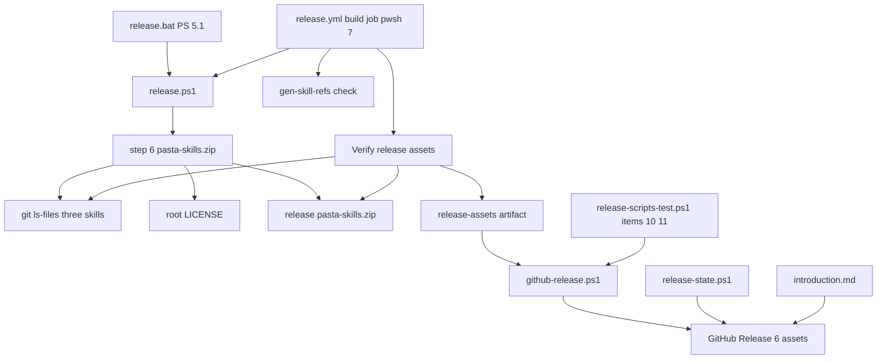
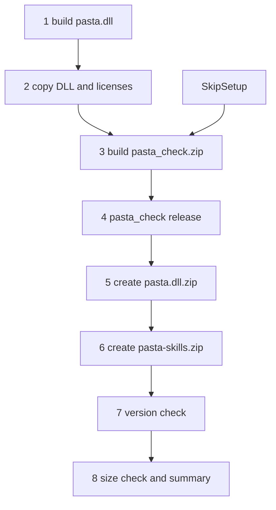
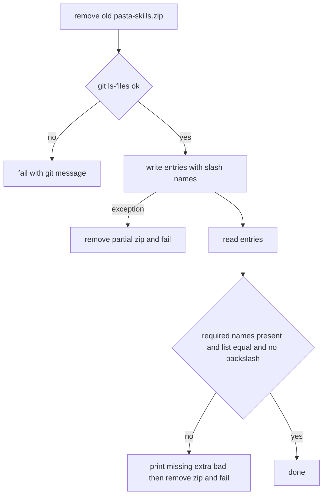
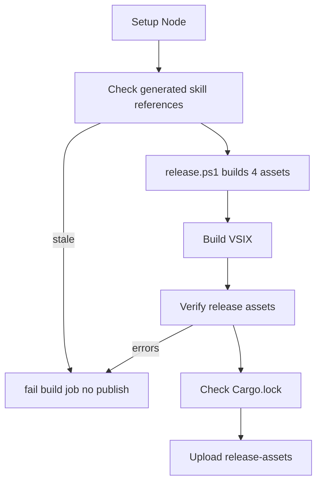

# 設計: pasta-skills-release-asset

## Overview

**目的**: AI にゴーストを書かせたいゴーストの作者が、GitHub Release から `pasta-skills.zip` を落としてゴーストの開発フォルダの `.claude/skills/` に展開するだけで、pasta のスキル 3 つ（`pasta-ghost-authoring`・`pasta-lua-coding`・`pasta-check`）を使えるようにする。

**利用者**: ゴーストの作者は、固定のリンク `https://github.com/ekicyou/pasta/releases/latest/download/pasta-skills.zip` か、版ごとのリリースページから落とす。pasta の開発者は、手元の `release.bat` とリリース CI で同じ `release.ps1` を使い、`pasta.dll.zip`・`hello-pasta.nar`・`pasta_check.zip`・`pasta-skills.zip` の 4 つを作って確かめる（VSIX はこれまでどおり別の手順が作る）。

**変わること**: 今のリリースビルド（`release.ps1`）に段を 1 つ足し、リリース CI の build の job・GitHub Release の添付・`release` スキルの状態の読み取り・マニュアルと配布物の一覧の文書を、配布物 5 つ（添付 6 つ）に合わせる。先例 `pasta-check-release-asset` と同じ流れで、新しい仕組みは作らず、今の部品を伸ばす。

### Goals

- `pasta-skills.zip`（3 つのフォルダと `LICENSE` だけ・`/` 区切り）を、手元（Windows PowerShell 5.1）とリリース CI（pwsh 7）の同じ手順で作り、中身を検査する。
- リリース CI が、zip の中身と生成ファイルの鮮度を確かめてから、6 つの添付で GitHub Release を公開する。
- マニュアルの `introduction.md` に、落とし方・置き場所・版のそろえ方を書く。

### Non-Goals

- 配るスキルの中身の書き直し（`pasta-check/SKILL.md` の段の並びと配布物の一覧の書き換えを除く）。
- claude.ai 向けのスキルごとの zip・開発用のスキルの配布・VSIX への同梱・署名。
- `gen-skill-refs.mjs` の生成の仕組みの変更。
- 毎回の CI（`build.yml`）と関門（gate）の変更。
- 過去の版（0.4.1 まで）の Release への追加。

## Boundary Commitments

### This Spec Owns

- `release.ps1` の新しい段 6（`pasta-skills.zip` の作成と中身の検査）と、段の並びと番号（`/8`）、冒頭の説明・頭とまとめの表示、`release.bat` の説明。
- `release.yml` の build の job のうち、生成ファイルの照合の step（新しく足す）、リリースビルドの段の名前、「Verify release assets」の `pasta-skills.zip` の検査、「Upload release-assets」の path、冒頭の説明の 1 行（「5 つの配布物」）。
- `github-release.ps1` の添付の一覧（6 つ）と、その文言。`release-scripts-test.ps1` の項目 10 の手直しと項目 11。
- `release` スキルの状態の読み取り（`release-state.ps1`）と、手順書の読み方（`procedure.md`・`SKILL.md`）。
- マニュアル `book/src/introduction.md` の関連リンクの行と、新しい節「AI にゴーストを書かせるとき」。
- 配布物の一覧と段の並びを書いた文書（File Structure Plan に挙げたもの）。

### Out of Boundary

- 3 つのスキルの中身（`pasta-check/SKILL.md` の段の並びと配布物の一覧を除く）。`ponytail-check-release` が `pasta-check/SKILL.md` の別の所を直す。
- `gen-skill-refs.mjs` とその対応表、`manual.yml` の照合（そのまま使う）。
- 段 1〜5 の中身（`pasta.dll.zip`・`hello-pasta.nar`・`pasta_check.zip` の作り方と検査）。
- `release.yml` の verify・gate の job、公開系の job（publish-crates・publish-vsce・github-release・report）の行、action の版の固定と Node の版（`ponytail-manual-ci` が持つ）。
- `build.yml` の構成（`release-scripts-test.ps1` を走らせる今の job が、そのまま項目 11 も走らせる）。
- `pasta_check release`（作者のゴーストの `.nar` を作る道）。

### Allowed Dependencies

- `.NET` の `System.IO.Compression`（`ZipArchive`・`ZipFile.Open`・`ZipFileExtensions.CreateEntryFromFile`・`ZipFile.OpenRead`）。Windows PowerShell 5.1（.NET Framework 4.x）と pwsh 7 の両方で使える物に限る。`Compress-Archive` と `ZipFile.CreateFromDirectory` は使わない（5.1 で `\` を書く）。
- `git ls-files`・`git ls-tree`（詰める元の一覧と、CI の検査の期待の一覧。手元は開発者のクローン、CI はタグの checkout。どちらにも git がある）。
- ルートの `LICENSE`（そのまま詰める）と、`.claude/skills/<3 つ>/` の追跡しているファイル。
- `node book/tools/gen-skill-refs.mjs --check`（npm の依存なし。build の job の「Setup Node」の Node をそのまま使う）。
- `github-release.ps1` の今の流れ（添付の有無の検査 → 下書き → 添付 → 公開・冪等な再実行）。

### Revalidation Triggers

- 配るスキルを足す・減らす・改名する（`release.ps1` 段 6・`release.yml` の検査・マニュアルの節の 3 か所を合わせる）。
- 配るスキルのフォルダに、ASCII でない名前のファイルや、さらに深いサブフォルダを足す（`git ls-files` の出力の形と、エントリの名前の組み方の前提が変わる）。
- 配布物の名前・数を変える（`release.ps1`・`release.yml`・`github-release.ps1`・`release-state.ps1`・文書の 5 か所を合わせる）。
- `gen-skill-refs.mjs --check` の終了コードの意味や、対応表に載るスキルが変わる。
- `ponytail-manual-ci` が関門に生成ファイルの照合を足すとき（本仕様の build の job の照合との重複を整理する）。`ponytail-manual-ci`・`pasta-dll-multiarch` が `release.yml`・`github-release.ps1`・`release.ps1` を合わせるとき、本仕様が足した行と段 6 を保つ。

## Architecture

### Existing Architecture Analysis

- 配布物は `crates/pasta_sample_ghost/release.ps1`（7 段・331 行）が作る。手元では `release.bat`（`powershell.exe` 5.1）が、リリース CI では build の job（`pwsh`）が、同じスクリプトを呼ぶ。段 1〜2 が準備（`-SkipSetup` で飛ぶ）、段 3〜7 がリリース（毎回走る）。
- 段 3（`pasta_check.zip`）の「古い zip を消す → 作る → `ZipFile.OpenRead` で中身を検査する」形と、CI の「Verify release assets」の `Get-ZipEntries` と `$errors` に積む形が、新しい zip の手本になる。
- 添付の名前と数は `github-release.ps1` の `$names` が持ち、後続の job は `release-assets` を丸ごと渡すだけである。
- 生成ファイルの照合（`gen-skill-refs --check`）は今は `manual.yml` だけにあり、リリースの道には無い。

### Architecture Pattern & Boundary Map

**Architecture Integration**:
- 選んだ形: 今の部品を伸ばす（ギャップ分析の Option A）。検査のコードは `release.ps1` と `release.yml` の 2 か所に並ぶ（今の 2 つの zip と同じ形）。
- 分担: 作る（`release.ps1`）・照合し検査して渡す（`release.yml` の build の job）・添付する（`github-release.ps1`）・状態を読む（`release-state.ps1`）の 4 つは今と同じ分担で、それぞれに `pasta-skills.zip` を 1 つ足す。
- 守る形: 手元と CI が同じ `release.ps1`（2.10）。添付は gh を呼ぶ前に有無を検査する。中身の検査は「期待の一覧とちょうど同じ」。
- 新しい物: ファイルは増やさない。新しい step は build の job の照合の 1 つだけ。
- 依存の向き: 文書・状態の読み取り → GitHub Release ← `github-release.ps1` ← `release-assets` ← build の job ← `release.ps1` ← ソース（`.claude/skills/`・`LICENSE`）。上流（ソース・`release.ps1`）は下流（添付の数・文書）を知らない。

### Technology Stack

| 層 | 選択 / 版 | 役目 | 備考 |
|---|---|---|---|
| スクリプト | Windows PowerShell 5.1 / pwsh 7 | `release.ps1` の段 6 | 5.1 で動く書き方に限る（`??`・三項演算子・`&&` を使わない） |
| zip | .NET `System.IO.Compression`（5.1 は .NET Framework 4.x、7 は .NET） | エントリの名前を `/` で組んで書く・読んで検査する | 5.1 と 7 で同じ 33 エントリ・`\` 無しを実験で確かめた（`research.md` 8 節） |
| 一覧 | git（`ls-files`・`ls-tree`） | 詰める元の一覧（`ls-files`）と、CI の検査の期待の一覧（`ls-tree -r --name-only HEAD`） | 出力は既にリポジトリ相対・`/` 区切り |
| 照合 | Node 20（build の job の「Setup Node」）・`gen-skill-refs.mjs --check` | 生成ファイルの鮮度 | npm の依存なし・0.1 秒。改行を LF に正規化して比べるので Windows の checkout でも通る |
| CI | GitHub Actions（windows-latest） | build の job | step を 1 つ足し、検査と upload を伸ばす |

## File Structure Plan

### New Files

なし。

### Modified Files

作る（リリースビルド）:
- `crates/pasta_sample_ghost/release.ps1` — 段 5 の後に段 6「Creating pasta-skills.zip」を足す。段の番号を `/8` に（版の確認が 7、大きさとまとめが 8）。冒頭の説明（2 行目・パラメーターの段の範囲）・`Release Phase (Steps 3-8)`・頭の表示とまとめに `Skills Zip:` の行を足す。
- `release.bat` — 冒頭の説明（3 行目の作る物・8〜10 行目の段の並び・13 行目の `-SkipSetup` の段の範囲）を合わせる。

リリース CI:
- `.github/workflows/release.yml` — 冒頭 3 行目「build（5 つの配布物）」、build の job に「Check generated skill references」の step（「Setup Node」の直後）、段の名前に `pasta-skills.zip`、「Verify release assets」に `pasta-skills.zip` の項目、「Upload release-assets」の path に 1 行。
- `.github/scripts/release/github-release.ps1` — `$names` に `pasta-skills.zip`、L18 の説明・L71 の注釈・L88〜89 の skip の文言・L103 の注釈を 6 つ（配布物 5 つ）に。
- `.github/scripts/release/release-scripts-test.ps1` — 項目 10 を 6 つの前提に直し、項目 11 を足す。

release スキル:
- `.claude/skills/release/scripts/release-state.ps1` — 配布物の配列に `pasta-skills.zip`、`/4` → `/5`、公開済みの判定を 5 に。
- `.claude/skills/release/procedure.md` — L471 の状態の表の読み方と L477 の文を `5/5`・`n/5` に。0.4.1 までの版は `3/5` と出ることを書く。
- `.claude/skills/release/SKILL.md` — L166 の「添付 4/4」を「添付 5/5」に。

文書（マニュアル）:
- `book/src/introduction.md` — 関連リンクの表の「リリースページ」の行に `pasta-skills.zip` の固定のリンク。表の後（「このマニュアルが対象とするバージョン」の前）に節「AI にゴーストを書かせるとき」。

文書（配布物の一覧・段の並び）:
- `README.md`（ルート、L41〜46）— 直リンクの並びに `pasta-skills.zip` を 1 行。
- `crates/pasta_sample_ghost/RELEASE.md`（L6・L42・L45・L107）— 配布物・build の役目・添付 6 つ・`release.ps1` の 8 段。
- `crates/pasta_sample_ghost/README.md`（L42・L66〜78）— `release.ps1` の説明と 8 ステップの一覧。
- `.claude/skills/pasta-check/SKILL.md`（L110〜125・L143〜146・L164）— hello-pasta の段の並び（段 6 を足し、版の確認 7・大きさ 8 に）、`release/` の中身、配布物の並び。
- `.kiro/steering/tech.md`（L212）— 成果物 5 つ・添付 6 つ。
- `.kiro/steering/structure.md`（L226・L280・L291）— `release.ps1` の 8 段、`release/` の中身。

## System Flows

### リリースビルドの段の並び（変更後）

- 段 6 はリリースの段（3〜8）の中にあり、`-SkipSetup`・`-SkipDllBuild` のときも必ず走り、作り直す（2.5）。段 6 だけを飛ばす指定は足さない。
- 段 5 の後に置くので、番号が変わるのは今の段 6・7（版の確認・大きさ）だけである。段 3〜5 の番号と中身は変わらない（2.9）。

### 段 6 の中（どこで止まるか）

### リリース CI の build の job（変更後の順）

- 照合は長いビルドの前に置き、合わなければ数十分のビルドを待たずに止まる。build の job が失敗すれば、後続の公開系の job は needs で走らない（3.5）。

## Requirements Traceability

| 要件 | 要約 | 部品 | 取り決め | 流れ |
|---|---|---|---|---|
| 1.1 | 最上位は 3 つのフォルダと LICENSE だけ | SkillsZipStep | 一覧は 3 つのフォルダの `git ls-files`＋`LICENSE` | 段 6 の中 |
| 1.2 | 元と同じ相対パス・中身・過不足なし | SkillsZipStep | `CreateEntryFromFile` でファイルをそのまま書く・一覧の突き合わせ | 段 6 の中 |
| 1.3 | 開発用のスキルとほかの物を入れない | SkillsZipStep | 3 つのパスだけを `git ls-files` に渡す・余計なエントリの検査 | 段 6 の中 |
| 1.4 | LICENSE はルートと同じ中身 | SkillsZipStep | ルートの `LICENSE` を `LICENSE` の名前で書く | 段 6 の中 |
| 1.5 | `/` 区切り・上にフォルダを挟まない | SkillsZipStep | 名前は `git ls-files` の出力から `.claude/skills/` を外した物・`\` の検査 | 段 6 の中 |
| 1.6 | 版のファイルなどを足さない | SkillsZipStep | 書くのは一覧の物だけ・余計なエントリの検査 | 段 6 の中 |
| 2.1 | `release/` に 4 つ・まとめに表示 | SkillsZipStep・ReleaseScriptFrame | 頭とまとめの `Skills Zip:` 行 | 段の並び |
| 2.2 | 中身の形を検査 | SkillsZipStep | 必須の名前・一覧の一致・`\` 無し | 段 6 の中 |
| 2.3 | 足りない・余計・形の合わないパスを示して失敗 | SkillsZipStep | `Missing:`・`Extra:`・`Bad path:` の行 | 段 6 の中 |
| 2.4 | 失敗で古い zip を残さない | SkillsZipStep | 段の頭で消す・失敗のたびに作りかけを消す | 段 6 の中 |
| 2.5 | `-Skip*` でも段 6 を行う | ReleaseScriptFrame | 段 6 をリリースの段に置く | 段の並び |
| 2.6 | 5.1 と 7 で同じ一覧と `/` | SkillsZipStep | `ZipArchive`＋自分で組んだ名前（実験で確かめ済み） | 段 6 の中 |
| 2.7 | 新しい道具を要さない | SkillsZipStep | .NET の zip と git（どちらも既にある） | — |
| 2.8 | 段の番号・説明を合わせる | ReleaseScriptFrame | `/8`・冒頭・`release.bat` | 段の並び |
| 2.9 | 今の配布物と検査を変えない | ReleaseScriptFrame | 段 3〜5 は触らない | 段の並び |
| 2.10 | 手元と CI で同じ手順 | ReleaseBuildJob | CI は `release.ps1` を呼ぶだけ | — |
| 3.1 | CI の build で作る | ReleaseBuildJob | 今の `release.ps1` の step（名前だけ変える） | build の job |
| 3.2 | 3 つの SKILL.md と LICENSE・最上位にほかが無い | ReleaseBuildJob | Verify の必須の名前と余計なエントリの検査 | build の job |
| 3.3 | 一覧がタグの 3 つのフォルダと一致・`/` 区切り | ReleaseBuildJob | Verify の `git ls-tree -r --name-only HEAD` との突き合わせ・`\` の検査 | build の job |
| 3.4 | 生成ファイルの照合 | ReleaseBuildJob | `gen-skill-refs.mjs --check` の step | build の job |
| 3.5 | 合わなければ失敗・公開しない | ReleaseBuildJob | `$errors` → `exit 1`・照合の終了コード 1・後続は needs で止まる | build の job |
| 3.6 | `release-assets` で渡す | ReleaseBuildJob | upload の path に 1 行 | build の job |
| 3.7 | `build.yml`・gate を変えない | ReleaseBuildJob | 触らない | — |
| 4.1 | 6 つを添付 | GitHubReleaseAssets | `$names` に `pasta-skills.zip` | — |
| 4.2 | 版を含まない名前・固定のリンク | GitHubReleaseAssets・SkillsZipStep | 名前は `pasta-skills.zip` 固定 | — |
| 4.3 | 1 つでも無ければ作らず失敗・名前を示す | GitHubReleaseAssets | gh の前の有無の検査（今のまま 6 つに広がる） | — |
| 4.4 | そろってから公開 | GitHubReleaseAssets | 下書き → 添付 → 公開（今のまま） | — |
| 4.5 | 再実行の規則を保つ | GitHubReleaseAssets | 判定は `$names` から出るので 6 つに広がる | — |
| 4.6 | 欠けのテスト | ReleaseScriptsTest | 項目 10 の手直しと項目 11 | — |
| 5.1 | `n/5` で数える | ReleaseStateReader | 配列に 1 つ足す | — |
| 5.2 | 5/5 の公開だけを公開済み | ReleaseStateReader | `$n -eq 5` | — |
| 5.3 | 手順書の読み方・0.4.1 までは 3/5 | ReleaseSkillDocs | `procedure.md` L471・L477 | — |
| 5.4 | 手で添付する案内・見どころの言い方 | ReleaseSkillDocs | `SKILL.md` L166。`procedure.md` L396（F5）は数を含まないので確かめだけ | — |
| 5.5 | 公開先 7 つは変えない | ReleaseSkillDocs | 「7/7」の記述に触らない | — |
| 6.1 | 関連リンクに固定のリンク | ManualSkillsSection | 表の「リリースページ」の行 | — |
| 6.2 | 中身・落とし方・置き場所の短い節・章は足さない | ManualSkillsSection | `introduction.md` の新しい節 | — |
| 6.3 | 同じ版を使う・3 つのフォルダを置き換える | ManualSkillsSection | 節の最後の段落 | — |
| 6.4 | 代わりの使い方を載せない | ManualSkillsSection | claude.ai・作り直しの手順を書かない | — |
| 6.5 | マニュアルの検査を通る | ManualSkillsSection | 章を足さない・生成の元でない章・`link-check.mjs` ほか | — |
| 7.1 | 配布物の一覧の文書を合わせる | AssetListDocs | File Structure Plan の文書 | — |
| 7.2 | `pasta-check/SKILL.md` の段と配布物 | AssetListDocs | L110〜125・L143〜146・L164 | — |
| 7.3 | ワークフローの冒頭の説明 | ReleaseBuildJob | `release.yml` 3 行目 | — |

## Components and Interfaces

| 部品 | 層 | 役目 | 要件 | 主な依存 | 取り決め |
|---|---|---|---|---|---|
| SkillsZipStep | リリースビルド | `release.ps1` の段 6。一覧・zip・検査 | 1.1〜1.6, 2.1〜2.4, 2.6, 2.7 | git (P0)・.NET zip (P0) | Batch |
| ReleaseScriptFrame | リリースビルド | 段の番号・説明・頭とまとめの表示・`release.bat` | 2.1, 2.5, 2.8, 2.9 | — | — |
| ReleaseBuildJob | リリース CI | build の job の照合・段の名前・検査・upload・冒頭の説明 | 2.10, 3.1〜3.7, 7.3 | `release.ps1` (P0)・Node (P0)・git (P0) | Batch |
| GitHubReleaseAssets | リリース CI | `github-release.ps1` の添付 6 つ | 4.1〜4.5 | gh (P0) | Batch |
| ReleaseScriptsTest | リリース CI のテスト | 項目 10・11（添付の欠け） | 4.6 | GitHubReleaseAssets (P0) | — |
| ReleaseStateReader | release スキル | `release-state.ps1` の `n/5` | 5.1, 5.2 | gh (P1) | State |
| ReleaseSkillDocs | release スキル | `procedure.md`・`SKILL.md` の読み方 | 5.3〜5.5 | — | — |
| ManualSkillsSection | 文書 | `introduction.md` の行と節 | 6.1〜6.5 | — | — |
| AssetListDocs | 文書 | 配布物の一覧・段の並び | 7.1, 7.2 | — | — |

### リリースビルド

#### SkillsZipStep（`release.ps1` 段 6「Creating pasta-skills.zip」）

| 項目 | 内容 |
|---|---|
| 役目 | 3 つのスキルの追跡しているファイルとルートの `LICENSE` を、`/` 区切りの名前で `release\pasta-skills.zip` に書き、中身を検査する |
| 要件 | 1.1, 1.2, 1.3, 1.4, 1.5, 1.6, 2.1, 2.2, 2.3, 2.4, 2.6, 2.7 |

**責務と制約**
- リリースの段（3〜8）にあり、`-SkipSetup`・`-SkipDllBuild` に関わらず毎回走る。
- Windows PowerShell 5.1 で動く書き方に限る。`Compress-Archive`・`ZipFile.CreateFromDirectory` は使わない（5.1 はフォルダの中のファイルを `a\SKILL.md` と書く）。拡張メソッドは 5.1 ではインスタンスの形で呼べないので、`[System.IO.Compression.ZipFileExtensions]::CreateEntryFromFile($zip, $src, $name)` と静的に呼ぶ。
- 版を示すファイルなど、一覧に無い物を書かない（1.6）。

**依存**
- External: git — `git -C <ws> ls-files -- .claude/skills/pasta-ghost-authoring .claude/skills/pasta-lua-coding .claude/skills/pasta-check`（P0）
- External: .NET `System.IO.Compression`・`System.IO.Compression.FileSystem`（`Add-Type -AssemblyName` で読み込む。P0）
- Inbound: ReleaseScriptFrame — 段の番号と `$SkillsZipPath`（P0）

**Contracts**: Batch [x]

##### Batch / Job Contract
- **起動**: `release.ps1` の段 6（段 5 の成功の後）。冒頭のパスの設定に `$SkillsZipPath = <ws>\release\pasta-skills.zip` を足す。配るスキルの名前は段の中に 1 つの配列 `@('pasta-ghost-authoring', 'pasta-lua-coding', 'pasta-check')` で持つ。
- **入力**: ワークスペースの git のインデックスに載っている `.claude/skills/<3 つ>/` のファイル（作業ツリーの中身）と、ルートの `LICENSE`。
- **手順と失敗の扱い**（どれも失敗なら赤字の `ERROR:` を出し、作りかけの zip を消して `exit 1`）
  1. 前の実行の `$SkillsZipPath` が在れば消す（2.4）。
  2. `git ls-files` で一覧を取る。終了コードが 0 でなければ `ERROR: git ls-files failed`（2.7 の範囲で、git はクローンに既にある）。
  3. `[System.IO.Compression.ZipFile]::Open($SkillsZipPath, 'Create')` で開き、一覧の各ファイルを、名前を `git ls-files` の出力（`.claude/skills/pasta-check/references/nar-spec.md`）から先頭の `.claude/skills/` を外した物（`pasta-check/references/nar-spec.md`）として書く。最後に `LICENSE` を `LICENSE` の名前で書く（1.1・1.4・1.5）。書く途中の例外は捕まえて、zip を閉じて消してから失敗する（2.4）。
  4. `ZipFile.OpenRead` で中身の名前を読み、次の 3 つを大文字と小文字を区別して検査する（2.2）。
     - 必須の名前: `pasta-ghost-authoring/SKILL.md`・`pasta-lua-coding/SKILL.md`・`pasta-check/SKILL.md`・`LICENSE` がある。
     - 一覧の一致: 期待の一覧（手順 2 の一覧から `.claude/skills/` を外した物＋`LICENSE`）と、過不足なく同じ（1.2・1.3・1.6）。
     - パスの形: `\` を含むエントリが無い（1.5・2.6）。
  5. 合わなければ `ERROR: pasta-skills.zip content mismatch` と、`Missing: …`（期待にあって zip に無い）・`Extra: …`（zip にあって期待に無い）・`Bad path: …`（`\` を含む）のうち空でない行を出し、zip を消して失敗する（2.3・2.4）。
- **出力**: `release\pasta-skills.zip`。成功の行 `Created pasta-skills.zip (<N> files: pasta-ghost-authoring, pasta-lua-coding, pasta-check, LICENSE)`。
- **冪等性**: 毎回作り直す（段の頭で消す）。作業ツリーと git には何も書かない。

**Implementation Notes**
- 詰める元を `git ls-files` にするのは、(1) 出力が既にリポジトリ相対で `/` 区切りなので、5.1 で相対パスを組む処理が要らない（5.1 の .NET Framework に `Path.GetRelativePath` は無い）、(2) 「リリースするコミットのファイル」（1.2）に合い、手元の未追跡のファイルを詰めない、の 2 つのため。CI の検査の期待の一覧は、別の取り方（`git ls-tree -r --name-only HEAD`）にする（ReleaseBuildJob）。
- 中身の一致（1.2）は、ファイルをそのまま書くことで保つ。検査はファイルの一覧と名前の形を見て、中身のハッシュは比べない（Testing Strategy の展開と `diff` で確かめる）。
- 改行は checkout に従う（Windows の `core.autocrlf=true` では CRLF）。手元と CI はどちらも Windows の checkout なので同じになる見込みで、2.6 が求めるのは一覧とパスの形だけである。
- 手元の zip は確かめ用である。中身は作業ツリーのファイルなので、コミットしていない変更も入る。また、段 3〜5 で失敗すると段 6 まで進まず、前の実行の `pasta-skills.zip` が `release\` に残る（ほかの配布物と同じ扱い）。公開するのは、リリース CI がタグのまっさらな checkout から作った物だけなので、どちらも受け入れる。警告の処理は足さない。
- リスク: ASCII でない名前のファイルを足すと、`git ls-files` は名前を引用符と 8 進数で出し、そのパスのファイルが見つからずに手順 3 で失敗する（壊れた zip は出さない）。今の 32 ファイルはすべて ASCII。Revalidation Triggers に挙げた。

#### ReleaseScriptFrame（段の並びと表示）

- 段の見出しを `[1/8]`〜`[8/8]` に。準備は段 1〜2（`# Setup Phase (Steps 1-2)`）、リリースは段 3〜8（`# Release Phase (Steps 3-8)`）。今の段 6・7 は段 7・8 になり、中身は変えない（2.9）。
- 冒頭のコメント（2 行目の作る物に `pasta-skills.zip`、`-SkipSetup` の説明の「run release steps (3-8) only」）を合わせる（2.8）。
- 頭の表示（`Check Zip:` の次）とまとめ（`Release Packages Ready!` の下の `Check Zip:` の次）に `Skills Zip: <パス>` の行を足す（2.1）。
- `release.bat` の 3 行目（作る物）、8〜10 行目（段の並び。`3-8. Build pasta_check.zip (x64), pasta_check release, create pasta.dll.zip, create pasta-skills.zip, version check, size check and release instructions`）、13 行目（`steps 3-8 still run`）を合わせる（2.8）。

### リリース CI

#### ReleaseBuildJob（`release.yml` の build の job）

| 項目 | 内容 |
|---|---|
| 役目 | 生成ファイルを照合し、タグのソースから 5 つの配布物を作り、検査して `release-assets` で渡す |
| 要件 | 2.10, 3.1, 3.2, 3.3, 3.4, 3.5, 3.6, 3.7, 7.3 |

**Contracts**: Batch [x]

##### Batch / Job Contract
- **起動**: 今と同じ（`needs: [verify, gate]`）。
- **変更点**
  - 冒頭の説明 3 行目「build（4 つの配布物）」を「build（5 つの配布物）」に（7.3）。
  - 「Setup Node」の直後に step `Check generated skill references` を足す。`run: node book/tools/gen-skill-refs.mjs --check`。合わなければ `gen-skill-refs.mjs` が古い生成ファイルと直すコマンドを並べて終了コード 1 で止まり、job が失敗する（3.4・3.5）。注釈に「生成ファイルを `pasta-skills.zip` で配るので、タグの時点の鮮度をここで保証する（manual.yml は path filter 付きで、マージは CI を待たない）」と書く。
  - 段の名前を `Build pasta.dll.zip, hello-pasta.nar, pasta_check.zip and pasta-skills.zip` に。実行の行（`pwsh -NoProfile -File crates/pasta_sample_ghost/release.ps1`）は変えない（2.10・3.1）。
  - Verify release assets に `pasta-skills.zip` の項目を足す（`pasta_check.zip` の項目の直後）:
    - `$skills = @(Get-ZipEntries 'release/pasta-skills.zip')`。無ければ `Get-ZipEntries` が「配布物が無い: …」で止まる（3.5）。
    - 必須の名前（3 つの `SKILL.md` と `LICENSE`）のうち無い物を、「`pasta-skills.zip` に `<名前>` が無い」として `$errors` に積む（3.2）。
    - 期待の一覧を `git ls-tree -r --name-only HEAD -- .claude/skills/pasta-ghost-authoring .claude/skills/pasta-lua-coding .claude/skills/pasta-check` から `.claude/skills/` を外した物＋`LICENSE` で作り、zip に無い物（「`pasta-skills.zip` に足りない: …」）と、期待に無い物（「`pasta-skills.zip` に余計な物: …」。開発用のスキルや版のファイルはここに出る）を `$errors` に積む（3.2・3.3）。比べるのは `-cnotcontains`（大文字と小文字を区別する）。
    - `\` を含むエントリを「`pasta-skills.zip` のパスが `/` 区切りでない: …」として `$errors` に積む（3.3）。
  - Upload release-assets の `path` に `release/pasta-skills.zip`（3.6）。
- **変えない物**: Check Cargo.lock is unchanged、verify・gate の job、`build.yml`（3.7）、公開系の job のすべての行。
- **失敗の伝わり方**: build の job が失敗すれば、publish-crates・publish-vsce・github-release は needs で走らない（今と同じ。3.5）。

**Implementation Notes**
- Verify の期待の一覧は、`release.ps1`（`git ls-files`・インデックス）とは別に、タグのコミットの木（`git ls-tree -r --name-only HEAD`）から取る。要件 3.3 の「タグのコミットの一覧」に文字どおり合い、作る側の式の繰り返しにならない。出力はどちらもリポジトリ相対の `/` 区切りなので、`.claude/skills/` を外す処理は同じでよい。別の目としての意味は、これに加えて、zip を実際に読み直すことと、決め打ちの必須の名前（`SKILL.md` が消えたコミットを見逃さない）にある。
- `pasta-check` のスキルは生成ファイルを持たない（`GENERATION_MAP` は `pasta-ghost-authoring`・`pasta-lua-coding` だけ）。照合は対応表に載るものすべてを見るので、本仕様で対象を絞る必要はない。

#### GitHubReleaseAssets（`github-release.ps1`）

| 項目 | 内容 |
|---|---|
| 役目 | 6 つの添付で Release を作り・補い・公開する |
| 要件 | 4.1, 4.2, 4.3, 4.4, 4.5 |

**Contracts**: Batch [x]
- **変更点**: `$names` を `'pasta.dll.zip', 'hello-pasta.nar', "pasta-vscode-<版>.vsix", 'pasta_check.zip', 'pasta-skills.zip', "release-notes-<タグ>.md"` の 6 つに。L18 の `-AssetDir` の説明、L71 の注釈「6 つの添付（配布物 5 つと詳しいリリースノート）」、L88 の注釈と L89 の skip の文言「公開済みで 6 つ（配布物 5 つと詳しいリリースノート）が添付済みのため飛ばした」、L103 の注釈「6 つがそろってから公開する」を合わせる。
- **変えない流れ**: gh の前の有無の検査（無い名前を示して `failed publish`、4.3）、下書き → 足りない添付 → 公開（4.4）、再実行の判定（公開済みで 6 つ添付済みなら skipped・下書きなら未完了の添付を消して足りない物だけ・公開済みの添付は消さない、4.5）。どれも `$names` から決まるので、`$names` の 1 か所で 6 つに広がる。
- **名前**: `pasta-skills.zip` は版を含まない固定の名前で、`releases/latest/download/pasta-skills.zip` がそのまま効く（4.2）。

#### ReleaseScriptsTest（`release-scripts-test.ps1` 項目 10・11）

- **項目 10（手直し）**: 題名を「`github-release.ps1` が、添付 6 つのうち `pasta_check.zip` だけが無いとき、終了コード 1 で、出力にその名前を示す」に。置くファイルに `pasta-skills.zip` を足し（5 つ）、検査に「出力に `pasta-skills.zip` が出ない」を足す（無いのが `pasta_check.zip` だけであることを確かめる）。
- **項目 11（新規）**: 「`github-release.ps1` が、添付 6 つのうち `pasta-skills.zip` だけが無いとき、終了コード 1 で、出力にその名前を示す」。別の一時のフォルダ（`$tmp` の下の `assets-skills`）に、`pasta.dll.zip`・`hello-pasta.nar`・`pasta-vscode-0.0.2.vsix`・`pasta_check.zip`・`release-notes-v0.0.2.md` の 5 つ（中身は空でよい）を置き、`Invoke-Script github-release.ps1 @('-Tag','v0.0.2','-NotesFile',$notesPath,'-AssetDir',<dir>)` を呼ぶ。`Exit -ne 1`、出力に `pasta-skills.zip` が無い、出力に `pasta_check.zip` が出る、のどれかで NG。
- **前提**: 添付の有無は gh の呼び出しより前に検査されるので、ネットワークと gh を使わない。`GITHUB_OUTPUT`・`GITHUB_STEP_SUMMARY` はテストの冒頭で外してある。毎回の CI（`build.yml` の release-scripts の job）でもそのまま走る（4.6）。

### release スキル

#### ReleaseStateReader（`release-state.ps1`）

**Contracts**: State [x]
- **状態**: GitHub Release の行の状態は `あり（公開・添付 5/5） <URL>`・`下書き（添付 n/5）`・`添付不足（公開・添付 n/5） <URL>`・`無し`・`不明`。
- **変更点**: L84 の配列に `'pasta-skills.zip'` を足し、L85〜87 の `/4` を `/5` に、`$n -eq 4` を `$n -eq 5` に（5.1・5.2）。リリースノートの添付は数えない（今と同じ）。
- **注意**: 0.4.1 までの版に向けると `添付不足（公開・添付 3/5）` と出る。過去の版へは足さない（範囲外）。

#### ReleaseSkillDocs（`procedure.md`・`SKILL.md`）

- `procedure.md` L471 の表を `5/5`・`n/5` に。L477 の文の配布物の並びに `pasta-skills.zip` を足して 5 つに、「`pasta_check.zip`・`pasta-skills.zip` を添付していない 0.4.1 までの版は `添付不足（公開・添付 3/5）` と出る」に（5.3）。L396 の F5 の案内は「足りない配布物」と書くだけで数を含まないので変えない（5.4 は確かめだけ）。
- `SKILL.md` L166 の「添付 4/4」を「添付 5/5」に（5.4）。公開先の「7/7」は変えない（5.5）。
- `.claude/skills/**` の編集は分類器が Self-Modification として拒否することがある。拒否されたら、回避策を探さずに、入った分と残りを示して開発者の許可を求める。

### 文書

#### ManualSkillsSection（`book/src/introduction.md`）

- **関連リンクの行（6.1）**: 「リリースページ」の行の配布物の並びの、検査の CLI の後に「AI 向けのスキル [`pasta-skills.zip`](https://github.com/ekicyou/pasta/releases/latest/download/pasta-skills.zip)」を足す。
- **新しい節（6.2・6.3）**: 関連リンクの表の後、「このマニュアルが対象とするバージョン」の前に、`## AI にゴーストを書かせるとき` を置く。今の本文と同じ「である」調で、次の 3 つの要素だけを書く。
  1. 中身: Claude Code などの AI のエージェントにゴーストを書かせるときに読ませる、pasta のスキル 3 つ（`pasta-ghost-authoring`＝Pasta DSL の文法と辞書の書き方、`pasta-lua-coding`＝Lua API と書き方の決まり、`pasta-check`＝辞書の検査とリリースビルド）。
  2. 落とし方と置き場所: 固定のリンクか、リリースページの各版の添付から落とし、ゴーストの開発フォルダの `.claude/skills/` に展開する。展開すると `.claude/skills/pasta-ghost-authoring/SKILL.md` などができる（要件の使い方の例と同じ木を示す）。
  3. 版: 使っている pasta と同じ版の `pasta-skills.zip` を使う。版を上げるときは、3 つのフォルダを消してから新しい版を展開する（上書きで展開すると、新しい版で消えたファイルが残るため）。
- **書かない物（6.4）**: claude.ai へのアップロードの手順、スキルごとに zip を作り直す手順、ほかの AI の道具ごとの置き場所。
- **検査（6.5）**: 章を足さないので `SUMMARY.md` と章の数の検査 3 か所（`gen-skill-refs-test.mjs` K-10・`verify-scripts-test.mjs` の T-syntax/T-intro/T-outro）は触らない。`introduction.md` は `GENERATION_MAP` に無いので、生成ファイルの作り直しは要らない。節は本文（`---` と台詞より前）に置き、台詞の行を含めない。固定のリンクは 0.4.2 の公開まで 404 だが、`link-check.mjs` は自分のリポジトリの `blob/main`・`tree/main` 以外の絶対 URL を照合しないので落ちない（先例と同じ）。

#### AssetListDocs（配布物の一覧・段の並び）

- File Structure Plan の「文書（配布物の一覧・段の並び）」の各所に `pasta-skills.zip` を足し、配布物 5 つ・添付 6 つ・`release.ps1` の段 8 つの並びに合わせる（7.1）。
- ルートの `README.md` には「`pasta-skills.zip` — AI にゴーストを書かせるときの pasta のスキル 3 つ（`.claude/skills/` に展開する）」の 1 行を、`pasta_check.zip` の行の後に足す。
- `.claude/skills/pasta-check/SKILL.md`（7.2）:
  - 段の並びの図に「6. pasta-skills.zip の作成と検査（pasta リポジトリ固有）」を足し、版の確認を 7、大きさを 8 に。箇条の「段 3・段 5〜7」を「段 3・段 5〜8」に。
  - `release/` の木に `pasta-skills.zip  # pasta のスキル 3 つと LICENSE（pasta リポジトリ固有・release.ps1 の段 6）` を足す。
  - L164 の配布物の並びに `pasta-skills.zip` を足す。
  - 同じファイルの入れ方（L12〜18）など、ほかの所は変えない（中身の書き直しは範囲外）。
- `crates/pasta_sample_ghost/README.md` の手順の一覧は「6. `release/pasta-skills.zip` を作成して中身を検査（pasta のスキル 3 つと `LICENSE`）」を足し、版の確認 7・大きさ 8 に。「手順 3 はどちらの指定でも毎回走ります」を「手順 3〜8 は」に合わせる。

## Error Handling

### Error Strategy

- リリースビルドは、どの失敗でも赤字の `ERROR:` と、何が合わないかを出して `exit 1`（今の段と同じ形）。失敗したときに `release\pasta-skills.zip` を残さない（作りかけ・検査に落ちた物も消す）。
- リリース CI の検査は、今と同じく `$errors` に積んで最後にまとめて `::error::` で出し、`exit 1`。照合の step は `gen-skill-refs.mjs` の出力と終了コードをそのまま使う。build の job の失敗で後続の公開系の job は走らない。
- `github-release.ps1` は、添付が欠ければ gh を呼ぶ前に `failed publish` で止まり、無い名前を示す。

### Error Categories and Responses

| 失敗 | 場所 | 出す物 |
|---|---|---|
| git が無い・`ls-files` の失敗 | 段 6 | `ERROR: git ls-files failed`（git の出力がその上に出る） |
| zip を書く途中の例外（ファイルが無い・書けない） | 段 6 | `ERROR: failed to write pasta-skills.zip: <例外の文>` |
| 中身の違い | 段 6 | `ERROR: pasta-skills.zip content mismatch` と `Missing:`・`Extra:`・`Bad path:` の行 |
| 生成ファイルが古い | CI の照合 | `gen-skill-refs.mjs` の不一致の一覧と直すコマンド |
| zip が無い・中身の違い | CI の Verify | `::error::` の行（足りない・余計な物・`/` でないパス・無い `SKILL.md`） |
| 添付の欠け | `github-release.ps1` | `添付がそろっていない（… に無い: pasta-skills.zip）` |

## Testing Strategy

### スクリプトのテスト（自動）

- `release-scripts-test.ps1` 項目 10: `pasta_check.zip` だけが無いとき、終了コード 1 で、出力に `pasta_check.zip` があり `pasta-skills.zip` が無い（4.3・4.6）。
- 同 項目 11: `pasta-skills.zip` だけが無いとき、終了コード 1 で、出力に `pasta-skills.zip` があり `pasta_check.zip` が無い（4.3・4.6）。項目 1〜9 も今までどおり ok であること。

### 手元のリリースビルド（pwsh で `release.ps1` を直に）

- 通しの実行で、`release\` に 4 つの zip / nar ができ、まとめに `Skills Zip:` が出る（2.1）。段の見出しが `[1/8]`〜`[8/8]`（2.8）。
- `pasta-skills.zip` を展開し、最上位が 3 つのフォルダと `LICENSE` だけで（1.1・1.3）、各フォルダを `.claude/skills/<名前>/` と `diff -r` して差が無く（1.2）、`LICENSE` がルートと同じバイト列である（1.4）。エントリに `\` が無い（1.5）。
- `pasta.dll.zip`・`hello-pasta.nar`・`pasta_check.zip` の中身の名前の一覧が、変更の前の実行と同じ（2.9）。
- `-SkipSetup` で走らせても段 6 が行われ、`pasta-skills.zip` が作り直される（更新時刻が変わる。2.5）。
- 失敗の道（2.3・2.4）: 段 6 の行をスクラッチの写しにし、(a) 前の実行の zip を置いたうえで、存在しないファイルを一覧に混ぜて書く途中で失敗させ、zip が残らないこと、(b) 検査の部分に `Compress-Archive` で作った zip（5.1 で `\` のエントリになる）を与え、`Missing:`・`Extra:`・`Bad path:` が出て zip が消えること、を確かめる。

### Windows PowerShell 5.1

- 段 6 の行を `powershell.exe -NoProfile -Command -`（標準入力から読ませる）で走らせ、pwsh 7 で作った zip とエントリの一覧が同じで、`\` が無いこと（2.6。設計の調査で同じ書き方を確かめ済み）。
- `[System.Management.Automation.Language.Parser]::ParseFile` を 5.1 で `release.ps1` に当て、構文のエラーが無いこと。7 だけの書き方を使っていないことを見直す。
- `release.bat` での通しの実行は、エージェントは `-ExecutionPolicy Bypass` を走らせられないので、開発者の確かめに回す。

### リリース CI

- `actionlint` を `release.yml` に当てる。
- 「Verify release assets」の `run` の中身をスクラッチの `.ps1` に写し、手元の `release\` と `$env:VERSION`・`$env:RUNNER_TEMP` を与えて走らせ、`pasta-skills.zip` の項目が成功すること、`kiro-x/SKILL.md` を足した zip・`references/` の 1 つを抜いた zip・`pasta-check/SKILL.md` を抜いた zip で、それぞれ余計な物・足りない物・無い `SKILL.md` の行が出ることを確かめる（VSIX の項目は手元に VSIX が無ければ NG になるので、その行は除いて読む）。
- `node book/tools/gen-skill-refs.mjs --check` がワークツリー（Windows の CRLF の checkout）で通る（3.4。設計の調査で確かめ済み）。
- 本番の確かめ（Release に 6 つが載り、固定のリンクで落ちる）は 0.4.2 のリリースで行う。

### 文書

- `book/tools/link-check.mjs` と、`manual.yml` が行う検査（台詞部品・章の数・`verify-content` など）が通る（6.5）。
- `node book/tools/gen-skill-refs.mjs --check` が通る（`pasta-check/SKILL.md` の書き換えは生成の対象外だが、念のため）。
- `release-state.ps1` を 0.4.1 に向け、`添付不足（公開・添付 3/5）` と出ること（5.1・5.2 の形の確かめ。gh の認証が要るので手元の補助の確かめ）。

## Security Considerations

- zip に入るのは、追跡している 3 つのフォルダの文書と MIT の `LICENSE` だけである。開発用のスキル（`release` スキルの手順や `kiro-*`）と未追跡のファイルは、一覧の取り方と余計なエントリの検査で入らない。
- 利用者が受け取るのは、タグのソースからリリース CI が作り、検査した zip だけである。手元の `release\` の物は公開しない（今と同じ）。

## Decisions / Risks

次の 7 件は、2026-10-23 の設計ディスカッションで確定した（開発者の一括承認。根拠は `research.md` 8 節）。

1. **段の位置**: 段 5（`pasta.dll.zip`）の後の段 6。番号が変わるのは版の確認と大きさの 2 段だけ。
2. **zip の書き方**: `ZipFile.Open(…, 'Create')`＋`ZipFileExtensions.CreateEntryFromFile` で、名前を `/` で自分で組む。5.1（5.1.26100）と 7（7.6.7）の両方で、33 エントリ・`\` 無し・同じ一覧になることを確かめた。
3. **一覧の取り方**: 作る側は `git ls-files`。CI の検査の期待の一覧は `git ls-tree -r --name-only HEAD`（タグのコミットの木から別に取る）。
4. **生成ファイルの照合の位置**: build の job の「Setup Node」の直後（長いビルドの前）。要件 3.4 もこの位置に合わせて言い直した。
5. **失敗の後片付け**: 古い zip だけでなく、作りかけと検査に落ちた zip も消す。
6. **zip の中の改行**: checkout のまま詰める（Windows では CRLF）。LF にそろえる処理は足さない。
7. **手元の zip**: コミットしていない変更が入ること、段 3〜5 の失敗で前の zip が残ることを受け入れる（SkillsZipStep の Implementation Notes）。

- リスク: 0.4.1 までの版の状態の読み取りは `3/5` の添付不足と出る（手順書に書く）。
- リスク: `.claude/skills/**` の編集が分類器に拒否されると、5.3・5.4・7.2 が止まる（開発者の許可で進める）。
- リスク: `pasta-check/SKILL.md` はリポジトリの中の話（`crates/…` のパス・hello-pasta の段）を文字として含んだまま配られる。中身の直しは範囲外で、`ponytail-check-release` に申し送る。
- 申し送り（kiro-complete のとき）: `ponytail-manual-ci`（build の job に照合を足したこと・関門に足すときの重複の整理・`release.yml` の行のずれ）、`ponytail-check-release`（`pasta-check/SKILL.md` の段の番号が変わったこと）、`pasta-dll-multiarch`（`release.ps1` の段が 8 つになり、配布物の検査が 1 つ増えたこと）。
