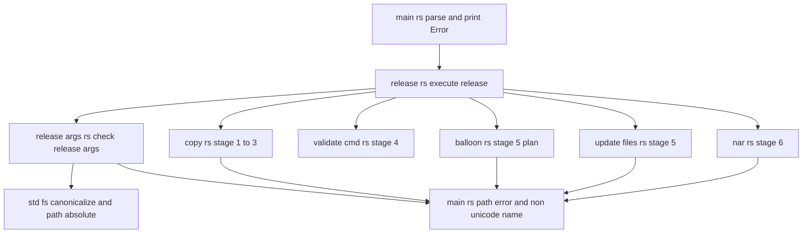
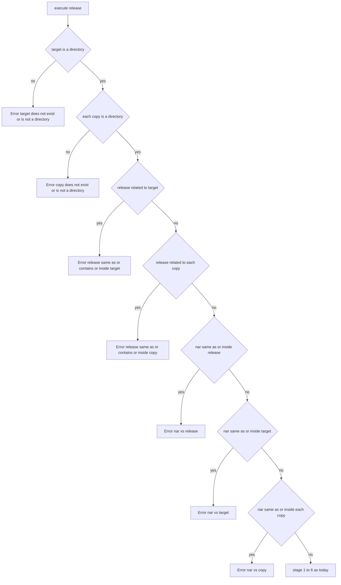
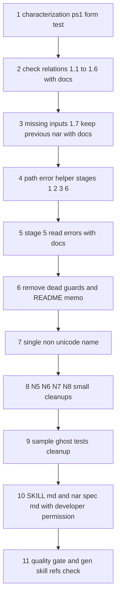

# 設計: ponytail-check-release

## Overview

**Purpose**: `pasta_check release` の 4 つの引数（`--target`・`--copy`・`--release`・`--nar`）の関係を段 1 の前に確かめ、作者の開発フォルダ・上書きフォルダ・作者のファイルを消す、自分を入れ子に写す、書きかけの nar を nar に入れる、の 3 種の壊れ方を、何にも触れずに英語の誤りで止める。あわせて、段 5 の読み取りの誤りの握りつぶしをやめ、段 1・2・3・5・6 の I/O の誤りにパスを添え、同じ領域の ponytail 監査の指摘（働かない守り・写し・要らない作り・決して落ちない試験）を片づける。

**Users**: `release.bat`・`release.ps1` から `pasta_check release` を呼ぶゴーストの作者と、`pasta_check`・見本のゴーストを保守する pasta の開発者。

**Impact**: 今は `execute_release` が段 1 でいきなり `--release` を消し、前回の nar を消す。本設計の後は、その前に読み取りだけの「引数の確かめ」が入り、危ない組み合わせと、無い入力のフォルダは、段の表示も削除もせずに終了コード 1 で止まる。正しい使い方（`release.ps1` の段 4 の形）の出力・成果物は変わらない。

### Goals

- 要件 1 の 7 つの関係を、パスの書き方（相対・絶対・`.`・`..`・末尾の区切り・大文字と小文字・8.3・junction）に左右されずに、段 1 の前に断る。
- 断る理由を、2 つのオプション名・渡したままのパス・関係（同じ・含む・中にある）を 1 行で示す英語で出す。
- 段 5 の読み取りの誤りを段 5 の失敗にし、I/O の誤りの文にパスを含める。
- 監査の指摘（brief の 1〜8、N1〜N11）を残さない。品質の関門（fmt・clippy 0・`cargo test -p pasta_check -p pasta_sample_ghost`）を通す。

### Non-Goals

- 確かめを省くオプション・消さずに写すオプションなど、新しいオプション（4.4）。
- 「前回の配布フォルダでない、中身の入ったフォルダ」を `--release` に渡したときの判定（README の「毎回クリーンされる」のまま）。
- `--nar` が在るフォルダで、配布フォルダや入力のフォルダを中に含む場合の専用の判定（要件 1 に無い。今どおり段 1 の `remove_file` の誤りで止まる。作者のフォルダは消えない）。
- `validate/` の規則、段 4 の出力の言語、`release.ps1`・`release.bat`・リリース CI の中身。
- Windows 以外での、まだ無いパスの残りの部品に含まれる `..` の扱い（下の「前提と限界」）。

## Boundary Commitments

### This Spec Owns

- `pasta_check release` の**引数の確かめ**（新しい `src/release_args.rs`）: 判定の順・関係の判定・パスの正規化・断る文言。
- `release` の段 1・2・3・5・6 の **I/O の誤りの文言**（パスを添える形）と、段 5 の読み取りの誤りを止める扱い。
- `pasta_check` の `release.rs`・`copy.rs`・`nar.rs`・`update_files.rs`・`main.rs`（と、段 5 の I/O の 2 か所だけ `balloon.rs`。下の前提 A-1）の、働かない守り・写し・要らない作りの整理。
- `pasta_sample_ghost` の試験の整理（`tests/` の下と `src/scripts.rs` の試験）。
- 説明の文書: `crates/pasta_check/README.md`、マニュアル `book/src/debug/validate.md` の「release との関係」、スキル `pasta-check` の `SKILL.md` と `references/nar-spec.md`（後の 2 つは開発者の許可が要る）。

### Out of Boundary

- `crates/pasta_check/src/validate/` の全部（ウェーブの約束。`syntax.rs`・`report.rs` は `ponytail-editor-tooling`、`scenes.rs` は `ponytail-core-registry`）。
- `validate_cmd.rs` の振る舞いと文言（段 4 の誤り「…を読めません」が日本語であることを含む）。
- `balloon.rs` の判定（同梱バルーンの選び方・重なり・UTF-8 の規則・その文言）。
- ルートと各クレートの `Cargo.toml`・`Cargo.lock`（ウェーブの約束。`Cargo.lock` の席は `mlua-stdlib-removal`）。dev-dependency も足さない。
- `release.ps1`・`release.bat`・`.github/workflows/*`。
- `--version`・`--help` の出力（4.3・4.4）。

### Allowed Dependencies

- Rust の標準ライブラリ: `std::fs::canonicalize`、`std::path::absolute`（1.79 で安定）、`Path::components`、試験だけで `std::os::windows::fs::OpenOptionsExt`（排他の開き方）。
- 既にある依存: `md5` 0.8.1（`default = ["std"]` で `impl io::Write for Context` がある）、`zip`（`ZipWriter` は `io::Write`）、dev の `tempfile`、見本のゴーストの dev の `ctor`。
- 依存の向き: `main.rs`（引数・共通の誤りの手助け）→ `release.rs`（段の流れ）→ `release_args.rs`・`copy.rs`・`validate_cmd.rs`・`balloon.rs`・`update_files.rs`・`nar.rs`。`release_args.rs`・`copy.rs`・`update_files.rs`・`nar.rs`・`balloon.rs` は `crate::` の誤りの手助け（`main.rs` に置く）だけを使い、互いを呼ばない（既に `crate::ReleaseArgs` を `main.rs` から使うのと同じ形）。

### Revalidation Triggers

- `ReleaseArgs` の欄やオプションの増減（確かめの対象と順が変わる）。
- 断る文言・I/O の誤りの文言の形の変更（README・`SKILL.md` のトラブルシューティングの表・試験の文言の照合が追う）。
- `release.ps1` の段 4 の引数の形の変更（4.1 の試験の形を合わせる）。
- `crates/pasta_sample_ghost/tests/common/mod.rs` の口の変更（`mlua-0-12-upgrade` が後で `self_deploy_integration_test.rs` を触るので、その spec が読む）。
- 段の数や順の変更（段 1 の前に確かめる約束・段 1 の前回の nar の削除の約束）。

## Architecture

### Existing Architecture Analysis

- `main.rs` の `parse_args_from`（lexopt。I/O なし）が `Command` を作り、`release::execute_release(&ReleaseArgs)` が 6 段を順に `?` でつなぐ。どの段も `io::Result<()>` で、`main.rs` が `Error: {e}` を出して終了コード 1 にする。
- 段の処理は渡されたままの `PathBuf` を使い、表示も `display()` のまま（2.4 はこの形を保てば満たせる）。
- 先例: `balloon.rs` の `check_overlaps` が「同じ・上位・配下」を断る英語の文言を持つ（ただし配布フォルダからの相対の文字列で比べ、ファイルシステムの正規化はしない）。
- 今の欠け: 段 1 の前の確かめが無い（brief 1〜3・N1）。`update_files.rs` が `read_dir` の失敗・項目の誤り・更新日時の誤りを握りつぶす（brief 5・N3・N4）。I/O の誤りが OS の文言だけ（N2）。

### Architecture Pattern & Boundary Map



**Architecture Integration**:
- 採る形: 段の流れの頭に、読み取りだけの関門を 1 つ足す（Fail Fast）。段の流れ・呼び出す側・`ReleaseArgs` の形は変えない。
- 新しいファイル `release_args.rs` を置く理由: `release.rs` は既に 720 行（本体 86 行・残りは試験）で、steering の目安 600 行を超えている。確かめの関数と、その関係ごとの試験（約 300 行）を `release.rs` に足すと 1,000 行を超える。抽象を増やすのではなく、置き場を分けるだけ（公開する関数は 1 つ）。
- 誤りの手助け 2 つ（`path_error`・`non_unicode_name`）は、新しいファイルを作らずにクレートの根の `main.rs` に置く（`ReleaseArgs` を置いているのと同じ場所。`non_unicode_name` の写しを 1 つにする 6.2 と、パスを添える 5.3 の両方の置き場）。
- steering の順守: 英語の誤りの文言（release の既存の文言と同じ流儀）、依存を足さない、試験は一時フォルダだけ。

### Technology Stack

| Layer | Choice / Version | Role in Feature | Notes |
|-------|------------------|-----------------|-------|
| CLI | Rust（workspace の edition 2024）・`lexopt` | 引数の読み取り（変えない） | N8 で `struct Args` を外すだけ |
| ファイルシステム | `std::fs::canonicalize`・`std::path::absolute` | 同じ場所としての比べ | Windows で前者は `\\?\C:\…`、後者は `C:\…` を返すので、比べるのは必ず前者の形にそろえた後 |
| 更新ファイル | `md5` 0.8.1 | `io::copy` で `Context` に流す（N6） | `impl std::io::Write for Context`（`std` 機能・既定で有効） |
| NAR | `zip`（既存の版） | `io::copy` でファイルから `ZipWriter` に流す（N6） | 中身のバイトは変わらない |
| 試験 | `tempfile`・`std::os::windows::fs::OpenOptionsExt` | 一時フォルダ・排他の開き方で読めない場所を作る | 依存を足さない |

## File Structure Plan

### Directory Structure

```
crates/pasta_check/src/
├── main.rs            # 変更: struct Args を外す（N8）。path_error・non_unicode_name を置く（5.3・6.2）
├── release_args.rs    # 新規: 引数の確かめ check_release_args とその試験（1.x・2.x・3.x・7.1〜7.3・7.6）
├── release.rs         # 変更: 段 1 の前に check_release_args を呼ぶ。段 1 の I/O にパス（前提 A-2）。試験の差し替え・追加（4.1・7.4）
├── copy.rs            # 変更: ensure_within と試験を外す（6.1）。I/O にパス（5.3）
├── nar.rs             # 変更: ensure_no_parent_component と試験・non_unicode_name の写しを外す（6.1・6.2）。N5・N6。I/O にパス（5.3）
├── update_files.rs    # 変更: 読み取りの誤りを ? で返す（5.1・5.2）。non_unicode_name の写しを外す（6.2）。N6（md5）・N7。I/O にパス（5.3）
└── balloon.rs         # 変更（2 関数の I/O の 4 か所だけ）: パスを添える（5.3・前提 A-1）。判定と文言は変えない
crates/pasta_check/tests/
└── cli_test.rs        # 変更: 相対パス・`.` 同士・誤りの 1 行・段の表示が無いこと（1.9・3.1・7.2・7.3）
crates/pasta_sample_ghost/
├── src/scripts.rs                      # 変更: test_face_pasta_contains_all_characters を外す（6.9）
└── tests/
    ├── common/mod.rs                   # 書き換え: #[ctor] neutralize_debug_env と master_copy() だけ（6.5・6.7）
    ├── integration_test.rs             # 変更: test_dll_copy_helper_message と mod common を外す（6.4）
    ├── shell_assets_test.rs            # 変更: #[allow(dead_code)] mod common を外し、workspace_root をファイルの中に持つ（N9）
    ├── self_deploy_integration_test.rs # 変更: neutralize_debug_env・copy_tree_skip_profile・fixture_master_dir を外し common を使う（6.5）
    ├── touch_shortcuts_test.rs         # 変更: neutralize_debug_env・copy_master を外し common を使う（6.5）
    ├── tutorial_stages_test.rs         # 変更: neutralize_debug_env・copy_master を外し common を使う（6.5）
    └── dist_src_validation_test.rs     # 削除（6.6）
```

### Modified Files（文書）

- `crates/pasta_check/README.md` — release の節に「引数の確かめ」（断る組み合わせの表・止まったときは何も消さないこと）を足す（8.1）。仕様メモの「ZIP エントリ名の `..`…」の行を消す（8.2）。「前回の NAR の削除」に、確かめで止まったときは消さないことを足す。I/O の誤りにパスを添えることを仕様メモに 1 行足す。「ソース構成」に `release_args.rs` を足す。
- `book/src/debug/validate.md` — 「release との関係」に、1 段目の前に引数を確かめ、危ない組み合わせでは何にも触れずに止まることを 1 項目足す（8.5）。
- `.claude/skills/pasta-check/SKILL.md` — 選択肢の表と段の説明に断る組み合わせ、トラブルシューティングの表に新しい誤りの行（8.3）。**分類器が止める。別のタスクにし、その場面で入った分と残りを示して開発者の許可を求める。**
- `.claude/skills/pasta-check/references/nar-spec.md` — 「実装箇所」の段 1 の削除の説明に、確かめで止まったとき（入力のフォルダが無いときも）前回の nar を残すことを足す（8.4）。許可の扱いは `SKILL.md` と同じ。

## System Flows

### 引数の確かめの順（3.4）



- どの `Error` も、段の表示（`[1/6]`）より前に返る。ファイル・フォルダを作らず、消さず、書き換えない（1.8・1.9・2.3）。
- `--copy` は渡した順に調べる。最初に当たった 1 つだけを返す（3.4）。
- 断る関係の組（要件 1 との対応）: `--release` と `--target`・`--copy` は同じ・含む・中にあるの 3 つとも断る（1.1〜1.4）。`--nar` と `--release`・`--target`・`--copy` は同じ・中にあるの 2 つを断る（1.5・1.6）。

## Requirements Traceability

| Requirement | Summary | Components | Interfaces | Flows |
|-------------|---------|------------|------------|-------|
| 1.1 | release が target と同じか含む | ReleaseArgsCheck | `check_release_args`・`relation` | 確かめの順 R1 |
| 1.2 | release が copy と同じか含む | ReleaseArgsCheck | 同上 | R2 |
| 1.3 | release が target の中 | ReleaseArgsCheck | 同上 | R1 |
| 1.4 | release が copy の中 | ReleaseArgsCheck | 同上 | R2 |
| 1.5 | nar が release と同じか中 | ReleaseArgsCheck | 同上 | N1 |
| 1.6 | nar が target・copy と同じか中 | ReleaseArgsCheck | 同上 | N2・N3 |
| 1.7 | target・copy が無い・フォルダでない | ReleaseArgsCheck | `require_dir` | T1・C1 |
| 1.8 | 断ったら何も変えない | ReleaseArgsCheck・ReleasePipeline | 読み取りだけの API（metadata・absolute・canonicalize） | 全体 |
| 1.9 | 断ったら段の表示を出さない | ReleasePipeline | `execute_release` の頭で呼ぶ | 全体 |
| 2.1 | 書き方に左右されない | ReleaseArgsCheck | `resolve`・`relation` | — |
| 2.2 | まだ無いパスも同じ判定 | ReleaseArgsCheck | `resolve`（在る一番近い親） | — |
| 2.3 | 確かめで作らない | ReleaseArgsCheck | 同上 | — |
| 2.4 | 表示は渡したまま | ReleaseArgsCheck・ReleasePipeline・IoErrorContext | 文言は `args.*.display()` | — |
| 3.1 | `Error: ` の 1 行・終了コード 1 | Main（変えない）・ReleaseArgsCheck | `io::Error` を返す | — |
| 3.2 | 2 つのオプション・パス・関係 | ReleaseArgsCheck | 断る文言の表 | — |
| 3.3 | オプション・パス・無い／フォルダでない | ReleaseArgsCheck | 同上 | — |
| 3.4 | 決まった順で最初の 1 つ | ReleaseArgsCheck | 確かめの順 | 確かめの順 |
| 4.1 | `release.ps1` の段 4 の形は通る | ReleaseArgsCheck・ReleasePipeline | 部品ごとの比べ（文字列の前方一致でない） | — |
| 4.2 | 当たらない組は今と同じ | ReleasePipeline | 段の処理は変えない（N6 も中身のバイトは同じ） | — |
| 4.3 | `--version` を変えない | Main | 変えない（N8 は `Command` の包みだけ） | — |
| 4.4 | `--help` のオプションを変えない | Main | `print_usage` を変えない | — |
| 4.5 | 確かめを通った後の段 1・段 6 の約束 | ReleasePipeline | `prepare_release_dir`・`remove_stale_nar`・段 6 の後始末を変えない | — |
| 5.1 | 段 5 のフォルダの一覧の誤り | UpdateFiles | `collect_files_recursive` が `?` で返す | — |
| 5.2 | 段 5 の項目の誤り | UpdateFiles | 項目・種類・metadata・更新日時・中身を `?` | — |
| 5.3 | I/O の誤りにパス | IoErrorContext・Copy・UpdateFiles・Nar・Balloon | `path_error` | — |
| 5.4 | 段 5 で止まると前回の nar も無い | ReleasePipeline | 段 1 の削除の後に段 5（変えない） | — |
| 6.1 | 働かない守りを持たない | Copy・Nar | `ensure_within`・`ensure_no_parent_component` を消す | — |
| 6.2 | `non_unicode_name` を 1 か所 | IoErrorContext | `crate::non_unicode_name` | — |
| 6.3 | N5〜N8 を持たない | Nar・UpdateFiles・Main | 下の各ブロック | — |
| 6.4 | 作られない DLL を探す道具と落ちない試験を持たない | SampleGhostTests | `common/mod.rs`・`integration_test.rs` | — |
| 6.5 | 写すと環境変数を外すのを 1 か所 | SampleGhostTests | `common::master_copy`・`#[ctor]` | — |
| 6.6 | 重複の試験を持たない | SampleGhostTests | `dist_src_validation_test.rs` を消す | — |
| 6.7 | 写した後も同じものを確かめる | SampleGhostTests | `profile/`・`pasta.dll` を写さない・`expect` で誤りを出す | — |
| 6.8 | fmt・clippy 0・試験 | 全体 | 品質の関門 | — |
| 6.9 | `src/scripts.rs` の重複の試験を持たない | SampleGhostTests | `test_face_pasta_contains_all_characters` を消す | — |
| 7.1 | 1〜7 の各関係の試験と、残ること | ReleaseArgsCheck の試験 | 表で回す試験 | — |
| 7.2 | 親・同じ（`.` 同士）・中・nar が中 | ReleaseArgsCheck の試験・cli_test | 同上・`current_dir` | — |
| 7.3 | 相対と絶対・`..`・大文字と小文字 | ReleaseArgsCheck の試験・cli_test | 同上 | — |
| 7.4 | `release.ps1` の段 4 の形で nar まで | ReleasePipeline の試験 | `execute_release` | — |
| 7.5 | 段 5 の読み取りの誤り | UpdateFiles の試験 | 排他で開いたフォルダ | — |
| 7.6 | 8.3 が混じっても通る | 全試験 | 渡したままのパスで照合・8.3 の明示の試験 | — |
| 7.7 | 一時フォルダの外に触れない | 全試験 | `TempDir`・`current_dir(temp)` | — |
| 8.1 | README の release の節 | Docs | — | — |
| 8.2 | README の仕様メモから `..` の守り | Docs | — | — |
| 8.3 | `SKILL.md` | Docs（許可待ち） | — | — |
| 8.4 | `nar-spec.md` | Docs（許可待ち） | — | — |
| 8.5 | `validate.md` の「release との関係」 | Docs | — | — |
| 8.6 | 振る舞いの直しと同じ変更で文書 | 実装の順 | — | — |
| 8.7 | `gen-skill-refs --check` | 実装の順 | `node book/tools/gen-skill-refs.mjs --check` | — |

## Components and Interfaces

| Component | Domain/Layer | Intent | Req Coverage | Key Dependencies | Contracts |
|-----------|--------------|--------|--------------|------------------|-----------|
| ReleaseArgsCheck | `release_args.rs` | 段 1 の前に引数の関係を確かめる | 1.1〜1.9, 2.1〜2.4, 3.1〜3.4, 4.1, 7.1〜7.3, 7.6 | std::fs・std::path (P0) | Service |
| ReleasePipeline | `release.rs` | 確かめを呼んでから 6 段を進む | 1.8, 1.9, 4.1, 4.2, 4.5, 5.4, 7.4 | ReleaseArgsCheck (P0) | Service |
| IoErrorContext | `main.rs` | I/O の誤りにパスを添える・Unicode でない名前の誤り | 5.3, 6.2 | なし | Service |
| Copy | `copy.rs` | 段 1 の作り直しと段 2・3 の写し | 5.3, 6.1 | IoErrorContext (P1) | Service |
| UpdateFiles | `update_files.rs` | 段 5 の updates.txt | 5.1〜5.3, 6.2, 6.3, 7.5 | md5 (P1)・IoErrorContext (P1) | Service |
| Nar | `nar.rs` | 段 6 の ZIP | 5.3, 6.1〜6.3 | zip (P1)・IoErrorContext (P1) | Service |
| Balloon（I/O だけ） | `balloon.rs` | 段 5 の同梱バルーンの読み取り | 5.3 | IoErrorContext (P2) | — |
| Main | `main.rs` | 引数の読み取り・`Error: ` の表示 | 3.1, 4.3, 4.4, 6.3 | lexopt (P0) | — |
| SampleGhostTests | `pasta_sample_ghost` の試験 | 写しと落ちない試験の整理 | 6.4〜6.7, 6.9 | tempfile・ctor (P1) | — |
| Docs | README・マニュアル・スキル | 断る組み合わせと残るものの説明 | 8.1〜8.7 | — | — |

### release の引数の確かめ

#### ReleaseArgsCheck（`crates/pasta_check/src/release_args.rs`）

| Field | Detail |
|-------|--------|
| Intent | `ReleaseArgs` の 4 つの引数の関係を、読み取りだけで、決まった順に確かめる |
| Requirements | 1.1〜1.9, 2.1〜2.4, 3.1〜3.4, 4.1, 7.1〜7.3, 7.6 |

**Responsibilities & Constraints**
- 呼ぶのは `release::execute_release` の頭の 1 か所だけ（段の表示より前）。
- 使ってよい API は読み取りだけ: `fs::metadata`・`std::path::absolute`・`fs::canonicalize`。`create_dir_all`・`remove_*`・`File::create` を呼ばない（1.8・2.3）。
- 判定のために作った正規化の形（`\\?\…`）は、この部品の外に出さない。誤りの文には `ReleaseArgs` の `display()` をそのまま使う（2.4）。

**Dependencies**
- Inbound: ReleasePipeline — 段 1 の前の関門 (P0)
- Outbound: IoErrorContext の `path_error` — 想定外の読み取りの誤り (P2)
- External: Rust std — 正規化 (P0)

**Contracts**: Service [x]

##### Service Interface

```rust
/// 段 1 の前に引数の関係を確かめる（読み取りだけ・何も作らない・消さない）。
/// 最初に見つかった 1 つを Err で返す。
pub(crate) fn check_release_args(args: &ReleaseArgs) -> io::Result<()>;

// 以下はファイルの中だけの手助け（pub にしない）
enum Relation { Same, Contains, Inside }   // a から見た b: 同じ・a が b を含む・a が b の中

/// 比べるための形: absolute にし、在る一番近い祖先を canonicalize して、残りの部品を書かれたまま足す
fn resolve(path: &Path) -> io::Result<PathBuf>;

/// 部品ごとの比べ。Windows では部品を小文字にしてから比べる
fn relation(a: &Path, b: &Path) -> Option<Relation>;

/// 在るフォルダかを確かめる（1.7）
fn require_dir(option: &str, path: &Path) -> io::Result<()>;
```

- Preconditions: `args` は `parse_args_from` を通った値（4 つのうち `--copy` だけが 0 個以上）。
- Postconditions: `Ok(())` のとき、`--target` と全ての `--copy` は在るフォルダで、要件 1.1〜1.6 のどの関係も無い。`Err` のとき、ファイルシステムは呼ぶ前と同じ。
- Invariants: 同じ引数とファイルシステムなら、毎回同じ結果・同じ文言（3.4）。

**判定の中身（決めたこと）**

- `resolve`: `std::path::absolute(path)?` の祖先を近い順にたどり、最初に `fs::canonicalize` が成功した祖先 `anc` の結果に、`abs.strip_prefix(anc)` の残りを足す。どれも成功しなければ `abs` のまま返す（在らないドライブなど。そのとき在るパスとは関係を持ちえない）。
  - 2026-10-24 に Windows で確かめた: `canonicalize` は 8.3 の短い名前・大文字と小文字・junction を解いて `\\?\C:\…`（UNC は `\\?\UNC\…`）を返す。`absolute` は `..` と `.` を字面で畳み、末尾の区切りを残す。ファイルを通るパス（`file.txt\x.nar`）の `canonicalize` は `NotFound` で、祖先のファイルまで戻って足す形になる。
  - `PathBuf::join("")` は末尾に区切りを足すが、`components()` の比べでは同じになる（確かめ済み）。
- `relation`: 両方の `components()` を部品の列にし、列が等しければ `Same`、`b` の列が `a` の列で始まれば `Contains`、逆なら `Inside`。部品ごとに比べるので `release\hello` と `release\hello.nar` を取り違えない（4.1）。
  - Windows では部品を `to_string_lossy().to_lowercase()` にしてから比べる。`canonicalize` が在る部分の大文字と小文字をそろえるが、まだ無い残りの部品（例: `--release New` と `--nar NEW\x.nar` がどちらもまだ無い）は書かれたままなので、NTFS と同じく大文字と小文字を区別しない比べが要る（2.2）。`Path` の `==`・`starts_with` は大文字と小文字を区別する（確かめ済み）。Windows 以外では部品をそのまま比べる。
  - `to_string_lossy` は Unicode でない名前どうしを同じとみなすことがある。そのときは断る側に倒れるだけで、壊す側には倒れない。
- 断る組: `--release` 対 `--target`・各 `--copy` は `Some(_)` で断る。`--nar` 対 `--release`・`--target`・各 `--copy` は `Some(Same | Inside)` で断る。
- `require_dir`: `fs::metadata` が `NotFound` なら「無い」、成功してフォルダでなければ「フォルダでない」、ほかの誤りは `path_error` の形で返す。

**断る文言（3.1〜3.3。`main.rs` が頭に `Error: ` を付ける）**

| 順 | 条件 | 文言（`<X>` は渡したままのパス） | kind |
|----|------|------------------------------|------|
| 1 | `--target` が無い | `--target (<T>) does not exist` | NotFound |
| 1 | `--target` がフォルダでない | `--target (<T>) is not a directory` | InvalidInput |
| 2 | `--copy` が無い・フォルダでない（渡した順） | `--copy (<C>) does not exist`／`--copy (<C>) is not a directory` | 同上 |
| 3 | `--release` と `--target` が同じ | `--release (<R>) must not be the same as --target (<T>)` | InvalidInput |
| 3 | `--release` が `--target` を含む | `--release (<R>) must not contain --target (<T>)` | InvalidInput |
| 3 | `--release` が `--target` の中 | `--release (<R>) must not be inside --target (<T>)` | InvalidInput |
| 4 | `--release` と `--copy`（渡した順） | 上の 3 つの `--target` を `--copy (<C>)` に替えたもの | InvalidInput |
| 5 | `--nar` と `--release` | `--nar (<N>) must not be the same as --release (<R>)`／`--nar (<N>) must not be inside --release (<R>)` | InvalidInput |
| 6 | `--nar` と `--target` | 同じ形で `--target (<T>)` | InvalidInput |
| 7 | `--nar` と `--copy`（渡した順） | 同じ形で `--copy (<C>)` | InvalidInput |
| — | 確かめの中の想定外の誤り（権限・空のパスの `absolute` など） | `cannot read <X>: <OS の文言>`（IoErrorContext の形） | 元の kind |

例（序の 4 つの呼び出し）:

```text
Error: --release (C:\dev) must not contain --target (C:\dev\myghost)
Error: --release (.) must not be the same as --target (.)
Error: --release (G\out) must not be inside --target (G)
Error: --nar (out\g.nar) must not be inside --release (out)
```

**Implementation Notes**
- Integration: `release.rs` の 1 行目に `check_release_args(args)?;`。`main.rs` に `mod release_args;`。
- Validation: 下の「Testing Strategy」の ReleaseArgsCheck の項。段 1 の前の赤の確かめは、再現 A・B・D・E・F の「何も残る」試験を、呼び出しを足す前に書いて落ちることを見る。再現 C（無限の入れ子）は今のコードでは試験のプロセスごとスタックあふれで落ちるので、呼び出しを足した後に足す。
- Risks: Windows 以外で、まだ無い残りの部品に `..` があると比べがずれる（`absolute` が `..` を畳まないため）。`shortcut: Windows 以外では、まだ無い部分の .. を畳まない。CI が Windows 以外で試験を回すようになったら、残りの部品を字面で畳む` の形のコメントを `resolve` に置く。

### release の段の流れ

#### ReleasePipeline（`crates/pasta_check/src/release.rs`）

| Field | Detail |
|-------|--------|
| Intent | 確かめを呼んでから、今どおり 6 段を進む |
| Requirements | 1.8, 1.9, 4.1, 4.2, 4.5, 5.4, 7.4 |

**Responsibilities & Constraints**
- 段の表示・段の順・段 1 の作り直しと前回の nar の削除・段 6 の作りかけの削除は変えない（4.2・4.5）。
- `remove_stale_nar` の `NotFound` の判定は自分の呼び出しの誤りで行い、`path_error` で包むのはその後（kind は保つ）。

**Contracts**: Service [x]

```rust
pub(crate) fn execute_release(args: &ReleaseArgs) -> io::Result<()>; // 形は変えない
```

- Postconditions: `check_release_args` が `Err` なら、その `Err` を何も表示せずに返す。

**Implementation Notes**
- 試験の差し替え: `test_execute_release_removes_stale_nar_on_failure`（無い `--copy` で段 1 の後の失敗を作っていた）は、無い `--copy` を確かめで断り、前回の nar が中身ごと残る試験に替える（1.7・1.8）。「段 1 の後の失敗で前回の nar が消える」約束は、既にある `test_execute_release_validation_errors_stop_before_update_files`（段 4）と `test_execute_release_balloon_plan_error_creates_no_nar`（段 5）が前回の nar を置いて確かめているので、新しい作り方は要らない（research の 5 の 9）。
- 名前の直し（N7）: `test_execute_release_removes_partial_nar_on_stage5_failure` → `…_on_stage6_failure`。
- `release.ps1` の段 4 の形の試験（4.1・7.4）を足す（下の Testing Strategy）。

### 誤りの手助け

#### IoErrorContext（`crates/pasta_check/src/main.rs`）

| Field | Detail |
|-------|--------|
| Intent | I/O の誤りに、どの操作か（英語の動詞）とどのパスかを添える。Unicode でない名前の誤りを 1 か所で作る |
| Requirements | 5.3, 6.2 |

**Contracts**: Service [x]

```rust
/// I/O の誤りに、操作とパスを英語で添える（kind は元のまま）。
/// 文: "cannot {action} {path}: {元の誤り}"
pub(crate) fn path_error(e: io::Error, action: &str, path: &Path) -> io::Error;

/// Unicode として正しくない名前は化けさせずに止める（UTF-8 限定の作成ツール）
/// 文: "file name is not valid Unicode: {path}"（kind は InvalidData。今の文言のまま）
pub(crate) fn non_unicode_name(path: &Path) -> io::Error;
```

- `action` は次のどれか: `read`（フォルダの一覧・項目・種類・metadata・更新日時・中身）、`create`（フォルダ）、`write`（ファイルの作成と書き込み）、`copy <src> to`（`fs::copy`。文は `cannot copy <src> to <dst>: …`）、`pack`（nar へのエントリの追加）、`remove`（段 1 の削除）。
- 包むのは、誤りが起きた操作のその場だけ。再帰の呼び出しの `?` では包まない（二重に包まない）。
- `balloon.rs` の文言つきの誤り（InvalidData）と `non_unicode_name`・`validate_cmd.rs` の誤りは包まない。
- kind を保つので、`balloon.rs` の `install.txt` が無いときの `NotFound` の判定と、既存の試験の kind の照合はそのまま通る。

**包む場所（5.3。前提 A-1・A-2 を含む）**

| 段 | ファイル | 操作 → action と path |
|----|----------|------------------------|
| 1 | `copy.rs` `prepare_release_dir` | `remove_dir_all`→`remove <release>`、`create_dir_all`→`create <release>` |
| 1 | `release.rs` `remove_stale_nar` | `NotFound` 以外の `remove_file`→`remove <nar>` |
| 2・3 | `copy.rs` `copy_dir_inner` | `create_dir_all`→`create <dst>`、`read_dir`・項目→`read <src>`、`file_type`→`read <src_path>`、`fs::copy`→`copy <src_path> to <dst_path>` |
| 5 | `update_files.rs` | `read_dir`・項目→`read <current_dir>`、`file_type`・`metadata`・`modified`・md5 の open と読み→`read <path>`、`File::create`・書き込み→`write <updates.txt>`、ghost/master への `fs::copy`→`copy … to …` |
| 5 | `balloon.rs` | `read_utf8_kv` の `fs::read`→`read <path>`、`resolve_existing_dir` の `read_dir`・項目・`file_type`→`read <dir>` |
| 6 | `nar.rs` | `create_dir_all`→`create <parent>`、`File::create`・`finish`・`metadata`→`write <nar>`、`read_dir`・項目・`file_type`→`read <current>`、ファイルの open→`read <path>`、`start_file`・`io::copy`→`pack <path>` |

例: `Error: cannot read C:\dev\myghost\ghost\master\dic: プロセスはファイルにアクセスできません。別のプロセスが使用中です。 (os error 32)`（後ろは OS の文言で、日本語の Windows では日本語になる）。

### 段の処理の整理

#### Copy（`copy.rs`）

- `ensure_within` とその試験 2 本と呼び出しを消す（6.1。`read_dir` は `..` も区切りも返さない。本当の守りは ReleaseArgsCheck が持つ）。
- 上の表のとおり `path_error` で包む（5.3）。`test_copy_dir_recursive_missing_src_errors` は文にコピー元のパスが入ることも見る。

#### UpdateFiles（`update_files.rs`）

- `collect_files_recursive`: `match fs::read_dir … Err(_) => return Ok(())` と `.flatten()` をやめ、`read_dir` と各項目の誤りを `?` で返す（5.1・5.2・N3）。`metadata.modified().unwrap_or(UNIX_EPOCH)` を `?` にする（5.2・N4）。読み取りは書き出しより前に全部終わるので、途中で止まれば `updates.txt` は作られない（5.1・5.2）。
- `test_generate_update_files_nonexistent_root_returns_zero` を、無いフォルダで誤り（`NotFound`・文にパス）になる試験に替える。
- `non_unicode_name` の写しを消して `crate::non_unicode_name` を使う（6.2）。
- `calculate_md5` は `io::copy(&mut File::open(path)?, &mut context)` にする（N6）。既存の `test_calculate_md5_multi_chunk_matches_one_shot` などがそのまま通ること。
- 注記を直す（N7）: 89 行の「段 4 の生成結果」→「段 5 の生成結果」、91 行の「従来の戻り値と同じ意味」を消す。
- `format_datetime` の `unwrap_or_default`、`days_to_ymd`、`strip_prefix(…).map_err(…)` は残す（research 1.5 の閉じた論点）。

#### Nar（`nar.rs`）

- `ensure_no_parent_component` とその試験 2 本と呼び出しを消す（6.1）。
- `non_unicode_name` の写しを消す（6.2）。
- N5: `parent.exists()` の確かめを外し、`nar_path.parent()` があれば `create_dir_all` を呼ぶ（`create_dir_all("")` は成功するので `--nar g.nar` も今どおり）。
- N6: `add_dir_to_zip` の `buffer: &mut Vec<u8>` の引数と `read_to_end` をやめ、`io::copy(&mut File::open(&path)?, zip)` にする。エントリの名前・順・中身は変わらない（4.2）。

#### Main（`main.rs`）

- N8: `struct Args` を消し、`parse_args_from` は `Result<Command, lexopt::Error>` を返す。`main` は `match parse_args_from(…)` で `Command` を直接見る。試験の `args.command` は `parse(…)` の値をそのまま見る形に替える。`print_usage` と `--version` の行は変えない（4.3・4.4）。
- `mod release_args;` と IoErrorContext の 2 関数を足す。

### 見本のゴーストの試験

#### SampleGhostTests（`crates/pasta_sample_ghost`）

| Field | Detail |
|-------|--------|
| Intent | 写しを 1 か所にし、落ちない試験と重複の試験を消す |
| Requirements | 6.4, 6.5, 6.6, 6.7, 6.9 |

- `tests/common/mod.rs` を次の 2 つだけにする。3 つの読み込みの試験（`self_deploy_integration_test.rs`・`touch_shortcuts_test.rs`・`tutorial_stages_test.rs`）がどちらも使うので、dead_code の警告も `#[allow]` も要らない（research の 5 の 7）。

```rust
/// 環境の PASTA_DEBUG・PASTA_DEBUG_PORT を main の前に外す（固定ポートの AddrInUse を避ける）
#[ctor::ctor(unsafe)]
fn neutralize_debug_env();

/// hello-pasta の ghost/master を、profile/ と pasta.dll を除いて新しい一時フォルダへ写して返す。
/// コミット済みのゴーストをその場で読み込まないため。読み取りの誤りは expect で止める（握りつぶさない）
pub fn master_copy() -> TempDir;
```

- `copy_master` の中身は今の 2 つ（`touch`・`tutorial`）と同じ規則で、`.flatten()` をやめて各項目を `expect` する（6.7・N10）。`self_deploy` の `copy_tree_skip_profile` は `pasta.dll` を写していたが、ローダーは `pasta.dll` を読まないので、除く側にそろえても確かめる中身は変わらない。
- 各ファイルは `mod common;` を宣言し、`fresh_ghost_copy()`・`load_ghost()`・`assemble_stage()` の中の写しを `common::master_copy()` に替える。各ファイルの `neutralize_debug_env`・`copy_master`・`copy_tree_skip_profile`・使わなくなった `fixture_master_dir` を消す。`tutorial_stages_test.rs` の `master_dir()` は `dic_dir()` が使うので残す。
- `integration_test.rs`: `test_dll_copy_helper_message` と `mod common;`（と使わなくなった import）を消す（6.4）。
- `shell_assets_test.rs`: `#[allow(dead_code)] mod common;` を消し、`workspace_root()` を `Path::new(env!("CARGO_MANIFEST_DIR")).ancestors().nth(2)` の 1 行の関数としてファイルの中に持つ（N9）。
- `dist_src_validation_test.rs` を消す（6.6。同じ 4 ファイルを `integration_test.rs` の `test_pasta_toml_content`・`test_ukadoc_files` が `unwrap` で読む）。
- `src/scripts.rs` の `test_face_pasta_contains_all_characters` を消す（6.9。`test_face_pasta_expression_surface_mapping` が両アクターと 9 表情の全行を確かめる）。

## Error Handling

### Error Strategy

- 誤りは今どおり `io::Error` 1 本で `main.rs` の `Error: {e}`・終了コード 1 に流す（3.1）。新しい誤りの型は作らない。
- 誤りの種類と出る場所:

| 種類 | 出る場所 | 何が残るか |
|------|----------|-----------|
| 引数の関係・無い入力のフォルダ | 段 1 の前（ReleaseArgsCheck） | 全部そのまま（配布フォルダの中身・前回の nar も） |
| 段 1〜3・5・6 の I/O | その段 | 段 1 の後なので、前回の nar は無い。段 6 の作りかけも消す（今の約束） |
| 段 4 の辞書の誤り | 段 4（変えない） | 同上 |
| 段 5 の同梱バルーンの判定の誤り | 段 5（変えない） | 同上 |

- 段 2 で深い入れ子を写してスタックあふれで落ちる道（再現 C）は、確かめが先に断るので無くなる。

### Monitoring

- 対象外（CLI。標準エラー出力の 1 行と終了コードだけ）。

## Testing Strategy

既存の試験の置き場（各ファイルの `#[cfg(test)] mod tests`・`tests/cli_test.rs`）に合わせる。どの試験も `TempDir` の中だけを使い、誤りの文の照合は、試験が渡したパスの `display()` で組み立てる（8.3 の短い名前が混じる CI の `%TEMP%` でも、正規化した形と比べない。7.6・7.7）。

### Unit Tests（`release_args.rs`・関数と `execute_release` を直接呼ぶ）

1. **関係ごとの断り（7.1・7.2）**: 一時フォルダに `ghost`（最小のゴースト＋目印のファイル）・`overlay`・在る `release_out`（目印のファイル）・前回の `out.nar`（`"old nar"`）を置き、表で回す。各行で `execute_release` が誤りになり、文に 2 つのオプション名と渡したパスと関係の語が入り、`ghost`・`overlay`・`release_out` の目印と `out.nar` の中身が残ることを確かめる。行: release＝target（1.1）、release が target の親（再現 A・1.1）、release＝copy・release が copy の親（1.2）、release が target の中（再現 C・1.3）、release が copy の中（1.4）、nar が release の中（再現 D・1.5）、nar＝release（1.5）、nar が target の中の作者のファイル（再現 F・1.6。そのファイルの中身も残る）、nar が copy の中・nar＝target（1.6）、target が無い・target がファイル・copy が無い（1.7）。
2. **書き方の違い（7.3）**: `..` を含む形（`temp/x/../ghost` を release に）と、Windows だけで大文字にした形（release に target のパスの大文字）を断る。まだ無い release と nar で、大文字と小文字だけが違う残りの部品（`--release <temp>\new` と `--nar <temp>\NEW\x.nar`）を断る（2.2・Windows だけ）。
3. **8.3 の明示（7.6・Windows だけ）**: `target_ghost_long` を作り、`<temp>\TARGET~1` が在るとき（そのボリュームで 8.3 が有効なとき）だけ、`--release <temp>\TARGET~1\out` を断ることを確かめる。無ければ何もせずに通す（依存を足さずに短い名前を作る方法。2026-10-24 にこの手の名前の推測が当たることを確かめた）。
4. **断らない組（4.1・4.2）**: target と名前の頭が同じ隣のフォルダ（`ghost` と `ghost2`）・copy が target の中・nar が release の隣で名前の頭が同じ（`out` と `out.nar`）は `check_release_args` が `Ok`。
5. **確かめは何も作らない（2.3）**: まだ無い `release`・`nar` の親を渡して断られたとき、それらの親も作られていない。

### Unit Tests（段の処理）

1. **`release.ps1` の段 4 の形（4.1・7.4・`release.rs`）**: `<temp>\ghosts\hello`（最小のゴースト）・`<temp>\release\hello`・`<temp>\release\hello.nar` で 6 段を終え、nar に `install.txt` などのエントリがあり、`release\hello\updates.txt` がある。
2. **段 2 の I/O の誤りにパス（5.3・`release.rs`・Windows だけ）**: target の中のフォルダを `OpenOptions::new().read(true).share_mode(0).custom_flags(FILE_FLAG_BACKUP_SEMANTICS)` で開いたまま `execute_release` を呼ぶ。確かめは通り（`metadata`・`canonicalize` は開いたままでも成功する。確かめ済み）、段 2 で誤りになり、文が `cannot read ` とそのフォルダのパスを含む。ハンドルは関数の終わりで閉じるので後始末が要らない。
3. **段 5 の読み取りの誤り（5.1・5.2・7.5・`update_files.rs`）**: (a) 無いフォルダを `generate_update_files` に渡すと `NotFound` の誤りで、文にパスが入る（今の `…_returns_zero` を替える）。(b) Windows だけ、根の下のフォルダを上と同じ排他の形で開いたまま呼ぶと誤りになり、文にそのフォルダのパスが入り、`updates.txt` が作られない。(c) Windows だけ、根の下のファイルを `share_mode(0)` で開いたまま呼ぶと、md5 の読みの誤り（中身。5.2）になり、文にそのファイルのパスが入る。段 5 で止まったとき nar と前回の nar が残らないこと（5.4）は、既存の `test_execute_release_balloon_plan_error_creates_no_nar` が確かめる。
4. **N6 で中身が変わらない（4.2）**: 既存の `test_create_nar_entry_content_roundtrip`・`test_updates_txt_characterization_without_balloon`・md5 の試験がそのまま通る。
5. **守りを外した後（6.1）**: `ensure_within`・`ensure_no_parent_component` の試験 4 本を消す。代わりの試験は要らない（ReleaseArgsCheck の試験が本当の守りを持つ）。

### Integration Tests（`tests/cli_test.rs`・バイナリを走らせる）

1. **`.` 同士（再現 E・7.2）**: `current_dir(<temp>\ghost)` で `release --target . --release . --nar ..\out.nar` を走らせ、終了コード 1、標準エラー出力が `Error: --release (.) must not be the same as --target (.)` の 1 行で、標準出力に `[1/6]` が無く（1.9）、ghost の中身が残る。
2. **相対と絶対（7.3）**: `current_dir(<temp>)` で `--target ghost --release <temp の絶対>\ghost\out` を断る。
3. **既存の試験**: `test_release_io_error_exits_one`（無い target）は確かめの誤りになっても、`Error:`・終了コード 1・使い方を出さない、がそのまま通る。`test_release_end_to_end_via_binary` は 6 段の表示を今どおり確かめる（4.2）。`--version` と `--help` の試験はそのまま（4.3・4.4）。

### 見本のゴースト

- `cargo test -p pasta_sample_ghost` が、写しを 1 つにした後も同じ本数（消した 3 本を除く）通り、dead_code の警告が出ないこと（6.5〜6.9・6.8）。

### 品質の関門（6.8・8.7）

- `env -u NoDefaultCurrentDirectoryInExePath cargo fmt --check`（clean でなければ触ったファイルだけ整える）、`cargo clippy -p pasta_check -p pasta_sample_ghost --all-targets -- -D warnings`、`cargo test -p pasta_check -p pasta_sample_ghost`、`node book/tools/gen-skill-refs.mjs --check`。

## Migration Strategy（実装の順）

特性化の試験を先に置き、1 つ直すごとに確かめて 1 コミットにする（brief の Constraints）。振る舞いを変えるコミットは、同じコミットで README・`validate.md` を直す。`SKILL.md`・`nar-spec.md` は 10 で直し、8.6 は同じ PR の中で満たす（A-7）。



- 2: 再現 A・B・D・F の「何も残る」試験を先に書いて赤を見てから、`release_args.rs` と呼び出しを足す。C の試験は呼び出しの後に足す。E は cli_test。
- 3: `test_execute_release_removes_stale_nar_on_failure` の差し替えはこのコミット。
- 4 と 5 は、5 が `update_files.rs` の握りつぶしを外す（振る舞いの変化）ので分ける。`balloon.rs` の 2 関数は 4 に入れる（前提 A-1）。
- 9 は試験だけの変更で、小さく 4 つに分ける（DLL の道具と試験・`common` への寄せ・`dist_src_validation_test.rs`・`scripts.rs`）。
- 10 は分類器が止める。止まったら回避策を探さずに、入った分と残り（`SKILL.md` の表・段の説明・トラブルシューティングの行、`nar-spec.md` の 1 項目）を示して開発者の許可を求める。

## 決めたことと限界（2026-10-24 の設計ディスカッションで開発者が全議題を推奨案で確定）

- **A-1**（確定。要件 5.3 と Out of scope を合わせて直した）: 5.3（段 5 の I/O にパス）を満たすため、`balloon.rs` の I/O の 4 か所（`read_utf8_kv` の `fs::read`、`resolve_existing_dir` の `read_dir`・項目・`file_type`）を `path_error` で包む。判定・文言つきの誤り・kind は変えない。requirements の Out of scope は「`balloon.rs` の判定と文言つきの誤り」に書き直した。
- **A-2**（確定。要件 5.3 を「段 1・2・3・5・6」に直した）: 段 1 の I/O（`prepare_release_dir` の 2 か所・`remove_stale_nar`）にもパスを添える。開発者の決定は「I/O の誤りにパスを含める」で、段 1 だけ OS の文言のままにすると、`--release` がファイルのとき・使用中のときにどのパスか分からないまま残る。
- **A-3**（確定。要件の序の例も合わせた）: 断る文言は、当たった関係を 1 つの語で示す形（`be the same as`・`contain`・`be inside`）にする（3.2 の「関係を示す」に合わせる）。
- **A-4**（確定）: Windows では部品を小文字にして比べる（まだ無い部分の大文字と小文字の違いのため）。
- **A-5**（確定）: 8.3 の明示の試験は、8.3 が無効なボリュームでは何もせずに通す。
- **A-6**（確定）: 調べる順は「System Flows」の flowchart の順。置き場は新しい `release_args.rs`、誤りの手助けは `main.rs`。roadmap の持ち場の欄（`main.rs`・`balloon.rs`・`release_args.rs`・`tests/cli_test.rs`・`src/scripts.rs`・README も触る）は kiro-complete で直す。
- **A-7**（確定。要件 8.6 を直した）: 8.6 は「同じ PR の中で」と読む。README・`validate.md` は振る舞いを変えるコミットで直し、`SKILL.md`・`nar-spec.md` は実装の順の 10 にまとめる。
- **A-8**（確定）: `.claude/skills/pasta-check/references/updates-txt-spec.md` の誤りの表には足さない（同梱バルーンの判定の誤りの一覧のため。読み取りの誤りは README と `SKILL.md` のトラブルシューティングに書く）。
- **限界**（受け入れた）: Windows 以外の、まだ無い残りの部品の `..`（上の ReleaseArgsCheck の Risks）。`--nar` が在るフォルダで入力を中に含む場合は専用の文言で断らない（Non-Goals）。段 5 の項目の誤りのうち、`ReadDir` の項目そのものの誤りと `modified()` の誤りは Windows で作る方法が無く、コードの直し（`?`）だけで守る（試験は中身の読みの誤りで代える）。
