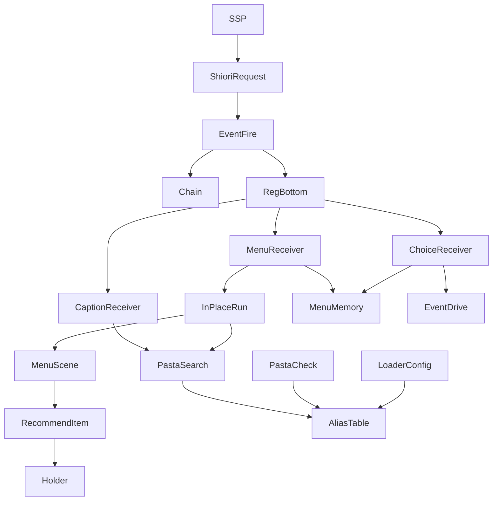
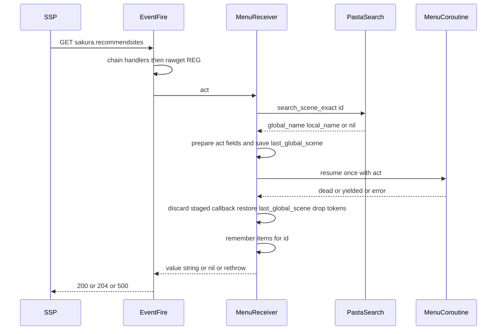
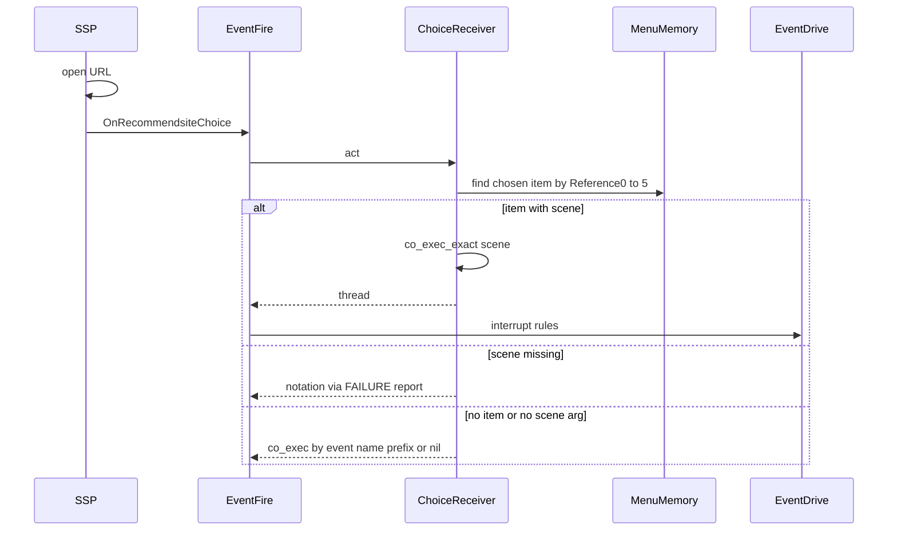

# 設計書: recommend-menu-scenes

## Overview

**Purpose**: SSP の右クリックメニューの「おすすめ」「相方おすすめ」「`char*` のおすすめ」「ポータル」の中身とボタンの名前を、ゴースト作者が辞書（DSL）のシーンと単語だけで書けるようにする。選んだ項目の後のトークも、ふつうのシーンで書ける。

**Users**: 辞書（`.pasta`）を書くゴースト作者。Lua で `REG` に受け手を書いている作者（窓際のぱすたさん）は、今の書き方のまま動く。

**Impact**: 既定ハンドラのファイルを 1 つ足し（リソースの受け手・ボタンの名前の受け手・`OnRecommendsiteChoice`・`＞おすすめ項目`／`＞おすすめ区切り`）、シーン名の別名の既定の表を 1 件から 7 件にし、`[scene.alias]` の読み方を「書いたキーだけ既定を置き換える」に改める。`pasta_check validate` は同じ読み方と 2 つの新しい注意を持つ。

### Goals

- `＊おすすめメニュー` などのシーンと `＞おすすめ項目`・`＞おすすめ区切り` だけでメニューが出る（pasta.toml 不要）。
- メニューを開いても、チェイントークの続き・持ち越し・待っているコールバック・ほかの状態を変えない。
- 選んだ項目のシーンが、ふつうのイベントと同じ決まり（`chain-talk-interrupt`）で話す。
- 別名表の合成の規則を `pasta_core` の 1 か所に置き、pasta.dll と `pasta_check` が同じ規則で読む。

### Non-Goals

- pasta.toml の表でおすすめを書く形、`homeurl`・`username`・メニューの文言・`getaistate`・`char*.recommendbuttoncaption`・`recommendrootbutton.caption` などのほかのリソース。
- Rust（`pasta_shiori`）で ID を振り分けること。DSL の文法の変更（Call の引数の式に単語の参照を書けるようにする等）。
- 見本のゴースト（hello-pasta）・入門ガイドへの作例、ghost_dev の辞書の書き換え。

## Boundary Commitments

### This Spec Owns

- 新しい既定ハンドラのファイル `pasta/shiori/event/recommend.lua` の全部: メニューのリソースの受け手、ボタンの名前の受け手、`OnRecommendsiteChoice` の既定の受け手、`GLOBAL.recommend_item`／`GLOBAL["おすすめ項目"]`・`GLOBAL.recommend_separator`／`GLOBAL["おすすめ区切り"]`、項目の入れ物（act の欄 `_recommend_items`）の決まり、開いたときの並びの記憶（メモリ上だけ）。
- 別名表の既定の 7 件と、書いた行を既定に重ねる規則（`SceneAliasTable::with_written`）と、既定とのぶつかりのエラー（`SceneAliasError::ConflictsWithDefault`）。
- `@pasta_search` の読み取り専用のメソッド `scene_aliases()`。
- `pasta_check validate` の別名表の読み方の追従、組み込みの名前 4 つ、報告の種類 `recommend-item-invalid`・`recommend-menu-talk`。
- マニュアルの該当節と、生成するスキルの references。

### Out of Boundary

- 別名の置き換えの規則そのもの（完全一致・1 段・グローバルシーン名だけ・登録と検索の両方）。変えるのは表の作り方だけ。
- `EVENT.fire`・`EVENT.drive`・`set_co_scene`・`run_interrupt_scene` の振る舞い（`chain-talk-interrupt`・`reg-handler-chain` の持ち場）。`event/init.lua` には require を 1 行足すだけ。
- `act.lua`・`scene.lua`・`shiori/act.lua`・`shiori/entry.lua`・`pasta/failure.lua`（失敗の種類 `FAILURE.LABEL` は足さない）。
- `loader/config/sections.rs`（`SceneAliasSource` の型と注釈。`toml-serialization` のファイル）、`runtime/mod.rs`・`module_registry.rs`（`mlua-stdlib-removal` の持ち場）、`Cargo.toml`・`Cargo.lock`。
- `pasta_check` の `release.rs`・`copy.rs`・`nar.rs`・`update_files.rs`（`ponytail-check-release` の持ち場）。

### 同じウェーブとの持ち場（roadmap の一覧に無いもの）

- roadmap の持ち場の行に無いソース: `pasta_lua/src/search/context.rs`・`pasta_core/src/error.rs`・`pasta_check/src/validate/{recommend,report,mod}.rs`・`pasta_shiori/tests/scene_alias_ontalk_e2e_test.rs`。どれも同じウェーブのほかの 3 本の持ち場に無い（2026-10-24 に各 brief で確かめた）。
- マニュアルで同じ頁を共有するもの（節が別なので共有してよい）: `lua/shiori-events.md`（既定ハンドラの表は行を足すだけ。`mlua-stdlib-removal`）、`internals/loader.md`（この spec は `PastaConfig::parse` の手順 3 の 1 文だけ。`mlua-stdlib-removal`）、`reference/pasta-toml.md`（`[scene]` の節だけ。`toml-serialization` は `[persistence]`）。
- roadmap の持ち場の行は、このウェーブの途中では書き換えない（ほかの 3 本と同じファイルを触らないため）。`kiro-complete` のロードマップ更新で直す。

### Allowed Dependencies

- Lua: `pasta.shiori.event.register`（`REG`）、`pasta.global`（`GLOBAL`）、`pasta.act`（`IMPL.build`）、`pasta.scene`（`get`・`co_exec`・`co_exec_exact`）、`pasta.store`（`last_global_scene` の控えと戻しだけ）、`pasta.shiori.event.callback`（`has_staged`・`discard_staged`）、`pasta.failure`（`report`・`LABEL.SCENE_NOT_FOUND`）、`@pasta_search`（`search_scene_exact`・`search_word`・`scene_aliases`）、`@pasta_log`。
- `recommend.lua` は `pasta.shiori.event`（`event/init.lua`）を require しない（循環させない。ほかの既定ハンドラと同じ）。
- Rust: `pasta_check` → `pasta_core`（`SceneAliasTable`・`SceneAliasError`・`SceneRegistry::sanitize_name`）、`pasta_lua` → `pasta_core`。依存の向きは pasta_dsl → pasta_core → pasta_lua／pasta_check のまま。

### Revalidation Triggers

- 別名表の既定の件数・内容、または合成の規則を変えるとき（指紋が変わり、キャッシュが作り直る。`call-attribute-filter`・`scene-attribute-store`・`scene-exact-match` は表の作り方に依存する）。
- `EVENT.fire` の戻り値の規則・鎖の順を変えるとき（受け手は `REG` の生の値の底に置く前提）。
- `ACT_IMPL.yield`・`SHIORI_ACT_IMPL.get_property` が `self:build()`・`self:yield()` 以外の道で区切るようになるとき（その場で動かす道の打ち切りが効かなくなる）。
- `@pasta_search` の登録の時点が main.lua・entry.lua より後になるとき（`char*` の受け手を置けなくなる）。
- `pasta_check` の報告の種類の並び（`FindingKind::ALL`）を使う側（`pasta_lsp`）。

## Architecture

### Existing Architecture Analysis

- SSP の要求は ID によらず `SHIORI.request` → `EVENT.fire` に来る。`EVENT.fire` は鎖（`REG:register`）→ `rawget(REG, id)` → `EVENT.no_entry` の順に引き、文字列なら `RES.ok`（空なら 204）、thread なら `EVENT.drive` で再開する。
- 既定ハンドラは `REG.X = REG.X or function … end` の形で、`event/init.lua` の読み込みの並びから require される（作者の `main.lua` の代入も辞書の Lua ブロックの代入も勝つ）。
- 別名は登録と検索の両方に効くので、`＊おすすめメニュー` は `sakura.recommendsites` の名前で登録され、`SEARCH:search_scene_exact("sakura.recommendsites")` で引ける。同じ名前のシーンが複数あれば、完全一致の引き方でも重ならないように 1 つを選ぶ。
- `@pasta_search` は main.lua・entry.lua より前に、本番と同じ別名表を持って登録される（`runtime/mod.rs`）。既定ハンドラのファイルは require の時点で別名表を読める。
- ふつうのシーンの道（`wrap_scene` → `act:build()` → SHIORI の組み立て）は持ち越しを書き換え、`EVENT.drive` は続きを差し替える。メニューのシーンはどちらも通さない。

### Architecture Pattern & Boundary Map



- **選んだ形**: 既定ハンドラのファイル 1 つ（`external_control.lua` と同じ形）＋ `pasta_core` の別名表への 1 関数。
- **境界**: Lua の受け手・組み込み・記憶は `recommend.lua` だけが持つ。別名の合成は `pasta_core` だけが持ち、pasta.dll と `pasta_check` は呼ぶだけ。
- **守る既存の形**: `REG.X = REG.X or fn`、`GLOBAL` の英語の名前と日本語の名前（ブラケット記法）の対、`run_interrupt_scene` のインスタンスの欄の差し替え、`FAILURE.report` → `act:build()` の失敗の返し方（`OnRecommendsiteChoice` だけ）。
- **Steering**: ゴーストの振る舞いは DSL で書く。些細なことに Lua を出さない。失敗の表記は `On` で始まる要求にだけ出す。

### Technology Stack

| Layer | Choice / Version | Role in Feature | Notes |
|-------|------------------|-----------------|-------|
| Runtime（Lua） | LuaJIT 2.1（mlua） | 受け手・組み込み・その場で動かす道 | `coroutine.close` 無し。捨てるコルーチンは参照を外すだけ |
| Registry | `pasta_core`（Rust 2024） | 別名表の既定・合成・検証 | 新しい依存なし |
| Loader | `pasta_lua` | `[scene.alias]` の読み込みと出どころの判定 | `SceneAliasSource` の型は変えない |
| CLI | `pasta_check` | 別名表の読み方・組み込みの名前・新しい注意 2 種 | 実行時と同じ判定 |
| 外部 | SSP（UKADOC の SHIORI リソース・イベント） | メニューの値の形・`OnRecommendsiteChoice` | 実機で確かめる点は Open Questions |

## File Structure Plan

### New Files

```
crates/pasta_lua/pasta_scripts/pasta/shiori/event/
└── recommend.lua              # メニュー・ボタンの名前・OnRecommendsiteChoice の既定の受け手、＞おすすめ項目・＞おすすめ区切り、並びの記憶
crates/pasta_lua/tests/lua_specs/
└── recommend_menu_test.lua    # Req 12.2・12.3 の Lua テスト
crates/pasta_check/src/validate/
└── recommend.rs               # recommend-item-invalid・recommend-menu-talk の検査（1 段）
crates/pasta_check/tests/
└── validate_recommend_test.rs # Req 10.3〜10.6 の検査のテスト
```

- コンポーネントとファイルの対応: MenuReceiver・InPlaceRun・RecommendBuiltins・MenuMemory・ChoiceReceiver・CaptionReceiver → `recommend.lua`。SearchAliasesMethod → `search/context.rs`。AliasTable → `scene_alias.rs`・`error.rs`。LoaderConfig → `loader/config/mod.rs`。CheckConfig → `validate/config.rs`。CheckBuiltins → `validate/builtins.rs`。CheckRecommend → `validate/recommend.rs`・`validate/report.rs`・`validate/mod.rs`。Manual → `book/src/**`・生成の references。

### Modified Files

- `crates/pasta_lua/pasta_scripts/pasta/shiori/event/init.lua` — 読み込みの並びの末尾に `require("pasta.shiori.event.recommend")` を 1 行。ほかは触らない。
- `crates/pasta_core/src/registry/scene_alias.rs` — 既定の 7 件（`DEFAULT_ENTRIES`）、`builtin_default()` をそこから作る、`with_written()` を足す、単体テスト。
- `crates/pasta_core/src/error.rs` — `SceneAliasError::ConflictsWithDefault`・`TargetIsDefaultAlias` を足す。
- `crates/pasta_lua/src/loader/config/mod.rs` — `parse_scene_aliases` が `with_written` を呼ぶ。見出しだけなら `BuiltinDefault`、行があれば `PastaToml`。新しい誤りの行番号の取り方。注釈の書き直し。
- `crates/pasta_lua/src/loader/config_tests.rs` — 見出しだけ・キーごとの置き換え・空の配列・既定とのぶつかりの文のテスト（今の「見出しだけは空」「丸ごと置き換え」のテストを書き直す）。
- `crates/pasta_lua/src/search/context.rs` — `add_methods` に `scene_aliases` を 1 つ（テストはここに足さない）。
- `crates/pasta_lua/tests/search/scene_search_test.rs` — `scene_aliases()` の Lua からの戻り値のテスト。
- `crates/pasta_lua/tests/lua_specs/init.lua` — specs の表に `"recommend_menu_test"` を 1 行。
- `crates/pasta_shiori/tests/scene_alias_ontalk_e2e_test.rs` — 「見出しだけで別名を消す」版を `OnTalk = []` に直す。
- `crates/pasta_check/src/validate/builtins.rs` — `GLOBAL_NAMES` を 8 → 12。注釈に置き場所を足す。
- `crates/pasta_check/src/validate/config.rs` — `read_aliases` が `with_written` を呼ぶ。新しい誤りの文言。テストの書き直し。
- `crates/pasta_check/src/validate/report.rs` — `FindingKind` に 2 つ（末尾）、`ALL` 25 → 27、重さ・コード名、`msg` に文言 4 つ。
- `crates/pasta_check/src/validate/mod.rs` — `mod recommend;` と、飛び先の段の中で `recommend::check` を 1 回呼ぶ。
- `crates/pasta_check/tests/validate_report_test.rs` — 種類の表と数 27。
- `book/src/grammar/call-jump.md` — 組み込みの表に 2 行、新しい節「おすすめメニュー」、シーン名の別名の節の書き直し（既定 7 件・新しい読み方・これまでのゴーストへの影響）。
- `book/src/reference/pasta-toml.md` — `[scene]` の節の書き直し、冒頭の既定の説明。
- `book/src/lua/shiori-events.md` — 既定ハンドラの表に 3 行・「9 つ」→「12」、`REG["sakura.recommendsites"]` の作例と勝ち負け、1057 行の「丸ごと置き換わる」の書き直し。
- `book/src/lua/modules/pasta-search.md` — `scene_aliases()` の節、67 行の既定の説明。
- `book/src/debug/validate.md` — `recommend-item-invalid`・`recommend-menu-talk`、`config-scene-alias` の新しい誤り、組み込みの名前の一覧。
- `book/src/grammar/block-structure.md`（85 行）・`book/src/internals/loader.md`（102〜103 行） — 既定の表と読み方の記述。
- `.claude/skills/*/references/*`（`book/tools/gen-skill-refs.mjs` が生成） — 作り直す。
- `.claude/skills/pasta-ghost-authoring/SKILL.md` — 特殊 Call の一覧に `＞おすすめ項目`・`＞おすすめ区切り` を 1 行（**開発者の許可が要る**。分類器に拒まれたら入った分と残りを示して許可を求める）。

## System Flows

### メニューの問い合わせ（その場で動かす道）



- 受け手は `EVENT.drive`・`set_co_scene`・`wrap_scene`・SHIORI の `build` を通らない。返すのは文字列か `nil` だけなので、`EVENT.fire` は `RES.ok`／`RES.no_content` にする。
- resume は 1 回だけ。`＞チェイントーク`・`get_property` で区切っても、そこで打ち切る。

### 選んだとき



- 項目のシーンのコルーチンには `STORE.co_preempt` の印を付けない（Req 6.6）。チェイントークの続きが待っていれば、`EVENT.drive` が割り込みとして扱い、台詞を出せば続きを捨てて `＊チェイントーク中断` を出す（Req 6.5）。

## Requirements Traceability

| Requirement | Summary | Components | Interfaces | Flows |
|-------------|---------|------------|------------|-------|
| 1.1 | 既定にメニューの 3 件 | AliasTable | `DEFAULT_ENTRIES` | — |
| 1.2 | 書かなくてもメニューのシーン | AliasTable, MenuReceiver | `builtin_default` | メニューの問い合わせ |
| 1.3 | 完全一致で探す | MenuReceiver | `search_scene_exact` | メニューの問い合わせ |
| 1.4 | 同じ名前から 1 つ選ぶ | MenuReceiver | `search_scene_exact` | メニューの問い合わせ |
| 1.5 | `char*.recommendsites` の別名 | MenuReceiver, SearchAliasesMethod | `scene_aliases` | 受け手の設置 |
| 1.6 | 名前を変えたメニュー | AliasTable, MenuReceiver | `with_written` | — |
| 1.7 | Call で呼べるまま | AliasTable（規則は変えない） | — | — |
| 2.1 | 書いたキーだけ置き換える | AliasTable, LoaderConfig, CheckConfig | `with_written` | — |
| 2.2 | 空の配列で消す | AliasTable | `with_written` | — |
| 2.3 | 見出しだけは既定 | AliasTable, LoaderConfig, CheckConfig | `with_written`, 出どころの判定 | — |
| 2.4 | 既定とのぶつかりのエラー | AliasTable, LoaderConfig | `ConflictsWithDefault` | — |
| 2.5 | 今の誤りと行番号 | AliasTable, LoaderConfig, CheckConfig | `from_entries`（書いた行だけ先に） | — |
| 2.6 | info ログ | LoaderConfig（`loader/mod.rs` は変えない） | `Display` | — |
| 2.7 | キャッシュの作り直し | AliasTable（指紋） | `fingerprint` | — |
| 2.8 | 置き換えの規則を変えない | AliasTable | `resolve` | — |
| 3.1 | 組み込みの 2 対 | RecommendBuiltins | `GLOBAL.recommend_item` ほか | — |
| 3.2 | 呼んだ順に加える | RecommendBuiltins | `RecommendHolder` | — |
| 3.3 | 3・4 つ目の省略・空 | RecommendBuiltins | `RecommendItem` | — |
| 3.4 | 区切り線 | RecommendBuiltins | `recommend_separator` | — |
| 3.5 | 引数は式 | RecommendBuiltins（生成コードそのまま） | — | — |
| 3.6 | 台詞の加工を通さない | RecommendBuiltins, MenuReceiver | `encode` | — |
| 3.7 | 呼ばれたシーンの項目も | RecommendBuiltins（同じ act） | `RecommendHolder` | — |
| 3.8 | メニューの外では何もしない | RecommendBuiltins | `rawget(act, "_recommend_items")` | — |
| 4.1 | 値の形で 200 | MenuReceiver | `encode` | メニューの問い合わせ |
| 4.2 | URL が開き項目のシーンが話す | MenuReceiver（4 つ目の欄は空）, ChoiceReceiver | `OnRecommendsiteChoice` | 選んだとき |
| 4.3 | バナーは書いたまま | MenuReceiver | `encode` | — |
| 4.4 | URL は書いたまま | MenuReceiver | `encode` | — |
| 4.5 | 台詞は捨てる | InPlaceRun | `act.token = {}` | メニューの問い合わせ |
| 4.6 | 無ければ 204 | MenuReceiver | `nil` を返す | メニューの問い合わせ |
| 4.7 | 毎回動かし直す | MenuReceiver | — | メニューの問い合わせ |
| 5.1 | 続きを残す | InPlaceRun | `EVENT.drive` を通さない | メニューの問い合わせ |
| 5.2 | 持ち越しを変えない | InPlaceRun | インスタンスの `build` | メニューの問い合わせ |
| 5.3 | チェイントークで打ち切る | InPlaceRun | インスタンスの `yield`、resume 1 回 | メニューの問い合わせ |
| 5.4 | 自動トークを再開しない | InPlaceRun | インスタンスの `yield` | — |
| 5.5 | get_property で打ち切り・warn | InPlaceRun | `has_staged`・`discard_staged` | メニューの問い合わせ |
| 5.6 | ほかの待ちを変えない | InPlaceRun | `_staged` の 1 枠だけ捨てる | — |
| 5.7 | 変数の代入は残す | InPlaceRun（取り消さない） | — | — |
| 6.1 | 項目のシーンを完全一致 | ChoiceReceiver | `co_exec_exact` | 選んだとき |
| 6.2 | 開いたときの並びから特定 | MenuMemory, ChoiceReceiver | `find_chosen` | 選んだとき |
| 6.3 | 特定できない・3 つ目が無い | ChoiceReceiver | `SCENE.co_exec(act, act.req.id)` | 選んだとき |
| 6.4 | シーンが無い表記 | ChoiceReceiver | `FAILURE.LABEL.SCENE_NOT_FOUND` | 選んだとき |
| 6.5 | 中断の決まり | ChoiceReceiver → `EVENT.drive` | thread を返す | 選んだとき |
| 6.6 | 黙って捨てる再生にしない | ChoiceReceiver | `co_preempt` を付けない | — |
| 7.1 | ボタンの名前の既定 3 件 | AliasTable | `DEFAULT_ENTRIES` | — |
| 7.2 | 単語の候補から 1 つ | CaptionReceiver | `search_word` | — |
| 7.3 | 無ければ 204 | CaptionReceiver | `nil` | — |
| 7.4 | 結びつけを変える・`char*` | CaptionReceiver, SearchAliasesMethod | `scene_aliases` | 受け手の設置 |
| 7.5 | 加工を通さない | CaptionReceiver | 単語の値そのまま | — |
| 7.6 | 別名の規則をそのまま | AliasTable | 同じ表 | — |
| 8.1 | 作者の代入が勝つ | 全受け手 | `REG.X = REG.X or fn` | — |
| 8.2 | 鎖が先 | EventFire（既存） | `REG[id]` の生の値に置く | — |
| 8.3 | 窓際のぱすたさんの書き方 | 全受け手 | 同上 | — |
| 9.1 | 名前・URL の型の誤り | RecommendBuiltins | `check_text` | — |
| 9.2 | バイト値 1・2 | RecommendBuiltins | `check_text` | — |
| 9.3 | 5 つ目から後 | RecommendBuiltins | `select("#", ...)` | — |
| 9.4 | 表記を混ぜない | InPlaceRun, CaptionReceiver | トークンを捨てる | — |
| 9.5 | エラーは 500 | InPlaceRun | `error(err, 0)` | メニューの問い合わせ |
| 9.6 | エラーでも状態を変えない | InPlaceRun | 控えを戻してから投げ直す | — |
| 10.1 | 組み込みの名前 | CheckBuiltins | `GLOBAL_NAMES` | — |
| 10.2 | 別名表の読み方 | CheckConfig | `with_written` | — |
| 10.3 | 項目のシーンが無い | CheckRecommend | `RecommendItemInvalid` | — |
| 10.4 | 引数の数 | CheckRecommend | `RecommendItemInvalid` | — |
| 10.5 | 式は見ない | CheckRecommend | `string_literal` | — |
| 10.6 | メニューのシーンの台詞 | CheckRecommend | `RecommendMenuTalk` | — |
| 11.1 | おすすめメニューの節 | Manual | `grammar/call-jump.md` | — |
| 11.2 | 既定ハンドラの表 | Manual | `lua/shiori-events.md` | — |
| 11.3 | `REG` でリソースを受ける作例 | Manual | `lua/shiori-events.md` | — |
| 11.4 | 別名表の書き直しと影響 | Manual | `reference/pasta-toml.md`・`grammar/call-jump.md` ほか | — |
| 11.5 | 検査の報告 | Manual | `debug/validate.md` | — |
| 11.6 | references の作り直し | Manual | `gen-skill-refs.mjs` | — |
| 11.7 | `!` の件名 | Migration | コミットの件名 | — |
| 12.1 | Rust の別名表のテスト | Tests | `scene_alias.rs`・`config_tests.rs`・`scene_search_test.rs` | — |
| 12.2 | Lua のメニューのテスト | Tests | `recommend_menu_test.lua` | — |
| 12.3 | Lua の選んだとき・ボタンの名前 | Tests | `recommend_menu_test.lua` | — |
| 12.4 | pasta_check のテスト | Tests | `validate_parity_test.rs`・`validate_report_test.rs`・`validate_recommend_test.rs`・`config.rs` | — |

## Components and Interfaces

| Component | Domain/Layer | Intent | Req Coverage | Key Dependencies (P0/P1) | Contracts |
|-----------|--------------|--------|--------------|--------------------------|-----------|
| MenuReceiver | Lua 既定ハンドラ | メニューの ID ごとの受け手 | 1.2〜1.5, 4.1〜4.7, 8.1〜8.3 | InPlaceRun (P0), `@pasta_search` (P0) | Service, State |
| InPlaceRun | Lua 既定ハンドラ | メニューのシーンをほかの状態に触れずに 1 回だけ動かす | 4.5, 5.1〜5.7, 9.4〜9.6 | `pasta.scene` (P0), CALLBACK (P1) | Service |
| RecommendBuiltins | Lua `GLOBAL` | `＞おすすめ項目`・`＞おすすめ区切り` | 3.1〜3.8, 9.1〜9.3 | `@pasta_log` (P1) | Service |
| MenuMemory | Lua 既定ハンドラ | 開いたときの並びを ID ごとに覚える | 6.2, 6.3 | — | State |
| ChoiceReceiver | Lua 既定ハンドラ | `OnRecommendsiteChoice` の既定の受け手 | 4.2, 6.1〜6.6 | MenuMemory (P0), `EVENT.drive`（既存）(P0) | Service |
| CaptionReceiver | Lua 既定ハンドラ | ボタンの名前の受け手 | 7.2〜7.5 | SearchAliasesMethod (P0) | Service |
| SearchAliasesMethod | Rust `pasta_lua` search | 別名表を Lua に見せる | 1.5, 7.4 | `SceneAliasTable::entries` (P0) | Service |
| AliasTable | Rust `pasta_core` | 既定 7 件・合成・検証 | 1.1, 1.6, 2.1〜2.8, 7.1, 7.6 | — | Service |
| LoaderConfig | Rust `pasta_lua` loader | `[scene.alias]` を読み、出どころを決める | 2.1〜2.6 | AliasTable (P0) | Service |
| CheckConfig | Rust `pasta_check` | 同じ読み方と報告 | 2.5, 10.2 | AliasTable (P0) | Service |
| CheckBuiltins | Rust `pasta_check` | 組み込みの名前 | 10.1 | — | — |
| CheckRecommend | Rust `pasta_check` | 項目と台詞の検査 | 10.3〜10.6 | SceneModel (P0) | Service |
| Manual | book | 節の追加と書き直し、references | 11.1〜11.6 | gen-skill-refs (P1) | — |

### Lua 既定ハンドラ（`pasta/shiori/event/recommend.lua`）

#### MenuReceiver・InPlaceRun

| Field | Detail |
|-------|--------|
| Intent | メニューのリソースの ID に結びついたシーンを、その場で 1 回だけ動かし、積んだ項目を SSP の値にする |
| Requirements | 1.2, 1.3, 1.4, 1.5, 4.1, 4.3〜4.7, 5.1〜5.7, 8.1〜8.3, 9.4〜9.6 |

**Responsibilities & Constraints**
- 受け手を置く ID: `sakura.recommendsites`・`kero.recommendsites`・`sakura.portalsites` と、require の時点の `SEARCH:scene_aliases()` の置き換え先のうち `^char%d+%.recommendsites$` に当たるもの。置き方は `REG[id] = REG[id] or menu_receiver(id)`。
- `@pasta_search` が引けない、または `scene_aliases` を持たないとき（テストの差し替えなど）は、決まった 3 つだけに置く。
- シーンは ID そのもので完全一致に引く（別名は登録で置き換わっているので、別名表を読まない）。
- `EVENT.drive`・`set_co_scene`・`wrap_scene`・SHIORI の `build` を通らない。`STORE.co_scene`・`STORE.co_preempt`・`STORE.actor_spots`・`STORE.appearance`・`CALLBACK.pending` に触れない。
- `STORE.last_global_scene` は動かす前に控え、動かした後（エラーでも）に戻す。

##### Service Interface

```lua
---@class RecommendItem
---@field name string          -- 区切り線は "-"
---@field url string           -- 区切り線は ""
---@field scene string|nil     -- 選んだときのシーンの書いた名前（無ければ nil）
---@field banner string|nil    -- バナーのパス（無ければ nil）

---@class RecommendHolder      -- act の欄 _recommend_items（メニューの受け手だけが作る）
---@field id string            -- リソースの ID（ログ用）
---@field calls integer        -- ＞おすすめ項目・＞おすすめ区切り を呼んだ数（ログの「何番目」）
---@field [integer] RecommendItem

--- メニューの受け手を作る（ID を閉じ込める）
---@param id string
---@return fun(act: ShioriAct): string|nil
local function menu_receiver(id) end

--- その場で 1 回だけ動かす。止まったエラーは状態を戻してから error(err, 0) で投げ直す
---@param act ShioriAct
---@param id string
---@return RecommendItem[]|nil items  -- シーンが無ければ nil
local function run_menu(act, id) end

--- 項目を SSP の値にする（各項目の後ろに \2。トークの欄は常に空）
---@param items RecommendItem[]
---@return string
local function encode(items) end
```

- `run_menu` の手順:
  1. `SEARCH:search_scene_exact(id)` → `global_name, local_name`。無ければ `nil`。`SCENE.get(global_name, local_name)` が関数でなければ `nil`。
  2. act のインスタンスの欄を置く: `_recommend_items = { id = id, calls = 0 }`、`build = ACT.IMPL.build`（区切りで持ち越しに触れない）、`yield = function() coroutine.yield() end`（`resume_auto_talk` を呼ばない）。
  3. `STORE.last_global_scene` を控え、`coroutine.create(fn)` を `coroutine.resume(co, act)` で **1 回だけ**再開する。
  4. 成否にかかわらず: `local waited = CALLBACK.has_staged()`、`CALLBACK.discard_staged()`、`STORE.last_global_scene` を戻す、`act.token = {}`（台詞と失敗の表記を捨てる）。コルーチンは参照を外して捨てる。
  5. エラーなら `error(err, 0)`（`SHIORI.request` が `On` で始まらない ID として 500 と `X-Error-Reason` にする）。
  6. `waited` なら warn を 1 行（`"recommend menu: <id>: get_property is not available in a menu scene; the scene was cut there"`）。
  7. 項目の配列（`_recommend_items` の配列部分）を返す。
- `menu_receiver(id)(act)`: `run_menu` の結果が `nil` か空なら、その ID の記憶を消して `nil`（204）。項目があれば記憶に入れ、`encode(items)` を返す（200）。
- `encode`: 各項目を `name .. "\1" .. url .. "\1" .. (banner or "") .. "\1" .. "\2"` にして連結する（区切り線は `"-\1\1\1\2"`）。
- Preconditions: `EVENT.fire` が渡した act（毎回新しい）。
- Postconditions: 戻った後、`STORE` のどの欄も呼ぶ前と同じ（変数の代入 `act.save`・`act.var` の結果は除く。Req 5.7）。
- Invariants: resume は要求ごとに 1 回。値に `\1`・`\2` は区切りとしてだけ現れる（項目の検証で保証）。

##### State Management
- MenuMemory: モジュールの局所の表 `last[id] = RecommendItem[]`。メモリ上だけで保存しない。読み直し・再起動で消える。メニューが 204 を返したとき（項目なし・シーン無し）はその ID を消す。作者の受け手が答えたときは更新されない（その場合は名前と URL の確かめで食い違い、Req 6.3 の落ち先へ回る）。

**Implementation Notes**
- Integration: `event/init.lua` の読み込みの並びの末尾に 1 行（`external_control` の後）。`recommend.lua` は `event/init.lua` を require しない。
- Validation: 区切りの後の続き・コールバック待ちの打ち切り・エラーの 3 つの出口で、`STORE` と `CALLBACK` が変わらないことを Lua テストで確かめる。
- Risks: 共通のシーンを引数つきで Call すると、その引数が `＞おすすめ項目` の後ろに付く（既存の Call の決まり。下の Open Questions 6）。

#### RecommendBuiltins

| Field | Detail |
|-------|--------|
| Intent | `＞おすすめ項目（名前、URL、シーン、バナー）`・`＞おすすめ区切り` で項目を入れ物に積む |
| Requirements | 3.1〜3.8, 9.1〜9.3 |

**Responsibilities & Constraints**
- `GLOBAL` に置く（`entry.lua` と同じ形で、無条件に定義する）。日本語の名前はブラケット記法で同じ関数を指す。
- 入れ物は `rawget(act, "_recommend_items")`。無ければ何もしない（Req 3.8。出力もトークも変えない）。
- 項目を台詞として積まない（`act.token` に触れない）。

##### Service Interface

```lua
--- ＞おすすめ項目（名前、URL、選んだときのシーン、バナー）
---@param act ShioriAct
---@param name any
---@param url any
---@param scene any|nil
---@param banner any|nil
---@param ... any  5 つ目から後（使わずに warn）
function GLOBAL.recommend_item(act, name, url, scene, banner, ...) end
GLOBAL["おすすめ項目"] = GLOBAL.recommend_item

--- ＞おすすめ区切り（引数は見ない）
---@param act ShioriAct
function GLOBAL.recommend_separator(act) end
GLOBAL["おすすめ区切り"] = GLOBAL.recommend_separator
```

- 検証（`holder.calls` を 1 増やしてから。ログには ID・何番目・どの引数かを出す）:
  - 5 つ目から後があれば（`select("#", ...) > 0`）、warn して捨て、項目は加える（Req 9.3）。
  - 名前・URL: 空でない文字列か数値（数値は `tostring`）。`nil`・空・真偽値・表は warn して項目を加えない（Req 9.1）。
  - シーン・バナー: `nil`・空文字列は「無し」（Req 3.3）。数値は `tostring`。真偽値・表は warn して項目を加えない（仮定。Open Questions 8）。
  - どの欄でも `\1`・`\2` を含めば warn して項目を加えない（Req 9.2）。
- warn の文の形（英語。既存の受け手の warn に合わせる）: `"recommend_item: <id> item #<n>: bad <name|url|scene|banner> (<型または値>); item skipped"`、`"recommend_item: <id> item #<n>: <k> extra argument(s) ignored"`。
- 区切り線: `{ name = "-", url = "" }` を末尾に加える（Req 3.4）。

#### ChoiceReceiver

| Field | Detail |
|-------|--------|
| Intent | 選ばれた項目のシーンを、ふつうのイベントと同じ道で話させる |
| Requirements | 4.2, 6.1〜6.6, 8.1, 8.2 |

##### Service Interface

```lua
--- 開いたときの並びから選ばれた項目を探す
---@param ref table<integer, string>  act.req.reference
---@return RecommendItem|nil
local function find_chosen(ref) end

REG.OnRecommendsiteChoice = REG.OnRecommendsiteChoice or function(act) end
```

- `find_chosen` の手順:
  1. 推す ID: Reference3 が `portal` なら `sakura.portalsites`。`recommend` なら Reference4 が `0`→`sakura.recommendsites`、`1`→`kero.recommendsites`、それ以外の数 N→`charN.recommendsites`。
  2. 推した ID の並びで、`Reference5 + 1` 番目（区切り線も 1 つと数える）が名前（Reference0）と URL（Reference1）で一致すればそれ。
  3. 違えば、同じ並びから名前と URL が一致する最初の項目。
  4. それも無ければ、覚えているほかの並びを `sakura.recommendsites`・`kero.recommendsites`・`sakura.portalsites`・`char*`（ID の文字列の昇順）の順に探す。区切り線は対象にしない。
- 受け手の手順:
  1. 項目が無いか、項目にシーンが無い → `require("pasta.scene").co_exec(act, act.req.id)` を返す（`EVENT.no_entry` と同じ前方一致。無ければ `nil` で 204。Req 6.3）。
  2. `SCENE.co_exec_exact(item.scene)` がコルーチンを返せば、それを返す（`EVENT.fire` → `EVENT.drive` が割り込みの決まりで再開する。`co_preempt` は付けない）。
  3. 見つからなければ `FAILURE.report(act, { label = FAILURE.LABEL.SCENE_NOT_FOUND, subject = "＊" .. item.scene, warning = "OnRecommendsiteChoice: scene not found: name='<scene>'" })` の後 `act:build()` を返す（`＊OnRecommendsiteChoice` へは回さない。Req 6.4）。
- メニューの値の 4 つ目の欄（選択時トーク）は常に空にし、トークはこの受け手だけで話す（決定の理由は research.md 8 の 1 つ目）。

#### CaptionReceiver

| Field | Detail |
|-------|--------|
| Intent | ボタンの名前のリソースに、別名表で結びついた名前の単語の値を返す |
| Requirements | 7.2〜7.5 |

- 受け手を置く ID: `sakura.recommendbuttoncaption`・`kero.recommendbuttoncaption`・`sakura.portalbuttoncaption` と、require の時点の置き換え先のうち `^char%d+%.recommendsites%.caption$` に当たるもの。`REG[id] = REG[id] or caption_receiver(id)`。
- 名前の一覧は require の時点の `SEARCH:scene_aliases()[id]`（辞書順）。その順に `SEARCH:search_word(name)` を引き、最初に見つかった単語の値を返す（200）。どれも無い・一覧が無い → `nil`（204）。
- 単語はふだんの `＠名前` と同じ前方一致で引く（`＠おすすめボタン名_冬` も候補に入る）。値はそのまま返す（Req 7.5）。`act:word` は使わない（GLOBAL・act のメソッドを引かせず、失敗の表記を積まないため）。

```lua
---@param id string
---@return fun(act: ShioriAct): string|nil
local function caption_receiver(id) end
```

### Rust

#### AliasTable（`pasta_core/src/registry/scene_alias.rs`）

| Field | Detail |
|-------|--------|
| Intent | 既定の 7 件を持ち、書いた行をキーごとに既定へ重ねて検証する |
| Requirements | 1.1, 1.6, 2.1〜2.5, 2.7, 2.8, 7.1, 7.6 |

```rust
/// 内蔵の既定表（置き換え先, 別名の列）
const DEFAULT_ENTRIES: [(&str, &[&str]); 7] = [
    ("OnTalk", &["会話"]),
    ("sakura.recommendsites", &["おすすめメニュー"]),
    ("kero.recommendsites", &["相方おすすめメニュー"]),
    ("sakura.portalsites", &["ポータルメニュー"]),
    ("sakura.recommendbuttoncaption", &["おすすめボタン名"]),
    ("kero.recommendbuttoncaption", &["相方おすすめボタン名"]),
    ("sakura.portalbuttoncaption", &["ポータルボタン名"]),
];

impl SceneAliasTable {
    /// 内蔵の既定表（DEFAULT_ENTRIES の 7 件）
    pub fn builtin_default() -> Self;

    /// 既定の表に、書いた行をキーごとに重ねる。
    /// 書いたキーの既定の別名は捨てて書いた列にする（空の列なら消すだけ）。書かなかったキーの既定は残す。
    pub fn with_written<I, A>(written: I) -> Result<Self, SceneAliasError>
    where
        I: IntoIterator<Item = (String, A)>,
        A: IntoIterator<Item = String>;
}
```

- `with_written` の手順: (1) 書いた行だけを `from_entries` で検証する（空の名前・書いた行どうしの重複・連鎖は今のエラーと同じ。Req 2.5）。(2) 書かなかったキーの既定の行と書いた行を合わせて `from_entries` で検証する。(3) (2) で出る誤りは、どれも既定の行が絡む（(1) を通ったので書いた行どうしでは起きない）。`DuplicateAlias { alias, targets }` は `ConflictsWithDefault { alias, target: 書いた側, default_target: 既定の側 }` に、`Chain`（書いた置き換え先が既定の別名。例 `会話 = ["雑談"]`）は `TargetIsDefaultAlias { target: 書いた置き換え先, default_target: その別名を持つ既定の置き換え先 }` に読み替える。どちらも相手が既定の表のものと分かる文と直し方を持つ（Req 2.4）。
- 書いた行が空（見出しだけ）なら `builtin_default()` と等しい表を返す（Req 2.3）。
- `builtin_default()` は `DEFAULT_ENTRIES` から直接作る（単体テストで `from_entries(DEFAULT_ENTRIES)` と等しいことを確かめる）。
- 置き換え・`entries`・`fingerprint`・`Display` は変えない（Req 2.7・2.8）。

#### SceneAliasError::ConflictsWithDefault（`pasta_core/src/error.rs`）

```rust
#[error("scene alias: alias '{alias}' of '{target}' conflicts with the default alias of '{default_target}' (write {default_target} = [] to remove the default)")]
ConflictsWithDefault { alias: String, target: String, default_target: String },

#[error("scene alias: target '{target}' is a default alias of '{default_target}' (write {default_target} = [] to remove the default)")]
TargetIsDefaultAlias { target: String, default_target: String },
```

#### LoaderConfig（`pasta_lua/src/loader/config/mod.rs` の `parse_scene_aliases`）

- `[scene.alias]` が無い → `(builtin_default(), BuiltinDefault)`（今のまま）。
- 表がある → 出どころは行が 0 なら `BuiltinDefault`、1 つ以上なら `PastaToml`（型は変えない。意味は「書いた行を既定に重ねた」になる）。表は `SceneAliasTable::with_written(entries)`。
- 誤りの行番号: `hit` に `ConflictsWithDefault { alias: dup, target, .. } => alias == dup && 置き換え先 == target` と `TargetIsDefaultAlias { target, .. } => 置き換え先 == target` を足す（書いた側の行だけが当たる）。文は `"{e}; at [scene.alias] {target} = \"{alias}\" (line N)"` の今の形。
- info ログ `Scene alias table`（`loader/mod.rs`）は変えない。合成後の表を `Display` するので Req 2.6 を満たす。

#### SearchAliasesMethod（`pasta_lua/src/search/context.rs`）

```rust
// scene_aliases() -> { [置き換え先] = { 別名, ... } }（置き換え先・別名ともに辞書順。毎回新しい表）
methods.add_method("scene_aliases", |lua, this, ()| { /* this.scene_aliases.entries() を表にする */ });
```

- 読み取り専用。表を変えても `@pasta_search` の別名表は変わらない。

#### CheckConfig（`pasta_check/src/validate/config.rs` の `read_aliases`）

- `SceneAliasTable::with_written(entries)` を呼ぶ。`hit`・`message` に `ConflictsWithDefault`・`TargetIsDefaultAlias` を足す。文言は `msg::config_scene_alias_default_conflict(alias, target, default_target)`（例「[scene.alias] の {target} の別名「{alias}」は、既定の {default_target} の別名とぶつかります。既定を消すには {default_target} = [] を書きます」）と `msg::config_scene_alias_target_is_default(target, default_target)`（例「[scene.alias] の置き換え先「{target}」は、既定の {default_target} の別名です。既定を消すには {default_target} = [] を書きます」）。報告の種類は今の `config-scene-alias`（誤り）。
- 見出しだけのときは既定と等しい表を返す（`GhostConfig` の既定と同じ）。

#### CheckBuiltins（`pasta_check/src/validate/builtins.rs`）

- `GLOBAL_NAMES: [&str; 12]` に `recommend_item`・`おすすめ項目`・`recommend_separator`・`おすすめ区切り` を足す。注釈に `pasta/shiori/event/recommend.lua` を足す。組み込みに隠れる報告（`scene-shadowed-by-builtin`）は今の仕組みで出る。

#### CheckRecommend（`pasta_check/src/validate/recommend.rs`）

```rust
/// ＞おすすめ項目 の引数と、メニューのシーンの本体の台詞を検査する（10.3〜10.6）
pub(crate) fn check(
    model: &SceneModel,
    aliases: &SceneAliasTable,
    parsed: &[(String, PastaFile)],
    texts: &[(String, FileText)], // 字下げの後ろの列を出すため（references::check と同じ）
) -> Vec<Finding>;
```

- 呼ぶ場所: `validate_ghost` の飛び先の段（`skip_reasons` が空のとき）の中で、`references::check` の後に 1 回。
- `＞おすすめ項目` の判定: `CallTarget::Static` の名前が `おすすめ項目` か `recommend_item` の Call（すべてのローカルの範囲）。
  - 引数の数（`args.items.len()`。名前つきの引数も 1 つと数える。引数なしは 0）が 2〜4 の外 → `RecommendItemInvalid`（Req 10.4）。
  - 3 つ目が文字列だけの式（`Expr::String`。括弧つきも）で空でなければ、`aliases.resolve` で置き換えた名前を照合用の名前に揃え、`model.globals` の `declared` を揃えたものと等しいものが無ければ `RecommendItemInvalid`（Req 10.3。完全一致）。文字列だけの式でなければ見ない（Req 10.5）。
- メニューのシーン: `declared` が `sakura.recommendsites`・`kero.recommendsites`・`sakura.portalsites` か `char<数字>.recommendsites` のグローバルシーン。その最初の範囲（名前の無いローカルの範囲）の `ActionLine`・`ContinueAction` ごとに `RecommendMenuTalk`（Req 10.6。呼んだ先は見ない）。
- 位置は行の span（選択肢と同じく字下げの後ろの列）。

#### report.rs（`pasta_check/src/validate/report.rs`）

- `FindingKind` の末尾に `RecommendItemInvalid`・`RecommendMenuTalk`（ともに注意）。`ALL` は 27。コード名は `recommend-item-invalid`・`recommend-menu-talk`（serde の kebab-case と同じ）。
- `msg` に: `recommend_item_arg_count(n)`、`recommend_item_scene_missing(name)`、`recommend_menu_talk(scene)`、`config_scene_alias_default_conflict(alias, target, default_target)`、`config_scene_alias_target_is_default(target, default_target)`。

## Data Models

### Domain Model

- **メニューの並び**（`RecommendItem[]`）: 項目と区切り線の列。メニューのシーンを 1 回動かした結果で、リソースの ID ごとに最後の 1 つだけを覚える（集約の根は ID）。
- **別名表**（`SceneAliasTable`）: 別名 → 置き換え先。不変条件（空の名前なし・別名は一意・置き換え先は別名でない）は今のまま。既定の 7 件と書いた行の合成は読み込みのときに 1 回だけ。

### Data Contracts & Integration

**SSP へのメニューの値**（`sakura.recommendsites` ほか）

| 欄 | 値 | 備考 |
|----|----|------|
| 項目名 | 書いた名前（区切り線は `-`） | 加工しない |
| URL | 書いた URL（`script:` もそのまま。区切り線は空） | 加工しない |
| バナー | 書いたパス（無ければ空） | 基準のフォルダの変換をしない |
| 選択時トーク | 常に空 | トークは `OnRecommendsiteChoice` で話す |

- 欄の区切りはバイト値 1、各項目の後ろにバイト値 2（SSP 同梱の Emily/Phase4 と同じ形）。値は `Value` の 200。項目が無ければ 204。

**`OnRecommendsiteChoice` から読む Reference**: 0＝名前、1＝URL、3＝`recommend`／`portal`、4＝0／1（ほかの数は `char` の番号と仮定）、5＝上からの位置（手がかりにだけ使う）。2（バナー）は使わない。

**`SEARCH:scene_aliases()`**: `table<string, string[]>`。キーは置き換え先、値は別名の配列（辞書順）。

## Error Handling

### Error Strategy

| 起きること | 扱い | 応答 |
|------------|------|------|
| メニューのシーンが無い・項目が 0 | 何も出さない | 204 |
| `＞おすすめ項目` の引数の誤り | その項目を外して warn、残りで値を作る | 200（残りがあれば） |
| メニューのシーンの中の `get_property` | そこで打ち切り、予約を捨て、warn | 200／204 |
| メニューのシーンの中の `＞チェイントーク` | そこで打ち切り（ログなし） | 200／204 |
| メニューのシーンの実行時エラー | `STORE.last_global_scene` を戻し予約を捨ててから投げ直す | 500＋`X-Error-Reason`（表記なし） |
| メニューのシーンの中の失敗の表記（未定義の単語など） | トークンとして捨てる（値に混ぜない） | — |
| 項目のシーンが辞書に無い | `SCENE_NOT_FOUND` の表記と warn | 200（表記。設定で出さなければ 204） |
| 選んだ項目を特定できない・3 つ目が無い | `＊OnRecommendsiteChoice`（前方一致）へ | 200／204 |
| 別名表の既定とのぶつかり | 読み込みエラー（`ConflictsWithDefault`、書いた側の行番号つき） | ゴーストを読み込まない |

### Monitoring

- warn: 項目の誤り（ID・何番目・どの引数）、`get_property` の打ち切り、項目のシーンが無い。
- info: `Scene alias table`（合成後の表と出どころ）。

## Testing Strategy

### Unit Tests（Rust）

- `scene_alias.rs`: 既定が 7 件で `from_entries(DEFAULT_ENTRIES)` と等しい・`with_written` で書いたキーだけ置き換わる（`OnBoot = ["起動"]` で既定 7 件が残る、`OnTalk = ["会話", "おしゃべり"]`）・空の配列で消える（`"sakura.recommendsites" = []`）・空の入力は既定と等しい・書いた行どうしの重複は `DuplicateAlias` のまま・既定とのぶつかりは `ConflictsWithDefault`（`OnBoot = ["会話"]`、`OnTalk = []` を足すと通る）・置き換え先が既定の別名なら `TargetIsDefaultAlias`（`会話 = ["雑談"]`）・指紋が既定の変更で変わる（Req 12.1）。
- `config_tests.rs`: 見出しだけが既定で `BuiltinDefault`、行ありは `PastaToml`、既定とのぶつかりの文に相手（既定の `OnTalk`）・直し方（`OnTalk = []`）・書いた行の行番号が入る、型の違い・空の名前・連鎖の今の文言（Req 2.3〜2.5）。
- `scene_search_test.rs`: Lua から `SEARCH:scene_aliases()` が既定 7 件を置き換え先 → 別名の配列で返す（Req 1.5・7.4 の口）。
- `pasta_check` の `config.rs`: 見出しだけが既定と等しい、既定とのぶつかりが `config-scene-alias` に書いた行の行番号で出る（Req 10.2）。

### Integration Tests（Lua: `recommend_menu_test.lua`）

- 値の形: 項目 2 つと区切り線で `"カクヨム\1https://kakuyomu.jp/\1\1\2-\1\1\1\2…"`、省いた引数・空の文字列が無しになる、バナーと `script:` の URL が書いたまま（Req 4.1・4.3・4.4・3.2〜3.4）。
- 台詞を捨てる・同じ名前のシーンから選び直す（`set_scene_selector` で決める）・シーンが無い／項目 0 で 204・呼ばれたシーンの項目も加わる・メニューの外の `＞おすすめ項目` は何もしない（Req 4.5〜4.7・3.7・3.8）。
- 状態を変えない: 待っている `STORE.co_scene` が同じ、`＊チェイントーク中断` が動かない、`STORE.actor_spots`・`STORE.appearance`・`STORE.last_global_scene`・`CALLBACK.pending` が同じ。`＞チェイントーク` で打ち切り、自動トークを止めたまま（`STORE.auto_talk_paused` が真のまま）。`get_property` で打ち切って warn・予約なし。エラーで 500 と `X-Error-Reason`、状態が同じ（Req 5.1〜5.6・9.5・9.6）。
- 書き間違いの項目を外す（`nil`・真偽値・表・空・`\1`・5 つ目）と warn、数値は文字列に（Req 9.1〜9.3）。作者の `REG["sakura.recommendsites"]` の代入が勝つ・`REG:register` の鎖が先で `nil` なら組み込みへ（Req 8.1・8.2）。
- 選んだとき: 項目のシーンが話す、並びが変わった後でも開いたときの並びから特定する（Reference5 が区切りを数える・数えない、両方の Reference で）、`char2` の Reference4、3 つ目なし・記憶なしで `＊OnRecommendsiteChoice`、シーンが無いと `SCENE_NOT_FOUND` の表記、チェイントークが待っていると中断の台詞（Req 6.1〜6.6・12.3）。
- ボタンの名前: 単語の候補から 1 つ（`set_word_selector`）、単語が無ければ 204、`char2.recommendsites.caption` の別名を持つ差し替えの `@pasta_search` で受け手が置かれる（Req 7.2〜7.5）。`char2.recommendsites` も同じく（Req 1.5）。

### Integration Tests（pasta_check）

- `validate_parity_test.rs` の組み込みの名前の一致（12 件）、`validate_report_test.rs` の種類の表（27 件）。
- `validate_recommend_test.rs`: 3 つ目のシーンが無い（別名の置き換え後・完全一致。`＊おすすめ_カクヨム秋` は当たらない）・引数が 1 つ／5 つ・式の引数は見ない・メニューのシーンの台詞は報告し、呼んだ先の台詞は報告しない・`[scene.alias]` で名前を変えたメニューのシーンも対象（Req 10.3〜10.6）。

### E2E（pasta_shiori）

- `scene_alias_ontalk_e2e_test.rs`: 別名を消す版を `OnTalk = []` にし、見出しだけの版は既定（`＊会話` が OnTalk）になることを確かめる。

### 実機（SSP。手で行う。Open Questions 1〜4）

- 下の Open Questions 1 の手順。

## Migration Strategy

- 動きが変わる変更（既定の別名 6 件の追加・見出しだけの `[scene.alias]` が既定になる・書いたキーだけ置き換える）は、コミットの件名に `!` を付け、詳しいリリースノートの「動きが変わる変更」に載せる（Req 11.7）。
- マニュアルの `reference/pasta-toml.md` の `[scene]` と `grammar/call-jump.md` に、これまでのゴーストへの影響と戻し方（`"sakura.recommendsites" = []`・`OnTalk = []`）を書く（Req 11.4）。
- キャッシュは別名表の指紋の変化で最初の読み込みで作り直る（作業は要らない）。

## Open Questions / Risks

1. **SSP は `OnRecommendsiteChoice` に 200 で答えても URL を開くか**（Req 4.2）。
   - 仮定: 開く（SSP ヘルプ「選択するとブラウザで開く」、同梱の Emily/Phase4 が選択時にトークを返し、メニューから来たときは配布元へ飛ぶ選択肢を出さない）。
   - 実機の試験（readonly・別ポートの SSP。普段の SSP には触らない）:
     1. `pasta_sample_ghost` の hello-pasta をスクラッチパッドへ複製し、`descript.txt` の name を `hello-pasta-wt` に変え、`release.ps1` で pasta.dll・scripts を置く。辞書に `＊おすすめメニュー`（項目 A: シーンあり・`https://example.com/a`、`＞おすすめ区切り`、項目 B: シーンなし・`https://example.com/b`、項目 C: `script:\![raise,OnTest]`）、`＊相方おすすめメニュー`（項目 1 つ）、`＊ポータルメニュー`（項目 1 つ）、項目 A のシーン、`＊OnRecommendsiteChoice`、`＠おすすめボタン名：本棚` を書く。
     2. `ssp.exe --option readonly --sstp-listen 9900 --ghost "<絶対パス>"` で起動する。
     3. 本体の右クリック → おすすめ（ボタンの名前が「本棚」か）→ 項目 A を選ぶ。ブラウザが開くか、項目 A のシーンが話すかを見る。`ghost/master/ssp_shiori_log.txt` で `OnRecommendsiteChoice` の Reference0〜5 と応答（200）を控える。
     4. 項目 B（204 の応答になる。`＊OnRecommendsiteChoice` を消した版でも）を選び、ブラウザが開くかを比べる。
     5. 区切り線の後の項目 B の Reference5 が 1 か 2 かを控える（Open Questions 2）。
     6. 相方の右クリック → 相方おすすめ、ポータルで Reference3・4 を控える。
     7. 項目 C で `script:` が走るかを見る。
     8. テスト用の SSP はパレットのスクリプト入力で `\-` を送って閉じる（WM_CLOSE は使わない）。
   - この試験は**実装の最初のタスク**にする（受け手を書く前に、REG で値を返す小さな辞書で確かめる）。
   - 開かなかったとき: ChoiceReceiver の中だけで、項目のシーンの出力の前に、その項目の URL を開くさくらスクリプトを足す（ほかの設計は変えない）。開いた上で項目のシーンが話せば、この設計のまま。
2. **Reference5 は区切り線を数えるか**。仮定: どちらでもよい作り（手がかりにして名前と URL で確かめる）。実機の試験 5 で控え、マニュアルには書かない。
3. **`char*` のメニューでの Reference4 と、SSP が問い合わせるボタンの名前の ID**（`char*.recommendsites.caption` と `char*.recommendbuttoncaption` の両方が UKADOC にある）。仮定: Reference4 は数 N を `charN` と読み、外れても全部の並びを探すので引ける。ボタンの名前は要件どおり `char*.recommendsites.caption` だけに受け手を置く。`\p[2]` のキャラクターを持つシェルでの実機の試験は、手元に無ければ公開後の確認に回す。
4. **各項目の後ろの `\2`**（Req 4.1 を Emily/Phase4 と同じ形に揃えた）。実機の試験 3 で表示が崩れないことを見る。
5. **`SceneAliasSource::PastaToml` の注釈**（`sections.rs`「書かれた表を使う」）が意味とずれる。仮定: ウェーブの約束（`sections.rs` に触らない）を守り、このウェーブでは直さない。意味は `config/mod.rs` の注釈に書く。ウェーブの後に 1 行直すかは開発者が決める。
6. **共通のシーンを引数つきで Call すると、その引数が `＞おすすめ項目` の後ろに付く**（生成コードの `table.unpack(args)`）。仮定: 組み込みに特別な扱いを入れない（ほかの組み込みと同じ）。5 つ目から後は warn、3・4 つ目に入れば書いた値として扱われる。マニュアルの作例は引数なしの Call で書く。
7. **ボタンの名前に複数の別名を書いたとき**。仮定: 別名の辞書順で、単語が見つかった最初の名前を使う（候補は混ぜない）。単語は `＠名前` と同じ前方一致。
8. **シーン・バナーに真偽値・表を渡したとき**（要件は名前・URL だけを決めている）。仮定: 名前・URL と同じく項目を外して warn。
9. **`pasta-ghost-authoring` の `SKILL.md` の手書きの一覧**。仮定: 1 行足す。分類器に拒まれたら、入った分と残りを示して開発者の許可を求める（references の作り直しも同じ）。
10. **メニューのシーンの「本体」**（Req 10.6）。仮定: 名前の無い最初の範囲のアクション行・継続行だけ。ローカルシーン・選択肢・呼んだ先は見ない。

## 設計ディスカッションの決定（2026-10-24）

開発者が全議題を推奨案のまま承認した。上の Open Questions の仮定は、次のとおり確定した。

1. **SSP の実機の試験**（Open Questions 1）: 実装の最初のタスクにする。URL が開かなかったときは、ChoiceReceiver の中だけで、項目のシーンの出力の前に URL を開くさくらスクリプトを足す。
2. **ボタンの名前に別名が複数あるとき**（Open Questions 7）: 別名の辞書順で、単語が見つかった最初の名前を使う。単語は `＠名前` と同じ前方一致で引く。
3. **項目の引数の細かい決まり**（Open Questions 6・8・10）: シーン・バナーの真偽値・表は項目を外して warn。引数つきで Call した共通のシーンの引数は特別に扱わない（マニュアルの作例は引数なし）。`recommend-menu-talk` は名前の無い最初の範囲のアクション行・継続行だけを見る。
4. **`sections.rs` の注釈**（Open Questions 5）: このウェーブでは触らず、意味は `config/mod.rs` の注釈に書く。`kiro-complete` の棚卸のときに `toml-serialization` が main に入っていれば、その場で 1 行直す。
5. **`pasta-ghost-authoring` の `SKILL.md`**（Open Questions 9）: 特殊 Call の一覧に 1 行足す。分類器に拒まれたら、入った分と残りを示して開発者の許可を求める。
6. **Reference5・`char*` の Reference4**（Open Questions 2・3）: どちらの数え方でも引ける作りのまま。ボタンの名前の受け手は `char*.recommendsites.caption` だけ。3 人以上のシェルでの確かめは、手元に無ければ公開後に回す。
