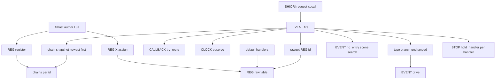
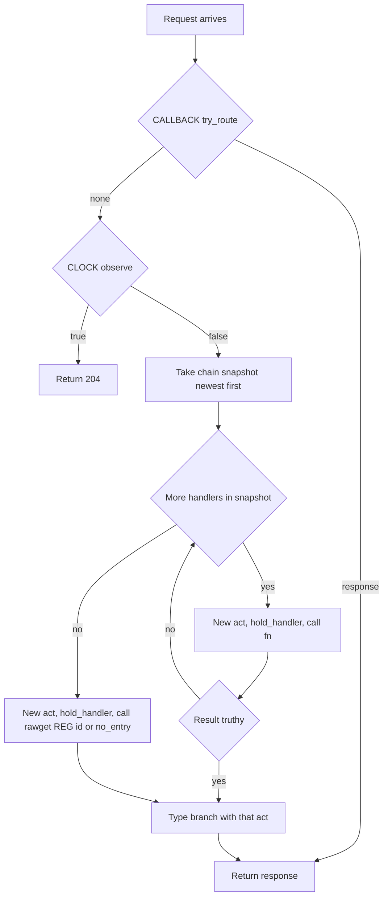

# Design Document: reg-handler-chain

## Overview

**Purpose**: SHIORI のイベントハンドラの登録表 `REG` に、1 つのイベントへハンドラを重ねて登録する口 `REG:register(id, fn)` を足し、イベントの振り分け `EVENT.fire` がその重なり（鎖）を新しい順に呼ぶようにする。ゴーストの作者は、前のハンドラを控えて包む決まり文句と、読み込みの順への依存から離れられる。

**Users**: Lua（`scripts/` の `.lua`・辞書の Lua ブロック・シーンの中の Lua）でイベントハンドラを書くゴーストの作者。動機は窓際のぱすたさん（ghost_dev）の `REG.OnSecondChange` の 3 か所の包み合い。

**Impact**: `register.lua` の `REG` に初めてメタテーブルが付き、モジュールのローカルに鎖を持つ。`EVENT.fire` のハンドラを引いて呼ぶ数行が「鎖を新しい順に呼ぶ → `rawget(REG, id)` → `EVENT.no_entry`」に替わり、呼ぶハンドラごとに新しい act を作る。鎖が空のイベントは、今と同じ道（act 1 つ・`REG[id]` か `EVENT.no_entry`）を通る。

### Goals

- `REG:register(id, fn)` で、いくつでもハンドラを重ねて登録でき、返る関数で外せる。
- 鎖は新しい順に呼ばれ、偽（`nil`・`false`）なら次へ、真なら止めて今の型判定で応答にする。
- 鎖が全部見送れば、今どおり `REG[id]` → イベントと同じ名前のシーンへ回る。今のゴースト（`REG.X = …` の代入と包み合い）は書き換えずに動く。
- 鎖の中のエラーは、今の止まるエラーの表記の決まりで、止まったハンドラ自身を指す。

### Non-Goals

- 優先度の数での並べ替え・見張り役の口・鎖を列挙する公開の口。
- 専用の「鎖を空にする口」（`register.lua` の読み直しで足りる）。
- 組み込みの既定のハンドラの置き方（`REG.X = REG.X or …`）・`CALLBACK.try_route`・`CLOCK.observe` の順の変更。
- DSL の文法への追加。ghost_dev の辞書の書き換え。

## Boundary Commitments

### This Spec Owns

- `pasta.shiori.event.register` の全体: `REG` の表・メタテーブル・鎖（ID ごとの登録の配列）・`register` の口・外す関数・`EVENT.fire` が鎖の写しを取るための内部の口。
- `EVENT.fire` のうち、act を作ってハンドラを引いて呼ぶ所（今の L228〜236）。鎖のループ・底の `rawget`・ハンドラごとの act と `STOP.hold_handler`。
- `event/init.lua` と `register.lua` の冒頭の説明のうち、ハンドラの引き方と戻り値の読み方の記述。
- 新しい Lua テスト 1 本と、Lua テストの一覧への 1 行。
- マニュアルの REG の節（返り値の表・「1 つだけ」の文・包む段落 L81〜95）・ページ冒頭の処理の順・フォールバックの図、`internals/execution-model.md`・`internals/shiori.md` の振り分けの順と `REG` の説明、生成の references の作り直し、手書きの `pasta-lua-coding/SKILL.md` の 2 か所（許可を得て）。

### Out of Boundary

- `EVENT.fire` の型判定の枝（今の L238〜255）と `EVENT.drive`・`set_co_scene`（`chain-talk-interrupt` の持ち場）。鎖が止めた値と act をそのまま渡すだけで、枝の中身は変えない。
- `event/init.lua` の既定ハンドラの読み込みの並び（L78〜82。`external-control-events` の持ち場）。
- マニュアルの既定ハンドラの表と数の文（`lua/shiori-events.md` L69〜79）。
- `pasta.shiori.stop`・`pasta.shiori.entry`・`pasta.shiori.act` の中身（今の口を呼ぶだけ）。
- 自動トークの停止（`ontalk-suppression`）・おすすめメニューの受け手の順（`recommend-menu-scenes` の要件）。
- `reference/runtime-failures.md`（「`REG` に登録した関数」の記述が鎖のハンドラも含むので、直さない）。

### Allowed Dependencies

- `register.lua` は今どおり依存モジュールを持たない（Lua の標準の `setmetatable`・`table.remove`・`error` だけ）。循環を避けるため、`act`・`STOP` などを `require` しない。
- `event/init.lua` は今の依存（`REG`・`RES`・`SHIORI_ACT`・`STORE`・`CALLBACK`・`STOP`・`CLOCK`）だけを使う。新しい `require` は足さない。
- 依存の向き: `register.lua` ← `event/init.lua` ← `entry.lua`。`register.lua` から上へは向かない。

### Revalidation Triggers

- `register` の呼び方・返り値の読み方（偽なら次・真なら止める）・新しい順の変更。`recommend-menu-scenes` の「Lua の `REG` が勝つ」の順と、マニュアルの作例を見直す。
- `EVENT.fire` の act の作り方（ハンドラごと）の変更。`chain-talk-interrupt` が `EVENT.drive` に渡す act と、`STOP.hold_handler` の控えの意味が変わる。
- `REG` のメタテーブルの形（`__index` で見せる名前）の変更。`REG` を読む Rust のテスト（`next(REG) == nil` を確かめる `event_dispatch_test.rs` L40）と、`pairs(REG)` で表を空にする 3 つのテストを見直す。
- 鎖を空に戻す方法（読み直し）の変更。Lua テストの一覧が 1 つの VM で続けて走るため、全スイートの持ち越しを見直す。

## Architecture

### Existing Architecture Analysis

- `REG` は `local REG = {}` を返すだけの表（`register.lua` 48 行。依存無し）。既定のハンドラ 7 つは `REG.X = REG.X or function … end` で `event/boot.lua` ほかが置く。
- `EVENT.fire`（`event/init.lua` L216〜256）: `CALLBACK.try_route` → `CLOCK.observe` → `create_act` → `REG[req.id] or EVENT.no_entry` → `STOP.hold_handler(act)` → `handler(act)` → 型判定（thread は `EVENT.drive(result, act, act)`、文字列は `SHIORI/` 素通しか `RES.ok`、それ以外は 204）。
- 型判定の枝は `true`・数・表も 204 にし、`RES.ok("")` も 204 にする。鎖が止めた値をこの枝へ渡せば、要件 2.3〜2.6 はそのまま満たす。
- エラーは `entry.lua` の `xpcall` が受け、`STOP.take_handler()` の act に表記を積む。控えは 1 要求に 1 つで上書き。ハンドラを呼ぶたびに控え直せば、最後の控え＝止まったハンドラの act になる。
- Rust 側は `REG` を直接読まない（`crates/*/src` に参照無し）。テストと fixtures は `REG.X = …` の代入と `next(REG) == nil` の確かめだけを使う。

### Architecture Pattern & Boundary Map



**Architecture Integration**:
- Selected pattern: 既存の延長（research.md の Option A）。鎖は `register.lua` のモジュールのローカル、呼ぶのは `EVENT.fire`。
- Domain/feature boundaries: 登録と鎖の持ち主は `register.lua`、呼び順と act の作り方は `EVENT.fire`。応答の形（型判定）は今の枝のまま。
- Existing patterns preserved: `REG.X = REG.X or …` の既定ハンドラ・`xpcall` と `STOP` のエラーの道・`EVENT.drive` の再開・テストの `package.loaded` からの読み直し。
- New components rationale: 鎖（ID ごとの配列）と `register` の口だけ。ほかは既存の口を呼ぶ。
- Steering compliance: LuaJIT 2.1（`goto`・`<close>` を使わない）。`register.lua` は依存無しのまま。

### Technology Stack

| Layer | Choice / Version | Role in Feature | Notes |
|-------|------------------|-----------------|-------|
| Runtime | LuaJIT 2.1（mlua 0.11） | `REG` のメタテーブル・鎖・`EVENT.fire` のループ | Lua 5.1 の範囲（`setmetatable`・`rawget`・`table.remove`） |
| Test | lua_test（scriptlibs）・`lua_unittest_runner.rs` | 新しい Lua テスト | 1 つの VM で全スイートが続けて走る |
| Docs | mdBook・`book/tools/gen-skill-refs.mjs` | マニュアルと references の作り直し | CI が `--check` で鮮度を照合する |

新しい依存は無い。

## File Structure Plan

### Directory Structure

```
crates/pasta_lua/
├── pasta_scripts/pasta/shiori/event/
│   ├── register.lua        # REG・メタテーブル・鎖・register の口・外す関数・鎖の写しの内部の口
│   └── init.lua            # EVENT.fire の act の作成とハンドラの引き方・呼び方（L228〜236）と冒頭の説明
└── tests/lua_specs/
    ├── reg_handler_chain_test.lua   # 新規: 要件 1〜6 の振る舞い
    └── init.lua                     # 一覧に "reg_handler_chain_test" を 1 行
book/src/
├── lua/shiori-events.md             # REG の節・冒頭の処理の順・フォールバックの図
├── internals/execution-model.md     # EVENT.fire の手順の図と経路の列挙
└── internals/shiori.md              # 振り分けの順・モジュール表の REG・hold_handler の説明・OnSecondChange 前段の図
.claude/skills/pasta-lua-coding/
├── references/*.md                  # 生成物（gen-skill-refs.mjs で作り直す。手で触らない）
└── SKILL.md                         # 手書き。モジュール表 L111 と §6 L174（開発者の許可を得てから）
```

### Modified Files

- `crates/pasta_lua/pasta_scripts/pasta/shiori/event/register.lua` — 鎖・`register`・外す関数・鎖の写しの口を足し、冒頭の説明に `REG:register` と鎖のハンドラの返り値の読み方を書く。
- `crates/pasta_lua/pasta_scripts/pasta/shiori/event/init.lua` — L228〜236 を鎖のループと底の呼び出しに替える。冒頭の説明（L1〜66）のハンドラの引き方・シーン関数フォールバックの段落に鎖を加える。L238〜255 と L78〜82 は触らない。
- `crates/pasta_lua/tests/lua_specs/init.lua` — 一覧に 1 行。
- `crates/pasta_lua/tests/lua_specs/reg_handler_chain_test.lua` — 新規。
- 3 つの既存テスト（`event_clock_hook_test.lua`・`event_coroutine_test.lua`・`second_change_thread_test.lua`）は直さない（読み直しで鎖も空になる。要件 7.2 の確かめは走らせて通ることで行う）。
- `book/src/lua/shiori-events.md` — L15〜16（処理の順）、L20〜66 の REG の節（返り値の表の後に鎖の小節、L55「1 つだけ」の文）、L81〜95（包む段落に鎖での書き換え例）、L738〜750（フォールバックの図）。L69〜79 は触らない。
- `book/src/internals/execution-model.md` — L157〜161 の手順の図、L174 の経路の列挙。
- `book/src/internals/shiori.md` — L96（`REG` の説明「依存を持たない空の表」）、L314〜318（振り分けの順）、L358（`hold_handler` を呼ぶ時期）、L410〜413（OnSecondChange の前段の図）。
- `.claude/skills/pasta-lua-coding/references/` — `node book/tools/gen-skill-refs.mjs` で作り直す。
- `.claude/skills/pasta-lua-coding/SKILL.md` — L111・L174 に `REG:register(id, fn)` を足す。分類器が止めるので、直すその場で開発者の許可を求める。

## System Flows



- 写しはループの前に 1 回だけ取る。ループの途中の登録・外しは写しに効かず、次のイベントから効く（4.5）。
- 鎖のハンドラも底も、呼ぶたびに `create_act(req)` と `STOP.hold_handler(act)` をする。型判定に渡す act は、止めたハンドラ（または底）の act である（2.9・6.3）。
- 底の戻り値は今どおり真偽で見ない（`nil`・`false` でもシーンへは回らず、型判定で 204）。
- エラーは `xpcall` へそのまま抜けるので、止まったハンドラより古い登録・底・シーンは呼ばれず、登録も外れない（6.1・6.2・6.5）。

## Requirements Traceability

| Requirement | Summary | Components | Interfaces | Flows |
|-------------|---------|------------|------------|-------|
| 1.1 | 登録して外す関数を返す | RegisterModule | `REG:register` | — |
| 1.2 | いくつでも重ねる | RegisterModule | 鎖の配列 | — |
| 1.3 | 同じ関数の 2 回は別の登録 | RegisterModule | 登録ごとの目印の表 | — |
| 1.4 | どこからでもいつでも | RegisterModule | `require` で同じ `REG` | — |
| 1.5 | `pairs(REG)` に出さない | RegisterModule | 鎖はモジュールのローカル | — |
| 1.6 | `REG.X` の代入と読み出しを変えない | RegisterModule | `__index` は `register` だけ | — |
| 1.7 | 引数を確かめてエラー | RegisterModule | `error(…, 2)` | — |
| 2.1 | 新しい順に呼ぶ | RegisterModule, EventFire | 鎖の写し（新しい順） | 振り分け |
| 2.2 | 偽なら次へ | EventFire | ループの真偽判定 | 振り分け |
| 2.3 | `true` は 204 | EventFire | 今の型判定の枝 | 振り分け |
| 2.4 | 文字列は今の決まり | EventFire | 今の型判定の枝 | 振り分け |
| 2.5 | コルーチンは今の決まり | EventFire | `EVENT.drive(result, act, act)` | 振り分け |
| 2.6 | ほかの真の値・`""` は止めて 204 | EventFire | 今の型判定の枝・`RES.ok("")` | 振り分け |
| 2.7 | 止めたら古い方・底・シーンを呼ばない | EventFire | ループの `break` | 振り分け |
| 2.8 | コールバック・時計が先 | EventFire | L218〜226 を変えない | 振り分け |
| 2.9 | ハンドラごとに新しい act | EventFire | `create_act(req)` を呼ぶたび | 振り分け |
| 3.1 | 全部見送れば `REG[id]` | EventFire | `rawget(REG, req.id)` | 振り分け |
| 3.2 | それも無ければシーン | EventFire | `EVENT.no_entry` | 振り分け |
| 3.3 | 鎖が空なら今と同じ応答 | EventFire | 写しが空ならループを素通り | 振り分け |
| 3.4 | 代入は底だけを替える | RegisterModule | 鎖と表は別の置き場所 | — |
| 3.5 | 包み合いはそのまま動く | RegisterModule, EventFire | 表の読み書きは生のまま | — |
| 3.6 | 既定 OnSecondChange は底に残る | EventFire | 底の呼び出し | 振り分け |
| 4.1 | 外せば次から呼ばない | RegisterModule | 外す関数 | — |
| 4.2 | ほかの登録と順を変えない | RegisterModule | 目印の表で 1 つだけ取り除く | — |
| 4.3 | 2 回目以降は何もしない | RegisterModule | 見つからなければ何もしない | — |
| 4.4 | 全部外せば今と同じ | RegisterModule, EventFire | 空の配列＝空の写し | 振り分け |
| 4.5 | 途中の登録と外しは次から | RegisterModule, EventFire | 呼ぶ前の写し | 振り分け |
| 5.1 | すべての ID に同じ決まり | EventFire | ID で分けない | 振り分け |
| 5.2 | `register` という ID | EventFire | `rawget`（`__index` を通らない） | 振り分け |
| 6.1 | 今と同じエラーの応答 | EventFire | `xpcall`・`STOP.response`（既存） | 振り分け |
| 6.2 | 止まったら古い方・底・シーンを呼ばない | EventFire | エラーがループから抜ける | 振り分け |
| 6.3 | 止まったハンドラ自身を指す | EventFire | 呼ぶたびの `STOP.hold_handler(act)` | 振り分け |
| 6.4 | コルーチンのエラーは今と同じ | EventFire | `EVENT.drive` の失敗の枝（既存） | 振り分け |
| 6.5 | エラーで登録を外さない | RegisterModule | 外すのは外す関数だけ | — |
| 7.1 | 読み直しで鎖も空 | RegisterModule | 鎖はモジュールのローカル | — |
| 7.2 | 既存の 3 つのテストが通る | RegisterModule | 読み直しと `pairs(REG)` | — |
| 7.3 | 自動テストと一覧 | ChainTest | `reg_handler_chain_test.lua`・一覧の 1 行 | — |
| 8.1 | REG の節に書き方・返り値の表・順・外す・底 | ManualDocs | `lua/shiori-events.md` の新しい小節 | — |
| 8.2 | 包み合いからの書き換え例 | ManualDocs | `lua/shiori-events.md` L81〜95 | — |
| 8.3 | 「1 つだけ」の文・処理の順・フォールバックの図 | ManualDocs | `lua/shiori-events.md` L15〜16・L55・L738〜750 | — |
| 8.4 | 見張り役が無いこと | ManualDocs | 新しい小節 | — |
| 8.5 | `＞自動トーク停止` と門の使い分け | ManualDocs | 新しい小節 | — |
| 8.6 | 内部の説明 | ManualDocs | `internals/execution-model.md`・`internals/shiori.md` | — |
| 8.7 | references の作り直し | ManualDocs | `gen-skill-refs.mjs` | — |
| 8.8 | 手書きの SKILL.md | ManualDocs | `SKILL.md` L111・L174（許可を得て） | — |

## Components and Interfaces

| Component | Domain/Layer | Intent | Req Coverage | Key Dependencies (P0/P1) | Contracts |
|-----------|--------------|--------|--------------|--------------------------|-----------|
| RegisterModule | Lua runtime（`register.lua`） | `REG` の表・鎖・登録と外し | 1.1〜1.7, 3.4, 3.5, 4.1〜4.5, 6.5, 7.1, 7.2 | なし | Service, State |
| EventFire | Lua runtime（`event/init.lua` の `EVENT.fire`） | 鎖 → 底 → シーンの順で呼び、ハンドラごとに act を作る | 2.1〜2.9, 3.1〜3.3, 3.6, 4.4, 4.5, 5.1, 5.2, 6.1〜6.4 | RegisterModule (P0), SHIORI_ACT (P0), STOP (P0), 型判定の枝 (P0) | Service |
| ChainTest | Test（`lua_specs`） | 要件 1〜6 の振る舞いを確かめる | 7.3（1〜6 の確かめ） | lua_test (P0), entry の読み直し (P1) | — |
| ManualDocs | Docs（`book/src`・スキル） | 鎖の書き方・順・書き換え例・内部の順 | 8.1, 8.2, 8.3, 8.4, 8.5, 8.6, 8.7, 8.8 | gen-skill-refs.mjs (P1) | — |

### Lua runtime

#### RegisterModule

| Field | Detail |
|-------|--------|
| Intent | `REG` の表に `register` の口と鎖を足し、鎖の写しを `EVENT.fire` に渡す |
| Requirements | 1.1, 1.2, 1.3, 1.4, 1.5, 1.6, 1.7, 3.4, 3.5, 4.1, 4.2, 4.3, 4.4, 4.5, 6.5, 7.1, 7.2 |

**Responsibilities & Constraints**
- `REG` は今どおりの表で、生のキーはイベントのハンドラだけ（`pairs(REG)`・`next(REG)` に鎖も `register` も出ない）。
- メタテーブルの `__index` は `register` の 1 つだけを見せる。ほかのキーの読み出しは今どおり `nil`。
- 鎖はモジュールのローカルの表 `chains`（ID → 登録の配列。古い順に積む）。モジュールを読み直せば空になる。
- 依存モジュールを持たない。

**Contracts**: Service [x] / State [x]

##### Service Interface

```lua
--- 登録の口（REG:register(id, fn) で呼ぶ）
---@param self table       REG（: で呼んだときに入る。中身は見ない）
---@param id string        イベントかリソースの ID
---@param fn fun(act: table): (string|thread|boolean|nil|any)
---@return fun()           外す関数（自分の登録だけを外す。2 回目以降は何もしない）
function register(self, id, fn) end

--- 鎖の写し（内部の口。EVENT.fire だけが使う。REG.X からは見えない）
---@param id string|nil
---@return fun(act: table)[]   新しく登録した順に並べた関数の配列の写し（無ければ空の配列）
function handlers(id) end
```

- 置き方: `setmetatable(REG, { __index = { register = register }, handlers = handlers })`。`EVENT.fire` は `getmetatable(REG).handlers(req.id)` で引く（`__index` を通さないので `REG.handlers` は今どおり `nil`）。
- Preconditions: `id` は文字列、`fn` は関数。違えば登録せず `error(メッセージ, 2)`（呼んだ所の位置が付く）。メッセージは今の Lua の口の書き方（`act.lua` の `"get_property: …"` の形）に合わせ、`REG:register: id must be a string (call as REG:register(id, fn))`・`REG:register: fn must be a function` とする。`REG.register(id, fn)`（`:` 無し）は `id` の位置に関数が入るので、前者で止まる。
- Postconditions: 登録ごとに新しい目印の表 `{ fn = fn }` を `chains[id]` の末尾に積む。外す関数は、その目印を配列から探して `table.remove` で取り除く（同じ関数の 2 回の登録も目印が別なので、自分だけが外れる）。見つからなければ何もしない。
- Invariants: `chains` と `REG` の生のキーは別の置き場所。`REG.X = 関数` は鎖に触れず、`REG:register` は `REG` の生のキーに触れない。`handlers` は毎回新しい配列を返し、呼ぶ側がループ中に鎖が変わっても写しは変わらない。

##### State Management

- State model: `chains: table<string, { fn: function }[]>`（古い順）。VM と同じ寿命で、保存しない。
- Persistence & consistency: モジュールの読み直し（`package.loaded["pasta.shiori.event.register"] = nil`）で新しい `REG` と空の `chains` になる（7.1）。前の `REG` に取られた外す関数は前の配列を指すだけで、無害。
- Concurrency strategy: VM は 1 スレッド。ループの途中の登録と外しは、呼ぶ前の写しで隔てる（4.5）。

**Implementation Notes**
- Integration: 既定ハンドラの `REG.X = REG.X or …` は `register` 以外のキーなので `__index` の影響を受けない。
- Validation: `next(REG) == nil`（`event_dispatch_test.rs` L40）と、3 つのテストの `pairs(REG)` のループが今どおり働くこと。
- Risks: 作者が `REG.register = 関数` と代入すると、生のキーが `__index` より先に引かれ、`REG:register` の口が隠れる（Design Decision 2。守らず、内部の説明に書く）。

#### EventFire

| Field | Detail |
|-------|--------|
| Intent | 鎖を新しい順に呼び、全部見送れば底（`rawget(REG, id)` → `EVENT.no_entry`）を呼んで、止めた値を今の型判定へ渡す |
| Requirements | 2.1, 2.2, 2.3, 2.4, 2.5, 2.6, 2.7, 2.8, 2.9, 3.1, 3.2, 3.3, 3.6, 4.4, 4.5, 5.1, 5.2, 6.1, 6.2, 6.3, 6.4 |

**Responsibilities & Constraints**
- `CALLBACK.try_route`・`CLOCK.observe`（L218〜226）の後で動く。そこは変えない（2.8）。
- 鎖の写しを 1 回だけ取り、新しい順に呼ぶ。1 つ呼ぶたびに `act = create_act(req)`・`STOP.hold_handler(act)`・`result = fn(act)`。`result` が真なら止める（2.2・2.7）。
- 全部見送れば、もう 1 度 `act = create_act(req)`・`STOP.hold_handler(act)` をして、`(rawget(REG, req.id) or EVENT.no_entry)(act)` を呼ぶ（3.1・3.2・5.2）。底の戻り値は真偽で見ない。
- 止めたハンドラ（または底）の `act` と `result` を、今の型判定の枝（L238〜255）へそのまま渡す。枝は変えない（2.3〜2.6）。
- 鎖が空なら、act は 1 つだけ作られ、今と同じ道を通る（3.3・4.4）。
- エラーは捕まえない。`xpcall` へ抜ける（6.1・6.2・6.5）。

**Dependencies**
- Outbound: RegisterModule — 鎖の写し `getmetatable(REG).handlers(id)` と、底の `rawget(REG, id)`（P0）
- Outbound: `SHIORI_ACT.new`（`create_act`）— ハンドラごとの act（P0）
- Outbound: `STOP.hold_handler` — 止まったときの表記の act（P0）
- Outbound: 型判定の枝・`EVENT.drive` — 応答の形（P0。`chain-talk-interrupt` が中身を直しうる）
- Inbound: `entry.lua` の `SHIORI.request`（`xpcall` の中）（P0）

**Contracts**: Service [x]

##### Service Interface

```lua
--- 今と同じ口。中の順だけが変わる
---@param req table  リクエストテーブル（req.id がイベントかリソースの ID。nil もありうる）
---@return string    SHIORI 応答
function EVENT.fire(req) end
```

- 変える行（今の L228〜236）の形:
  - `local act, result` を宣言し、`for _, fn in ipairs(getmetatable(REG).handlers(req.id)) do … if result then break end end` で鎖を回す。
  - `if not result then` で底を呼ぶ。
  - その後は今の `-- 型判定` の枝が `act` と `result` を読む（枝の行は変えない）。
- Preconditions: `req` は今と同じ形。`req.id` が `nil` でも、写しは空・`rawget(REG, nil)` は `nil` で、今どおり `EVENT.no_entry` へ回る。
- Postconditions: 応答は今の型判定の決まりで作られる。止めたハンドラ・底のどれか 1 つの act が `STOP` に控えられている。
- Invariants: 鎖のハンドラ・底・シーンは、それぞれ別の act を受け取る。前のハンドラが積んだ台詞は、後の出力に混ざらない。

**Implementation Notes**
- Integration: `event/init.lua` の持ち場の約束は「L231〜236 と冒頭の説明」だが、act を作る L228〜229 も同じ塊として替える（ループの中で作り直すため）。L238〜255（`chain-talk-interrupt`）・L78〜82（`external-control-events`）は触らない（Design Decision 1）。
- Validation: 鎖が空のイベントで、既存の Rust・Lua のテストが全部通ること。
- Risks: OnSecondChange は毎秒届き、鎖の長さ＋1 個の act を作る。`SHIORI_ACT.new` は設定を 3 つ読む程度で、負担は小さい。

### Test

#### ChainTest（`reg_handler_chain_test.lua`）

- 始めに、`event_clock_hook_test.lua` の `reload()` と同じく、`pasta.shiori.event`・`pasta.shiori.event.register`・`pasta.store`・既定ハンドラのモジュールを `package.loaded` から外して読み直す。エラーの確かめは、`shiori_entry_test.lua` と同じく entry の依存の閉包（`pasta.shiori.entry`・`pasta.shiori.stop`・`pasta.config` ほか）を一括で読み直し、`SHIORI.request` を通す。
- 後片付けは外す関数に頼らない。各テストの始めに読み直し、スイートの最後のテストでもう 1 度読み直して、鎖の無い `REG` を後のスイートへ渡す。Lua テストは 1 つの VM で続けて走り、`register` を読み直さないスイート（`event_no_entry_test.lua` ほか）が後にあるため。途中の assert が落ちて外す関数が呼ばれなくても、鎖が持ち越されない（lua_test に `after_each` は無いので、既存の `teardown()` の流儀に合わせる）。
- 確かめる振る舞いは Testing Strategy のとおり。

### Docs

#### ManualDocs

- `lua/shiori-events.md`:
  - 冒頭の処理の順（L15〜16）を「3. `REG:register` で重ねたハンドラ（鎖）を新しい順に呼ぶ／4. 全部見送れば `REG` のハンドラ／5. それも無ければシーン」にする。
  - REG の節: 返り値の表の後に「ハンドラを重ねる（`REG:register`）」の小節を足す。中身は書き方・外す関数・新しい順・鎖のハンドラの返り値の表（`nil`・`false`＝次へ、`true`＝止めて 204、文字列とコルーチン＝今の表のとおり、`""` も止まって 204、数・表も止まって 204）・ハンドラごとに新しい act・鎖の底・見張り役が無いこと・`＞自動トーク停止` と鎖の門の使い分け。L55「1 つのイベントに登録できるハンドラは 1 つである」は「`REG.X` に置けるハンドラは 1 つ（代入し直すと置き換わる）。重ねるときは `REG:register`」に改める。
  - 包む段落（L81〜95）: 今の包み方を残したまま、鎖での書き換え例（毎秒の処理を足す例・`true` を返す一時的な門を外す例）を足す。L69〜79 は触らない（ただし `external-control-events` が先に main に入っていれば、L69 の「登録すると」を「代入すると」に 1 語だけ直す。Design Decision 6）。
  - フォールバックの図（L738〜750）: 先頭に鎖の段を足す。
- `internals/execution-model.md` L157〜161・L174、`internals/shiori.md` L96・L314〜318・L358・L410〜413 を鎖を含む順に改める。
- 作り直し: `node book/tools/gen-skill-refs.mjs`（CI の `--check` を通すため）。
- 手書きの `SKILL.md`: L111 のモジュール表に `REG:register(id, fn)`、L174 の §6 の要約に「`REG:register` で重ねる」を足す。分類器が `.claude/skills` の編集を止めるので、そのタスクで開発者の許可を求めてから直す。

## Error Handling

### Error Strategy

- 登録の引数の誤り（1.7）は、`register` の中で `error(…, 2)` を投げ、何も登録しない。作者の Lua の読み込み（`scripts/` の `.lua` やシーンの中）で起きるので、今の読み込みのエラーやシーンのエラーと同じ道で見える。
- 鎖のハンドラの実行時のエラー（6.1〜6.5）は、`EVENT.fire` で捕まえず、`entry.lua` の `xpcall` → `STOP.response` の今の道に任せる。ハンドラを呼ぶたびに `STOP.hold_handler(act)` で控え直すので、表記はそのハンドラの act の台詞の後に積まれ、対象はシーンの名前が無ければ要求の ID、場所はエラー文の「チャンク:行」から作られる（止まったハンドラ自身の場所）。
- 鎖のハンドラが返したコルーチンのエラー（6.4）は、今の型判定の枝の `EVENT.drive` の失敗の枝（`STOP.hold` → `error`）を通る。
- エラーで鎖の登録は外さない（6.5）。

### Monitoring

- 新しいログは足さない。止まるエラーの警告（`balloon_warning`）は今の `STOP.response` の決まりのまま。

## Testing Strategy

### Unit Tests（`reg_handler_chain_test.lua`、`EVENT.fire` を直接呼ぶ）

1. 順番と止まり方: 3 つ登録し、新しい順に呼ばれる・`nil`/`false` は次へ・文字列で止まって 200・`true` で止まって 204・`""`/数/表で止まって 204・止めた後は古い方と底が呼ばれない（1.1, 1.2, 2.1〜2.4, 2.6, 2.7）。
2. 底と互換: 全部見送れば `REG.X`（代入）が呼ばれる・`REG.X` が無ければ同名のシーン（`SCENE.search` の差し替え）・鎖が空なら今と同じ応答・代入しても鎖は残る・包み合い（`local prev = REG.X`）がそのまま動く・`pairs(REG)` に鎖も `register` も出ない・`REG.register` は関数・`REG.Unknown` は `nil`（1.5, 1.6, 3.1〜3.5）。
3. act: 見送ったハンドラが積んだ台詞が、後のハンドラ・底の出力に混ざらない（2.9）。
4. 外す: 外せば次から呼ばれない・ほかの順は変わらない・2 回目は何もしない・全部外せば今と同じ・同じ関数の 2 回の登録はそれぞれ外れる・ループの途中の登録と外しは次のイベントから効く（1.3, 4.1〜4.5）。
5. ID: `sakura.recommendsites` のような ID にも効く・`register` という ID の要求で登録の口が呼ばれず、鎖 → 代入 → 204 の順になる・コールバックへの応答と `OnPastaClock` の回は鎖を呼ばない・引数の誤り（文字列でない ID・関数でない値・`REG.register(id, fn)`）はエラーで何も登録しない（1.7, 2.8, 5.1, 5.2）。

### Integration Tests（同じファイル、entry の閉包を読み直して `SHIORI.request` を通す）

1. コルーチンを返す鎖のハンドラ: 出力が 200、出力が無ければ 204。続きは `STORE.co_scene` に今どおり残る（2.5）。
2. 鎖のハンドラのエラー: 新しいハンドラが台詞を積んで見送り、古いハンドラが台詞を積んで止まる。表記の応答は古いハンドラの台詞の後に表記が付き、見送った台詞を含まず、理由の行にテストのファイルのチャンクと行が出る。底は呼ばれない。次のイベントでは両方とも呼ばれる（6.1〜6.3, 6.5）。
3. 鎖のハンドラが返したコルーチンのエラー: 今の `REG` のハンドラのコルーチンと同じ応答（6.4）。
4. 底の既定 OnSecondChange: 鎖が全部見送った秒に、既定の OnSecondChange（`virtual_dispatcher.dispatch` の差し替えで観測）が呼ばれる（3.6）。

### Regression

- 3 つの既存テスト（`event_clock_hook_test`・`event_coroutine_test`・`second_change_thread_test`）を直さずに通す（7.2）。
- `cargo test -p pasta_lua`（Lua テストの一覧を含む）と `cargo test -p pasta_shiori`（`runtime_error_balloon` ほかの fixtures）を通す。
- `node book/tools/gen-skill-refs.mjs --check` が通る（8.7）。

## Performance & Scalability

- 1 回のイベントで作る act は「止まるまでに呼んだ鎖のハンドラの数＋（見送ったなら）1」。鎖の写しは毎回の小さな配列 1 つ。鎖が空のイベントは今と同じ 1 つの act と、空の配列 1 つ。
- 数の上限は置かない（2026-10-22 決定の範囲外。見張り役・優先度と同じく作らない）。

## Migration Strategy

- 移行は要らない。今の `REG.X = …` の代入と包み合いは、鎖の底としてそのまま動く。ghost_dev の書き換えは、マニュアルの書き換え例を手がかりに ghost_dev の側で行う（範囲外）。

## Design Decisions（2026-10-23 設計ディスカッションで一括承認）

1. **`event/init.lua` の持ち場の端**（決定: L228〜236 をまとめて替える。変数名 `act`・`result` は今のまま残し、L238〜255 の型判定の枝は 1 文字も変えない。ぶつかったら後から入る側が rebase で合わせる）。棚卸の約束は「L231〜236 と冒頭の説明」。ハンドラごとに act を作るため、L228〜229 の `local act = create_act(req)` もループへ移す必要がある。L238〜255（型判定・`chain-talk-interrupt`）とは間に空行とコメント行（`-- 型判定`）を残して触る。
2. **`REG.register = 関数` の代入**（決定: 守らず、`internals/shiori.md` の `REG` の説明にだけ書く）。生のキーが `__index` より先に引かれるので、作者が `register` という ID のハンドラを `REG.register` に代入すると、以後 `REG:register` の口が隠れる。`__newindex` で止める案は、要件 1.6（代入を今と同じに働かせる）と引き換えになるので取らない。`register` という ID の底を置きたい作者はまず居ない。
3. **内部の口の置き場所**（決定: メタテーブルの `handlers` 欄、`getmetatable(REG).handlers(id)`）。`__index` に置くと `REG.handlers` が `nil` でなくなり、要件 1.6 に反する。モジュールを分ける案（research.md の Option B）は、読み直しで鎖が空にならないので取らない。
4. **場所の表記の確かめ方**（決定: Lua テストで理由の行にテストのファイルのチャンクと行が出ることを見る。`pasta_shiori` の e2e fixture（`runtime_error_balloon`）には鎖のケースを足さない）。`scripts/` の `.lua` のファイルと行に直す仕組み（`@pasta_chunks`）は鎖と無関係で、今の `REG` のハンドラの e2e が既に確かめている。
5. **引数の誤りのメッセージの言葉**（決定: 今の Lua の口に合わせ、英語の `REG:register: …` の形。直し方 `(call as REG:register(id, fn))` を添える）。
6. **マニュアル L69 の「登録すると置き換わる」**（決定: 新しい小節に「既定ハンドラが置き換わるのは `REG.X` への代入のときで、`REG:register` で重ねても既定は鎖の底に残る」と書く。実装のときに `external-control-events` が main に入っていれば、L69 の「登録すると」を「代入すると」に 1 語だけ直す。入っていなければ L69 は触らない）。
