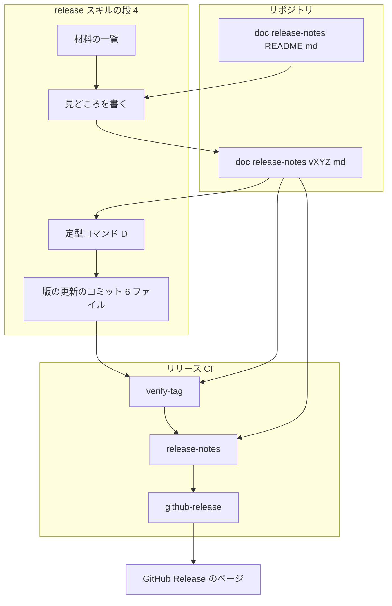
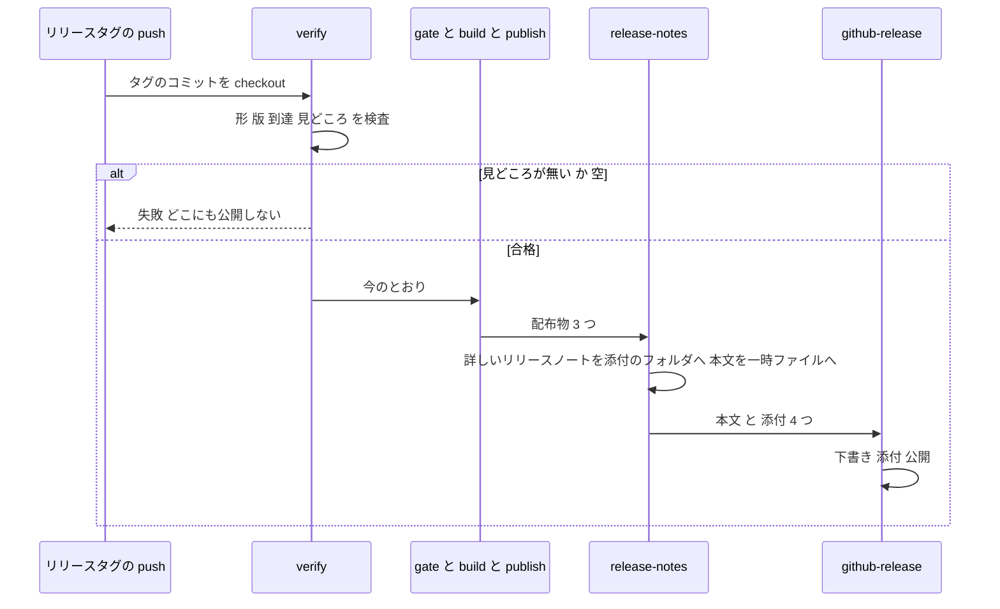
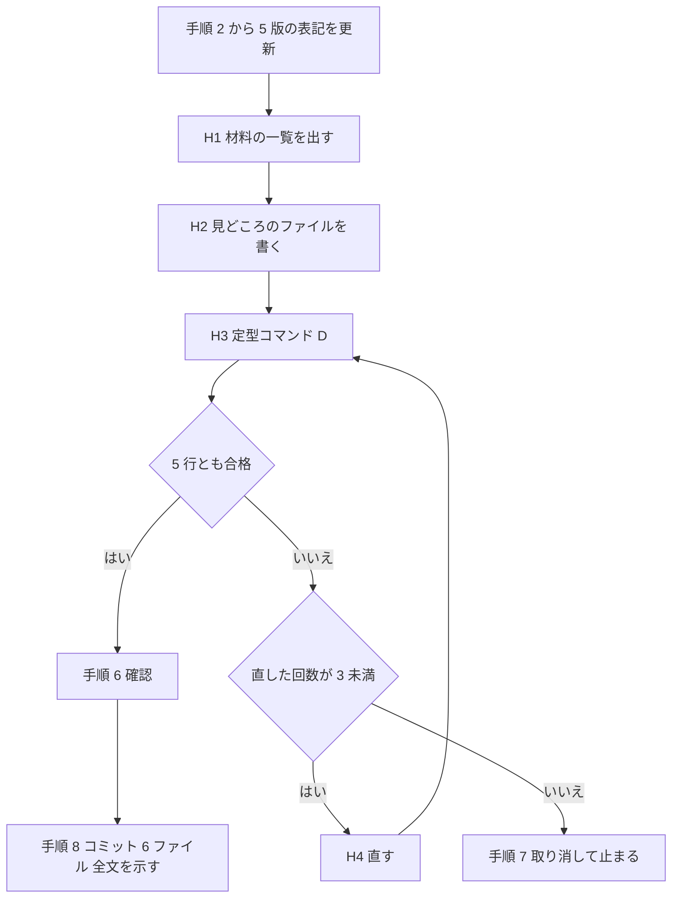
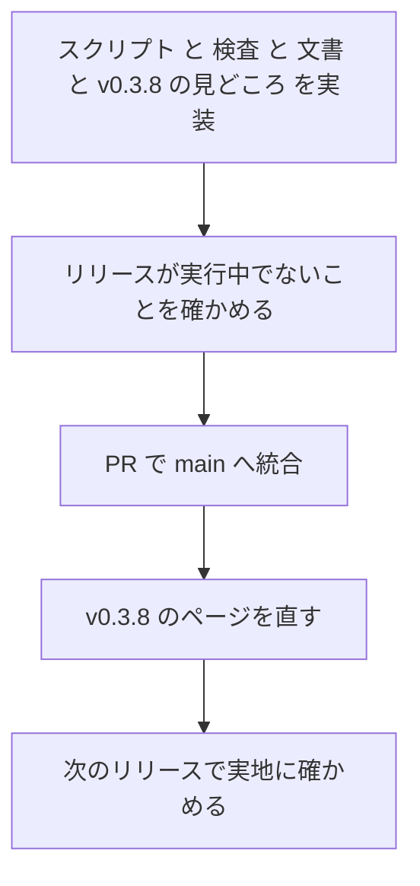

# Design Document

## Overview

**Purpose**: GitHub のリリースの本文を、コミットの件名の一覧から、その版の見どころを Claudia の口調で紹介する文章へ変える。すべての変更の一覧は、詳しいリリースノートとして Assets に添付する。

**Users**: リリースのページを読む人（ゴーストを作る人・pasta を使ってみようとする人）は、本文で見どころと動きが変わる点を読む。開発者とエージェントは、リリースの手順（`release` スキル。`/release`）の中で見どころを書く。

**Impact**: リリース CI（`release.yml` と補助スクリプト）の、タグの検査・ノートの生成・添付の数が変わる。`release` スキルの版の更新のコミットに、見どころのファイルが 1 つ加わる。この spec が main に入った後は、見どころのファイルの無いリリースタグは、公開の前に止まる。

### Goals

- 本文が、見どころのファイル（`doc/release-notes/vX.Y.Z.md`）の内容で始まり、詳しいリリースノートの添付へのリンクで終わる。
- 見どころのファイルの無い・空のリリースタグが、タグの検査の段で止まり、どこにも公開されない。
- 詳しいリリースノートが、接頭辞（種類・スコープ）と内部の作業を含まない一覧で、4 つ目の添付になる。
- `release` スキルが、見どころを書く節と、機械で確かめる定型コマンドを持つ。
- 公開済みの v0.3.8 のページが、同じ形になる。

### Non-Goals

- v0.3.7 より前のリリースの書き直し。
- 見どころの材料を溜める仕組み、マニュアルの更新履歴のページ、英語の本文。
- コミットの件名の本文の書き換え。
- リリース CI による、見どころの文章の中身の検査。
- 公開した後の本文の直し方。
- `release.yml` の publish-crates・publish-vsce・build・report の job の変更。

## Boundary Commitments

### This Spec Owns

- 見どころのファイルの置き場所（`doc/release-notes/`）・名前・書き方の決まり（`doc/release-notes/README.md`）。
- 内部の作業の決まり（`release-notes.ps1` の定数と、`README.md` の説明）。
- 詳しいリリースノートの形（見出しの並び・件名の整形）と、本文の組み立て（末尾の 1 行）。
- 4 つ目の添付の名前（`release-notes-vX.Y.Z.md`）。
- 見どころの検査（リリース CI の側は `verify-tag.ps1`、手順の側は定型コマンド D）。
- `release` スキル（`.claude/skills/release/` の `SKILL.md`・`procedure.md`・`scripts/`）への書き足し（見どころを書く節・6 ファイル・定型コマンド C の 5 行目・定型コマンド D）。
- v0.3.8 のページの 1 回きりの直し。

### Out of Boundary

- 完了した `release-ci`・`release-workflow` の spec の文書（`.kiro/specs/completed/` の下。書き換えない）。
- `release.yml` の verify・github-release のほかの job と、公開先ごとの結果の報告の形（`published`・`skipped`・`failed`・`not-run`・理由・URL）。
- `release` スキルの段 2・3・7・9 の挙動、判定表 S0〜S9・F0〜F7、定型コマンド A・B、スキルの前書き（呼び出しの形）。段 8 は、定型コマンド C の行数の言い方だけを直す。
- 定型コマンド A の「添付 3/3」の判定。A は配布物の 3 つを名前で数え、詳しいリリースノートを数えない。4 つ目の添付がそろったかは、リリース CI（`github-release.ps1`）の結果で分かるので、A は変えない。
- `book/AUTHORING.md`（参照するだけである）。
- `.claude/settings.json` の操作の許可（足さない）。

### Allowed Dependencies

- `git`（履歴・タグ）、`gh`（Release の作成・添付。v0.3.8 の直しでは `gh release upload`・`gh release edit`）、pwsh 7。
- `release-notes.ps1` は `git` だけに依存する。ネットワークと `gh` を使わない。
- 定型コマンド D（`highlights-check.ps1`）は、`release-notes.ps1` と `.kiro/specs/` のフォルダ名に依存する。
- 依存の向き: `doc/release-notes/` ← `release-notes.ps1` ← `highlights-check.ps1`・`release.yml`。`verify-tag.ps1` は `doc/release-notes/` だけを読む。逆向きに依存させない。
- 新しいライブラリ・Action・secret を足さない。

### Revalidation Triggers

- 見どころのファイルの置き場所か名前を変える → `verify-tag.ps1`・`release-notes.ps1`・`pretag-check.ps1`・`highlights-check.ps1`・`release` スキルの `SKILL.md` と `procedure.md`・`RELEASE.md`。areka の側とも食い違う。
- 詳しいリリースノートの見出し「動きが変わる変更」の文言を変える → `highlights-check.ps1`（その見出しの下の PR の番号を読む）。
- 添付の名前か数を変える → `github-release.ps1`・本文の末尾のリンク・`tech.md`・`RELEASE.md`。
- `github-release.ps1` の結果の報告の形を変える → `release` スキルの段 7・定型コマンド B。
- コミットの件名の決まり（Conventional Commits）か、内部の作業に使うスコープの名前を変える → `release-notes.ps1` の定数と `README.md`。

## Architecture

### Existing Architecture Analysis

- リリース CI は、verify → gate → build → publish-crates／publish-vsce → github-release → report の job で進む。上流の job が失敗すると、後続は走らない。verify で止めれば、どこにも公開されない。
- 補助スクリプトは役割ごとに 1 本で、`-WorkspaceRoot` を受け取り、`$GITHUB_OUTPUT`・`$GITHUB_STEP_SUMMARY` が無ければ標準出力へ書く。手元でも同じに動く。
- `github-release.ps1` は、添付の名前の一覧（`$names`）で「そろっているか」「足りないもの」を判定する。公開済みで全部そろっていれば飛ばし、題名と本文を触らない。
- `release` スキルは、`SKILL.md`（実行の約束・止まり方・段の進め方）が、`procedure.md`（段 1〜9 のコマンド・合否の基準・判定表）を手順の番号で指す。コマンドと合否の基準は `procedure.md` にだけ置く。読むだけの定型コマンド A〜C を `scripts/` に持つ。`.claude/skills/` の下の編集は、開発者の許可が要る。
- `release-notes.ps1`・`github-release.ps1`・`verify-tag.ps1` を動かす自動テストは無い。

### Architecture Pattern & Boundary Map



**Architecture Integration**:

- 採る形: 既存のスクリプトへの書き足し。新しい job・新しい結果の区分を作らない。
- 持ち場の分け方: 文章（見どころ）は人が書いてリポジトリに置く。機械は、在ること・空でないこと（CI）と、番号・リンク・spec 名（手順）だけを見る。一覧と本文の組み立ては、`release-notes.ps1` の 1 本に集める。
- 保つもの: job の並び、公開済みなら飛ばす判定、公開済みの Release を触らない決まり、結果の報告の形、`release` スキルの段と手順の番号。
- 新しい部品の理由: `highlights-check.ps1`（手順の側の 5 つの確認を、推論に任せないため）、`release-scripts-test.ps1`（リリースを待たずに確かめるため）、`doc/release-notes/README.md`（書き方と内部の作業の決まりを 1 か所に置くため）。
- steering との整合: 「問題があれば止める」（警告で続けない）、「公開先ごとに冪等」（再実行で続きから回復する）を保つ。

### Technology Stack

| Layer | Choice / Version | Role in Feature | Notes |
|-------|------------------|-----------------|-------|
| CI | GitHub Actions（`release.yml`・`build.yml`） | 見どころの検査、ノートの生成、添付、検査の実行 | 新しい Action を足さない |
| スクリプト | PowerShell 7（pwsh） | 補助スクリプトと検査 | 既存の 3 本を直し、2 本を足す |
| CLI | `git`・`gh` | 履歴の読み取り、Release の操作 | 既存のとおり |
| 文書 | Markdown | 見どころのファイル、書き方の決まり、詳しいリリースノート | — |

## File Structure Plan

### Directory Structure

```
doc/
└── release-notes/                     # 新しいフォルダ。見どころのファイルの置き場所
    ├── README.md                      # 書き方の決まり・内部の作業の決まり・材料の出し方
    └── v0.3.8.md                      # v0.3.8 の見どころ（1 回きりの直しで書く）
.github/
├── scripts/release/
│   ├── release-notes.ps1              # 直す: 件名の整形・内部の作業の除外・-Head・-BodyFile
│   ├── verify-tag.ps1                 # 直す: 見どころのファイルの検査を 1 つ足す
│   ├── github-release.ps1             # 直す: 添付の名前を 4 つにする
│   └── release-scripts-test.ps1       # 新しい: 動かして確かめる検査（1 コマンド）
└── workflows/
    ├── release.yml                    # 直す: github-release の job の 2 つの step
    └── build.yml                      # 直す: 検査を動かす job を 1 つ足す
.claude/skills/release/                # 開発者の許可を得て直す
├── SKILL.md                           # 直す: 6 ファイル・定型コマンド C の 5 行・D・段 4 の箇条・段 9
├── procedure.md                       # 直す: 段 4 に節を足す・6 ファイル・定型コマンド C の 5 行・D を足す
└── scripts/
    ├── pretag-check.ps1               # 直す: 5 行目（見どころ）を足す
    └── highlights-check.ps1           # 新しい: 定型コマンド D
.kiro/specs/
└── release-notes-highlights/
    └── v0.3.8-body-before.md          # 新しい: 直す前の v0.3.8 の本文の記録
```

### Modified Files

- `.kiro/steering/tech.md` — リリース CI の成果物の説明（205 行）を、本文が見どころから作られ、4 つを添付する形に改める。
- `.kiro/steering/structure.md` — `doc/release-notes/` を木に足し、`scripts/release/` の説明に検査のスクリプトを足す。
- `crates/pasta_sample_ghost/RELEASE.md` — Step 1 の版の更新の一覧に見どころのファイルを足す。job の表（verify・github-release の行）と、「リリースノートは…自動で生成されます」の文を改める。
- `.claude/skills/pasta-check/SKILL.md` — 133 行の「リリースノートはコミット履歴から生成」を改める。**開発者の許可が要る**。

## System Flows

### リリース CI の流れ（変わるところ）



- 見どころの検査は、今ある 3 つの検査と同じ場所・同じ失敗の報告に並べる。
- 再実行では、`github-release.ps1` が Release の状態を見る。公開済みで 4 つそろっていれば飛ばす。足りない添付だけを補う。本文は、下書きを作るときにだけ使う。

### 見どころを書く流れ（`release` スキルの段 4）



## Requirements Traceability

| Requirement | Summary | Components | Interfaces / 場所 |
|-------------|---------|------------|-------------------|
| 1.1 | 置き場所と名前 | HighlightsDoc | `doc/release-notes/vX.Y.Z.md` |
| 1.2 | 書き方の決まりの文書 | HighlightsDoc | `doc/release-notes/README.md` |
| 1.3 | 日本語の Markdown | HighlightsDoc | README「書き方」1 |
| 1.4 | 3〜5 件（直しだけなら 1〜2 件） | HighlightsDoc | README「書き方」2 |
| 1.5 | 見出しの末尾に PR の番号 | HighlightsDoc・HighlightsCheck | README「書き方」3、D の 3 行目 |
| 1.6 | 動きが変わる点をすべて載せる | HighlightsDoc・HighlightsCheck | README「書き方」4、D の 4 行目 |
| 1.7 | 動きが変わる点は普通の文体・番号 | HighlightsDoc | README「書き方」4 |
| 1.8 | Claudia 1 人の語り | HighlightsDoc | README「書き方」5 |
| 1.9 | 名乗りと出典のリンク 1 か所 | HighlightsDoc・HighlightsCheck | README「書き方」6、D の 2 行目 |
| 1.10 | spec 名と接頭辞を載せない | HighlightsDoc・HighlightsCheck | README「書き方」7、D の 5 行目 |
| 2.1 | タグの検査の段で確かめる | VerifyTag | 検査 5 |
| 2.2 | 無ければ失敗・公開しない | VerifyTag | 検査 5（`$failures`） |
| 2.3 | 空なら失敗・公開しない | VerifyTag | 検査 5（空白だけを含む） |
| 2.4 | パス・理由・未公開を示す | VerifyTag | 失敗の summary |
| 2.5 | 中身を検査しない | VerifyTag | 検査 5 の範囲 |
| 2.6 | 今ある検査を変えない | VerifyTag | 検査 1〜4 は触らない |
| 3.1 | 前のタグからのコミットで作る | ReleaseNotes | 範囲の決め方 |
| 3.2 | 種類ごとの見出し・空を出さない | ReleaseNotes | 「詳しいリリースノートの形」 |
| 3.3 | 接頭辞をすべて外す | ReleaseNotes | 件名の整形 |
| 3.4 | PR の番号を残す | ReleaseNotes | 件名の整形 |
| 3.5 | 破壊的変更が分かる | ReleaseNotes | 見出し「動きが変わる変更」 |
| 3.6 | 内部の作業を載せない | ReleaseNotes | 内部の作業の決まり |
| 3.7 | 決まりを文書に持つ | HighlightsDoc | README「内部の作業」 |
| 3.8 | 決まった形でない件名を落とさない | ReleaseNotes | 見出し「そのほか」 |
| 3.9 | Full Changelog のリンク | ReleaseNotes | 末尾の行 |
| 3.10 | 0 件でも失敗にしない | ReleaseNotes | 「載せる変更はありません。」 |
| 3.11 | 作れなければ Release を作らない | ReleaseNotes・ReleaseYml | 終了コード 1 → job の失敗 |
| 3.12 | タグが無くても手元で出せる | ReleaseNotes | `-Head` |
| 4.1 | 見どころを本文の先頭に | ReleaseNotes | `-BodyFile` |
| 4.2 | 末尾にリンクと件数 | ReleaseNotes | 本文の末尾の行 |
| 4.3 | 4 つ目の添付 | GithubRelease・ReleaseYml | `$names`、`-OutFile` の先 |
| 4.4 | 4 つそろってから公開 | GithubRelease | 今の順（添付 → 公開） |
| 4.5 | 題名を変えない | GithubRelease | `-Title` は触らない |
| 4.6 | 公開済みで 4 つなら飛ばす | GithubRelease | `$missing` の判定 |
| 4.7 | 足りない添付だけを補う | GithubRelease | `$missing` の判定 |
| 4.8 | 削除も上書きもしない | GithubRelease | 今のとおり（`--clobber` 無し） |
| 4.9 | 結果の報告の形を保つ | GithubRelease・ReleaseYml | `Complete`・集約の step は触らない |
| 5.1 | 材料の一覧を手元に出す | ReleaseSkillDocs | 段 4 の H1 |
| 5.2 | 決まりに従って書く | ReleaseSkillDocs | 段 4 の H2 |
| 5.3 | 5 つの確認 | HighlightsCheck | 定型コマンド D |
| 5.4 | 通るまでコミットしない | ReleaseSkillDocs | 段 4 の H3・H4 |
| 5.5 | 通らなければ取り消して止まる | ReleaseSkillDocs | 段 4 の H4・手順 7 |
| 5.6 | 1 つのコミット | ReleaseSkillDocs | 段 4 の手順 8 |
| 5.7 | 全文を示して先へ進む | ReleaseSkillDocs | 段 4 の手順 8 の後 |
| 5.8 | 見どころのあるコミットにだけタグ | PretagCheck | 定型コマンド C の 5 行目 |
| 5.9 | 無ければ止まり、PR を求める | PretagCheck・ReleaseSkillDocs | 段 6 の手順 1・2 |
| 5.10 | 統合からの再開で確認をやり直す | ReleaseSkillDocs | 段 1 の手順 3 |
| 5.11 | PR に入る変更を確かめる | ReleaseSkillDocs | 段 5 の手順 1 |
| 6.1 | `SKILL.md` を 6 ファイルに合わせる | ReleaseSkillDocs | 「`SKILL.md` の直し」 |
| 6.2 | `procedure.md` の「5 ファイル」と行数をすべて合わせる | ReleaseSkillDocs | 「`procedure.md` の直し」 |
| 6.3 | 節のコマンドと合否の基準 | ReleaseSkillDocs | 段 4 の H1〜H4 |
| 6.4 | リリース CI の持ち場の記述を改める | ReleaseSkillDocs | 「`SKILL.md` の直し」（冒頭） |
| 6.5 | 補助スクリプトを合わせる | PretagCheck・HighlightsCheck | `.claude/skills/release/scripts/` |
| 6.6 | 完了した `release-workflow` を書き換えない | ReleaseSkillDocs | Out of Boundary |
| 6.7 | スキルの編集が拒まれたら示して止まる | ReleaseSkillDocs | 「スキルの編集」 |
| 7.1 | `tech.md` | Docs | Modified Files |
| 7.2 | `structure.md` | Docs | Modified Files |
| 7.3 | `RELEASE.md` | Docs | Modified Files |
| 7.4 | `SKILL.md`（許可のもとで） | Docs | Modified Files |
| 7.5 | 許可が無ければ示す | Docs | 「スキルの編集」 |
| 7.6 | `release-ci` の文書を触らない | Docs | Out of Boundary |
| 8.1 | 1 コマンドの検査 | ScriptsTest | `release-scripts-test.ps1` |
| 8.2 | ネットワークなしで動く | ScriptsTest | 一時の git リポジトリ |
| 8.3 | 整形・番号・破壊的変更・内部の作業・形でない件名 | ScriptsTest | 検査の項目 1〜5 |
| 8.4 | 満たされなければ失敗して示す | ScriptsTest | 終了コード 1・項目の一覧 |
| 8.5 | 見どころの検査の 3 つの場合 | ScriptsTest | 検査の項目 8 |
| 9.1 | v0.3.8 の見どころのファイル | V038Retrofit | `doc/release-notes/v0.3.8.md` |
| 9.2 | PR で main へ入れてから直す | V038Retrofit | 手順 4 |
| 9.3 | 直す前の本文を残す | V038Retrofit | `v0.3.8-body-before.md` |
| 9.4 | 本文を同じ組み立てに差し替える | V038Retrofit | 手順 5・7 |
| 9.5 | 詳しいリリースノートを添付する | V038Retrofit | 手順 5・6 |
| 9.6 | 配布物・タグ・題名を変えない | V038Retrofit | 使うコマンドの限定 |
| 9.7 | v0.3.7 より前を触らない | V038Retrofit | 対象は v0.3.8 だけ |
| 9.8 | 直した後に確かめて報告する | V038Retrofit | 手順 8 |
| 9.9 | 拒まれたらコマンドを示して止まる | V038Retrofit | 「拒まれたとき」 |

## Components and Interfaces

| Component | Layer | Intent | Req Coverage | Key Dependencies | Contracts |
|-----------|-------|--------|--------------|------------------|-----------|
| HighlightsDoc | 文書 | 見どころのファイルと、書き方・内部の作業の決まり | 1.1–1.10, 3.7 | `book/AUTHORING.md`（P1） | State |
| VerifyTag | リリース CI | 見どころのファイルが在り、空でないことを公開の前に確かめる | 2.1–2.6 | HighlightsDoc（P0） | Batch |
| ReleaseNotes | リリース CI・手元 | 詳しいリリースノートと本文を作る | 3.1–3.6, 3.8–3.12, 4.1, 4.2 | git（P0）・HighlightsDoc（P0） | Batch |
| GithubRelease | リリース CI | 4 つを添付して公開する | 4.3–4.9 | gh（P0） | Batch |
| ReleaseYml | リリース CI | 2 つの step の引数を変える | 3.11, 4.3, 4.9 | ReleaseNotes・GithubRelease（P0） | Batch |
| ScriptsTest | 検査 | スクリプトを一時のリポジトリで動かして確かめる | 8.1–8.5 | ReleaseNotes・VerifyTag・HighlightsCheck（P0） | Batch |
| HighlightsCheck | 手順（定型コマンド D） | 見どころの 5 つの確認 | 5.3, 6.5 | ReleaseNotes（P0） | Batch |
| PretagCheck | 手順（定型コマンド C） | タグを付けるコミットに見どころが在ることを確かめる | 5.8, 5.9, 6.5 | git（P0） | Batch |
| ReleaseSkillDocs | 手順の文書（`release` スキル） | 見どころを書く節と、6 ファイルへの整合 | 5.1, 5.2, 5.4–5.7, 5.9–5.11, 6.1–6.4, 6.6, 6.7 | HighlightsCheck・PretagCheck（P0） | — |
| Docs | 文書 | 今の方式を書いている文書の更新 | 7.1–7.6 | — | — |
| V038Retrofit | 1 回きりの作業 | 公開済みの v0.3.8 のページを同じ形に直す | 9.1–9.9 | ReleaseNotes・HighlightsCheck・gh（P0） | — |

### 文書

#### HighlightsDoc

| Field | Detail |
|-------|--------|
| Intent | 版ごとの見どころのファイルと、その書き方の決まりを置く |
| Requirements | 1.1, 1.2, 1.3, 1.4, 1.5, 1.6, 1.7, 1.8, 1.9, 1.10, 3.7 |

**Responsibilities & Constraints**

- `doc/release-notes/vX.Y.Z.md`: その版の見どころ。版・件数・詳しいリリースノートへのリンクを書かない（CI が足す）。
- `doc/release-notes/README.md`: 次の 4 つの節を持つ。この文書が、書き方と内部の作業の決まりの正である。
  1. **このフォルダの役割**: ファイルがリリースの本文になること、無ければリリース CI が公開の前に止まること。
  2. **書き方**（下の 1〜7）と、形の見本。
  3. **内部の作業**: 詳しいリリースノートに載せない変更の決まり（下の表）。決まりを当てる場所は `release-notes.ps1` であること。
  4. **材料の出し方**: タグを打つ前に一覧を出す 1 行のコマンドと、確かめる 1 行のコマンド（定型コマンド D）。

**書き方の決まり**（README「書き方」に、この番号で書く）

1. 日本語の Markdown で書く。GitHub のリリースの本文として、そのまま表示される（1.3）。
2. 見どころは 3〜5 件。直しだけの版は 1〜2 件でよい（1.4）。
3. 見どころごとに `###` の見出しを 1 つ付け、末尾に元になった PR の番号を `(#83)` の形で付ける。複数は `(#63, #77)`。PR を通らなかった変更には付けない（1.5）。
4. 動きが変わる点（破壊的変更）は、すべて載せる。1 つの見出しの下に、普通の文体の箇条書きで書き、各項目の末尾に PR の番号を付ける。口調のために読み違えられる書き方をしない（1.6・1.7。`book/AUTHORING.md` 第 1 節の鉄則）。
5. 紹介の文章は、Claudia の口調（`book/AUTHORING.md` 第 1 節）で、Claudia 1 人の語りとして書く。アンソニーを出さない（1.8）。
6. 語り手は「Claudia」と名乗る。最初に名乗る 1 か所だけを `[Claudia](https://github.com/ponapalt/claudia)` と書き、それより前（見出しを含む）に `Claudia` の字を書かない。出典の断り書きを別に書かない（1.9）。
7. spec 名（`.kiro/specs/` のフォルダの名前）と、`feat(…):` のような接頭辞を書かない（1.10）。

**形の見本**（README に載せる。文面は例である）

```markdown
## 今回の見どころ

おほほ、ごきげんよう。[Claudia](https://github.com/ponapalt/claudia) ですわ。今回の目玉は、わたくしが選んでさしあげますわ。

### 「＊会話」と書けば、ランダムトークになりますの (#83)

これまでは ＊OnTalk と書く決まりでしたけれど、＊会話 と書けるようにしましたわ。

### ご注意あそばせ — 動きが変わる点が 2 つ

- Call から戻ると、呼び出し元の文脈に戻ります。 (#70)
- タグだけの出力では、段落区切りの改行を出しません。 (#69)
```

**内部の作業の決まり**（3.6・3.7。上から当て、どれかに当てはまれば載せない）

| # | 条件 | 例 |
|---|------|----|
| 1 | 種類が `spec` | `spec(discovery): …` |
| 2 | スコープが `spec`・`discovery`・`roadmap`・`steering`・`skills`・`cc-sdd`・`release-workflow` のどれか、または `kiro-` で始まる（種類は問わない） | `docs(roadmap): …`・`chore(kiro-skills): …` |
| 3 | 種類が `chore` で、スコープが `release` | `chore(release): v0.3.8` |

種類とスコープは、大文字と小文字を区別しない。

### リリース CI

#### VerifyTag（`verify-tag.ps1`）

| Field | Detail |
|-------|--------|
| Intent | タグの版の見どころのファイルが在り、空でないことを、公開の前に確かめる |
| Requirements | 2.1, 2.2, 2.3, 2.4, 2.5, 2.6 |

**Contracts**: Batch [x]

##### Batch / Job Contract

- Trigger: verify の job（今のとおり。`release.yml` の verify の step は変えない）。
- Input / validation: 引数は今のまま（`-Tag`・`-Sha`・`-MainRef`・`-WorkspaceRoot`）。検査 1〜4 は変えない（2.6）。**検査 5** を足す。タグの形が合っているとき（`$version` があるとき）にだけ行う。
  - `{WorkspaceRoot}/doc/release-notes/v{version}.md` がファイルとして無い → 失敗「見どころのファイル: `doc/release-notes/v{version}.md` が無い」（2.2）。
  - 在るが、中身が空白と改行だけ → 失敗「見どころのファイル: `doc/release-notes/v{version}.md` が空である」（2.3）。
  - 中身のほかの検査はしない（2.5）。
- Output / destination: 失敗は、今ある `$failures` に足す。summary は今の形（「タグの検査: 失敗」・失敗の箇条書き・「どの公開先にも公開していない。」）で出るので、パス・理由・未公開の 3 つが示される（2.4）。成功の summary の 1 行に、見どころのファイルのパスを足す。
- Idempotency & recovery: 読むだけ。失敗したら、見どころのファイルを PR で main に入れ、`release` スキルの段 8 の「タグの付け直し」で続ける（今の F1 の扱い）。

#### ReleaseNotes（`release-notes.ps1`）

| Field | Detail |
|-------|--------|
| Intent | 詳しいリリースノートと、リリースの本文を作る |
| Requirements | 3.1, 3.2, 3.3, 3.4, 3.5, 3.6, 3.8, 3.9, 3.10, 3.11, 3.12, 4.1, 4.2 |

**Contracts**: Batch [x]

##### Batch / Job Contract

```powershell
param(
    [Parameter(Mandatory)][string]$Tag,    # vX.Y.Z。-Head が無いときは、在るタグであること
    [Parameter(Mandatory)][string]$Repo,   # owner/name。リンクの組み立てに使う
    [string]$Head,                          # 範囲の終わりの参照。指定すると、タグが在ることを求めない（3.12）
    [string]$OutFile,                       # 詳しいリリースノートの書き出し先。省くと標準出力
    [string]$BodyFile,                      # 本文の書き出し先。指定すると、見どころのファイルを読む（4.1・4.2）
    [string]$WorkspaceRoot = (Join-Path $PSScriptRoot '../../..')
)
```

- Trigger: github-release の job の step、`release` スキルの段 4 の H1（`-Head origin/main`）、定型コマンド D、v0.3.8 の直し。
- Input / validation:
  - `-Tag` が `vX.Y.Z` の形でなければ失敗（今のとおり）。
  - 範囲: 始まりは、形の合うタグのうち版で並べて `-Tag` より小さい最大のもの（今のとおり。無ければ全履歴）。終わりは、`-Head` があればそれ、無ければ `-Tag`（3.1・3.12）。
  - `-Head` が無く、タグが見つからなければ失敗（今のとおり）。`git log` の失敗も失敗（3.11）。
  - `-BodyFile` があり、`{WorkspaceRoot}/doc/release-notes/{Tag}.md` が無いか空なら失敗（verify を通っていれば起きない。守りとして置く）。
- **件名の扱い**（マージコミットを除く。`git log` の順 = 新しい順のまま）。件名ごとに、上から当てる。
  1. `^(\w+)(?:\(([^)]*)\))?(!)?:\s+(.+)$` に合わない → 件名をそのまま「そのほか」へ（3.8）。
  2. 内部の作業の決まり（HighlightsDoc の表）に当てはまる → 載せない（3.6）。
  3. `!` が付いている → 本文（4 つ目の組）を「動きが変わる変更」へ（3.5）。
  4. 種類が `feat`・`fix`・`refactor`・`docs`・`test` → 本文を、その見出しへ。それ以外の種類 → 本文を「そのほか」へ。
  - 載せるのは本文だけである。種類・スコープ・`!`・`:` を外す（3.3）。本文の末尾の `(#83)` は、本文の一部なので残る（3.4）。
- **詳しいリリースノートの形**（3.2・3.9・3.10）

  ```markdown
  # pasta vX.Y.Z の詳しいリリースノート

  ## ⚠️ 動きが変わる変更
  - Call から戻った後の文脈を呼び出し元に戻し、…（破壊的変更） (#70)

  ## ✨ 新機能
  - ＊会話 を OnTalk の既定の別名にするシーン名の別名表 (#83)

  ## 🐛 不具合の修正
  ## ♻️ リファクタリング
  ## 📝 ドキュメント
  ## 🧪 テスト
  ## 🔧 そのほか

  **Full Changelog**: https://github.com/{Repo}/compare/{前のタグ}...{Tag}
  ```

  - 見出しは、この順で出す。変更の無い見出しは出さない。
  - 載せる変更が 0 件のときは、題名の下に「載せる変更はありません。」と書く。失敗にしない。
  - Full Changelog の行は、前のタグが在るときにだけ出す。`-Head` を指定しても、リンクの終わりは `{Tag}` と書く。
- **本文の形**（`-BodyFile`。4.1・4.2）: 見どころのファイルの内容（末尾の空白だけを落とす。ほかは書き換えない）の後に、次を足す。`N` は詳しいリリースノートに載せた件数である。

  ```markdown

  ---

  すべての変更（N 件）は、Assets の [release-notes-vX.Y.Z.md](https://github.com/{Repo}/releases/download/vX.Y.Z/release-notes-vX.Y.Z.md) にまとめてありますわ。
  ```

- Output / destination: `-OutFile` へ UTF-8（BOM 無し）・改行 LF で書く。省けば標準出力。`-BodyFile` も同じ形式で書く。`-OutFile` があるときは、今のとおり 1 行の要約（前のタグ・件数・書き出し先）を標準出力に出す。
- Idempotency & recovery: 読むだけ（指定されたファイルを書くほかは、何も変えない）。同じコミットと同じ見どころのファイルからは、同じ出力になる。

**Implementation Notes**

- Integration: 内部の作業のスコープの一覧は、スクリプトの先頭の定数に置き、コメントで `doc/release-notes/README.md` と合わせることを書く。
- Risks: 件名の本文に spec 名が書かれていても、外さない（件名の本文は書き換えない。Non-Goals）。

#### GithubRelease（`github-release.ps1`）

| Field | Detail |
|-------|--------|
| Intent | 詳しいリリースノートを 4 つ目の添付にする |
| Requirements | 4.3, 4.4, 4.5, 4.6, 4.7, 4.8, 4.9 |

**Contracts**: Batch [x]

##### Batch / Job Contract

- Input / validation: 引数は変えない。添付の名前の一覧（`$names`）に `release-notes-{Tag}.md` を足す。`-AssetDir` に 4 つがそろっていなければ、今のとおり `failed`・`publish` で終える。
- 判定は、今の仕組みのまま 4 つに及ぶ: 公開済みで 4 つが添付済み → `skipped`（題名・本文・添付を触らない。4.6）。足りないものだけを添付する（4.7）。下書きの未完了の添付だけを消して付け直す。公開済みの添付は削除も上書きもしない（4.8）。4 つがそろってから公開する（4.4）。
- 変えるのは、名前の一覧と、「3 つ」と書いているメッセージ・コメントだけである。`-Title`（4.5）と `Complete`（4.9）は触らない。

#### ReleaseYml（`release.yml` の github-release の job）

| Field | Detail |
|-------|--------|
| Intent | ノートの step と Release の step の引数を変える |
| Requirements | 3.11, 4.3, 4.9 |

- 「Generate release notes」の step: `-OutFile "release-assets/release-notes-$env:GITHUB_REF_NAME.md" -BodyFile "$env:RUNNER_TEMP/release-body.md"` にする。配布物の取得（`Download release-assets`）の後に置く（今の順のまま）。
- 「Create GitHub Release」の step: `-NotesFile "$env:RUNNER_TEMP/release-body.md"` にする。
- ノートの step が失敗すれば、Release の step は走らず、集約の step が今のとおり `failed`・`publish` を出す（3.11・4.9）。集約の step と report の job は変えない。
- verify の job は変えない（`verify-tag.ps1` の中で検査が増える）。step の名前とコメントだけ、見どころを含む形に直す。

### 検査

#### ScriptsTest（`release-scripts-test.ps1`）

| Field | Detail |
|-------|--------|
| Intent | 補助スクリプトを、一時の git リポジトリで実際に動かして確かめる |
| Requirements | 8.1, 8.2, 8.3, 8.4, 8.5 |

**Contracts**: Batch [x]

##### Batch / Job Contract

- Trigger: 手元では `pwsh -NoProfile -File .github/scripts/release/release-scripts-test.ps1`（8.1）。CI では `build.yml` の新しい job `release-scripts`（`ubuntu-latest`・checkout・この 1 行）。`build.yml` はリリース CI の関門でもあるので、公開の前にも動く。
- Input / validation: 引数なし。一時のフォルダに git リポジトリを作り（`git init`・作者は `-c user.name`・`-c user.email` で渡す）、決まった件名のコミットとタグ（`v0.0.1`・`v0.0.2`）を積む。最小の `Cargo.toml`（`[workspace.package]` の `version`）と `editors/vscode/package.json` を置く。スクリプトは `-WorkspaceRoot`（定型コマンド D は作業ディレクトリ）で一時のリポジトリへ向ける。ネットワークと `gh` を使わない（8.2）。
- **確かめる項目**

  | # | 項目 | 対応 |
  |---|------|------|
  | 1 | `feat(scene-name-alias): 別名 (#1)` が `- 別名 (#1)` で載り、スコープの文字列が出力に無い | 3.3・3.4 |
  | 2 | `fix(pasta_lua)!: …` が「動きが変わる変更」の見出しの下に載る | 3.5 |
  | 3 | `spec(discovery): …`・`docs(roadmap): …`・`chore(kiro-skills): …`・`chore(release): v0.0.2` が載らない | 3.6 |
  | 4 | 接頭辞の無い件名が「そのほか」に、そのまま載る | 3.8 |
  | 5 | 変更の無い見出しが出ず、末尾が `compare/v0.0.1...v0.0.2` のリンクである | 3.2・3.9 |
  | 6 | タグの無い版（`-Tag v0.0.3 -Head HEAD`）で、終了コード 0 で同じ形の一覧が出る | 3.12 |
  | 7 | `-BodyFile` の本文が、見どころのファイルの内容で始まり、`release-notes-v0.0.2.md` へのリンクと件数の行で終わる | 4.1・4.2 |
  | 8 | `verify-tag.ps1` が、見どころのファイルが在る → 終了コード 0、無い → 1、空白だけ → 1 | 2.1〜2.3（8.5） |
  | 9 | 定型コマンド D が、決まりどおりのファイルで 5 行とも `合格`、材料に無い PR の番号を書いたファイルで 3 行目が `不合格`、リンクより前に素の `Claudia` を書いたファイルで 2 行目が `不合格` | 5.3 |

- Output / destination: 項目ごとに `ok` か `NG` を 1 行で出す。1 つでも `NG` なら、`NG` の項目を並べて終了コード 1（8.4）。すべて `ok` なら 0。
- Idempotency & recovery: 一時のフォルダは、終わりに消す。リポジトリの作業ツリーを変えない。

### 手順（`release` スキル）

#### HighlightsCheck（定型コマンド D・`highlights-check.ps1`）

| Field | Detail |
|-------|--------|
| Intent | 見どころのファイルの 5 つの確認を、推論に任せずに出す |
| Requirements | 5.3, 6.5 |

**Contracts**: Batch [x]

##### Batch / Job Contract

- 呼び出し（リポジトリのルートを作業ディレクトリにして、PowerShell ツールで 1 行）:

  | 場面 | 呼び出し |
  |------|----------|
  | タグを打つ前（段 4・段 1 の再開） | `& "$PWD/.claude/skills/release/scripts/highlights-check.ps1" -Version {V} -Head origin/main` |
  | タグが在る版（v0.3.8 の直し） | `& "$PWD/.claude/skills/release/scripts/highlights-check.ps1" -Version 0.3.8` |

- Input / validation: 作業ディレクトリの `doc/release-notes/v{V}.md` と `.kiro/specs/` を読む。材料は、`release-notes.ps1 -Tag v{V} -Repo ekicyou/pasta -WorkspaceRoot {作業ディレクトリ}`（`-Head` があれば渡す）の標準出力である。`release-notes.ps1` は、自分の場所（`$PSScriptRoot`）からの相対で見つける（検査が、作業ディレクトリを一時のリポジトリにして呼べるようにする）。
- Output / destination: 次の 5 行。定型コマンド C と同じ形（`名前 | 値 | 合格／不合格`）で出す。読むだけで、何も変えない。

  | 行 | 名前 | 合格の条件 | 値 |
  |----|------|------------|-----|
  | 1 | 見どころのファイル | ファイルが在り、空白と改行だけでない | パス |
  | 2 | Claudia の出典リンク | `[…Claudia…](https://github.com/ponapalt/claudia)` の形のリンクが、ちょうど 1 つ在り、そのリンクより前に `Claudia` の文字が無い | 見つかった数（前に素の `Claudia` が在れば、`リンクの前に Claudia` を添える） |
  | 3 | PR の番号 | ファイルの中の `#数字` が、すべて材料の中の `#数字` に在る | 材料に無い番号（無ければ `なし`） |
  | 4 | 動きが変わる点 | 材料の「動きが変わる変更」の見出しの下の `#数字` が、すべてファイルに在る | 載っていない番号（無ければ `なし`） |
  | 5 | spec 名 | `.kiro/specs/` と `.kiro/specs/completed/` のフォルダの名前（`completed` を除く）が、ファイルに単語として出てこない | 見つかった名前（無ければ `なし`） |

  - 5 行目の「単語として」は、前後が英数字・`_`・`-` でないことである。大文字と小文字を区別する。
  - 1 行目が不合格のときは、2〜5 行目も `不合格` として出す。
  - 材料を出せないとき（`release-notes.ps1` の失敗）は、3・4 行目を `不合格` とし、値に失敗の内容を出す。

#### PretagCheck（定型コマンド C・`pretag-check.ps1`）

| Field | Detail |
|-------|--------|
| Intent | タグを付けるコミットに、その版の見どころのファイルが在ることを確かめる |
| Requirements | 5.8, 5.9, 6.5 |

- 5 行目を足す: `見どころ | doc/release-notes/v{V}.md | 合格／不合格`。`git show {TARGET}:doc/release-notes/v{V}.md` の出力が、空白と改行だけでなければ `合格`。ファイルが無ければ `不合格`（git の失敗の出力を、行に混ぜない）。
- 今ある 4 行は変えない。呼び出しも変えない。
- スクリプトの冒頭の説明（「同じ 4 つの条件」「4 行とも」）を、5 つ・5 行に直す。

#### ReleaseSkillDocs（`release` スキルの `SKILL.md`・`procedure.md`）

| Field | Detail |
|-------|--------|
| Intent | 見どころを書く節を足し、「5 ファイル」を 6 ファイルへ合わせる |
| Requirements | 5.1, 5.2, 5.4, 5.5, 5.6, 5.7, 5.9, 5.10, 5.11, 6.1, 6.2, 6.3, 6.4, 6.6, 6.7 |

**言い方の決まり**: 版の更新のコミットに入るファイルを、「6 ファイル（版の表記の 5 ファイルと、見どころのファイル `doc/release-notes/v{V}.md`）」と書く。2 度目からは「6 ファイル」と書く。版の表記だけを指すときは、「版の表記の 5 ファイル」と書く。

**要件の番号を写さない**: `procedure.md` のかっこの中の番号（2.3 など）と、段の表の `Requirements` の行は、完了した `release-workflow` の要件の番号である。足す文には、本仕様の要件の番号を書かない。段の表の `Requirements` の行も変えない。下の表と節のかっこの番号（5.1 など）は、この設計の中の対応を示すもので、スキルには写さない。

**スキルの編集**（6.7）: `.claude/skills/release/` の下の 4 つのファイル（`SKILL.md`・`procedure.md`・`scripts/pretag-check.ps1`・`scripts/highlights-check.ps1`）は、開発者の許可を得てから直す。編集が拒まれたら、別の手段（シェルでの書き換えなど）を試さず、入った分と残りを開発者に示して止まる。スキルの直しが入らないまま、リリース CI の側（`verify-tag.ps1`・`release.yml` など）だけを main へ入れない（手順が見どころを書かないのに、リリース CI が見どころを求めて止まる）。

##### `procedure.md` の直し（6.2・6.3）

| 場所 | 直し |
|------|------|
| 段 1 の手順 3「版の更新のコミットだけが残っている場合」 | 2 つ目の基準を「段 4 の 6 ファイルだけ」にする。続け方に、定型コマンド D（`-Version {V} -Head origin/main`）が 5 行とも `合格` であることを足す（5.10） |
| 段 4 の Intent | 「版の表記の 5 ファイルをそろえ、見どころを書き、1 つのコミットにする」 |
| 段 4 に節「見どころを書く」を足す | 下の H1〜H4。手順 5 の後、手順 6 の前に行う。既存の手順の番号を動かさない |
| 段 4 の手順 6 の (5) | `git status --porcelain` に出てよいものを、「版の表記の 5 ファイルと、`?? doc/release-notes/v{V}.md`」にする。(1) の `git diff --numstat` の 5 行は変えない（まだ追跡していないファイルは出ない） |
| 段 4 の手順 7 | 「6 ファイルを元に戻し」にする。版の表記の 5 ファイルの `git restore` の後に、`git clean -f -- doc/release-notes/v{V}.md` を足す（5.5） |
| 段 4 の手順 8 | `git add` に `doc/release-notes/v{V}.md` を足す。最後の出力が、件名と 6 ファイルであること（5.6）。その後に、見どころのファイルの全文を開発者に示し、承認を求めずに段 5 へ進む（5.7） |
| 段 5 の手順 1 | 「段 4 の 6 ファイルだけ」「6 ファイルだけでなければ」にする（5.11） |
| 段 5 の手順 5・段 6 の手順 2・段 8「タグの付け直し」の手順 2 | 定型コマンド C が「5 行とも `合格`」 |
| 段 6 の手順 1（S7 から来たとき） | 下の「S7 で見どころが無いとき」を足す（5.9） |
| 定型コマンドの呼び出し方 | 「4 本とも読むだけ」にする。C の出力の形を、5 行（末尾に「見どころ」）にする。C の説明の「同じ 4 つの条件」を「同じ 5 つの条件」にする。D の行を足す（呼び出しは、HighlightsCheck の表の 1 行目。出力の形は「5 行（見どころのファイル・Claudia の出典リンク・PR の番号・動きが変わる点・spec 名）。それぞれ `合格` か `不合格`」） |

##### `SKILL.md` の直し（6.1・6.4）

| 場所 | 直し |
|------|------|
| 冒頭（「検査・ビルド・公開はリリース CI が行う」の段落） | 「見どころのファイル（`doc/release-notes/vX.Y.Z.md`）は、段 4 でこのスキルが書く。詳しいリリースノートの生成と、リリースの本文の組み立ては、リリース CI が行う」を足す（6.4） |
| 実行の約束 3 | 「段 4 の版の更新（6 ファイル（版の表記の 5 ファイルと、見どころのファイル `doc/release-notes/v{V}.md`））だけである」 |
| 段の進め方 3 | 「定型コマンド A・B・C・D」 |
| 段 4 | 「手順 2〜5 で、版の表記の 5 ファイルを `V` にそろえる」にする。箇条を足す:「節『見どころを書く』（H1〜H4）で、見どころのファイルを書く。定型コマンド D の 5 行がすべて `合格` になるまで、手順 8 を行わない。直すのは 3 回までである」。手順 7 は「6 ファイルを元に戻し」、手順 8 は「6 ファイルだけ」にする。箇条を足す:「手順 8 の後、見どころのファイルの全文を開発者に示す。承認を求めない。答えを待たずに段 5 へ進む」。統合からの再開のときは、「手順 6 の (3) と (4) のコマンドと、定型コマンド D（`-Version {V} -Head origin/main`）だけを行う」にし、完了の状態に「定型コマンド D の 5 行がすべて `合格`」を足す。完了の状態（統合からの再開でないとき）は「件名と 6 ファイルだけ」 |
| 段 5 | 「6 ファイルだけ」（2 か所）。完了の状態の定型コマンド C は「5 行がすべて `合格`」 |
| 段 6 | 手順 1 の箇条に、「S7 から来て、見どころのファイルが無いときの扱いは、手順 1 のとおりにする」を足す。手順 2 の定型コマンド C は「5 行がすべて `合格`」 |
| 段 9 | 「リリースの実行は、版の表記と見どころのファイルのほかに文書を変えない」 |
| このスキルを直すとき | 「版の更新のコミットに入るファイル（段 4 の『6 ファイル』。…）」にする。箇条を 1 つ足す:「見どころのファイルの置き場所と名前、書き方の決まり（`doc/release-notes/README.md`）、詳しいリリースノートの見出し『動きが変わる変更』（定型コマンド C・D と、段 4 の節『見どころを書く』）」 |
| 前書き・止まり方・段 1〜3・段 7・段 8・「まだ実地で確かめていない読み方」 | 変えない（段 1 の「統合からの再開」は、段 4 の箇条を通して見どころの確認を含む） |

**段 4 の節「見どころを書く」**（`procedure.md` の段 4 に、この内容で書く。6.3）

- **H1 材料の一覧**（5.1）。出力の最後の行が `**Full Changelog**: https://github.com/ekicyou/pasta/compare/v{V_OLD}...v{V}` であること。違えば、前のタグを読めていないので止まる。

  ```powershell
  & "$PWD/.github/scripts/release/release-notes.ps1" -Tag v{V} -Repo ekicyou/pasta -Head origin/main
  ```

- **H2 見どころのファイルを書く**（5.2）。`doc/release-notes/README.md` の「書き方」に従い、H1 の一覧から見どころを選んで、`doc/release-notes/v{V}.md` を Write で作る。「動きが変わる変更」の見出しの下の項目は、すべて動きが変わる点として載せる。一覧の件名だけで足りないときは、`gh pr view {番号} --json title,body` と、マニュアル（`book/src/`）を読んでよい。読むだけである。
- **H3 確認**（5.3）。定型コマンド D（`-Version {V} -Head origin/main`）の 5 行が、すべて `合格` であること。合格なら、手順 6 へ進む。
- **H4 不合格のとき**（5.4・5.5）。`不合格` の行の値（材料に無い番号・載っていない番号・見つかった spec 名など）を直して、H3 をやり直す。直すのは 3 回までである。3 回直しても `合格` にならなければ、手順 7（取り消し）を行い、`不合格` の行を示して止まる。H3 が合格するまで、手順 8（コミット）を行わない。

**S7 で見どころが無いとき**（`procedure.md` の段 6 の手順 1 に足す。5.9）。S7 から来て、`chore(release): v{V}` のコミットで定型コマンド C の 5 行目だけが `不合格` のときは、`git rev-parse origin/main` の出力を `TARGET` にして、定型コマンド C をやり直す。5 行とも `合格` なら、その `TARGET` で続ける（見どころのファイルが、後の PR で main に入っている）。なお `不合格` なら、リリースタグを作らずに止まり、`doc/release-notes/v{V}.md` を PR で main に入れることを開発者に求める。

**Implementation Notes**

- Validation: 直した後、上の 2 つの表の行を 1 つずつ確かめる。そのうえで、`.claude/skills/release/` の下（`SKILL.md`・`procedure.md`・`scripts/`）を検索する。`5 ファイル` で出る箇所は、すべて「版の表記の 5 ファイル」の形であること（今の「5 ファイルの版の表記」のような言い方は、この形に言い換える）。`4 行`（「4 行目」は数えない）・`3 本とも`・`4 つの条件` は、1 件も出ないこと。
- Risks: `.kiro/specs/completed/release-workflow/` の下に差分を作らない（6.6）。スキルの前書き（`name`・`description`・`disable-model-invocation`・`argument-hint`）を変えない。`.claude/settings.json` を変えない（手順 7 の `git clean` が許可の判定に拒まれたら、スキルの実行の約束 10 のとおりに止まる。その時点で、リリースはすでに止まる流れにある）。

### 文書

#### Docs

| Field | Detail |
|-------|--------|
| Intent | 「本文はコミット履歴から作られる」と書いている文書を、新しい方式に合わせる |
| Requirements | 7.1, 7.2, 7.3, 7.4, 7.5, 7.6 |

- 直す場所は、File Structure Plan の「Modified Files」のとおりである（7.1〜7.4）。
- **スキルの編集**（7.4・7.5）: `.claude/skills/pasta-check/SKILL.md` は、開発者の許可を得てから直す。編集が拒まれたら、別の手段（シェルでの書き換えなど）を試さず、133 行の今の文と、改める文を開発者に示す。改める文: 「CI はタグのソースから配布物を作り直し、GitHub Release（題名 `pasta vX.Y.Z`。本文は `doc/release-notes/vX.Y.Z.md` の見どころ）を作って、配布物と詳しいリリースノート（`release-notes-vX.Y.Z.md`）を添付する。」
- `.kiro/specs/completed/release-ci/` の下は、何も変えない（7.6）。

### 1 回きりの作業

#### V038Retrofit

| Field | Detail |
|-------|--------|
| Intent | 公開済みの v0.3.8 のページを、見どころの本文と 4 つの添付にする |
| Requirements | 9.1, 9.2, 9.3, 9.4, 9.5, 9.6, 9.7, 9.8, 9.9 |

**Responsibilities & Constraints**

- 対象は v0.3.8 だけである（9.7）。使ってよい `gh release` のコマンドは、`view`・`upload`（`--clobber` 無し）・`edit --notes-file` の 3 つだけである。題名・タグ・下書きの状態を変える引数（`--title`・`--tag`・`--draft`・`--target`）と、`delete`・`delete-asset` を使わない（9.6）。
- ページを触る手順 6・7 は、外に見える変更である。**開発者の承認を得てから行う**。
- `release` スキルの実行の約束 7（手元から `gh release upload` を実行しない）は、`/release` の実行の中の約束である。この直しは、スキルの外で行う 1 回きりの作業である。

**手順**

1. **直す前の本文を残す**（9.3）。`gh release view v0.3.8 --json body -q .body` の出力を、`.kiro/specs/release-notes-highlights/v0.3.8-body-before.md` に保存する（先頭に、取得した日と、直す前の本文であることを 1 行で書く）。
2. **見どころのファイルを書く**（9.1）。`doc/release-notes/v0.3.8.md` を、README の「書き方」に従って書く。材料は `release-notes.ps1 -Tag v0.3.8 -Repo ekicyou/pasta` の標準出力である。動きが変わる点は 3 つ（#65・#69・#70）で、すべて載せる。
3. **確かめる**。定型コマンド D（`-Version 0.3.8`）の 5 行が、すべて `合格` であること。
4. **main へ入れる**（9.2）。ここまでの実装（スクリプト・文書・見どころのファイル・直す前の本文の記録）を、PR で main へ squash で統合する。リリースが実行中でないこと（席）を、開発者に確かめてから行う。統合の後、作業ブランチに `origin/main` を取り込む。
5. **本文と詳しいリリースノートを作る**（9.4・9.5）。出力先は、スクラッチパッドのフォルダ（`{S}`）である。

   ```powershell
   & "$PWD/.github/scripts/release/release-notes.ps1" -Tag v0.3.8 -Repo ekicyou/pasta -OutFile "{S}/release-notes-v0.3.8.md" -BodyFile "{S}/release-body.md"
   ```

6. **添付を足す**（9.5）。本文より先に行う（本文のリンクの先を、先に作る）。

   ```bash
   gh release upload v0.3.8 "{S}/release-notes-v0.3.8.md"
   ```

7. **本文を差し替える**（9.4）。

   ```bash
   gh release edit v0.3.8 --notes-file "{S}/release-body.md"
   ```

8. **確かめて報告する**（9.8）。次の出力が、題名 `pasta v0.3.8`、下書きでない、添付が 4 つ（`hello-pasta.nar`・`pasta-vscode-0.3.8.vsix`・`pasta.dll.zip`・`release-notes-v0.3.8.md`）であること。本文が、見どころのファイルの 1 行目で始まること。ページの URL とあわせて、開発者に報告する。

   ```bash
   gh release view v0.3.8 --json name,isDraft,assets,body,url
   ```

**拒まれたとき**（9.9）: 手順 6・7 のコマンドが、エージェントへの操作の許可で拒まれたら、言い直して実行し直さない。手順 5 で作った 2 つのファイルの場所と、手順 6〜8 のコマンドを開発者に示して止まる。

**途中で止まったとき**: 手順 6 が済んで手順 7 が済んでいないときは、ページは「古い本文 ＋ 4 つの添付」である。配布物は変わっていないので、そのまま手順 7 から続けられる。本文を元に戻すときは、手順 1 の記録を `gh release edit v0.3.8 --notes-file` で戻す。

## Data Models

持続するデータは、リポジトリのファイルと、GitHub Release の本文・添付だけである。

| もの | 置き場所 | 書く人 | 読む人 |
|------|----------|--------|--------|
| 見どころのファイル | `doc/release-notes/vX.Y.Z.md`（タグのコミットの中） | `release` スキルの段 4（エージェント） | `verify-tag.ps1`・`release-notes.ps1`・`pretag-check.ps1`・`highlights-check.ps1` |
| 詳しいリリースノート | Release の添付 `release-notes-vX.Y.Z.md` | `release-notes.ps1`（リリース CI） | リリースのページを読む人 |
| 本文 | Release の本文 | `release-notes.ps1` が作り、`github-release.ps1` が下書きの作成で使う | リリースのページを読む人 |

- 見どころのファイルは、リポジトリに積み重なる（版ごとに 1 つ。消さない）。
- 詳しいリリースノートと本文は、タグのコミットから毎回同じに作れる。リポジトリには置かない。

## Error Handling

### Error Strategy

問題があれば、警告で続けずに止める。公開の前（verify）で止まるものと、Release の作成だけが止まるものを分ける。

### Error Categories and Responses

| 起きること | 見つける場所 | 応答 | 回復 |
|------------|--------------|------|------|
| 見どころのファイルが無い・空 | `verify-tag.ps1`（verify の job） | job の失敗。どこにも公開しない | ファイルを PR で main に入れ、タグを付け直す（`release` スキルの F1・「タグの付け直し」） |
| 同上（タグを打つ前） | 定型コマンド C の 5 行目 | タグを作らずに止まる | 同上 |
| 見どころの確認が通らない | 定型コマンド D（段 4 の H3） | 3 回まで直す。通らなければ取り消して止まる | 開発者が見どころを直すか、指示する |
| 詳しいリリースノートを作れない | `release-notes.ps1`（github-release の job） | job の失敗。Release は `failed`・`publish`。crates.io は公開済み | 原因を直して job を再実行する（今の扱い） |
| 添付が 4 つそろっていない | `github-release.ps1` | `failed`・`publish` | job の再実行 |
| 公開済みの Release に添付が足りない | `github-release.ps1` | 足りないものだけを添付する。Immutable で拒まれたら `failed`・`immutable` | 今の扱い（手で添付する） |
| スキルの編集・`gh release` の操作が拒まれる | 実装の作業 | 回避せず、内容を開発者に示して止まる | 開発者が行うか、許可する |

### Monitoring

- verify の失敗は、job の summary の「タグの検査: 失敗」に、ほかの検査と並んで出る。
- Release の結果は、今の集約の step と report の job が出す。形は変えない。

## Testing Strategy

### スクリプトの検査（`release-scripts-test.ps1`。手元と `build.yml`）

ScriptsTest の表の 9 項目である。とくに次を落とさない。

1. 接頭辞が外れ、PR の番号が残る（3.3・3.4）— 本文に spec 名が頭に付かないことの土台である。
2. 内部の作業が載らず、形でない件名は落ちない（3.6・3.8）— 除きすぎて変更が消えることを防ぐ。
3. `!` の付いた件名が「動きが変わる変更」に入る（3.5）— 定型コマンド D の 4 行目が、この見出しを読む。
4. `verify-tag.ps1` が、無い・空の見どころで終了コード 1 を返す（2.2・2.3）— 公開の前に止まることの土台である。
5. `-BodyFile` の本文が、見どころで始まり、添付へのリンクで終わる（4.1・4.2）。

### 手元での確かめ（実装の中で 1 度ずつ）

1. `release-notes.ps1 -Tag v0.3.8 -Repo ekicyou/pasta` の出力に、`spec(`・`docs(roadmap)`・`chore(release)` の行が無く、「動きが変わる変更」の下に #65・#69・#70 の 3 行があること。件数が 36 であること（57 件から内部の作業 21 件を除く）。
2. `github-release.ps1 -Tag v0.3.8 -NotesFile … -AssetDir … -DryRun` を、4 つのファイルを置いたフォルダで実行し、「公開済みで添付が足りない（release-notes-v0.3.8.md）」と、`gh release upload v0.3.8 …release-notes-v0.3.8.md` の 1 つだけが出ること（4.7。v0.3.8 の直しの前に行う）。
3. `pretag-check.ps1 -Version 0.3.8 -Target <v0.3.8 のコミット>` の 5 行目が `不合格`（そのコミットに見どころのファイルは無い）、v0.3.8 の見どころのファイルをコミットした作業ブランチの先頭を `-Target` にすると、5 行目が `合格` であること（main から届かないので、4 行目は `不合格` でよい。5.8）。main へ統合した後（V038Retrofit の手順 4 の後）に、`origin/main` を `-Target` にして、5 行目が `合格` であることを確かめ直す。
4. `release` スキルの `SKILL.md`・`procedure.md`・`scripts/` を、ReleaseSkillDocs の Implementation Notes の言葉で検索し、古い記述が残っていないこと（6.1・6.2）。`git diff --stat origin/main -- .kiro/specs/completed/` の出力が空であること（6.6）。

### リリース CI の実地の確かめ

リリース CI は、タグの push でしか動かない。verify の検査 5 と、4 つの添付での公開は、この spec の後の最初のリリース（`/release` の実行）で初めて実地に動く。それまでの間は、スクリプトの検査（項目 8）、上の手元での確かめの 2、v0.3.8 のページの直し（本文の組み立てと 4 つ目の添付が、実際のページでどう見えるか）で確かめる。`release` スキルの段 7・9 は変えない。最初のリリースの後に、ページの本文が見どころで始まり、添付が 4 つであることを、開発者がページで確かめる。

### 行わないもの

- `cargo test`・clippy の対象は変わらない（Rust のコードを変えない）。`build.yml` の既存の job が、今のとおり通ることだけを確かめる。

## Security Considerations

- 書き込みの権限（`contents: write`）を持つのは、今のとおり github-release の job だけである。verify の job と `build.yml` の新しい job は、読むだけである。
- 見どころのファイルは、PR を通って main に入った内容だけが本文になる（main はブランチ保護で PR が必須）。リリース CI は、ファイルの内容をコマンドとして解釈しない（`--notes-file` で渡すだけである）。
- `.claude/settings.json` に `gh release` の許可を足さない。v0.3.8 の直しは、その場の承認で行う。

## Migration Strategy



- リリース CI のスクリプト・`release` スキルの文書・定型コマンドは、同じ PR で main に入れる（6.7）。片方だけが入ると、手順とリリース CI が食い違う。
- main に入った後は、見どころのファイルの無いリリースタグが verify で止まる。v0.3.8 より前のタグの再実行は、タグのコミットにあるワークフローで動くので、影響を受けない。
- 取り消すときは、PR を revert する。v0.3.8 のページは、`v0.3.8-body-before.md` で本文を戻せる。足した添付は、害が無いので残す。

## Open Questions

`requirements.md` の未決事項のうち、設計で決めたものと、開発者が確定したもの（2026-10-11。「全て推奨で」）。

1. **語り手の名乗りと出典**（1.9）→ **確定（2026-10-11・開発者）**。pasta でも areka と同じ形にする。後で変えるなら、README の「書き方」6 と、定型コマンド D の 2 行目を変える。
2. **動きが変わる点の箇条書きにも PR の番号を付ける**（1.7）→ **確定（2026-10-11・開発者）**。定型コマンド D の 4 行目が、この番号で「すべて載っている」を確かめる。付けない形に変えるなら、4 行目の確かめ方が無くなる。
3. **見どころを示した後の承認**（5.7）→ **確定（2026-10-11・開発者）**。承認を求めない。後で変えるなら、`procedure.md` の段 4 の手順 8 の後の 1 文と、`SKILL.md` の段 4 の箇条を変える。
4. **内部の作業の決まり** → 決めた（HighlightsDoc の表）。`feat(release-ci)` のような、リリースの仕組みの変更は載せる。
5. **本文の末尾の文面** → 決めた（`brief.md` の例の文に、添付へのリンクを付けた）。
6. **検査を CI で動かすか** → 動かす（`build.yml` の job）。
7. **v0.3.8 のページを直す時機** → **確定（2026-10-11・開発者）**。実装を PR で main に入れた後、spec の完了（`/kiro-complete`）の前に行う。main への統合が 2 度（実装の PR と、完了の PR）になる。
8. **リリースの手順の移動** → 合わせた（2026-10-11）。設計を作った後に、リリースの手順が常駐 spec `release-workflow` から `release` スキル（`.claude/skills/release/`）へ移った（PR #105）。直す相手を、`release-workflow` の `requirements.md`・`design.md`・`tasks.md` から、スキルの `SKILL.md`・`procedure.md`・`scripts/` に替えた。完了した spec に Requirement 13 を足す案は、やめた（完了した spec は記録である）。段の番号（段 4 の手順 1〜8・段 5 の手順 1・段 6 の手順 1）と判定表の S7 は、スキルでも同じである。再開の判定は、段 1 の手順 4 から手順 3 に変わった。
