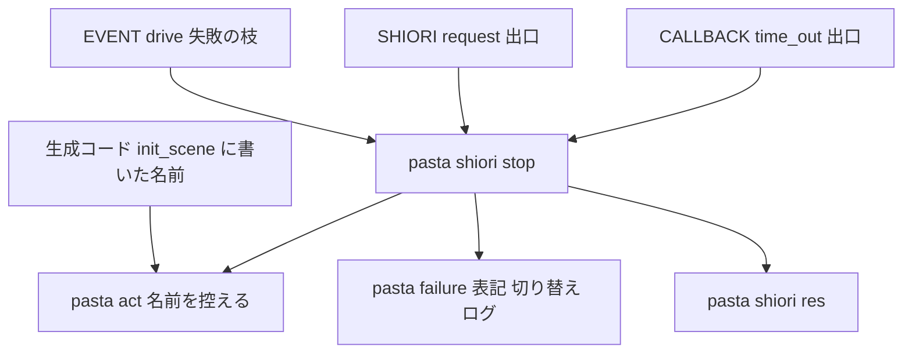
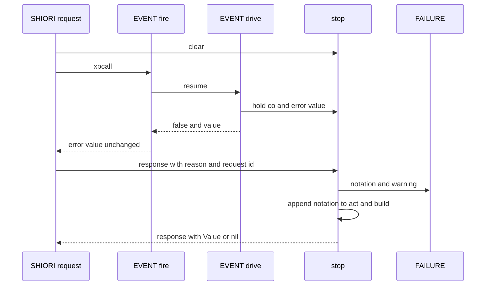
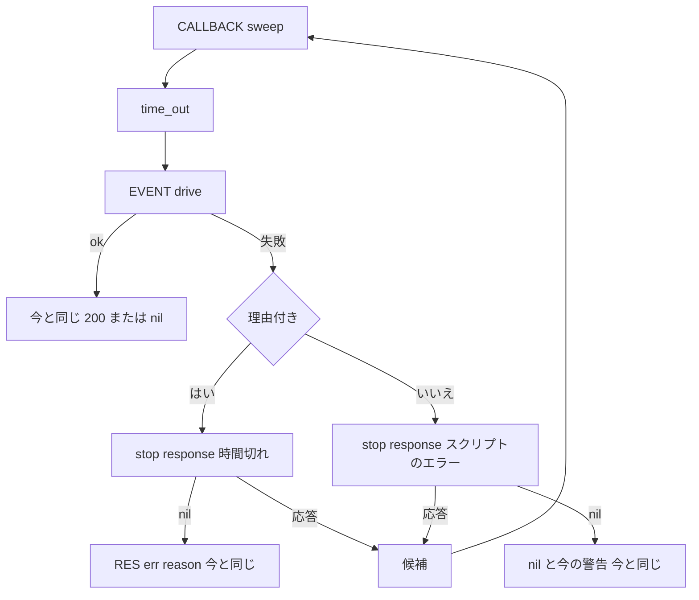

# 設計書: runtime-error-balloon

## Overview

**Purpose**: Lua のエラーでシーンや要求が止まったときに、その理由を、実行時の失敗と同じ `【…】` の失敗表記でバルーンに出す。作者は、ログのファイルや SSP の通信ログを開かなくても、ゴーストを動かしているだけで、どのシーンで何が起きて止まったかを読める。

**Users**: Pasta DSL で辞書を書き、辞書の中の Lua のブロックや `scripts/` の Lua を書くゴースト作者。

**Impact**: 今は、止まるエラーは 500 の応答の理由の行（`X-Error-Reason`）にしか出ず、途中までの台詞も捨てている。本設計は、要求を受ける Lua の出口（`SHIORI.request`）と時間切れの出口（`callback.lua` の `time_out`）で、エラーの表記を応答の値（`Value`）に付ける。止まること・理由の行の中身・表記を出さない設定での応答は変えない。

### Goals
- GET の要求で起きた止まるエラーを、`【スクリプトのエラー：＊天気・雨の日（…）】`・`【時間切れ：…】` の形でバルーンに出す（要件 1・2）。
- 止まるまでにシーンやハンドラが積んだ台詞の後に、表記を出す（要件 3.4）。
- `[logging] balloon_warning = false` で、応答を今と 1 バイトも違わない形に戻す（要件 4.2）。
- 止まるエラーの最初の行を、警告として 1 行ログに残す（要件 5.6）。

### Non-Goals
- Rust の側の 500（読み込みの失敗・未ロード・`SHIORI.request` の呼び出しそのものの失敗）を表記にすること（決定 Q4）。
- デバッガのソースの対応表（`debug/source_map`）を普段から作ること。`.pasta` の行は、生成コードがシーンごとに持つ小さな対応（文字列の定数）から引く（設計議題 3）。
- エラーの後でシーンを続けること・やり直すこと、繰り返すエラーの抑止（決定 Q11）。
- 応答のステータスを選ぶ設定（実機の結果で 1 つに決める）。

## Boundary Commitments

### This Spec Owns
- 止まるエラーを表記にして応答に付ける処理（新しいモジュール `pasta.shiori.stop`）。種類の名前 2 つ（`スクリプトのエラー`・`時間切れ`）。
- 止まった場所の示し方: 作者が書いたシーン名（`＊グローバル・ローカル`）、シーンの外なら要求の ID。場所は、辞書の中なら `.pasta` のファイルと行（`dic\天気.pasta:15`）、作者の `.lua` ならゴーストのフォルダーから見た形（`scripts\天気.lua:12`）。
- 書いたシーン名と `.pasta` の行を実行時へ運ぶ道: 生成コードの `act:init_scene(SCENE, 書いたグローバルシーン名, 書いたローカルシーン名, 行の対応)` と、act がそれを控えて途中の Call の後に戻すこと。
- 読み込んだ Lua のファイルの控え: 探索関数（`runtime/searcher.rs`）が、読み込んだファイルのフルパスを、エラー文に出る形（縮めた形を含む）から引ける表に足すこと（設計議題 3）。
- 止まったシーンの act とエラーの値を、`EVENT.drive` の失敗の枝で控えること（1 要求に 1 つ）。
- 理由の無い時間切れの後のエラーを、表記を出す設定で応答の候補にすること（決定 Q6）。
- マニュアルの該当ページの更新と、スキル用の文書の再生成。

### Out of Boundary
- 失敗表記の形・エスケープ・切り替え（`FAILURE.format`・`FAILURE.escape`・`FAILURE.enabled`）を作り直すこと。本設計は呼ぶだけ。`FAILURE` に足すのは `LABEL` の 2 行と、読み取りの関数 `FAILURE.act_of` 1 つ。
- `RES.err`・`RES.ok`・`RES.build` の中身（公開の関数。要件 5.2）。
- `error_handler`（`entry.lua`）と、理由の行の中身（要件 5.1）。`EVENT.fire`・`CALLBACK.try_route` の投げ直し（`error(value)`）も今のまま。
- `pasta_shiori` の Rust のソース（要件 5.4）、`pasta_check`（要件 4.5）。
- シーンが生きている失敗の見せ方（`failure-output-unification`）。
- 作者が `scripts/` に置いて上書きした `entry.lua` などの動き（そこでは控えを使わないだけで、今と同じに動く）。
- `actor.lua`・`word.lua` と、`act.lua` の `init_scene`・`call_restore`・`restore_scene` 以外。`restore_scene` の引数は変えない（設計議題 2）。

### Allowed Dependencies
- `pasta.shiori.stop` → `pasta.failure`・`pasta.shiori.res`（読み込み時）、`pasta.store`・`pasta.shiori.act`（呼んだ時点で `require`。`pasta.shiori.act` は `callback.lua` を読み込み時に読むので、読み込み時に握ると循環する）。
- `pasta.shiori.event`（`init.lua`）・`pasta.shiori.event.callback`・`pasta.shiori.entry` → `pasta.shiori.stop`。
- `pasta.act` → `pasta.failure`（今と同じ）。`pasta.act` は `pasta.shiori.stop` を読まない。
- 生成コード → `act:init_scene` の新しい引数（文字列の定数）。
- 依存の向き: `failure` ← `res` ← `stop` ← `event/init`・`event/callback`・`entry`。`stop` から `event` や `entry` は読まない。

### Revalidation Triggers
- `FAILURE.notation`・`FAILURE.format`・`FAILURE.enabled`・`LABEL` の形が変わる（`call-attribute-filter`・`scene-anchor-link`・`shell-element-click` も `LABEL` に足すので、同じウェーブに置かない）。
- `act:init_scene` の引数・`call_restore` の戻し方、生成コードのシーン関数の先頭の形が変わる（デバッガのソースの対応表・`pasta_check` の照合も見る）。
- `EVENT.drive` の失敗の枝、`SHIORI.request` の出口、`time_out` の候補の作り方が変わる。
- `lua_search_paths` の既定（`profile/pasta/…` の位置）や、チャンク名の付け方（`@` ＋ 候補のパス）が変わる（場所の見分けが前提にしている）。
- SSP の 500 の応答の扱いが変わる（応答のステータスの前提）。
- 生成コードの整形（`normalize`）・`debug/source_map` の記録の取り方が変わる（行の対応が食い違わないこと）。探索関数のチャンク名の付け方、LuaJIT のチャンク名を縮める長さが変わる（表のキー）。

## Architecture

### Existing Architecture Analysis
- 止まるエラーの出口は Lua の側に 2 つある。`SHIORI.request` の `xpcall`（`EVENT.fire` の中のすべて: REG のハンドラ・シーン・チェイントーク・コールバックの再開）と、`OnSecondChange` の既定ハンドラから呼ぶ掃引の `time_out`。Rust の側は Lua の応答の文字列を素通しする（ステータスを見ない）。
- シーンの再開は `EVENT.drive` に一本化されている（通常のイベント・`CALLBACK.try_route`・`time_out`）。失敗の枝は予約を捨て、継続を空にして `false, エラーの値` を返す。`EVENT.fire`・`try_route` はそれを `error(value)` で投げ直す。
- `FAILURE.bind(act)`（`init_scene` が呼ぶ）は、コルーチン → act の弱い表を持つ。チェイントークで再開したコルーチンは、`EVENT.fire` が作った新しい act ではなく、この表の act に台詞を積む。
- **pasta のランタイムに Lua の `debug` ライブラリは無い**（`std_all` = `ALL_SAFE`）。呼び出し履歴は調べられない。
- 登録名（`OnTalk_1`・`雨の日_1`）からは、別名と記号を戻せない。書いた名前は生成コードにしか無い。

### Architecture Pattern & Boundary Map



**Architecture Integration**:
- 選んだ形: 既存の 2 つの出口に、1 つの組み立て役（`pasta.shiori.stop`）を挟む。シーンの失敗の手がかり（act とエラーの値）は、3 つの再開の経路が通る `EVENT.drive` の 1 か所で控える。
- 守る既存の型: 表記は `FAILURE` の 1 か所で作る。応答は `RES` で作る。エラーの値は変えずに投げ直す（理由の行が変わらない）。
- 新しい部品の理由: 出口が 3 つ（`SHIORI.request`・理由付きの時間切れ・理由の無い時間切れ）あり、`entry.lua` は `callback.lua` から読めないので、共有のモジュールが要る。
- steering との整合: マニュアルが唯一の権威（同じ変更で直す）。Lua の `debug` は出さない（安全な既定のまま）。デバッガを有効にしないときの重さは増やさない（シーン関数の入口で文字列の定数 2 つを act に書くだけ）。

### Technology Stack

| Layer | Choice / Version | Role in Feature | Notes |
|-------|------------------|-----------------|-------|
| ランタイム（Lua） | LuaJIT 2.1（mlua 0.11 `luajit52`） | 出口・控え・表記の組み立て | 新しい依存なし。`debug` ライブラリは使わない |
| トランスパイラ（Rust） | `pasta_lua` の `code_gen/scope_gen.rs` | `init_scene` に書いた名前を出す | 既存の `StringLiteralizer` で文字列にする |
| 統合 | `pasta_shiori`（ソースは触らない） | 結合テストで確かめるだけ | — |

## File Structure Plan

### Directory Structure
```
crates/pasta_lua/pasta_scripts/pasta/shiori/
└── stop.lua                  # 新規: 止まるエラーの控え・場所の見分け・表記の組み立て・応答
crates/pasta_lua/tests/lua_specs/
└── stop_test.lua             # 新規: stop.lua の単体テスト（場所の見分けの表・名前・応答の形・切り替え）
crates/pasta_shiori/tests/
├── runtime_error_balloon_e2e_test.rs        # 新規: pasta.dll を通した結合テスト
└── fixtures/runtime_error_balloon/          # 新規フィクスチャ（差し替えるファイルと pasta.toml だけ）
    ├── pasta.toml                           # [logging] balloon_warning はテストが書き足す
    ├── dic/runtime_error_balloon.pasta      # Lua のブロックで止まるシーン・別名・ローカルシーン・途中の台詞
    └── scripts/
        ├── main.lua                         # REG のハンドラ（シーンの外のエラー・リソースの要求のエラー）
        └── 天気.lua                          # 作者の .lua（場所を残す例。日本語のファイル名）
```

### Modified Files
- `crates/pasta_lua/pasta_scripts/pasta/failure.lua` — `LABEL` に `SCRIPT_ERROR = "スクリプトのエラー"`・`TIMEOUT = "時間切れ"` を足す。`FAILURE.act_of(co)`（`RUNNING[co]` を返すだけ）を足す。
- `crates/pasta_lua/pasta_scripts/pasta/act.lua` — `init_scene(self, scene, scene_name, local_scene_name)` が、書いた名前を `self.scene_name`・`self.local_scene_name` に控え、`self.scene_names[scene] = scene_name` も書く（引数が無ければ `nil` を書く）。`call_restore` が、呼ぶ前の 2 つの名前を、戻った後に戻す（`current_scene` と同じ）。`restore_scene(scene)` が、`self.scene_name = self.scene_names[scene]`・`self.local_scene_name = nil` にする（設計議題 2）。
- `crates/pasta_lua/src/code_gen/scope_gen.rs`（と生成の後の仕上げ） — シーン関数の先頭を `local save, var = act:init_scene(SCENE, "書いたグローバルシーン名", nil, "行の対応")`（`__start__`）・`act:init_scene(SCENE, "書いたグローバルシーン名", "書いたローカルシーン名", "行の対応")`（名前付きローカル）にする。書いた名前は、別名で置き換える前・`sanitize_name` の前の名前。行の対応は 1 行の文字列の定数で、`.pasta` のファイル（ゴーストのフォルダーから見た形）と、そのシーン関数の「最終の `.lua` の行 → `.pasta` の行」の組を持つ。最終の行は整形（`normalize`）の後に決まるので、仕上げの段で同じ行の中の置き場所を埋める（行は増やさない。対応の取り方は `debug/source_map` の `MapBuilderSink` と同じ記録を使う）。
- `crates/pasta_lua/src/runtime/searcher.rs` — 読み込んだファイルを、エラー文に出る形（`@` を除いたチャンク名。60 バイトを超えれば `...` ＋ 末尾 56 バイト）をキーにした Lua の表に控える。値は種類（作者の `.lua` ならゴーストのフォルダーから見たパス、変換した Lua のキャッシュなら「辞書」の印）。標準ランタイム（`pasta_scripts/`）は控えない。同じキーが 2 つになったら、そのキーは見分けられないとして消す。チャンク名は変えない（デバッガの照合に響かない）。
- `crates/pasta_lua/pasta_scripts/pasta/shiori/event/init.lua` — `EVENT.drive` の失敗の枝の先頭で `STOP.hold(co, value)` を呼ぶ（1 行と `require`）。`EVENT.fire` がハンドラを呼ぶ直前に `STOP.hold_handler(act)` を呼ぶ（1 行。設計議題 6）。`EVENT.fire` の投げ直しは今のまま。
- `crates/pasta_lua/pasta_scripts/pasta/shiori/event/callback.lua` — `time_out` の失敗の枝で `STOP.response` を使う（理由付き・理由無しの 2 つ）。表記を出さない設定なら今と同じ値（`RES.err(reason)`・`nil`）を返す。
- `crates/pasta_lua/pasta_scripts/pasta/shiori/entry.lua` — `SHIORI.load` が `STOP.set_ghost_dir(load_dir)` を呼ぶ。`SHIORI.request` が最初に `STOP.clear()` を呼び、失敗の枝で `STOP.response(…) or RES.err(result)` を返す。`error_handler` は変えない。
- テストの期待値: `crates/pasta_lua/tests/fixtures/sample.expected.lua`（生成コードの `init_scene` の行）、`crates/pasta_lua/src/code_gen/scope_gen_tests.rs`・`crates/pasta_lua/tests/transpiler/basic_test.rs`（`init_scene(SCENE)` の文字列）、`crates/pasta_lua/tests/lua_specs/shiori_entry_test.lua`・`callback_module_test.lua`（500 の形を確かめる箇所）、`act_call_restore_test.lua`（名前の戻し）、`failure_test.lua`（`act_of`・`LABEL`）、`lua_specs/init.lua`（`stop_test` を登録）、要るなら `crates/pasta_shiori/tests/async_callback_chain_test.rs`（理由付きの時間切れの応答）。
- マニュアル: `book/src/reference/runtime-failures.md`・`book/src/lua/shiori-events.md`・`book/src/reference/startup.md`・`book/src/internals/shiori.md`・`book/src/debug/troubleshooting.md`・`book/src/reference/pasta-toml.md`・`book/src/lua/script-api.md`（`init_scene` の引数）・`book/src/internals/internal-modules.md`（`init_scene`・act のフィールド・`call_restore`）・`book/src/internals/transpiler.md`（生成コードの先頭の行）。生成物 `.claude/skills/*/references/`（`node book/tools/gen-skill-refs.mjs`）。章は足さない（63 章のまま）。

## System Flows

### シーンの中で止まったとき（通常のイベント・チェイントーク・コールバックの再開）



- シーンの控えが無い（シーンの外の REG のハンドラなどで止まった）ときは、対象を要求の ID にし、エラー文は `result`（今の理由と同じ最初の行）から作る。台詞は、`EVENT.fire` が控えたハンドラの act に積まれた分を出す（要件 3.4・設計議題 6）。
- `STOP.response` が `nil` を返す（表記を出さない設定・ID が `On` で始まらない）と、`SHIORI.request` は今と同じ `RES.err(result)` を返す。

### 時間切れの掃引



- 採用の規則（最初の候補を応答にし、残りは警告を出して捨てる）は `CALLBACK.sweep` のまま（要件 1.5）。
- 理由の無い時間切れの後のエラーが候補になると、その回の `OnSecondChange` は掃引の応答を返し、その秒の仮想イベント（`OnTalk`・`OnHour`）は次の秒へ回る（理由付きの時間切れの今の動きと同じ）。

## Requirements Traceability

| Requirement | Summary | Components | Interfaces | Flows |
|-------------|---------|------------|------------|-------|
| 1.1 | GET で止まったら表記を出す | StopNotation, EntryExit | `STOP.response` | シーンの中で止まったとき |
| 1.2 | どこで起きても同じ形 | StopNotation, DriveHold | `STOP.hold`・`STOP.response` | 同上 |
| 1.3 | 理由付きの時間切れ | TimeoutExit, StopNotation | `STOP.response{timeout}` | 時間切れの掃引 |
| 1.4 | 理由の無い時間切れの後のエラー | TimeoutExit, StopNotation | `STOP.response` | 時間切れの掃引 |
| 1.5 | 掃引の採用の規則 | TimeoutExit（`sweep` は変えない） | — | 時間切れの掃引 |
| 1.6 | `On` で始まらない ID は出さない | EntryExit | `report.shown` | シーンの中で止まったとき |
| 1.7 | NOTIFY は表示しない | 変更なし（Rust が応答を捨てる） | — | — |
| 1.8 | 抑止しない | StopNotation（状態を持ち越さない） | `STOP.clear` | — |
| 2.1 | 同じ形・エスケープ | StopNotation → `FAILURE.format` | `FAILURE.notation` | — |
| 2.2 | 種類の名前と文言 | FailureLabels, StopNotation | `LABEL.SCRIPT_ERROR`・`LABEL.TIMEOUT` | — |
| 2.3 | 最初の行から場所を除いた文 | StopNotation | `STOP.detail` | — |
| 2.4 | 書いたシーン名・シーンの外は ID | SceneNameCarrier, StopNotation | `init_scene` の引数・`STOP.subject` | — |
| 2.5 | 生成コード・標準ランタイム・投げ直しの場所を出さない | StopNotation, DriveHold | `STOP.location`・元のエラーの値を控える | — |
| 2.6 | 作者の `.lua` はゴーストから見た場所 | StopNotation, EntryExit | `STOP.location`・`STOP.set_ghost_dir` | — |
| 2.7 | 同じ名前は区別しない | SceneNameCarrier | 書いた名前だけを運ぶ | — |
| 2.8 | タグとして働く文字を無効に | `FAILURE.format`（使うだけ） | — | — |
| 2.9 | 1 件に 1 つ | StopNotation, EntryExit, TimeoutExit | 控えは 1 つ・出口で 1 回だけ組み立てる | — |
| 3.1 | バルーンに出る応答 | StopNotation | `STOP.STATUS` | — |
| 3.2 | ステータスは実機で決める | 実装タスク 1 → StopNotation | `STOP.STATUS` | — |
| 3.3 | 理由の行を同じ中身で付ける | StopNotation | `report.reason` をそのまま使う | — |
| 3.4 | 途中の台詞の後に表記 | DriveHold, StopNotation | `FAILURE.act_of`・`act:build` | シーンの中で止まったとき |
| 3.5 | 再開しない・継続と待ち合わせを捨てる | 変更なし（`EVENT.drive` の失敗の枝のまま） | — | — |
| 3.6 | 次の要求は普通に処理 | EntryExit | `STOP.clear` | — |
| 4.1 | 同じ `balloon_warning` で切り替え | StopNotation → `FAILURE.notation` | `FAILURE.enabled` | — |
| 4.2 | 出さない設定では今と同じ応答 | EntryExit, TimeoutExit | `STOP.response` が `nil` | 両方 |
| 4.3 | 書かない・型違いは出す | `FAILURE.enabled`（使うだけ） | — | — |
| 4.4 | 既定を変えず案内で | ManualUpdate | — | — |
| 4.5 | `pasta_check` を変えない | 変更なし | — | — |
| 5.1 | 理由の行の名前と中身を変えない | DriveHold（投げ直しを変えない）, StopNotation | `RES.err` | — |
| 5.2 | `RES.err` の応答はそのまま | 変更なし（`SHIORI` 形の文字列は `EVENT.fire` が素通し） | — | — |
| 5.3 | 止まることを変えない | 変更なし | — | — |
| 5.4 | Rust の出口を変えない | 変更なし | — | — |
| 5.5 | 起動の失敗と切り分けの手順を変えない | 変更なし, ManualUpdate | — | — |
| 5.6 | 整えた中身を警告で 1 行 | StopNotation | `report.warning` → `FAILURE.notation` | — |
| 5.7 | 止まらない辞書は同じ | SceneNameCarrier（出力に影響しない）, テスト | — | — |
| 6.1 | 各場所の自動テスト | stop_test, 既存の Lua のテスト, 結合テスト | — | — |
| 6.2 | 出さない設定で同じ | stop_test, 結合テスト | — | — |
| 6.3 | タグの文字が書いたとおり | stop_test | — | — |
| 6.4 | `pasta.dll` を通した切り替え | runtime_error_balloon_e2e_test | — | — |
| 6.5 | 既存のテストの意図を変えない | 既存のテストの更新の規則 | — | — |
| 7.1〜7.4 | マニュアルの各ページ | ManualUpdate | — | — |
| 7.5 | スキル用の文書の再生成 | ManualUpdate | `gen-skill-refs.mjs` | — |
| 7.6 | 変更の記録に記す | 実装の最後のタスク（コミット・PR の本文） | — | — |

## Components and Interfaces

| Component | Domain/Layer | Intent | Req Coverage | Key Dependencies | Contracts |
|-----------|--------------|--------|--------------|------------------|-----------|
| StopNotation（`shiori/stop.lua`） | Lua ランタイム | 控え・場所の見分け・名前・表記・応答 | 1.1〜1.4, 1.6, 1.8, 2.1〜2.9, 3.1〜3.4, 3.6, 4.1〜4.3, 5.1, 5.6 | FAILURE (P0), RES (P0), act (P1) | Service, State |
| DriveHold（`event/init.lua`） | Lua ランタイム | シーンの失敗を控える | 1.2, 2.5, 3.4 | StopNotation (P0) | Service |
| EntryExit（`entry.lua`） | Lua ランタイム | 要求の出口・ゴーストのフォルダー | 1.1, 1.6, 2.6, 3.6, 4.2 | StopNotation (P0), RES (P0) | Service |
| TimeoutExit（`event/callback.lua`） | Lua ランタイム | 時間切れの出口 | 1.3〜1.5, 4.2 | StopNotation (P0) | Service |
| SceneNameCarrier（`scope_gen.rs`・`act.lua`） | トランスパイラ・Lua ランタイム | 書いた名前を act まで運ぶ | 2.4, 2.7, 5.7 | StringLiteralizer (P1) | State |
| FailureLabels（`failure.lua`） | Lua ランタイム | 種類の名前・act の読み取り | 2.2, 3.4 | — | Service |
| ManualUpdate（`book/src/…`） | 文書 | 見え方・切り替え・案内 | 4.4, 5.5, 7.1〜7.5 | gen-skill-refs (P0) | — |

### Lua ランタイム

#### StopNotation（`pasta.shiori.stop`）

| Field | Detail |
|-------|--------|
| Intent | 止まるエラー 1 件を、ログの警告 1 行と、エラーの表記を値に持つ応答に変える |
| Requirements | 1.1〜1.4, 1.6, 1.8, 2.1〜2.9, 3.1〜3.4, 3.6, 4.1〜4.3, 5.1, 5.6 |

**Responsibilities & Constraints**
- 1 要求に 1 つの控え（act・エラーの値）を持つ。`clear` で空にし、`take` で取り出すと空になる。
- 表記の形・エスケープ・切り替え・ログは `FAILURE` に任せる。自分で `【】` を組まない。
- エラーの値・理由の文字列を書き換えない。理由の行は呼び出し元が渡した値をそのまま使う。
- 組み立ての途中のエラーで出口を壊さない（`act:build` は `pcall` で守り、失敗したら表記だけの値にする）。

**Dependencies**
- Outbound: `pasta.failure` — `notation`・`LABEL`・`act_of`（P0）
- Outbound: `pasta.shiori.res` — `err`・`ok`（P0）
- Outbound: `pasta.shiori.act`・`pasta.store` — 控えに act が無いとき、表記だけを組み立てる新しい act（P1・呼んだ時点で `require`）
- Inbound: `event/init.lua`（`hold`）、`entry.lua`・`event/callback.lua`（`clear`・`take`・`response`）

**Contracts**: Service [x] / State [x]

##### Service Interface
```lua
---@class StopHold
---@field act table|nil   止まったコルーチンの act（FAILURE.act_of(co)。無ければ nil）
---@field err any         EVENT.drive が受けたエラーの値（投げ直す前の元の値）

---@class StopReport
---@field reason string|nil   応答の理由の行（今と同じ値。RES.err へそのまま渡す）
---@field hold StopHold|nil   シーンの失敗の控え（STOP.take の結果）
---@field handler table|nil  ハンドラの act の控え（STOP.take_handler の結果。SHIORI.request だけが渡す）
---@field err any             控えが無いときのエラーの値（SHIORI.request では result）
---@field fallback string|nil 名前が分からないときの対象（SHIORI.request では req.id）
---@field timeout string|nil  理由付きの時間切れなら timeout_message（種類が「時間切れ」になる）
---@field warning string|boolean|nil  ログの警告を出すか（nil・false なら出さない。true なら表記と同じ整えた中身、文字列ならそれを前に付けた中身。元のエラー文はそのまま出さない）
---@field shown boolean       表記を出してよい要求か（SHIORI.request では ID が "On" で始まる）

---@type string  応答のステータス。実装タスク 1（SSP の実機の確かめ）で "500 Internal Server Error" か "200 OK" の 1 つに決める
STOP.STATUS = ...

--- ゴーストのフォルダー（SHIORI.load の load_dir）を控える。"\" を "/" にし、末尾の "/" を落とす
---@param dir string|nil
function STOP.set_ghost_dir(dir) end

--- 控えを空にする（要求の始めに呼ぶ）
function STOP.clear() end

--- シーンの失敗を控える（EVENT.drive の失敗の枝だけが呼ぶ）。前の控えは上書きする
---@param co thread
---@param err any
function STOP.hold(co, err) end

--- 控えを取り出して空にする
---@return StopHold|nil
function STOP.take() end

--- イベントのハンドラに渡す act を控える（EVENT.fire がハンドラを呼ぶ直前に呼ぶ）。STOP.clear で空になる
---@param act table
function STOP.hold_handler(act) end

--- 控えたハンドラの act を取り出して空にする
---@return table|nil
function STOP.take_handler() end

--- 位置の接頭辞のチャンクの文字列を、ゴーストのフォルダーから見た場所にする（純粋な関数）
--- 作者の .lua なら "scripts\天気.lua"（区切りは "\"）、出さない場所・見分けられない場所なら nil
---@param chunk string  エラー文の "チャンク:行: " のチャンクの部分（"[string ...]"・パス・"..." ＋ 末尾）
---@param ghost_dir string|nil  set_ghost_dir で控えた形
---@return string|nil
function STOP.location(chunk, ghost_dir) end

--- エラー文の最初の行から、出さない場所の接頭辞を除き、作者の .lua の接頭辞を "場所:行: " の形に直した文（純粋な関数）
--- 文字列でなければ nil。除いた後が空なら nil
---@param err any
---@param ghost_dir string|nil
---@return string|nil
function STOP.detail(err, ghost_dir) end

--- act が控えた書いた名前から、止まった場所の名前を作る（"＊天気・雨の日"・"＊天気"）
--- 書いた名前が無ければ act.current_scene.__global_name__ から末尾の "_連番" を落とした名前、それも無ければ nil
---@param act table|nil
---@return string|nil
function STOP.subject(act) end

--- 表記を出す応答の全文。出さないとき（shown が偽・表記を出さない設定）は nil（呼び出し元が今の応答を返す）
--- 警告（report.warning）は、表記を出すかどうかにかかわらず FAILURE.notation で 1 回出す
---@param report StopReport
---@return string|nil
function STOP.response(report) end
```
- Preconditions: `response` は 1 件の止まるエラーにつき 1 回だけ呼ぶ。`hold` は失敗したコルーチンの再開の直後に呼ぶ。
- Postconditions:
  - 種類と対象と説明（`FAILURE.format(label, subject, detail)` に渡す値）:
    - 理由付きの時間切れ: `LABEL.TIMEOUT`、対象 `report.timeout`、説明なし。
    - それ以外でエラーの値が文字列でない: `LABEL.SCRIPT_ERROR` だけ（`【スクリプトのエラー】`）。
    - それ以外: `LABEL.SCRIPT_ERROR`、対象 `STOP.subject(hold.act)` または `report.fallback`、説明 `STOP.detail(hold.err または report.err)`。対象が無ければ説明が対象の位置に出る（`FAILURE.format` の決まり）。
  - 値（`Value`）: 控えに act があれば、表記を act の末尾に raw_script として積み、`act:build()` の結果を値にする（止まるまでの台詞の後に表記が出る。位置と話者は `FAILURE.report` と同じ）。シーンの控えが無ければ、控えたハンドラの act（`report.handler`。`SHIORI.request` の出口だけが `STOP.take_handler()` で渡す。時間切れの出口は渡さない）で同じことをする。それも無ければ（時間切れの出口など）、新しい SHIORI の act に表記だけを積んで組み立てる。
  - 応答: `STOP.STATUS` が 500 なら `RES.err(report.reason, { Value = 値 })`、200 なら `RES.ok(値, { ["X-Error-Reason"] = 理由 })`（理由が `nil`・空なら `"Unknown error"`。`RES.err` と同じ）。
- Invariants: 理由の行の名前と中身は、表記を出さない場合と同じ（要件 3.3・5.1）。控えは要求をまたいで残らない（要件 3.6）。

##### State Management
- State model: モジュールの局所に `held`（`StopHold|nil`）と `ghost_dir`（`string|nil`）。
- 持ち越し: `SHIORI.request` が要求の始めに `clear` する。`time_out` は `EVENT.drive` の直後に `take` する。作者が上書きした `entry.lua` は `clear` しないが、次の `hold` で上書きされ、標準の出口でしか読まれない。

**Implementation Notes**
- 場所の見分け（`STOP.location`。設計議題 3）: エラー文のチャンクの部分を、探索関数が控えた表で引く。推測はしない。
  - 作者の `.lua`: 控えたゴーストから見たパスを、区切りを `\` にして `場所:行` で返す。
  - 変換した Lua のキャッシュ: act が控えたシーンの行の対応で、その行を `.pasta` のファイルと行（`dic\天気.pasta:15`）に直す。対応に無い行（別のシーン・`restore_scene` で対応を失った後など）なら `nil`。
  - 表に無いもの（標準ランタイム・`[string "…"]`・`[C]`・見分けられないキー）は `nil`。
  - 行の対応の文字列は、止まったときにだけ読み解く（普段は文字列の定数を 1 つ渡すだけで、表を作らない）。
- 接頭辞の見分け（`STOP.detail`）: 最初の行の先頭から `^(.-):(%d+): ` を繰り返し取る。チャンクの部分が表で引けるものと、`.lua` で終わる・`]` で終わるものだけを位置の接頭辞として扱う（エラー文の中の `10:30: ` などを誤って取らない）。`STOP.location` が返した場所は `場所:行: ` として残し、それ以外は落とす。
- 変換した Lua のキャッシュのパスは、表記にもログの警告にも出ない（要件 2.5・5.6）。
- シーンの失敗は元のエラーの値（投げ直しの前）を使うので、投げ直しの場所（`event/init.lua:229`・`callback.lua:110`）は表記に入らない。理由の行には今どおり入る。
- 新しい act を作るのは、シーンの控えにもハンドラの控えにも act が無いときだけ。`pasta.shiori.act` は呼んだ時点で `require` する（読み込み時に握ると `callback.lua` と循環する）。
- Risks: 末尾 56 バイトまで同じパスのファイルが 2 つあると、その場所は落とす（エラー文は出す）。

#### DriveHold（`EVENT.drive` の失敗の枝）

| Field | Detail |
|-------|--------|
| Intent | 失敗したコルーチンの act とエラーの値を、出口のために控える |
| Requirements | 1.2, 2.5, 3.4 |

**Responsibilities & Constraints**
- 失敗の枝の最初に `STOP.hold(co, value)` を 1 回呼ぶ。今の処理（予約を捨てる・継続を空にする・`false, value` を返す）は変えない。
- 通常のイベント・`CALLBACK.try_route`・`time_out` の 3 つの呼び出し元は、どれもここを通る。
- `EVENT.fire`・`try_route` の `error(value)` は変えない（理由の行が変わらない）。

**Contracts**: Service [x]

#### EntryExit（`SHIORI.load`・`SHIORI.request`）

| Field | Detail |
|-------|--------|
| Intent | 要求の出口で、止まるエラーを表記付きの応答にする |
| Requirements | 1.1, 1.6, 2.6, 3.6, 4.2 |

**Responsibilities & Constraints**
- `SHIORI.load(hinst, load_dir)` が `STOP.set_ghost_dir(load_dir)` を呼ぶ（戻り値は今のまま）。
- `SHIORI.request(req)` は、`xpcall` の前に `STOP.clear()` を呼ぶ。失敗したら次を返す。
  ```lua
  STOP.response({
      reason = result, hold = STOP.take(), handler = STOP.take_handler(), err = result, fallback = req.id,
      warning = true, shown = type(req.id) == "string" and req.id:sub(1, 2) == "On",
  }) or RES.err(result)
  ```
- `error_handler` は変えない。NOTIFY は判定しない（Rust の側が応答を捨てる。要件 1.7）。

**Contracts**: Service [x]

#### TimeoutExit（`CALLBACK.time_out`）

| Field | Detail |
|-------|--------|
| Intent | 時間切れで再開したシーンが止まったときの候補を、表記付きの応答にする |
| Requirements | 1.3, 1.4, 1.5, 4.2 |

**Responsibilities & Constraints**
- 理由付き: `STOP.response({ reason = reason, hold = STOP.take(), timeout = reason, shown = true }) or RES.err(reason)`。警告は今の再開の前の警告（`event_id: reason`）で足りるので、`warning` は渡さない。
- 理由無し: `STOP.response({ reason = 最初の行(value), hold = STOP.take(), err = value, warning = event_id, shown = true })`。今の警告（`event_id: scene error after silent timeout: …`。元のエラー文に変換した Lua の場所が入る）は、`event_id` を前に付けた整えた中身の警告に置き換える（要件 5.6）。`nil` なら今と同じ `nil`（候補にしない）。警告は 1 回だけ出る。
- `CALLBACK.sweep` の採用の規則は変えない。

**Contracts**: Service [x]

#### SceneNameCarrier（生成コードと act）

| Field | Detail |
|-------|--------|
| Intent | 作者が書いたシーン名を、実行中の act まで運ぶ |
| Requirements | 2.4, 2.7, 5.7 |

**Responsibilities & Constraints**
- トランスパイラ: グローバルシーンの書いた名前は、別名で置き換える前の `scene.name`（単独の `＊` 行は受け継いだ名前）。ローカルシーンの書いた名前は `local_scene.name`。どちらも `StringLiteralizer` で Lua の文字列にする。`__start__` はローカルシーン名を渡さない。行は増やさない。
- `act:init_scene(scene, scene_name, local_scene_name, line_map)`: `self.scene_name = scene_name`・`self.local_scene_name = local_scene_name`・`self.line_map = line_map` を書く（引数が無ければ `nil`）。`line_map` は読み解かずに控えるだけ。`call_restore` は 3 つを戻し、`restore_scene` は `line_map` も `nil` にする。今の処理（`last_global_scene`・`current_scene`・`FAILURE.bind`・戻り値）は変えない。
- `act:call_restore`: 呼ぶ前の `scene_name`・`local_scene_name` を、戻った後に戻す（`current_scene` を戻すのと同じ時点）。
- `act:restore_scene(scene)`: グローバル名を `self.scene_names[scene]` から戻し、ローカル名は `nil` にする。粗くなる（`＊天気` とだけ出る）が、別のシーンの名前は出さない（設計議題 2）。
- 名前はバルーンの出力・単語や Call の検索に使わない（止まらない辞書の出力は変わらない。要件 5.7）。

**Contracts**: State [x]

##### State Management
- State model: act のフィールド 3 つ（`scene_name: string|nil`・`local_scene_name: string|nil`・`scene_names: table<SceneTable, string>`）。`current_scene` と同じ寿命（act は 1 要求の間だけ生きる）。
- 戻し方: `call_restore` は 2 つの名前をそのまま戻す。`restore_scene`（`word`・`expr_fn`・`expr_fn_var`・`global_fn`・アクタープロキシが使う）は、グローバル名を `scene_names` から戻し、ローカル名を `nil` にする。

**Implementation Notes**
- Lua の関数のハンドラの中で別のシーンへ入り（`act:call` など）、戻った後に呼び出し元の行で止まると、グローバルシーン名だけが出る（`＊天気`）。呼んだ先のシーンの名前は出ない。DSL の途中の Call（`call_restore`）では、ローカルシーン名まで出る。
- 古いキャッシュ（`init_scene(SCENE)` のまま）と、作者が Lua で書いたシーン関数では名前が `nil` になり、`STOP.subject` は登録名から連番を落とした名前を使う。

#### FailureLabels（`pasta.failure` への追加）
- `LABEL.SCRIPT_ERROR = "スクリプトのエラー"`・`LABEL.TIMEOUT = "時間切れ"`。
- `FAILURE.act_of(co) -> table|nil`: `RUNNING[co]` を返す。書き込みの関数は足さない。

### 文書

#### ManualUpdate（summary）
- `reference/runtime-failures.md`: 15 行目の「500 応答はこのページの対象外」を直し、「止まるエラーの表記」の節を足す（2 つの種類・形・止まった場所の示し方・途中の台詞・出る応答・切り替え・ログの警告）。種類の表に 2 行足す。
- `lua/shiori-events.md`: 「エラーハンドリング」の応答の例と説明、理由付きの時間切れの応答（450 行）を、表記を出す設定と出さない設定の両方で書く。
- `reference/startup.md`「ゴーストが起動しない・喋らないとき」・`debug/troubleshooting.md`・`internals/shiori.md`: 止まるエラーはバルーンに表記で出ること、出さない設定では今までどおり理由の行とログで見ることを足す。切り分けの手順は変えない。
- `reference/pasta-toml.md`: `balloon_warning` が止まるエラーの表記も切り替えること、配る前に `false` にする案内。
- `lua/script-api.md`・`internals/internal-modules.md`・`internals/transpiler.md`: `init_scene` の引数（生成コードが書いた名前を渡す。省略できる）、act のフィールド 2 つ、`call_restore` が名前も戻すこと、生成コードの先頭の行。
- 同じ変更で `node book/tools/gen-skill-refs.mjs` を走らせ、鮮度の照合（`--check`）とリンクの検証を通す。

## Data Models

### Domain Model
- **止まるエラー 1 件**: 種類（`スクリプトのエラー`・`時間切れ`）、対象（書いたシーン名・要求の ID・`timeout_message`）、説明（場所を直したエラー文）、途中の台詞（act のトークン）、理由（今の理由の行）。
- 不変条件: 1 件につき表記 1 つ・警告 1 行。理由は表記の有無で変わらない。

### Data Contracts & Integration
- 応答（表記を出す設定・`On` で始まる GET）:
  - `STOP.STATUS` が 500: `SHIORI/3.0 500 Internal Server Error`、`X-Error-Reason: <今と同じ>`、`Value: <途中の台詞><表記>`
  - `STOP.STATUS` が 200: `SHIORI/3.0 200 OK`、`Value: <途中の台詞><表記>`、`X-Error-Reason: <今と同じ>`
- 応答（表記を出さない設定・`On` で始まらない ID）: 今と同じ（`RES.err(reason)`、理由の無い時間切れは応答なし）。
- 生成コード: `local save, var = act:init_scene(SCENE, "天気", nil, "dic/天気.pasta|40:3,41:4")`（`__start__`）、`local save, var = act:init_scene(SCENE, "天気", "雨の日", "dic/天気.pasta|47:12,48:13,52:15")`（名前付きローカル）。行の対応の文字列の形（区切り・圧縮）は実装で決めてよいが、1 行の文字列の定数であること、読み解くのは止まったときだけであることは守る。

## Error Handling

### Error Strategy
- 組み立ての途中の失敗（`act:build` のエラーなど）は `pcall` で守り、表記だけの値にする。それも作れなければ `nil` を返し、呼び出し元が今の応答を返す（止まるエラーの出口が、表記のせいで別のエラーにならない）。
- 場所が見分けられないときは落とす（誤った場所を出さない）。名前が分からないときは要求の ID、それも無ければ説明を対象の位置に出す。

### Monitoring
- 止まるエラーごとに警告 1 行。中身は表記と同じ（種類・止まった場所・整えたエラー文。枠とエスケープは除く）。理由の無い時間切れは `event_id` を前に付ける。理由付きの時間切れは今の再開の前の警告（`event_id: timeout_message`。変換した Lua の場所を含まない）で足りる。表記を出さない設定でも出る。スタックトレースは残さない（決定 Q10）。

## Testing Strategy

### Unit Tests（`crates/pasta_lua/tests/lua_specs/`）
- `stop_test.lua` — `STOP.location` の表: 縮めていない作者の `.lua`・縮めた作者の `.lua`（日本語のファイル名・`\` と `/` の混在・56 バイトを超える相対のパス）・変換した Lua のキャッシュの行が `.pasta` の行に直る・対応に無い行は `nil`・`profile/pasta/pasta_scripts/…`・`[string "entry.lua"]`・表に無いキー・同じキーが 2 つ（2.5・2.6）。ログの警告に変換した Lua のパスが入らない（5.6）。
- `searcher` のテスト（Rust） — 読み込んだ作者の `.lua`・変換した Lua のキャッシュが表に入り、標準ランタイムは入らない。縮めた形のキー。同じキーが 2 つなら消える。チャンク名は今と同じ。
- `stop_test.lua` — `STOP.detail`: 投げ直しの接頭辞が付いた文から元の文だけが残る、作者の接頭辞が `scripts\天気.lua:12: ` に直る、`10:30: ` を含む文は取らない、文字列でない値は `nil`（2.3・2.5）。
- `stop_test.lua` — `STOP.subject`: 書いた名前（別名 `会話`・記号 `OnTalk＿新しいおもちゃ`）、`__start__`、名前の無い act は連番を落とす（2.4・2.7）。
- `stop_test.lua` — `STOP.response`: 種類ごとの文言（2.2 の 3 つの例そのもの）、途中の台詞の後に表記、`\`・`%`・改行が書いたとおりに出る形（6.3）、出さない設定で `nil`・警告は出る（4.2・5.6）、`shown = false` で `nil`（1.6）、理由の行が渡した値のまま（3.3）。
- `act_call_restore_test.lua` — `call_restore` の後に名前が呼ぶ前に戻る。`restore_scene` の後にグローバル名が戻り、ローカル名が空になる（別のシーンの名前が残らない）。`failure_test.lua` — `act_of` と 2 つの `LABEL`。

### Integration Tests（Lua の側の出口）
- `shiori_entry_test.lua` — REG のハンドラの例外・シーンの中の例外（`EVENT.fire` の投げ直し）・チェイントークの再開の中の例外で、表記・ステータス・理由の行を確かめる。今の「500・理由の行・`Value` が無い」の確かめは、表記を出さない設定に固定して残す（6.1・6.2・6.5）。
- `callback_module_test.lua` — 理由付きの時間切れ・理由の無い時間切れの後のエラー・コールバックの再開の中のエラーで、候補の形と、出さない設定で今と同じであること。2 つの候補の採用の規則（1.3〜1.5）。
- 生成コード: `scope_gen_tests.rs`・`basic_test.rs` — 別名・記号を含むシーンで、`init_scene` に書いた名前と行の対応が出る。行の対応の各組が、`debug/source_map` の対応表と同じ `.pasta` の行を指す（デバッガの対応表と食い違わないことを、同じ `.pasta` から作った両方で照らす）。生成コードの行の数が変わらない。`sample.expected.lua` を更新する（5.7 の出力の不変は既存の実行テストで見る）。

### E2E Tests（`crates/pasta_shiori/tests/runtime_error_balloon_e2e_test.rs`）
- 一時ゴースト（`copy_fixture_to_temp`）で、`balloon_warning` を書かない・`false`・型違いの 3 通りに `pasta.toml` を書き足し、`＊会話`（別名）の Lua のブロックで止まる・`scripts/天気.lua` で止まる・REG のハンドラで止まる・`On` で始まらない ID で止まる、を起こす（6.4）。
- 確かめること: 表記の文言（`＊会話・雨の日`・`scripts\天気.lua:N:`・生成コードとランタイムの場所が無いこと）、途中の台詞が表記の前にあること、ステータス（タスク 1 で決めた方）、理由の行が出さない設定と同じ中身、出さない設定の応答が今と同じ、ログの警告が 1 行。
- hello-pasta を既定の設定で動かすテスト（`tutorial_stages_test.rs` など）が、表記を 1 つも出さないまま通ること（5.7）。

## Implementation Order（タスク生成への申し送り）
1. **SSP の実機の確かめ**（最初のタスク）: 500 ＋ `Value`・200 ＋ `Value` ＋ `X-Error-Reason`・`OnSecondChange` の応答の見え方。結果を `research.md` に書き、`STOP.STATUS` を 1 つに決める（要件 3.2）。
2. 書いた名前と行の対応を運ぶ（トランスパイラ・`act.lua`・生成コードの期待値）と、探索関数の読み込んだファイルの表（`searcher.rs`）。
3. `failure.lua` の追加と `stop.lua`（単体テストと一緒に）。
4. `EVENT.drive`・`SHIORI.request`・`SHIORI.load` をつなぐ（既存のテストの更新）。
5. `time_out` をつなぐ（既存のテストの更新）。
6. 結合テストとフィクスチャ。
7. マニュアルとスキル用の文書の再生成、変更の記録（7.6）。

## 設計ディスカッションの決定（2026-10-17）
1. 書いた名前は `init_scene` の引数で運ぶ。トランスパイラと `act.lua` を触る（brief の Out of Boundary「`act.lua` は触らない」を、この目的に限って広げた。Lua の `debug` が無く、登録名からは別名・記号を戻せないため、他に要件 2.4 を満たす道が無い）。`FAILURE.act_of` を足す。
2. `restore_scene` はグローバル名を戻し、ローカル名を空にする（間違った名前は出さず、粗くなるだけ）。`actor.lua` は触らない。
3. 場所は推測しない。探索関数が読み込んだファイルを、エラー文に出る形で引ける表に控える（チャンク名は変えない）。変換した Lua の中で止まったときは、生成コードが `init_scene` の追加の引数に載せたシーンの行の対応で `.pasta` のファイルと行に直す（デバッガの対応表は普段は作らない）。ログの警告も表記と同じ整えた中身にし、変換した Lua のキャッシュのパスはどこにも新しく出さない。理由の行は今のまま。
4. 理由の無い時間切れの後のエラーが、その秒の応答を取ってよい（その秒の `OnTalk`・`OnHour` は次の秒へ回る。理由付きの時間切れの今の動きと同じ）。
5. ログは止まるエラーごとに警告 1 行（NOTIFY も同じ）。理由付きの時間切れは今の再開前の警告で足り、行を増やさない。
6. シーンの外（REG のハンドラ・既定のハンドラ）で止まったときも、ハンドラが act に積んだ台詞の後に表記を出す。`EVENT.fire` がハンドラを呼ぶ直前に act を控える（1 行）。要件 3.4 を「シーンまたはハンドラの途中」に広げた。
7. 「500・理由の行・`Value` が無い」を確かめる既存のテストは、表記を出さない設定に固定して残す。表記を出す設定は新しいテストで確かめる。
- 応答のステータスは実機の結果で決まる（タスク 1。要件 3.2）。
