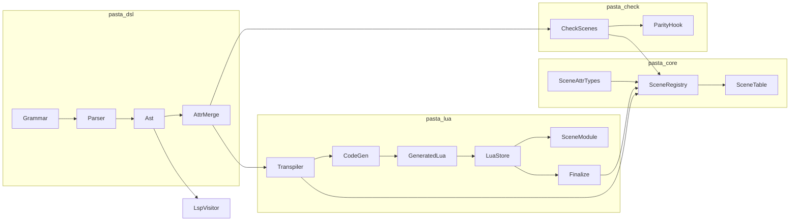
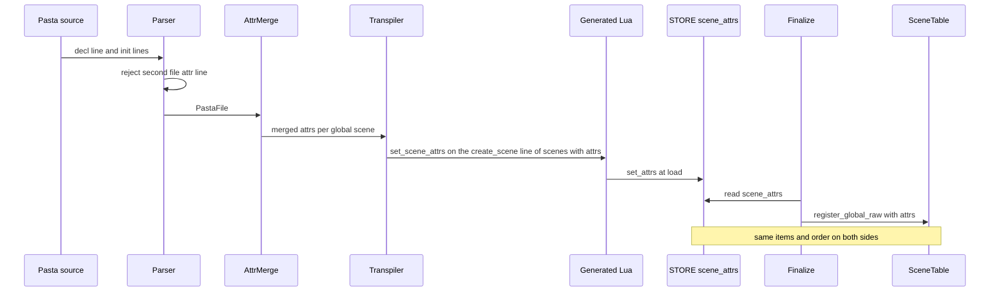
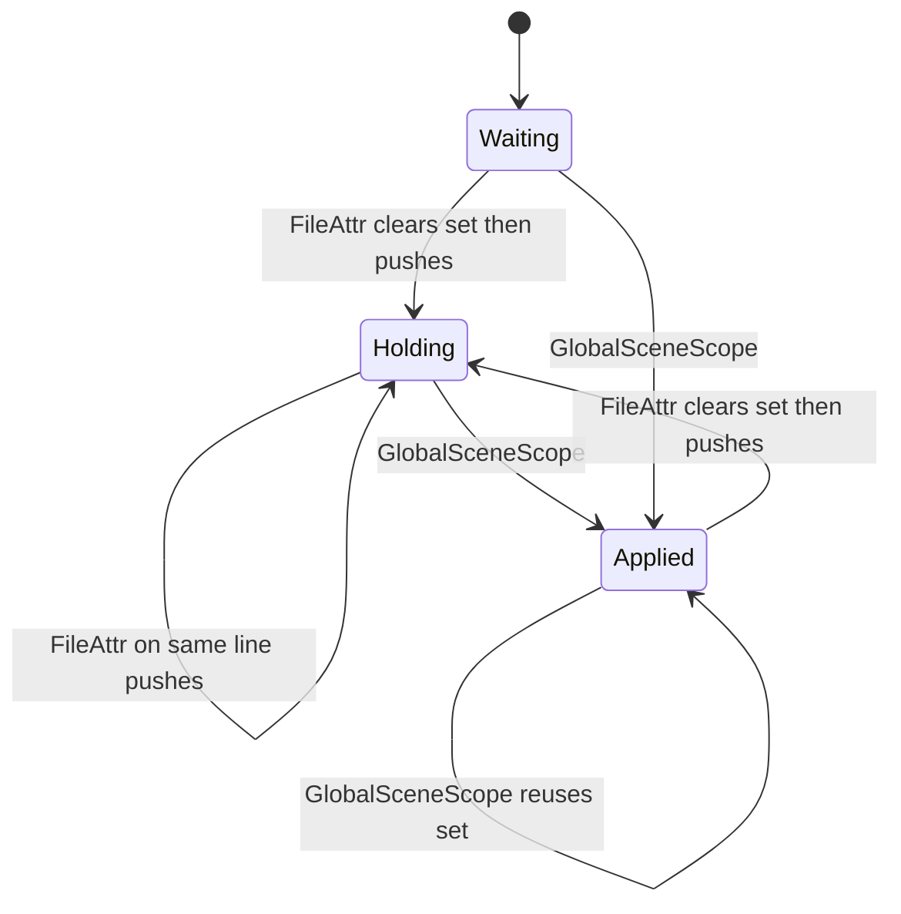

# Design Document: scene-attribute-store

## Overview

**Purpose**: 属性（`＆名前：値`・`＆＄変数 演算子 値`・`＆＄変数`）を、書いた場所によらず「書いたとおりに・書いた順で・型を保って」実行時まで運び、場面を選ぶ処理（Rust のシーン表）と場面に入った処理（Lua の `SCENE.attrs`）の両方が同じ並びを読めるようにする。

**Users**: ゴースト作者は、宣言行・名前なしの `＊` 行・初期部・ファイル先頭に書いた属性が、決まった規則で場面に付くことを得る。後続の 3 つの spec（`scene-condition-attributes`・`scene-pick-modes`・`cue-command-runtime`）は、作り直さずに乗れる倉と読み出しの口を得る。

**Impact**: 今は、宣言行の属性はパーサが捨て、初期部の属性はトランスパイル時の登録で文字列化され、辞書確定で空の表に作り直される。この設計は、パーサで宣言行の属性を残し、受け継ぎと重なりを `pasta_dsl` の 1 か所で決め、生成 Lua の属性のあるシーンだけ `create_scene` の行に属性の文を続け（行の数は変えない）、Lua の別表から辞書確定で Rust のシーン表へ運ぶ。属性の無い辞書の生成物は 1 バイトも変わらない。

### Goals

- 宣言行（グローバル・ローカル・名前なしの `＊`）と初期部の属性を、書いた順に構文木へ残す（要件 1）
- 条件とフラグの形を、文法・構文木・運搬・倉・Lua の口まで、宣言と同じ道で通す。評価はしない（要件 2）
- ファイル属性の「1 行で置き換え」「書いた順で後が勝つ・位置は先」「条件は畳まない」「ローカルへは受け継がない」を 1 つの関数で決める（要件 3）
- 値の型（整数・小数・文字列・空文字列）を Lua まで保つ（要件 4）
- 辞書確定の後、Rust のシーン表と Lua の倉が同じ並びを持つ（要件 5）
- `SCENE.attrs(global_name, local_name)` を 1 つ公開する（要件 6）
- 属性の無い辞書のバイト不変・`pasta_check validate` との一致・着色・見本の更新（要件 7）
- マニュアル 5 ページとスキルの `references/` を新しい挙動に合わせる（要件 8）

### Non-Goals

- 条件の評価と候補の絞り込み、`＆優先` の意味、trace（`scene-condition-attributes`）
- `＆重み`・`＆順番` の意味（`scene-pick-modes`）
- 柱の属性を台本へ流すこと（`cue-command-runtime`）
- 値を複数持たせること（`＆背景：教室、夕方` は 1 つの文字列）、条件の右辺の変数、単語への属性、動的単語参照
- `act` へのメソッドの追加、`search/context.rs` への読み出しの口

## Boundary Commitments

### This Spec Owns

- 属性の文法: 条件とフラグの形（比較演算子 6 種・全角と半角）、名前なしの `＊` 行への付記、`file_scope_item` の名前の直し
- 構文木の属性の形（`Attr { key, body, span }`・`AttrBody`・`CmpOp`）と、宣言行の属性の取り込み
- ファイル属性の 2 行目のパースエラー
- 受け継ぎと重なりの規則の唯一の実装（`PastaFile::global_scene_attrs`・`merge_attrs`）
- 倉の型（`pasta_core` の `SceneAttr`・`SceneAttrValue`・`CmpOp`）と、`SceneEntry`・`SceneInfo` の `attributes` の型
- 生成 Lua の属性の行（`PASTA.set_scene_attrs(…)`）の形
- Lua の倉（`STORE.scene_attrs`）と、口 `SCENE.attrs`・書き口 `SCENE.set_attrs`
- 辞書確定での Lua → Rust の属性の運搬（`collect_scene_attrs`）
- `pasta_check` の属性の登録と、一致テスト用の口 `scene_attrs`
- 条件の形の着色（`pasta_lsp`・VSCode の文法定義）
- マニュアルの属性の記述（要件 8 の 5 ページ）と `references/` の再生成

### Out of Boundary

- 条件・フラグの評価、候補の絞り込み、袋と控え、`＆優先`（`scene-condition-attributes`）
- `＆重み`・`＆順番` の解釈（`scene-pick-modes`）
- 場面に入るときに属性を台本へ流すこと、語彙の選び方（`cue-command-runtime`）
- `filter_by_attributes` の作り直し（この spec は型を合わせるだけで、意味は変えない）
- `act.lua`・`search/context.rs`・`debug/source_map/scene_join.rs`・`finalize_scene_impl` の署名（どれも触らない）
- `pasta_check validate` の条件についての注意（`scene-condition-attributes`）

### Allowed Dependencies

- 依存の向きは今のワークスペースのまま: `pasta_dsl` と `pasta_core` は互いに依存しない。`pasta_lua`・`pasta_check` が両方に依存し、`pasta_lsp` が `pasta_dsl`・`pasta_check` に依存する
- 受け継ぎと重なりの規則は `pasta_dsl` に置き、`pasta_lua` と `pasta_check` はそれを呼ぶだけにする（独自の規則を書かない）
- 構文木 → 倉の項目の写しは、`pasta_lua`（`context.rs`）と `pasta_check`（`validate/scenes.rs`）にそれぞれ置いてよい（`pasta_core` が `pasta_dsl` を知らないため）。ずれは一致テストが拾う
- 新しい外部の依存は足さない

### Revalidation Triggers

- `SceneAttr`・`SceneAttrValue`・`CmpOp`（`pasta_core`）の形、または `SCENE.attrs` の戻りの形（3 種の項目のフィールド）が変わる → 3 つの読み手の spec を見直す
- `SCENE.attrs` のローカル名の意味（登録名か書いた名前か）が変わる → `cue-command-runtime` を見直す（設計の決定 1）
- 受け継ぎの規則（`merge_attrs`・`global_scene_attrs`）が変わる → `pasta_check` の一致テストと 3 つの読み手を見直す
- 生成 Lua の属性の行の形が変わる → 見本とスナップショット、`debug-mcp-runtime` のソースマップの行の数え方を見直す
- `STORE.scene_attrs` の置き場が変わる → `debug-mcp-runtime`（シーン索引）・`scene-count`（シーンの数）を見直す

## Architecture

### Existing Architecture Analysis

- パース: `grammar.pest` → `parse_scene.rs`・`parse_elements.rs` → 構文木。ファイル属性は `FileItem::FileAttr` に 1 つずつ平らになる（`parser/mod.rs` 209〜217）。
- トランスパイル: `transpiler.rs` が `file.items` を書いた順に 1 回だけ走査し、登録（`TranspileContext`）と生成（`LuaCodeGenerator`）を並べて行う。
- 実行: 生成 Lua が `PASTA.create_scene` でシーン表を `STORE.scenes` に作る。辞書確定（`finalize.rs`）が `STORE.scenes` を走査して Rust の `SceneRegistry` → `SceneTable` を作り直し、`@pasta_search` に渡す。
- 検査: `pasta_check` はトランスパイラと同じ手順で `SceneRegistry` を作り、一致テストで pasta.dll と比べる。
- 守るもの: 2 パスでなく 1 回の走査の構造、`init_scene` の引数（行の対応が最後）、`STORE.scenes` の形（`__global_name__` 以外はシーン関数）、属性の無い辞書の生成物。

### Architecture Pattern & Boundary Map

既存の「Lua に出して辞書確定で集める」流れを延ばす（research.md 3 節の Option A）。



**Architecture Integration**:
- 採用するパターン: 既存の 1 回走査のトランスパイルと、辞書確定での Lua → Rust の再構築。
- 境界: 規則（`AttrMerge`）は構文木の層、倉の型は `pasta_core`、Lua の倉と口は `pasta.scene`。読み手の意味はどこにも置かない。
- 守る既存のパターン: `#[doc(hidden)]` の一致テスト用の口、`PASTA.*` を生成コードの入口にすること、`STORE` を状態の置き場にすること。
- 新しい部品の理由: `AttrMerge` は規則を 1 か所にするため。`SceneAttr` は順と型を持つ倉のため。`STORE.scene_attrs` は偽のシーンを出さない置き場のため。
- ステアリングとの整合: レイヤーの向き（`tech.md`「ワークスペースレイヤー構成」）、テストの置き方（`structure.md`「テスト構成」）、ファイルの大きさの目安 600 行。

**依存の向き（違反はレビューで誤りとして扱う）**:
`pasta_dsl`（grammar → ast → parser → attr_merge）／`pasta_core`（scene_types → scene_registry → scene_table）→ `pasta_lua`（context → transpiler → code_gen、pasta_scripts の store → scene → init、runtime/finalize）・`pasta_check`（validate/scenes → validate/mod）→ `pasta_lsp`。Lua の側は `store.lua` ← `scene.lua` ← `init.lua` の向きで、`act.lua` は触らない。

### Technology Stack

| Layer | Choice / Version | Role in Feature | Notes |
|-------|------------------|-----------------|-------|
| Parser | Pest 2.8.6 | 条件・フラグの規則、名前なしの `＊` の付記 | 既存。規則を足すだけ |
| Registry | pasta_core（Rust 2024） | `SceneAttr` の型と、シーン表の `attributes` | 新しい依存なし。`indexmap` は足さない |
| Runtime | LuaJIT 2.1（mlua 0.12） | `STORE.scene_attrs`・`SCENE.attrs`・辞書確定の読み出し | 数は倍精度 1 種類（値の型の規則を参照） |
| Editor | pasta_lsp（WASM）・TextMate 文法 | 条件の形の着色 | 既存の照合テスト（`tmGrammar.test.ts`）に足す |
| Docs | mdBook・`book/tools/gen-skill-refs.mjs` | マニュアルと `references/` | 既存 |

## File Structure Plan

### Directory Structure

```
crates/pasta_dsl/src/parser/
├── grammar.pest              # 条件・フラグ・名前なし＊の付記・file_scope_item の直し
├── mod.rs                    # build_ast: ファイル属性の 2 行目のパースエラー
├── parse_elements.rs         # parse_attr: 宣言・条件・フラグの 3 種
├── parse_scene.rs            # 宣言行の属性（グローバル・名前なし＊・ローカル）
└── ast/
    ├── action.rs             # Attr { key, body, span }・AttrBody・CmpOp・Attr::value()
    ├── attr_merge.rs         # 新規: merge_attrs・PastaFile::global_scene_attrs（受け継ぎと重なりの唯一の実装）
    └── mod.rs                # mod attr_merge; と pub use
crates/pasta_core/src/registry/
├── scene_types.rs            # SceneAttr・SceneAttrValue・CmpOp・SceneInfo.attributes の型
├── scene_registry.rs         # SceneEntry.attributes の型・register_* の引数・ローカルへ写さない
├── scene_table.rs            # from_scene_registry の写し・filter_by_attributes の型合わせ
└── mod.rs                    # pub use に SceneAttr・SceneAttrValue・CmpOp を足す
crates/pasta_lua/
├── src/context.rs            # file_attrs と累積・merge_attrs を消す。scene_attrs_of（構文木 → 倉の項目）
├── src/transpiler.rs         # global_scene_attrs を使ってシーンごとの属性を渡す
├── src/code_gen/scope_gen.rs # PASTA.set_scene_attrs の行を出す
├── src/runtime/finalize.rs   # collect_scene_attrs・build_scene_registry に属性を渡す
└── pasta_scripts/pasta/
    ├── store.lua             # STORE.scene_attrs と reset
    ├── scene.lua             # SCENE.set_attrs・SCENE.attrs
    └── init.lua              # PASTA.set_scene_attrs
crates/pasta_check/
├── src/validate/scenes.rs    # global_scene_attrs と写しで登録する
├── src/validate/mod.rs       # 一致テスト用の口 scene_attrs
└── tests/validate_attr_parity_test.rs  # 新規: pasta.dll の SCENE.attrs と比べる
crates/pasta_lsp/src/analysis/visit_scope.rs  # 宣言行の属性を構文木から着色する
editors/vscode/
├── syntaxes/pasta.tmLanguage.json  # cond-attr を decl-rest に足す
└── src/test/tmGrammar.test.ts      # 条件の形・名前なし＊の属性の照合
book/src/
├── grammar/block-structure.md   # 属性の節の書き直し
├── grammar/markers.md           # 属性の中の比較演算子
├── lua/script-api.md            # SCENE.attrs
├── internals/transpiler.md      # 運び方（累積の記述を消す）
└── internals/registry-search.md # 「属性は空で登録」の記述を消す
```

### Modified Files（テストとフィクスチャ）

- `crates/pasta_dsl/tests/scene_attribute_parse_test.rs`（新規）— 宣言行・名前なしの `＊`・条件・フラグ・2 行目のエラー・右辺の変数のエラー・演算子の正規形
- `crates/pasta_dsl/tests/attr_merge_test.rs`（新規）— 受け継ぎと重なりの決まり（要件 3 の例をそのまま）
- `crates/pasta_dsl/tests/{literal_fixes_test,number_literal_test,concat_parse_test,parser_test,ast_test}.rs` — `attr.value` → `attr.value()`、組み立ての形
- `crates/pasta_core/src/registry/{scene_registry.rs のテスト,scene_table_candidate_tests.rs,scene_table_resolve_filter_tests.rs}`・`crates/pasta_core/tests/*`・`crates/pasta_lua/src/search/context.rs` のテスト・`crates/pasta_lua/tests/{search,shiori,runtime}/*` — `HashMap::new()` → `Vec::new()`（機械的）。`scene_registry.rs` 420 のテストは「ローカルへ写さない」に反転
- `crates/pasta_lua/src/{context.rs,transpiler_tests.rs}`・`crates/pasta_lua/tests/transpiler/comparison_test.rs` — 累積のテストを置き換えのテストに直す
- `crates/pasta_lua/tests/transpiler/final_regression_test.rs` 133 — `kind_scene_attributes` の 2 行のファイル属性を 1 行に直し、スナップショットを作り直す
- `crates/pasta_lua/tests/runtime/syntax_test.rs` 76〜 — `test_attribute_inheritance` を 1 行に直し、`SCENE.attrs` の中身を確かめる
- `crates/pasta_lua/tests/fixtures/sample.lua`・`sample.generated.lua`・`tests/transpiler/snapshots/transpiler__final_regression_test__r7_1_off_path__fixture_sample.snap`・`…__kind_scene_attributes.snap`・`transpiler__snapshot_test__scene_with_attributes.snap` — 新しい生成物（要件 7.6）
- `crates/pasta_lua/tests/lua_specs/scene_attrs_test.lua`（新規）と `lua_specs/init.lua` の一覧 — `SCENE.attrs` の戻り
- `crates/pasta_lua/tests/runtime/finalize_scene_test.rs` — 辞書確定の後の Rust の表と、シーンの数が変わらないこと
- `crates/pasta_lsp/tests/semantic_token_test.rs` — 条件の形・名前なしの `＊` の属性の色、宣言行の二重の色が出ないこと
- `.kiro/steering/grammar.md` 25・47 — 「処理には反映されない」と f 番の置ける場所
- `.claude/skills/*/references/`（`gen-skill-refs.mjs` の出力）

## System Flows

### 属性が運ばれる道



- 判断の要所: (1) 2 行目のファイル属性はパーサで止める（構文木に置き換えの手がかりを残さなくてよくなる）。(2) 属性が 1 つも無いシーンには何も出さず、属性のあるシーンも `create_scene` の行に続けるので行の数が変わらない。(3) Lua の倉が正で、Rust の表はそこから作る（要件 5.3 を作りで満たす）。

### ファイル属性の受け継ぎ（`global_scene_attrs` の状態）



- グローバルシーンの後に来た最初の `FileAttr` で組を捨てる。同じ行の `FileAttr` は続けて積む（2 行目はパーサが通さないので、続く `FileAttr` は必ず同じ行）。アクター辞書とグローバル単語は状態を変えない。ファイルごとに最初からやり直す（要件 3.4）。

## Requirements Traceability

| Requirement | Summary | Components | Interfaces | Flows |
|-------------|---------|------------|------------|-------|
| 1.1 | グローバル宣言行の属性を残す | Parser | `parse_global_scene_start` | 運ばれる道 |
| 1.2 | ローカル宣言行の属性を残す | Parser | `parse_local_scene_scope` | 運ばれる道 |
| 1.3 | 宣言行 → 初期部の順 | Parser | `GlobalSceneScope.attrs` | 運ばれる道 |
| 1.4 | 名前なしの `＊` は名前だけ受け継ぐ | Parser・AttrMerge | `parse_global_scene_start`・`global_scene_attrs` | 受け継ぎ |
| 1.5 | 名前なしの `＊` 行の属性 | Grammar・Parser | `global_scene_continue_line` | 運ばれる道 |
| 1.6 | 置ける場所 | Grammar | `grammar.pest` | — |
| 1.7 | 同じ宣言名の宣言を混ぜない | Transpiler・Finalize | 登録名ごとの `STORE.scene_attrs` | 運ばれる道 |
| 2.1 | 条件の項目 | Grammar・Parser | `attr_cond`・`AttrBody::Cond` | 運ばれる道 |
| 2.2 | 比較演算子 6 種・全角半角 | Grammar | `cmp_op` | — |
| 2.3 | フラグの項目 | Grammar・Parser | `attr_flag`・`AttrBody::Flag` | 運ばれる道 |
| 2.4 | 条件とフラグを同じ場所・同じ道で | Grammar・全段 | `attr` の共有 | 運ばれる道 |
| 2.5 | 候補の選択を変えない | SceneTable | `filter_by_attributes`（意味は不変） | — |
| 2.6 | 右辺の変数はパースエラー | Grammar | `!var_marker` | — |
| 2.7 | 演算子の正規形 | Parser・SceneAttrTypes | `CmpOp::as_str` | — |
| 3.1 | ファイル属性を後のシーンへ | AttrMerge | `global_scene_attrs` | 受け継ぎ |
| 3.2 | 後の行で丸ごと置き換え | AttrMerge・Transpiler | `global_scene_attrs` | 受け継ぎ |
| 3.3 | 2 行続いたらパースエラー | Parser | `build_ast` | 運ばれる道 |
| 3.4 | 別のファイルへ持ち越さない | AttrMerge | `PastaFile` ごとの関数 | 受け継ぎ |
| 3.5 | 書いた順で後が勝つ | AttrMerge | `merge_attrs` | — |
| 3.6 | 位置は先・値は後 | AttrMerge | `merge_attrs` | — |
| 3.7 | 条件とフラグは畳まない | AttrMerge | `merge_attrs` | — |
| 3.8 | ローカルへ受け継がない | AttrMerge・SceneRegistry | `merge_attrs(&[], …)`・`register_global_raw` | — |
| 3.9 | 名前なしの `＊` にもファイル属性 | AttrMerge | `global_scene_attrs` | 受け継ぎ |
| 4.1 | 整数 | Parser・CodeGen・Finalize | `SceneAttrValue::Integer` | 運ばれる道 |
| 4.2 | 小数 | Parser・CodeGen・Finalize | `SceneAttrValue::from_f64` | 運ばれる道 |
| 4.3 | 文字列（引用の有無を区別しない） | CodeGen・SceneAttrTypes | `SceneAttrValue::String` | — |
| 4.4 | 空文字列 | Parser・CodeGen | `AttrValue::String("")` | — |
| 4.5 | 型の規則は 1 つ | Parser・SceneAttrTypes | `number_value`・`from_f64` | — |
| 4.6 | 値を分けない | Parser | `attr_string` は不変 | — |
| 5.1 | 登録したシーンごとに保持 | LuaStore・Finalize・SceneRegistry | `STORE.scene_attrs`・`register_global_raw` | 運ばれる道 |
| 5.2 | 書いた順のまま | AttrMerge・LuaStore・SceneRegistry | `Vec`・Lua の配列 | — |
| 5.3 | 選ぶ処理と入った処理で同じ内容 | Finalize | `collect_scene_attrs` | 運ばれる道 |
| 5.4 | 偽のシーンを出さない | LuaStore | 別表 `STORE.scene_attrs` | — |
| 5.5 | 項目は 3 種・`＄` で見分ける | SceneAttrTypes・SceneModule | `SceneAttr`・Lua の項目 | — |
| 5.6 | アクター配下は記録しない | Transpiler | `process_actor` は属性を使わない | — |
| 6.1 | `SCENE.attrs` を 1 つ公開 | SceneModule | `SCENE.attrs` | — |
| 6.2 | 項目の形 | SceneModule・CodeGen | Lua の項目の表 | — |
| 6.3 | 属性が無ければ空の配列 | SceneModule | `SCENE.attrs` | — |
| 6.4 | 登録の無いシーンは nil | SceneModule | `SCENE.attrs` | — |
| 6.5 | 実行中のグローバルシーンを `act` の名前で読む | SceneModule | `act.current_scene.__global_name__`（ローカルは検索の結果の登録名。決定 1） | — |
| 6.6 | 値の型のまま | CodeGen | 生成 Lua の字句 | — |
| 6.7 | マニュアル `lua/script-api.md` | Docs | — | — |
| 7.1 | 属性の無い辞書はバイト不変 | CodeGen | 属性の無いシーンは何も出さず、行の数も変えない | — |
| 7.2 | `init_scene` の引数を崩さない | CodeGen | `create_scene` の行に続けるだけ（行の対応の番号も変わらない） | — |
| 7.3 | 候補の選択を変えない | SceneTable | `filter_by_attributes`（空のフィルタは不変） | — |
| 7.4 | `pasta_check` と一致 | CheckScenes・ParityHook | `scene_attrs`・一致テスト | — |
| 7.5 | 着色と照合テスト | LspVisitor・TmGrammar | `visit_attr`・`cond-attr` | — |
| 7.6 | 見本の期待値の更新 | Fixtures | `sample.lua`・スナップショット | — |
| 8.1 | `block-structure.md#属性` | Docs | — | — |
| 8.2 | `markers.md` | Docs | — | — |
| 8.3 | `internals/transpiler.md`・`registry-search.md` | Docs | — | — |
| 8.4 | `references/` の再生成 | Docs | `gen-skill-refs.mjs` | — |
| 8.5 | 読み手の意味を書かない | Docs | — | — |

## Components and Interfaces

| Component | Domain/Layer | Intent | Req Coverage | Key Dependencies | Contracts |
|-----------|--------------|--------|--------------|------------------|-----------|
| Grammar | pasta_dsl | 条件・フラグ・名前なし `＊` の付記を受ける | 1.5, 1.6, 2.1〜2.4, 2.6 | Pest（P0） | — |
| Parser | pasta_dsl | 宣言行の属性を残し、3 種の項目を作り、2 行目を止める | 1.1〜1.5, 2.1, 2.3, 2.7, 3.3, 4.1〜4.6 | Grammar（P0） | Service |
| AttrMerge | pasta_dsl | 受け継ぎと重なりの唯一の実装 | 1.4, 3.1〜3.9, 5.2 | Ast（P0） | Service |
| SceneAttrTypes | pasta_core | 倉の項目と値の型 | 2.7, 4.1〜4.5, 5.5 | なし | State |
| SceneRegistry・SceneTable | pasta_core | 順と型を持つ `attributes` を運ぶ | 3.8, 5.1, 5.2, 2.5, 7.3 | SceneAttrTypes（P0） | Service |
| TranspileContext・Transpiler | pasta_lua | 受け継いだ属性で登録し生成器へ渡す | 1.7, 3.2, 5.6 | AttrMerge（P0）・SceneRegistry（P1） | Service |
| CodeGen | pasta_lua | 属性の行を出す | 4.1〜4.4, 6.2, 6.6, 7.1, 7.2 | Transpiler（P0） | Batch |
| LuaStore・SceneModule | pasta_lua（Lua） | 倉と口 | 5.1, 5.4, 6.1〜6.5 | STORE（P0） | Service, State |
| Finalize | pasta_lua | Lua の倉 → Rust の表 | 5.1, 5.3, 4.2 | LuaStore（P0）・SceneRegistry（P0） | Batch |
| CheckScenes・ParityHook | pasta_check | 同じ規則で登録し、一致テストに出す | 7.4 | AttrMerge（P0）・SceneRegistry（P0） | Service |
| LspVisitor | pasta_lsp | 宣言行の属性も構文木から着色 | 7.5 | Ast（P0） | — |
| TmGrammar | editors/vscode | 条件の形の着色 | 7.5 | なし | — |
| Docs | book・steering・skills | 新しい挙動を書く | 6.7, 8.1〜8.5 | `gen-skill-refs.mjs`（P1） | — |

### pasta_dsl

#### Grammar

| Field | Detail |
|-------|--------|
| Intent | 属性の 3 種の形と、名前なしの `＊` 行への付記を受ける |
| Requirements | 1.5, 1.6, 2.1〜2.4, 2.6 |

**Responsibilities & Constraints**
- `attr` の中身を「条件 → フラグ → 宣言」の順で試す。宣言の形（`key_attr`）・値（`attr_value`・`attr_string`）は変えない（`＆k：a＝b` の値は今までどおり `a＝b`）。
- 変数は `id` の名前だけを受ける（`＄０` のような引数番号は受けない。要件 2.1 の変数の別はローカルとグローバルの 2 つ）。
- 条件の値は `＄` で始まってはいけない（要件 2.6）。
- `global_scene_continue_line` に `s ~ attrs?` を足す。置ける場所はそれ以外変えない（要件 1.6）。
- `file_scppe_item` を `file_scope_item` に直す（出力に出ない規則なので挙動は変わらない）。

規則の形（`grammar.pest` 162〜166・239・253〜254 を置き換える）:

```pest
attr            =  { attr_marker ~ ( attr_cond | attr_flag | key_attr ) ~ s }
attrs           = _{ attr+ }
key_attr        =  { id ~ s ~ kv_marker ~ s ~ attr_value }
attr_value      = _{ number_literal | string_literal | attr_string }
attr_string     = @{ !("「" | "\"") ~ ( !( kv_marker | attr_marker | comment_marker ) ~ no_ws )+ }
// 条件とフラグ。属性の中でだけ ＞・＝ を比較として読む。右辺に変数は書けない
attr_var_global =  { var_marker ~ global_marker ~ id }
attr_var_local  =  { var_marker ~ id }
attr_var        = _{ attr_var_global | attr_var_local }
cmp_op          = @{ "≧" | "≦" | "≠" | ">=" | "<=" | "!=" | "＞" | "＜" | "＝" | ">" | "<" | "=" }
attr_cond       =  { attr_var ~ s ~ cmp_op ~ s ~ !var_marker ~ attr_value }
attr_flag       =  { attr_var }

global_scene_continue_line = { global_marker ~ s ~ attrs? ~ or_comment_eol }

file_scope      = { file_scope_item+ }
file_scope_item =_{ file_attr_line | file_word_line | blank_line }
```

**Implementation Notes**
- 検証: `＆＄＊経験値≧500`・`＆＄hour>5`・`＆＄ｒ０＝「changed」`・`＆＄＊初回待ち`・`＊＆順番：２０`・`＊　＆重み：５` が通り、`＆＄ｒ０＝＄ｒ１`・`＆＄０＞1` がパースエラーになる。
- リスク: `cmp_op` の 2 文字の半角を 1 文字より先に置かないと `>=` が `>` と `=5` に割れる。

#### Parser

| Field | Detail |
|-------|--------|
| Intent | 宣言行の属性を構文木に残し、属性の 3 種の項目を作り、ファイル属性の 2 行目を止める |
| Requirements | 1.1〜1.5, 2.1, 2.3, 2.7, 3.3, 4.1〜4.6 |

**Responsibilities & Constraints**
- `parse_global_scene_start`（`parse_scene.rs` 73〜108）は、`global_scene_line` と `global_scene_continue_line` の子の `attr` を `parse_attr` に通して返す。`parse_global_scene_scope` はそれを `attrs` の先頭に積み、後に初期部の属性行（29〜35）が続く（要件 1.3）。名前なしの `＊` は今までどおり名前だけを受け継ぐ（88〜101。要件 1.4）。
- `parse_local_scene_scope`（210〜232）は、`local_scene_line` の子の `attr` を `scope.attrs` に積む（要件 1.2）。
- `parse_attr`（`parse_elements.rs` 6〜39）は 3 種の項目を作る。条件とフラグの `key` は `＄名前`・`＄＊名前`（印は全角に揃え、名前は書いたまま）。比較演算子は `CmpOp` にする。値の読み分けは今の規則（`number_value`・`string_blank` → 空文字列）をそのまま使う。
- `build_ast`（`parser/mod.rs` 203〜233）は、最後のグローバルシーンの後に見た `file_attr_line` の行番号を 1 つ持ち、2 つ目の `file_attr_line` でパースエラーを返す。グローバルシーンを組み立てたら持っていた行番号を捨てる。アクター辞書とグローバル単語では捨てない（設計の決定 4）。

##### Service Interface

```rust
// crates/pasta_dsl/src/parser/ast/action.rs
#[derive(Debug, Clone)]
pub struct Attr {
    /// 宣言は名前。条件・フラグは変数（`＄名前`・`＄＊名前`。印は全角に揃える）
    pub key: String,
    pub body: AttrBody,
    pub span: Span,
}

#[derive(Debug, Clone, PartialEq)]
pub enum AttrBody {
    /// `＆名前：値`
    Decl(AttrValue),
    /// `＆＄変数 演算子 値`
    Cond { op: CmpOp, value: AttrValue },
    /// `＆＄変数`
    Flag,
}

#[derive(Debug, Clone, Copy, PartialEq, Eq)]
pub enum CmpOp { Ge, Le, Gt, Lt, Eq, Ne }

impl CmpOp {
    /// 正規形（`>=`・`<=`・`>`・`<`・`=`・`!=`）
    pub fn as_str(self) -> &'static str;
}

impl Attr {
    /// 宣言と条件の値。フラグは None
    pub fn value(&self) -> Option<&AttrValue>;
}
```

- 事前条件: `pair` は `Rule::attr`。
- 事後条件: `AttrBody::Cond`・`Flag` の `key` は必ず `＄` で始まり、`Decl` の `key` は `＄` で始まらない（`id` は `＄` を含まない）。
- 誤り: 2 行目のファイル属性は `ParseError::SyntaxError { file, line, column, message }`。位置は 2 行目の行頭、文言は「ファイル属性の行が続いています。ファイル属性は 1 行にまとめて書きます（前の行: N 行目）」。

**Implementation Notes**
- 統合: `partial.rs` の `shift_global_scene`・`shift_local_scene` は既に `attrs` の位置をずらしているので、宣言行の属性もずれる（変更なし。テストで確かめる）。
- リスク: `Attr` を組み立てるコード（7 か所。ほとんどテスト）と、`attr.value` を読むテスト（4 本ほど）を直す。

#### AttrMerge

| Field | Detail |
|-------|--------|
| Intent | ファイル属性の受け継ぎと宣言の重なりの、唯一の実装 |
| Requirements | 1.4, 3.1〜3.9, 5.2 |

**Responsibilities & Constraints**
- `merge_attrs(inherited, own)`: 並びを `inherited` → `own` の順に作る。宣言は同じ `key` が既にあれば、その位置のまま後の項目で置き換える（位置は先・値は後。要件 3.5・3.6）。条件とフラグは畳まずに足す（要件 3.7）。
- `PastaFile::global_scene_attrs()`: `items` を書いた順に走査し、n 番目の `GlobalSceneScope` に `merge_attrs(その時のファイル属性, &scene.attrs)` を返す。ファイル属性の組は、グローバルシーンの後に来た最初の `FileAttr` で捨てる（要件 3.2。状態は System Flows の図）。名前なしの `＊` も同じ扱い（要件 3.9）。ファイルの外の状態を持たない（要件 3.4）。
- ローカルシーンの属性は、呼び出し側が `merge_attrs(&[], &local.attrs)` で作る（ファイルと親を受け継がない。要件 3.8。同じ宣言行の中の重なりは畳む）。

##### Service Interface

```rust
// crates/pasta_dsl/src/parser/ast/attr_merge.rs
/// 宣言の重なりを畳んだ並び。条件・フラグは畳まない
pub fn merge_attrs(inherited: &[Attr], own: &[Attr]) -> Vec<Attr>;

impl PastaFile {
    /// n 番目は items の中の n 番目の GlobalSceneScope の属性（受け継ぎと畳みの後・書いた順）
    pub fn global_scene_attrs(&self) -> Vec<Vec<Attr>>;
}
```

- 不変条件: 返す並びの宣言の `key` に重なりは無い。条件とフラグの数は入力の和と等しい。
- 例（要件 3.6）: `＆ファイル：「属性１」＆あなたが好き：true` の後の `＊シーン１＆ファイル：「属性２」` → `[ファイル＝属性２, あなたが好き＝true]`。

### pasta_core

#### SceneAttrTypes

| Field | Detail |
|-------|--------|
| Intent | 倉の項目と値の型。読み手が見る唯一の Rust の形 |
| Requirements | 2.7, 4.1〜4.5, 5.5 |

##### State Management

```rust
// crates/pasta_core/src/registry/scene_types.rs
#[derive(Debug, Clone, PartialEq)]
pub enum SceneAttrValue {
    Integer(i64),
    Float(f64),
    /// 引用の有無は区別しない。空の引用は空文字列
    String(String),
}

impl SceneAttrValue {
    /// 整数値で i64 に収まる小数は Integer、それ以外は Float（Lua の数と同じ見え方にそろえる）
    pub fn from_f64(f: f64) -> Self;
}
impl std::fmt::Display for SceneAttrValue; // Integer・Float は数の表記、String はそのまま

#[derive(Debug, Clone, Copy, PartialEq, Eq)]
pub enum CmpOp { Ge, Le, Gt, Lt, Eq, Ne }
impl CmpOp {
    pub fn as_str(self) -> &'static str;
    /// 正規形の文字列から。それ以外は None
    pub fn from_normalized(s: &str) -> Option<Self>;
}

#[derive(Debug, Clone, PartialEq)]
pub enum SceneAttr {
    Decl { key: String, value: SceneAttrValue },
    Cond { key: String, op: CmpOp, value: SceneAttrValue },
    Flag { key: String },
}
impl SceneAttr {
    pub fn key(&self) -> &str;
}

pub struct SceneInfo {
    // …既存のフィールド…
    /// 書いた順の属性（宣言・条件・フラグ）
    pub attributes: Vec<SceneAttr>,
}
```

- 値の型の規則（要件 4.5）: 構文木の `Integer` → `Integer`、`Float` → `from_f64`、`String`・`AttrString` → `String`。辞書確定の Lua の数も `from_f64`（`Value::Integer` は `Integer`）。したがって `＆率：1.0` は Rust では `Integer(1)` になる（設計の決定 2。要件 4.2 の「整数の値になる小数は整数と同じに扱う」）。
- `CmpOp` は `pasta_dsl` にも同じ名前の型がある（`pasta_core` は `pasta_dsl` に依存しないため）。写しは `as_str()` → `from_normalized()` で行い、正規形の文字列 6 つが両者の約束になる。

#### SceneRegistry・SceneTable

| Field | Detail |
|-------|--------|
| Intent | 順と型を持つ `attributes` を登録から検索表まで運ぶ |
| Requirements | 2.5, 3.8, 5.1, 5.2, 7.3 |

**Responsibilities & Constraints**
- `SceneEntry.attributes`（`scene_registry.rs` 20）と `SceneInfo.attributes`（`scene_types.rs` 31）を `Vec<SceneAttr>` にする。
- `register_global_raw` はローカルへ親の属性を写さない（147〜188 の `attributes.clone()` をやめる。要件 3.8）。ローカルの属性は引数で別に受ける。
- `filter_by_attributes`（`scene_table.rs` 283〜305）は、フィルタの `(key, value)` を「`key` が同じ宣言の項目の値の表記が `value` と等しい」で比べる。フィルタの型（`HashMap<String, String>`）・キャッシュのキー・誤りの形は変えない。実行時の検索は今までどおり空のフィルタを渡すので、候補は変わらない（要件 2.5・7.3）。

##### Service Interface

```rust
// crates/pasta_core/src/registry/scene_registry.rs
pub fn register_global(&mut self, name: &str, attributes: Vec<SceneAttr>) -> (i64, usize);
pub fn register_local(
    &mut self,
    name: &str,
    parent_name: &str,
    parent_counter: usize,
    local_counter: usize,
    attributes: Vec<SceneAttr>,
) -> i64;
/// locals は `__start__` 以外の（関数名, 属性）。`__start__` が入っていたら飛ばす（今と同じ）
pub fn register_global_raw(
    &mut self,
    full_name: &str,
    locals: &[(String, Vec<SceneAttr>)],
    attributes: Vec<SceneAttr>,
) -> i64;
```

**Implementation Notes**
- 統合: 呼び出し側（テストに約 130 か所）の `HashMap::new()` を `Vec::new()` に置き換える。`scene_registry.rs` 420 のテストは「ローカルに写らない」へ反転する。
- リスク: 機械的な置き換えが大きいので、1 つのタスクで型の置き換えだけを行い、意味の変更（ローカルへ写さない・フィルタの比べ方）とは分ける。

### pasta_lua

#### TranspileContext・Transpiler

| Field | Detail |
|-------|--------|
| Intent | 受け継いだ属性でシーンを登録し、生成器へ渡す |
| Requirements | 1.7, 3.2, 5.6 |

**Responsibilities & Constraints**
- `context.rs` の `file_attrs`・`accumulate_file_attr`・`file_attrs()`・`merge_attrs`（17・67〜95）を消す（規則は AttrMerge に移る）。
- `transpile_with_source_map`（`transpiler.rs` 113〜128）は最初に `file.global_scene_attrs()` を作り、n 番目のグローバルシーンにその並びを渡す。`FileItem::FileAttr` の枝は何もしない。
- `process_global_scene` は受け継いだ並びで `register_global_scene_named` を呼び、同じ並びを `generate_global_scene` に渡す。ローカルは `merge_attrs(&[], &local.attrs)` で登録する。
- `process_actor` は今までどおり属性を使わない（要件 5.6）。

##### Service Interface

```rust
// crates/pasta_lua/src/context.rs
pub fn register_global_scene_named(&mut self, name: &str, attrs: &[Attr]) -> (i64, usize);
pub fn register_local_scene(
    &mut self,
    local_scene: &LocalSceneScope,
    parent_name: &str,
    parent_counter: usize,
    local_counter: usize,
) -> i64; // 属性は merge_attrs(&[], &local_scene.attrs)
/// 構文木の属性 → 倉の項目（pasta_check の validate/scenes.rs に同じ写しがある）
pub fn scene_attrs_of(attrs: &[Attr]) -> Vec<SceneAttr>;
```

#### CodeGen

| Field | Detail |
|-------|--------|
| Intent | 属性のあるシーンにだけ、`create_scene` の行に属性の文を続ける |
| Requirements | 4.1〜4.4, 6.2, 6.6, 7.1, 7.2 |

##### Batch / Job Contract

- Trigger: `generate_global_scene(scene, declared_name, scene_counter, attrs: &[Attr])`（`scope_gen.rs` 90〜113。今の `_file_attrs: &HashMap` を置き換える）。
- Output: `local SCENE = PASTA.create_scene(…)` の行（111〜114）の**同じ行の後ろ**に、`; ` で区切って次の文を続ける（改行は足さない。設計の決定 6）。
  - グローバル: `attrs` が空でなければ `PASTA.set_scene_attrs(SCENE, "__start__", { … })`。
  - ローカル: 名前のあるローカルごとに、`merge_attrs(&[], &local.attrs)` が空でなければ `PASTA.set_scene_attrs(SCENE, "関数名", { … })`。関数名は `generate_local_scene` と同じ `local_scene_counters` から作る（`選択肢_1`）。そのために、ローカルの属性の並びは `create_scene` の行を書く前に作っておく。
- 項目の字句: 宣言 `{ key = K, value = V }`、条件 `{ key = K, op = "正規形", value = V }`、フラグ `{ key = K }`。`K` と文字列の `V` は `StringLiteralizer::literalize`、整数は `{}`、小数は `Expr::Float` と同じ `{}`（`expr_gen.rs` 147〜149）。
- 冪等: 属性の無いシーンには何も書かず、属性のあるシーンも行の数を変えないので、`init_scene` の最後の引数（`"sample.pasta|26:25,…"` の Lua の行番号）は同じファイルの後のシーンでもずれない。属性の無いシーンの生成物はバイト単位で変わらない（要件 7.1）。シーン関数の本体と `init_scene` の行は変わらない（要件 7.2）。

生成の例（`＆背景：教室` のファイル属性・`＊会話＆＄＊経験値≧500`・`・選択肢＆優先：3`・`＊＆重み：５`）:

```lua
do
    local SCENE = PASTA.create_scene("会話"); PASTA.set_scene_attrs(SCENE, "__start__", { { key = "背景", value = "教室" }, { key = "＄＊経験値", op = ">=", value = 500 } }); PASTA.set_scene_attrs(SCENE, "選択肢_1", { { key = "優先", value = 3 } })

    function SCENE.__start__(act, ...)
        local args = { ... }
        local save, var = act:init_scene(SCENE, "会話", nil, "…")
    …
end
do
    local SCENE = PASTA.create_scene("会話"); PASTA.set_scene_attrs(SCENE, "__start__", { { key = "背景", value = "教室" }, { key = "重み", value = 5 } })
```

**Implementation Notes**
- 検証: 属性を持たないフィクスチャのスナップショットが変わらないこと（`final_regression_test` の `kind_*`・`fixture_*` のうち属性の無いもの）。属性のあるフィクスチャでも、差分が `create_scene` の行だけであること（`sample.generated.lua` の `init_scene` の行が変わらない）。
- リスク: `init_scene` の行の対応は生成 Lua の行番号を埋め込むので、行を足すと後のシーンがずれる。同じ行に続けることでこれを避ける。`create_scene` の行の対応（`record_span_since`）が 1 行のままであることを `debug-mcp-runtime` の対応表のテストで確かめる。

#### LuaStore・SceneModule

| Field | Detail |
|-------|--------|
| Intent | 属性の倉（シーン表の外の別表）と、読み出しの口 |
| Requirements | 5.1, 5.4, 6.1〜6.5 |

**Responsibilities & Constraints**
- `store.lua`: `STORE.scene_attrs = {}`（`table<登録名, table<ローカルの登録名, 項目[]>>`）を足し、`STORE.reset()` で空にする。シーン表（`STORE.scenes`）には何も足さないので、シーンの一覧とデバッグの索引に偽のシーンは出ない（要件 5.4）。
- `scene.lua`: 書き口 `SCENE.set_attrs` と読み口 `SCENE.attrs` を足す。`init.lua` は `PASTA.set_scene_attrs = SCENE.set_attrs` を足す。
- `act.lua` は触らない。

##### Service Interface

```lua
--- @class SceneAttrItem
--- @field key string      宣言は名前、条件・フラグは "＄名前" / "＄＊名前"
--- @field op string|nil   条件だけ: ">=" "<=" ">" "<" "=" "!="
--- @field value number|string|nil  宣言と条件だけ

--- 生成コードが呼ぶ。scene_table は PASTA.create_scene の戻り
--- @param scene_table SceneTable
--- @param local_name string  "__start__" または ローカルの関数名（例: "選択肢_1"）
--- @param items SceneAttrItem[]
function SCENE.set_attrs(scene_table, local_name, items) end

--- シーンの属性を書いた順の配列で返す（新しい配列と新しい項目の表。倉は書き換わらない）
--- @param global_name string        グローバルの登録名（例: "会話_1"）
--- @param local_name string|nil     ローカルの登録名（例: "選択肢_1"）。nil と "__start__" はグローバル自身
--- @return SceneAttrItem[]|nil      登録の無いシーンは nil、属性が無ければ {}
function SCENE.attrs(global_name, local_name) end
```

- 「登録がある」とは `SCENE.get(global_name, local_name or "__start__")` が関数を返すこと（Lua ブロックで書いたシーン関数も含む）。
- エラーは出さない（引数が文字列でなければ nil。要件 6.4）。
- 実行中のシーン（要件 6.5）: グローバルシーンでは `SCENE.attrs(act.current_scene.__global_name__, nil)`。ローカルシーンの登録名は `act` が持たない（`act.local_scene_name` は書いた名前）ので、ローカルは検索の結果の登録名で読む（`SCENE.search` の戻りの `global_name`・`local_name`）。`act` から読めるのは実行中のグローバルシーンだけ（要件 6.5・設計の決定 1）。

#### Finalize

| Field | Detail |
|-------|--------|
| Intent | Lua の倉から Rust のシーン表へ属性を運ぶ |
| Requirements | 4.2, 5.1, 5.3 |

##### Batch / Job Contract

- Trigger: `finalize_scene_impl`（`finalize.rs` 226。署名は変えない）の中で、`collect_scenes` の後に `collect_scene_attrs` を呼ぶ。
- Input: `require("pasta.store").scene_attrs`。項目の写し: `op` があれば `Cond`（`CmpOp::from_normalized`）、`key` が `＄` で始まり `op` が無ければ `Flag`、それ以外は `Decl`。値は `Value::Integer` → `Integer`、`Value::Number` → `from_f64`、`Value::String` → `String`。
- Output: `build_scene_registry(scenes, &attrs)` が `register_global_raw(グローバル, ローカルごとの（関数名, 属性）, __start__ の属性)` を呼ぶ。属性の無いシーンは空の並び。
- 不正な項目: 写せない項目（値の型が数・文字列でない、`op` が正規形でない）は `tracing::warn!` を出して飛ばす。生成コードしか書かないので、通常は起きない。
- 冪等: 辞書確定は Lua の倉を読むだけで、倉を書き換えない。

```rust
// crates/pasta_lua/src/runtime/finalize.rs
pub fn collect_scene_attrs(lua: &Lua) -> LuaResult<HashMap<(String, String), Vec<SceneAttr>>>;
fn build_scene_registry(
    scenes: &[(String, String)],
    attrs: &HashMap<(String, String), Vec<SceneAttr>>,
) -> SceneRegistry;
```

### pasta_check

#### CheckScenes・ParityHook

| Field | Detail |
|-------|--------|
| Intent | pasta.dll と同じ規則で属性を登録し、一致テストに見せる |
| Requirements | 7.4 |

**Responsibilities & Constraints**
- `validate/scenes.rs` の `check`（30〜107）は、ファイルごとに `file.global_scene_attrs()` を作り、n 番目のグローバルシーンをその並びで登録する。ローカルは `merge_attrs(&[], &local.attrs)`。`attr_map`（156〜161）は `scene_attrs_of` の写しに置き換える。
- ファイル属性の 2 行目はパーサが止めるので、検査は構文エラーとして報告する（新しい種類の注意は足さない）。
- 一致テスト用の口を足す。

##### Service Interface

```rust
// crates/pasta_check/src/validate/mod.rs
/// 一致テスト用: 登録した各シーンの属性。キーは（グローバルの登録名, ローカルの関数名。グローバル自身は "__start__"）
#[doc(hidden)]
pub fn scene_attrs(
    input: &GhostInput,
    files: &BTreeMap<String, FileText>,
) -> BTreeMap<(String, String), Vec<pasta_core::SceneAttr>>;
```

- 一致テスト（`tests/validate_attr_parity_test.rs`）: 同じゴーストを `PastaLoader` で読み込み、キーごとに Lua で `SCENE.attrs(g, l)` を呼んで、項目ごとに `key`・`op`・値の表記を比べる。属性の無いシーンも空で一致すること、`__start__` 以外のローカルにグローバルの属性が出ないことを含める。

### pasta_lsp・editors/vscode

#### LspVisitor（要約のみ）

- `visit_decl_line`（`visit_scope.rs` 219〜243）と `scan_decl_line`（260〜289）から属性の走査を外し、印と名前のトークン、名前の後ろの行末のコメントだけを出す。宣言行の属性は、`visit_global_scene`・`visit_local_scene` が `scene.attrs` を `visit_attr` で着色する（構文木の位置を使う）。これで二重の色が出ず、条件の形（`：` を持たない）も宣言行で着色される。
- `push_trailing_comment` は、後ろが `＃` のときだけコメントを出すので、属性が続く宣言行で名前の後ろにコメントは出ない（今の `visit_attr` と同じ前提）。

#### TmGrammar（要約のみ）

- `repository` に `cond-attr` を足し、`decl-rest` の `decl-attr` の前に入れる。形は `([＆&])([＄$][＊*]?名前(?:[\s　]*演算子[\s　]*値)?)` で、名前・値の部分は `decl-attr` と同じ字句、演算子は `≧|≦|≠|>=|<=|!=|＞|＜|＝|>|<|=`。捕まえ方と scope 名は `decl-attr` と同じ（`keyword.other.marker.pasta`・`entity.other.attribute-name.pasta`・`meta.attribute.pasta`）。
- 名前なしの `＊` 行の属性は、今の `global-scene`（名前を省ける形）で既に着色されるので、照合テストだけ足す。

### Docs（要約のみ）

- `grammar/block-structure.md#属性`（269〜303）: 「処理には反映されない」を、宣言行の取り込み・ファイル属性（1 行・後の行で置き換え・2 行続けるとパースエラー）・重なり（書いた順で後が勝つ・位置は先）・値の型・名前なしの `＊`・ローカルシーン（受け継がない）・条件の形（書き方と「評価は `scene-condition-attributes` で入る」の一言）に置き換える。置ける場所の表に名前なしの `＊` 行を足し、「よくある間違い」に 2 行のファイル属性を足す。
- `grammar/markers.md`: 108 行の「`＝` は代入、`＞` は Call、`＜` は使われない」に「属性の中の `＄` で始まる項目では比較」と添え、比較演算子 6 種（全角・半角）の表を載せる。
- `lua/script-api.md`: `pasta.scene` の `SCENE.attrs` の節（引数・3 種の項目・`{}` と `nil`・実行中のグローバルシーンの読み方・ローカルは検索の結果の登録名で読むこと）。`SCENE.set_attrs` は生成コード用として書かない。
- `internals/transpiler.md`（91・164・167・171）・`internals/registry-search.md`（100・183・284）: 「累積」「属性は空で登録」を、`global_scene_attrs`・属性の行・`STORE.scene_attrs`・`collect_scene_attrs` の記述に直す。
- `.kiro/steering/grammar.md` 25・47 を同じ内容に合わせ、`node book/tools/gen-skill-refs.mjs` で `references/` を作り直す（CI の `--check` が通る）。読み手の意味は書かない（要件 8.5）。

## Data Models

### Domain Model

- 集約: **シーンの属性の並び**（登録したシーン 1 つにつき 1 本。グローバルは `(登録名, "__start__")`、ローカルは `(親の登録名, 関数名)`）。
- 項目は 3 種（宣言・条件・フラグ）の値オブジェクトで、並びの中の位置に意味がある（書いた順）。
- 不変条件:
  - 宣言の `key` は並びの中で重ならない（AttrMerge が畳む）。条件・フラグは重なってよい。
  - 条件・フラグの `key` は `＄` で始まり、宣言の `key` は `＄` で始まらない。
  - ローカルの並びは、そのローカルの宣言行の属性だけからなる。
  - 辞書確定の後、Rust の `SceneInfo.attributes` と Lua の `SCENE.attrs` の戻りは、項目ごとに同じ（`key`・`op`・値の表記）。

### Logical Data Model

| 層 | 置き場 | 形 |
| -- | ------ | -- |
| 構文木 | `GlobalSceneScope.attrs`・`LocalSceneScope.attrs`・`FileItem::FileAttr` | `Vec<Attr>`（書いたまま。受け継ぎ前） |
| 受け継ぎ後 | `PastaFile::global_scene_attrs()` の戻り | `Vec<Vec<Attr>>` |
| 生成 Lua | `PASTA.set_scene_attrs(SCENE, 関数名, { … })` | Lua の表の字句 |
| Lua の倉 | `STORE.scene_attrs[登録名][関数名]` | `SceneAttrItem[]` |
| Rust の表 | `SceneEntry.attributes`・`SceneInfo.attributes` | `Vec<SceneAttr>` |

## Error Handling

### Error Strategy

- パースの段で止めるもの（作者の書き間違い）: ファイル属性の 2 行目、条件の右辺の変数、`＄０` の条件、比較演算子でない記号。どれも `ParseError::SyntaxError` で、pasta.dll の読み込み・`pasta_check validate`・LSP の診断に同じ文言で出る。
- 実行時: `SCENE.attrs` は誤りを出さない（登録の無いシーン・文字列でない引数は `nil`）。辞書確定の写せない項目は警告して飛ばす（生成コード以外が倉を書いた場合だけ起きる）。

### Monitoring

- `collect_scene_attrs` の項目数を `tracing::debug!` で出す（既存の `scene_count`・`word_count` と同じ並び）。

## Testing Strategy

### Unit Tests

- `pasta_dsl`（`scene_attribute_parse_test.rs`）: 宣言行の属性がグローバル・ローカル・名前なしの `＊` で残り、順が「宣言行 → 初期部」であること（1.1〜1.3・1.5）。名前なしの `＊` が直前の属性を持たないこと（1.4）。`＆＄＊経験値≧500` などが条件、`＆＄＊初回待ち` がフラグになり、全角・半角の 6 種が正規形になること（2.1〜2.3・2.7）。`＆＄ｒ０＝＄ｒ１` とファイル属性の 2 行目がパースエラーになること（2.6・3.3）。ローカル宣言の次の行の属性行がパースエラーのままであること（1.6）。
- `pasta_dsl`（`attr_merge_test.rs`）: 要件 3.6 の例、後の行で丸ごと置き換え（3.2）、条件を畳まない（3.7）、名前なしの `＊` へのファイル属性（3.9）、2 つのファイルで持ち越さない（3.4）。
- `pasta_core`: `register_global_raw` がローカルへ写さないこと（3.8）。`filter_by_attributes` が宣言の項目で今までどおりの AND 一致になること（2.5・7.3）。`SceneAttrValue::from_f64`（4.2）。
- `pasta_lua`（`scope_gen_tests.rs`）: 属性のあるシーンだけ行が出ること、項目の字句（4.1〜4.4・6.2）、属性の無いシーンの生成物が変わらないこと（7.1・7.2）。

### Integration Tests

- `pasta_lua/tests/runtime/finalize_scene_test.rs`: 辞書確定の後の Rust の表の `attributes` と Lua の倉が同じであること（5.3）、属性の有無でシーンの数が変わらないこと（5.4）、同じ宣言名の 2 つの宣言の属性が混ざらないこと（1.7）、アクター辞書の配下の属性がどのシーンにも入らないこと（5.6）。
- `pasta_lua/tests/lua_specs/scene_attrs_test.lua`: `SCENE.attrs` が 3 種の項目を書いた順で返し、属性の無いシーンで `{}`、登録の無いシーンで `nil`、値が number・string のままであること（6.1〜6.4・6.6）。シーン関数の中で `act.current_scene.__global_name__` を渡して実行中のグローバルシーンの属性が読めること（6.5 のグローバル）。
- `pasta_lua/tests/runtime/syntax_test.rs`: 書き直した `test_attribute_inheritance` で、ファイル属性とシーンの属性の重なりが `SCENE.attrs` に出ること（3.1・3.5）。
- `pasta_check/tests/validate_attr_parity_test.rs`: 宣言・条件・フラグ・ファイル属性・名前なしの `＊`・ローカルを含むゴーストで、`scene_attrs` と pasta.dll の `SCENE.attrs` が一致すること（7.4）。

### Snapshot / Editor Tests

- `final_regression_test`（`fixture_sample`・`kind_scene_attributes`）と `snapshot_test`（`scene_with_attributes`）の作り直し、`sample.lua` の更新（7.6）。属性の無いスナップショットは差分なし（7.1）。
- `pasta_lsp/tests/semantic_token_test.rs`: 条件の形と名前なしの `＊` の属性が `DECORATOR` になり、宣言行の属性が二重に出ないこと（7.5）。`partial_token_test.rs` が通ること。
- `editors/vscode/src/test/tmGrammar.test.ts`: `＊雑談＆＄＊変数＞１００`・`　＆＄＊初回待ち`・`＊　＆重み：５` の scope（7.5）。宣言の属性の既存のケースが変わらないこと。

## Integration & Migration Notes

- 互換の変化: 2 行のファイル属性はパースエラーになる。今まで属性は効いていなかったので、書き直し（1 行にまとめる）だけで同じ意味になる。マニュアルの「よくある間違い」に載せる。
- `pasta_scripts` の変更で自己展開の基準ダイジェストが変わる（ビルドで作り直される）。
- `pasta_lua` のテストが `sample.generated.lua` を書き換える。今回は中身が変わるので、新しい生成物をコミットに含める（改行コードだけの差分なら戻す）。
- タスクの規模: 次の 19 前後を見込む（20 を超えない）。文法・構文木・パーサ（3）、AttrMerge（1）、`pasta_core` の型の置き換え（1）と意味の変更（1）、`pasta_lua` の登録・生成・Lua の倉・辞書確定（4）、フィクスチャとスナップショット（1）、`pasta_check` と一致テスト（2）、着色（LSP・VSCode を 1 つにまとめて 1）、マニュアル（2）と `references/`・ステアリング（1）、最後の検証（1）。20 を超えそうなら、着色は LSP と VSCode を 1 タスクのまま最後のほうに置き、マニュアルの 2 タスクを 1 つにまとめる。

## Design Decisions（2026-11-03 の設計ディスカッション・全議題を推奨案で確定）

1. **実行中のシーンの読み方**: `act` から読めるのは実行中のグローバルシーンだけ（`SCENE.attrs(act.current_scene.__global_name__, nil)`）。ローカルは検索の結果の登録名で読む。要件 6.5 をこの形に改めた。`init_scene` に登録名を渡す案は 7.1 に反し、書いた名前を受ける案は同名のローカルを取り違えるので採らない。
2. **整数の値になる小数**: `＆率：1.0` は Rust の表で `Integer(1)`、Lua では 1（`SceneAttrValue::from_f64`）。LuaJIT が区別できないので、3 つの経路を 1 つの規則にそろえる。要件 4.2 に一言足した。
3. **条件の変数の表記**: `＆$*exp>=5` の `key` は `＄＊exp`（印だけ全角にそろえ、名前は書いたまま）。条件の変数に `＄０`（引数番号）は書けない（パースエラー）。
4. **ファイル属性の 2 行目の数え直し**: グローバルシーンの後だけ数え直す。アクター辞書を挟んだ 2 行（`＆a：1` → `％さくら` → `＆b：2` → `＊会話`）もパースエラー。
5. **`attr_string` は変えない**: research.md 6 節の「比較演算子も除外」は採らない。条件の枝を先に試すので要らず、`＆k：a＝b` の値を壊さない。
6. **属性の文は `create_scene` の行に続ける**: 行を足すと `init_scene` の行の対応（生成 Lua の行番号）が後のシーンでずれて 7.1 に反するので、改行を足さない。

## Risks

- `register_global`・`register_local` の型の変更は、テストに約 130 か所の機械的な置き換えを生む。意味の変更と別のタスクにする。
- `create_scene` の行が長くなる（属性の多いシーン）。生成コードなので読みやすさより行の数を守るほうを採る。
