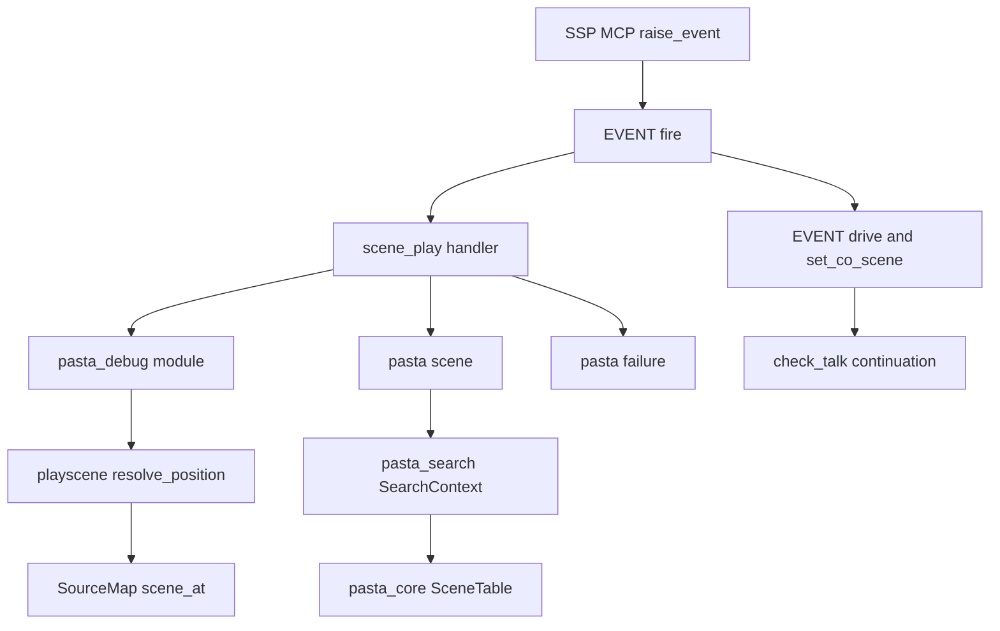
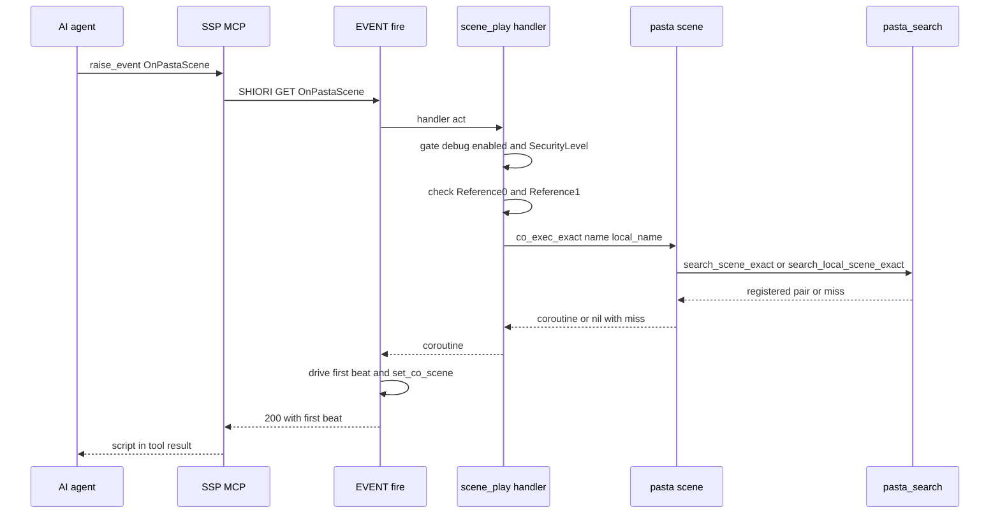
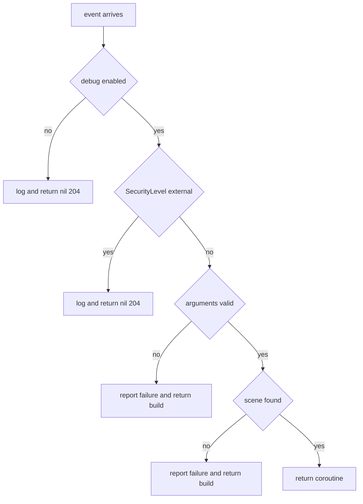

# 設計書: scene-play-event

## Overview

**目的**: SSP の MCP サーバーの `raise_event` から、名前か位置でシーンを指名して、その場で再生できるようにする。AI エージェントは、返ってきた 1 ビート目の台本とログを読んで、辞書を直せる。

**利用者**: ゴーストの開発者（pasta.toml か `PASTA_DEBUG` でデバッグを有効にする人）と、AI エージェント（`raise_event` でイベントを送る人）。

**変わること**: `OnPastaScene`・`OnPastaSceneAt` の 2 つの既定のハンドラを足す。デバッグが有効なときは、ソースマップと位置の索引を、VSCode の待ち受けが立たなかったときも持ち続ける。ほかのイベントの動きは変えない。

```
raise_event("OnPastaScene",   ["会話"])                  → ＊会話 を再生（1 ビート目が結果に載る）
raise_event("OnPastaScene",   ["会話", "挨拶"])          → ＊会話 の中の ・挨拶 を再生
raise_event("OnPastaSceneAt", ["dic/boot.pasta", "42"])  → 42 行目のシーンを再生
```

### Goals

- 名前（大域、または大域とローカル）で、書いた名前どおりに完全一致でシーンを引いて再生する。
- ファイルと行で、VSCode の「カーソル位置からシーンを再生」と同じ規則でシーンを引いて再生する。
- 1 ビート目はイベントの応答で返し、続きと中断は今のシーンの続きの仕組みに任せる。
- デバッグが有効なときだけ働き、配るゴーストの動きを何も変えない。
- 見つからないときと引数の誤りを、今の失敗の表記（`【種類：対象】`）とログに出す。

### Non-Goals

- VSCode の拡張と、SSP の MCP サーバーの側の変更。
- シーンに引数やアクターを渡すこと。登録名（`会話_1`）や前方一致での指名。
- SSTP 以外の経路（`\![raise]` の作例など）と、`pasta_check validate` のイベント名の一覧。
- 同じ名前のシーンが別のファイルにあるときの、位置の索引と通し番号の制約の直し（受け継ぐ）。
- `raise_event` が NOTIFY で届く場合の別の道（GET と決めた。Decisions 1）。

## Boundary Commitments

### This Spec Owns

- `OnPastaScene`・`OnPastaSceneAt` の既定のハンドラ（新しいファイル `pasta/shiori/event/scene_play.lua`）。引数の確かめ、デバッグの有効と `SecurityLevel` の門、失敗の表記の出し方。
- 名前からシーンのコルーチンを作る口の拡張（`SCENE.co_exec_exact` の 2 つ目の引数、`SCENE.co_exec_registered`）。
- 「その名前の大域のうち、そのローカルを持つものから順送りで選ぶ」検索（`SceneTable::resolve_global_owning_local_exact`、`SearchContext::search_local_scene_exact` と Lua のメソッド `search_local_scene_exact`）。
- 内部用の Lua モジュール `@pasta_debug`（`enabled()`・`scene_at(file, line)`）と、相対パスを `ghost/master/` に結んでから位置を引く純粋な関数（`resolve_position`）。
- ランタイムがソースマップを持つ条件の変更（待ち受けの有無から、設定での有効へ）。
- マニュアル（SHIORI イベントの章ほか）とスキルの references の作り直し。

### Out of Boundary

- キックの動き（`kick.lua`・`KICK.try_dispatch`・`STORE.kick_*`）と、VSCode からの `pasta/playSceneAt`・`pasta/reloadShiori`。触らない。
- 仮想ディスパッチャ（`virtual_dispatcher.lua`）、`shiori/entry.lua`、`store.lua`。同じウェーブの `ontalk-suppression` のため触らない。
- 続きのビートを流す時機（`check_talk`）と、ランダムトークを止めている間に続きを流すかどうか（`ontalk-suppression` が決める）。
- `EVENT.fire`・`EVENT.drive`・`set_co_scene` の中身（今のまま使う）。
- 失敗の表記の仕組み（`pasta/failure.lua`）。種類の名前も足さない。
- ブレークポイント・ステップ・ソースの提示（`debug::enable` の中の消費者）。
- `pasta_shiori`（GET・NOTIFY の扱いを含む）。

### Allowed Dependencies

- Lua のハンドラ → `pasta.shiori.event.register`（REG）、`pasta.scene`、`pasta.failure`、`@pasta_log`、`@pasta_debug`（`pcall` で読む）。
- `pasta.scene` → `@pasta_search`（呼んだ時に読む。今と同じ）。
- `@pasta_debug`（Rust）→ `debug::playscene`（`uri_to_pasta_path`・新しい `resolve_position`）→ `debug::source_map::SourceMap::scene_at`。
- `SearchContext`（`pasta_lua`）→ `SceneTable`（`pasta_core`）。向きは今と同じで、`pasta_core` は `pasta_lua` を知らない。
- 依存の向き: `pasta_core` → `pasta_lua` の検索 → `pasta.scene` → ハンドラ。`debug::source_map` → `debug::playscene` → `runtime` の登録 → ハンドラ。逆向きの依存は作らない。

### Revalidation Triggers

- `SCENE.co_exec_exact` の戻り値の形（2 つ目の戻り値）を変えたとき — 呼び出し元（つつき・撫でのショートカット、このハンドラ）を確かめ直す。
- `@pasta_debug` の関数の形を変えたとき — このハンドラと、後の `ponytail-lua-debug` を確かめ直す。
- ランタイムがソースマップを持つ条件（`runtime/mod.rs`）を変えたとき — 位置での再生（要件 4.3）を確かめ直す。`ponytail-lua-loader`・`ponytail-lua-debug` が触る場所である。
- ハンドラのファイルの形（`REG.OnX = REG.OnX or function` と門の置き方）を変えたとき — この形を写す `external-control-events`・`chain-talk-interrupt` に知らせる。
- `raise_event` が NOTIFY で届くと分かったとき — 1 ビート目の返し方を設計し直す。

## Architecture

### Existing Architecture Analysis

- **イベントの振り分け**: `EVENT.fire` は `REG[req.id]` が無ければ `EVENT.no_entry`（前方一致のシーン検索）を呼ぶ。ハンドラがコルーチンを返すと、`EVENT.drive` が 1 ビート目まで進めて応答にし、残りを `set_co_scene` で `STORE.co_scene` に置く（前の会話は捨てる）。文字列を返すと、そのまま 200（空なら 204）、nil なら 204 で、`STORE.co_scene` は変わらない。
- **既定のハンドラの置き方**: `REG.OnX = REG.OnX or function(act) ... end` を `pasta/shiori/event/` のファイルに書き、`event/init.lua` の `require` の並びに 1 行足す（`choice_select.lua` が先例）。作者が先に `REG.OnX` を定義していれば、そちらが残る。
- **完全一致の検索**: `SEARCH:search_scene_exact(名前, 親)` は名前を `sanitize_name` で直し、大域の検索だけ `[scene.alias]` を当て、同じキーの候補から重ならない順送りで 1 つ選ぶ。順送りの状態は `pasta_core` の `SceneTable` のキャッシュにある。
- **位置の索引**: ローダーはデバッグが有効なときだけソースマップを作る。ランタイムは辞書の確定の後に索引を突き合わせて、マップの中に書き込む。今は `debug::enable` が待ち受けを立てられなかったとき、ランタイムはマップを捨てる（`runtime/mod.rs` L267〜271）。
- **失敗の表記**: `FAILURE.report(act, record)` がログの警告を出し、`[logging] balloon_warning` が真なら表記を act のトークンに積む。

### Architecture Pattern & Boundary Map



**Architecture Integration**:
- **選んだ形**: 新しい既定のハンドラのファイルと、小さな口の追加（research.md 9 の案 B）。キック・ディスパッチャ・ストアに触らない。
- **境界の分け方**: ハンドラは「門・引数・失敗の出し方」だけを持つ。名前からコルーチンを作るのは `pasta.scene`、候補の選び方は検索（Rust）、位置からの引き当ては `@pasta_debug`（Rust）が持つ。
- **守る今の形**: 既定のハンドラの置き方、`(大域の登録名, ローカルの登録名)` を返す検索の口の形、`wrap_scene` によるコルーチン化、`EVENT.drive` による 1 ビート目と続き、`FAILURE.report` の表記。
- **新しい部品の理由**: `@pasta_debug` は Lua からデバッグの有効と位置の索引を知る唯一の口。`resolve_global_owning_local_exact` は要件 1.8 の順送りの状態を持てる唯一の場所（`SceneTable`）に置く。
- **steering との整合**: 層の向き（`pasta_core` → `pasta_lua`）、デバッグは opt-in で既定はゼロコスト、作者の上書きを優先、の決まりを守る。

### Technology Stack

| 層 | 選んだもの | この機能での役割 | 備考 |
| --- | --- | --- | --- |
| Lua ランタイムのスクリプト | LuaJIT 2.1（mlua 0.11） | 既定のハンドラ、`pasta.scene` の口 | 新しい依存なし |
| Lua に出す口 | Rust 2024・mlua 0.11 | `@pasta_debug` の登録、`SEARCH:search_local_scene_exact` | `set_loaded_module` の今の形 |
| 検索 | `pasta_core` の `SceneTable`（fast_radix_trie 1.2.0） | そのローカルを持つ大域の順送り | 関数を 1 つ足す |
| デバッグの情報 | `pasta_lua::debug::source_map` | 位置からシーンを引く | 持つ条件だけ変える |

## File Structure Plan

### Directory Structure

```
crates/pasta_lua/pasta_scripts/pasta/shiori/event/
└── scene_play.lua        # 新規。REG.OnPastaScene・REG.OnPastaSceneAt の既定のハンドラ
crates/pasta_lua/tests/lua_specs/
└── scene_play_event_test.lua  # 新規。ハンドラと scene.lua の口の Lua の単体テスト
crates/pasta_lua/tests/
└── scene_play_event_test.rs   # 新規。デバッグを有効にしたゴーストを読み込み、SHIORI.request で 2 つのイベントを確かめる結合テスト
```

### Modified Files

- `crates/pasta_lua/pasta_scripts/pasta/shiori/event/init.lua` — 既定のハンドラの `require` の並び（L78〜81）に `require("pasta.shiori.event.scene_play")` を 1 行足す。
- `crates/pasta_lua/pasta_scripts/pasta/scene.lua` — `SCENE.co_exec_exact(name, local_name)` に省略できる 2 つ目の引数と、見つからない側を示す 2 つ目の戻り値を足す。`SCENE.co_exec_registered(global_name, local_name)` を足す。
- `crates/pasta_core/src/registry/scene_table.rs` — `resolve_global_owning_local_exact` を足す。キャッシュの鍵（`SceneCacheKey`）に、持ち主のローカルの名前を入れる欄を足す（今の 3 か所の呼び出しは「無し」を渡す）。
- `crates/pasta_core/src/registry/scene_table_candidate_tests.rs`（または同じ並びの新しいテストのファイル） — 新しい関数の単体テスト。
- `crates/pasta_lua/src/search/context.rs` — `LocalSceneMatch` と `search_local_scene_exact` を足し、Lua のメソッドとして出す。テストを同じファイルの `tests` に足す。
- `crates/pasta_lua/src/debug/playscene.rs` — `resolve_position(map, base_dir, file, line)` を足す（相対パスを結ぶ → `uri_to_pasta_path` → `scene_at` → 登録名の組）。`resolve_and_kick` は変えない。
- `crates/pasta_lua/src/debug/playscene_tests.rs` — `resolve_position` の単体テスト。
- `crates/pasta_lua/src/runtime/module_registry.rs` — `register_debug_module(lua, enabled, source_map, base_dir)` を足す（`@pasta_debug` を登録）。
- `crates/pasta_lua/src/runtime/factory.rs` — `from_loader_with_scene_dic` で、解決したデバッグの有効を控え、`@pasta_config` などの登録の並びで `register_debug_module` を呼ぶ。
- `crates/pasta_lua/src/runtime/mod.rs` — ソースマップを持つ条件を `debug_handle.is_some()` から `config.debug.enabled` に変える（L265〜271 とコメント）。
- `crates/pasta_lua/src/runtime/exec.rs` — `debug_source_map()` の説明（doc コメント）を新しい条件に合わせる。動きは変えない。
- `crates/pasta_lua/tests/lua_specs/init.lua` — テストの一覧に `scene_play_event_test` を 1 行足す。
- `book/src/lua/shiori-events.md` — 既定ハンドラの表（L69〜77）と主要イベントの表に 2 つのイベントを足し、2 つの節（引数、探し方、デバッグのときだけ動くこと、失敗の出方、2 ビート目は後で出ること、`raise_event` の例、呼ぶ前に `reload` する作法とその理由）を書く。
- `book/src/lua/modules/pasta-search.md` — `search_local_scene_exact` の節を足す。
- `book/src/internals/debug.md` — L124 の「ソースマップを保持しない」を新しい条件に直す。シーンキックの節から 2 つのイベントの節を参照し、`@pasta_debug` と `resolve_position` を書く。
- `book/src/internals/internal-modules.md` — `SCENE.co_exec_exact` の 2 つ目の引数と戻り値、`SCENE.co_exec_registered` を書く。
- `book/src/internals/registry-search.md` — 完全一致の表に `search_local_scene_exact` の行を、`SceneTable` の説明に新しい関数を足す。
- `book/src/internals/execution-model.md` — 構築の手順の 4 に `@pasta_debug` を、9 の前提（持つ条件）を足す。
- `book/src/debug/dev-actions.md` — 「シーン再生」の節から 2 つのイベントの節を参照する。
- `.claude/skills/pasta-lua-coding/references/shiori-events.md`・`pasta-search.md`・`internal-modules.md` — 手で書かず、`book/tools/gen-skill-refs.mjs` でマニュアルから作り直す（写されるのは `lua/shiori-events.md`・`lua/modules/pasta-search.md`・`internals/internal-modules.md` の 3 つ。`internals/debug.md`・`debug/` は写されない）。

## System Flows

### OnPastaScene の流れ（GET を前提）



`OnPastaSceneAt` は、`co_exec_exact` の代わりに `@pasta_debug.scene_at` で登録名の組を得て、`SCENE.co_exec_registered` でコルーチンを作る。後は同じである。

### ハンドラの判定の順



- 門（デバッグの有効・`SecurityLevel`）は、引数を見る前に置く。無効のゴーストでは、引数が誤っていても何も表記しない（ログだけ）。
- 失敗の道では、コルーチンを返さないので `STORE.co_scene` は変わらない（要件 5.6）。`act:build()` の結果を返し、表記を出さない設定なら nil になり 204 になる。
- Status による抑止の判定は置かない（要件 3.4）。

## Requirements Traceability

| 要件 | 内容 | 部品 | 口 | 流れ |
| --- | --- | --- | --- | --- |
| 1.1 | 大域を名前で再生 | ScenePlayHandler, SceneCoroutineApi | `SCENE.co_exec_exact(name)` | OnPastaScene の流れ |
| 1.2 | 大域の中のローカルを再生 | ScenePlayHandler, SceneCoroutineApi, LocalSceneSearch | `SCENE.co_exec_exact(name, local_name)`, `search_local_scene_exact` | 同上 |
| 1.3 | 番号の付かない名前で受ける | LocalSceneSearch | `search_scene_exact`・`search_local_scene_exact` は書いた名前を受ける | — |
| 1.4 | 完全一致 | LocalSceneSearch, OwningLocalResolver | `resolve_scene_id_exact`・`resolve_global_owning_local_exact` はキーの完全一致 | — |
| 1.5 | 名前の直し方と別名 | LocalSceneSearch | `sanitize_name`、大域だけ `[scene.alias]` | — |
| 1.6 | 同名の候補は順送り | LocalSceneSearch, OwningLocalResolver | 今の `select_from_cache` | — |
| 1.7 | 空の Reference1 は省略 | ScenePlayHandler | 引数の確かめ | 判定の順 |
| 1.8 | そのローカルを持つ大域から順送り | OwningLocalResolver, LocalSceneSearch | `resolve_global_owning_local_exact` | — |
| 2.1 | 位置で再生 | ScenePlayHandler, DebugLuaModule, SceneCoroutineApi | `DEBUG.scene_at`, `SCENE.co_exec_registered` | OnPastaScene の流れの注 |
| 2.2 | VSCode と同じ引き方 | PositionResolver | `SourceMap::scene_at` をそのまま使う | — |
| 2.3 | 相対パスは ghost/master から | PositionResolver | `resolve_position` が `base_dir` に結ぶ | — |
| 2.4 | 絶対パス | PositionResolver | `Path::is_absolute()` ならそのまま | — |
| 2.5 | 区切りと大小 | PositionResolver | `uri_to_pasta_path`・`canonicalize_pasta_file` | — |
| 2.6 | 行は半角の 1 以上の整数 | ScenePlayHandler, PositionResolver | 引数の確かめ、`1..=u32::MAX` 以外は nil | 判定の順 |
| 2.7 | 指した位置のシーンそのもの | PositionResolver | 索引の登録名をそのまま使う | — |
| 3.1 | 進行中の会話を中断 | ScenePlayHandler（コルーチンを返す） | 今の `EVENT.drive`・`set_co_scene` | OnPastaScene の流れ |
| 3.2 | 応答は 1 ビート目だけ | 同上 | 今の `EVENT.drive` | 同上 |
| 3.3 | 続きはふだんの時機 | 同上 | 今の `check_talk` | — |
| 3.4 | Status で止めない | ScenePlayHandler | 抑止の判定を置かない | 判定の順 |
| 3.5 | 実行時のエラー | 同上 | 今の `EVENT.fire` の `error` と止まるエラーの表示 | — |
| 4.1 | デバッグが有効なら再生 | ScenePlayHandler, DebugLuaModule | `DEBUG.enabled()` | 判定の順 |
| 4.2 | 設定で決める | DebugLuaModule | 解決した `RuntimeConfig.debug.enabled` | — |
| 4.3 | 待ち受けが立たなくても情報を持つ | SourceMapRetention | `runtime/mod.rs` の条件 | — |
| 4.4 | 無効なら 204 とログ | ScenePlayHandler | nil を返す、`log.warn` | 判定の順 |
| 4.5 | 作者のハンドラを優先 | ScenePlayHandler | `REG.OnX = REG.OnX or …` | — |
| 4.6 | external は断る | ScenePlayHandler | `act.req.security_level` | 判定の順 |
| 5.1 | 大域が見つからない | ScenePlayHandler, SceneCoroutineApi | 2 つ目の戻り値 `"global"` | 判定の順 |
| 5.2 | ローカルが見つからない | 同上, LocalSceneSearch | 2 つ目の戻り値 `"local"` | 同上 |
| 5.3 | 位置に無い | ScenePlayHandler, PositionResolver | `DEBUG.scene_at` が nil | 同上 |
| 5.4 | 引数の誤り | ScenePlayHandler | `FAILURE.kind_of`・`FAILURE.value_of` | 同上 |
| 5.5 | 表記の形と設定 | ScenePlayHandler | `FAILURE.report` と `act:build()` | 同上 |
| 5.6 | 失敗では会話を残す | ScenePlayHandler | コルーチンを返さない | 同上 |
| 6.1 | 章に表と節 | Manual | `book/src/lua/shiori-events.md` | — |
| 6.2 | raise_event の例 | Manual | 同上 | — |
| 6.3 | 呼ぶ前に reload | Manual | 同上 | — |
| 6.4 | 内部設計とデバッグの章から参照 | Manual | `internals/debug.md`, `debug/dev-actions.md` | — |
| 6.5 | references の作り直し | Manual | `book/tools/gen-skill-refs.mjs` | — |
| 7.1 | 無効なら他のイベントは不変 | ScenePlayHandler | 足すのは 2 つのキーだけ | — |
| 7.2 | VSCode のキックとリロードは不変 | 全部品 | `kick.lua`・`resolve_and_kick` を変えない | — |
| 7.3 | 今のテストを書き換えない | 全部品 | 失敗の種類を足さない、など | — |
| 7.4 | 自動テスト | Tests | Testing Strategy の各項 | — |

## Components and Interfaces

| 部品 | 層 | 役目 | 要件 | 主な依存 | 契約 |
| --- | --- | --- | --- | --- | --- |
| ScenePlayHandler | Lua ハンドラ | 2 つのイベントの門・引数・再生・失敗 | 1.1〜1.2, 1.7, 2.1, 2.6, 3.1〜3.5, 4.1, 4.4〜4.6, 5.1〜5.6, 7.1 | SceneCoroutineApi (P0), DebugLuaModule (P0), FAILURE (P0) | Service, Event |
| SceneCoroutineApi | Lua `pasta.scene` | 名前・登録名の組からコルーチン | 1.1, 1.2, 2.1, 5.1, 5.2 | LocalSceneSearch (P0) | Service |
| LocalSceneSearch | Rust `pasta_lua::search` | 書いた名前どおりのローカル検索 | 1.2〜1.6, 1.8, 5.2 | OwningLocalResolver (P0) | Service |
| OwningLocalResolver | Rust `pasta_core` | そのローカルを持つ大域の順送り | 1.4, 1.6, 1.8 | なし | Service, State |
| DebugLuaModule | Rust `runtime` の登録 | `@pasta_debug` | 2.1, 4.1, 4.2 | PositionResolver (P0) | Service |
| PositionResolver | Rust `debug::playscene` | 相対パスを結んで位置を引く | 2.2〜2.7, 5.3 | SourceMap (P0) | Service |
| SourceMapRetention | Rust `runtime` | 設定で有効ならマップを持つ | 4.3 | `debug::enable` (P1) | State |
| Manual | `book/` | 使い方と内部設計 | 6.1〜6.5 | gen-skill-refs (P1) | — |

### Lua ハンドラ

#### ScenePlayHandler

| 欄 | 内容 |
| --- | --- |
| Intent | `OnPastaScene`・`OnPastaSceneAt` を受け、門を通ればシーンのコルーチンを返す |
| Requirements | 1.1, 1.2, 1.7, 2.1, 2.6, 3.1〜3.5, 4.1, 4.4〜4.6, 5.1〜5.6, 7.1 |
| ファイル | `crates/pasta_lua/pasta_scripts/pasta/shiori/event/scene_play.lua` |

**役目と決まり**
- `REG.OnPastaScene = REG.OnPastaScene or function(act) … end` と `REG.OnPastaSceneAt` を同じ形で置く。作者が先に定義していれば何もしない（4.5）。
- 共通の小さな関数を 2 つだけ持つ: 門（`allowed(act, event)`）と失敗（`fail(act, record)`）。後の spec（`external-control-events`・`chain-talk-interrupt`）が、この形を写せるようにする。
- 再生するときはコルーチンを返すだけにする。差し替え・1 ビート目・続きは `EVENT.fire` に任せる（3.1〜3.3・3.5）。
- Status を見ない（3.4）。`STORE` を直接触らない。

**依存**
- Inbound: `EVENT.fire` — `REG[req.id]` として呼ばれる（P0）
- Outbound: `pasta.scene`（SceneCoroutineApi）— コルーチンを作る（P0）
- Outbound: `@pasta_debug`（DebugLuaModule）— 有効の判定と位置（P0）
- Outbound: `pasta.failure` — 表記とログの警告（P0）、`@pasta_log` — 門で断るときのログ（P1）

**Contracts**: Service [x] / API [ ] / Event [x] / Batch [ ] / State [ ]

##### Event Contract

| イベント | Reference0 | Reference1 | 応答 |
| --- | --- | --- | --- |
| `OnPastaScene` | 大域シーンの書いた名前（必須・空でない） | ローカルシーンの書いた名前（省略・空なら大域だけ） | 再生: 200（1 ビート目）。失敗: 200（表記）か 204。断り: 204 |
| `OnPastaSceneAt` | `.pasta` ファイル。`ghost/master/` からの相対パスか絶対パス。区切りは `/`・`\` | 行。半角数字だけの 1 以上の整数（`"42"`） | 同上 |

- 前提: SHIORI の GET で、`SecurityLevel: local` で届く（Decisions 1）。NOTIFY で届いたときもハンドラは同じに動き、応答は `pasta_shiori` が捨てる。
- 冪等ではない: 呼ぶたびに順送りが進み、進行中の会話を差し替える。

##### Service Interface（Lua）

```lua
---@alias ScenePlayResult thread|string|nil
--- thread: 再生するシーンのコルーチン（EVENT.fire が 1 ビート目を応答にする）
--- string: 失敗の表記を積んだ act:build() の結果
--- nil:    204（門で断った、または表記を出さない設定の失敗）

---@param act ShioriAct
---@return ScenePlayResult
REG.OnPastaScene = REG.OnPastaScene or function(act) end

---@param act ShioriAct
---@return ScenePlayResult
REG.OnPastaSceneAt = REG.OnPastaSceneAt or function(act) end
```

- 事前条件: `act.req.reference` は 0 から数える表（`reference[0]` が Reference0）。
- 事後条件: コルーチンを返したときだけ `STORE.co_scene` が変わる（`EVENT.drive` による）。それ以外は `STORE` を変えない。

**判定の決まり（順に）**

1. 門: `pcall(require, "@pasta_debug")` が失敗するか `DEBUG.enabled()` が偽なら、`log.warn("<イベント名>: debug is disabled; scene not played")` を出して nil を返す（4.4）。
2. 門: `act.req.security_level == "external"` なら、`log.warn("<イベント名>: SecurityLevel external is refused; scene not played")` を出して nil を返す（4.6）。
3. 引数（`OnPastaScene`）: Reference0 が文字列でないか空なら失敗（`名前にならない値`）。Reference1 が空の文字列か無いなら、ローカルは省略（1.7）。
4. 引数（`OnPastaSceneAt`）: Reference0 が文字列でないか空なら失敗（`名前にならない値`）。Reference1 が `^%d+$` に合わないか、数にして 1 未満なら失敗（`数にできない値`）。全角の数字・前後の空白・小数・符号は合わない（2.6）。
5. 引き当て: `OnPastaScene` は `SCENE.co_exec_exact(name, local_name)`。`OnPastaSceneAt` は `DEBUG.scene_at(file, tonumber(line))` で登録名の組を得て、`SCENE.co_exec_registered(g, l)`。
6. コルーチンが得られたら返す。得られなければ失敗（`シーンが見つからない`）。

**失敗の表記とログ（5.1〜5.5）**

`FAILURE.report(act, record)` の後に `act:build()` を返す。表記の形は今の `【種類：対象（説明）】`。対象は「イベント名、半角の空白、探したもの」。

| 場合 | 種類（`FAILURE.LABEL`） | 対象 | 説明 | 表記の例 |
| --- | --- | --- | --- | --- |
| 大域が無い（5.1） | `SCENE_NOT_FOUND` | `OnPastaScene ＊会話` | なし | `【シーンが見つからない：OnPastaScene ＊会話】` |
| ローカルが無い（5.2） | `SCENE_NOT_FOUND` | `OnPastaScene ＊会話 ・挨拶` | なし | `【シーンが見つからない：OnPastaScene ＊会話 ・挨拶】` |
| 位置に無い（5.3） | `SCENE_NOT_FOUND` | `OnPastaSceneAt dic/boot.pasta:42`（渡された文字列のまま） | なし | `【シーンが見つからない：OnPastaSceneAt dic/boot.pasta:42】` |
| Reference0 が無い・空（5.4） | `BAD_NAME` | `<イベント名> Reference0` | `FAILURE.kind_of(値)` | `【名前にならない値：OnPastaScene Reference0（値なし）】` |
| 行の誤り（5.4） | `NOT_NUMBER` | `OnPastaSceneAt Reference1` | `FAILURE.value_of(値)` | `【数にできない値：OnPastaSceneAt Reference1（"４２"）】` |

- ログの警告（`record.warning`）は英語で、今の失敗の警告と同じ並び: `OnPastaScene: scene not found: global='会話'`、`OnPastaScene: scene not found: global='会話', local='挨拶'`、`OnPastaSceneAt: scene not found: file='dic/boot.pasta', line=42`、`OnPastaSceneAt: bad argument: Reference1='４２'`。
- 新しい種類の名前は足さない（今のテストが種類を 10 種と数えるため。要件 7.3）。
- パスの `\` と `%` は `FAILURE.format` がエスケープする。

**Implementation Notes**
- 結合: `event/init.lua` の `require` の並びの最後に 1 行足す。ほかのハンドラのファイルとの順序の依存は無い。
- 確かめ: Lua の単体テストで `@pasta_debug`・`@pasta_search` を差し替えて、門・引数・失敗・成功を確かめる。
- 危険: 無効のゴーストでも 2 つのキーは `REG` に入る。これまで `＊OnPastaScene…` で始まる名前のシーンを前方一致で再生していたゴーストは、それが動かなくなる（要件の話し合いで承認済み）。

### Lua の `pasta.scene`

#### SceneCoroutineApi

| 欄 | 内容 |
| --- | --- |
| Intent | 書いた名前、または登録名の組から、シーンのコルーチンを作る |
| Requirements | 1.1, 1.2, 2.1, 5.1, 5.2 |
| ファイル | `crates/pasta_lua/pasta_scripts/pasta/scene.lua` |

**Contracts**: Service [x]

##### Service Interface（Lua）

```lua
---@alias SceneMiss "global"|"local"

--- 完全一致でシーンを探し、コルーチンを返す（実行しない）。
--- local_name が nil なら今と同じ（大域だけ。SEARCH:search_scene_exact(name, nil)）。
--- local_name があれば SEARCH:search_local_scene_exact(name, local_name)。
---@param name string 大域シーンの書いた名前
---@param local_name string|nil ローカルシーンの書いた名前
---@return thread|nil co
---@return SceneMiss|nil miss co が nil のとき、無かった側
function SCENE.co_exec_exact(name, local_name) end

--- 登録名の組（例 "会話_1", "__start__" / "会話_1", "挨拶_1"）からコルーチンを返す。
--- SCENE.get で関数が引けなければ nil。
---@param global_name string
---@param local_name string
---@return thread|nil
function SCENE.co_exec_registered(global_name, local_name) end
```

- 事後条件: 返すコルーチンは今の `wrap_scene` で包む（最後に `act:build()` を返す。`co_exec` と同じ）。
- 今の呼び出し元（つつき・撫でのショートカット）は 1 つ目の戻り値だけを使うので、2 つ目の戻り値を足しても動きは変わらない。

### Rust の検索

#### LocalSceneSearch

| 欄 | 内容 |
| --- | --- |
| Intent | 大域とローカルの書いた名前から、そのローカルを持つ大域を順送りで選び、ローカルを引く |
| Requirements | 1.2〜1.6, 1.8, 5.2 |
| ファイル | `crates/pasta_lua/src/search/context.rs` |

**Contracts**: Service [x]

##### Service Interface（Rust）

```rust
/// search_local_scene_exact の結果。
pub enum LocalSceneMatch {
    /// 登録名の組（例: ("会話_1", "挨拶_1")）。
    Found { global_name: String, local_name: String },
    /// その名前の大域シーンが無い。
    NoGlobal,
    /// 大域シーンはあるが、どれもそのローカルシーンを持たない。
    NoLocal,
}

impl SearchContext {
    pub fn search_local_scene_exact(
        &mut self,
        global_name: &str,
        local_name: &str,
    ) -> Result<LocalSceneMatch, SearchError>;
}
```

- 手順: (1) `global_name` に別名を当て（完全一致のときだけ）、`sanitize_name` で直す。(2) `local_name` を `sanitize_name` で直す。(3) `SceneTable::resolve_global_owning_local_exact` で大域を選ぶ。(4) 選んだ大域の登録名を親にして、今の `resolve_scene_id_exact(親, ローカル)` でローカルを選ぶ（同じ大域の中に同じ名前のローカルが複数あれば順送り）。(5) ローカルの `fn_name` を分けて登録名の組を返す。
- 別名を当てて大域が無かったときは、今の大域の検索と同じ `Scene not found (alias applied)` の警告を出す。
- Lua のメソッド: `SEARCH:search_local_scene_exact(global_name, local_name)` → `global_name, local_name`（見つかった）／`nil, "global"`／`nil, "local"`。内部の失敗は今と同じく Lua のエラーにする。

#### OwningLocalResolver

| 欄 | 内容 |
| --- | --- |
| Intent | その名前の大域のうち、そのローカルを持つものだけを候補にして、重ならない順送りで 1 つ選ぶ |
| Requirements | 1.4, 1.6, 1.8 |
| ファイル | `crates/pasta_core/src/registry/scene_table.rs` |

**Contracts**: Service [x] / State [x]

##### Service Interface（Rust）

```rust
impl SceneTable {
    /// `name` と等しいキーの大域シーンのうち、`:{大域の登録名}:{local}` と等しいキーの
    /// ローカルシーンを持つものだけを候補にし、重ならない順送りで 1 つ選ぶ。
    ///
    /// - Ok(Some(id)): 選んだ大域シーン
    /// - Ok(None): 大域シーンはあるが、どれも `local` を持たない
    /// - Err(SceneNotFound): `name` の大域シーンが無い
    /// - Err(InvalidScene): `name` か `local` が空
    pub fn resolve_global_owning_local_exact(
        &mut self,
        name: &str,
        local: &str,
        filters: &HashMap<String, String>,
    ) -> Result<Option<SceneId>, SceneTableError>;
}
```

##### State Management
- 順送りの状態は今の `cache` に置き、鍵は「`name`・`local`・完全一致」の組にする。`SceneCacheKey` に持ち主のローカルの名前の欄（`Option<String>`）を足し、今の 3 つの解決は `None` を入れる。鍵が混ざらないので、ふつうの完全一致（`resolve_scene_id_exact("", name)`）の順送りとは別に進む。
- 候補の表はキャッシュを作るときに 1 度だけ決める（今の `select_from_cache` と同じ）。辞書の確定で `SceneTable` が作り直されれば、状態も作り直される。

### Rust のデバッグの口

#### DebugLuaModule（`@pasta_debug`）

| 欄 | 内容 |
| --- | --- |
| Intent | Lua に、設定でのデバッグの有効と、位置からの引き当てを出す |
| Requirements | 2.1, 4.1, 4.2 |
| ファイル | `crates/pasta_lua/src/runtime/module_registry.rs`（登録）、`crates/pasta_lua/src/runtime/factory.rs`（呼び出し） |

**Contracts**: Service [x]

##### Service Interface

```rust
impl PastaLuaRuntime {
    /// `@pasta_debug` を登録する。テーブルは関数 2 つだけを持つ。
    pub(crate) fn register_debug_module(
        lua: &Lua,
        enabled: bool,
        source_map: Option<Arc<SourceMap>>,
        base_dir: &Path,
    ) -> LuaResult<()>;
}
```

```lua
---@class PastaDebug
---@field enabled fun(): boolean  -- 解決したデバッグの設定（pasta.toml [debug] と PASTA_DEBUG）
---@field scene_at fun(file: string, line: number): (string|nil), (string|nil)
---  -- 登録名の組（大域, ローカル）。大域なら ローカルは "__start__"。見つからなければ nil
```

- `enabled` は `from_loader_with_scene_dic` で解決した `RuntimeConfig.debug.enabled` をそのまま持つ。待ち受けが立ったかどうか（`debug_enabled()`）は見ない（4.2）。
- `scene_at` は `PositionResolver::resolve_position` を呼ぶ。マップが無ければ常に nil。`line` は数で受け、`1..=u32::MAX` の整数でなければ nil（500 にしない）。
- 登録は本番の入口（`from_loader_with_scene_dic`）だけで行う。`PastaLuaRuntime::new` などの簡易な入口では登録しない（ハンドラは無いものを無効として扱う）。
- 内部用のモジュールとし、マニュアルでは内部設計の章にだけ書く（作者向けのモジュールの章には載せない。Decisions 5）。

#### PositionResolver

| 欄 | 内容 |
| --- | --- |
| Intent | ファイルと行を、`ghost/master/` に結んでから索引で引き、登録名の組にする |
| Requirements | 2.2〜2.7, 5.3 |
| ファイル | `crates/pasta_lua/src/debug/playscene.rs` |

##### Service Interface（Rust）

```rust
/// 位置 (file, line) を登録名の組 (大域, ローカル) に引く（純粋）。
///
/// - file が相対パス（`!Path::is_absolute()`）なら base_dir に結ぶ。
/// - 結んだパスを uri_to_pasta_path に通し、map.scene_at(path, line) で引く。
/// - 大域 (scene_id, None) → (scene_id, "__start__")、ローカル (scene_id, Some(p)) → (p, scene_id)。
/// - 見つからなければ None。ファイルは開かない。
pub fn resolve_position(
    map: &SourceMap,
    base_dir: &Path,
    file: &str,
    line: u32,
) -> Option<(String, String)>;
```

- 区切りと大小の扱いは、今の `canonicalize_pasta_file`（`scene_at` の中）に任せる（2.5）。
- 同じ名前のシーンが別のファイルにあるときの索引の制約は受け継ぐ（2.7）。
- `resolve_and_kick` は変えない（7.2）。

#### SourceMapRetention

| 欄 | 内容 |
| --- | --- |
| Intent | 設定でデバッグが有効なら、待ち受けが立たなくてもソースマップと索引を持つ |
| Requirements | 4.3 |
| ファイル | `crates/pasta_lua/src/runtime/mod.rs` |

##### State Management
- 変更前: `let source_map = if debug_handle.is_some() { source_map } else { None };`
- 変更後: `let source_map = if config.debug.enabled { source_map } else { None };`
- 効果: 2 体目のゴースト（ポートが取れない）でも `runtime.source_map` が残り、`factory.rs` L241 の索引の突合が走る。
- ほかの消費者への影響は無い（ブレーク・ステップ・ソースの提示は `debug::enable` の中で、待ち受けが立った後にだけマップを受け取る。research.md 8.2）。無効のときは、ローダーが初めからマップを作らないので、今と同じく何も持たない（7.1）。

### マニュアル（要約）

- `book/src/lua/shiori-events.md`: 「既定ハンドラと上書き」の表（今は「次の 5 つのイベント」）を 7 つにし、主要イベントの表に「デバッグ」の分類で 2 行を足す。`### OnPastaScene（名前でシーンを再生）`・`### OnPastaSceneAt（位置でシーンを再生）` の 2 つの節に、Reference の表、探し方（完全一致・別名・順送り・ローカルを持つ大域から選ぶこと・位置の規則）、デバッグが有効なときだけ動くこと（無効・external は 204 とログ）、失敗の表記の例、1 ビート目だけが結果に載り 2 ビート目からはランダムトークの次の時刻に出ること、`raise_event` の呼び方の例、呼ぶ前に MCP の `reload`（SHIORI）を呼ぶ作法と理由を書く。
- 同じ名前で始まるシーンの前方一致（シーン関数フォールバック）が 2 つのイベントでは起きないことを、節の中で 1 行書く。

## Error Handling

### Error Strategy

| 誤り | 判定する場所 | 応答 | ログ | 表記 |
| --- | --- | --- | --- | --- |
| デバッグが無効 | ハンドラの門 | 204 | `warn`: debug is disabled | 出さない |
| `SecurityLevel` が external | ハンドラの門 | 204 | `warn`: SecurityLevel external is refused | 出さない |
| Reference0 が無い・空 | ハンドラ | 200（表記）か 204 | `warn` | `名前にならない値` |
| 行の誤り | ハンドラ | 同上 | `warn` | `数にできない値` |
| シーンが見つからない | ハンドラ（`co_exec_exact` の miss、`scene_at` の nil） | 同上 | `warn`（別名を当てたときは検索の警告も） | `シーンが見つからない` |
| 再生したシーンの実行時エラー | 今の `EVENT.fire` | 今の止まるエラーの応答 | 今のとおり | 今の止まるエラーの表記 |
| 検索の内部の失敗 | `SearchContext` | Lua のエラー → 今の止まるエラーの応答 | 今のとおり | 今のとおり |

- 失敗では進行中の会話を残す（5.6）。
- 表記を出すかどうかは `[logging] balloon_warning` に従い、ログの警告は常に出す（今の `FAILURE.report` の決まり）。

### Monitoring

- 門で断ったとき、見つからないとき、引数の誤りは、どれも pasta のログに warn で 1 行残る。pasta は SHIORI の応答に `ErrorLevel` を載せないので、SSP の MCP の `get_log` には出ない。AI エージェントは pasta のログファイルを読む。
- 見つからないときと引数の誤りは、既定（`balloon_warning = true`）では表記が応答に載るので、`raise_event` の結果だけで分かる。門で断ったとき（204）だけは、ログを読まないと理由が分からない。

## Testing Strategy

### Unit Tests

1. `SceneTable::resolve_global_owning_local_exact`（`pasta_core`）: `会話_1`（`挨拶` あり）・`会話_2`（なし）・`会話_3`（あり）で、選ばれるのが 1 と 3 だけで、1 周で重ならないこと（1.8・1.6）。大域が無いと `SceneNotFound`、だれも持たないと `Ok(None)`。ふつうの完全一致の順送りと状態が混ざらないこと。
2. `SearchContext::search_local_scene_exact`: 大域に別名が当たること、ローカルには別名が当たらないこと、両方の名前が `sanitize_name` で直ること（1.5）、登録名の組を返すこと、`NoGlobal`・`NoLocal`。Lua のメソッドの戻り値（`nil, "global"`／`nil, "local"`）。
3. `resolve_position`（`playscene_tests.rs`）: 相対パス（`dic/boot.pasta`・`dic\boot.pasta`）が `base_dir` に結ばれて引けること（2.3・2.5）、絶対パスがそのまま引けること（2.4）、大域とローカルの組の形、索引に無いファイル・シーンの無い行・マップに索引が無いときの `None`。
4. Lua（`scene_play_event_test.lua`、`@pasta_debug`・`@pasta_search` を差し替え）: 無効のとき nil とログ（4.4）、`@pasta_debug` が無いとき nil、external のとき nil とログ（4.6）、作者の `REG.OnPastaScene` が残ること（4.5）、Reference0 の無し・空、Reference1 の `"４２"`・`" 42"`・`"0"`・`"1.5"`・`"abc"`・無し、空の Reference1 を省略として扱うこと（1.7）、表記の文字列（5.1〜5.5）、`balloon_warning = false` で nil、失敗で `STORE.co_scene` が変わらないこと（5.6）、成功でコルーチンが返り 1 回目の再開で `build` の結果が返ること。
5. Lua（同じファイル）: `SCENE.co_exec_exact` の 2 つ目の戻り値（`"global"`・`"local"`）と、`SCENE.co_exec_registered` が登録名の組の関数を包むこと、引けなければ nil。

### Integration Tests

`crates/pasta_lua/tests/scene_play_event_test.rs`。一時フォルダにデバッグを有効にしたゴースト（大域・ローカル・同じ名前の大域 2 つ・2 ビートのシーン）を作り、`PastaLoader::load_with_config` で読み込んで、`SHIORI.request` に GET のリクエストを渡す（`tests/shiori/event_dispatch_test.rs` と同じ形）。`PASTA_DEBUG` を中和する今の仕組み（`#[ctor]`）とポートの扱い（`tests/common`）に従う。

1. 名前で大域とローカルを再生し、200 の Value が 1 ビート目だけであること、続きが `STORE.co_scene` に置かれること（1.1・1.2・3.1・3.2）。
2. 同じ名前の大域が 2 つあり、片方だけがローカルを持つとき、ローカルを指名すると毎回再生できること（1.8）。
3. 位置で、相対パスと絶対パスの両方で再生できること（2.1・2.3・2.4）。
4. 待ち受けのポートを先に塞いでから読み込み、`debug_enabled()` が偽でも `debug_source_map()` があり、位置で再生できること（4.2・4.3）。
5. デバッグを無効にしたゴーストでは 2 つのイベントが 204 になること（4.4・7.1）。見つからないときに 200 で表記が返ること（5.1・5.3）。

### 実機での確かめ（実装の最後）

SSP の実機で、デバッグを有効にした試験用のゴーストに、MCP の `reload` の後で `raise_event` を送る（起動中の SSP とは別の SSP で試す）。次を確かめる。

1. `OnPastaScene`・`OnPastaSceneAt` が SHIORI に GET で、`SecurityLevel: local` で届くこと（pasta のログで見る）。
2. ツールの結果に 1 ビート目の台本が載り、見つからないときは表記が載ること。

GET でなかったとき、または `local` でなかったときは、実装を完了とせず、設計に戻る（Decisions 1）。

### Regression

- 今のテスト（Rust・Lua・luacheck）を書き換えずに通す（7.3）。とくに `failure_test.lua` の種類の数、`source_map_handoff_test.rs`・`scene_identity_index_test.rs` の無効のときの `None`、キックの Lua のテスト 5 本（7.2）。
- `pasta_lua` のテストが `sample.generated.lua` の改行を書き換えることがあるので、コミットに混ぜない。

## Security Considerations

- 2 つのイベントは、設定でデバッグを有効にしたときだけ働く。配るゴーストでは、だれがイベントを送ってもシーンを再生しない。
- `SecurityLevel: external` は断る（`OnPastaClock` に揃える）。
- `OnPastaSceneAt` のパスは索引を引くためだけに使い、ファイルを開かない。どんなパスを渡されても、ファイルの中身や有無は漏れない（見つからない表記に出るのは、渡された文字列だけ）。
- 表記に入る値（名前・パス・行）は `FAILURE.format` がエスケープするので、さくらスクリプトとして働かない。

## Decisions（2026-10-22 設計の話し合いで、すべて推奨案で確定）

1. **`raise_event` は GET・`SecurityLevel: local` で届く**: SHIORI/3.0 は NOTIFY の応答の Value を捨てる。SSP ヘルプは、`raise_event` が「ゴーストが返したスクリプトを再生する」こと、MCP の操作が Owned SSTP と同様に扱われるローカル専用の機能であることを書く（research.md 8.1）。実機での確かめは、実装の最後に行う（Testing Strategy の「実機での確かめ」）。NOTIFY だったときは、1 ビート目を捨てない別の道（例: `KICK.install` で次の OnSecondChange に出す）に設計し直す。`external` だったときは、要件 4.6 を見直す。
2. **順送りの状態の鍵**: `SceneCacheKey` に持ち主のローカルの名前の欄（`Option<String>`）を足す。今の 3 か所の解決は `None` を渡す。`module_name` に `:` で始まる印を埋める案は、隠れた約束を残すので採らない。
3. **失敗の表記の対象**: 「イベント名、半角の空白、`＊大域 ・ローカル`／`ファイル:行`／`ReferenceN`」。DSL と同じ印で、大域とローカルを取り違えない。要件 5.2 の例もこの形に直した。
4. **引数の誤りの種類**: 新しい種類を足さず、`名前にならない値`・`数にできない値` を使う。`"0"` も `数にできない値` と呼び、括弧の中に値を出して分かるようにする。足すと `failure_test.lua` の種類の数（10 種）が変わり、要件 7.3 と食い違う。
5. **`@pasta_debug` は内部用**: 内部設計の章にだけ書き、作者向けのモジュールの章には載せない。後の `ponytail-lua-debug` のために、口を小さく保つ。
6. **門で断ったときのログは warn**: 204 の理由はログにしか残らない。配るゴーストにこのイベントが届くのは、誰かがわざわざ送ったときだけなので、警告で目立たせてよい。

## Risks

- 実機で GET・`local` でなかったときは、1 ビート目の返し方か要件 4.6 を直すことになる（Decisions 1）。
