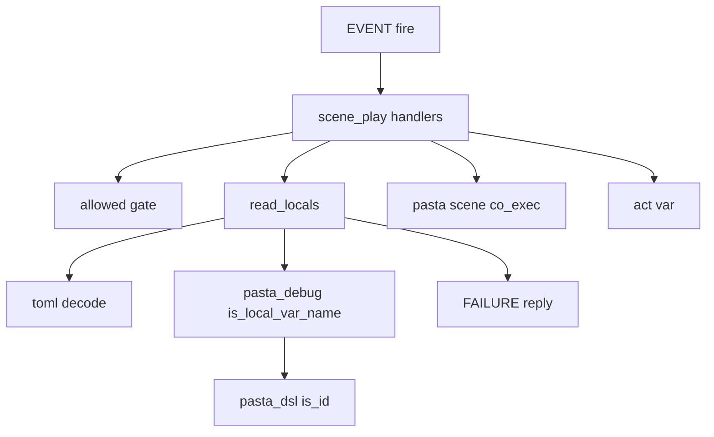
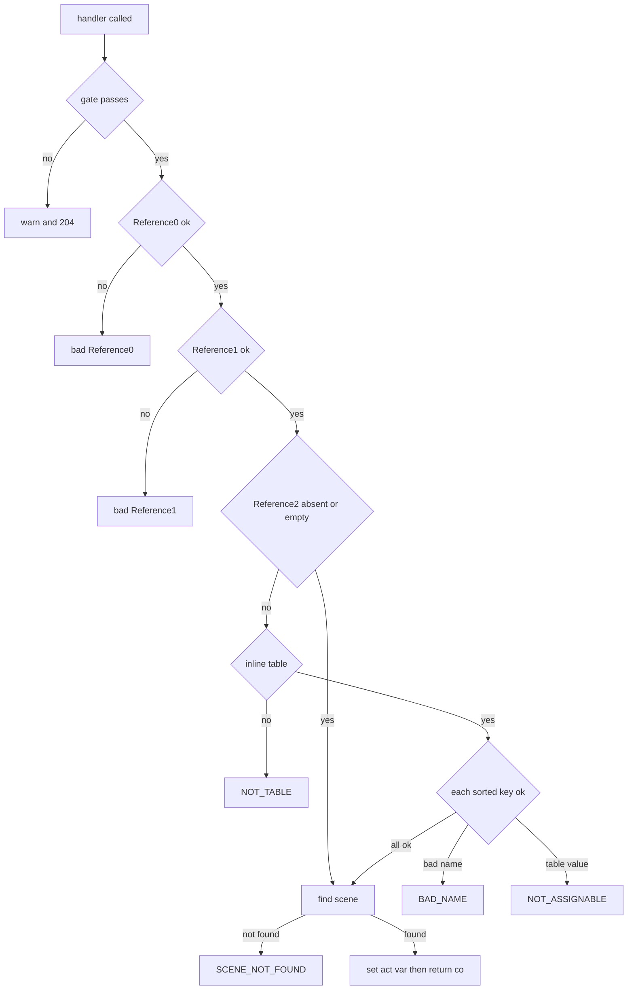

# 設計書: scene-play-locals

## Overview

**Purpose**: 開発用のイベント `OnPastaScene`・`OnPastaSceneAt` に、ローカル変数（`＄名前`）へ値を入れた状態でシーンを始める口を足す。送る側は Reference2 に TOML のインライン表を 1 つ書く。

**Users**: ゴーストの作者と AI エージェント（SSP の MCP の `raise_event`）、のちに `pasta-recipe-dev-actions` の画面。変数の値で分かれる話を、前置きのシーンを書かずに確かめる。

**Impact**: 既定ハンドラ（`scene_play.lua`）が、シーンを引く直前に Reference2 を読んで検査し、コルーチンが得られたら `act.var` に入れる。Reference2 が無いか空なら、今の道をそのまま通る。シーンの入口（`scene.lua`）と生成するコード（`code_gen`）は変えない。

### Goals

- Reference2 の `{ "名前" = "ぱすた", "回数" = 3 }` で、シーンの最初の行から `＄名前`・`＄回数` が読める（1.1〜1.7）。
- 書き方の誤り 3 種を、今の失敗と同じ出口（`FAILURE.reply`）で 1 件だけ知らせ、鳴らさない（4.1〜4.8）。
- Reference2 を送らない今の利用者の振る舞いと、今のテストを変えない（3.1・3.2・7.2）。

### Non-Goals

- `OnPastaCallFunction` の引数・シーン引数（`＄０`…）・グローバル変数（`＄＊`）を入れること。
- 配列・表の値（要る人が出てから足す。2.5）。
- VS Code 拡張・`pasta-recipe` の画面から Reference2 を送ること。
- 引用符の無い日本語のキーの読み替え（TOML の書き方をそのまま受ける）。

## Boundary Commitments

### This Spec Owns

- `OnPastaScene`・`OnPastaSceneAt` の既定ハンドラの Reference2 の読み取り・検査・`act.var` への代入。
- Reference2 の書き方の契約（TOML のインライン表 1 つ・値の型・誤りの 3 種の表記とログの警告）。
- 失敗のラベル `表にできない値`（`FAILURE.LABEL.NOT_TABLE`）の新設。
- 「文字列の全体が辞書の `id` 規則に当たるか」の判定（`pasta_dsl::parser::is_id`）と、その Lua への口（`@pasta_debug.is_local_var_name`）。
- マニュアルの `shiori-events.md` の 2 節と共通の決まり、`internals/debug.md` の `@pasta_debug` の表、スキルの参照資料の作り直し。

### Out of Boundary

- シーンの探し方（`co_exec_exact`・`co_exec_registered`・`scene_at`・シーンマップ）。`scene.lua` に触らない。
- 生成するシーンの関数（`code_gen`）と、ローカル変数の名前の決まりそのもの（`grammar.pest`）。
- 門（デバッグの有効・`SecurityLevel`）の振る舞いと文言。
- `@toml` の変換（日付・時刻を文字列にする、整数を `f64` にする）。
- `crates/pasta_lsp/`・`editors/vscode/`・`book/src/debug/dev-actions.md`（並走の `vscode-scene-outline-play` の持ち場）。
- Lua の仕様のテストのランナー（`tests/lua_unittest_runner.rs`）。

### Allowed Dependencies

- `scene_play.lua` → `@toml`（`decode`）・`@pasta_debug`（`is_local_var_name`）・`pasta.failure`・既存の `pasta.scene`・`pasta.store`。`pasta.shiori.event`（`init.lua`）は今と同じく `require` しない。
- `pasta_lua`（`module_registry.rs`）→ `pasta_dsl::parser::is_id`。`pasta_lua` の `Cargo.toml` に依存を足さない（`pest` を直接使わない）。
- `pasta_dsl::parser::is_id` → 自クレートの `PastaParser2`・`Rule::id` だけ。

### Revalidation Triggers

- Reference2 の書き方（インライン表・受ける型・ラベル・警告の文言）を変えたとき: `pasta-recipe-dev-actions` が文字列の組み立てと誤りの読み方を見直す。
- `grammar.pest` の `id` 規則を変えたとき: 受けるキーが一緒に変わる（意図どおり。マニュアルの例を見直す）。
- `@toml` の変換を変えたとき（日付・時刻・大きい整数）: 値の型の節を見直す。
- `EVENT.fire` が、ハンドラの act とシーンを再開する act を分けたとき: 代入の置き場（ハンドラ）が成り立たなくなる。

## Architecture

### Existing Architecture Analysis

- `EVENT.fire` は act を作って Reference と日時をローカル変数へ転記し（`create_act`）、ハンドラを呼び、返ったコルーチンを**同じ act** で再開する。`＞` の呼び出し・ローカルシーン・チェイントークの続きも同じ act を使う。
- 生成するシーンの関数は `act:init_scene` から `act.var` をそのまま受け取り、`＄x` を `var.x` として読む。
- したがって、ハンドラがコルーチンを返す前に `act.var[キー] = 値` とすれば、「シーンの最初の行の前に代入した」のと同じ範囲に届き（1.3）、本文の代入が後から勝ち（1.4）、転記された `＄r0`・日時の変数に勝つ（1.7）。後の別のイベントは別の act なので届かない。
- 失敗は `FAILURE.reply(act, record)` が、表記（`balloon_warning` に従う）・ログの警告・エスケープをまとめて受け持つ（4.7・4.8）。

### Architecture Pattern & Boundary Map



- **Selected pattern**: 既存のハンドラの中に局所関数を 1 つ足す（ギャップ分析の案 B）。新しいモジュールは作らない。
- **Dependency direction**: `pasta_dsl`（文法）→ `pasta_lua` の Rust（`@pasta_debug`）→ Lua の `scene_play.lua`。逆向きの依存は作らない。
- **Steering compliance**: pasta の書式は TOML（`@toml` を使う）。LuaJIT 2.1 の機能だけを使う（`goto`・5.2 以降の機能を使わない。7.1）。

### Technology Stack

| Layer | Choice / Version | Role in Feature | Notes |
| ----- | ---------------- | --------------- | ----- |
| Lua ランタイム | LuaJIT 2.1（mlua 0.12） | ハンドラの実行 | 変更なし |
| TOML | toml 1.1.8（`@toml.decode`） | Reference2 の読み取り | 既存。`v = ` に包んで文書として読む |
| 文法 | pest（`pasta_dsl` の `grammar.pest`） | 変数の名前の判定 | 既存の `id` 規則を全体一致で使う。依存の追加なし |

## File Structure Plan

### Modified Files

- `crates/pasta_dsl/src/parser/mod.rs` — `pub fn is_id(s: &str) -> bool` を足す（`Rule::id` に文字列の全体が当たるか）。同じファイルの `#[cfg(test)] mod tests` に単体テストを足す。
- `crates/pasta_lua/src/runtime/module_registry.rs` — `register_debug_module` に `is_local_var_name(s)` を 1 つ足し、doc コメントの関数の数を直す。
- `crates/pasta_lua/pasta_scripts/pasta/failure.lua` — `FAILURE.LABEL.NOT_TABLE = "表にできない値"` を 1 行足す。
- `crates/pasta_lua/pasta_scripts/pasta/shiori/event/scene_play.lua` — 局所関数 `read_locals` を足し、2 つのハンドラから呼ぶ。`OnPastaScene` は門の戻り値（`@pasta_debug`）を受け取るように変える。冒頭のモジュールの説明に Reference2 を足す。
- `crates/pasta_lua/tests/scene_play_event_test.rs` — `FIXTURE` の**末尾に**確かめ用のシーンを足し、Reference2 のテスト関数を足す。今のテスト関数と `LINE_*` は変えない。
- `book/src/lua/shiori-events.md` — `OnPastaScene`・`OnPastaSceneAt` の Reference の表と誤りの表、送り方の例、シーンを再生するイベントの共通の決まりに「ローカル変数を入れる」の段を足す。
- `book/src/internals/debug.md` — `@pasta_debug` の関数の表に `is_local_var_name` を足し、「位置でのシーンの再生」に Reference2 の扱いを 1 文足す。
- `.claude/skills/pasta-lua-coding/references/shiori-events.md` — `node book/tools/gen-skill-refs.mjs` で作り直すだけ（手では書かない）。

新しく作るファイルは無い。

## System Flows



- `OnPastaScene` の Reference1 には検査が無い（空なら省略と同じ。中身にかかわらずローカルシーンの名前。3.3・3.4）。`OnPastaSceneAt` の Reference1 は今の行の検査。
- 誤りのどの枝でも `act.var` に触れず、コルーチンを作らないので、チェイントークで待っている続きは残る（4.4）。
- 門は Reference2 を読む前にあるので、デバッグが無効・`external` のときは今と同じ警告 1 行と 204（5.1・5.2）。

## Requirements Traceability

| Requirement | Summary | Components | Interfaces | Flows |
| ----------- | ------- | ---------- | ---------- | ----- |
| 1.1 | 表のキーごとに `＄キー` へ入れて始める | ScenePlayHandlers, LocalsReader | `read_locals`・`act.var` | Assign |
| 1.2 | 最初の行から読める | ScenePlayHandlers | `act.var`（同じ act で再開） | Assign |
| 1.3 | 最初の行の前に代入したのと同じ範囲 | ScenePlayHandlers | 同じ act（`＞`・ローカル・Lua・続き） | Assign |
| 1.4 | 本文の代入が後から勝つ | ScenePlayHandlers | `act.var` を初期値として入れるだけ | Assign |
| 1.5 | 書いたとおりの名前 | LocalsReader | キーを揃えずに `act.var[key]` | Keys |
| 1.6 | 空の表は足さずに鳴らす | LocalsReader | 空の表を返す | Keys |
| 1.7 | 転記された変数に勝つ | ScenePlayHandlers | 転記（`create_act`）の後で代入 | Assign |
| 2.1 | 文字列 | LocalsReader | `@toml.decode` の変換 | Keys |
| 2.2 | 整数・浮動小数点数は数 | LocalsReader | 同上（整数は `f64`） | Keys |
| 2.3 | 真偽値 | LocalsReader | 同上 | Keys |
| 2.4 | 日付・時刻は書いたとおりの文字列 | LocalsReader | 同上（`Datetime::to_string`） | Keys |
| 2.5 | 配列・表は扱えない型 | LocalsReader | `type(v) == "table"` → NOT_ASSIGNABLE | FA |
| 3.1 | Reference2 無しは今のまま | ScenePlayHandlers | `reference[2] == nil` は今の道 | R2 |
| 3.2 | 空の文字列は無しと同じ | LocalsReader | `""` は今の道 | R2 |
| 3.3 | Reference1 が無い・空ならグローバル | ScenePlayHandlers | 今の `""` → nil | R1 |
| 3.4 | Reference1 を Reference2 と読まない | ScenePlayHandlers | Reference1 の扱いは今のまま | R1 |
| 4.1 | 表にできない値 | LocalsReader, FailureLabel | `NOT_TABLE`・`FAILURE.reply` | FT |
| 4.2 | 名前にならない値 | LocalsReader, DebugNameCheck, DslIdCheck | `is_local_var_name`・`is_id`・`BAD_NAME` | FN |
| 4.3 | 代入できない値 | LocalsReader | `NOT_ASSIGNABLE` | FA |
| 4.4 | 誤りなら 1 つも入れない | ScenePlayHandlers | 代入はコルーチンを得た後だけ | Assign |
| 4.5 | 誤りは 1 件だけ | LocalsReader | キーを並べ替え、最初の誤りで返す | Keys |
| 4.6 | Reference0 → 1 → 2 → 検索 の順 | ScenePlayHandlers | `read_locals` を検索の直前に呼ぶ | 全体 |
| 4.7 | `balloon_warning = false` は 204・警告は出す | LocalsReader | `FAILURE.reply`（既存） | FT・FN・FA |
| 4.8 | `\`・`%` を無効にする | LocalsReader | `FAILURE.format` のエスケープ（既存） | FT・FN・FA |
| 5.1 | デバッグが無効なら読まない | ScenePlayHandlers | 門 `allowed` が先 | Gate |
| 5.2 | `external` なら読まない | ScenePlayHandlers | 同上 | Gate |
| 5.3 | 作者のハンドラを上書きしない | ScenePlayHandlers | `REG.X = REG.X or …`（既存） | — |
| 6.1 | Reference の表・送り方の例・読めること | ManualSections | `shiori-events.md` | — |
| 6.2 | 誤りの表に 3 種 | ManualSections | 同上 | — |
| 6.3 | 共通の決まり（型・範囲・Reference1 を空に・引用符） | ManualSections | 同上 | — |
| 6.4 | スキルの参照資料を作り直し `--check` に通る | ManualSections | `gen-skill-refs.mjs` | — |
| 7.1 | LuaJIT 2.1 で動く | LocalsReader | 5.1 の機能だけ（`table.sort`・`pairs`・`string.match`） | — |
| 7.2 | 今のテストを書き換えずに通す | Tests | 今のテスト関数に触れない | — |
| 7.3 | 自動のテスト | Tests | 結合テスト・`pasta_dsl` の単体テスト | — |

## Components and Interfaces

| Component | Domain/Layer | Intent | Req Coverage | Key Dependencies | Contracts |
| --------- | ------------ | ------ | ------------ | ---------------- | --------- |
| ScenePlayHandlers | Lua（`scene_play.lua`） | 2 つのハンドラに Reference2 の読み取りと代入を挟む | 1.1〜1.4, 1.7, 3.1, 3.3, 3.4, 4.4, 4.6, 5.1〜5.3 | LocalsReader (P0), `pasta.scene` (P0) | Service |
| LocalsReader | Lua（`scene_play.lua` の局所関数） | Reference2 を読み、検査し、表か失敗の応答を返す | 1.5, 1.6, 2.1〜2.5, 3.2, 4.1〜4.3, 4.5, 4.7, 4.8, 7.1 | `@toml` (P0), `@pasta_debug` (P0), `pasta.failure` (P0) | Service |
| FailureLabel | Lua（`failure.lua`） | ラベル `表にできない値` | 4.1 | — | State |
| DebugNameCheck | Rust（`module_registry.rs`） | `@pasta_debug.is_local_var_name` | 4.2 | DslIdCheck (P0) | Service |
| DslIdCheck | Rust（`pasta_dsl/src/parser/mod.rs`） | 文字列の全体が `id` 規則に当たるか | 4.2 | `PastaParser2`・`Rule::id` (P0) | Service |
| ManualSections | マニュアル | 書き方・型・範囲・誤りを載せ、参照資料を作り直す | 6.1〜6.4 | `gen-skill-refs.mjs` (P1) | — |
| Tests | テスト | 値が読める・今のまま・誤りの 3 種・名前の判定 | 7.2, 7.3 | 本物のランタイム (P0) | — |

### Lua

#### LocalsReader（`read_locals`）

| Field | Detail |
| ----- | ------ |
| Intent | Reference2 を読み、検査を全部通ったローカル変数の表か、失敗の応答を返す |
| Requirements | 1.5, 1.6, 2.1〜2.5, 3.2, 4.1〜4.3, 4.5, 4.7, 4.8, 7.1 |

**Responsibilities & Constraints**

- `act.var` に触れない（代入はハンドラの仕事）。シーンを引かない。
- 検査は届いた文字列だけで済ませる（4.6 の「シーンを引く前」）。

**Contracts**: Service [x]

##### Service Interface

```lua
--- @param act ShioriAct
--- @param event "OnPastaScene"|"OnPastaSceneAt"
--- @param debug table  門が返した @pasta_debug（is_local_var_name を持つ）
--- @return boolean ok
--- @return table<string, string|number|boolean>|string|nil  ok なら入れる表（無ければ nil）、ok でなければ FAILURE.reply の戻り値（204 にする設定なら nil）
local function read_locals(act, event, debug) end
```

- **Preconditions**: 門と Reference0・Reference1 の検査を通っている。
- **Postconditions**:
  - `reference[2]` が nil か `""` → `true, nil`（3.1・3.2）。
  - `@toml.decode("v = " .. raw)` が読めない → `NOT_TABLE`。読めても、文書のキーが `v` 以外を含むか、`v` が表でない → `NOT_TABLE`（4.1）。空白だけの文字列も読めないので `NOT_TABLE`（3.2 の「空」は `""` だけ。想定外の書き方を読み替えない）。
  - `v` のキーを `table.sort` で並べ、キーごとに「名前 → 型」の順で確かめ、最初の誤りで返す（4.5）。名前は `debug.is_local_var_name(key)` が偽なら `BAD_NAME`（4.2）、値が `type(v) == "table"`（TOML の配列・表・ドットのキーで生まれた表）なら `NOT_ASSIGNABLE`（2.5・4.3）。
  - 全部通れば `true, v`（空の表なら `true, {}`。1.6）。値は `@toml` の変換のまま（文字列・数・真偽。日付・時刻は書いたとおりの文字列。2.1〜2.4）。
- **Invariants**: 失敗は必ず `FAILURE.reply` を 1 回だけ通る（表記とログの警告がちょうど 1 件。4.5・4.7・4.8）。
- `require("@toml")` は Reference2 が空でないときだけ、関数の中で呼ぶ。Lua の仕様のテストのランナーは `@toml` を登録していないので、ファイルの先頭で読むと Reference2 を送らない今のテストが壊れる（7.2）。`debug.is_local_var_name` も同じく、キーがあるときだけ呼ぶ（今のテストの `@pasta_debug` の代役はこの関数を持たない）。

#### ScenePlayHandlers（`OnPastaScene`・`OnPastaSceneAt`）

| Field | Detail |
| ----- | ------ |
| Intent | 今のハンドラの、シーンを引く直前に `read_locals` を挟み、コルーチンを得たら代入する |
| Requirements | 1.1〜1.4, 1.7, 3.1, 3.3, 3.4, 4.4, 4.6, 5.1〜5.3 |

**Responsibilities & Constraints**

- 順は「門 → Reference0 → Reference1 → `read_locals` → シーンの検索（`co_exec_exact`／`scene_at` → `co_exec_registered`）」（4.6）。`OnPastaScene` は門の戻り値を `debug` として受け取る（今は捨てている）。
- `read_locals` が `false, reply` を返したら `reply` を返す（nil なら 204）。
- コルーチンを得たときだけ、`locals` の各項目を `act.var[key] = value` と入れてから、今と同じく `STORE.co_preempt[co] = true` を付けて返す（1.1〜1.4・1.7・4.4）。見つからないときは今の `SCENE_NOT_FOUND` のまま（入れない）。
- Reference2 が無いときの応答・警告の文言は一字も変えない（3.1）。

**Implementation Notes**

- Integration: `REG.X = REG.X or function` の形を保つ（5.3）。`init.lua` を `require` しない（循環させない）。
- Risks: 無し（同じ act で再開することは `EVENT.fire` の今の契約）。

#### FailureLabel

- `FAILURE.LABEL.NOT_TABLE = "表にできない値"` を足す。`book/src/reference/runtime-failures.md` には載せない（`代入できない値`・`型の名前にならない値` と同じく、イベント固有のラベルは `shiori-events.md` の誤りの表にだけ載せる前例に従う）。

### Rust

#### DslIdCheck（`pasta_dsl::parser::is_id`）

| Field | Detail |
| ----- | ------ |
| Intent | 文字列の全体が、辞書の `id` 規則（`＄名前` のローカル変数名と同じ決まり）に当たるか |
| Requirements | 4.2 |

**Contracts**: Service [x]

```rust
/// `s` の全体が文法の `id` 規則に当たるか（XID_START か `_` で始まり XID_CONTINUE が続き、`__…__` でない）。
pub fn is_id(s: &str) -> bool;
```

- `PastaParser2::parse(Rule::id, s)` が成功し、当たった範囲の長さが `s` の長さと同じときだけ真（pest の `parse` は先頭だけ当たっても成功するため、長さを比べる）。
- 数字だけ（`"1"`・`"１"`）・空文字列・`"__名前__"`・空白や `-`・`.`・`、`・`★` を含む名前は偽。`"名前"`・`"_x"`・`"x1"`・`"r0"`・`"ｒ０"` は真。
- 公開の関数の追加だけで、`pasta_dsl` の今の API は変えない。

#### DebugNameCheck（`@pasta_debug.is_local_var_name`）

- `is_local_var_name(s: string) -> boolean`。`pasta_dsl::parser::is_id(s)` をそのまま返す。エラーを Lua に上げない（文字列でない引数は mlua の引数の変換に従う。呼ぶのは `read_locals` だけで、キーはいつも文字列）。
- 有効かは見ない（門は `scene_play.lua`。今の 3 つの関数と同じ）。本番の入口だけが登録する（今の `@pasta_debug` と同じ）。

## Data Models

### Reference2 の契約

- 形: TOML のインライン表 1 つ（`{ "名前" = "ぱすた", "回数" = 3 }`）。末尾のカンマ・改行は TOML 1.1 の範囲で受ける。キーは TOML のキーの書き方（日本語は `"…"` か `'…'` で包む）。
- 値の型:

| TOML の値 | `＄キー` に入る値 |
| --------- | ----------------- |
| 文字列（`"雨"`・`'C:\dic'`） | 文字列 |
| 整数（`3`） | 数（Lua の倍精度。2^53 を超える整数は丸まる） |
| 浮動小数点数（`1.5`） | 数 |
| 真偽値（`true`） | 真偽値 |
| 日付・時刻（`1979-05-27`・`1979-05-27T07:32:00Z`・`07:32:00`） | 書いたとおりの文字列 |
| 配列・表（`[1]`・`{}`・`"a".b = 1`） | 誤り（代入できない値） |

- 同じキーを 2 度書くと TOML として読めない（表にできない値）。

## Error Handling

### Error Strategy

検査はすべて届いた文字列だけで済ませ、シーンを引く前に最初の 1 件で止める。出口は `FAILURE.reply` だけ（表記・`balloon_warning`・エスケープ・ログを任せる）。

### Error Categories and Responses

`<E>` はイベント名（`OnPastaScene`・`OnPastaSceneAt`）。

| 誤り | ラベル | 表記（`FAILURE.format`） | ログの警告 |
| ---- | ------ | ------------------------ | ---------------------------- |
| TOML のインライン表として読めない（4.1） | `NOT_TABLE`（新設） | `【表にできない値：<E> Reference2（"<届いた文字列>"）】` | `<E>: bad argument: Reference2='<届いた文字列>' (<理由>)` |
| 変数の名前にならないキー（4.2） | `BAD_NAME` | `【名前にならない値：<E> Reference2（"<キー>"）】` | `<E>: bad argument: Reference2 key='<キー>' (not a local variable name)` |
| 扱えない型の値（4.3） | `NOT_ASSIGNABLE` | `【代入できない値：<E> Reference2 ＄<キー>（表）】` | `<E>: bad argument: Reference2 key='<キー>' (table is not assignable)` |

- `<理由>` は、toml の誤りの文の**最後の空でない行**（例 ``invalid unquoted key, expected letters, numbers, `-`, `_` ``）。toml の 1 行目（`line 1, column N`）と抜き出しの行は、`v = ` の分だけ列がずれるので載せない。読めても表でないとき、`v` 以外のキーがあるときは `not an inline table`。
- 表記の detail は `FAILURE.value_of`（文字列を `"…"` で包む）。キーが空文字列なら `（""）`（要件 4.2 の形のまま）。`（表）` は `FAILURE.kind_of` の `表`。
- 例（`OnPastaScene`、Reference2 `{ 天気 = "雨" }`）: 表記 `【表にできない値：OnPastaScene Reference2（"{ 天気 = "雨" }"）】`、警告 ``OnPastaScene: bad argument: Reference2='{ 天気 = "雨" }' (invalid unquoted key, expected letters, numbers, `-`, `_`)``。

### Monitoring

ログの警告は今の `@pasta_log.warn` に 1 行。新しい観測の口は作らない。

## Testing Strategy

### Unit Tests（`crates/pasta_dsl/src/parser/mod.rs` の `tests`）

- `is_id` が真: `名前`・`_x`・`x1`・`r0`・`ｒ０`・`天気`。
- `is_id` が偽: `""`・`"1"`・`"１"`・`"__名前__"`・`"a b"`・`"a-b"`・`"a.b"`・`"名前、"`・`"★"`（要件 4.2 の例。先頭だけ当たる入力が偽になることを含む）。

### Integration Tests（`crates/pasta_lua/tests/scene_play_event_test.rs`、本物のランタイム）

`FIXTURE` の末尾に、`＄天気`・`＄回数` を台詞に出すグローバルシーン、そのローカルシーン、`＞` で呼ぶ先のシーン、本文で `＄回数` に代入するシーン、`＞チェイントーク` の後で `＄天気` を出すシーンを足す。警告は `package.loaded["@pasta_log"]` を集める表に差し替えて読む。

1. **値が読める・型**（1.1・1.2・1.5・2.1〜2.4）: `OnPastaScene` に `{ "天気" = "雨", "回数" = 3, "晴れ" = true, "日" = 1979-05-27 }` を付けると、応答の `Value` に `雨`・`3`・`1979-05-27` が出る。シーンの Lua のブロックで `var.回数 + 1`・`type(var.晴れ)` を台詞に出し、`4`・`boolean` を確かめる（算術に使える数・真偽値。Lua のブロックに届くことも兼ねる）。`OnPastaSceneAt` でも同じ。
2. **届く範囲と後勝ち**（1.3・1.4・1.7）: `＞` の呼び先・ローカルシーン・チェイントークの続き（`OnTestContinue` の形で流す）で同じ値が読める。本文の代入が勝つ。`{ "r0" = "上書き" }` で `＄r0` が Reference2 の値になる。次の Reference2 無しの再生では `＄天気` が `【値の無い変数：＄天気】` になる。
3. **今のまま**（3.1〜3.4・1.6）: Reference2 が無い・`""`・`{}` で今と同じ台詞。`OnPastaScene` の Reference1 を `""` にして Reference2 を付けるとグローバルシーンが鳴る。Reference1 に `{ … }` を渡すとその名前のローカルシーンを探して `シーンが見つからない` になる。
4. **誤りの 3 種と順**（4.1〜4.6）: `{ 天気 = "雨" }`・`3`・`{ "a" = 1 } x` → 表にできない値。`{ "1" = 1 }`・`{ "__x__" = 1 }`・`{ "a b" = 1 }` → 名前にならない値。`{ "a" = [1] }`・`{ "a".b = 1 }` → 代入できない値。`{ "b" = [1], "1" = 2 }` で、並べ替えた最初のキー `"1"` の名前の誤り 1 件だけが出る。Reference2 が誤っていて Reference0 のシーンも無いと、Reference2 の誤りが出る。`OnPastaSceneAt` で行が誤っていて Reference2 も誤っていると、行の誤りが出る。失敗の後も `STORE.co_scene` が変わらない。警告がちょうど 1 行で、Error Handling の表の文言に一致する。
5. **門と設定**（4.7・5.1・5.2）: `external`・デバッグ無効では Reference2 が誤っていても 204 と門の警告 1 行だけ。`[logging] balloon_warning = false` のゴーストでは 204 で警告は出る。エスケープ（4.8）は Reference2 に `\` を含めて `Value` で `\\` になることを確かめる。

### Regression

- 今の `scene_play_event_test.rs` のテスト関数と `lua_specs/scene_play_event_test.lua` を変えずに通す（7.2）。作者のハンドラを上書きしないこと（5.3）は、今の Lua の仕様のテストが確かめている。
- マニュアルを書き換えたら `node book/tools/gen-skill-refs.mjs --check` が通る（6.4）。

## Security Considerations

- 口は今の 2 つのイベントの門の内側だけにある（デバッグが有効・`SecurityLevel` が `external` でない）。門は Reference2 を読む前に断る（5.1・5.2）。
- 入れられるのはそのリクエストの act のローカル変数だけで、グローバル変数（`save`）・他のイベントの act には届かない。値は文字列・数・真偽だけで、関数や表は入らない。

## 設計ディスカッションで確定した事項（2026-11-12）

どれも今の書き方の前例か、「想定外の書き方を読み替えない」決まりで答えが出たので、議題にせずに閉じた。

1. ログの警告の文言は Error Handling の表のとおり（今の `<E>: bad argument: ReferenceN='…'` の形に揃える）。
2. toml の誤りの理由は、最後の空でない行だけを載せる（`v = ` の分だけ列がずれるので、位置の行は載せない）。
3. 誤りが複数あるときは、キーを並べ替え、キーごとに「名前 → 型」の順で確かめて、最初の 1 件を出す。
4. 結合テストは、今の `scene_play_event_test.rs` の `FIXTURE` の末尾に足す。名前の判定は `pasta_dsl` の単体テストで確かめる。Lua の仕様のテストのランナーは触らない。
5. 空白だけの Reference2 は、空と同じには扱わず、表にできない値の誤りにする（`""` だけが空）。
6. マニュアルの `raise_event` の例では、キーと値を TOML のリテラル文字列（`{ '天気' = '雨' }`）で書いて、JSON の `\"` を避ける。`\` を含む値もリテラル文字列で書く。2^53 を超える整数が丸まることは、値の型の表に 1 句だけ書く。
7. 判定は `pasta_dsl::parser::is_id` に置く（公開の関数を 1 つ足すだけで、`pasta_lua` に `pest` の依存を足さない）。

### 実装で確かめること（設計の検証で出た点）

- フィクスチャの Lua のブロックで、`var.回数 + 1`・`type(var.晴れ)` を台詞に出す書き方と、真偽値を本文に出したときの出方は、まだ確かめていない。実装のときに本物のランタイムで確かめて、テストをそれに合わせる。
- `.claude/skills/pasta-lua-coding/references/shiori-events.md` の作り直しは、編集の分類器に止められることがある。止められたら回避の道を探さず、そこで止めて、開発者に許可を求める。
