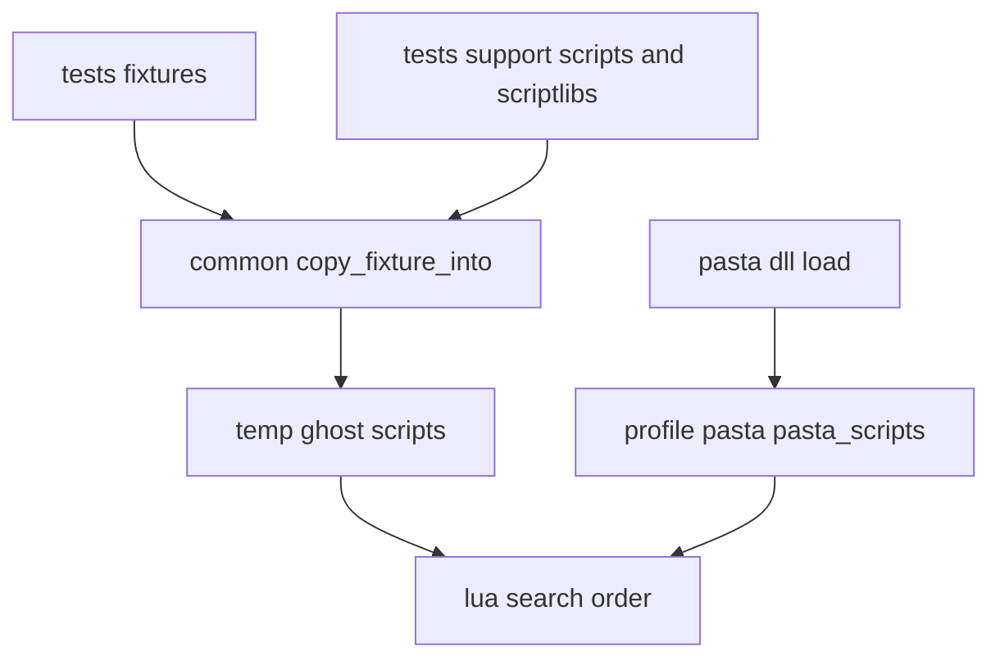
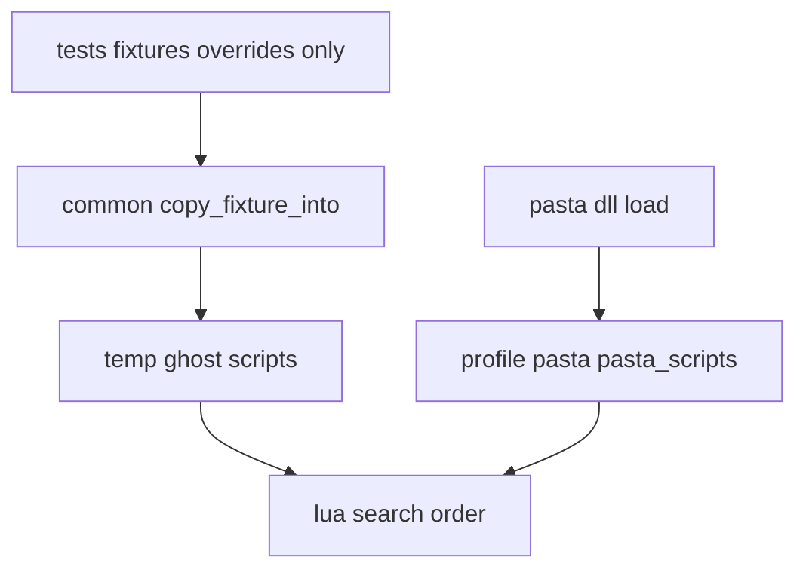

# 設計: shiori-test-support-runtime

## 概要

**目的**: `pasta_shiori` の結合テストを、`pasta.dll` が起動時に自己展開する本物のランタイムだけで動かす。テストが古いランタイムの写しで動いた結果を確かめてしまう状態をなくす。

**使う人**: `pasta_shiori` の結合テストを書く人・読む人。新しいフィクスチャ（テスト用の小さなゴースト）を足すときに、検索パスの回避を書かずに済む。

**変わること**: テストのファイルだけを直す。ほとんどが削除で、新しいファイルや新しい部品は作らない（ギャップ分析の案 A）。

- 写し（`crates/pasta_shiori/tests/support/` の 13 ファイル）を消す。
- 共通部品（`tests/common/mod.rs`）が写しをコピーする手順を消す。
- 4 つのフィクスチャの `pasta.toml` から、写しを避ける設定（`lua_search_paths`）とコメントを消す。
- 効いていないコピー（ゴーストの直下の `pasta_scripts/` へ本物をコピーする手順。`tests/` の 10 ファイルと `src/shiori_request_tests.rs` の 2 か所）を消す。
- 写しが置かれることを確かめていた 1 か所（`tests/test_path_helpers_test.rs`）を直し、説明を実際の動きに合わせる。

### ゴール

- 一時ゴーストの標準ランタイムは、自己展開した `profile/pasta/pasta_scripts/` からだけ読まれる（1.1, 1.2）。
- 回避の設定とコメントが無くなり、新しいフィクスチャは差し替えるファイルだけを持てばよい（2.1〜2.4）。
- `pasta_shiori` のテストは、1 か所の確かめを直す以外、同じ確かめのまま全部通る（1.5, 2.3, 5.2）。
- ワークスペースのテストが全部通り、`cargo clippy --all-targets --workspace -- -D warnings` が警告を出さない（7.3）。

### やらないこと

- ランタイム・ローダー・自己展開の仕組み、`pasta_shiori` と `pasta_lua` の本番のコードの変更（7.1）。
- テストごとに書かれた同じ形のコピー関数（`copy_dir_recursive`。`tests/` に 15 個）の整理。直下へのコピーを消して使われなくなる 1 個だけを消す。
- 写しがまた置かれないための見張りのテストや検査。
- 過去の記録（`TEST_COVERAGE.md` の履歴の節、`.kiro/specs/completed/` と `.kiro/specs/review-improvement-loop/tasks.md` 849 行）の書き換え。

## 境界の約束

### この spec が持つもの

- `crates/pasta_shiori/tests/support/` の写し（`scripts/` 10 ファイル・`scriptlibs/` 3 ファイル）の削除。
- 結合テストの共通部品 `tests/common/mod.rs` のコピー処理と、その説明。
- 4 つのフィクスチャ（`codegen_runtime_safety`・`actor_proxy_act_delegation`・`call_execution_correctness`・`scene_alias_ontalk`）の `pasta.toml` の、回避の設定とコメント。
- `tests/test_path_helpers_test.rs` の `scriptlibs` の確かめ。
- ゴーストの直下の `pasta_scripts/` へ本物をコピーする手順（`tests/` の 10 ファイル・`src/shiori_request_tests.rs` の 2 か所）と、その周りの説明。
- 上の削除で使われなくなる関数・`use`・変数の削除（`tests/actor_kick_test.rs` だけが当たる）。

### この spec が持たないもの

- `crates/pasta_lua/` の全部（ランタイム・ローダー・自己展開・`scriptlibs/lua_test/`・モック）。
- `pasta_shiori` の `src/` の本番のコード。`src/` で触るのはテストのファイル `src/shiori_request_tests.rs` だけ。
- 3 つのフィクスチャ（`shiori_lifecycle`・`async_callback`・`debug_preservation`）が持つテスト用の `scripts/pasta/shiori/entry.lua`。本番の読み込み順を使った差し替えなので、そのまま残す。
- 4 つの `pasta.toml` の、回避と関係ない行（`[loader]` の `pasta_patterns`・`transpiled_output_dir`、`[talk]`・`[ghost]`・`[actor.*]`）。
- `src/shiori_request_tests.rs` が `crates/pasta_lua/scriptlibs/`（本物の `lua_test`）を一時ゴーストの `scriptlibs/` へコピーする手順。写しではなく本物で、`scriptlibs` は検索パスに入っているので、効いていない手順ではない。
- サンプルゴースト `hello-pasta` を丸ごとコピーするテスト（`scene_kick*_e2e_test.rs` など）。写しも直下の `pasta_scripts/` も通らない。

### 頼ってよいもの

- `pasta.dll` の読み込みの Phase 2.5（`crates/pasta_lua/src/loader/mod.rs` の `sync_pasta_scripts`）が、標準ランタイムを `profile/pasta/pasta_scripts/` へ自己展開すること。
- 既定の検索パス（`crates/pasta_lua/src/loader/config/mod.rs` の `default_lua_search_paths`）が `profile/pasta/save/lua` → `scripts` → `profile/pasta/pasta_scripts` → `profile/pasta/cache/lua` → `scriptlibs` の順であること。`scripts/` が標準ランタイムより先に読まれるので、フィクスチャの差し替えが効く。
- 検索パスに入っているディレクトリが無くても、読み込みが失敗しないこと（写しを置かない実験で、`scriptlibs/` が無い一時ゴーストも読み込めた）。

### 見直しのきっかけ

- 自己展開の置き場所（`profile/pasta/pasta_scripts/`）や既定の検索パスの順序が変わったとき。共通部品の説明と、各テストの説明を合わせて直す。
- 自己展開をやめて、標準ランタイムをゴーストへ同梱する形に戻すとき。結合テストは標準ランタイムを自分で置く必要がまた出る。
- 後に続く `runtime-error-balloon` は、この spec の後に入り、回避の設定を書かずに結合テストを足せることを前提にする。

## 構成

### 今の構成



- 共通部品は先に写し（`tests/support/`）を一時ゴーストの `scripts/`・`scriptlibs/` へ置き、後からフィクスチャを重ねる。`scripts/` は標準ランタイムより先に読まれるので、写しが本物を隠す。
- 4 つのフィクスチャは、`lua_search_paths` から `scripts` を外して写しを避けている。
- 別のコピー処理（11 か所）は、本物をゴーストの直下の `pasta_scripts/` へコピーしているが、そこは検索パスに無いので読まれない。本物が読まれているのは自己展開のおかげ。

### 変えた後の構成



- 一時ゴーストに置かれるのはフィクスチャ自身のファイルだけ。標準ランタイムは自己展開したものだけが読まれる。
- 差し替えの仕組み（`scripts/` が先）は本番と同じで、変えない（3.2, 7.2）。

**決めたこと**

- 案 A（消すだけ）を取る。写しを本物から作る案（案 C）は取らない。本物は既に自己展開されるので作る意味が無く、`scripts/` に本物の写しを置くと、本番の「利用者のスクリプトが先」という順序をテストが標準ランタイムで塞ぐ（3.4 の「写しを残す理由」に当たらない）。
- 準備の部品を一つにまとめる案（案 B）は取らない。目的（本物だけで動かす）に要らない。

### 使う技術

| 層 | 選んだもの | この spec での役目 |
| -- | ---------- | ------------------ |
| テスト | Rust の結合テスト（`cargo test`）・`tempfile` | 一時ゴーストを作って `PastaShiori` で読み込む。新しい依存は足さない |
| ランタイム | `pasta_lua` の自己展開（変えない） | 標準ランタイムを一時ゴーストへ置く唯一の経路 |

## ファイルの計画

行の番号は、ブランチの基点（`0ecc524a`）のもの。先に別の変更が入って行がずれたときは、コードの形（`.join("pasta_scripts")` のかたまり、`copy_support_dirs` の呼び出しなど）で場所を探す。tasks もコードの形で場所を指す。

### 消すファイル

- `crates/pasta_shiori/tests/support/scripts/pasta/` の 10 ファイル（`act.lua`・`actor.lua`・`global.lua`・`init.lua`・`scene.lua`・`store.lua`・`word.lua`・`areka/init.lua`・`shiori/init.lua`・`shiori/entry.lua`）（1.3）。
- `crates/pasta_shiori/tests/support/scriptlibs/lua_test/` の 3 ファイル（`expect.lua`・`test.lua`・`toDebugString.lua`）（1.4）。
- 消した後、`crates/pasta_shiori/tests/support/` のディレクトリは残らない。

### 直すファイル

#### 共通部品 `crates/pasta_shiori/tests/common/mod.rs`（1.1, 1.2, 2.4, 6.1, 6.2, 6.4）

- 62〜67 行: 写しのコピー（`copy_support_dirs` の呼び出し）と、その前後のコメント（「Copy support files first」「Copy fixture files last (overrides support files if needed)」「fixture-specific main.lua」）を消す。フィクスチャのコピー（68〜71 行）だけが残る。
- 154〜172 行: 使われなくなる `copy_support_dirs` を関数ごと消す。
- `copy_dir_recursive`（130〜153 行）は残す。`copy_fixture_into` と `copy_sample_ghost_to_temp` がまだ呼ぶ。
- 36〜48 行: `copy_fixture_to_temp` の説明を、次の文に書き換える（6.1・6.2・6.4）。

```rust
/// フィクスチャを一時ディレクトリへコピーして、一時ゴーストを作る。
///
/// コピーするのはフィクスチャ自身のファイルだけで、標準ランタイムはコピーしない。
/// 標準ランタイムは、`pasta.dll` が読み込みのときに `profile/pasta/pasta_scripts/` へ
/// 自己展開した本物が使われる。
///
/// フィクスチャには、差し替えるファイルだけを置く（例: `scripts/pasta/shiori/entry.lua`）。
/// `scripts/` は自己展開した標準ランタイムより先に読まれる（本番のゴーストと同じ読み込み順）。
/// 検索パス（`pasta.toml` の `lua_search_paths`）を書き換える必要はない。
///
/// # Arguments
/// * `fixture_name` - `tests/fixtures/` の下のフィクスチャ名
///
/// # Returns
/// フィクスチャをコピーした `TempDir`
```

- `copy_fixture_into` の説明（55〜57 行）は、今のまま実際と合っているので変えない。

#### 4 つのフィクスチャの `pasta.toml`（2.1, 2.2, 2.5）

| ファイル（`crates/pasta_shiori/tests/fixtures/` の下） | 消す行 | 残す行 |
| ---- | ---- | ---- |
| `codegen_runtime_safety/pasta.toml` | 2〜6 行（回避のコメント）、10〜15 行（`lua_search_paths`） | 1 行目の見出し、`[loader]` の `pasta_patterns`・`transpiled_output_dir`、`[talk]`・`[actor.*]` とそのコメント |
| `actor_proxy_act_delegation/pasta.toml` | 2〜6 行、10〜15 行 | 1 行目、`[loader]` の残り 2 行、`[ghost]`・`[actor.*]` とそのコメント |
| `call_execution_correctness/pasta.toml` | 3〜6 行、12〜17 行 | 1〜2 行目、7〜8 行目（ウェイトを置かない理由。回避と関係ない）、`[loader]` の残り 2 行、`[ghost]`・`[actor.*]` とそのコメント |
| `scene_alias_ontalk/pasta.toml` | 5〜7 行（区切りの `#` と回避のコメント 2 行）、11〜16 行 | 1〜4 行目（別名表の説明）、`[loader]` の残り 2 行、`[ghost]`・`[actor.*]` とそのコメント |

例: 直した後の `codegen_runtime_safety/pasta.toml` の頭。

```toml
# codegen_runtime_safety E2E 用フィクスチャ（dsl-codegen-runtime-safety task 4.2）

[loader]
pasta_patterns = ["dic/*.pasta"]
transpiled_output_dir = "profile/pasta/cache/lua"
```

#### パスの自己検証 `crates/pasta_shiori/tests/test_path_helpers_test.rs`（4.1）

- 50〜53 行（`scriptlibs` が置かれることの確かめ）だけを消す。
- 38〜49 行（`pasta.toml` が置かれて読めて空でないこと、`scripts/` が置かれていること）は残す。`scripts/` は、フィクスチャ `shiori_lifecycle` 自身の `scripts/pasta/shiori/entry.lua` で置かれるので、写しが無くても成り立つ。深いパス・ANSI で表せないパスの下に、入れ子のディレクトリを含む一時ゴーストを置けて読めること、というテストの意図はこの 2 つで確かめられる。

#### 直下の `pasta_scripts/` へのコピーを消すファイル（5.1, 5.3, 6.3）

「消す行」は、本物をゴーストの直下の `pasta_scripts/` へコピーする 1 かたまり（コピー元の組み立て・`create_dir_all`・`copy_dir_recursive` の呼び出しと、そのすぐ上のコメント・後ろの空行）。

| ファイル（`crates/pasta_shiori/` の下） | 消す行 | 説明の直し | `copy_dir_recursive` |
| ---- | ---- | ---- | ---- |
| `tests/common/async_callback_support.rs` | 31〜41 | 18〜20 行・42〜43 行 | 残す（45 行でフィクスチャのコピーに使う） |
| `tests/actor_thread_vm_test.rs` | 47〜55 | 39 行 | 残す（57 行） |
| `tests/actor_marshaling_test.rs` | 74〜82 | なし | 残す（84 行） |
| `tests/actor_reload_leak_test.rs` | 37〜45 | なし | 残す（47 行） |
| `tests/actor_teardown_test.rs` | 44〜52 | なし | 残す（54 行） |
| `tests/byte_invariant_test.rs` | 136〜145 | 130 行 | 残す（148 行） |
| `tests/ffi_actor_lifecycle_test.rs` | 53〜61 | なし | 残す（63 行） |
| `tests/ffi_extern_session_e2e_test.rs` | 210〜218 | 203 行 | 残す（220 行） |
| `tests/debug_preservation_test.rs` | 66〜74 | 59 行 | 残す（76 行） |
| `tests/actor_kick_test.rs` | 59〜70（`manifest_dir` の行を含む） | 52〜53 行・78 行 | **消す**（31〜50 行と後ろの空行）。13 行の `use std::path::{Path, PathBuf};` を `use std::path::PathBuf;` にする |
| `src/shiori_request_tests.rs` | 43〜48・471〜476 と、それぞれのすぐ上のコメント 38 行・466 行。486〜491 行（フィクスチャの `scripts/` の二度目のコピー）とその前の空行 | なし（486 行のコメントはかたまりごと消える） | 残す（36・464・483 行） |

- `tests/actor_kick_test.rs` だけは、`copy_dir_recursive` を直下へのコピーにしか使っていない（フィクスチャは `pasta.toml` と `entry.lua` をその場で書く）。コピーを消すと関数・`Path` の `use`・`manifest_dir` が使われなくなり、clippy の `-D warnings` で落ちるので、まとめて消す。ほかの 10 ファイルは、フィクスチャのコピーに同じ関数を使い続けるので残す。
- `src/shiori_request_tests.rs` の `crate_root` は、`scriptlibs` のコピー（50〜56 行・478〜484 行）が使い続けるので残す。38 行・466 行のコメントは `// pasta_lua の scriptlibs をコピーする（標準ランタイムは自己展開されるのでコピーしない）` に書き換え、50 行・478 行の `// Copy scriptlibs directory` は重なるので消す。

説明の直しの文（6.3）。標準ランタイムの読み込み先を「自己展開した `profile/pasta/pasta_scripts/`」と書き、直下の `pasta_scripts/` を読み込み先として書かない。

| 場所 | 直した後の文 |
| ---- | ---- |
| `async_callback_support.rs` 18〜20 行 | `/// async_callback フィクスチャ（`entry.lua` の差し替えと `pasta.toml`）を一時ディレクトリへコピーする。`<br>`/// EVENT・CALLBACK・SHIORI_ACT などの本番モジュールは、`pasta.dll` が`<br>`/// `profile/pasta/pasta_scripts/` へ自己展開した標準ランタイムから読まれる。` |
| `async_callback_support.rs` 42〜43 行 | `// Copy fixture files (entry.lua override + pasta.toml).`<br>`// scripts/ is searched before the self-deployed profile/pasta/pasta_scripts/.` |
| `actor_thread_vm_test.rs` 39 行 | `/// async_callback フィクスチャ（entry.lua の差し替え。標準ランタイムは自己展開される）を temp へ` |
| `byte_invariant_test.rs` 130 行 | `/// async_callback フィクスチャ（entry.lua の差し替え。標準ランタイムは自己展開される）で` |
| `ffi_extern_session_e2e_test.rs` 203 行 | `// フィクスチャ構築（async_callback: entry.lua の差し替え。標準ランタイムは自己展開される）` |
| `debug_preservation_test.rs` 59 行 | `/// デバッグ保全フィクスチャ（`[debug]` 有効 entry.lua の差し替え。標準ランタイムは自己展開される）を` |
| `actor_kick_test.rs` 52〜53 行 | `/// `pasta.toml` と、`scripts/pasta/shiori/entry.lua` の **ユーザーオーバーライド** を temp に書く。`<br>`/// 実 `SHIORI.kick` / `KICK.install` / `STORE` は、自己展開した標準ランタイム（`profile/pasta/pasta_scripts/`）から読まれる。`（54〜56 行はそのまま） |
| `actor_kick_test.rs` 78 行 | `// ユーザーオーバーライド entry.lua（scripts/ は自己展開した profile/pasta/pasta_scripts/ より先に検索される）。` |

- ファイルの中の説明の言葉（英語か日本語か）は、そのファイルの近くの説明に合わせる。

## 要件との対応

| 要件 | 内容 | 実現するところ |
| ---- | ---- | ---- |
| 1.1 | 写しを一時ゴーストへ置かない | 共通部品: 62〜67 行と `copy_support_dirs` を消す |
| 1.2 | 標準ランタイムは自己展開からだけ読む | 写しの削除＋共通部品＋直下へのコピーの削除。頼ってよいもの: 自己展開 |
| 1.3 | `tests/support/scripts/` を持たない | 消すファイル（10） |
| 1.4 | `tests/support/scriptlibs/lua_test/` を持たない | 消すファイル（3） |
| 1.5 | 同じ確かめで全部通る | テストの方針: `cargo test -p pasta_shiori` |
| 2.1 | 回避の設定を持たない | 4 つの `pasta.toml` の `lua_search_paths` を消す |
| 2.2 | 回避のコメントを持たない | 4 つの `pasta.toml` の回避のコメントを消す |
| 2.3 | 回避を外しても同じ確かめで通る | テストの方針: 4 つの E2E |
| 2.4 | 新しいフィクスチャは検索パスを書かずに本物で動く | 共通部品の説明（36〜48 行）。写しが無いので既定の検索パスのままで本物が読まれる |
| 2.5 | 回避と関係ない設定を保つ | 4 つの `pasta.toml` の「残す行」 |
| 3.1 | 差し替えるファイルだけをフィクスチャに置く | 3 つのフィクスチャの `entry.lua` をそのまま使う（変えない） |
| 3.2 | 差し替えは本番と同じ読み込み順で効く | 頼ってよいもの: 既定の検索パスの順序 |
| 3.3 | 写しにしか無い振る舞いは最小限の差し替えにする | 当てはまるものは無い（ギャップ分析の実験）。実装中に見つかったら、そのフィクスチャの `scripts/` に要るファイルだけを置く |
| 3.4 | 写しを残す理由があれば本物から作る | 当てはまるものは無い（案 C を取らない理由） |
| 4.1 | 写しの有無の確かめを本来の意図に直す | `test_path_helpers_test.rs` 50〜53 行を消す |
| 4.2 | 古いランタイムの結果の期待値を直す | 当てはまるものは無い（ギャップ分析の実験）。実装中に見つかったら期待値を本物の結果に直す |
| 4.3 | 直したテストを記録に残す | `tasks.md` の実装メモに `test_path_helpers_test.rs` の直しと理由（写しの `scriptlibs` に頼っていた）を書く |
| 5.1 | 直下の `pasta_scripts/` へコピーしない（`tests/`） | 直下へのコピーを消す 10 ファイル |
| 5.2 | 外しても同じ確かめで通る | テストの方針 |
| 5.3 | `src/shiori_request_tests.rs` のコピーも外す | 同上の表の `src/shiori_request_tests.rs` |
| 6.1 | 共通部品の説明: 自己展開を使い、差し替えだけ持つ | 共通部品の説明（36〜48 行） |
| 6.2 | 差し替えの例は `entry.lua` | 共通部品の説明。`main.lua` の例は 42・67 行ごと消える |
| 6.3 | 読み込み先を `profile/pasta/pasta_scripts/` と書く | 説明の直しの表 |
| 6.4 | 呼んでいない手順を書かない | `async_callback_support.rs` 18〜20 行の書き換え。共通部品の「support files」の記述を消す |
| 7.1 | テスト以外を変えない | 境界: 触るのは `tests/` と `src/shiori_request_tests.rs` だけ |
| 7.2 | 読み込み順を変えない | 頼ってよいもの。ローダーは触らない |
| 7.3 | テストが全部通り clippy が警告を出さない | テストの方針。`actor_kick_test.rs` の使われなくなる関数・`use` を消す |

## 部品

| 部品 | 置き場所 | 役目 | 要件 | 頼るもの |
| ---- | ---- | ---- | ---- | ---- |
| 写し | `tests/support/**` | 消す | 1.3, 1.4 | なし |
| 共通部品 | `tests/common/mod.rs` | フィクスチャだけを一時ゴーストへコピーする | 1.1, 1.2, 2.4, 6.1, 6.2, 6.4 | 自己展開（P0） |
| 4 つのフィクスチャの設定 | `tests/fixtures/{4 つ}/pasta.toml` | 回避を外し、既定の検索パスで動く | 2.1, 2.2, 2.3, 2.5 | 既定の検索パス（P0） |
| 別のコピー処理 | 上の表の 11 ファイル | 直下へのコピーを消し、フィクスチャのコピーだけにする | 5.1, 5.2, 5.3, 6.3 | 自己展開（P0） |
| パスの自己検証 | `tests/test_path_helpers_test.rs` | 写しの有無ではなく、置けて読めることを確かめる | 4.1 | 共通部品（P1） |

### 共通部品の約束

関数の形（引数と戻り値）は変えない。変わるのは、コピーした後の中身だけ。

```rust
pub fn copy_fixture_to_temp(fixture_name: &str) -> TempDir;
pub fn copy_fixture_into(fixture: &str, dest: &Path);
```

- 前提: `tests/fixtures/<fixture>` があること（無ければ何もコピーしない。今の動きのまま）。
- 後の状態: `dest` の中身は、フィクスチャのファイルだけ（`profile/` を除く）。`scripts/`・`scriptlibs/` は、フィクスチャが持つときだけある。
- 呼び出し側（`shiori_lifecycle` を使う 8 ファイルと、4 つの E2E）は変えない。

## エラー処理

新しいエラーの扱いは無い。

- 標準ランタイムが自己展開されないと、一時ゴーストの読み込みが失敗し、テストが落ちる。これは今も同じで、写しのコピーが隠していた失敗が表に出るだけ（自己展開は本番の経路なので、落ちるべき失敗）。
- 消し漏れで使われない関数や `use` が残ると、clippy の `-D warnings` が落ちる。実装の終わりに必ず走らせる。

## テストの方針

新しいテストは足さない。今あるテストが、同じ確かめのまま通ることを確かめる。

- `cargo test -p pasta_shiori`: 全部通ること（1.5, 2.3, 5.2）。ギャップ分析の実験（基準 313 通過）では、写しを置かず回避を外し直下へのコピーをやめると、落ちたのは `test_path_helpers_test::deep_non_ansi_fixture_is_buildable_and_readable` の `scriptlibs` の確かめ 1 本だけだった。それを直すので、全部通るはず。
- 特に見るテスト:
  - 回避を外した 4 つの E2E（`codegen_runtime_safety_e2e_test`・`actor_proxy_act_delegation_e2e_test`・`call_execution_correctness_e2e_test`・`scene_alias_ontalk_e2e_test`）。既定の検索パスで本物のランタイムが読まれること（2.3, 2.4）。
  - `shiori_lifecycle` を使う 8 ファイル。写しが無くても、フィクスチャの `entry.lua` の差し替えが効くこと（3.1, 3.2）。
  - `async_callback`・`debug_preservation` を使う 9 ファイルと `actor_kick_test`。直下へのコピーが無くても通ること（5.2）。
  - `src/shiori_request_tests.rs`（`cargo test -p pasta_shiori --lib`）（5.3）。
- `cargo test --all` と `cargo clippy --all-targets --workspace -- -D warnings`（7.3）。走らせる前に `NoDefaultCurrentDirectoryInExePath` を外し、`PASTA_DEBUG` を外す。
- `pasta_lua` のテストを走らせると `sample.generated.lua` の改行だけの差分が出ることがある。`git checkout --` で戻し、コミットに混ぜない。
- 確かめ: `crates/pasta_shiori/tests/support/` が無いこと、4 つの `pasta.toml` に `lua_search_paths` と「古い runtime の写し」「理由は同じ」の文言が無いこと、`crates/pasta_shiori/` の `.rs` に `.join("pasta_scripts")` が無いことを grep で確かめる（1.3, 1.4, 2.1, 2.2, 5.1, 5.3）。

## 申し送り（完了のときにすること）

- `.kiro/specs/scene-attribute-store/brief.md` 176 行の「`pasta_shiori` の結合テストは、古いランタイムの写し（…`scene.lua`）を読む。…写しは直さない（`shiori-test-support-runtime` の持ち場）」を、写しが無くなったことに合わせて直す（kiro-complete の申し送り）。
- `.kiro/steering/roadmap.md` 346 行の `shiori-test-support-runtime` の行は、kiro-complete の通常の手順で完了にする。

## 前提と決めたこと

- **決めたこと 1**（2026-10-16 確定）: `test_path_helpers_test.rs` は `scriptlibs` の確かめ（50〜53 行）だけを消し、`scripts` の確かめは残す。`scripts` は写しではなくフィクスチャ自身の差し替えで置かれる。
- **決めたこと 2**（2026-10-16 確定）: 共通部品の `copy_fixture_to_temp` の説明は日本語で書く（すぐ下の `copy_fixture_into` の説明に合わせる）。
- **決めたこと 3**（2026-10-16 確定）: `src/shiori_request_tests.rs` の `copy_shiori_lifecycle_fixture` にある、フィクスチャの `scripts/` の二度目のコピー（486〜491 行。直前の 464 行で既にコピー済み）は消す。直下の `pasta_scripts/` を置いた後に差し替えを重ねるための手順で、直下へのコピーを消すと意味が無くなる（要件 5 の「実際に効く手順だけで書く」）。本物の `scriptlibs` のコピー（478〜484 行）は、検索パスに入る本物を置く手順なので残す。
- この設計の変更そのものは、まだ走らせていない（設計の段では手元のファイルを書き換えなかった）。根拠はギャップ分析の実験（2026-10-16、同じ基点）。clippy は実験で走らせていないので、使われなくなる関数・`use` の洗い出し（`actor_kick_test.rs` だけ）は読んで確かめた結果である。
