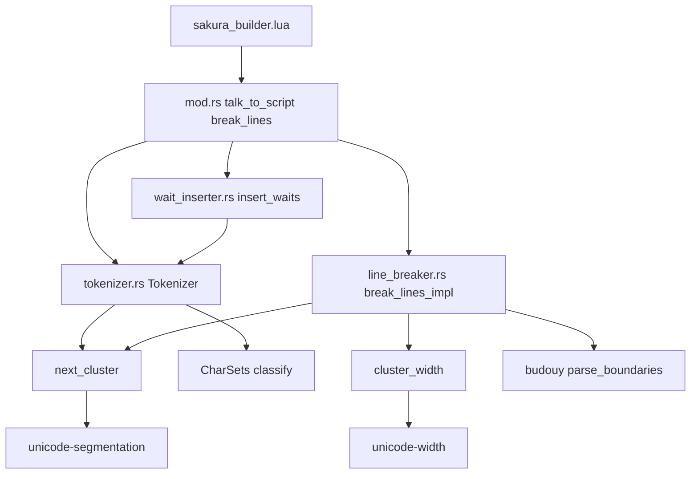
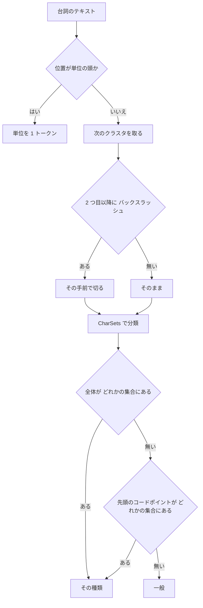

# 設計: talk-grapheme-clusters

## Overview

**Purpose**: `@pasta_sakura_script` の台詞の変換（`talk_to_script`・`break_lines`）が「1 文字」と数える単位を、コードポイントから拡張書記素クラスタ（以下「クラスタ」。UAX #29）へ改める。組み合わせの絵文字（`🙆‍♀️`・`✌️`・`👍🏽`・`🇯🇵`）や結合文字付きの文字（`é`）の途中に、自動ウェイトも budoux の改行も入らなくなる。`chars_*` に書いた組み合わせの絵文字も 1 文字として一致する。

**Users**: 台詞に絵文字を書くゴーストの作者（窓際のぱすたさん。縦書きのバルーンで `🙆` と `♀` が割れて描かれた）。絵文字を使わない作者には、出力の変化は無い。

**Impact**: 切り出しの 2 か所（`tokenizer.rs` の `tokenize`、`line_breaker.rs` の `tokenize_plain_chars`）を、共通の関数 `next_cluster` で 1 クラスタずつ進む形に改める。`CharSets` はクラスタ（文字列）で引く。ウェイトは 1 トークン 1 つ、budoux の幅はクラスタごとに数える。依存に `unicode-segmentation 1.13.3` を足す。`mod.rs`・Lua の側・`pasta.toml` の約束は変えない。

### Goals

- 要件 1〜8 の受け入れ条件をすべて満たす。
- 単位でない部分が 1 コードポイントのクラスタだけの台詞では、`talk_to_script`・`break_lines` の出力と列の状態を 1 文字も変えない（要件 5.1）。既存のテストの期待値を書き換えない（要件 5.2）。
- クラスタの切り方の規則（「次の `\` の手前で止める」を含む）を 1 つの関数に置き、2 つの切り出しがそれを使う。

### Non-Goals

- 表示の幅を、SSP のバルーンの描画（フォントしだい）と完全に一致させること。
- Unicode の正規化（NFC・NFKC）。台詞と `chars_*` は書かれたとおりのコードポイントで扱う。
- 単位の直後の結合文字（`\n` ＋ U+0301）を前の字とつなぐこと。単位の後ろの単独のクラスタとして扱う。
- 別々の `talk_to_script` の呼び出しにまたがるクラスタをつなぐこと。
- budoux の禁則・語の区切り方（モデル）。
- Lua の側（`sakura_builder.lua` など）。台詞を 1 文字ずつ処理する所が無い。
- 単語・シーン名の検索のキーの正規化。

## Boundary Commitments

### This Spec Owns

- **クラスタの切り方の規則**: 単位でない部分を、UAX #29 の拡張書記素クラスタで 1 つずつ切る。クラスタは、2 つ目以降のコードポイントに `\` を含まない（`\` の手前で切る）。この規則は `tokenizer.rs` の `next_cluster` だけが持つ。
- **文字の種類の判定の単位と引き方**: `CharSets` の項目の作り方（`chars_*` の文字列をクラスタに分けた項目＋各コードポイント）と、判定の 2 段の順（全体で全種類を見る → 先頭のコードポイントで全種類を見る）。
- **自動ウェイトの粒度**: 一般の文字とリーダーは 1 クラスタに 1 つのウェイト。`\` ちょうどのクラスタの直後には入れない。
- **budoux の改行の単位と幅**: 改行はクラスタの境界にだけ入れる。幅はクラスタごとに数える（幅の規則は後述）。単独の `\` の守り（`vertical-balloon-lines` の決定 9）を「クラスタが `\` ちょうど」で判定する。
- **公開 Rust API の形の変更**: `CharSets` のフィールドの型と `classify` の引数、`Tokenizer::tokenize` のトークンの粒度。
- 依存の追加（`unicode-segmentation`）と、技術の steering の依存の表。
- テスト、マニュアル 4 ページ、スキル references の再生成。

### Out of Boundary

- `SAKURA_TAG_PATTERN`（単位の読み方）。正規表現も、Lua の `tag_at`・DSL の文法の写しも変えない。
- 列の状態（`Column`・`ColumnMove`・`apply`・`threshold`）の意味と、Lua の表との読み書き（`mod.rs`）。
- `insert_waits` の句読点の並びの規則（並びの最後に最大値−50 を 1 つ）。粒度が変わるだけで、規則は触らない。
- `budouy` の語の区切り方とモデル。
- `pasta.toml` の `[talk]` のキーと既定の値（`loader/config/sections.rs`）。読み方は今のまま、文字列を受け取る。
- 0.4.2 の見どころのファイル（`doc/release-notes/v0.4.2.md`）。版の更新のときに書く決まり。本 spec は PR の本文に「動きが変わる点」の材料を残す。
- `pasta_check`・LSP・VSCode 拡張（`sakura_script` を使っていない）。

### Allowed Dependencies

- `mod.rs` → `tokenizer.rs`・`wait_inserter.rs`・`line_breaker.rs`（今のまま）。
- `line_breaker.rs` → `tokenizer.rs`（`next_cluster` を新しく使う。今は `SAKURA_TAG_PATTERN` の正規表現を `mod.rs` 経由で受け取るだけ）。逆向き（`tokenizer.rs` → `line_breaker.rs`）は作らない。
- `wait_inserter.rs` → `tokenizer.rs`（`Token`・`TokenKind`。今のまま）。
- 外部: `unicode-segmentation 1.13.3`（新規）・`unicode-width 0.2.2`・`budouy 0.2.2`（どちらも今ある）。
- 新しいソースファイル・新しい Lua モジュールは作らない。新しいファイルは結合テスト 1 つだけ。

### Revalidation Triggers

- `next_cluster` の規則（`\` で切る所）を変えるとき。`tokenizer.rs` と `line_breaker.rs` の両方の結果と、単位の読み取りの一致（`conformance_test.rs`）を見直す。
- `SAKURA_TAG_PATTERN` を、`\` 以外で始まる単位を持つ形に変えるとき。「`\` の手前で切れば単位に食い込まない」という前提が崩れる。
- `unicode-segmentation` の版を上げるとき（Unicode の版が変わるとクラスタの切り方が変わりうる）。クラスタの退行テストを見直す。
- `unicode-width` の版を上げるとき（クラスタの幅の期待値）。
- `budouy` の版を上げるとき（`parse_boundaries` の位置の意味）。
- `novel-talk-flow` など、`wait_inserter.rs`・`line_breaker.rs` を触る spec。同じウェーブに置かない。

## Architecture

### Existing Architecture Analysis

- 流れ: `talk_to_script_impl`（`mod.rs`）が `Tokenizer::tokenize` → `insert_waits` → `break_lines_impl` の順に呼ぶ。Lua の `break_lines` は `break_fresh` から `break_lines_impl` だけを呼ぶ。
- 切り出しが 2 か所ある。
  - `tokenize`: `\` の位置で `SAKURA_TAG_PATTERN` に一致すれば単位、そうでなければ `remaining.chars().next()` の 1 コードポイントを `classify(char)` で分類。
  - `tokenize_plain_chars`: 入力全体に `tag_regex.find_iter` をかけて単位の範囲を集め、残りを 1 コードポイントずつ `PlainChar { ch: char }` にする。単位は直前の字の `trailing` に付く。
- 単位はすべて `\` で始まる。よって「クラスタを `\` の手前で切る」だけで、クラスタが単位に食い込まない。両方の切り出しで、単位の読み取りは今のまま先に行われる。
- `break_lines_impl` が受け取る文字列（`talk_to_script` の経路）には、ウェイトがクラスタの後ろに入っている。ウェイトはクラスタの境界にしか入らないので、改行の側で切り直しても、トークナイザと同じクラスタになる（境界から切り始めれば、UAX #29 の結果は同じ）。

### Architecture Pattern & Boundary Map



**Architecture Integration**:
- Selected pattern: 今の 3 ファイルを拡張する（ギャップ分析の選択肢 A。共通の関数を `tokenizer.rs` に置き、ファイルを増やさない）。
- 境界: クラスタの切り方は `next_cluster`、種類の判定は `CharSets`、幅は `cluster_width`（`line_breaker.rs` の中）。どれも 1 か所にだけある。
- 今の形を保つ所: 単位を先に読む順、`Token { kind, text }`、`insert_waits` の規則、`PlainChar` と `trailing`・`moves`、列の状態の扱い、`mod.rs` の配線。
- 新しい部品: `next_cluster`（2 か所の切り出しの共通の規則）と `cluster_width`（幅の規則）。どちらも関数 1 つ。型・モジュールは足さない。
- Steering との合い方: 依存の向き（`line_breaker.rs` → `tokenizer.rs`）は既存の向きの内側。依存は `deny.toml` の許可に入るライセンスだけ。

### Technology Stack

| Layer | Choice / Version | Role in Feature | Notes |
|-------|------------------|-----------------|-------|
| Backend（Rust・pasta_lua） | unicode-segmentation 1.13.3（新規） | 拡張書記素クラスタの切り出し（`graphemes(true)`） | `MIT OR Apache-2.0`・依存なし・`rust-version 1.85`（手元は 1.99）。ワークスペースの依存に足す |
| Backend（Rust・pasta_lua） | unicode-width 0.2.2（既存） | クラスタの幅（`UnicodeWidthChar::width_cjk`・`UnicodeWidthStr::width_cjk`） | 文字列の幅は ZWJ の並び・肌色・VS16・国旗を 2 と数える（確かめた） |
| Backend（Rust・pasta_lua） | budouy 0.2.2（既存） | 語の区切り（`parse` から `parse_boundaries` へ） | 区切りは `char` の位置。クラスタの先頭に当たらない区切りを捨てる |
| Infrastructure | cargo-deny（build.yml・リリース CI）・cargo-about | ライセンスの関門と第三者ライセンスの表示 | 設定の変更は要らない（`MIT` が許可にある） |

## File Structure Plan

### Directory Structure

```
crates/pasta_lua/
├── src/sakura_script/
│   ├── tokenizer.rs        # next_cluster（新規の関数）・CharSets のクラスタ化・tokenize のクラスタ化
│   ├── wait_inserter.rs    # 1 トークン 1 ウェイト
│   └── line_breaker.rs     # PlainChar のクラスタ化・cluster_width（新規の関数）・budoux の区切りの写し
└── tests/sakura_script/
    ├── main.rs             # mod grapheme_test; を足す
    ├── edge_case_test.rs   # classify の呼び方を文字列へ（127・136 行。期待値は変えない）
    └── grapheme_test.rs    # 新規。クラスタの退行テストと特性化テスト
```

### Modified Files

- `crates/pasta_lua/src/sakura_script/tokenizer.rs` — `pub(crate) fn next_cluster` を足す。`CharSets` のフィールドを `HashSet<String>` に、`from_config` をクラスタ＋各コードポイントの項目に、`classify` を `&str` の 2 段の判定に改める。`tokenize` の単位でない所を `next_cluster` の 1 クラスタ 1 トークンにする。文書コメントの「1 文字」をクラスタに合わせる。
- `crates/pasta_lua/src/sakura_script/wait_inserter.rs` — `append_with_per_char_wait` を `append_with_wait`（トークン 1 つに 1 つのウェイト。テキストが `\` ちょうどなら入れない）に改める。`insert_waits` の規則のコメントの「each character」を「each cluster」に。
- `crates/pasta_lua/src/sakura_script/line_breaker.rs` — `PlainChar.ch: char` を `cluster: &'a str` に。`tokenize_plain_chars` の 1 コードポイントを `next_cluster` に。幅を `cluster_width` に。`parser.parse` と `word.chars().count()` を `parser.parse_boundaries` とクラスタの先頭の位置の照合に。単独の `\` の守りを `prev.cluster == "\\"` に。出力を `push_str(pc.cluster)` に。
- `crates/pasta_lua/tests/sakura_script/main.rs` — `mod grapheme_test;`。
- `crates/pasta_lua/tests/sakura_script/edge_case_test.rs` — `classify('･')`・`classify('､')` を `classify("･")`・`classify("､")` に（引数の型だけ。期待値は同じ）。
- `crates/pasta_lua/tests/sakura_script/grapheme_test.rs`（新規） — 要件 6 のテスト（後述の Testing Strategy）。600 行未満に収める。
- `Cargo.toml`（ルート） — `[workspace.dependencies]` の `unicode-width` の隣に `unicode-segmentation = "1.13.3"`。
- `crates/pasta_lua/Cargo.toml` — `unicode-width.workspace = true` の隣に `unicode-segmentation.workspace = true`。
- `Cargo.lock` — `unicode-segmentation 1.13.3` の項目。
- `.kiro/steering/tech.md` — pasta_lua の依存の表に `unicode-segmentation 1.13.3`（書記素クラスタの切り出し）。
- `.kiro/steering/structure.md` — `sakura_script/` のテストの一覧に `grapheme_test.rs` を足し、ファイル数を直す。
- `TEST_COVERAGE.md` — さくらスクリプトの行に、クラスタのテストの 1 行を足す。
- `book/src/lua/modules/pasta-sakura-script.md` — 「1 文字」の定義（52・94・108〜109・211 行の付近）。
- `book/src/reference/pasta-toml.md` — `[talk]` の `chars_*`（155〜161・681〜686 行の付近）と `budoux` の幅（473・535 行の付近）。`chars_*` には、組み合わせの絵文字を書けること、その部品と先頭の文字（`🙆‍♀️` を書くと `♀`・`🙆`・`🙆‍♂️` も当たる）も当たることを書く。
- `book/src/internals/talk-output.md` — トークナイザ・ウェイト挿入の説明（221・226・227 行の付近。`append_with_per_char_wait` の名前も直す）と budoux の改行の説明。
- `book/src/grammar/action-line.md` — 104 行の `\\` の約束の隣に、クラスタの途中にも何も入らないこと。
- スキルの references（`pasta-ghost-authoring`・`pasta-lua-coding`） — `node book/tools/gen-skill-refs.mjs` で再生成。手では書かない。

`crates/pasta_lua/src/sakura_script/mod.rs` と Lua のソースは変えない。`line_breaker.rs` のテストの mod は移さない（新しいテストは結合テストの新しいファイルに置き、`line_breaker.rs` の行数を増やさない）。

## System Flows



- 単位の判定はクラスタより先に行う（要件 1.2）。`\` の位置では、正規表現が一致しないときだけクラスタを取る。
- 全体の判定は、優先順（句点 → 読点 → 強調 → リーダー → 行頭禁則 → 行末禁則）で全種類を見る。全部外れてから、同じ優先順で先頭のコードポイントを見る（要件 3.1・3.6 の「どの項目とも全体では一致しないとき」）。

budoux の側（`break_lines_impl`）:

1. 単位の範囲を `find_iter` で集める（今のまま）。単位でない所を `next_cluster` で `PlainChar` にする。
2. 本文は、クラスタをつないだ文字列（今と同じコードポイントの並び）。`parse_boundaries` で区切りの `char` の位置を得る。
3. 各クラスタの先頭の `char` の位置を数えておき、区切りがクラスタの先頭に当たるときだけ、そのクラスタの添字を語の境界にする。当たらない区切りは捨て、前後をつないで 1 語にする（要件 4.2）。
4. 語（クラスタの添字の範囲）ごとに、今のかけらの規則・上限・決定 9 の守りを当てる。幅は `cluster_width` の和。
5. 改行はクラスタの前にだけ入る。クラスタの文字列はそのまま出す（要件 4.8）。

## Requirements Traceability

| Requirement | Summary | Components | Interfaces | Flows |
|-------------|---------|------------|------------|-------|
| 1.1 | 単位でない部分をクラスタで 1 文字に | next_cluster・Tokenizer・LineBreaker | `next_cluster`・`tokenize`・`tokenize_plain_chars` | 切り出し |
| 1.2 | 単位の読み取りを今と同じに | Tokenizer・LineBreaker | `SAKURA_TAG_PATTERN`（変えない） | 単位を先に読む |
| 1.3 | Prepend の後ろの `\` を前のクラスタに入れない | next_cluster | `\` の手前で切る | 切り出し |
| 1.4 | 単位の直後の結合文字は単独のクラスタ | Tokenizer・LineBreaker | 単位の後ろから切り始める | 切り出し |
| 1.5 | ZWJ・異体字セレクタ・肌色・国旗・結合文字を 1 文字に | next_cluster | `graphemes(true)` | 切り出し |
| 2.1 | クラスタの途中にウェイトを入れない | Tokenizer・WaitInserter | 1 クラスタ 1 トークン | — |
| 2.2 | 一般・リーダーは 1 クラスタに 1 ウェイト | WaitInserter | `append_with_wait` | — |
| 2.3 | 「りょ🙆‍♀️✨」の出力 | Tokenizer・WaitInserter | — | — |
| 2.4 | 「✌️」の出力 | Tokenizer・WaitInserter | — | — |
| 2.5 | 句読点の並びの規則を今のまま | WaitInserter | `insert_waits`（規則は変えない） | — |
| 2.6 | 単独の `\` の直後にウェイトを入れない | WaitInserter | テキストが `\` ちょうどなら入れない | — |
| 3.1 | 種類の判定をクラスタで・優先順を保つ | CharSets | `classify(&str)` | 分類の 2 段 |
| 3.2 | `chars_*` の複数コードポイントの項目が全体で一致 | CharSets | `from_config`（クラスタの項目） | 分類の 2 段 |
| 3.3 | 2 つ目以降の部品で種類を決めない | CharSets | 全体 → 先頭のコードポイントだけを見る | 分類の 2 段 |
| 3.4 | 既定の値の各文字を今と同じ種類に | CharSets | `from_config`（各コードポイントの項目） | — |
| 3.5 | 1 コードポイントの並びの設定を今と同じ種類に | CharSets | `from_config`（各コードポイントの項目） | — |
| 3.6 | 全体で外れたら先頭のコードポイントで判定 | CharSets | `classify` の 2 段目 | 分類の 2 段 |
| 3.7 | 複数コードポイントの項目の部品も単独で当たる | CharSets | `from_config`（各コードポイントの項目） | — |
| 4.1 | budoux の改行をクラスタの途中に入れない | LineBreaker | `PlainChar.cluster`・区切りの写し | budoux の 2〜5 |
| 4.2 | クラスタの途中の区切りを捨てる | LineBreaker | `parse_boundaries` とクラスタの先頭の照合 | budoux の 3 |
| 4.3 | 1 クラスタを 1 つの表示の単位に | LineBreaker | `cluster_width` | budoux の 4 |
| 4.4 | 組み合わせの絵文字を 2 と数える | LineBreaker | `cluster_width`（文字列の幅） | — |
| 4.5 | 1 コードポイントのクラスタの幅を今と同じに | LineBreaker | `cluster_width`（文字の幅） | — |
| 4.6 | 列の状態・数え直し・持ち越しを今のまま | LineBreaker | `Column`・`apply`（変えない） | — |
| 4.7 | 単独の `\` の守り（決定 9） | LineBreaker | `prev.cluster == "\\"` | budoux の 4 |
| 4.8 | `🙆‍♀️` を間に何も挟まず出す | LineBreaker | `push_str(pc.cluster)` | budoux の 5 |
| 5.1 | 1 コードポイントの台詞の出力を変えない | 全部 | 1 コードポイントでは今と同じ動きになる作り | — |
| 5.2 | 既存のテストの期待値を書き換えない | テスト | `edge_case_test.rs` は引数の型だけ直す | — |
| 5.3 | `ｶﾞ` などを 1 クラスタに | next_cluster・CharSets | 先頭の `ｶ` で一般 | — |
| 5.4 | Lua からの呼び方を変えない | mod.rs（変えない） | `talk_to_script`・`break_lines` | — |
| 6.1 | 報告の 2 例のウェイト | grapheme_test.rs | 退行テスト 1 | — |
| 6.2 | `chars_period` の組み合わせの絵文字 | grapheme_test.rs | 退行テスト 2 | — |
| 6.3 | 肌色・国旗・結合文字の途中に何も入らない | grapheme_test.rs | 退行テスト 3 | — |
| 6.4 | budoux の改行とクラスタの幅 | grapheme_test.rs | 退行テスト 4 | — |
| 6.5 | 既定の `chars_*` の全文字の特性化 | grapheme_test.rs | 特性化テスト 1・2 | — |
| 6.6 | Prepend と単位の直後の結合文字 | grapheme_test.rs | 退行テスト 5 | — |
| 7.1 | 「1 文字」＝クラスタの定義 | `pasta-sakura-script.md`・`talk-output.md` | — | — |
| 7.2 | 「1 文字ずつ」「字数」の記述を合わせる | マニュアル 3 ページ（`pasta-sakura-script.md`・`pasta-toml.md`・`talk-output.md`） | — | — |
| 7.3 | `chars_*` に組み合わせの絵文字を書ける | `pasta-toml.md`・`pasta-sakura-script.md` | — | — |
| 7.4 | クラスタの途中にも何も入らない | `action-line.md` | — | — |
| 7.5 | スキル references の再生成 | gen-skill-refs.mjs | `--check` | — |
| 8.1 | x86・x64 で同じ動き | 依存（純 Rust） | build.yml の 2 ターゲットのテスト | — |
| 8.2 | `cargo-deny` と依存の表 | Cargo.toml・tech.md | — | — |

## Components and Interfaces

| Component | Domain/Layer | Intent | Req Coverage | Key Dependencies (P0/P1) | Contracts |
|-----------|--------------|--------|--------------|--------------------------|-----------|
| next_cluster | tokenizer.rs | 次のクラスタを 1 つ返す（`\` の手前で切る） | 1.1, 1.3, 1.4, 1.5, 5.3 | unicode-segmentation (P0) | Service |
| CharSets | tokenizer.rs | クラスタの種類を決める | 3.1〜3.7, 5.1 | — | Service, State |
| Tokenizer | tokenizer.rs | 単位とクラスタのトークン列を作る | 1.1, 1.2, 1.4, 2.1 | next_cluster (P0), CharSets (P0) | Service |
| WaitInserter | wait_inserter.rs | 1 トークン 1 ウェイトで入れる | 2.1〜2.6 | Tokenizer (P0) | Service |
| LineBreaker | line_breaker.rs | クラスタの境界で改行し、クラスタの幅で数える | 4.1〜4.8, 1.1 | next_cluster (P0), unicode-width (P0), budouy (P0) | Service |
| grapheme_test | tests/sakura_script | 退行テストと特性化テスト | 6.1〜6.6, 5.1, 5.3 | Lua の `@pasta_sakura_script` (P0) | — |

### tokenizer.rs

#### next_cluster

| Field | Detail |
|-------|--------|
| Intent | 文字列の先頭のクラスタを返す。2 つ目以降のコードポイントに `\` があれば、その手前で切る |
| Requirements | 1.1, 1.3, 1.4, 1.5, 5.3 |

**Responsibilities & Constraints**
- 切り方は `unicode-segmentation` の拡張書記素クラスタ（`graphemes(true)` の最初の 1 つ）。
- 2 つ目以降のコードポイントが `\` なら、その手前までを返す。`\` が前の文字につながるのは Prepend の文字（U+0600 など）の後ろだけだが、規則は「どの `\` でも切る」と単純にする。単位の頭の `\` でも、単位にならない `\` でも切る（後者を切らないと、`\u{600}\あ` のクラスタの後ろにウェイトが入って `\\` ができる。要件 2.6）。
- 呼び出し元は、単位の頭（`\` で正規表現が一致する所）ではこの関数を呼ばない。単位の後ろから呼ぶので、単位の直後の結合文字は単独のクラスタになる（要件 1.4）。
- `\` で始まるクラスタ（単位にならない `\` ＋ 結合文字・ZWJ など）は、そのまま 1 クラスタ（`\` ＋ U+0301 は 1 つ）。

**Dependencies**
- Inbound: Tokenizer・LineBreaker — 単位でない所の切り出し (P0)
- External: unicode-segmentation 1.13.3 — UAX #29 (P0)

**Contracts**: Service [x]

##### Service Interface
```rust
/// 単位でない所の次のクラスタ。2 つ目以降のコードポイントの `\` の手前で切る。
pub(crate) fn next_cluster(s: &str) -> &str;
```
- Preconditions: `s` は空でない。`s` の先頭はクラスタの境界（テキストの頭・前のクラスタの後ろ・単位の後ろ）。
- Postconditions: 戻り値は `s` の空でない接頭辞で、`char` の境界で終わる。戻り値の 2 つ目以降のコードポイントに `\` は無い。
- Invariants: 戻り値が 1 コードポイントなら、それは `s.chars().next()` と同じ（1 コードポイントの台詞で今と同じ切り出しになる）。

#### CharSets

| Field | Detail |
|-------|--------|
| Intent | `chars_*` の項目の集合を持ち、クラスタ 1 つの種類を決める |
| Requirements | 3.1, 3.2, 3.3, 3.4, 3.5, 3.6, 3.7, 5.1 |

**Responsibilities & Constraints**
- 項目の作り方（`from_config`）: 各 `chars_*` の文字列について、(a) `graphemes(true)` で分けた各クラスタ、(b) 文字列の各コードポイント（1 文字の文字列）を、その種類の集合に入れる。設定の文字列は単位を持たないので、`next_cluster` ではなく素の `graphemes(true)` で分ける。
  - 例: 既定の `chars_line_start_prohibited` の末尾 `ｰﾞﾟ` は、`"ｰﾞﾟ"`・`"ｰ"`・`"ﾞ"`・`"ﾟ"` の 4 項目になる（要件 3.4・3.5）。
  - 例: `chars_period = "。🙆‍♀️"` は、`"。"`・`"🙆‍♀️"`・`"🙆"`・`"\u{200D}"`・`"♀"`・`"\u{FE0F}"` になる（要件 3.2・3.7）。
- 判定（`classify`）は 2 段。
  1. クラスタ全体を、優先順（句点・読点・強調・リーダー・行頭禁則・行末禁則）で各集合に引く。当たれば、その種類。
  2. 全部外れたら、クラスタの先頭のコードポイント（1 文字の文字列）を、同じ優先順で引く。当たれば、その種類（要件 3.6）。
  3. それも外れたら一般。
- 2 つ目以降のコードポイントは、どちらの段でも引かない（要件 3.3）。
- 1 コードポイントのクラスタでは、1 段目と 2 段目は同じ文字列を引く。集合の中の 1 コードポイントの項目は、設定の文字列のコードポイントとちょうど同じ（クラスタに分けた項目のうち 1 コードポイントのものは、(b) にも入っている）。よって、1 コードポイントの文字の種類は今と同じになる（要件 3.4・3.5・5.1）。
- 決定 1 と決定 2 を重ねた帰結: `chars_period = "🙆‍♀️"` のとき、`🙆` も項目に入るので、台詞の `🙆‍♂️`（全体は外れる）も先頭の `🙆` で句点に当たる。要件 3.3 は 2 つ目以降の部品だけを禁じており、この動きは要件の文言に合う。設計ディスカッションで受け入れ、`pasta-toml.md` の `chars_*` の説明に書く（2026-10-23 開発者の決定）。

**Dependencies**
- Inbound: Tokenizer — 分類 (P0)。結合テスト `edge_case_test.rs` — 公開 API (P1)
- External: unicode-segmentation — 設定の文字列の分割 (P0)

**Contracts**: Service [x] / State [x]

##### Service Interface
```rust
pub struct CharSets {
    pub period: HashSet<String>,
    pub comma: HashSet<String>,
    pub strong: HashSet<String>,
    pub leader: HashSet<String>,
    pub line_start_prohibited: HashSet<String>,
    pub line_end_prohibited: HashSet<String>,
}

impl CharSets {
    /// 各 `chars_*` を「クラスタに分けた項目」と「各コードポイント」の和の集合にする。
    pub fn from_config(config: &TalkConfig) -> Self;
    /// クラスタ 1 つの種類。全体 → 先頭のコードポイント → 一般 の順。
    pub fn classify(&self, cluster: &str) -> TokenKind;
}
```
- Preconditions: `classify` の `cluster` は空でない（`Tokenizer` は空を渡さない）。空なら一般を返す（先頭のコードポイントが無い）。
- Postconditions: 戻り値は `SakuraScript` 以外の `TokenKind`。
- Invariants: 長さ 1 コードポイントの `cluster` について、`classify(&c.to_string())` は変更前の `classify(c)` と同じ値。

##### State Management
- State model: `Tokenizer::new` のときに 1 回作り、以後は読むだけ（今のまま）。
- 公開 API の変更（破壊的。決定 4 で 0.4.x の中で許された）: フィールドの型 `HashSet<char>` → `HashSet<String>`、`classify(char)` → `classify(&str)`。`classify(char)` は残さない（呼び出し元はワークスペースの中の 2 行だけで、意味が 1 つの関数にまとまるため。残してもフィールドの型が変わるので、破壊的な変更であることは同じ）。

#### Tokenizer

| Field | Detail |
|-------|--------|
| Intent | 単位とクラスタのトークン列を作る |
| Requirements | 1.1, 1.2, 1.4, 2.1 |

**Responsibilities & Constraints**
- `\` の位置で `SAKURA_TAG_PATTERN` が先頭で一致すれば単位のトークン（今のまま）。
- そうでなければ `next_cluster(&input[pos..])` を 1 トークンにし、`classify` で種類を決める。
- `pub fn tokenize(&self, input: &str) -> Vec<Token>` の形は変えない。変わるのは粒度（一般などのトークンの `text` が 1 クラスタ）。文書コメントに書く。

**Contracts**: Service [x]

**Implementation Notes**
- Validation: 1 コードポイントの台詞で、トークン列が今と同じ（既存の 25 本の単体テストがそのまま通る）。
- Risks: 無い（単位の読み取りの経路は触らない）。

### wait_inserter.rs

#### WaitInserter

| Field | Detail |
|-------|--------|
| Intent | 一般の文字とリーダーは 1 トークンに 1 つのウェイトを、トークンの後ろに入れる |
| Requirements | 2.1, 2.2, 2.3, 2.4, 2.5, 2.6 |

**Responsibilities & Constraints**
- `append_with_per_char_wait` を `append_with_wait(result, text, wait_ms)` に改める。`text` を足し、`wait_ms - 50 > 0` かつ `text != "\\"` ならウェイトを 1 つ足す。
- トークンは 1 クラスタなので、ウェイトはクラスタの途中に入らない（要件 2.1）。
- 単独の `\` の判定は「テキストが `\` ちょうど」。`\` ＋ 結合文字のクラスタの後ろには入れる（`\` の直後ではないので `\\` にならない。要件 2.6）。改行の側（決定 9）と同じ判定。
- 句読点の並びの規則（`insert_waits` の `pending_*`・`flush_pending`）は変えない（要件 2.5）。

**Contracts**: Service [x]

##### Service Interface
```rust
pub fn insert_waits(tokens: &[Token], wait_values: &WaitValues) -> String; // 形は変えない
fn append_with_wait(result: &mut String, text: &str, wait_ms: i64);      // 非公開。1 トークン 1 ウェイト
```

**Implementation Notes**
- Validation: 既存の 13 本の単体テストは、一般・リーダーのトークンがどれも 1 文字なので、期待値はそのまま通る。
- Risks: 外から `insert_waits` に複数文字の一般のトークンを渡す利用者がいれば、ウェイトの数が変わる（公開 API の意味の変更。リリースノートの材料に書く）。

### line_breaker.rs

#### LineBreaker

| Field | Detail |
|-------|--------|
| Intent | クラスタの境界でだけ budoux の改行を入れ、行の字数をクラスタの幅で数える |
| Requirements | 1.1, 4.1, 4.2, 4.3, 4.4, 4.5, 4.6, 4.7, 4.8 |

**Responsibilities & Constraints**
- `PlainChar` の `ch: char` を `cluster: &'a str` にする。`tokenize_plain_chars` は、単位でない所で `next_cluster(&input[pos..])` を取る。`trailing`・`moves`・`leading` の扱いは今のまま。
- 幅は `cluster_width`（下の規則）。`rule.widths` が空のときの状態の進め方も、これで数える。
- 語の区切り: 本文（クラスタをつないだ文字列。今と同じコードポイントの並び）に `parser.parse_boundaries` をかけ、区切りの `char` の位置を得る。各クラスタの先頭の `char` の位置と照合し、一致する区切りだけをクラスタの添字の境界にする。一致しない区切りは捨てる（要件 4.1・4.2）。語は「クラスタの添字の範囲」になり、その後のかけら・上限・状態の規則は今のまま（要件 4.6）。
- 単独の `\` の守り（決定 9）: 直前の `PlainChar` の `cluster == "\\"` かつ `trailing` が空のときだけ。`\` ＋ 結合文字のクラスタの直後の改行は `\\` を作らないので守らない（要件 4.7）。
- 出力は `push_str(pc.cluster)`（要件 4.8）。

**幅の規則（`cluster_width`）**
- クラスタが 1 コードポイントなら、今と同じ `UnicodeWidthChar::width_cjk(c).unwrap_or(0)`（制御文字は 0・幅が曖昧な文字は 2。要件 4.5）。
- クラスタが `\r\n` なら 0（今は `\r` と `\n` の 2 字でどちらも 0。今の数え方のまま。要件 4.5 の「制御文字は 0」に合わせる）。UAX #29 では、制御文字が他の文字とつながるのは `\r\n` だけ。
- それ以外（2 コードポイント以上）は `UnicodeWidthStr::width_cjk(cluster)`。`🙆‍♀️`・`✌️`・`👍🏽`・`🇯🇵` は 2（要件 4.4。確かめた値）。

**Dependencies**
- Inbound: mod.rs — `break_lines_impl`（形は変えない）(P0)
- Outbound: tokenizer.rs — `next_cluster` (P0)
- External: unicode-width 0.2.2 (P0)・budouy 0.2.2 `parse_boundaries` (P0)

**Contracts**: Service [x]

##### Service Interface
```rust
pub fn break_lines_impl(
    input: &str,
    rule: &BreakRule,
    column: &mut Column,
    tag_regex: &Regex,
    parser: &budouy::Parser,
) -> String; // 形は変えない

fn cluster_width(cluster: &str) -> usize; // 非公開。上の幅の規則
```
- Preconditions: 今のまま。
- Postconditions: 戻り値の中で、どのクラスタのコードポイントの間にも何も挟まらない。列の状態は今の約束で進む。
- Invariants: 1 コードポイントのクラスタだけの本文では、`PlainChar` の並び・幅・語の境界が今と同じ（区切りは必ずクラスタの先頭に当たる）。

**Implementation Notes**
- Integration: `talk_to_script` の経路では、入力にウェイトがクラスタの後ろに入っている。ウェイトはクラスタの境界にしかないので、ここで切り直したクラスタはトークナイザのクラスタと同じになる。
- Validation: 既存の 35 本の単体テストと budoux・backslash_break の結合テストがそのまま通る。
- Risks: 本文に渡すコードポイントの並びを変えると budoux の採点が変わる。本文はクラスタをつないだもの（＝今と同じ並び）にする。

## Data Models

### Domain Model

- **クラスタ**: 台詞の中の、単位でない所の 1 文字。`&str`（入力の部分文字列）として持ち、新しい型は作らない。
- **項目の集合**（`CharSets` の各フィールド）: `chars_*` の文字列から作る `HashSet<String>`。クラスタの項目と、各コードポイントの項目の和。
- 不変条件: 1 コードポイントの項目の集合は、設定の文字列のコードポイントの集合と等しい（1 コードポイントの台詞で種類が今と同じになる根拠）。

## Error Handling

### Error Strategy

- 新しい失敗の道は無い。`next_cluster` は空でない文字列から必ず空でない接頭辞を返す（UAX #29 のクラスタは空にならない）。`classify` は必ず種類を返す。
- `Tokenizer::new` の失敗（正規表現のコンパイル）は今のまま。`chars_*` の文字列は何が書かれていても項目にするだけで、読み込みのエラーは足さない。

### Monitoring

- ログは足さない（台詞の変換はトークごとに呼ばれ、ログを出す道ではない）。

## Testing Strategy

テストの順: 特性化テストを先に置き、今のコードで通ることを確かめてから、本体を直す（安全で戻せる手順）。新しいテストは `tests/sakura_script/grapheme_test.rs` に置く（公開の Lua の API と `Tokenizer`・`CharSets` の公開 API から確かめる。`tokenizer.rs`・`line_breaker.rs` の行数を増やさない）。

### 特性化テスト（本体を直す前に置く）

1. 既定の 6 つの `chars_*` の全文字を 1 文字ずつ `Tokenizer::tokenize`（既定の設定）に通し、今のトークンの種類を表で固定する。`tokenize` の形は変わらないので、直した後も同じテストが書き換えなしで通る（要件 3.4・3.5・6.5）。
2. 既定の `chars_*` の全文字と、ひらがな・漢字・ASCII・半角カナ（濁点なし）・単独の `\`・タグを混ぜた台詞を `talk_to_script` に通し、今の出力の文字列を固定する。budoux を持つアクターでも同じ台詞の出力と列の状態を固定する（要件 5.1・6.5）。

### 退行テスト（要件 6）

1. 「りょ🙆‍♀️✨」を既定の `chars_*` と `script_wait_normal = 90` で変換して `り\_w[40]ょ\_w[40]🙆‍♀️\_w[40]✨\_w[40]`。「✌️」で `✌️\_w[…]` が 1 つだけ（要件 2.3・2.4・6.1）。
2. `chars_period = "。🙆‍♀️"` の設定で、`🙆‍♀️` の後ろに句点のウェイト（並びの規則どおり）。同じ設定で単独の `♀` も句点（要件 3.2・3.7・6.2）。`chars_period` に `♀`・U+FE0F だけがあるとき、`🙆‍♀️` は一般（要件 3.3）。`chars_strong` に `❗` があるとき `❗️` は強調（要件 3.6）。
3. `👍🏽`・`🇯🇵🇺🇸`（2 つの国旗）・`é`（`e` ＋ U+0301）を含む台詞で、クラスタの途中にウェイトも改行も無い（要件 1.5・6.3）。
4. budoux: `talk_to_script` に列の状態の表を渡し、`🙆‍♀️`・`✌️`・`👍🏽`・`🇯🇵` のそれぞれ 1 つで `width` が 2 になる。`break_lines` で `🙆‍♀️` を並べた台詞を狭い幅で割り、改行がクラスタの間にだけ入る。縦書きのアクター（`budoux` と `budoux_newlines` を持つ）で `🙆‍♀️` の 4 つのコードポイントが続けて出る（要件 4.1・4.3・4.4・4.8・6.4）。
5. Prepend: `\u{600}\h` が `\u{600}` のクラスタと `\h` の単位になり、`\h` の後ろにウェイトが無い。`\u{600}\あ` で `\` の直後にウェイトが無い。単位の直後の結合文字: `\n` ＋ U+0301 で、U+0301 が単独のクラスタ（一般のウェイトが後ろに付く）（要件 1.3・1.4・2.6・6.6）。
6. 半角カナ＋濁点: `ｶﾞ` が 1 トークンで、`ｶﾞ` の後ろにだけウェイト（要件 5.3）。
7. 単独の `\` の守り: `\` ＋ U+0301 のクラスタの後ろにはウェイトが入る。budoux で、単独の `\`（クラスタが `\` ちょうど）に続く語で上限を超えたとき `\` の前で割る（今の `backslash_break_test.rs` がそのまま通ることと合わせて。要件 4.7）。

### 既存のテスト（期待値を変えない）

- 単体 75 本（`tokenizer.rs` 25・`wait_inserter.rs` 13・`line_breaker.rs` 35・`mod.rs` 2）と結合 89 本がそのまま通る。`edge_case_test.rs` の `classify` の 2 行は引数の型だけ直す（要件 5.2）。
- `conformance_test.rs`（Rust・Lua・DSL の単位の読み取りの一致）がそのまま通る（要件 1.2）。

### 関門

- `cargo test -p pasta_lua`・`cargo clippy`（ローカル。`NoDefaultCurrentDirectoryInExePath` を外して走らせる）。
- `node book/tools/gen-skill-refs.mjs --check`（要件 7.5）。
- `cargo deny check`（ローカルで動けば。CI の build.yml でも走る）と、build.yml の x86・x64 の `cargo test`（要件 8.1・8.2）。

## Migration Strategy

- 保存の形・設定のキーは変わらない。ゴーストの作者の作業は無い。
- 動きが変わる点（PR の本文の「動きが変わる点」に書く。`doc/release-notes/v0.4.2.md` は `release` スキルの版の更新の段で書き、その確認の 5 行が PR の「動きが変わる点」を拾う。`doc/release-notes/README.md` の決まりのとおり）:
  - 組み合わせの絵文字・結合文字の途中にウェイトと改行が入らなくなる（直し）。
  - `ｶﾞ`・`ﾊﾟ` など、半角カナと半角の濁点・半濁点の並びは 1 文字になり、ウェイトは並びの後ろにだけ入る。
  - `pasta_lua` クレートの公開 Rust API: `CharSets` のフィールドの型（`HashSet<String>`）と `classify(&str)`。`Tokenizer::tokenize` の一般などのトークンが 1 クラスタになる。

## Open Questions / Risks

設計ディスカッションで決めた所（2026-10-23）:

- 部品の先頭のコードポイントでの一致を受け入れる（`chars_period = "🙆‍♀️"` で `🙆‍♂️` も句点）。マニュアルに書く。代案の「2 段目は 1 コードポイントで書かれた項目だけを見る」は、既定の `ｰﾞﾟ` で台詞の `ｰﾞ` が一般に変わるので採らない。開発者の承認。
- `classify(char)` は残さず `classify(&str)` に置き換える。
- `\r\n` の幅は 0（今の数え方のまま）。
- リリースノートは `doc/release-notes/README.md` の決まりのとおり、PR の本文の「動きが変わる点」から `release` スキルが拾う。
- `line_breaker.rs` のテストの mod は移さない。新しいテストは `grapheme_test.rs` に置く。
- 要件 5.3 の今の出力の例を `ｶ\_w[…]ﾞ` に直した（既定では `ﾞ` が行頭禁則）。

- Risk: `unicode-segmentation` の版を上げると、Unicode の版の違いでクラスタの切り方が変わりうる。退行テストが捕まえる（Revalidation Triggers）。
- Risk: 1 コードポイントの台詞で出力が変わる見落とし。特性化テストを本体の変更より先に置いて捕まえる。
