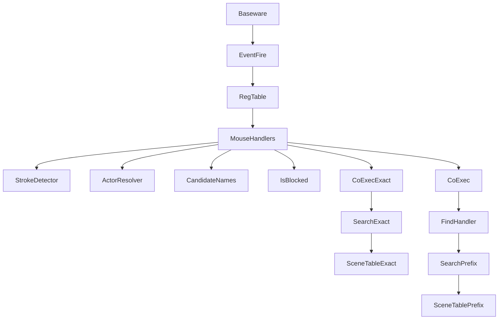
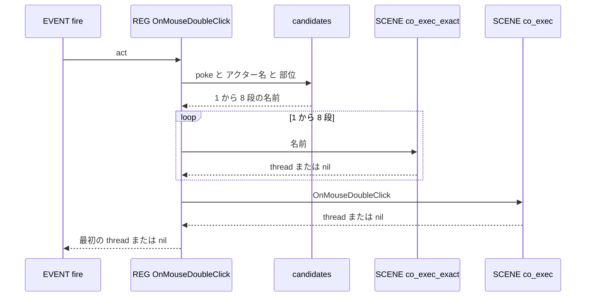
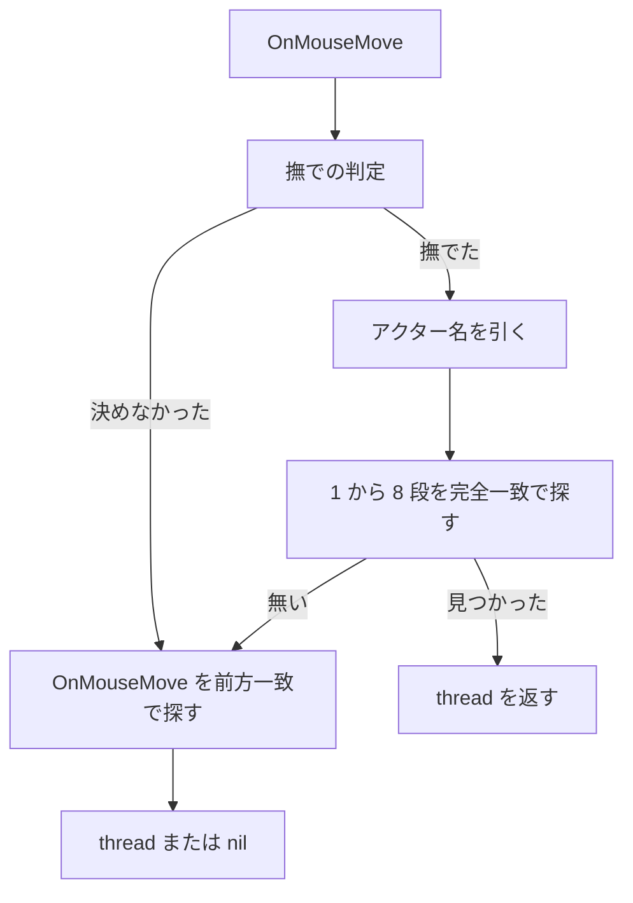
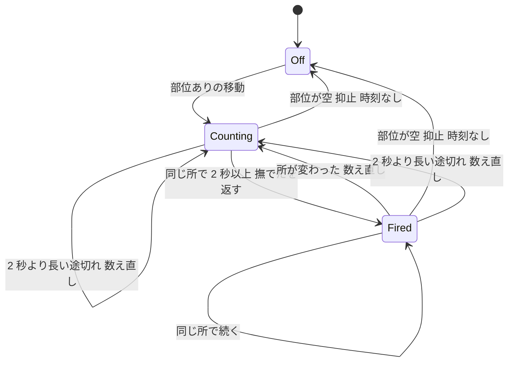

# 設計書: touch-poke-shortcuts

## Overview

**目的**: ゴーストの作者が、撫でられた・つつかれたときの反応を、決まった名前のシーン（`＊つっつき反応女の子Head`・`＊さわり反応その他` など）を書くだけで書けるようにする。Lua の振り分けも、Reference の番号も、撫での判定の自作も要らなくする。

**利用者**: ゴーストの作者（入門者を含む）。入門ガイドの 8・9 段目と見本のゴースト hello-pasta が、新しい書き方の手本になる。既存のゴースト（emo2・pasta-in-windows）は、書き直さずにそのまま動く。

**変えること**: Lua のイベント層に `OnMouseDoubleClick`・`OnMouseMove` の既定のハンドラを 1 ファイルで足す。候補の名前を時報と同じ形の段々で探し、ショートカットの段（1〜8 段）だけは名前の完全一致で探す。完全一致のために、シーンの検索（`pasta_core` の `SceneTable`・`@pasta_search`）に「完全一致で、同じ名前の中から今までと同じ決まりで選ぶ」道を 1 本足す。9 段目（`OnMouseDoubleClick`・`OnMouseMove`）の探し方は今のまま変えない。

### Goals

- つつき・撫でのそれぞれについて、9 段の候補を上から探し、最初に見つかったシーンを返す（要件 1・3）。
- 撫での判定（2 秒・途切れ 2 秒・1 回だけ・数え直し・トーク中の抑止）を pasta が持つ（要件 2・5）。
- ショートカットの段は完全一致で探し、同じ名前のシーンの抽選は今と同じ決まり（使い切るまで繰り返さない）を保つ（要件 1.2・3.2・6）。
- ショートカットを書いていないゴースト・自前の Lua で受けているゴーストの挙動を変えない（要件 8）。
- hello-pasta の 8・9 段目と、マニュアル・スキル references を新しい書き方へそろえる（要件 9・10）。

### Non-Goals

- `OnMouseClick`・`OnMouseWheel`・押しっぱなしの判定。
- エレメントのクリック（`shell-element-click`）・選択肢の振り分けの変更。
- DSL の文法・トランスパイラの変更。
- 撫でのしきい値などの設定（`pasta.toml`）。
- 完全一致の場面選びを設定で切り替える一般の仕組み（`novel-talk-flow`）。この spec は、その部品になる「完全一致の検索」を足すだけで、切り替えの仕組みは持たない。
- areka での届き方の確認。

## Boundary Commitments

### This Spec Owns

- `OnMouseDoubleClick`・`OnMouseMove` の既定のハンドラ（`REG` への登録のしかたを含む）。
- 既存の既定ハンドラ（`OnBoot`・`OnChoiceSelectEx`・`OnSecondChange`）の登録のしかた。5 つとも `REG.X = REG.X or 既定` にそろえる（要件 8.7。設計ディスカッション議題 2）。ハンドラの中身は変えない。
- 候補の名前の組み立て（接頭辞・アクター名・部位・`その他`/`Other` の並べ方と、段を飛ばす決まり）。
- スコープ番号からアクター名を引く決まり。
- 撫での判定の状態機械（状態 1 つ・保存しない）と、抑止の当てはめ方。
- シーンの完全一致の検索: `SceneTable::resolve_scene_id_exact`・`SearchContext::search_scene_exact`・`@pasta_search` の `search_scene_exact`・`SCENE.co_exec_exact`。この 4 つの契約はこの spec が定める。
- hello-pasta の `dic/08-touch.pasta`・`dic/09-choice.pasta`、それを検査するテスト、`STAGES.md` の 8・9 段目の行と検証イベント表、`README.md` の辞書の一覧。
- マニュアルの該当の章（入門 8・9 段目、SHIORI イベント、`@pasta_search`、内部モジュール、文法の章からの案内）と、生成するスキル references。
- 手書きのスキルのうち、つつき・撫での手本を挙げている所（`pasta-ghost-authoring/SKILL.md`・`pasta-ghost-authoring/references/authoring-patterns.md`・`pasta-lua-coding/SKILL.md`）。新しい書き方を手本にする（設計ディスカッション議題 4）。

### Out of Boundary

- 前方一致の検索（`search_scene`・`resolve_scene_id_unified`・`SCENE.search`・`SCENE.co_exec`）の挙動。触らない。
- `EVENT.fire`・`EVENT.drive`・チェイントークの扱い。`init.lua` には `require` を 1 行足すだけで、振り分けの本体は変えない。
- 仮想イベント（`OnTalk`・`OnHour`）と、その抑止の語の一覧（`virtual_dispatcher` の `BLOCKED_STATUSES`）。この spec は `is_blocked` を呼ぶだけで、一覧を変えない。
- 既存の既定ハンドラ（`OnBoot`・`OnChoiceSelectEx`・`OnSecondChange`）の中身。登録の 1 行だけを変える。
- 失敗の見せ方（`failure-output-unification`）。飛び先が無ければ今までどおり 204。
- 接頭辞だけのシーン（`＊さわり反応`・`＊つっつき反応`）を見つける検査（`pasta-check-dic-validate` が後から足す）。
- 手書きのスキルのうち、つつき・撫でに関わらない所。
- emo2・pasta-in-windows の辞書の載せ替え。

### Allowed Dependencies

- `mouse.lua` → `pasta.shiori.event.register`（`REG`）、`pasta.scene`（`SCENE.co_exec`・`SCENE.co_exec_exact`）、`pasta.shiori.event.virtual_dispatcher`（`is_blocked` だけ）、`pasta.store`（`STORE.appearance.owners`）、`@pasta_config`（`actor` 表）、`@pasta_log`（trace・debug だけ）。
- `SCENE.co_exec_exact` → `@pasta_search` の `search_scene_exact`。
- `SearchContext::search_scene_exact` → `SceneTable::resolve_scene_id_exact`・`SceneAliasTable`・`SceneRegistry::sanitize_name`。
- 依存の向き: `pasta_core`（SceneTable）→ `pasta_lua/src/search`（SearchContext とその束縛）→ `pasta_scripts/pasta/scene.lua` → `pasta_scripts/pasta/shiori/event/mouse.lua` → `event/init.lua`（require だけ）。逆向きの参照は作らない。`mouse.lua` は `EVENT`（`init.lua`）を require しない。
- 新しい外部の crate・Lua ライブラリは足さない。

### Revalidation Triggers

- `search_scene_exact`・`SCENE.co_exec_exact` の引数・戻り値・抽選の決まりを変えたとき（`novel-talk-flow` が同じ部品を使う予定）。
- `SceneCacheKey` の形を変えたとき（前方一致の抽選と完全一致の抽選が混ざらないことの前提）。
- `event/init.lua` の既定ハンドラの読み込みの並びや、起動の順（`main` → `entry` → `scene_dic`）を変えたとき（`runtime-error-balloon`・`boot-surface-without-dic`）。
- `virtual_dispatcher.is_blocked` の語の一覧を変えたとき（撫での抑止も変わる）。
- `STORE.appearance.owners` の更新の時点や意味を変えたとき（共有スポットのアクター名）。
- hello-pasta の 8・9 段目のシーン名を変えたとき（`getting-started-screenshots`・`manual-shell-guide`）。

## Architecture

### Existing Architecture Analysis

- `EVENT.fire` は `REG[req.id] or EVENT.no_entry` を呼ぶ。`no_entry` は `SCENE.co_exec(act, req.id)` でイベントと同じ名前のシーンを探す。`OnMouseDoubleClick`・`OnMouseMove` は今ここを通る。
- 既定のハンドラは `event/init.lua` の冒頭で `require` され、`REG.X = function…` と無条件に代入している（`boot`・`choice_select`・`second_change`）。
- 起動の順は `main`（ゴーストの `scripts/main.lua`）→ `pasta.shiori.entry`（ここで `event/init.lua` と既定ハンドラが読まれる）→ `pasta.scene_dic`（辞書の Lua ブロックが評価される）である（`crates/pasta_lua/src/runtime/factory.rs` 214〜225 行）。マニュアル（`lua/shiori-events.md`「既定ハンドラと上書き」）は「既定ハンドラを持たないイベントのハンドラは、どちらに書いてもよい」と書いており、`OnMouseDoubleClick` を `main.lua` で登録しているゴーストがありうる。
- シーンの検索は、名前を `sanitize_name` で整え、`RadixMap` の前方一致で候補を集め、`(範囲, 検索キー, 属性)` をキーにしたキャッシュで「並べ替えて使い切るまで繰り返さない」順に選ぶ。RadixMap のキーは登録名から通し番号を外した名前なので、同じ名前のシーンは 1 つのキーの下に並んでいる。
- 時報は候補の配列を `co_exec` で上から探す。抑止は `virtual_dispatcher.is_blocked(status)` が 9 語の部分一致で判定する。

### Architecture Pattern & Boundary Map



- `MouseHandlers`・`StrokeDetector`・`ActorResolver`・`CandidateNames` は 1 ファイル（`event/mouse.lua`）にまとめる。どれも 2 つのハンドラだけが使い、別々に差し替える理由が無いため。
- `CoExecExact` → `SearchExact` → `SceneTableExact` が新しい道。`CoExec` → `FindHandler` → `SearchPrefix` は今の道で、9 段目だけがこれを通る。
- 採ったパターン: 時報（`check_hour`）と同じ「候補の配列を上から探す」形。新しい抽象（戦略オブジェクト・設定）は作らない。

**Steering との整合**: `pasta_core` → `pasta_lua` のレイヤーの向きを守る。Lua の状態はモジュールの中に持ち、保存しない。LuaJIT 2.1 の範囲で書く（`coroutine.close` に頼らない）。ログは per-event に出さない。

### Technology Stack

| Layer | Choice / Version | Role in Feature | Notes |
|-------|------------------|-----------------|-------|
| Lua ランタイム | LuaJIT 2.1（mlua 0.11） | 既定ハンドラ・撫での判定・候補の名前 | 新しい依存なし |
| 検索 | Rust 2024・`fast_radix_trie` 1.2.0（既存） | 完全一致の候補集め・既存のキャッシュで抽選 | 新しい依存なし |
| 時刻 | `req.date.unix`・`req.date.ns`（既存。`pasta_shiori/src/lua_request.rs`） | 秒より細かい時刻（`unix + ns / 1e9`） | テストは `date` 表を直に渡すか `X-Pasta-Time` |
| マニュアル | mdBook・`book/tools/tutorial-check.mjs`・`gen-skill-refs.mjs`（既存） | 作例の逐語照合・スキル references の生成 | — |

## File Structure Plan

### Directory Structure

```
crates/pasta_lua/
├── pasta_scripts/pasta/shiori/event/
│   └── mouse.lua                      # 新規。OnMouseDoubleClick・OnMouseMove の既定ハンドラ、候補の名前、アクター名、撫での判定
└── tests/
    ├── lua_specs/mouse_test.lua       # 新規。候補の名前・アクター名・撫での判定の単体テスト（時刻を引数で進める）
    └── shiori/mouse_event_test.rs     # 新規。実ローダーでの段々・完全一致・抑止・空のシーン・自前のハンドラの優先

crates/pasta_sample_ghost/
└── tests/touch_shortcuts_test.rs      # 新規。hello-pasta の 8 段目の各段・撫で・9 段目の選択肢
```

### Modified Files

- `crates/pasta_core/src/registry/scene_table.rs` — `SceneCacheKey` に `exact: bool` を足す（既存の作り方は `false`）。`resolve_scene_id_exact` と、範囲ごとにキーが等しい候補だけを集める私的な関数を足す。前方一致の関数は変えない。
- `crates/pasta_core/src/registry/scene_table_resolve_filter_tests.rs` — 完全一致のテスト（頭が同じ名前を拾わない・同じ名前の抽選が使い切るまで繰り返さない・前方一致のキャッシュと混ざらない・空の名前はエラー）。
- `crates/pasta_lua/src/search/context.rs` — `search_scene_exact` と、Lua の束縛 `search_scene_exact(name, global_scene_name?)` を足す。`search_scene` の本体は、完全一致かどうかを引数に取る私的な関数へ移し、`search_scene` はそれを `false` で呼ぶ（挙動は変えない）。
- `crates/pasta_lua/tests/search/scene_search_test.rs` — 束縛のテスト（Lua から `SEARCH:search_scene_exact` を呼ぶ・別名の置き換え・`sanitize_name` での照合）。
- `crates/pasta_lua/pasta_scripts/pasta/scene.lua` — `SCENE.co_exec_exact(name)` を足す。コルーチンへ包む処理は `co_exec` と同じ私的な関数を使う。
- `crates/pasta_lua/pasta_scripts/pasta/shiori/event/init.lua` — 既定ハンドラの読み込みに `require("pasta.shiori.event.mouse")` を 1 行足す。
- `crates/pasta_lua/pasta_scripts/pasta/shiori/event/boot.lua`・`choice_select.lua`・`second_change.lua` — `REG.X = function…` を `REG.X = REG.X or function…` に変える（各 1 行。要件 8.7）。`boot.lua` は `boot-surface-without-dic` も触るので、マージのときに突き合わせる。
- `crates/pasta_lua/tests/lua_specs/init.lua` — `specs` に `"mouse_test"` を足す。
- `crates/pasta_lua/tests/shiori/main.rs` — `mod mouse_event_test;` を足す。
- `crates/pasta_sample_ghost/ghosts/hello-pasta/ghost/master/dic/08-touch.pasta` — ショートカットのシーンで書き直す（下の「hello-pasta の 8・9 段目」）。
- `crates/pasta_sample_ghost/ghosts/hello-pasta/ghost/master/dic/09-choice.pasta` — 選択肢を出すシーンの名前を `つっつき反応その他` に変え、コメントを直す。
- `crates/pasta_sample_ghost/src/scripts.rs` — `test_touch_pasta_contains_events` を新しい書き方の検査へ書き直す。
- `crates/pasta_sample_ghost/tests/tutorial_stages_test.rs` — `MUST_SPEAK` の説明（`OnMouseDoubleClick` の名前を挙げている所）を直す。検査の本体は変えない。
- `crates/pasta_sample_ghost/STAGES.md` — 8・9 段目の行、検証イベント表（8 段目に `OnMouseMove` の行を足す・9 段目の Reference2）、8 段目の注記。
- `crates/pasta_sample_ghost/README.md` — 辞書の一覧の 8 段目の説明。
- `book/src/getting-started/08-touch.md`・`09-choice.md` — 作例と説明。
- `book/src/lua/shiori-events.md` — 主要イベントの表、既定ハンドラの表、`### OnMouseDoubleClick` の書き直し、`### OnMouseMove` の新設、つつき・撫でのショートカットの節の新設。
- `book/src/lua/modules/pasta-search.md` — `search_scene_exact` の節。
- `book/src/internals/internal-modules.md` — `SCENE.co_exec_exact` の行と説明。
- `book/src/grammar/variables.md`・`book/src/lua/patterns.md` — `OnMouseDoubleClick` の例から新しい書き方への案内。
- `.claude/skills/pasta-lua-coding/references/`・`.claude/skills/pasta-ghost-authoring/references/` — `node book/tools/gen-skill-refs.mjs` の生成物（手で編集しない）。
- `.claude/skills/pasta-ghost-authoring/SKILL.md`・`.claude/skills/pasta-ghost-authoring/references/authoring-patterns.md`・`.claude/skills/pasta-lua-coding/SKILL.md` — 手書き。`＊OnMouseDoubleClick`＋`＄ｒ４` や Lua の振り分けを挙げている手本を、ショートカットのシーンに替える。SKILL.md の編集は分類器が止めるので、実装のときに開発者の許可を得る。

## System Flows

### つつき（OnMouseDoubleClick）



- 抑止は見ない（要件 1.7）。アクター名はつつきのたびに引く。
- 見つかったシーンは、出力が無くても返す。下の段は探さない（要件 7.1）。

### 撫で（OnMouseMove）



- 判定は毎回回す。抑止の状態・部位が空・時刻が無いときは、判定の中で数え直して「決めなかった」になる。
- 決めなかったときに探すのは `OnMouseMove` の 1 回だけ（要件 3.3・8.5）。アクター名も、決めたときだけ引く。

### 撫での判定の状態



- 「所」は「スコープ番号と部位の組」。時計が戻ったとき（今の時刻が前の時刻より小さい）も途切れと同じに数え直す。
- 抑止の間は Off に戻すので、抑止が解けた後の最初の移動から数え始める（要件 5.2）。撫での反応そのものがトーク中の Status を作るので、同じ所を撫で続けたときの 2 回目は、反応の再生が終わってからさらに 2 秒後になる。

## Requirements Traceability

| Requirement | Summary | Components | Interfaces | Flows |
|-------------|---------|------------|------------|-------|
| 1.1 | つつきの 9 段 | MouseHandlers・CandidateNames | `M.candidates`・`SCENE.co_exec_exact`・`SCENE.co_exec` | つつき |
| 1.2 | 同名の抽選は今と同じ | SceneTableExact | `resolve_scene_id_exact`（既存のキャッシュ） | — |
| 1.3 | どれも無ければ 204 | MouseHandlers | ハンドラが nil を返す → `EVENT.fire` が 204 | つつき |
| 1.4 | 部位が空なら部位の段を飛ばす | CandidateNames | `M.candidates(kind, actor, nil)` | つつき |
| 1.5 | アクター名が無ければアクターの段を飛ばす | CandidateNames・ActorResolver | `M.candidates(kind, nil, part)` | つつき |
| 1.6 | 接頭辞だけでは探さない | CandidateNames | 候補に接頭辞だけの名前を入れない | — |
| 1.7 | つつきは抑止しない | MouseHandlers | `OnMouseDoubleClick` は `is_blocked` を呼ばない | つつき |
| 1.8 | 左右・入力機器を区別しない | MouseHandlers | Reference5・6 を読まない | — |
| 2.1 | 2 秒続いたら撫でた | StrokeDetector | `M.check_stroke` | 判定の状態 |
| 2.2 | 1 回だけ | StrokeDetector | Fired 状態 | 判定の状態 |
| 2.3 | 所が変わったら数え直す | StrokeDetector | 「所」の比較 | 判定の状態 |
| 2.4 | 2 秒より長い途切れで数え直す | StrokeDetector | `now - last > GAP` | 判定の状態 |
| 2.5 | 部位が空で数え直す | StrokeDetector | 部位が空 → Off | 判定の状態 |
| 2.6 | 1 秒より細かい時刻で測る | StrokeDetector・MouseHandlers | `req.date.unix + req.date.ns / 1e9` | — |
| 2.7 | 状態 1 つ・保存しない | StrokeDetector | モジュールのローカル変数 | — |
| 2.8 | 設定で変えない | StrokeDetector | 定数 `THRESHOLD = 2`・`GAP = 2` | — |
| 3.1 | 撫での 9 段 | MouseHandlers・CandidateNames | `M.candidates("touch", …)` | 撫で |
| 3.2 | 同名の抽選は今と同じ | SceneTableExact | `resolve_scene_id_exact` | — |
| 3.3 | 決めなかった移動は OnMouseMove だけ | MouseHandlers | `SCENE.co_exec(act, "OnMouseMove")` | 撫で |
| 3.4 | アクター名が無ければ飛ばす | CandidateNames | 同 1.5 | 撫で |
| 3.5 | 接頭辞だけでは探さない | CandidateNames | 同 1.6 | — |
| 3.6 | 部位が空では決めない | StrokeDetector | 部位が空 → Off・false | 判定の状態 |
| 4.1 | spot が 1 人ならその名前 | ActorResolver | `M.resolve_actor` | — |
| 4.2 | 0 人なら決まらない | ActorResolver | 同上 → nil | — |
| 4.3 | 2 人以上なら最後に話した人 | ActorResolver | `STORE.appearance.owners[scope]` | — |
| 4.4 | 番号の段を探さない | CandidateNames | 候補にスコープ番号を入れない | — |
| 4.5 | アクターだけの段の名前 | CandidateNames | `<接頭辞><アクター>その他`・`<接頭辞><アクター>Other` | — |
| 5.1 | 抑止の間は決めない | StrokeDetector・IsBlocked | `check_stroke(…, blocked=true)` → false | 判定の状態 |
| 5.2 | 抑止の間は撫でていないと数える | StrokeDetector | 抑止 → Off | 判定の状態 |
| 5.3 | 抑止の語は仮想イベントと同じ | IsBlocked | `virtual_dispatcher.is_blocked` | — |
| 5.4 | balloon だけなら抑止しない | IsBlocked | 9 語のどれも含まない | — |
| 5.5 | 抑止の間も OnMouseMove は探す | MouseHandlers | 判定の結果にかかわらず 9 段目へ | 撫で |
| 6.1 | 部位の名前をそのまま入れる | CandidateNames | 部位を加工せずに連結 | — |
| 6.2 | 1〜8 段は完全一致 | SceneTableExact・SearchExact・CoExecExact | `search_scene_exact` | つつき・撫で |
| 6.3 | 9 段目は今のまま | MouseHandlers | `SCENE.co_exec`（変更なし） | つつき・撫で |
| 6.4 | `その他`・`Other` の部位は特別扱いしない | CandidateNames・Manual | 名前の重なりのまま並べる | — |
| 7.1 | 出力の無いショートカットは 204・下を探さない | MouseHandlers | 見つかった thread をそのまま返す | つつき・撫で |
| 7.2 | `＞transfer_req_to_var` が使える | MouseHandlers | 同じ `act` で実行する | — |
| 7.3 | 新しい変数を足さない | MouseHandlers | 変数に書かない | — |
| 7.4 | チェイントークの扱いを変えない | MouseHandlers | thread を `EVENT.fire` → `EVENT.drive` に渡す（変更なし） | — |
| 8.1 | ショートカットが無いゴーストは今のまま | MouseHandlers | 9 段目＝今の `no_entry` と同じ呼び出し | つつき・撫で |
| 8.2 | 自前のハンドラは登録の前後にかかわらず呼ばれる | MouseRegistration | `REG.X = REG.X or handler` | — |
| 8.3 | 自前のハンドラがあれば既定は動かない | MouseRegistration | `REG[req.id]` が自前のハンドラになる | — |
| 8.4 | 移動ごとに既定の水準でログを出さない | MouseHandlers | per-event は trace だけ | — |
| 8.5 | 決めなかった移動は 1 回だけ探す | MouseHandlers | 同 3.3 | 撫で |
| 8.6 | 前後の両方をテストする | Tests | `mouse_event_test.rs` | — |
| 8.7 | 既存の既定ハンドラも上書きしない | MouseRegistration | `boot.lua`・`choice_select.lua`・`second_change.lua` の `REG.X = REG.X or …` | — |
| 9.1 | 8 段目のつつきは 4 種の段 | SampleDic | `08-touch.pasta` | — |
| 9.2 | 8 段目の撫で | SampleDic | `08-touch.pasta` | — |
| 9.3 | 8 段目で旧い書き方を使わない | SampleDic・SampleTests | `scripts.rs` の検査 | — |
| 9.4 | 9 段目は 8 段目と同じ名前で抽選 | SampleDic | `09-choice.pasta` の `＊つっつき反応その他` | — |
| 9.5 | 段階表・辞書の一覧 | SampleDocs | `STAGES.md`・`README.md` | — |
| 9.6 | 見本のテスト | SampleTests | `touch_shortcuts_test.rs` | — |
| 10.1 | 入門 8 段目 | Manual | `08-touch.md`（`tutorial-check.mjs`） | — |
| 10.2 | 入門 9 段目 | Manual | `09-choice.md` | — |
| 10.3 | SHIORI イベントのリファレンス | Manual | `shiori-events.md` | — |
| 10.4 | 文法の章からの案内 | Manual | `variables.md`・`patterns.md` | — |
| 10.5 | スキル references の再生成 | Manual | `gen-skill-refs.mjs` | — |

## Components and Interfaces

| Component | Domain/Layer | Intent | Req Coverage | Key Dependencies | Contracts |
|-----------|--------------|--------|--------------|------------------|-----------|
| SceneTableExact | pasta_core registry | 完全一致の候補を集め、既存のキャッシュで選ぶ | 1.2, 3.2, 6.2 | RadixMap（P0） | Service |
| SearchExact | pasta_lua search | 完全一致の検索を Lua へ出す | 6.2 | SceneTableExact（P0） | Service |
| CoExecExact | Lua `pasta.scene` | 完全一致で見つけたグローバルシーンをコルーチンにする | 6.2 | SearchExact（P0） | Service |
| MouseHandlers | Lua `event/mouse.lua` | 2 つの既定ハンドラ。段々に探す | 1.x, 3.x, 5.5, 6.3, 7.x, 8.1, 8.4, 8.5 | CoExecExact（P0）・CoExec（P0）・IsBlocked（P1） | Service |
| MouseRegistration | Lua `event/mouse.lua`・`boot.lua`・`choice_select.lua`・`second_change.lua` | 自前のハンドラを上書きしない登録（5 つの既定ハンドラで同じ形） | 8.2, 8.3, 8.7 | REG（P0） | State |
| CandidateNames | Lua `event/mouse.lua` | 候補の名前の配列を作る（純粋関数） | 1.1, 1.4–1.6, 3.1, 3.4, 3.5, 4.4, 4.5, 6.1, 6.4 | なし | Service |
| ActorResolver | Lua `event/mouse.lua` | スコープ番号 → アクター名 | 4.1–4.3, 1.5, 3.4 | `@pasta_config`（P0）・`STORE.appearance`（P1） | Service |
| StrokeDetector | Lua `event/mouse.lua` | 撫での判定（状態 1 つ） | 2.x, 3.6, 5.1, 5.2 | なし（時刻は引数） | Service, State |
| SampleDic・SampleDocs・SampleTests | hello-pasta | 8・9 段目の手本と検査 | 9.x | MouseHandlers | — |
| Manual | book | 決まりの説明と作例 | 10.x, 6.4 | SampleDic | — |

### pasta_core / 検索

#### SceneTableExact

| Field | Detail |
|-------|--------|
| Intent | 検索キーと等しいキーのシーンだけを候補にし、前方一致と同じキャッシュの決まりで 1 つ選ぶ |
| Requirements | 1.2, 3.2, 6.2 |

**Responsibilities & Constraints**
- 範囲の決まりは `collect_scene_candidates` と同じ。`module_name` が空ならグローバル（`:` で始まるキーを除く）、空でなければ `:module_name:name` のローカルだけ。フォールバックは無い。
- 候補は RadixMap のキーが探す名前と完全に等しいものだけ。頭が同じ別の名前（`つっつき反応胸右`・`つっつき反応女の子Head`）は入らない。
- 属性の絞り込みと「並べ替えて使い切るまで繰り返さない」選び方は、前方一致と同じ私的な関数（`filter_by_attributes`・`select_from_cache`）を使う。
- キャッシュのキーは `(範囲, 検索キー, 属性, exact)`。同じ文字列を前方一致と完全一致で探しても、キャッシュが混ざらない。

**Contracts**: Service [x]

##### Service Interface
```rust
impl SceneTable {
    /// 完全一致で 1 つ選ぶ。候補の集め方以外は resolve_scene_id_unified と同じ。
    pub fn resolve_scene_id_exact(
        &mut self,
        module_name: &str,
        name: &str,
        filters: &HashMap<String, String>,
    ) -> Result<SceneId, SceneTableError>;
}
```
- Preconditions: `name` は整えた後の名前（`sanitize_name` 済み）。
- Postconditions: 返す `SceneId` のキーは `name`（ローカルなら `:module_name:name`）と等しい。
- Errors: 名前が空 → `InvalidScene`。候補なし → `SceneNotFound`。属性で 0 件 → `NoMatchingScene`。いずれも前方一致と同じ型。
- Invariants: `resolve_scene_id_unified`・`resolve_scene_id` の結果と、そのキャッシュの状態を変えない。

#### SearchExact

| Field | Detail |
|-------|--------|
| Intent | `SearchContext` と `@pasta_search` に完全一致の検索を足す |
| Requirements | 6.2 |

**Responsibilities & Constraints**
- 名前の整え方・別名の置き換え（グローバルのときだけ）・戻り値の形は `search_scene` と同じ。違うのは候補の集め方だけ。
- `search_scene` の挙動・引数は変えない。新しいメソッドとして足す。

**Contracts**: Service [x]

##### Service Interface
```rust
impl SearchContext {
    /// 完全一致版の search_scene。戻り値は search_scene と同じ (global_name, local_name)。
    pub fn search_scene_exact(
        &mut self,
        name: &str,
        global_scene_name: Option<&str>,
    ) -> Result<Option<(String, String)>, SearchError>;
}
```
```lua
--- @pasta_search の UserData メソッド（Lua 側）
--- @param name string 探す名前（sanitize_name で整えてから完全一致）
--- @param global_scene_name string|nil 親のグローバルシーンの登録名（nil ならグローバルだけ）
--- @return string|nil global_name, string|nil local_name  見つからなければ何も返さない
SEARCH:search_scene_exact(name, global_scene_name)
```
- Errors: 空の名前は `search_scene` と同じく Lua のエラーになる。見つからないのはエラーでなく「何も返さない」。

#### CoExecExact

| Field | Detail |
|-------|--------|
| Intent | 完全一致で見つけたグローバルシーンの `__start__` を、`co_exec` と同じ形のコルーチンにする |
| Requirements | 6.2 |

**Responsibilities & Constraints**
- グローバルシーンだけを探す（ショートカットのシーンはグローバルシーン）。`act` の今のシーン・`act` のメソッド・`GLOBAL` の関数は見ない（要件 6.2「その名前と完全に同じ名前のシーンだけ」）。
- コルーチンへの包み方（シーン関数を呼び、最後に `act:build()` を返す）は `co_exec` と同じ私的な関数を使う。

**Contracts**: Service [x]

##### Service Interface
```lua
--- 完全一致でグローバルシーンを探し、コルーチンを返す（実行しない）
--- @param name string 候補の名前（例: "つっつき反応女の子Head"）
--- @return thread|nil シーンコルーチン。見つからなければ nil
function SCENE.co_exec_exact(name) end
```
- Postconditions: 返したコルーチンを `act` で再開すると、シーンが実行され、出力（無ければ nil）が返る。

### Lua イベント層（`event/mouse.lua`）

モジュール `pasta.shiori.event.mouse` は、下の 5 つを 1 ファイルに持つ。公開するのはテスト用の関数だけで、ゴーストに向けた API は増やさない（ゴーストが使うのはシーンの名前だけ）。

#### CandidateNames

| Field | Detail |
|-------|--------|
| Intent | 種類・アクター名・部位から、1〜8 段の候補の名前を上から順に並べる |
| Requirements | 1.1, 1.4, 1.5, 1.6, 3.1, 3.4, 3.5, 4.4, 4.5, 6.1, 6.4 |

**Contracts**: Service [x]

##### Service Interface
```lua
--- @alias MouseKind "poke"|"touch"
--- @param kind MouseKind  "poke" = つっつき反応/OnPoke、"touch" = さわり反応/OnTouch
--- @param actor string|nil アクター名（決まらなければ nil）
--- @param part string|nil 部位（空文字列・nil は「部位なし」）
--- @return string[] 候補の名前（1〜8 段のうち飛ばさなかったもの。上の段から順）
function M.candidates(kind, actor, part) end
```

| 段 | 条件 | 日本語の名前 | 英字の名前 |
|----|------|--------------|------------|
| 1・2 | アクター名と部位がある | `<接頭辞><アクター名><部位>` | `<英字><アクター名><部位>` |
| 3・4 | アクター名がある | `<接頭辞><アクター名>その他` | `<英字><アクター名>Other` |
| 5・6 | 部位がある | `<接頭辞><部位>` | `<英字><部位>` |
| 7・8 | いつも | `<接頭辞>その他` | `<英字>Other` |

- 接頭辞は `つっつき反応`・`さわり反応`、英字は `OnPoke`・`OnTouch`。部位は加工せずに連結する（要件 6.1）。部位が `その他`・`Other` でも特別扱いしない（要件 6.4。5 段目と 7 段目が同じ名前になるだけ）。
- 例（男の子＝スポット 1 の `Head` をつついた）: `つっつき反応男の子Head`・`OnPoke男の子Head`・`つっつき反応男の子その他`・`OnPoke男の子Other`・`つっつき反応Head`・`OnPokeHead`・`つっつき反応その他`・`OnPokeOther`。
- 9 段目（`OnMouseDoubleClick`・`OnMouseMove`）は配列に入れない。ハンドラが前方一致の `co_exec` で別に探す。

#### ActorResolver

| Field | Detail |
|-------|--------|
| Intent | Reference3（スコープ番号）から `pasta.toml` のアクター名を引く |
| Requirements | 4.1, 4.2, 4.3, 1.5, 3.4 |

**Contracts**: Service [x]

##### Service Interface
```lua
--- @param scope_ref string|nil Reference3 の生の値（"0" など）
--- @return string|nil アクター名。決まらなければ nil
function M.resolve_actor(scope_ref) end
```
- 引き方: `tonumber(scope_ref)` が数でなければ nil。`@pasta_config` の `actor` 表で `spot` がその数に等しいアクターを集める（読み込み時の値。`％` 行で変わる `STORE.actor_spots` は見ない）。
- 1 人ならその名前。0 人なら nil。2 人以上なら `STORE.appearance.owners[番号]`（そのスポットで最後に出力を組み立てたアクター）を見て、それが集めた中にいればその名前、いなければ（まだ誰も話していない・`％` で別のアクターが入った）nil。
- `@pasta_config` が無い環境（単体テスト）では nil を返す。

#### StrokeDetector

| Field | Detail |
|-------|--------|
| Intent | `OnMouseMove` の流れから「撫でた」を決める |
| Requirements | 2.1–2.8, 3.6, 5.1, 5.2 |

**Contracts**: Service [x] / State [x]

##### Service Interface
```lua
--- @param scope_ref string|nil Reference3
--- @param part string|nil Reference4
--- @param now number|nil リクエストの時刻（秒・小数つき）。nil なら判定できないものとして数え直す
--- @param blocked boolean 抑止の状態か
--- @return boolean 今回「撫でた」と決めたら true（1 回だけ）
function M.check_stroke(scope_ref, part, now, blocked) end

--- テスト用: 状態を初期に戻す / 状態を読む
function M._reset() end
--- @return { target: string|nil, start: number, last: number, fired: boolean }
function M._get_state() end
```

##### State Management
- 状態: `target`（「スコープ番号と部位」の組を表す文字列。Off のとき nil）・`start`（数え始めた時刻）・`last`（前の移動の時刻）・`fired`（決めた後か）。モジュールのローカル変数で、1 つだけ持つ。保存しない。ゴーストを読み直すと消える（要件 2.7）。
- 定数: `THRESHOLD = 2`（秒・以上で決める）、`GAP = 2`（秒・より長いと途切れ）。設定では変えない（要件 2.8）。
- 決まり（上から順に当てはめる）:
  1. `blocked`・部位が空・`now` が nil のどれかなら、Off に戻して false。
  2. 所が `target` と違う、または `now - last > GAP`、または `now < last` なら、`target`＝今の所・`start`＝`last`＝`now`・`fired`＝false にして false。
  3. `last`＝`now`。`fired` なら false。
  4. `now - start >= THRESHOLD` なら `fired`＝true にして true。
  5. それ以外は false。
- 時刻はハンドラが `req.date.unix + (req.date.ns or 0) / 1e9` で作る。`req.date` が無ければ nil を渡す。

#### MouseHandlers と MouseRegistration

| Field | Detail |
|-------|--------|
| Intent | `REG.OnMouseDoubleClick`・`REG.OnMouseMove` の既定のハンドラ。段々に探してコルーチンを返す |
| Requirements | 1.1, 1.3, 1.7, 1.8, 3.1, 3.3, 5.5, 6.3, 7.1–7.4, 8.1–8.5 |

**Responsibilities & Constraints**
- つつき: アクター名（Reference3）と部位（Reference4）から候補を作り、`SCENE.co_exec_exact` で上から探す。無ければ `SCENE.co_exec(act, "OnMouseDoubleClick")`。抑止は見ない。Reference5（ボタン）・Reference6（入力機器）は読まない。
- 撫で: 毎回 `check_stroke(r3, r4, now, is_blocked(req.status))` を呼ぶ。true のときだけアクター名を引き、候補を `co_exec_exact` で探す。見つからなかった・決めなかったときは `SCENE.co_exec(act, "OnMouseMove")`。
- 見つかったシーンのコルーチンは、出力が無くても返す（204 になり、下の段は探さない）。コルーチンは `EVENT.fire` → `EVENT.drive` が今のイベントと同じに再開し、継続（チェイントーク）も同じに扱う。
- `act` はそのまま渡すので、シーンの中で `＞transfer_req_to_var` が今までどおり使える。変数には何も書かない。
- ログ: 移動 1 件ごとには trace だけ。「撫でた」と決めたときに debug を 1 行（所と見つかった名前）。
- 登録: `REG.OnMouseDoubleClick = REG.OnMouseDoubleClick or on_poke`、`REG.OnMouseMove = REG.OnMouseMove or on_touch`。
  - ゴーストが先に登録した（`scripts/main.lua`。起動の順で `entry` より前）とき: 既定は代入されない。
  - ゴーストが後に登録した（辞書の Lua ブロック。`scene_dic` で評価される）とき: ゴーストの代入が既定を置き換える。
  - どちらでも `REG[req.id]` はゴーストのハンドラなので、既定のハンドラは呼ばれず、撫での判定も回らない（要件 8.3）。
  - 既存の 3 つ（`OnBoot`・`OnChoiceSelectEx`・`OnSecondChange`）も同じ形にそろえる（要件 8.7）。既定を包みたいゴーストは、今までどおり先に `require("pasta.shiori.event")` を呼んでから `local default = REG.OnSecondChange` と取っておけばよい。

**Dependencies**
- Outbound: `SCENE.co_exec_exact`（P0）・`SCENE.co_exec`（P0）・`virtual_dispatcher.is_blocked`（P1）・`@pasta_log`（P2）

**Contracts**: Service [x] / State [x]

##### Service Interface
```lua
--- REG に登録する関数（EVENT.fire のハンドラの型）
--- @param act ShioriAct
--- @return thread|nil
local function on_poke(act) end
local function on_touch(act) end
```
- `act.req.reference[3]`・`[4]` が無いときは、それぞれ「アクター名なし」「部位なし」として扱う。

**Implementation Notes**
- Integration: `event/init.lua` の既定ハンドラの `require` 群の最後に 1 行足す。`mouse.lua` は `init.lua` を require しない（循環しない）。
- Validation: `mouse_test.lua`（純粋関数と状態機械）と `mouse_event_test.rs`（実ローダー）で確かめる。
- Risks: 撫での判定は実機の届き方に左右される。SSP の実ログでは、トーク中の `OnMouseMove` に `talking,balloon(0=0)` が付き、当たり判定の外では Reference4 が空で届く（`crates/pasta_shiori/doc/shiori-sample.log`。108 件のうち空が 41 件）。実機での手触りの確認は `getting-started-screenshots` に回る。

### hello-pasta の 8・9 段目

#### SampleDic

8 段目のシーンの並び（台詞は実装で書く。名前と段の割り当てを固定する）:

| シーン | 段 | 当たる操作（hello-pasta の部位は `Head`・`Face`・`Body`） |
|--------|----|------------------------------------------------------------|
| `＊つっつき反応女の子Head` | アクター＋部位 | 女の子の頭をつつく |
| `＊つっつき反応男の子その他` | アクターその他 | 男の子のどこをつついても（頭・顔・体・足元） |
| `＊つっつき反応Face` | 部位だけ | 女の子の顔をつつく（男の子の顔は上の段で止まる） |
| `＊つっつき反応その他` | その他 | 女の子の体・女の子の足元（当たり判定の外） |
| `＊さわり反応女の子Head` | アクター＋部位 | 女の子の頭を 2 秒撫でる |
| `＊さわり反応その他` | その他 | それ以外の所を 2 秒撫でる |

- 9 段目の選択肢を出すシーンは `＊つっつき反応その他` に改名し、8 段目の `＊つっつき反応その他` と一緒に抽選させる（要件 9.4）。
- 8 段目では `＊OnMouseDoubleClick`・`＞transfer_req_to_var`・`＄ｒ４` を使わない（要件 9.3）。
- 名前どうしは前方一致で重ならない（`tutorial_stages_test.rs` の `scene_names_do_not_prefix_collide` を通る）。

#### SampleDocs

- `STAGES.md` 8 段目: 「新しく覚える表現」を「触られた部位とキャラで台詞を変える」、「使う文法要素」をショートカットのシーンの名前（リファレンスの節へのリンク）、「初めて扱うイベント」を `OnMouseDoubleClick`・`OnMouseMove` にする。
- 検証イベント表: 8 段目の `OnMouseDoubleClick | 3=0, 4=Head` は残し、`| 8 | OnMouseMove | 3=0, 4=Head |` を足す。9 段目の Reference2 を `2=つっつき反応その他` にする（登録名でないので、今と同じく「最後のグローバルシーン」へのフォールバックを通る）。
- `README.md` の辞書の一覧: `08-touch.pasta    # 8 段: つつき・撫での反応（ショートカットのシーン）`。

### Manual

| ページ | 書くこと |
|--------|----------|
| `getting-started/08-touch.md` | ショートカットのシーンの作例（辞書と逐語で一致）。段々の順を、上の表の操作で説明する。撫では 2 秒・トーク中は反応しない、だけを書き、詳細はリファレンスへ |
| `getting-started/09-choice.md` | 選択肢のシーンが `＊つっつき反応その他` になったこと、8 段目の `その他` と一緒に抽選されること |
| `lua/shiori-events.md` | 主要イベントの表（`OnMouseDoubleClick`・`OnMouseMove` を「あり」）、既定ハンドラの表に 2 行、「既定ハンドラと上書き」を「既定はゴーストの登録を上書きしない。`main.lua` でも辞書の Lua ブロックでもよい。既定を包むときだけ先に `require("pasta.shiori.event")`」の 1 本の決まりに書き直す（5 つ共通）、`### OnMouseDoubleClick` の書き直し、`### OnMouseMove` の新設、新しい節「つつき・撫でのショートカット」（9 段の順・アクター名の決め方・撫での判定・抑止・完全一致・`その他`/`Other` の部位・接頭辞だけの名前は呼ばれない・自前のハンドラの優先・空のシーンで反応を止める書き方） |
| `lua/modules/pasta-search.md` | `search_scene_exact(name, global_scene_name?)` の節 |
| `internals/internal-modules.md` | `SCENE.co_exec_exact` の行と説明 |
| `grammar/variables.md` | `＄ｒ４` の例の後に、部位ごとの反応はショートカットのシーンで書ける、という案内 |
| `lua/patterns.md` | `REG.OnMouseDoubleClick` の例に、登録するとショートカットのシーンが呼ばれなくなる、という注記 |

- 同じ変更で `node book/tools/gen-skill-refs.mjs` を走らせ、生成物をコミットする（要件 10.5）。

## Data Models

撫での判定の状態（StrokeDetector の State Management）だけが新しい状態である。保存しない。検索のキャッシュは `SceneCacheKey` に `exact: bool` が加わるだけで、ほかの形は変わらない。

## Error Handling

- 候補の名前がどの段でも見つからない → ハンドラが nil を返し、`EVENT.fire` が 204 を返す（要件 1.3。失敗の見せ方は変えない）。
- `req.reference` が無い・Reference3 が数でない → アクター名なし。Reference4 が無い → 部位なし。エラーにしない。
- `req.date` が無い（Lua から組み立てたリクエストなど）→ 撫での判定は数え直して false。`OnMouseMove` の名前のシーンだけ探す。
- `@pasta_search` の中のエラー（空の名前など）は、候補の名前が空にならないので起きない。起きた場合は今までどおり `SHIORI.request` の xpcall が受ける。
- シーンの中のエラーは、今のイベントと同じに `EVENT.drive` → xpcall が受ける。

## Testing Strategy

### Unit Tests

- `scene_table_resolve_filter_tests.rs`: `つっつき反応胸` で `つっつき反応胸右` を選ばない／同じ名前 3 つが 3 回で 1 回ずつ選ばれ、4 回目から一巡する（MockRandomSelector）／同じ文字列の前方一致と完全一致のキャッシュが混ざらない／ローカルの範囲でも完全一致になる／空の名前は `InvalidScene`。
- `scene_search_test.rs`: Lua から `SEARCH:search_scene_exact("つっつき反応女", nil)` が `＊つっつき反応女の子Head` に当たらない／`・` を含む名前が登録と同じ規則で当たる／別名の置き換えが `search_scene` と同じに効く。
- `mouse_test.lua`（CandidateNames）: アクターと部位あり → 8 個の順／部位なし → 段 3・4・7・8／アクターなし → 段 5〜8／両方なし → 段 7・8／部位 `その他` → 5 段目と 7 段目が同じ名前のまま並ぶ／接頭辞だけの名前が入らない。
- `mouse_test.lua`（StrokeDetector）: 0・0.5・1.0・1.5・1.99 秒は false、2.0 秒で true、2.5 秒は false（1 回だけ）／途中で部位が変わると 2 秒数え直す／2.01 秒の途切れで数え直す／部位が空の移動を挟むと発火済みが消える／抑止の移動を挟むと、解けた後の最初の移動から 2 秒／時計が戻ると数え直す／`now` が nil で数え直す。
- `mouse_test.lua`（ActorResolver）: `@pasta_config` を差し替えて、1 人・0 人・2 人（owners がその中にいる・いない・空）を確かめる。

### Integration Tests（`crates/pasta_lua/tests/shiori/mouse_event_test.rs`。実ローダーで一時ゴーストを読み込む）

- つつきの段々: 9 段のうち書いた段だけを置いたゴーストで、それぞれ上の段が選ばれる／部位が空・スコープ番号が未登録のときに段が飛ぶ／どれも無いと 204／`＊OnMouseDoubleClick` だけのゴーストは今と同じ応答（要件 8.1）。
- 完全一致と抽選: `＊つっつき反応胸右` だけがあるゴーストで部位 `胸` をつつくと `その他` か 204（`胸右` を選ばない）／同じ名前の 2 シーンが 2 回で 1 回ずつ出る。
- 撫で: `date` 表の時刻を進めた `OnMouseMove` を送り、2 秒で `さわり反応…` が返る／Status `talking,balloon(0=0)` の間は返らず、`OnMouseMove` のシーンは返る（要件 5.5）／`balloon(0=0)` だけなら返る（要件 5.4）。
- 空のシーン: 本文の無い `＊つっつき反応Head` があると、部位 `Head` のつつきは 204 で、`＊つっつき反応その他` は呼ばれない（要件 7.1。文法上、本文の無いグローバルシーンも `__start__` を持つことをここで確かめる）。
- 自前のハンドラ（要件 8.6）: (a) `scripts/main.lua` で `REG.OnMouseDoubleClick`・`REG.OnMouseMove` を登録したゴースト、(b) 辞書の Lua ブロックで登録したゴースト。どちらにもショートカットのシーンを置き、自前のハンドラの応答が返ること、ショートカットのシーンが選ばれないこと、`M._get_state()` が初期のまま（判定が回っていない）ことを確かめる。
- 既存の既定ハンドラ（要件 8.7）: `scripts/main.lua` で `REG.OnBoot` を（`require` せずに）登録したゴーストで、ゴーストのハンドラの応答が返る。`OnSecondChange`・`OnChoiceSelectEx` も同じ。辞書の Lua ブロックで登録した場合と、`require` してから包む場合が今までどおり動く。
- 空のシーン（要件 7.1）の確認は、タスクの最初の群に置く。本文の無いグローバルシーンが登録されないと分かったら、登録されるようにこの spec の中で直す（マニュアルに代わりの書き方は載せない）。
- チェイントーク: ショートカットのシーンの応答の後の継続の扱いが、`＊OnMouseDoubleClick` のときと同じ（`STORE.co_scene` の状態が同じ）。

### Sample Ghost Tests（`crates/pasta_sample_ghost/tests/touch_shortcuts_test.rs`。12 段目の辞書＝配布辞書を読み込む）

- つつき: `3=0,4=Head` → 女の子の頭のシーン／`3=1,4=Head` → 男の子その他／`3=0,4=Face` → `Face` のシーン／`3=0,4=Body` を 2 回 → 8 段目の `その他` と 9 段目の選択肢（`\q[`）が 1 回ずつ／`3=0,4=` → `その他` か選択肢。
- 撫で: `3=0,4=Head` で時刻を 0〜2 秒進める → 2 秒で女の子の頭の撫でのシーン、それまでは 204／`3=1,4=Body` → `さわり反応その他`。
- 照合は、各シーンに固有の台詞の一部が応答の Value に含まれるかで行う。
- `scripts.rs`: 8 段目にショートカットの 4 種の段が 1 つ以上ずつあり、撫でのシーンがあり、`＊OnMouseDoubleClick`・`＞transfer_req_to_var`・`＄ｒ４` が無い。9 段目に `＊つっつき反応その他` がある。
- 既存の `every_stage_loads_and_responds`・`scene_names_do_not_prefix_collide`・`stage_table_matches_dic_files` が新しい辞書と表で通る。

### マニュアルの検査

- `node book/tools/tutorial-check.mjs`（8・9 段目の作例の逐語一致）、リンク検証、`gen-skill-refs.mjs` の再生成の差分なし。

## Performance & Scalability

- 決めなかった `OnMouseMove`（ほぼ全部）では、今の処理（`co_exec` 1 回）に、状態の比較数回と `is_blocked` の部分文字列探し 9 回が加わるだけ。アクター名の引きと完全一致の検索は「撫でた」と決めたとき・つつきのときだけ（最大 8 回の完全一致検索）。
- 完全一致の候補集めは RadixMap のキーの比較で、前方一致と同じ規模。

## 設計ディスカッションの決定（2026-10-16）

議題 2〜7 は推奨案で確定した。議題 1 は個別に議論して C-1 に確定した。

1. **完全一致の作り方**: C-1（Rust の検索に完全一致の道を足す）に確定。`resolve_scene_id_exact` は候補の集め方だけを替え、属性の絞り込みと抽選は既存の私的な関数を使う。`SceneCacheKey` に `exact` を足して前方一致のキャッシュと分ける。C-2（Lua で走査）は抽選と `sanitize_name` の決まりが 2 か所に分かれ、C-3（前方一致の引き直し）は登録名の比較が脆く呼び出しが最大 N 回になるため採らない。
2. **既存の 3 つの既定ハンドラ**: `OnBoot`・`OnChoiceSelectEx`・`OnSecondChange` も `REG.X = REG.X or 既定` にそろえる。要件 8.7 を足した。マニュアルの決まりは 1 本になる。
3. **要件 2.6**: 「1 秒より細かい時刻で測り、しきい値を過ぎた後の最初の移動で決める」に文言を直した。マニュアルには「撫で始めて 2 秒たった後の、最初のマウスの動きで反応する」と書く。
4. **手書きのスキル**: つつき・撫での手本を新しい書き方に替える（範囲に入れた）。SKILL.md の編集は実装のときに開発者の許可を得る。
5. **9 段目の選択肢**: `＊つっつき反応その他` に置く。
6. **1〜8 段で見るもの**: シーンだけ。`GLOBAL` の関数・`act` のメソッドは見ない。
7. **反応させない部位**: 本文の無いシーンで書く。統合テストを最初のタスク群に置き、登録されないならこの spec で直す。
