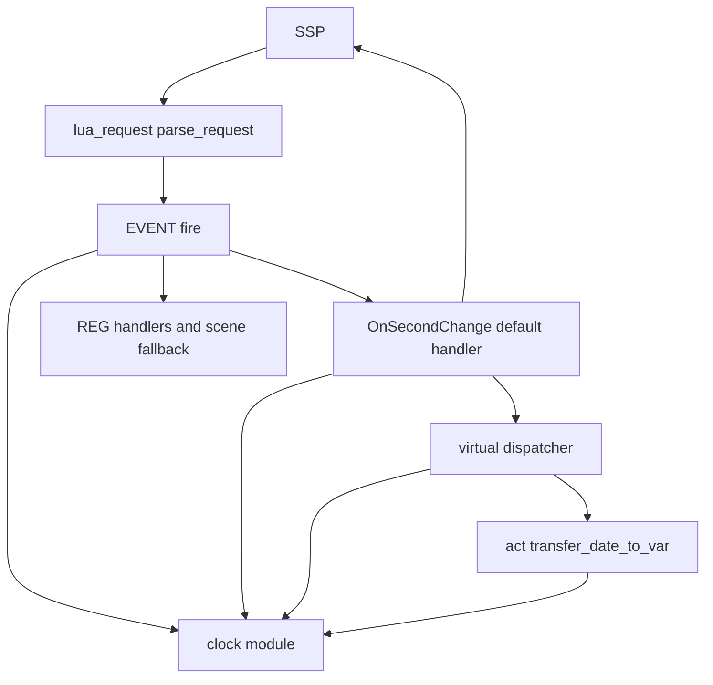
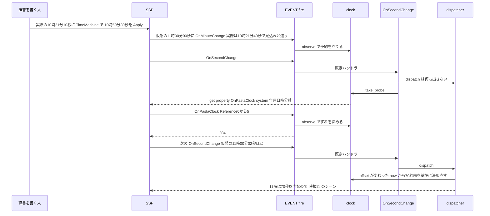
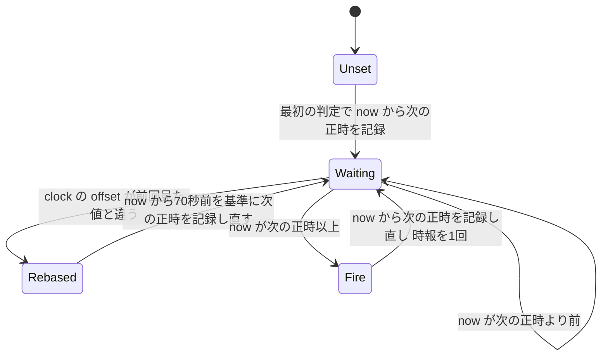

# 設計: tutorial-ssp-gaps

## Overview

**Purpose**: 辞書を書く人が、SSP の開発用パレットの「現在時刻の仮想的変更」（TimeMachine。以下「仮想時刻」）で、正時を待たずに時報を確かめられるようにする。あわせて、入門ガイドが SSP の動きに合わせて逃げている 2 か所（6 段目「次の正時を待つ」・準備の章「何も表示されないのが正しい」）を、決めた結果に合わせて書き直す。

**Users**: pasta で初めてゴーストを作る人（入門ガイドを読む人）と、辞書を書いて SSP で確かめる人。

**Impact**: pasta は今、時報を OS の時計で決めている。この設計で、時報の判定と日時変数（`＄時１２` など）が SSP の仮想時刻に従うようになる。おしゃべりの間隔・撫での判定・コールバックの待ち時間・`act.req.date` は、今までどおり実際の時計で数える。起動の既定の動き（要件 4）と外から起こした `OnTalk`（要件 3）はコードを変えず、文書で仕様を明記する。

### Goals

- 仮想時刻を正時の少し前に合わせて待つと、仮想の正時に時報が出る（要件 2.1）。
- 仮想時刻を使わない間の応答は、今とバイト単位で同じである（要件 2.7・7.3）。
- 入門ガイド・段階表・リファレンスの記述が、決めた動きと合う（要件 1.4・3.3・3.4・4.4・5・6）。

### Non-Goals

- `act.req.date` を仮想時刻に従わせること（決定 A2 の範囲外）（2026-10-18 の見直しで変更。末尾の「設計の見直し（7.2 の後）」を正とする）。
- 時刻を指定して時報を起こす口（決定 A3。仮想時刻が届くと分かったので作らない）。
- 外から起こした `OnTalk` で続きを出すこと（決定 A4）。
- 辞書や `＊OnBoot` が無いときに立ち絵を出すこと（決定 A6）。
- SSP 以外のベースウェアの仮想時刻への対応。

## Boundary Commitments

### This Spec Owns

- 時報の判定と日時変数に使う「今の日時」の決め方（`X-Pasta-Time` → SSP の仮想時刻 → OS の時計の順）。新しいモジュール `pasta.shiori.clock` がこれを一手に持つ。
- SSP の仮想時刻に気づく合図の判定と、`system.*` プロパティを読む往復（イベント名 `OnPastaClock`）。
- `check_hour` の「ずれが変わったら次の正時を決め直す」規則。
- 外から起こした `OnTalk` とチェイントークの続きの関係、辞書や `＊OnBoot` が無いときの起動の動きの、文書での明記。
- 入門ガイド（準備の章・1・6・7・11・13 段目、目次の表）、段階表 `STAGES.md`、リファレンス（SHIORI イベントの章・チェイントークの節・日時変数の節）、内部の説明（`internals/shiori.md`）、撮り方の正本 `book/SCREENSHOTS.md` の該当する記述。

### Out of Boundary

- `crates/pasta_shiori/src/lua_request.rs`（`act.req.date` の作り方と `X-Pasta-Time` の扱い）。変えない。
- `boot.lua`・`EVENT.no_entry`・`set_co_scene`・`check_talk` のチェイントークの続きの拾い方。変えない。
- `mouse.lua`（撫での判定）・`callback.lua`（コールバックの待ち時間）。変えない（2026-10-18 の見直しで変更。末尾の「設計の見直し（7.2 の後）」を正とする）。
- hello-pasta の辞書・段の数と並び・`tutorial_stages_test.rs`・`crates/pasta_check`・`editors/`・`manual.yml`。
- おしゃべりの間隔の設定（`[talk]`・`[ghost]` の `talk_interval_*`）、debug transport・シーンキック。
- 入門ガイドの絵（撮り直しは要らない見込み。下の「入門ガイドの絵」）。

### Allowed Dependencies

- `pasta.shiori.clock` は、Lua 標準の `os.time`・`os.date` と `@pasta_log` だけを使う。`pasta.shiori.event.*`・`pasta.shiori.act`・`pasta.store` を `require` しない（`act.lua` と `event/init.lua` の両方から読まれるため、循環させない）。
- `event/init.lua`・`event/second_change.lua`・`event/virtual_dispatcher.lua`・`act.lua` は `pasta.shiori.clock` を読む（一方向）。
- SSP のさくらスクリプト `\![get,property,…]` と、プロパティ `system.year`〜`system.second`（SSP 2.9.18 で確認）。

### Revalidation Triggers

- `EVENT.fire` の処理の順（`CALLBACK.try_route` → `clock.observe` → `create_act` → `STOP.hold_handler` → ハンドラ）を変えるとき。`event/init.lua` を共有する `novel-talk-flow`・`novel-checkpoint-rollback`・`shell-element-click` は、この順を確かめ直す。
- `check_hour`・`check_talk` の状態（`next_hour_unix`・`next_talk_time`）の意味を変えるとき（`novel-talk-flow`・`novel-checkpoint-rollback`）。
- `transfer_date_to_var` の読む日時を変えるとき。
- `act.req.date` の約束（OS の時計か `X-Pasta-Time`）を変えるとき（2026-10-18 の見直しで変更。末尾の「設計の見直し（7.2 の後）」を正とする）。

## Architecture

### Existing Architecture Analysis

- SSP のリクエストは、Rust の `parse_request`（`lua_request.rs`）が `act.req.date` を OS の時計（`X-Pasta-Time` があればその日時）で作り、Lua の `EVENT.fire` が振り分ける。
- 時報とおしゃべりは、`OnSecondChange` の既定ハンドラ（`second_change.lua`）が呼ぶ仮想ディスパッチャ（`virtual_dispatcher.lua`）が決める。正時は `next_hour_unix`、おしゃべりは `next_talk_time` の 2 つの状態で判定する。
- 時報が出るとき、`check_hour` が `act:transfer_date_to_var()` で日時変数を入れる。シーンの `＞transfer_date_to_var` も同じメソッドを呼ぶ。
- 既定ハンドラは `REG.X = REG.X or function … end` の形で、ゴーストが先に登録したハンドラを上書きしない（touch-poke-shortcuts 要件 8.7）。
- `EVENT.fire` は、ハンドラを呼ぶ直前に `STOP.hold_handler(act)` を置く（runtime-error-balloon）。

### Architecture Pattern & Boundary Map



**Architecture Integration**:

- **Selected pattern**: 「OS の時計とのずれ」を 1 つのモジュールが持ち、時刻を読む所がそのモジュールを呼ぶ（読む所を増やさず、読む関数を差し替える）。
- **Domain/feature boundaries**: 時刻の決め方は `clock` だけが持つ。ディスパッチャは「いつ・どのシーンを出すか」、`act` は「日時を変数に移す」だけを持ち、どちらも時刻の出どころを知らない。
- **Existing patterns preserved**: `REG` の既定ハンドラの形、`EVENT.fire` の戻り値の規則、`STOP.hold_handler` の位置、`set_co_scene` による継続の管理、`act.req` は読み取り専用。
- **New components rationale**: `clock` は、`EVENT.fire`（合図と返事を受ける）・`second_change`（読み取りを出す）・`virtual_dispatcher`（時報）・`act`（日時変数）の 4 か所が同じ状態を読むため、1 つのモジュールにする。どれか 1 つの中に置くと、`act.lua` からイベントの層への逆向きの依存か循環が生まれる。
- **Steering compliance**: Lua に寄せる（Rust を変えない）。配布する `pasta.dll` は 1 種類。設定キーを増やさない。

### Technology Stack

| Layer | Choice / Version | Role in Feature | Notes |
|-------|------------------|-----------------|-------|
| Lua ランタイム | LuaJIT 2.1（mlua 0.11） | `clock` モジュールと既存の 4 ファイルの変更 | `os.time{…}`・`os.date("*t", t)` を使う。フレームワークは既に `std_os` を使っている |
| ベースウェア | SSP 2.9.18 | 仮想時刻の伝え手 | `\![get,property]`・`system.*`・`OnMinuteChange`・`OnHourTimeSignal` |
| 文書 | mdBook（`book/`） | 入門ガイドとリファレンス | `link-check.mjs`・`tutorial-check.mjs`・`gen-skill-refs.mjs` |

Rust（`pasta_shiori`・`pasta_lua` の Rust 部分）と依存は変えない。

## File Structure Plan

### Directory Structure

```
crates/pasta_lua/pasta_scripts/pasta/shiori/
├── clock.lua                      # 新規: 仮想時刻のずれ・合図・読み取り・時刻と日付の表（VirtualClock）
├── act.lua                        # 変更: transfer_date_to_var が clock.date を読む
└── event/
    ├── init.lua                   # 変更: EVENT.fire が clock.observe を呼ぶ（返事は REG の前で受ける）
    ├── second_change.lua          # 変更: ディスパッチャが何も出さない回に clock.take_probe を返す
    └── virtual_dispatcher.lua     # 変更: check_hour・check_talk の正時の計算を clock.now・clock.date で行う。ずれが変わったときの決め直し

crates/pasta_lua/tests/lua_specs/
├── virtual_clock_test.lua         # 新規: clock の単体テスト
├── init.lua                       # 変更: virtual_clock_test を一覧に足す
├── virtual_dispatcher_spec.lua    # 変更: 仮想の正時・戻り・またぎ・hour_margin のテストを足す
├── second_change_thread_test.lua  # 変更: 読み取りのスクリプトを返す回・返さない回のテストを足す
└── shiori_act_test.lua            # 変更: transfer_date_to_var が仮想の日時を移すテストを足す

crates/pasta_shiori/tests/
└── virtual_clock_e2e_test.rs      # 新規: 本物のランタイムで OnPastaClock → OnSecondChange の時報と日時変数、X-Pasta-Time の優先
```

### Modified Files（文書）

- `book/src/getting-started/06-hour.md` — 「起動して確かめる」を仮想時刻の手順に書き換え、「次の正時を待つ」と「仮想時刻は効かない」を消す。章の頭と終わりの掛け合い（「本物の正時を待つ」「お茶を 3 杯」）を手順に合わせる。7 段目から「開発者用機能を有効にする」の節を移す（要件 5.1・5.2）。
- `book/src/getting-started/07-greeting.md` — 「開発者用機能を有効にする」の節を消し、6 段目の節へのリンクに置き換える。280 行のリンクも 6 段目へ向ける（要件 5.2）。
- `book/src/getting-started/13-nar.md` — 26・46・48 行の「7 段目」を 6 段目の節へ向ける（要件 5.2）。
- `book/src/getting-started/11-jump.md` — 「手順 4 で続きが出ないとき」の原因に、外から `OnTalk` を起こしたことを足す（要件 3.4）。
- `book/src/getting-started/setup.md` — 「SSP に入れて起動する」を「SSP の `ghost/` に置く」までにし、起動・「何も表示されない」・タスクバーの案内・`pasta.log` の確かめ・「うまく起動しないときは」を 1 段目へ移す。章の終わりの掛け合いのうち、起動を前提にする行を直す（要件 6.1・6.3）。
- `book/src/getting-started/01-boot.md` — 「起動して確かめる」を最初の起動の手順にする（SSP を起動し、自分のゴーストに切り替える）。成功の目印に立ち絵と台詞を書く。「うまく起動しないときは」の節を足す（要件 6.2・6.3）。
- `book/src/getting-started/index.md` — 45 行（準備の行の「できること」）を「一式が `ghost/` の下にそろう。起動は 1 段目で行う」の趣旨に直す（要件 6.1）。
- `crates/pasta_sample_ghost/STAGES.md` — 「確かめるための道具」の 6・7 段目、23 行（13 段目の表）・77 行の「7 段目で有効にした」を直す。調べの結果（日付・SSP の版・何で伝わるか）と決めた確かめ方を書く（要件 1.4・5.3）。
- `book/src/lua/shiori-events.md` — `act.req.date` の注記（仮想時刻に従わない）、`OnBoot` の節（シーンが無いと何も返さない）、53・444・603 行の「次の OnTalk の機会」、`OnPastaClock` の節（`OnPastaCallBack` の隣）、仮想ディスパッチャの `OnHour`・`check_hour`・`check_talk`・`OnTalk` の記述（要件 2・3.3・4.4）。
- `book/src/grammar/call-jump.md` — チェイントークの節の「次に OnTalk が発生する機会」を、自然なおしゃべりに限ると書き、外から起こした `OnTalk` は続きを破棄すると書く（要件 3.3）。
- `book/src/lua/script-api.md`（447・448 行）・`book/src/lua/patterns.md`（35 行）・`book/src/internals/execution-model.md`（289 行）— 同じ「次の OnTalk の機会」を「次の自然なおしゃべりの機会」にそろえる（設計の議題 5。要件 3.3 の対象外だが、根が同じなのでこの spec で直す）。
- `book/src/grammar/variables.md` — 日時変数の節に、値は SSP の仮想時刻に従うと書く（要件 2.2）。
- `book/src/internals/shiori.md` — 仮想イベントディスパッチャの節に、`clock` の状態と合図・読み取りの仕組み、`check_hour` の決め直しを書く。
- `book/SCREENSHOTS.md` — 77 行「6 段目は、実際の正時を待つ（SSP の仮想時刻は pasta に届かない）」と 97 行の撮り方を、仮想時刻でも撮れる形に直す。
- `.claude/skills/*/references/` — `node book/tools/gen-skill-refs.mjs` で生成し直す（`shiori-events.md`・`call-jump.md`・`variables.md` の写し）。手で書かない。
- `.kiro/specs/tutorial-ssp-gaps/research.md` — 調べの記録（要件 1.1〜1.3 は済み）と、起動の立ち絵をやらない理由（要件 4.5）。

## System Flows

### 仮想時刻に気づいてから時報が出るまで



- 59 分 30 秒を入れる手順では、pasta が仮想時刻に気づくのは次の `OnMinuteChange`、つまり仮想の正時ちょうどである（SSP は TimeMachine の変更をイベントで知らせない。開発用パレットのヘルプで確認）。そのため「気づいた回は時報を出さない」とすると肝心の時報が消える。決め直しの猶予（70 秒）がこれを拾う（下の「時報の判定」）。
- 予約は 1 回の読み取りで消える。返事が来なければ、次の合図まで読み直さない。
- 読み取りのスクリプトは、ディスパッチャが何も出さず、Status がブロック対象でない回にだけ返す。時報・おしゃべり・キック・コールバックの時間切れの応答が優先する。
- 読み取りの往復は `set_co_scene` を通らない（文字列の応答のため）。待っているチェイントークの続きは残る（要件 3.2）。

### 時報の判定（check_hour）



- `now` は `clock.now(act.req)`（仮想のずれを足した時刻）。
- **決め直しは、ずれ（`clock.offset()`）が前回見た値から変わったときだけ**行う（Apply・Reset。要件 2.3）。基準は `now - REBASE_GRACE`（70 秒）で、決め直した直後の同じ判定で、その 70 秒の間にあった正時の時報が 1 回出る。
  - 今が 10:21 で 11:59:30 を入れた: 基準は 11:58:20 → 次は 12:00。余分な `時報11` は出ない。
  - 59 分 30 秒を入れて、仮想の正時ちょうどに気づいた（上の流れ）: 基準は 10:58:51 → 次は 11:00 → すぐ `時報11`。
  - ちょうど 12:00:00 を入れた: 12:00 が 70 秒以内なので `時報12` が出る。
  - Reset で実際の 10:21 に戻した: 基準は 10:19:51 → 次は 11:00。時報は出ない。
- ずれが変わらない間（ずれ 0 で OS の時計を手で戻した場合を含む）は、今の判定を一切変えない（要件 7.3）。時が流れて正時をまたいだときは、何時間進んでも時報は 1 回で、`{HH}` は進んだ先の時（`clock.date(act.req).hour`）になる（要件 2.4。スリープの後と同じ）。
- `REBASE_GRACE`（70 秒）は調整つまみ。分の合図が届くまでの遅れと、読み取りの往復の遅れを吸収する値で、最初のタスクの実機の確かめで見直す。

## Requirements Traceability

| Requirement | Summary | Components | Interfaces | Flows |
|-------------|---------|------------|------------|-------|
| 1.1 | 呼出ログで手がかりを確かめる | 調べの記録（research.md 3.1.1。要件定義で完了） | — | — |
| 1.2 | `system.*` が仮想を返すか | 調べの記録（同上） | — | — |
| 1.3 | 結果を日付・版・手順とともに残す | 調べの記録（同上） | — | — |
| 1.4 | 段階表に結果と確かめ方 | TutorialDocs（STAGES.md） | — | — |
| 2.1 | 仮想の正時に 4 段の候補で時報 | VirtualClock, VirtualDispatcher, SecondChangeHandler, EventFireHook | `clock.observe`・`take_probe`・`now`・`date` | 仮想時刻に気づいてから時報が出るまで |
| 2.2 | 日時変数に仮想の日時 | VirtualClock, ActDateTransfer | `clock.date` | — |
| 2.3 | 設定し直したら次の正時を決め直す（70 秒の猶予） | VirtualDispatcher, VirtualClock | `check_hour`・`clock.offset` | 時報の判定 |
| 2.4 | 時が流れてまたいだら 1 回だけ | VirtualDispatcher | `check_hour` | 時報の判定 |
| 2.5 | 間隔・撫で・待ち時間は実時間 | VirtualDispatcher（`next_talk_time` は `act.req.date.unix`）、`mouse.lua`・`callback.lua` は変えない | `check_talk` | — |
| 2.6 | Reset で OS の時計に戻る | VirtualClock（ずれを読み直し、2 秒以下は 0） | `clock.observe` | 仮想時刻に気づいてから時報が出るまで |
| 2.7 | 仮想時刻なしは今と同じ | VirtualClock（ずれ 0 なら `req.date` をそのまま使う・合図が無ければ何も返さない） | `clock.now`・`date`・`take_probe` | — |
| 2.8 | `X-Pasta-Time` を優先 | VirtualClock | `clock.now`・`date`・`observe`・`take_probe` | — |
| 2.9 | 読めない値はエラーにしない | VirtualClock（ずれを 0 にして 204） | `clock.observe` | — |
| 3.1 | 外から起こした OnTalk は続きを破棄 | 既存の `EVENT.fire`・`no_entry`・`set_co_scene`（変えない）、ReferenceDocs | — | — |
| 3.2 | 続きは自然なおしゃべりだけ | 既存の `check_talk`（変えない）、VirtualClock の読み取りは継続に触れない | — | 仮想時刻に気づいてから時報が出るまで |
| 3.3 | 文法と SHIORI イベントの章に書く | ReferenceDocs（call-jump.md・shiori-events.md） | — | — |
| 3.4 | 11 段目に原因の 1 つとして書く | TutorialDocs（11-jump.md） | — | — |
| 4.1 | シーンが無い OnBoot は何も返さない | 既存の `boot.lua`（変えない） | — | — |
| 4.2 | シーンが無い OnGhostChanged は何も返さない | 既存の `EVENT.no_entry`（変えない） | — | — |
| 4.3 | 書いていない絵を推測で出さない | 既存の動き（変えない） | — | — |
| 4.4 | OnBoot の節に書く | ReferenceDocs（shiori-events.md） | — | — |
| 4.5 | やらない理由を残す | 調べの記録（research.md） | — | — |
| 5.1 | 6 段目を仮想時刻の手順に | TutorialDocs（06-hour.md） | — | — |
| 5.2 | 開発者用機能の節を 6 段目へ | TutorialDocs（06・07・13 段目） | — | — |
| 5.3 | 段階表を同じ内容に | TutorialDocs（STAGES.md） | — | — |
| 5.4 | 6 段目の絵の扱い | TutorialDocs（撮り直し不要の判断と SCREENSHOTS.md の更新） | — | — |
| 5.5 | `06-hour.pasta` を変えない | TutorialDocs（辞書は触らない） | — | — |
| 6.1 | 準備の章は置くまで | TutorialDocs（setup.md・index.md） | — | — |
| 6.2 | 1 段目で立ち絵と台詞を目印に | TutorialDocs（01-boot.md） | — | — |
| 6.3 | 何も出ないときの確かめ方を最初の起動の章に | TutorialDocs（01-boot.md） | — | — |
| 6.4 | 段の辞書・数・並びを変えない | TutorialDocs（辞書は触らない） | — | — |
| 6.5 | 準備の章・1 段目の絵の扱い | TutorialDocs（撮り直し不要の判断） | — | — |
| 7.1 | `X-Pasta-Time` は今のまま | `lua_request.rs` を変えない、VirtualClock は `X-Pasta-Time` があればずれを使わない | `clock.now`・`date` | — |
| 7.2 | DLL は 1 種類 | 全体（ビルドの分岐・設定キーを足さない） | — | — |
| 7.3 | 仮想時刻なしで出方を変えない | VirtualClock（ずれ 0・予約なしでは何もしない） | すべて | — |
| 7.4 | 起動の見え方を変えない | 既存の `boot.lua`（変えない） | — | — |
| 7.5 | 既定のハンドラはゴーストのハンドラを残す | SecondChangeHandler（`REG.OnSecondChange = REG.OnSecondChange or …` の形を保つ）、EventFireHook（新しい `REG` の既定ハンドラを足さない） | — | — |

## Components and Interfaces

| Component | Domain/Layer | Intent | Req Coverage | Key Dependencies (P0/P1) | Contracts |
|-----------|--------------|--------|--------------|--------------------------|-----------|
| VirtualClock | Lua ランタイム（`pasta/shiori/clock.lua`） | 仮想時刻のずれを持ち、時報と日時変数のための「今」を返す | 2.1, 2.2, 2.6, 2.7, 2.8, 2.9, 7.1, 7.3 | `os.time`・`os.date` (P0)、SSP `\![get,property]` (P0) | Service, Event, State |
| EventFireHook | Lua ランタイム（`event/init.lua`） | 合図と返事を `REG` より前に `clock` へ渡す | 2.1, 2.6, 2.9, 7.5 | VirtualClock (P0) | Event |
| SecondChangeHandler | Lua ランタイム（`event/second_change.lua`） | 何も出さない回に読み取りのスクリプトを返す | 2.1, 2.6, 3.2, 7.5 | VirtualDispatcher (P0)、VirtualClock (P0) | Service |
| VirtualDispatcher | Lua ランタイム（`event/virtual_dispatcher.lua`） | 時報の判定を仮想の時刻で行う | 2.1, 2.3, 2.4, 2.5 | VirtualClock (P0) | Service, State |
| ActDateTransfer | Lua ランタイム（`act.lua`） | 日時変数に仮想の日時を移す | 2.2 | VirtualClock (P0) | Service |
| TutorialDocs | 文書（入門ガイド・段階表・撮り方） | 確かめ方と最初の起動を決めた結果に合わせる | 1.4, 3.4, 5.1〜5.5, 6.1〜6.5 | ReferenceDocs (P1) | — |
| ReferenceDocs | 文書（リファレンス・内部） | 仕様（仮想時刻・外から起こした OnTalk・OnBoot）を明記する | 2.2, 3.3, 4.4 | gen-skill-refs (P1) | — |

### Lua ランタイム

#### VirtualClock

| Field | Detail |
|-------|--------|
| Intent | SSP の仮想時刻と OS の時計のずれを持ち、時報の判定と日時変数のための時刻と日付の表を返す |
| Requirements | 2.1, 2.2, 2.6, 2.7, 2.8, 2.9, 7.1, 7.3 |

**Responsibilities & Constraints**

- ずれ `offset`（整数秒）と読み取りの予約 `probe_armed` の 2 つだけを持つ。初期値は `0`・`false`。状態は SHIORI の load から unload まで（Lua の実行環境と同じ寿命）で、保存しない。
- `X-Pasta-Time` があるリクエスト（`req.dic["X-Pasta-Time"] ~= nil`）では、ずれを足さず、合図も見ず、読み取りも出さない（要件 2.8・7.1）。
- `offset == 0` のとき、`now` は `req.date.unix` を、`date` は `req.date` そのもの（同じ表）を返す（要件 2.7・7.3。仮想時刻を使わない間の値は今と同じ）。
- `req.date` を書き換えない（`act.req` は読み取り専用）。仮想の日付は新しい表で返す。
- `pasta.shiori.event.*`・`pasta.shiori.act`・`pasta.store` を `require` しない。

**Dependencies**

- Inbound: EventFireHook — 合図と返事を渡す (P0)
- Inbound: SecondChangeHandler — 読み取りのスクリプトを受け取る (P0)
- Inbound: VirtualDispatcher・ActDateTransfer — 時刻と日付の表を読む (P0)
- External: Lua `os.time{…}`・`os.date("*t", t)` — 地方時での変換。Rust の `now_local()` と同じ時刻帯 (P0)
- External: SSP `\![get,property,OnPastaClock,system.year,system.month,system.day,system.hour,system.minute,system.second]` — 仮想の日時を読む (P0)
- External: `@pasta_log` — 読めない値の警告 (P2)

**Contracts**: Service [x] / API [ ] / Event [x] / Batch [ ] / State [x]

##### Service Interface

```lua
---@class PastaDate                  -- act.req.date と同じ形（lua_request.rs の lua_date_from）
---@field unix integer
---@field year integer
---@field month integer               -- 1〜12
---@field day integer
---@field hour integer                -- 0〜23
---@field min integer
---@field sec integer
---@field ns integer
---@field yday integer                -- 1 月 1 日が 1
---@field ordinal integer             -- yday と同じ
---@field wday integer                -- 日曜が 0
---@field num_days_from_sunday integer

---@class ClockRequest                -- act.req のうち clock が読む所
---@field id string
---@field date PastaDate|nil
---@field dic table<string, string>|nil
---@field reference table<integer, string>|nil
---@field security_level string|nil

---@class VirtualClock
local M = {}

--- 合図と返事を受ける。EVENT.fire が REG より前に、すべてのリクエストで呼ぶ。
--- 返事（OnPastaClock）を受け取ったときだけ true を返す（呼び元は 204 を返し、REG へ進まない）。
---@param req ClockRequest
---@return boolean consumed
function M.observe(req) end

--- 予約があれば消して、読み取りのスクリプトを返す。予約が無ければ nil。
--- 呼び元（OnSecondChange の既定ハンドラ）が、ブロック対象の Status でないことを確かめてから呼ぶ。
---@param req ClockRequest
---@return string|nil script  -- "\\![get,property,OnPastaClock,system.year,system.month,system.day,system.hour,system.minute,system.second]\\e"
function M.take_probe(req) end

--- 時報の判定に使う「今」の Unix 時刻。req.date が無ければ nil。
---@param req ClockRequest
---@return integer|nil
function M.now(req) end

--- 日時変数に使う「今」の日付の表。req.date が無ければ nil。
---@param req ClockRequest
---@return PastaDate|nil
function M.date(req) end

--- 今のずれ（整数秒。0 は仮想時刻なし）。ディスパッチャが「ずれが変わったか」を見るのに使う。
---@return integer
function M.offset() end

--- テスト用: 状態を初期値に戻す
function M._reset() end

--- テスト用: 状態を読む
---@return { offset: integer, probe_armed: boolean }
function M._get_state() end
```

- **Preconditions**: `req.date` は Rust の `parse_request` が作った表（`unix` と各欄を持つ）か、テストが渡した同じ形の表。
- **Postconditions**:
  - `now(req)` = `X-Pasta-Time` があれば `req.date.unix`、無ければ `req.date.unix + offset`。
  - `date(req)` = `X-Pasta-Time` があるか `offset == 0` なら `req.date`。それ以外は `os.date("*t", now(req))` から作った新しい表（`wday` は `t.wday - 1`、`yday`・`ordinal` は `t.yday`、`ns` は `req.date.ns`、`num_days_from_sunday` は `wday` と同じ）。
- **Invariants**: `offset` は整数。`|offset| <= 2` のときは常に `0` に丸める。

##### Event Contract

- **見る合図**（`observe` が `false` を返す。予約を立てるかどうかだけを決める）:

| イベント | 見込みどおりの条件 | 外れたとき |
|----------|--------------------|------------|
| `OnMinuteChange` | `now(req) % 60` が `2` 以下か `58` 以上（`MINUTE_TOLERANCE` = 2 秒。調整つまみ） | `probe_armed = true` |
| `OnHourTimeSignal` | `now(req) % 3600` が `60` 以下か `3595` 以上（トークできるまで待つ遅れを 60 秒まで許す） | `probe_armed = true` |

- **受け取る返事**（`observe` が `true` を返す）:
  - イベント名: `OnPastaClock`。`Reference0`〜`Reference5` が `system.year`・`system.month`・`system.day`・`system.hour`・`system.minute`・`system.second` の値。
  - `req.security_level == "external"` のときは受け取らない（`false` を返し、通常のイベントとして `REG`・シーンへ進む）。
  - 6 つがどれも整数として読め、`os.time{year=…, month=…, day=…, hour=…, min=…, sec=…}` が数を返したとき: `offset = その値 - req.date.unix`。`|offset| <= 2` なら `0`。
  - 読めないとき（足りない・数でない・`os.time` が失敗した）: `offset = 0`、警告ログを 1 行出す。エラーにしない（要件 2.9）。
  - `X-Pasta-Time` がある返事は、ずれを変えずに受け取る（`true`。テストの時刻の上書きと混ぜない）。
- **Ordering / delivery**: 予約は 1 回の `take_probe` で消える。返事が来ないとき（SSP 以外など）の時間切れは持たない。次の合図で再び予約が立つ。返事が届く順は問わない（最後に届いた返事のずれが残る）。
- **見落とし（設計の議題 2。記録して許す）**: ずれの変化の秒の端数が許容幅（±2 秒）に入ると、毎分の合図では気づかない。59 分 30 秒を入れる手順で 1 回の Apply あたり約 8%（5/60）。そのときは仮想の正時の `OnHourTimeSignal`（実測で 7 秒遅れ）で気づき、決め直しの猶予で時報が数秒遅れて 1 回出る。Reset を見落としたときは、古いずれが最大 1 時間残り、実際の正時の `OnHourTimeSignal` で直る。ずれの変化が 1 時間の倍数に近いと気づけない。毎分読み直す案は、空のスクリプトを毎分返して吹き出しを消すおそれがあり（いつも読むのは要件 7.3 に反する）、採らない。

##### State Management

- **State model**: `offset: integer`（0 = 仮想時刻なし）、`probe_armed: boolean`。
- **Persistence & consistency**: 保存しない。unload で消え、次の load で `0`・`false` から始まる。仮想時刻を入れたまま読み込み直したときは、次の毎分の合図（仮想の分の変わり目は OS の秒とずれる）で気づき直す。
- **Concurrency strategy**: Lua の VM は 1 本のアクタースレッドで動くので、排他は要らない。

**Implementation Notes**

- Integration: `clock.lua` は `crates/pasta_lua/pasta_scripts/pasta/shiori/` に置く。ツリーごと zip にして自己展開されるので、登録は要らない。
- Validation: 単体テストは `virtual_clock_test.lua`（下の Testing Strategy）。
- Risks: SSP の `system.*` の値の形（ゼロ埋めの有無）は `tonumber` で吸収する。地方時の変換は `os.time`・`os.date` に任せる（夏時間の無い地域で確かめる）。

#### EventFireHook

| Field | Detail |
|-------|--------|
| Intent | すべてのリクエストを `clock.observe` に見せ、返事だけを `REG` より前に受け取る |
| Requirements | 2.1, 2.6, 2.9, 7.5 |

**Responsibilities & Constraints**

- `EVENT.fire` の `CALLBACK.try_route` の直後、`create_act` の前に、次の 1 か所を足す。

```lua
if CLOCK.observe(req) then
    return RES.no_content()
end
```

- `STOP.hold_handler(act)` はハンドラを呼ぶ直前に残す（順を変えない）。
- 新しい `REG` の既定ハンドラは足さない。`OnMinuteChange`・`OnHourTimeSignal` は、見た後も今までどおり `REG`・シーン関数フォールバックへ進む（ゴーストの `＊OnMinuteChange` などはそのまま動く。要件 7.5）。

**Contracts**: Event [x]

- Subscribed events: すべてのリクエスト（`clock.observe` が中で `OnMinuteChange`・`OnHourTimeSignal`・`OnPastaClock` だけを見る）。
- Published: `OnPastaClock` を受け取った回は 204。

**Implementation Notes**

- Validation: 既存の `stop_test.lua`・`event_no_entry_test.lua` などがそのまま通ること。`OnPastaClock` で `REG.OnPastaClock` が呼ばれないことのテスト。
- Risks: `event/init.lua` は `novel-talk-flow`・`novel-checkpoint-rollback`・`shell-element-click` と共有する。同じウェーブに置かない（brief の決定どおり）。

#### SecondChangeHandler

| Field | Detail |
|-------|--------|
| Intent | 時報・おしゃべりを出さない回に、予約された読み取りのスクリプトを返す |
| Requirements | 2.1, 2.6, 3.2, 7.5 |

**Responsibilities & Constraints**

- 既定ハンドラの形 `REG.OnSecondChange = REG.OnSecondChange or function(act) … end` を保つ。
- 処理の順: (1) `CALLBACK.sweep`（今のまま。応答があればそれを返す）→ (2) `dispatcher.dispatch(act)`（コルーチンがあればそれを返す）→ (3) `dispatcher.is_blocked(act.req.status)` なら `nil` → (4) `CLOCK.take_probe(act.req)` を返す（文字列か `nil`）。
- 文字列の応答は `EVENT.fire` が `RES.ok` にする。`EVENT.drive`・`set_co_scene` を通らないので、待っているチェイントークの続き（`STORE.co_scene`）は残る（要件 3.2）。

**Contracts**: Service [x]

```lua
---@param act ShioriAct
---@return string|thread|nil  -- sweep の応答（SHIORI/ で始まる全文）・シーンのコルーチン・読み取りのスクリプト・nil
REG.OnSecondChange = REG.OnSecondChange or function(act) end
```

**Implementation Notes**

- Validation: `second_change_thread_test.lua` に「予約ありで dispatch が nil → スクリプトを返す」「予約ありでもブロック中は nil で予約が残る」「dispatch がコルーチンを返す回は予約が残る」を足す。
- Risks: `REG.OnSecondChange` を丸ごと上書きしたゴーストでは、読み取りも出ない（時報もおしゃべりも出ないのと同じ。`shiori-events.md` の既存の注意に含める）。

#### VirtualDispatcher

| Field | Detail |
|-------|--------|
| Intent | 正時の判定と `{HH}` を仮想の時刻で行い、時刻が戻ったら次の正時を決め直す |
| Requirements | 2.1, 2.3, 2.4, 2.5 |

**Responsibilities & Constraints**

- `check_hour(act)`:
  - `now = CLOCK.now(act.req)`。
  - `next_hour_unix == 0` なら `next_hour_unix = calculate_next_hour_unix(now)`、`nil`。
  - `CLOCK.offset() ~= seen_offset` なら（設定し直された）`seen_offset = CLOCK.offset()`、`next_hour_unix = calculate_next_hour_unix(now - REBASE_GRACE)` とし、続く判定へ進む（要件 2.3。`REBASE_GRACE` = 70 秒）。
  - `now < next_hour_unix` なら `nil`。
  - それ以外は `next_hour_unix = calculate_next_hour_unix(now)`、`act:transfer_date_to_var()`、`hh = string.format("%02d", CLOCK.date(act.req).hour)` で 4 段の候補を探す（要件 2.1・2.4）。
- `check_talk(act)`:
  - `next_talk_time` の計算と比較は、今までどおり `act.req.date.unix`（実際の時刻）で行う（要件 2.5）。
  - 正時までの残り（`hour_margin` の判定）だけは `next_hour_unix - CLOCK.now(act.req)` で求める（`next_hour_unix` が仮想の時刻のため）。
- `dispatch(act)` の順・キックのゲート・ブロックの判定は変えない。

**Contracts**: Service [x] / State [x]

- Service: `check_hour(act): thread|nil`・`check_talk(act): thread|nil`・`dispatch(act): thread|nil`（形は今のまま）。
- State: `next_hour_unix` は「`CLOCK.now` の時刻で数えた次の正時」になる。`seen_offset`（前回見たずれ。初期値 0）を 1 つ足す。`next_talk_time` は実際の時刻のまま。`_get_internal_state()` は既存の欄を変えず、`seen_offset` を足す。

**Implementation Notes**

- Validation: `virtual_dispatcher_spec.lua` に次を足す。既存のテスト（`dic` の無い req）は、ずれ 0 でそのまま通る。
  - 仮想の正時ちょうどにずれが変わったら、すぐ `時報HH` が出る。
  - 正時をまたいで先へ設定し直しても、余分な時報は出ず、次の正時に出る。
  - 戻したら、戻った先の次の正時に出る。
  - ずれ 0 のまま OS の時計が戻っても、決め直さない（今の動き）。
  - 時が流れて 2 時間進んでも 1 回だけで、`HH` は進んだ先。
  - `hour_margin` は仮想の正時までの残りで見る。
  - `next_talk_time` は実時間のまま。
  - `X-Pasta-Time` 付きでは、ずれを無視する。
- Risks: 猶予（70 秒）より遅れて気づくと、その正時の時報は出ない。実機の確かめで遅れを測って値を決める。

#### ActDateTransfer

| Field | Detail |
|-------|--------|
| Intent | `transfer_date_to_var` が仮想の日時を日時変数に移す |
| Requirements | 2.2 |

**Responsibilities & Constraints**

- `SHIORI_ACT_IMPL.transfer_date_to_var(self)` の `local date = self.req.date` を `local date = CLOCK.date(self.req)` にする。`self.req` か日付が無ければ今までどおり何もしない。
- 移す変数の名前・形（`year`〜`wday`・`年`〜`秒`・`曜日`・`week`・`時１２`）は変えない。
- 時報のときの転記（`check_hour`）と、シーンの `＞transfer_date_to_var` の両方がこのメソッドを通る。

**Contracts**: Service [x]（`act:transfer_date_to_var(): ShioriAct`。形は今のまま）

**Implementation Notes**

- Validation: `shiori_act_test.lua` に「ずれありで `時`・`時１２`・`曜日` が仮想の値」「ずれ 0 では今と同じ値」を足す。

### 文書

#### TutorialDocs（summary）

- 6 段目の「起動して確かめる」は、次の流れにする（細かい文は実装で書く）。
  1. （6 段目の新しい節）開発者用機能を有効にする（7 段目から移した節。要件 5.2）。
  2. SSP を終了し、もう一度起動する。自分のゴーストに切り替える。
  3. 開発用パレットの「現在時刻の仮想的変更」で、**今の時刻の 59 分 30 秒**を入れて適用する（例: 今が 10:21 なら 10:59:30）。パレットの開き方（ショートカットかメニューか）は最初のタスクの実機の確かめで決める。
  4. 30 秒ほど待つ。成功の目印は今の 2 つ（12 時の目印・12 時以外の目印）のまま。12 時の目印を見たいときは 11:59:30 を入れればよい（設定し直しても余分な時報は出ない。要件 2.3）。
  5. 確かめ終わったら「現在時刻の仮想的変更」を元に戻す（Reset）。
- 7 段目と 13 段目は、6 段目の節（`06-hour.md#開発者用機能を有効にする`）を参照する。`link-check.mjs` でリンク切れが無いことを確かめる。
- 準備の章は `ghost/` の下へ置くところで終わる。1 段目の「起動して確かめる」が最初の起動になり、成功の目印を「立ち絵が出て、女の子の吹き出しに『やっほー、今日もよろしくね。』と出る」にする。「うまく起動しないときは」は 1 段目へ移し、`pasta.dll`・`descript.txt` の `shiori` の行・`shell/master/`・`pasta.log` のでき方・タスクバーの SSP のアイコンからメニューを開く方法を書く（要件 6.3）。準備の章の「文字化けする」「辞書が反映されない」の 2 項目も同じ節へ移す。
- 11 段目の「手順 4 で続きが出ないとき」に「開発用パレットなどで外から `OnTalk` を起こした」を原因として足す。
- 段階表の「確かめるための道具」に、調べの結果（2026-10-17・SSP 2.9.18・`pasta.dll` 0.4.0。仮想時刻はヘッダーでなく `system.*` プロパティと毎分・正時のイベントの時機で伝わる）と、6 段目の確かめ方（今の時刻の 59 分 30 秒を入れて待つ）を書く。開発者用機能の初出を 6 段目にする。
- 段の辞書（`01-boot.pasta`〜`13-*.pasta`）と `tutorial_stages_test.rs` は触らない（要件 5.5・6.4）。章の ` ```pasta ` ブロックも変えないので `tutorial-check.mjs` は今のまま通る。

**入門ガイドの絵（要件 5.4・6.5）**: `06-hour.png`（時報の吹き出し）と `01-boot.png`（最初の台詞）は、確かめ方や起動の章が変わっても同じ画面になるので撮り直さない。11 段目の 2 枚は動きが変わらないので撮り直さない。準備の章には絵が無い。したがって `roadmap.md` の「人手の確認が残っている項目」には足さない。`book/SCREENSHOTS.md` の 6 段目の撮り方の注記だけを直す。

#### ReferenceDocs（summary）

- `shiori-events.md`:
  - `act.req.date` の注記に「`act.req.date` は SSP の仮想時刻に従わない（OS の時計か `X-Pasta-Time`）。仮想時刻に従うのは時報の判定と日時変数」を足す。
  - `OnBoot` の節に「応えるシーンが無いと何も返さない（204）。立ち絵は最初の台詞と一緒に出る」を足す（要件 4.4）。
  - 53・444・603 行の「次の OnTalk の機会」を「次の自然なおしゃべり（仮想ディスパッチャが起こす OnTalk）の機会」とし、外から起こした `OnTalk` では続きが破棄されることを書く（要件 3.3）。
  - `OnPastaCallBack` の隣に `OnPastaClock`（仮想時刻の読み取り。`REG` より先に処理され、ハンドラは呼ばれない）の節を足す。
  - 仮想ディスパッチャの `OnHour`・`check_hour`・`check_talk` に、正時は SSP の仮想時刻に従うこと、戻ったときの決め直し、`hour_margin` の数え方を書く。`OnTalk` に外から起こした `OnTalk` の扱いを書く。
- `call-jump.md` のチェイントークの節（345・359 行）を同じ趣旨に直す（要件 3.3）。
- `script-api.md`（447・448 行）・`patterns.md`（35 行）・`internals/execution-model.md`（289 行）の「次の OnTalk の機会」も同じ言い方にそろえる（設計の議題 5）。
- `variables.md` の日時変数の節に「値は SSP の仮想時刻に従う。`X-Pasta-Time` があればその日時」を足す（要件 2.2）。
- `internals/shiori.md` の仮想イベントディスパッチャの節に `clock` の仕組みを書く。
- 直した後に `node book/tools/gen-skill-refs.mjs` で `.claude/skills` の references を生成し直す。書き換えが拒まれたら、回避を探さずに開発者へ許可を求める。

## Data Models

### Domain Model

- **仮想時刻のずれ（offset）**: SSP の仮想の日時と OS の時計の差（整数秒）。0 は「仮想時刻なし」。`clock` だけが書く。
- **読み取りの予約（probe_armed）**: 次に何も出さない `OnSecondChange` で読み取りを出すかどうか。合図で立ち、`take_probe` で消える。
- **次の正時（next_hour_unix）**: `clock.now` の時刻で数えた次の正時。ディスパッチャだけが書く。
- 不変条件: `next_talk_time` は実際の時刻で数え、`offset` の影響を受けない（要件 2.5）。

### Data Contracts & Integration

- 読み取りのスクリプト（応答の `Value`）: `\![get,property,OnPastaClock,system.year,system.month,system.day,system.hour,system.minute,system.second]\e`。
- 返事のリクエスト: `ID: OnPastaClock`、`Reference0`〜`Reference5` に年・月・日・時・分・秒の値。

## Error Handling

### Error Strategy

- 仮想時刻の値が読めないときは、ずれを 0 にして OS の時計で続ける。リクエストはエラーにせず 204 を返す（要件 2.9）。警告ログ（`@pasta_log` の warn）に、読めなかった値を 1 行出す。
- 返事が来ないときは何もしない（時間切れの処理を持たない）。
- `X-Pasta-Time` の形が正しくないときの 400 は、今のまま Rust が返す（要件 7.1。`clock` は関わらない）。
- `req.date` が無いリクエスト（Lua のテストなど）では、`now`・`date` は `nil` を返し、`observe` は合図を見ない。ディスパッチャは今までどおり入口で `nil` を返す。

### Monitoring

- ずれが変わったときに debug ログを 1 行出す（新しいずれの秒数）。仮想時刻を使わない間は何も出ない。

## Testing Strategy

### Unit Tests（`crates/pasta_lua/tests/lua_specs/`）

1. `virtual_clock_test.lua` — `observe`: `OnMinuteChange` が `now % 60` = 0・2・58 では予約が立たず、3・30 では立つ。`OnHourTimeSignal` が `now % 3600` = 7 では立たず、1800 では立つ。`X-Pasta-Time` 付きでは立たない（要件 2.1・2.8）。
2. `virtual_clock_test.lua` — 返事: 6 つの値から `offset` が決まる。差が 2 秒以下なら 0。数でない値・足りない値では 0 になり `true` を返す（エラーにならない）。`security_level = "external"` では `false` で `offset` が変わらない（要件 2.6・2.9）。
3. `virtual_clock_test.lua` — `now`・`date`: `offset == 0` では `date(req) == req.date`（同じ表）。`offset ~= 0` では `hour`・`day`・`wday`（日曜 0）・`yday` が仮想の値で、`req.date` は書き換わらない。`X-Pasta-Time` 付きでは `offset` を無視する（要件 2.2・2.7・2.8）。
4. `virtual_clock_test.lua` — `take_probe`: 予約が無ければ `nil`。予約があれば決まった文字列を 1 回だけ返す。
5. `virtual_dispatcher_spec.lua` — 仮想の正時で `時報HH` の候補を探す。戻ったら決め直し、戻った先の次の正時で出す。2 時間進んでも 1 回だけで、`HH` は進んだ先。`hour_margin` は仮想の正時までの残り。`next_talk_time` は `act.req.date.unix` で数える（要件 2.1・2.3・2.4・2.5）。

### Integration Tests

1. `second_change_thread_test.lua` — 予約ありで dispatch が `nil` なら読み取りの文字列を返す。ブロック中は `nil` で予約が残る。`STORE.co_scene`（待っている続き）が読み取りの後も同じコルーチンのまま残る（要件 3.2）。
2. `shiori_act_test.lua` — `transfer_date_to_var` がずれありで仮想の `時`・`時１２`・`曜日` を移す（要件 2.2）。
3. `crates/pasta_shiori/tests/virtual_clock_e2e_test.rs`（本物のランタイム。`common/test_env.rs` と同じ作りで、回避を書かない）— `OnSecondChange` で正時を記録 → 実際の今から次の正時をまたぐ日時を `OnPastaClock` の Reference で送る（204 が返る）→ 次の `OnSecondChange` が `＊時報その他`（または `時報HH`）の出力と、仮想の `＄時` を返す（要件 2.1・2.2・2.4）。同じ手順を `X-Pasta-Time` 付きで送ると時報が出ない（要件 2.8）。読めない Reference の `OnPastaClock` は 204 で、続く応答は OS の時計のまま（要件 2.9）。
4. 既存のテスト一式（`lua_request_date_test.rs`・`lua_request_parse_test.rs`・`scene_kick_*`・`byte_invariant_test.rs`・`kick_unused_byte_invariant_test.rs` ほか）が変更なしで通る（要件 7.1・7.3）。

### 文書の検査

1. `node book/tools/link-check.mjs` — 7・13 段目から 6 段目の「開発者用機能を有効にする」へのリンク、1 段目の「うまく起動しないときは」へのリンクが切れていない。
2. `node book/tools/tutorial-check.mjs` — 章の ` ```pasta ` ブロックが段の辞書と一致したまま（要件 5.5・6.4）。
3. `node book/tools/gen-skill-refs.mjs` の後、生成物の差分が文書の変更と一致する（ドリフトの検査）。

### 実機の前提の確かめ（SSP・最初のタスク。設計の議題 3）

実装に入る前に、えも2DEBUG（pasta で動く）と SHIORI 呼出ログで次を確かめ、`research.md` に記録する。結果で調整つまみを決め、前提が崩れたら実装の前に設計へ戻す。

1. (a) Reset の瞬間に `OnMinuteChange` が届くか。
2. (b) 文字の無い `\![get,property,…]\e` だけの応答が、表示中の吹き出しを消すか。消える場合は「Apply・Reset の直後だけのこと」として記録して許す。
3. (c) `system.year`〜`system.second` の値の形（ゼロ埋めの有無など）と、`OnPastaClock` の Reference への載り方。
4. (d) `OnMinuteChange`・`OnHourTimeSignal` が届く時機の揺れ。`MINUTE_TOLERANCE`（2 秒）と `REBASE_GRACE`（70 秒）をここで決める。
5. (e) 開発用パレットの開き方（入門ガイド 6 段目に書く手順）。

### 実機の確認（SSP・人手。実装の後）

1. 自分のゴースト（6 段目まで）で、TimeMachine に今の時刻の 59 分 30 秒を入れて Apply → 30 秒ほどで時報が出る（要件 2.1）。
2. 今の時刻より先の時の 59 分 30 秒を入れても、余分な時報が出ず、次の正時に出る（要件 2.3）。
3. Reset → 次の実際の正時まで時報が出ない。日時変数が実際の時刻に戻る（要件 2.6）。
4. 仮想時刻を使わずに数分動かし、SHIORI 呼出ログに `OnPastaClock` が出ない（要件 7.3）。

## Security Considerations

- `OnPastaClock` は、`SecurityLevel: external`（外からの SSTP）のものを受け取らない。受け取った値が影響するのは時報の時機と日時変数だけで、ファイルや設定には触れない。

## Performance & Scalability

- 仮想時刻を使わない間の追加の処理は、リクエストごとのイベント名の比較と、毎分・毎時の剰余の計算だけである。応答の追加は無い。
- 読み取りは合図があった回に 1 回（Apply・Reset のたびに 1 回ほど）。

## 設計の議題で決めたこと（2026-10-18）

設計ディスカッションで、全議題を推奨案で確定した。

1. **設定し直したときの時報**: ずれが変わったときだけ、`now - 70 秒` を基準に次の正時を決め直す（上の「時報の判定」）。ずれ 0 の間の判定は今のまま。要件 2.3・2.4 をこれに合わせて直した。
2. **合図の見落とし**: 毎分の合図の許容幅を ±2 秒に絞り、見落としは毎時の `OnHourTimeSignal` で拾う。残りは記録して許す（Event Contract の「見落とし」）。
3. **実機の前提の確かめ**: 最初のタスクにする（Testing Strategy の「実機の前提の確かめ」）。調整つまみ 2 つの値はここで決める。
4. **返事のイベント名**: `OnPastaClock`。
5. **「次の OnTalk の機会」の書き方**: 要件 3.3 の 2 ページに加え、`script-api.md`・`patterns.md`・`internals/execution-model.md` もこの spec でそろえる。

時刻の直し方の確認（開発者の問い）: ベースウェアの時計に置き換えるのではなく、SSP から日時を聞けたときに `ずれ = 仮想の日時 − OS の時計` を更新し、`見かけの時刻 = OS の時計 + ずれ` とする。SSP は日時を知らせないので、聞くのは合図があったときだけである。

## 設計の見直し（7.2 の後・2026-10-18）

7.2 の実機確認（`research.md`「実機の確認（2026-10-18・タスク 7.2）」）で、SSP 2.9.18（20261017-5）の TimeMachine が **SSP のプロセスの中の OS の時計まで仮想時刻にする**と分かった。`act.req.date`（Rust の `now_local()`）も、Lua の `os.time()` も、`pasta.log` の時刻も仮想時刻になる。このため、上の設計のうち次の点が成り立たない。

- 「`act.req.date` は OS の時計のまま」（Boundary・決定 A2・ReferenceDocs の注記）。
- 決め直しの起点を「ずれ（`offset`）が変わったとき」にしたこと。ずれは 0 のままで、`req.date` が飛ぶ。設定し直すと余分な時報が出る（要件 2.3 に反する）。
- おしゃべりの間隔を `act.req.date.unix` で数えること。仮想時刻で進む（要件 2.5 に反する）。コールバックの待ち時間（`os.time()`）と撫での判定（`req.date`）も同じ。

この節が、上の該当箇所より優先する。設計ディスカッションで、次の 5 つを推奨案で確定した（2026-10-18）。

### 1. 時刻の飛び（VirtualClock に足す）

- 時計は、前回の `OnSecondChange` の「今」（`now(req)`。ずれを足した仮想の今）を覚える。`observe` が `OnSecondChange` を見るたびに、差 `d = now − prev_now` を求める。
- `d < −JUMP_BACK`（2 秒）か `d > JUMP_FORWARD`（90 秒）なら「時刻の飛び」とする。
  - 飛びの通し番号 `epoch` を 1 増やす（ディスパッチャが決め直しの合図に使う）。
  - 飛びの合計 `jump_total += d − 1`（ふだんの 1 秒分を除く）。
- ずれ（`offset`）が変わったとき（SSP が書き換えない場合の読み取り）も、次の `OnSecondChange` で「今」が飛ぶので、同じ判定に入る。上の `seen_offset` による決め直しは、`epoch` による決め直しに置き換える。
- `OnSysResume`（スリープ明け）を見たら、次の 1 回の飛びは飛びとして扱わない（`epoch`・`jump_total` を変えない）。（2026-10-18 完了後の追記: 実機では `OnSysResume` が復帰後の最初の OnSecondChange より数秒遅れて届くので、`OnSysSuspend` でも印を立てる。`research.md`「スリープ明けの合図の順番」）スリープ明けは今と同じ動き（時報は 1 回・おしゃべりはすぐ）のまま（要件 2.4）。
- `X-Pasta-Time` 付きのリクエストは飛びを見ず、`prev_now` も変えない（要件 2.8・7.1。テストが時刻を飛ばしておしゃべりを起こす使い方を守る）。
- 状態は `offset`・`probe_armed` に、`prev_now`（初期値 `nil`）・`epoch`（0）・`jump_total`（0）・`resumed`（false）を足す。保存しない。
- 読み取り（`OnPastaClock`）は残す。SSP が OS の時計を書き換えるときは、ずれは常に 0（2 秒以内）になり、読み取りは Apply・Reset の直後に 1 回走るだけである。書き換えない SSP（古いビルドなど。2026-10-17 の調べで時報が出なかった理由は未確定）では、今までどおり読み取りでずれを得る。

```lua
--- 飛びを差し引いた「なめらかな時計」。間隔・待ち時間・撫でを数える。req.date が無ければ nil。
--- X-Pasta-Time があれば req.date.unix をそのまま返す。
---@param req ClockRequest
---@return integer|nil
function M.steady(req) end   -- = now(req) − jump_total

--- 飛びの通し番号。ディスパッチャが「前回見た値から変わったか」で決め直す。
---@return integer
function M.epoch() end
```

### 2. 飛んだら次の正時を決め直す（VirtualDispatcher）

- `check_hour` の決め直しの条件を `CLOCK.offset() ~= seen_offset` から `CLOCK.epoch() ~= seen_epoch` にする。決め直しの計算（`now − REBASE_GRACE` の次の正時）は今のまま。`_get_internal_state()` は `seen_offset` の代わりに `seen_epoch` を出す。
- 例（実機の 7.2 と同じ操作）:
  - 14:00:24 から 16:59:30 へ入れ直す → 飛び → 16:58:20 から決め直して次は 17:00 → 「午後4時」は出ず、17:00 に「午後5時」が出る（要件 2.3）。
  - 10:21 に 10:59:30 を入れる → 飛び → 10:58:20 から決め直して次は 11:00 → 30 秒後に時報（入門 6 段目）。
  - Reset で 17:01 から 13:11 へ戻す → 飛び → 次は 14:00。時報は出ない（要件 2.6）。
  - ふだん（差 1 秒）は何も変わらない（要件 7.3）。スリープ明けは飛びにしないので、時報は 1 回出る（要件 2.4）。

### 3. おしゃべりの間隔は「なめらかな時計」で数える（VirtualDispatcher）

- `check_talk` の `next_talk_time` の計算と比較を `act.req.date.unix` から `CLOCK.steady(act.req)` にする。正時までの残り（`hour_margin`）は今のまま `next_hour_unix − CLOCK.now(act.req)`。
- 例: 次のおしゃべりまで 46 秒の時に +3 時間飛んでも、なめらかな時計では 46 秒後のまま。ふだんは `jump_total` が 0 なので今と同じ値（要件 2.5・7.3）。

### 4. コールバックの待ち時間と撫での判定も「なめらかな時計」で数える

- `act.lua` の `get_property`（`CALLBACK.stage_pending` の締め切り）と、`second_change.lua` の `CALLBACK.sweep` に渡す今を、`os.time()` から `CLOCK.steady(act.req)` にする（`req.date` が無いときは今までどおり `os.time()`）。`callback.lua` 自体は「渡された今」で比べるので変えない。
- `mouse.lua` の `request_time(req)` を `CLOCK.steady(req) + ns / 1e9` にする。
- Boundary: `act.lua`・`event/second_change.lua`・`event/mouse.lua` が `pasta.shiori.clock` を読む（一方向。`clock.lua` はどれも `require` しない）。

### 5. 前提と文書

- `act.req.date` の注記を「SSP によっては（2.9.18 の TimeMachine など）`act.req.date` も仮想時刻になる。時報の判定と日時変数は、どちらの場合も仮想時刻に従う。おしゃべりの間隔・撫で・コールバックの待ち時間は、設定し直しの飛びを差し引いて数える」に直す（`shiori-events.md`・`variables.md`・`internals/shiori.md`・スキルの references・`STAGES.md` の調べの結果）。
- **要件 7.3 の例外として記録する**: 仮想時刻を使わずに OS の時計を手で 90 秒より進めたか 2 秒より戻したときも「飛び」になる。
  - 10:30 から 9:30 へ戻す: 今は 11:00 まで時報が止まる → 見直し後は 10:00 に出る。
  - 10:30 から 12:10 へ進める: 今は「時報12」が 1 回出る → 見直し後は 13:00 まで出ない。おしゃべりも、今はすぐ出る → 見直し後は残りの間隔を待つ。
  - ふだん（時計を動かさない・スリープ明け）の動きは変わらない。

### テスト（追加）

- `virtual_clock_test.lua`: 差 1 秒では飛びにならない／+91 秒・−3 秒で `epoch` が増え `jump_total` が差から 1 を引いた分だけ増える／`OnSysResume` の後の飛びは数えない／`X-Pasta-Time` 付きは飛びを見ない／`steady` = `now − jump_total`。
- `virtual_dispatcher_spec.lua`: `req.date` だけが飛ぶ（ずれ 0。SSP が OS の時計を書き換える場合）ときの 7.2 の 3 つの操作／スリープ明けの飛びでは時報が 1 回出る／おしゃべりの間隔は飛びの分だけずれない。既存のずれ（`offset`）による決め直しのテストは `epoch` で通る。
- `second_change_thread_test.lua`・`mouse_test.lua`・コールバックのテスト: なめらかな時計で数える。既存のテストは変更なしで通る。
- E2E（`virtual_clock_e2e_test.rs`）は今のまま通る（`OnPastaClock` のずれ → 次の `OnSecondChange` で飛び → 決め直し）。SSP が OS の時計を書き換える場合は Rust のテストで作れないので、Lua の単体テストと実機の確認（7.2 のやり直し）で確かめる。
