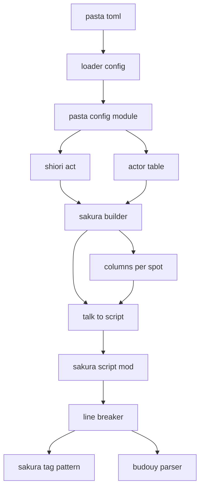
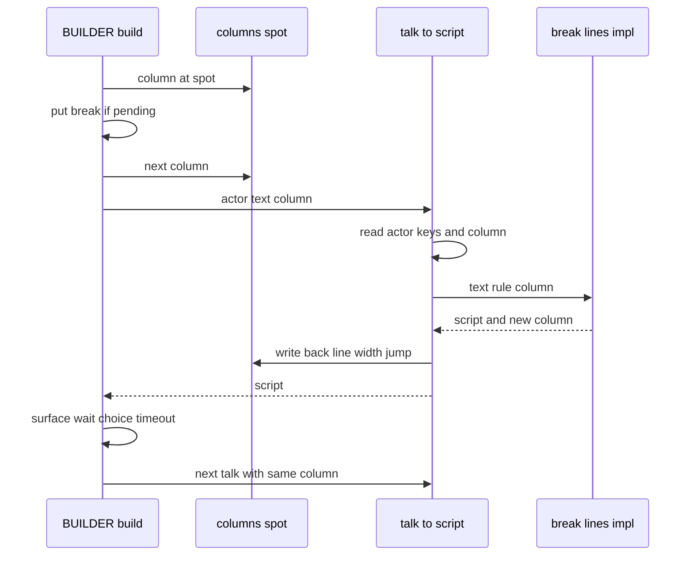
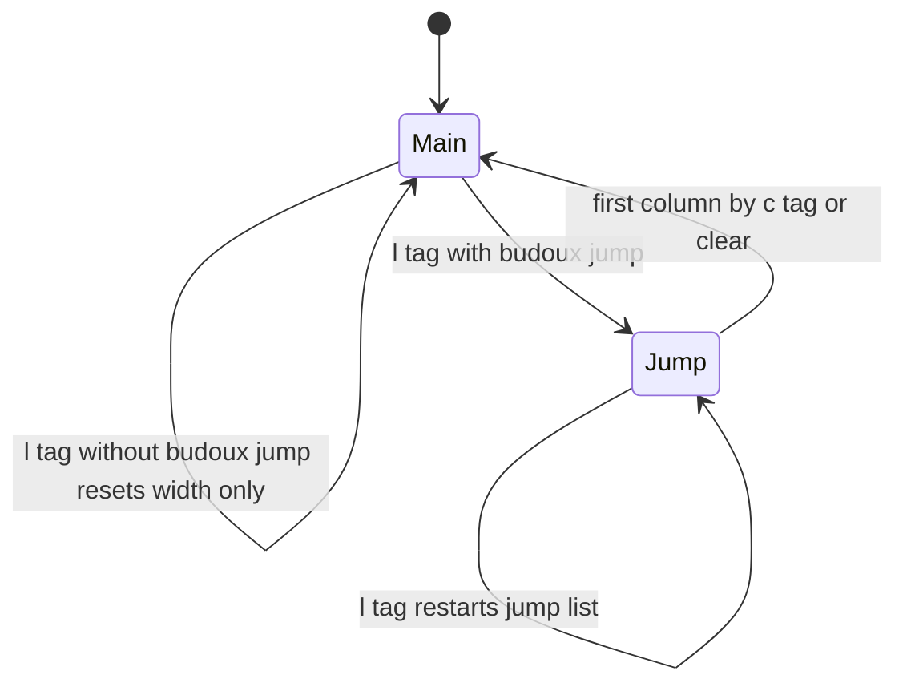

# 設計: vertical-balloon-lines

## Overview

**Purpose**: budoux の自動改行を、縦書きのバルーンでも正しい列で入るようにする。budoux が入れる改行の幅を倍率で指定でき（`budoux_newlines`）、台詞の中の列を動かすタグの所で数え直し、`\_l` で飛んだ先の枠の幅を別に書け（`budoux_jump`）、1 回の出力の中では表情などを挟んでも字数を引き継ぐ。あわせて、選択肢の後の改行の幅を倍率で指定できるようにする（`after_choice_newlines`）。

**Users**: 縦書きのバルーンを使うゴースト作者（窓際のぱすたさん）と、横書きで budoux を使うゴースト作者。後者は、作者が書いた `\n`・`\c` の後の数え違い（今の不具合）が直る。

**Impact**: budoux の行の数え方（`line_breaker.rs`）に「列の状態」を入れ、`talk_to_script` が状態を受け取って書き換えられるようにし、出力の組み立て（`sakura_builder.lua`）が吹き出しごとに状態を持つ。`[ghost]` にキーを 1 つ足す。`budoux` を書いていないゴーストの出力は変わらない。

### Goals

- 要件 1〜7 の受け入れ条件をすべて満たす。
- `budoux` を書いていないゴースト・新しいキーを書いていないゴーストで、Requirement 6 の範囲の出力を文字列のまま保つ。
- 込み入った規則（タグの見分け・幅の選び方・語の割り方）を `line_breaker.rs` の 1 か所に置く。

### Non-Goals

- budoux の禁則、語の区切り方（分割のモデル）、1 語で幅を超える列の扱い。
- 列が足りなくなったときに、budoux が自動で吹き出しを替えること。
- 台詞の中に書いたスコープの切り替え（`\0`・`\1`・`\p[…]`・`\h`・`\u`）・`\b[…]` の後の数え方。
- `pasta_check validate` での新しいキーの検査。
- アクターごとの表示の装い（`actor-display-style`）、縦書きのバルーンそのもの、`＠左` などゴースト側の単語。

## Boundary Commitments

### This Spec Owns

- **列の状態**（列の番号・その列の字数・どちらの幅の並びか）の形と意味。Rust の `Column` と、Lua に渡す表 `{ line, width, jump }` は同じものを指す。
- **列を動かすタグの規則**: どの単位が列をどう動かすか（次の列・最初の列・飛ぶ）と、幅の並びの選び方。`line_breaker.rs` だけが持つ。
- **budoux の改行の文字列**: `budoux_newlines` から `\n` または `\n[N]` を作る規則。
- **`talk_to_script` の 3 つ目の引数**（省略できる列の状態の表）と、その書き換えの約束。
- **出力の組み立ての中の列の進め方**: pasta が出す区切りでの「次の列」、`clear`・`clear_spot` での「最初の列」。吹き出しごと・1 回の出力ごとの状態の持ち方。
- **`[ghost]` の `after_choice_newlines`**: 既定値・補完・Lua の読み出し・選択肢の後の 2 か所の区切り。
- アクター設定のキー `budoux_newlines`・`budoux_jump` の読み方。
- テスト、マニュアルの該当章、スキル references の再生成。

### Out of Boundary

- budouy の語の区切り方と、そのモデルの版。
- `SAKURA_TAG_PATTERN`（単位の読み方）そのもの。本 spec は読んだ単位を見分けるだけで、正規表現は変えない。
- ウェイトの挿入（`wait_inserter.rs`）。
- SSP の自動折り返し・`\n[N]` の描き方・縦書きの描き方。
- `raw_script`・選択肢の表示の文字の数え方（数えない、と決めるだけで、その出力は変えない）。
- `pasta_check`・LSP・VSCode 拡張。
- 0.4.1 の見どころのファイル（`doc/release-notes/v0.4.1.md`）。版の更新のときに書く（本 spec は PR の本文に材料を残す）。

### Allowed Dependencies

- `sakura_builder.lua` → `@pasta_sakura_script`（`talk_to_script`）。逆向きの依存は作らない。
- `mod.rs` → `line_breaker.rs` → `tokenizer.rs`（`SAKURA_TAG_PATTERN` の読み）・`budouy`・`unicode-width`。どれも今ある依存。
- `shiori/act.lua` → `pasta.config`（`CONFIG.get`）→ `@pasta_config`（`[ghost]` は Rust の `apply_shiori_defaults` が補う）。
- 新しいクレート・新しい Lua モジュール・新しいファイルは作らない。
- `line_breaker.rs` は Lua（mlua）を知らない。Lua の表との読み書きは `mod.rs` だけが行う。

### Revalidation Triggers

- 列の状態の表のフィールド（`line`・`width`・`jump`）や、`talk_to_script` の 3 つ目の引数の意味を変えるとき。組み立て・代わりのレンダラ・マニュアルを見直す。
- `SAKURA_TAG_PATTERN` を変えるとき。列を動かすタグの見分け（単位の形）を見直す。
- `sakura_builder.lua` で、改行を出す場所を足す・変えるとき（`actor-display-style`・`novel-talk-flow` など）。区切りは「出して列を進める」関数を通す（通さないと、Builder Tests 6 の不変条件のテストが落ちる）。
- `[ghost]` のキーを足すとき（照合テスト・マニュアルの表・`AUTHORING.md` のキーの数）。
- budouy の版を上げるとき（作例の照合テストの期待値）。

## Architecture

### Existing Architecture Analysis

- 出力の組み立て `BUILDER.build` は、トークンを順に見て、`talk`・`sakura_script` を `talk_to_script(actor, text)` で変換する（ウェイト → budoux の順。Rust）。状態の無い関数で、呼び出しごとに 1 列目の字数 0 から数える。
- budoux の改行は `break_lines_impl` が入れる。本文の字だけをつないで語に分け、タグは字の後ろ（`trailing`）に付けて運ぶ。タグの種類は見ていない。
- 組み立ては、吹き出しごとの状態（`spot_has_text`・`spot_tail`）と、区切りの規則（`pending_break`・`choice_break`・選択肢の後の `\n`）を持つ。`clear`・`clear_spot` で状態を戻す。
- `[ghost]` の既定値は `GhostConfig` が正で、`apply_shiori_defaults` が `@pasta_config` に補い、Lua はリテラルの既定値つきで読む。照合テストがマニュアルの表と Lua のリテラルを確かめる。

### Architecture Pattern & Boundary Map

採るのは、ギャップ分析の案 C（規則は Rust、状態は小さな Lua の表）。



**Architecture Integration**:

- 規則の置き場: タグの見分け・幅の選び方・語の割り方・改行の文字列は `line_breaker.rs`。設定の読み出しと表の読み書きは `mod.rs`。
- 状態の置き場: 組み立てが、1 回の出力の中だけ、スポットごとに表を持つ。Rust は呼び出しのあいだ状態を持たない（今と同じく、状態の無いクロージャのまま）。
- 組み立てが状態を動かすのは 2 通りだけ（次の列・最初の列）。Rust の `\n`・`\c` の動きと同じ意味で、同値のテストで保つ。
- 新しい部品は無い。今の関数に引数と小さな関数を足す。
- steering の決まり: Lua 集約（さくらスクリプトの組み立ては Lua に残す）、レンダラの差し替え口（`RendererInjection`）を壊さない、既定の出力を変えない。

### Technology Stack

| Layer | Choice / Version | Role in Feature | Notes |
| ----- | ---------------- | --------------- | ----- |
| Rust（pasta_lua） | Rust 2024・regex 1・budouy 0.2.2・unicode-width 0.2.2 | 列の状態・タグの見分け・改行の位置 | 版は変えない |
| Lua 連携 | mlua 0.11（LuaJIT 2.1） | `talk_to_script` の 3 つ目の引数の表の読み書き | userdata は使わない |
| Lua スクリプト | `pasta_scripts`（DLL に同梱して自己展開） | 吹き出しごとの状態・区切りでの列の進め方・`after_choice_newlines` | DLL を作り直すと同梱物が変わる（今の仕組みのまま） |
| 設定 | toml 1・`GhostConfig` | `after_choice_newlines` の既定値 | 前例 `choice_newlines` |
| マニュアル | mdBook・`book/tools/gen-skill-refs.mjs` | 章の書き換えとスキル references の再生成 | |

## File Structure Plan

新しいファイルは、決定 9 の確かめ（タスク 1.2）で足したテスト `crates/pasta_lua/tests/sakura_script/backslash_break_test.rs` の 1 つだけ（下の「テスト」）。変更するファイルと、その責務は次のとおり。

### Modified Files

**Rust（budoux の数え方）**

- `crates/pasta_lua/src/sakura_script/line_breaker.rs` — 列の状態 `Column`、改行の規則 `BreakRule`、列の動き `ColumnMove` と単位の見分け、`tokenize_plain_chars` での列の動きの記録、語を列の動きで割る処理、改行の文字列の差し替え。`break_lines_impl` の形を変える（下の Components）。単体テストもこのファイルに足す。
- `crates/pasta_lua/src/sakura_script/mod.rs` — アクターの表から `budoux_newlines`・`budoux_jump` を読む。`talk_to_script` の省略できる 3 つ目の引数（列の状態の表）を読み、成功したら書き戻す。`break_lines` は新しい `break_lines_impl` を、新しい状態・`\n`・飛んだ後の並び無しで呼ぶ。モジュールの説明コメントを直す。

**設定（`after_choice_newlines`）**

- `crates/pasta_lua/src/loader/config/sections.rs` — `GhostConfig.after_choice_newlines: f64`（既定 1.0）と `default_after_choice_newlines()`。構造体の説明コメントの既定値の列挙に足す。
- `crates/pasta_lua/src/loader/config/mod.rs` — `apply_shiori_defaults` に `after_choice_newlines` の補完を 1 つ足す。
- `crates/pasta_lua/src/loader/mod.rs` — `default_after_choice_newlines` を再公開する（37 行の並び）。

**Lua（出力の組み立て）**

- `crates/pasta_lua/pasta_scripts/pasta/shiori/sakura_builder.lua` — スポットごとの列の状態 `columns`、`column_at`・`next_column`・`first_column`・`put_break`、`talk_to_script` に状態を渡す、`newline`・`clear` で状態を動かす、`clear_spot` で捨てる。`after_choice_newlines` を選択肢の後の 2 か所の区切りに通す（`plain_newline_tag`）。`BuildConfig` に `after_choice_newlines` を足す。
- `crates/pasta_lua/pasta_scripts/pasta/shiori/act.lua` — `CONFIG.get("ghost", "after_choice_newlines", 1.0)` を読み、`BUILDER.build` の設定に渡す。`@field` の注記を足す。

**変更しないファイル（理由つき）**

- `crates/pasta_lua/scriptlibs/lua_test/mocks.lua`・`crates/pasta_lua/tests/common/mod.rs` — モックは 3 つ目の引数を捨てる。戻り値の数が変わらないので、直さなくても動く。
- `crates/pasta_lua/src/runtime/renderer_injection.rs` — 差し替え口の形（`fn(&Lua, Option<&TalkConfig>) -> LuaResult<Table>`）は変わらない。
- `crates/pasta_lua/src/sakura_script/tokenizer.rs` — 正規表現は変えない。
- `crates/pasta_lua/pasta_scripts/pasta/act.lua` — `merge_consecutive_talks` は今のまま（持ち越しは組み立てが受け持つ）。

**テスト**

- `crates/pasta_lua/src/sakura_script/line_breaker.rs`（単体テスト）— 見分け・各タグでの数え直し・語の途中のタグ・持ち越した字数・改行の文字列・特性化テスト。
- `crates/pasta_lua/tests/sakura_script/budoux_test.rs` — Lua からの `talk_to_script`（2 つ・3 つの引数）・`break_lines`・エラー・3.7 の幅の照合。
- `crates/pasta_lua/tests/sakura_script/edge_case_test.rs` — 数値でない `budoux_newlines`・`budoux_jump` の要素、表でない 3 つ目の引数。
- `crates/pasta_lua/tests/lua_specs/sakura_builder_test.lua` — 持ち越し・区切りでの列の進め方・`clear`・スポットごと・出力ごと・選択肢の後の区切り・作例の照合・Lua と Rust の動きの同値。
- `crates/pasta_lua/tests/loader/config_defaults_test.rs`・`crates/pasta_lua/src/loader/config_tests.rs`・`crates/pasta_lua/tests/loader/config_sections_test.rs` — `after_choice_newlines` の既定値・補完・マニュアルとの照合・Lua のリテラルとの照合。
- `crates/pasta_lua/tests/loader/startup_test.rs` — SHIORI の act が `[ghost]` の `after_choice_newlines` を読み、選択肢の後の 2 か所の区切りに使う（5.1・5.2・5.6）。
- `crates/pasta_lua/tests/loader/config_actors_initialization_test.rs` — `[actor]` に書いた `budoux_newlines`・`budoux_jump` が `@pasta_config` から読め、`talk_to_script` に効く（1.7）。
- `crates/pasta_lua/tests/sakura_script/backslash_break_test.rs`（新規）・`crates/pasta_lua/tests/sakura_script/main.rs`（モジュールの登録）— 単語や関数が返した単独の `\` の直後に budoux の改行・pasta の区切りが続いても、`\\` に化けないこと（決定 9）。

**マニュアル・スキル references**

- `book/src/reference/pasta-toml.md` — 分類の表・テンプレート・`[ghost]` の表・`#### after_choice_newlines`・アクターの表の `budoux_newlines`・`budoux_jump`・`#### budoux` の数え方の説明。
- `book/src/lua/modules/pasta-sakura-script.md` — `talk_to_script` の 3 つ目の引数と列の状態の表、列を動かすタグの規則、`break_lines` の「元からある `\n` は数えない」を書き換え、`budoux_newlines`・`budoux_jump` の設定。
- `book/src/internals/talk-output.md` — 284 行の今の記述（呼び出しごとに 1 行目から・テキスト内の `\n` でも数え直さない）を、新しい数え方に書き換え。組み立ての状態の表（`columns`）、`BUILDER.build` の設定に `after_choice_newlines`。
- `book/src/grammar/block-structure.md` — 選択肢の配置の表の「選択肢 → 選択肢」「台詞 ← 選択肢」の行を `after_choice_newlines` に合わせる。
- `book/src/lua/modules/pasta-config.md`・`book/src/internals/loader.md`・`book/src/internals/internal-modules.md` — `[ghost]` のキーの並びに `after_choice_newlines` を足す。
- `book/AUTHORING.md` — 192 行の「検査対象の 5 キー」を 6 キーにする。
- `.kiro/specs/completed/vertical-balloon-lines/research.md` — 実機の確認（7.9）の依頼の内容と結果を記録する。
- スキル references（`node book/tools/gen-skill-refs.mjs` で再生成。`pasta-ghost-authoring` の `pasta-toml.md`・`block-structure.md`、`pasta-lua-coding` の `pasta-sakura-script.md`・`pasta-config.md`・`internal-modules.md`）。

## System Flows

### 1 回の出力の中の受け渡し



- 状態の表は、`BUILDER.build` の呼び出しの中で作り、終わったら捨てる（Requirement 4.5）。
- 表情・ウェイト・`!select` の制限時間は表に触らない。そのまま次の台詞が続きから数える（4.1）。
- 変換が失敗したら、表は書き換えない。

### 列の状態の動き



- `Main` は `budoux` の並び、`Jump` は `budoux_jump` の並びを使う状態（表の `jump`）。
- どの動きも、その列の字数を 0 にする。`clear_spot` は全スポットの表を捨て、次は新しい表（`Main` の 1 列目・字数 0）から始まる。

## Requirements Traceability

| Requirement | Summary | Components | Interfaces | Flows |
| ----------- | ------- | ---------- | ---------- | ----- |
| 1.1 | `budoux_newlines` で `\n[N]` | ActorBreakConfig, LineBreaker | `BreakRule.newline`、`newline_for_ratio` | — |
| 1.2 | 書かなければ `\n` | ActorBreakConfig | `newline_for_ratio(None)` | — |
| 1.3 | 1.0 なら `\n` | ActorBreakConfig | `N == 100` の判定 | — |
| 1.4 | `budoux` 無しなら改行なし | ActorBreakConfig, LineBreaker | 空の `widths` は追跡だけ | — |
| 1.5 | budoux の改行だけに効く | LineBreaker, SakuraBuilder | `BreakRule.newline` は挿入にだけ使う | — |
| 1.6 | 数値でないとエラー | ActorBreakConfig | `get::<f64>` のエラーを返す | — |
| 1.7 | `@pasta_config` で読める | SakuraScriptModule（アクターの表は `@pasta_config` の表そのもの。読み出しの道は変えない） | `CONFIG.actor[名前].budoux_newlines` | — |
| 2.1 | `\n`・`\n[…]` で次の列 | LineBreaker | `ColumnMove::Next` | 状態の動き |
| 2.2 | `\c` で最初の列 | LineBreaker | `ColumnMove::First` | 状態の動き |
| 2.3 | `\_l[…]` で字数 0 | LineBreaker | `ColumnMove::Jump` | 状態の動き |
| 2.4 | 書いたタグ・返したタグ・`act:sakura_script` に同じに | SakuraBuilder, LineBreaker | talk と sakura_script の両方に表を渡す | 受け渡し |
| 2.5 | タグの直後の語の前に改行しない | LineBreaker | 字数 0 の列の頭では割らない | — |
| 2.6 | 1 語の途中のタグで割る | LineBreaker | かけらへの分割 | — |
| 2.7 | タグの前は今の規則 | LineBreaker | 幅の数え方は今のまま | — |
| 2.8 | 列を動かさないタグでは数え直さない | LineBreaker | `column_move` が `None` | — |
| 2.9 | エスケープと囲みの中は読まない | LineBreaker | 単位の形で見分ける | — |
| 3.1 | `budoux_jump` を `\_l` の後に使う | LineBreaker, ActorBreakConfig | `BreakRule.jump_widths`、`Column.jump` | 状態の動き |
| 3.2 | `budoux_jump` 無しなら字数だけ 0 | LineBreaker | 空の `jump_widths` | 状態の動き |
| 3.3 | 飛んだ後も `\c` で `budoux` の先頭へ | LineBreaker | `First` は `jump = false` | 状態の動き |
| 3.4 | もう一度 `\_l` で先頭から | LineBreaker | `Jump` は `line = 1` | 状態の動き |
| 3.5 | `budoux_jump` の書き方は `budoux` と同じ | ActorBreakConfig | `table_to_widths` を使う | — |
| 3.6 | `budoux` 無しなら改行なし | ActorBreakConfig | `budoux_jump` を読まない | — |
| 3.7 | 20 字・20,14 字の実測を越えない | LineBreaker | 幅の選び方 | — |
| 4.1 | 字を出さない指定を挟んでも引き継ぐ | SakuraBuilder | スポットの表をそのまま渡す | 受け渡し |
| 4.2 | pasta の区切りで次の列 | SakuraBuilder | `put_break`・`newline` で `next_column` | 状態の動き |
| 4.3 | `clear`・`clear_spot` で最初の列 | SakuraBuilder | `first_column`・`columns = {}` | 状態の動き |
| 4.4 | 吹き出しごと | SakuraBuilder | `columns[tail_spot]` | — |
| 4.5 | 出力ごとに新しく | SakuraBuilder | `BUILDER.build` の局所の表 | 受け渡し |
| 4.6 | 引き継いだ字数で収まらなければ改行 | LineBreaker | 字数が 0 より大きければ先頭でも割る | — |
| 4.7 | 引き継いだ字数 0 なら改行しない | LineBreaker | 字数 0 の列の頭では割らない | — |
| 4.8 | 選択肢の文字は数えない | SakuraBuilder | 選択肢は `talk_to_script` を通らない | — |
| 5.1 | 選択肢の後の選択肢の前 | SakuraBuilder | `choice_break` の `"choice"` | — |
| 5.2 | 選択肢の後の台詞の前 | SakuraBuilder | S3 の `spot_tail == "choice"` | — |
| 5.3 | 無し・1.0 なら `\n` | SakuraBuilder | `plain_newline_tag` | — |
| 5.4 | 戻ったときは `spot_newlines` だけ | SakuraBuilder | 今の `pending_break` 優先を保つ | — |
| 5.5 | 換算と数値でない値は `choice_newlines` と同じ | SakuraBuilder | `math.floor(ratio * 100)` | — |
| 5.6 | 既定値 1.0 を補う | GhostDefaults, ShioriAct | `apply_shiori_defaults`・`CONFIG.get` | — |
| 5.7 | `choice_newlines` は変えない | SakuraBuilder | `choice_break` の `"text"` は今のまま | — |
| 6.1 | `budoux` 無しなら出力は今と同じ | LineBreaker, SakuraBuilder | 追跡だけの道は入力をそのまま返す | — |
| 6.2 | 新しいキー無し・タグ無し・挟まない台詞は今と同じ | LineBreaker | 字数 0 の判定の読み替えが同値 | — |
| 6.3 | 今の数え方に戻す設定を作らない | — | 切り替えのキーを作らない | — |
| 6.4 | 語の区切り・1 語の超過・先頭の扱いは今のまま | LineBreaker | 本文全体を 1 度に分ける | — |
| 6.5 | 2 つの引数で 1 列目から | SakuraScriptModule | 3 つ目が無ければ新しい状態 | — |
| 6.6 | `break_lines` にも数え直し | SakuraScriptModule | 新しい状態・`\n`・飛んだ後の並び無し | — |
| 6.7 | hello-pasta と期待値ファイルが通る | 全体 | 既存のテストを変えない | — |
| 6.8 | 変わる場所をリリースノートとマニュアルに | Manual | PR の本文・マニュアルの章 | — |
| 7.1 | 1〜5 の自動テスト | Tests | Testing Strategy | — |
| 7.2 | 既定で変わらないテスト | Tests | 特性化テスト | — |
| 7.3 | 作例の照合テスト | Tests | `sakura_builder_test.lua` | — |
| 7.4 | `pasta-toml.md` と照合テスト | Manual, GhostDefaults | `expect_row("after_choice_newlines", "1.0")` | — |
| 7.5 | `pasta-sakura-script.md` | Manual | — | — |
| 7.6 | `talk-output.md` の書き換え | Manual | — | — |
| 7.7 | `[ghost]` のキーの一覧の章 | Manual | — | — |
| 7.8 | スキル references の再生成と検査 | Manual | `gen-skill-refs.mjs --check` | — |
| 7.9 | 実機の確認を記録 | Manual（spec の記録として research.md に残す） | Migration Strategy の手順 6 | — |

## Components and Interfaces

| Component | Domain/Layer | Intent | Req Coverage | Key Dependencies (P0/P1) | Contracts |
| --------- | ------------ | ------ | ------------ | ------------------------ | --------- |
| LineBreaker | Rust `line_breaker.rs` | 列の状態と列を動かすタグの規則で、budoux の改行を入れる | 1.1, 1.4, 1.5, 2.1〜2.9, 3.1〜3.4, 3.7, 4.6, 4.7, 6.1, 6.2, 6.4 | budouy (P0), SAKURA_TAG_PATTERN (P0) | Service, State |
| SakuraScriptModule | Rust `mod.rs` | `talk_to_script`・`break_lines` の Lua の口。表の読み書き | 1.2, 1.3, 1.6, 1.7, 3.5, 3.6, 6.5, 6.6 | LineBreaker (P0), mlua (P0) | Service |
| ActorBreakConfig | Rust `mod.rs` の内部 | アクターの表から `BreakRule` を作る | 1.1〜1.4, 1.6, 3.5, 3.6 | mlua (P0) | Service |
| SakuraBuilder | Lua `sakura_builder.lua` | スポットごとに状態を持ち、区切りで列を進め、`after_choice_newlines` を出す | 2.4, 4.1〜4.5, 4.8, 5.1〜5.5, 5.7, 1.5 | SakuraScriptModule (P0) | State |
| ShioriAct | Lua `shiori/act.lua` | `after_choice_newlines` を読んで組み立てに渡す | 5.6 | pasta.config (P1) | — |
| GhostDefaults | Rust `loader/config` | `after_choice_newlines` の既定値と補完 | 5.6, 7.4 | toml (P1) | — |
| Manual | `book/`・spec の記録 | 章の書き換え・スキル references・実機の確認の記録 | 6.8, 7.4〜7.9 | gen-skill-refs.mjs (P1) | — |

### Rust: budoux の数え方

#### LineBreaker

| Field | Detail |
| ----- | ------ |
| Intent | 列の状態を受け取り、列を動かすタグの所で数え直しながら budoux の改行を入れ、終わりの状態を返す |
| Requirements | 1.1, 1.4, 1.5, 2.1〜2.9, 3.1〜3.4, 3.7, 4.6, 4.7, 6.1, 6.2, 6.4 |

**Responsibilities & Constraints**

- 列を動かすタグの見分けと、列の動きの規則を、このファイルだけが持つ。
- 語の分け方は今のまま、本文の字全体を 1 度に budoux で分ける（6.4）。
- 改行を入れうるのは語の頭の字の前だけ。かつ、その列の字数が 0 より大きいときだけ（2.5・4.6・4.7・6.4）。
- 幅の並びが空なら改行を入れず、入力の文字列をそのまま返し、列の状態だけ進める（1.4・6.1）。このときは budoux で語に分けず、単位の列の動きと字数だけを数える（budoux を使わないゴーストに、語分けの手間を足さない）。
- Lua を知らない。mlua の型を使わない。

**Dependencies**

- Inbound: SakuraScriptModule — `talk_to_script`・`break_lines` から呼ぶ (P0)
- External: budouy — 語の区切り (P0)。unicode-width — 字の幅（`width_cjk`）(P0)。regex — `SAKURA_TAG_PATTERN` の一致 (P0)

**Contracts**: Service [x] / State [x]

##### Service Interface

```rust
/// 列の状態。Lua の表 { line, width, jump } と 1 対 1 に対応する。
#[derive(Debug, Clone, Copy, PartialEq, Eq)]
pub struct Column {
    /// 列の番号。最初の列が 1。
    pub line: usize,
    /// その列に積んだ字数（全角 2・半角 1。タグは数えない）。
    pub width: usize,
    /// `budoux_jump` の並びを使っているか。
    pub jump: bool,
}

impl Default for Column {
    /// 最初の列の頭・字数 0・`budoux` の並び。
    fn default() -> Self;
}

/// 改行の規則（アクターの設定から作る）。
pub struct BreakRule<'a> {
    /// `budoux` の並び。空なら改行を入れない（状態は進める）。
    pub widths: &'a [usize],
    /// `budoux_jump` の並び。空なら `\_l[…]` は字数だけを 0 にする。
    pub jump_widths: &'a [usize],
    /// budoux が入れる改行の文字列（`\n` または `\n[N]`）。
    pub newline: &'a str,
}

/// 列の動き（単位 1 つが列をどう動かすか）。
enum ColumnMove {
    /// `\n` ちょうど・`\n[` で始まる単位。次の列へ。
    Next,
    /// `\c` ちょうどの単位。最初の列へ。
    First,
    /// `\_l[` で始まる単位。飛ぶ。
    Jump,
}

/// 単位の文字列から列の動きを決める。列を動かさない単位は None。
fn column_move(unit: &str) -> Option<ColumnMove>;

impl Column {
    /// 列の動きを当てる（下の表）。
    fn apply(&mut self, m: ColumnMove, rule: &BreakRule);
    /// 今の列の幅の上限。並びの最後の値を、それ以降の列で繰り返す。
    fn threshold(&self, rule: &BreakRule) -> usize;
}

/// budoux の改行を入れる。`column` を始めの状態として読み、終わりの状態に書き換える。
pub fn break_lines_impl(
    input: &str,
    rule: &BreakRule,
    column: &mut Column,
    tag_regex: &Regex,
    parser: &budouy::Parser,
) -> String;
```

列の動きの規則:

| 動き | `line` | `width` | `jump` |
| ---- | ------ | ------- | ------ |
| `Next` | 1 足す | 0 | そのまま |
| `First` | 1 | 0 | `false` |
| `Jump`（`jump_widths` が空でない） | 1 | 0 | `true` |
| `Jump`（`jump_widths` が空） | そのまま | 0 | そのまま |
| budoux が入れた改行 | 1 足す | 次の語のかけらの幅 | そのまま |

幅の上限は、`jump` が真で `jump_widths` が空でなければ `jump_widths`、それ以外は `widths` から、`(line - 1)` 番目（並びより先は最後の値）を使う。

改行の入れ方:

1. `tokenize_plain_chars` が、先頭の単位の並び（`leading`）と各字の後ろの単位の並び（`trailing`）を切り出すときに、各単位の列の動きを記録する。
2. 先頭の単位の列の動きを、始めの状態に当てる。
3. 本文の字をつないで budoux で語に分ける（今のまま）。
4. 語を先頭から見る。語の中の字の後ろに列の動きがあれば、そこで語を「かけら」に割る。
5. 語の頭のかけら: その列の字数が 0 より大きく、足すと上限を超えるなら、かけらの前に `rule.newline` を入れて次の列へ（字数 = かけらの幅）。そうでなければ字数に足す（1 語で上限を超えても割らない）。
6. かけらの最後の字の後ろの列の動きを、順に当てる。タグの後ろのかけらは字数 0 の列の頭から始まるので、手順 5 の改行の判定は当てず、字数に足すだけにする（2.5・2.6）。
7. 改行は、今と同じく「前の字の後ろの単位の後、次の字の前」に入れる。持ち越した字数で 1 つ目の語が収まらないときは、先頭の単位の後、1 つ目の字の前に入る（4.6）。

- Preconditions: `column.line >= 1`（1 より小さい値は 1 として読む）。
- Postconditions: 返す文字列から、入れた改行を除くと入力と同じになる。`rule.widths` が空なら、返す文字列は入力と同じ。`column` は入力の最後の字と単位までを数えた状態。
- Invariants: 改行は語の頭の字の前にだけ入る。字数 0 の列の頭には入らない。単位の中には入らない。

##### State Management

- State model: `Column`（上の表）。呼び出しのあいだは持たない。呼ぶ側が渡し、受け取る。
- Persistence & consistency: 持たない。
- Concurrency strategy: 関数は `&mut Column` を受けるだけで、共有の状態を持たない。

**Implementation Notes**

- Integration: 今の `break_lines_impl(input, widths, tag_regex, parser)` の呼び出しは `mod.rs` の 2 か所だけなので、両方を新しい形に替える。単体テストの呼び出しは、`BreakRule { widths, jump_widths: &[], newline: "\\n" }` と `Column::default()` を作る小さな関数で包む。
- Validation: 先に、列を動かすタグを含まない入力の今の出力を固定する特性化テストを置く（複数の幅・タグ・ウェイトの組み合わせ）。直した後も同じ文字列になること（6.2・6.4・7.2）。
- Risks: 相対の `\_l[@…]` でも字数が 0 に戻る（要件どおり）。マニュアルに書く。

#### SakuraScriptModule と ActorBreakConfig

| Field | Detail |
| ----- | ------ |
| Intent | `@pasta_sakura_script` の口。アクターの表から規則を作り、列の状態の表を読み書きする |
| Requirements | 1.1〜1.4, 1.6, 3.5, 3.6, 6.5, 6.6 |

**Responsibilities & Constraints**

- アクターの表の `budoux`・`budoux_newlines`・`budoux_jump` を、呼び出しのたびに読む（今の `budoux` と同じ）。
- `budoux` が表で空でないときだけ、`budoux_newlines`・`budoux_jump` を読む（1.4・3.6。使わない値は読まない）。
- 3 つ目の引数が表なら、始めの状態として読み、変換が成功した後に書き戻す。無ければ新しい状態で数え、捨てる（6.5）。
- `break_lines(text, widths)` は、新しい状態・`\n`・飛んだ後の並び無しで数える（6.6・【G】）。

**Dependencies**

- Inbound: SakuraBuilder — `talk_to_script` (P0)。ゴーストの Lua — `break_lines`・`talk_to_script` (P2)
- Outbound: LineBreaker (P0)
- External: mlua 0.11 — 表の読み書き (P0)

**Contracts**: Service [x]

##### Service Interface（Lua から見た形）

```lua
--- @class BudouxColumn 列の状態（talk_to_script が直接書き換える）
--- @field line integer 列の番号（最初の列が 1）
--- @field width integer その列に積んだ字数（全角 2・半角 1。タグは数えない）
--- @field jump boolean budoux_jump の並びを使っているか

--- @param actor table|nil アクターの表（budoux・budoux_newlines・budoux_jump・ウェイトのキーを読む）
--- @param talk string|nil 台詞のテキスト
--- @param column BudouxColumn|nil 列の状態。渡すと、始めの状態として読み、終わりの状態に書き換える
--- @return string 変換後の文字列（戻り値は今と同じ 1 つ）
SAKURA_SCRIPT.talk_to_script(actor, talk, column)

--- @param text string|nil
--- @param widths integer[]|nil
--- @return string
SAKURA_SCRIPT.break_lines(text, widths) -- 形は今のまま。数え直しだけが効く
```

```rust
// mod.rs の内部（ActorBreakConfig）
struct ActorBreak {
    widths: Vec<usize>,      // budoux。空なら追跡だけ
    jump_widths: Vec<usize>, // budoux_jump。空なら \_l は字数だけ 0
    newline: String,         // "\\n" または "\\n[N]"
}

/// アクターの表から ActorBreak を作る。表でない actor は、空の並び・"\\n"。
fn read_actor_break(actor: &Value) -> LuaResult<ActorBreak>;

/// 倍率から改行の文字列を作る。None・N が 100 なら "\\n"、それ以外は "\\n[N]"。
/// N は (ratio * 100.0).floor() as i64（Lua の math.floor(ratio * 100) と同じ値）。
fn newline_for_ratio(ratio: Option<f64>) -> String;

/// Lua の表と Column の読み書き。無いフィールドは line = 1・width = 0・jump = false。
fn read_column(t: &Table) -> LuaResult<Column>;
fn write_column(t: &Table, c: &Column) -> LuaResult<()>;
```

- Preconditions: `talk` が `nil` か `""` なら `""` を返し、表は書き換えない（今と同じ）。
- Postconditions: 3 つ目の引数が無いときの戻り値は、新しい状態から数えた結果と同じ。3 つ目が表のときは、成功した後にだけ `line`・`width`・`jump` を書く。
- Invariants: 戻り値は常に文字列 1 つ。`budoux` が表でない・空のアクターでは、出力の文字列は今と同じ（ウェイトの挿入だけ）。

**Implementation Notes**

- Integration: クロージャの引数を `(Value, Option<String>, Option<Table>)` にする。2 つの引数の呼び出しは 3 つ目が `None` になる。
- Validation: `budoux_newlines` は `Value::Nil` なら無し、それ以外は `f64` に変える（できなければエラー。`budoux` の要素の `i64` と同じ変換）。`budoux_jump` は表なら `table_to_widths`（整数にできない要素はエラー）、表でなければ空（`budoux` と同じ）。3 つ目の引数が表でも `nil` でもなければ、mlua の変換のエラーになる。
- Risks: 3 つ目の引数は公開の API になる。マニュアルに書き、組み立て以外が使ってもよい形にする。

### Lua: 出力の組み立て

#### SakuraBuilder

| Field | Detail |
| ----- | ------ |
| Intent | 1 回の出力の中、スポットごとに列の状態を持ち、`talk_to_script` に渡し、pasta が出す区切りで列を進める。選択肢の後の区切りを `after_choice_newlines` にする |
| Requirements | 1.5, 2.4, 4.1〜4.5, 4.8, 5.1〜5.5, 5.7 |

**Responsibilities & Constraints**

- 状態は `BUILDER.build` の局所の表 `columns`（スポット ID → 列の状態）。添え字は今の `spot_tail` と同じ `tail_spot`（話し手なしのグループはスポット 0）。
- 動かすのは 2 通りだけ。`next_column(col, n)`（`line` に n を足し、`width` を 0）と `first_column(col)`（`line = 1`・`width = 0`・`jump = false`）。Rust の `Next`・`First` と同じ意味。
- `BUILDER.build` に新しい分かれ道を足さない。区切りを出す 3 か所の `buffer:put` を `put_break` に替え、`newline`・`clear` の動きは `inner_token_to_string` の今の分かれ道の中に置く。
- `raw_script`・選択肢・表情・ウェイト・`choice_timeout` は、状態に触らない（4.1・4.8）。
- 単独の `\` の守り（決定 9。research.md の「4.1 で決めた守り方」）: 出力バッファを `tracking_buffer` で包み、最後に足した片が単位にならない `\` で終わるか（`ends_with_lone_backslash`。`APPEARANCE.tag_at` と同じ読み方）を覚える。pasta が出す片は `tracking_buffer` の `put` で足し、片が `\` で始まり末尾が単独の `\` なら、`\` を 1 つ足してエスケープの `\\` にしてから足す（足した後は単独でないと覚え、続けて足さない）。区切りの `put_break`、`newline` の `\n`・`clear` の `\c`、`talk_to_script` が台詞の頭に入れた改行、話し手の切り替えの `\p[…]` と外見の復旧のタグ、表情・ウェイト・制限時間・選択肢のタグ、終わりの `\e` がこれを通る。作者が書いた片（変換の結果の頭の 2 バイトがテキストの頭と同じ台詞と、`raw_script`。`head_written_by_author`）だけは `put_raw` で守らずに足す。

**Dependencies**

- Inbound: ShioriAct — `BUILDER.build(tokens, config, actor_spots, appearance)` (P0)
- Outbound: SakuraScriptModule — `talk_to_script(actor, text, column)` (P0)

**Contracts**: State [x]

##### State Management

- State model:

```lua
--- @class BuildConfig
--- @field spot_newlines number|nil
--- @field choice_newlines number|nil
--- @field after_choice_newlines number|nil 選択肢の後の改行幅（既定 1.0。N が 100 なら `\n`）
--- @field buffer_factory (fun(): table)|nil

local columns = {} -- table<integer, BudouxColumn>（BUILDER.build の局所）

local function column_at(columns, spot) end   -- 無ければ { line = 1, width = 0, jump = false } を作る
local function next_column(column, n) end     -- line = line + n、width = 0（Rust の ColumnMove::Next の写し。片方だけ直さない）
local function first_column(column) end       -- line = 1、width = 0、jump = false（Rust の ColumnMove::First の写し）
local function put_break(buffer, column, tag) end -- tag が "" でなければ出して next_column(column, 1)
local function plain_newline_tag(ratio) end   -- N == 100 なら "\\n"、それ以外は newline_tag(ratio)
```

| 場所 | 出すもの | 列の動き |
| ---- | -------- | -------- |
| 字を出すトークンの前の `pending_break` | `\n[spot_newlines × 100]` | 次の列 |
| 字を出すトークンの前（最後に表示したものが選択肢） | `plain_newline_tag(after_choice_newlines)` | 次の列 |
| 選択肢の前（最後が台詞） | `\n[choice_newlines × 100]`（今のまま） | 次の列 |
| 選択肢の前（最後が選択肢） | `plain_newline_tag(after_choice_newlines)` | 次の列 |
| 選択肢の前（まだ何も表示していない） | 出さない | 動かない |
| `newline` トークン | `\n` × n | n 列進める |
| `clear` トークン | `\c` | 最初の列 |
| `clear_spot` トークン | なし | `columns = {}`（全スポットを捨てる） |
| `talk`・`sakura_script` | `talk_to_script(actor, text, column)` | Rust が書き換える |
| 選択肢・表情・ウェイト・`choice_timeout`・`raw_script` | 今のまま | 動かない |

- Persistence & consistency: 持たない。1 回の出力（`BUILDER.build` の呼び出し）ごとに作って捨てる（4.5）。`STORE` に置かない。
- Concurrency strategy: 不要（1 回の呼び出しの中だけ）。

**Implementation Notes**

- Integration: `inner_token_to_string(actor, inner, column)`・`emit_inner_token(buffer, actor, inner, appearance, spot, column)` に引数を 1 つ足す。グループの中の `column` は、グループの頭で `column_at(columns, tail_spot)` を 1 度取る。`clear_spot` は表を作り直す（グループの外のトークンなので、グループの中の参照とは混ざらない）。
- Validation: 話し手が戻ったとき（5.4）は、今の「`pending_break` を先に見て、選択肢の後の区切りを重ねない」並びを変えない。`choice_break` の `"text"` の枝（`choice_newlines`）も変えない（5.7）。
- Risks: 代わりのレンダラやモックが 3 つ目の引数を無視すると、台詞の中の字数は数えられない（組み立ての区切りの分だけ進む）。出力は壊れない。luacheck の複雑度（`BUILDER.build` は 561 の注記で許している）が上がらないことを手元で確かめる。

#### ShioriAct

- `SHIORI_ACT.new` で `base._after_choice_newlines = CONFIG.get("ghost", "after_choice_newlines", 1.0)` を読み、`build` で `after_choice_newlines = self._after_choice_newlines` を渡す（5.6）。リテラル `1.0` は照合テストが `GhostConfig` の既定値と突き合わせる。

### Rust: 設定の既定値

#### GhostDefaults

- `GhostConfig` に `after_choice_newlines: f64` を足し、既定値は `default_after_choice_newlines() -> f64 { 1.0 }`。`apply_shiori_defaults` が、書かれていなければ `toml::Value::Float(1.0)` を補う（5.6）。`loader/mod.rs` で再公開する。
- 値の検査はしない（`choice_newlines` と同じ。数値でない値は、Lua の `math.floor(ratio * 100)` で Lua のエラーになる。5.5）。

### マニュアル

#### Manual

- `reference/pasta-toml.md`:
  - 分類の表に `` `[ghost]` › `after_choice_newlines` `` の行（`1.0`）、テンプレートに `after_choice_newlines = 1.0   # 既定 1.0`、`[ghost]` の表に行、`#### after_choice_newlines` の節（換算・1.0 で `\n`・効く 2 か所・戻ったときは `spot_newlines` だけ）。
  - `[actor]` の表に `budoux_newlines`（数値・既定なし＝`\n`）・`budoux_jump`（整数の配列・既定なし）。`#### budoux` に、列を動かすタグでの数え直し・1 回の出力の中の持ち越し・SSP が自分で折り返した分は数えられないこと。縦書きの作例（Introduction の設定）。
  - `choice_newlines` の節の「選択肢と選択肢の間の改行と、選択肢の後に続く台詞の前の改行は、この値では変わらない」に、`after_choice_newlines` への案内を足す。
- `lua/modules/pasta-sakura-script.md`: `talk_to_script(actor, talk, column)` の表に 3 つ目の引数と列の状態の表、列を動かすタグの表（動く 4 種・動かないもの）、`break_lines` の「テキストに元からある `\n` は行の区切りとして数えない」を「数え直す」に書き換え、`budoux_newlines`・`budoux_jump` の設定。
- `internals/talk-output.md`: 284 行を書き換え（呼び出しの中はタグで数え直す・組み立てがスポットごとに状態を持ち出力ごとに捨てる・区切りで次の列・`clear` で最初の列・`raw_script` と選択肢は数えない）。組み立ての状態の表に `columns`、区切りの表に `after_choice_newlines`、`BUILDER.build` の設定に `after_choice_newlines`、`line_breaker.rs` の説明。
- `grammar/block-structure.md`: 表の「選択肢 ← 選択肢」「台詞 ← 選択肢」を「`\n`（`after_choice_newlines` で変えられる。既定では `\n`）」にし、案内を足す。
- `lua/modules/pasta-config.md`・`internals/loader.md`・`internals/internal-modules.md`: キーの並びに `after_choice_newlines`（既定 1.0）を足す。
- `book/AUTHORING.md`: 「検査対象の 5 キー」を 6 キーにする。
- スキル references を再生成し、`node book/tools/gen-skill-refs.mjs --check` とリンクの検査を通す（7.8）。

## Data Models

### Domain Model

- **列の状態**（値）: `line`（1 以上）・`width`（0 以上）・`jump`（真偽）。スポットごとに 1 つ。1 回の出力の中だけ生きる。
- **改行の規則**（値）: `widths`・`jump_widths`・`newline`。アクターごとに、呼び出しのたびに表から作る。
- **列の動き**（列挙）: 次の列・最初の列・飛ぶ。台詞の中の単位と、pasta が出す区切りの両方から起こる。
- 不変の条件: 列を動かした直後の字数は 0。字数 0 の列の頭には改行を入れない。

### Data Contracts & Integration

設定のキー:

| 置き場 | キー | 型 | 既定 | 換算 | 数値でないとき |
| ------ | ---- | -- | ---- | ---- | -------------- |
| `[actor."名前"]` | `budoux_newlines` | 数値 | なし（`\n`） | `N = floor(値 × 100)`、`N = 100` なら `\n`、他は `\n[N]` | 台詞の変換が Lua のエラー（`budoux` があるときだけ読む） |
| `[actor."名前"]` | `budoux_jump` | 整数の配列 | なし（`\_l` は字数だけ 0） | `budoux` と同じ（全角 2・半角 1、最後の値を繰り返す） | 整数にできない要素があれば Lua のエラー。表でなければ無視（`budoux` があるときだけ読む） |
| `[ghost]` | `after_choice_newlines` | 数値 | `1.0`（補う） | `budoux_newlines` と同じ | `math.floor` で Lua のエラー（`choice_newlines` と同じ） |

## Error Handling

### Error Strategy

- 設定の書き間違いは、今のキーと同じ所で止める。新しい検査の仕組みは作らない（要件の決定）。
- 変換が失敗したときは、列の状態の表を書き換えない（成功した後にまとめて書く）。

### Error Categories and Responses

| 起こること | 応じ方 | 根拠 |
| ---------- | ------ | ---- |
| `budoux_newlines` が数値にできない（`budoux` あり） | `talk_to_script` が Lua のエラーを返す。後はランタイムのエラーの扱い（エラーのバルーン）のまま | 1.6 |
| `budoux_jump` に整数にできない要素（`budoux` あり） | 同上 | 3.5 |
| `budoux_jump` が表でない | 無視（`budoux` が表でないときと同じ） | 3.5 |
| `budoux` が無い・空で、`budoux_newlines`・`budoux_jump` が書き間違い | 読まない（エラーにしない） | 1.4・3.6 |
| `talk_to_script` の 3 つ目が表でも `nil` でもない | mlua の変換のエラー | — |
| 列の状態の表のフィールドが無い | 既定（1・0・偽）として読む | — |
| `after_choice_newlines` が数値にできない | 組み立ての `math.floor` で Lua のエラー（`choice_newlines` と同じ） | 5.5 |

### Monitoring

- 新しいログは出さない。budoux の改行の位置は、出力の文字列で確かめる（テストと、実機のバルーン）。

## Testing Strategy

### Unit Tests（Rust・`line_breaker.rs`）

1. **特性化（先に置く）**: 列を動かすタグを含まない入力（今のテストの入力・ウェイトつき・囲みとエスケープつき）について、幅 `[4]`・`[4, 8]`・`[6]`・`[10, 12]` の今の出力を文字列で固定する。直した後も同じ（6.2・6.4・7.2）。
2. **見分け**: `\n`・`\n[180]`・`\n[half]` → 次、`\c` → 最初、`\_l[-295,0]` → 飛ぶ。`\c[line,1]`・`\x`・`\x[noclear]`・`\_q`・`\_w[50]`・`\s[1]`・`\0`・`\p[1]`・`\b[2]`・`\\`・`\%`・`\_?\n\_?`・`\_!\c\_!` → 動かない（2.8・2.9）。
3. **各タグでの数え直し**: `\n` の後は次の値（`[4, 20]` で 2 列目が広くなる）、`\c` の後は先頭の値、`\_l` の後は字数だけ 0・列の番号そのまま（2.1〜2.3・3.2）。
4. **飛んだ後の並び**: `jump_widths = [40, 28]` で、`\_l` の後の 1 列目 40・2 列目以降 28、`\c` で `widths` に戻る、2 度目の `\_l` で先頭から（3.1・3.3・3.4）。
5. **語の途中のタグ・列の頭・持ち越し**: budoux が 1 語にする並び（例「空調」）の間に `\n` を入れても、タグの後ろの前に改行が入らず、字数 0 から数える（2.5・2.6）。始めの字数が 0 より大きいと 1 つ目の語の前で割り、0 なら割らない（4.6・4.7）。改行の文字列が `rule.newline` になる（1.1）。幅の並びが空なら入力のまま返し、状態だけ進む（1.4・6.1）。

### Integration Tests（Rust・`tests/sakura_script/`）

1. `talk_to_script(actor, talk)` の 2 つの引数の呼び方は、戻り値が 1 つで、`\n` を含まない台詞の出力が今と同じ（6.5）。`budoux_newlines = 1.8` で `\n[180]`、`1.0`・無しで `\n`（1.1〜1.3）。
2. 3 つ目の引数の表が、`line`・`width`・`jump` に書き換わる。失敗したときは書き換わらない。
3. 数値でない `budoux_newlines`・整数にできない `budoux_jump` の要素はエラー。`budoux` が無ければ、どちらも読まず改行も入らない（1.4・1.6・3.5・3.6）。
4. `break_lines(text, widths)` が、元からある `\n` の後を数え直し、改行は `\n`（6.6）。
5. `budoux = [40]`・`budoux_jump = [40, 28]` で長い台詞（`\_l[-295,0]` を挟む）を変換し、列を動かすものの所で文字列を割って、各列の字数が 20・20・…・`\_l` の後 20・14 字を越えないこと（1 語で超える列を除く）（3.7）。

### Builder Tests（Lua・`tests/lua_specs/sakura_builder_test.lua`。本物の `@pasta_sakura_script` を使う）

1. **持ち越し**: 同じアクターの台詞のあいだに表情・ウェイト・`choice_timeout` を挟んでも、後ろの台詞が続きの字数から数える（改行の位置が、挟まない 1 つの台詞のときと同じ）（4.1・4.6・4.7）。`act:sakura_script` のテキストの中のタグも数える（2.4）。
2. **区切りと消去**: 話し手の切り替えで戻った吹き出し・選択肢の前後・`newline` トークンの後は次の列から（`budoux = [4, 20]` で 2 列目の幅になる）。`clear`・`clear_spot` の後は 1 列目の幅から（4.2・4.3）。
3. **スポットごと・出力ごと**: スポット 0 と 1 を行き来しても、それぞれの続きから数える。2 回目の `BUILDER.build` は 1 列目から（4.4・4.5）。選択肢の表示の文字は数えない（4.8）。`budoux_newlines` は、pasta が出す区切りの幅を変えない（1.5）。
4. **選択肢の後の区切り**: `after_choice_newlines = 2.0` で、選択肢の後の選択肢の前と台詞の前が `\n[200]`、無し・1.0 で `\n`、戻ったときは `spot_newlines` だけ、`choice_newlines` の区切りは変わらない（5.1〜5.4・5.7）。
5. **作例と同値**: Introduction の作例（`budoux = [40]`・`budoux_newlines = 1.8`・`＠左` が返す `\_l[-295,0]`）を組み立てて、ウェイトのタグを除いた出力を文字列で照合する（7.3）。Lua の `next_column`・`first_column` と、`talk_to_script(nil, "\\n", col)`・`talk_to_script(nil, "\\c", col)` の結果の表が同じになる（組み立てと Rust の動きの同値。決定 7 により必須）。
6. **不変条件（決定 8）**: いくつかのトークン列（話し手の切り替え・選択肢の前後・`newline`・`clear`・`clear_spot`・表情を挟む台詞）を組み立て、出力の文字列をスポットごとに同じ規則（`\n`・`\n[…]` で次、引数の無い `\c` で最初、`\_l[…]` で飛ぶ）で数え直した結果が、組み立ての `columns` の `line`・`jump` と一致することを確かめる。隣の spec が `put_break` を通さない改行を足したとき、ここで落ちる。

### 設定と既定の出力

1. `config_defaults_test.rs`: `after_choice_newlines` を省いた `[ghost]` で、Lua から `1.0` が読める（5.6）。`config_reference_doc_matches_ssot` に `expect_row("after_choice_newlines", "1.0")`、`lua_fallback_literals_match_ssot` に `"after_choice_newlines", 1.0` の照合を足す（7.4）。`config_tests.rs`・`config_sections_test.rs` の既定値の確認に足す。
2. 既存のテスト（スナップショット・期待値の文字列・hello-pasta・`sakura_builder_test.lua` の既存の期待値）を変えずに通す（6.1・6.7・7.2）。
3. マニュアル: `mdbook build`、`node book/tools/gen-skill-refs.mjs --check`、リンクの検査（7.8）。
4. 関門は今のとおり、ローカルの `cargo test`（`pasta_lua`）・`cargo clippy`・luacheck。

## Migration Strategy

1 つの spec の中で、次の順に小さく入れる。どれも同じリリース（0.4.1）に入れ、部分出荷はしない。各段は、特性化テスト → 直し → 確かめ → コミットの順で、1 段ずつ戻せる。


1. **特性化テスト**: `line_breaker.rs` の今の出力を固定する（上の Unit Tests 1）。
2. **呼び出しの中の数え直し**: `line_breaker.rs`・`mod.rs`（`budoux_newlines`・`budoux_jump`・`break_lines`）。Rust で閉じる。`actor-display-style` と並べてよい。始める前に、単位にならない `\` で終わるトークンの後に区切りや budoux の改行が続く形が、DSL から届くかを確かめる（決定 9）。届くなら、この段で守ってテストを足す。
3. **`after_choice_newlines`**: 設定・`shiori/act.lua`・`sakura_builder.lua` の 2 か所。
4. **持ち越し**: `talk_to_script` の 3 つ目の引数・`sakura_builder.lua` の `columns`。`sakura_builder.lua` を触るので、`actor-display-style` とは 1 本ずつ入れる。
5. **マニュアルとスキル references**。PR の本文に「動きが変わる点」（列を動かすタグの後・表情などを挟んだ台詞・pasta の区切りの後で、幅の並びが先頭に戻らなくなること。相対の `\_l[@…]` でも字数が 0 に戻ること）を書く（6.8）。0.4.1 の見どころは、版の更新のときにここから拾う。
6. **実機の確認の依頼（7.9）**: 窓際のぱすたさん（ghost_dev）に、次を渡して確かめてもらう。結果は spec の完了の前に research.md に記録する。
   - 設定: `[ghost] spot_newlines = 1.8`、`[actor."ぱすた"] spot = 0`・`budoux = [40]`・`budoux_newlines = 1.8`・`budoux_jump = [40, 28]`。
   - 作例: Introduction の `＊ポエム_出来損ないのパスタ`。
   - 見ること: 右の枠 3 列・左の枠 4 列（1 列目 20 字・2〜4 列目 14 字）の中に収まる。折り返した列の間隔が、話者の切り替えの列（`\n[180]`）と同じ。SSP 2.9.18・縦書きのバルーン。

## Decisions / Risks

設計ディスカッションで決めたこと（2026-10-18 開発者の承認・全議題を推奨案で確定。理由は `research.md` の「Design Decisions」と「設計ディスカッションの決定」）:

- **決定 1**: 状態は `talk_to_script` の 3 つ目の引数の表で受け渡す。Rust が成功したときだけ表を書き換え、戻り値は文字列 1 つのまま。`line` は 1 から数える。
- **決定 2**: 3 つ目の引数は公開の API として `pasta-sakura-script.md` に書く。
- **決定 3**: `budoux` の無いアクターの台詞も、列の状態を進める（字数とタグ。改行は入れず、語分けもしない）。相手役が同じスポットで `\n`・`\c` を書いたときに、列の番号がずれないため。出力は変わらない。
- **決定 4**: `raw_script` は列の状態を変えない（組み立てが `raw_script` の `\c` を消去に数えない今の規則にそろえる）。
- **決定 5**: 倍率で `\n` を出す条件は「`N` が 100」（1.0 を含む。浮動小数の比べ方に頼らない）。
- **決定 6**: `budoux` が無い・空のアクターでは、`budoux_newlines`・`budoux_jump` を読まない（書き間違いでもエラーにしない）。
- **決定 7**: 組み立ての 2 通りの動き（次の列・最初の列）は Lua に写しを置く（公開の関数を足さない）。Rust の動きとの同値のテスト（Builder Tests 5）は必須とし、`next_column`・`first_column` のコメントに「Rust の `ColumnMove::Next`・`First` の写し。片方だけ直さない」と書く。
  - 補足（タスク生成のとき）: テストから覗けるように、内部用の表 `BUILDER._internal`（`next_column`・`first_column`）を置き、`BuildConfig` の省略できるフィールドで渡した表に、終わりの `columns` を書き出せるようにする。どちらもテスト用で、公開の API としてマニュアルに載せない。渡さなければ、今までどおり出力ごとに捨てる。
  - 補足（4.1 の実装）: フィールドの名前は `columns_out`。`BUILDER.build` の終わり（`\e` の前）に、その時の `columns` の中身（スポット ID → 列の状態の表。`clear_spot` で捨てたスポットは入らない）を `columns_out` に書き写す。`BUILDER._internal` の 2 つの関数は組み立てが使うものと同じ関数で、Rust との同値のテスト（Builder Tests 5）と不変条件のテスト（Builder Tests 6）だけが使う。
- **決定 8**: 「区切りは `put_break` を通す」を、不変条件のテスト（Builder Tests 6）で守る。
- **決定 9**: 台詞の頭に入る改行と、単位にならない `\` の組み合わせ（`\` と `\n[…]` がつながってエスケープの `\\` に化ける形）は、実装の前に DSL から届くかを確かめる（Migration Strategy の手順 2）。届くならこの spec で守り、届かなければ確かめた結果を research.md に記録する。
- **リスク**: 相対の `\_l[@…]` でも字数が 0 に戻る。横書きで `\_l` を少しずらす用途のゴーストは、改行の位置が変わる（要件 2.3・【F】の決定どおり）。
- **リスク**: SSP が自分で折り返した分（1 語で幅を超える列・`budoux` の無い台詞）は数えられず、実際の列とずれうる（要件の範囲外。マニュアルに書く）。
- **リスク**: スキル references の再生成で `.claude/skills` への書き込みが止められたら、残りを示して開発者に頼む。
