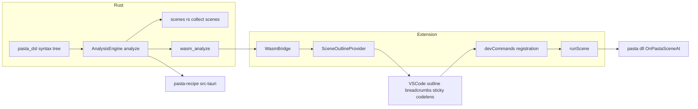
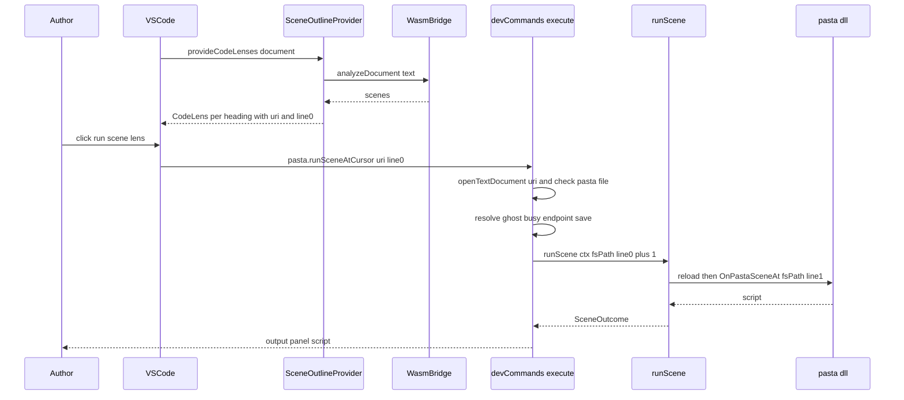

# Design Document: vscode-scene-outline-play

## Overview

**Purpose**: ゴーストの作者が `.pasta` のシーンを、見出しの行の上の「▶ シーンを実行」を 1 回押すだけで再生できるようにし、長い辞書の中のシーンの並び（グローバルシーン ＞ ローカルシーン）を VSCode の標準の場所（アウトライン・パンくず・`Ctrl+Shift+O`・スティッキースクロール）に見せる。

**Users**: VSCode でゴーストの辞書を書く作者。シーンを 1 つずつ鳴らして確かめる作業と、長い辞書の中の行き来に使う。`pasta-recipe`（0.5.3）は、解析器を直接呼んで同じシーンの並びを使う。

**Impact**: 解析器 `pasta_lsp` の解析の結果 `AnalysisResult` に欄 `scenes` を足す。拡張に DocumentSymbol と CodeLens のプロバイダを 1 つのクラスで足す。既存のコマンド `pasta.runSceneAtCursor` が、文書と行の引数を受けられるようにする。pasta.dll（`OnPastaSceneAt`）と再生の流れ（`runScene`）は変えない。

### Goals
- 解析器が、構文木（全体の解析か部分解析）から、文法のとおりのシーンの並びを 1 か所で作る（1.x）。
- 拡張が並びを写すだけで、アウトライン系の 4 つの場所と、見出しの上の「▶ シーンを実行」を出す（2.x・3.x）。
- 見出しの上の「▶ シーンを実行」が、右クリックと同じ流れで、押した見出しの行のシーンを鳴らす（3.3〜3.5・4.2）。
- 引数の無い呼び出し（右クリック・コマンドパレット）の振る舞いを変えない（4.1・4.6）。

### Non-Goals
- pasta.dll の側（`OnPastaSceneAt` の行の解釈・`scene_join.rs` の表）の変更。
- 「▶ シーンを実行」を消す拡張の独自の設定・`onDidChangeCodeLenses` による自前の更新・自前の待ち時間。
- アクター辞書・単語定義・コードブロック・属性をアウトラインに出すこと。
- 定義へ移動・参照の検索・折りたたみ（並びは将来使えるが、この spec では作らない）。
- 解析器が読めないときに、拡張が代わりに見出しを拾うこと。
- 指定の行の確かめ（pasta.dll に任せる）と、押した時点でまだ見出しの行かを確かめ直すこと。

## Boundary Commitments

### This Spec Owns
- **シーンの並びの取り出し**（`pasta_lsp`）: 構文木から `SceneNode` の木を作る規則（項目にするもの・しないもの・名前・種類・見出しの位置・範囲の式）と、その公開の型（`pub`・`serde::Serialize`）。並びの JSON の形（`{"name","kind","heading","range","children"}`）。
- **`AnalysisResult.scenes` の欄**: `AnalysisEngine::analyze` の結果に並びを入れること。`wasm_analyze` はそのまま渡す。
- **並びを VSCode の形へ写すこと**（拡張）: DocumentSymbol（名前・SymbolKind・range・selectionRange・子）と CodeLens（題・コマンド・引数）。
- **`pasta.runSceneAtCursor` の引数の受け取り**: `devCommands.ts` で `(uri, line)` を受け、対象の文書と 1 始まりの行を決めること。
- **マニュアルの節**: `book/src/debug/dev-actions.md` の「シーン再生（▶ シーンを実行）」の書き足し。

### Out of Boundary
- 行からシーンを引く規則（pasta.dll の `OnPastaSceneAt`・`pasta_lua/src/debug/source_map/scene_join.rs`）。この spec は読むだけで、同じ式を写す。
- 再生の流れの中身（`runSceneAtCursor.ts` の `runScene(ctx, fsPath, line1)`・`reloadShiori.ts`・出力のパネルの書式）。形も中身も変えない。
- 既存のセマンティックトークン・診断の中身と形、`DocumentSync`・`SemanticTokensProvider` の責務。
- `editors/vscode/package.json`（コマンドの題・メニュー・試験のスクリプト）。`vsce-4-upgrade` と共有するので触らない。
- `book/src/lua/shiori-events.md` の `OnPastaSceneAt` の節（規則が変わらない）。
- `pasta-recipe` の側の表示（並びを使う側）。

### Allowed Dependencies
- `pasta_lsp` → `pasta_dsl`（`parse_str`・`parse_str_partial`・`GlobalSceneScope`・`LocalSceneScope`・`Span`）・`serde`。新しい crate は足さない。
- `pasta_lsp` の中: `scenes.rs` → `mod.rs` の `Range`・`Position`、`text_utils::get_line_text`、`token_types::{utf8_len_to_utf16, utf8_offset_to_utf16}`。`visit_*` の着色の訪問とは互いに呼ばない。
- 拡張: `sceneOutline.ts` → `vscode`・`wasmBridge.ts`（型と `analyzeDocument`）。`devCommands.ts` を import しない（コマンドは id と題の文字で呼ぶ）。
- `devCommands.ts` → `runSceneAtCursor.ts` の `runScene` を今の形のまま呼ぶ。
- 依存の向き: `pasta_dsl` → `pasta_lsp`（analysis → transport）→ WASM → `wasmBridge.ts` → `sceneOutline.ts` → `extension.ts`。コマンドの道は `extension.ts` → `devCommands.ts` → `runSceneAtCursor.ts`。逆向きの import は誤り。

### Revalidation Triggers
- `SceneNode` の欄の名前・型・意味（範囲の式・見出しの列）を変える → 拡張の `SceneNode`（wasmBridge.ts）と `pasta-recipe` を確かめ直す。
- pasta.dll の行からシーンを引く規則（`scene_join.rs` の終わりの行の式・`OnPastaSceneAt` の Reference1）が変わる → 範囲の式と CodeLens の引数を確かめ直す。
- `pasta.runSceneAtCursor` の引数の形・行の数え方を変える → CodeLens と、再生の流れを `editors/shared/` へ移す `pasta-recipe-dev-actions` を確かめ直す。
- `AnalysisEngine::analyze` の公開の形（`pub`・戻りの型）を変える → `pasta-recipe` の `src-tauri` を確かめ直す。
- `pasta_dsl` の構文木のシーンの形（`is_continuation`・`name: Option`・部分解析の塊の切り方）が変わる → 1.4・1.5・1.11 の試験を確かめ直す。

## Architecture

### Existing Architecture Analysis
- 解析器は、文書を 1 回だけ解き（全体の解析が誤りなら部分解析）、同じ構文木から着色のトークンを作り、構文の誤りを診断にする。結果は `AnalysisResult` 1 つで、WASM の `wasm_analyze` がそのまま JS の値にする。位置は 0 始まりの行・UTF-16 の列（`Position`・`Range`）。
- 拡張は、WASM が読めたときだけ解析器を使うもの（着色・同期・ゴーストの検査）を `extension.ts` の `if (activationState.wasmReady && wasmBridge)` の中で作る。3 つの開発コマンドは WASM より前に登録し、WASM なしでも働く。
- 開発コマンドは「vscode に触らない部品（`runSceneAtCursor.ts` など）＋ vscode の糊（`devCommands.ts`）」に分かれている。この spec は糊の側だけを広げる。

### Architecture Pattern & Boundary Map



**Architecture Integration**:
- **Selected pattern**: 既存の「解析器が 1 回解いて結果に詰める → 拡張は写すだけ」を広げる。並びは Rust の 1 か所だけで作る（文法を TS に二重に持たない）。
- **Boundaries**: 並びの意味（何が項目か・範囲）は `scenes.rs` だけが決める。VSCode の形への写しは `sceneOutline.ts` だけ。引数の受け取りは `devCommands.ts` だけ。再生は `runScene` だけ。
- **Existing patterns preserved**: `AnalysisResult` の直列化した形がそのまま JS へ渡る／WASM が読めないときは解析器を使う機能を作らない／失敗した解析は `null`・空で返して通知しない（`SemanticTokensProvider` の作り）／開発コマンドの「部品＋糊」。
- **New components rationale**: `scenes.rs`（着色の訪問と別の責務を `mod.rs` に混ぜない）、`sceneOutline.ts`（2 つのプロバイダは写す元が同じなので 1 クラス）。
- **Steering compliance**: `pasta_lsp` は WASM でも動くファイルシステム非依存の解析器のまま（tech.md）。新しい依存なし。WASM のビルドの手順は変わらない。

### Technology Stack

| Layer | Choice / Version | Role in Feature | Notes |
|-------|------------------|-----------------|-------|
| 解析器 | Rust（edition は既存）・`pasta_dsl`・`serde 1` | 構文木からシーンの並びを作り、結果に入れる | 新しい依存なし |
| WASM の入口 | `wasm-bindgen`・`serde-wasm-bindgen`（既存） | `wasm_analyze` が `scenes` ごと JS の値にする | 入口のコードは変えない |
| 拡張 | TypeScript・VSCode API（`engines.vscode ^1.85.0`） | `DocumentSymbolProvider`・`CodeLensProvider`・コマンドの引数 | どちらの API も 1.85 より前からある。`package.json` は変えない |
| 試験 | `cargo test`（`crates/pasta_lsp/tests`）・esbuild＋node の既存の試験（`vscodeModules.test.ts`・`devCommands.e2e.test.ts`） | 並び・写し・コマンドの引数 | 試験のスクリプトは変えない |

## File Structure Plan

### Directory Structure
```
crates/pasta_lsp/
├── src/analysis/
│   └── scenes.rs              # 新規: SceneNode・SceneKind と、構文木から並びを作る純粋な関数
└── tests/
    └── scene_outline_test.rs  # 新規: 並びの取り出しの試験（1.x）
editors/vscode/src/
└── sceneOutline.ts            # 新規: SceneOutlineProvider（DocumentSymbol と CodeLens の写し・1 枠の控え）
```

### Modified Files
- `crates/pasta_lsp/src/analysis/mod.rs` — `mod scenes;`・`pub use scenes::{SceneKind, SceneNode};`。`AnalysisResult` に `pub scenes: Vec<SceneNode>` を足す（`tokens`・`diagnostics` の後ろ）。`analyze` の 2 つの分かれ（全体の解析・部分解析）で、着色に渡すのと同じ `items` から `scenes::collect_scenes(items, source)` を呼ぶ。
- `crates/pasta_lsp/src/transport.rs` — `test_analysis_result_json_shape_stable` の期待に `scenes` を足す（子を 1 つ持つグローバルを 1 つ入れて、欄の名前・順・`kind` の綴りを固定する）。`wasm_analyze` 本体は変えない。
- `crates/pasta_lsp/src/lib.rs` — 先頭の説明に「シーンの並び」を 1 行足す。
- `editors/vscode/src/wasmBridge.ts` — `SceneNode` 型と `WasmAnalysisResult.scenes` を足し、`isWasmAnalysisResult` に `Array.isArray(scenes)` を足す。
- `editors/vscode/src/extension.ts` — `wasmReady` の中で `SceneOutlineProvider` を作り、`registerDocumentSymbolProvider` と `registerCodeLensProvider`（どちらも `{ language: 'pasta' }`）で登録する。
- `editors/vscode/src/devCommands.ts` — 登録を `(...args: unknown[]) => execute(cmd, args)` にし、`execute` が引数から対象（文書と 1 始まりの行）を決める。`Command.run` の第 2 引数を `editor` から対象へ変える。
- `editors/vscode/src/test/mock/vscode.ts` — `SymbolKind`・`DocumentSymbol`・`CodeLens`・`languages.registerDocumentSymbolProvider`・`languages.registerCodeLensProvider`・`workspace.openTextDocument` を足す。
- `editors/vscode/src/test/vscodeModules.test.ts` — `SceneOutlineProvider` の試験・`isWasmAnalysisResult` の期待（`scenes`）・`activate` が 2 つのプロバイダを登録すること。
- `editors/vscode/src/test/devCommands.e2e.test.ts` — 引数付きの呼び出し・右クリックの形（`Uri` だけ）の呼び出しの試験。
- `book/src/debug/dev-actions.md` — 「シーン再生（▶ シーンを実行）」の節の書き足し（見出しは変えない）。
- `editors/vscode/README.md` — 「開発支援コマンド」の行に「シーンの見出しの上の ▶ からも再生できる」を足し、「アウトライン・パンくず・スティッキースクロールにシーンの並び（グローバルシーン ＞ ローカルシーン）」の行を足す（README はマーケットプレイスの機能の一覧で、右クリックだけを書いたままだと古くなる）

> 並べて進められる塊: ① 解析器（`scenes.rs`・`mod.rs`・`transport.rs`・`lib.rs`・`scene_outline_test.rs`）／② 写し（`wasmBridge.ts`・`sceneOutline.ts`・`extension.ts`）／③ コマンド（`devCommands.ts`）／④ マニュアル。②は①の JSON の形（下の API Contract）だけに依存し、①の完成を待たずに偽の bridge で試験できる（本物の WASM での結合の試験だけは①の後）。`mock/vscode.ts` は②と③の両方が足すので、同じファイルを触るタスクは順に行う。

## System Flows

### 見出しの上の「▶ シーンを実行」を押したとき



- 引数あり・なしの分かれは `execute` の入口だけ。その後（ゴースト・重なりの止め・相手・保存・`run`）は右クリックと同じ道を通る（3.3・3.9）。
- 引数の見分け: `args[0] instanceof vscode.Uri && typeof args[1] === 'number'` のときだけ引数あり。右クリック（VSCode は `editor/context` のコマンドに文書の `Uri` だけを渡す）とコマンドパレット（引数なし）は、今までどおりアクティブなエディタとカーソルの行（4.1）。
- 押した時点で行がまだ見出しかは確かめない。VSCode が書き換えのたびに CodeLens を問い合わせ直す（3.6）。

## Requirements Traceability

| Requirement | Summary | Components | Interfaces | Flows |
|-------------|---------|------------|------------|-------|
| 1.1 | 結果に並びを文書の順で含める | SceneCollector・AnalysisEngine | `AnalysisResult.scenes` | — |
| 1.2 | 名前・種類・見出し・範囲・子 | SceneCollector | `SceneNode` | — |
| 1.3 | 全角・半角の印 | SceneCollector（構文木が吸収） | `collect_scenes` | — |
| 1.4 | 続きのシーンを別の項目に・名前を受け継ぐ | SceneCollector | `SceneNode.name` | — |
| 1.5 | 名前の無い最初のローカル部分を項目にしない | SceneCollector | `collect_scenes` | — |
| 1.6 | コードブロックの中・コメントを見出しにしない | SceneCollector（構文木が吸収） | `collect_scenes` | — |
| 1.7 | 範囲の式 | SceneCollector | `SceneNode.range` | 範囲の式 |
| 1.8 | 子は親の範囲の中 | SceneCollector | `SceneNode.range` | 範囲の式 |
| 1.9 | 0 始まりの行・UTF-16 の列 | SceneCollector | `Range`・`Position` | — |
| 1.10 | シーンが無ければ空 | SceneCollector | `scenes: []` | — |
| 1.11 | 書きかけの文書は解ける部分だけ | AnalysisEngine・SceneCollector | 部分解析の `items` | — |
| 1.12 | トークン・診断を変えない | AnalysisEngine | 既存の欄 | — |
| 1.13 | 拡張と `pasta-recipe` に同じ並び | AnalysisEngine・transport | `pub fn analyze`・`wasm_analyze` | — |
| 2.1 | アウトラインに 2 階層 | SceneOutlineProvider | `provideDocumentSymbols` | — |
| 2.2 | パンくず・`Ctrl+Shift+O`・スティッキースクロール | SceneOutlineProvider（VSCode が DocumentSymbol から作る） | `provideDocumentSymbols` | — |
| 2.3 | 項目の名前 | SceneOutlineProvider | `DocumentSymbol.name` | — |
| 2.4 | 同じ名前は別の項目 | SceneCollector・SceneOutlineProvider | 木の項目 1 つ＝見出し 1 つ | — |
| 2.5 | 選ぶと見出しの行へ | SceneOutlineProvider | `selectionRange = heading` | — |
| 2.6 | カーソルのあるシーンを出す | SceneOutlineProvider | `range`（子は親の中） | — |
| 2.7 | 書き換えに合わせる | SceneOutlineProvider | 版ごとの解析（VSCode が問い合わせ直す） | — |
| 2.8 | シーンのほかを出さない | SceneCollector | `collect_scenes` | — |
| 3.1 | すべての見出しの上に ▶ | SceneOutlineProvider | `provideCodeLenses` | クリックの流れ |
| 3.2 | 名前の無い最初の部分には出さない | SceneCollector | 並びに無い | — |
| 3.3 | 右クリックと同じ流れ | DevCommands | `execute` | クリックの流れ |
| 3.4 | Reference1 は押した見出しの行 | SceneOutlineProvider・DevCommands | 引数 `(uri, line0)` → `line0 + 1` | クリックの流れ |
| 3.5 | 押したシーンだけを鳴らす | SceneOutlineProvider・pasta.dll（既存の試験） | 見出しの行 | クリックの流れ |
| 3.6 | 書き換えに合わせて出し直す | SceneOutlineProvider | `onDidChangeCodeLenses` を持たない（VSCode が問い合わせ直す） | — |
| 3.7 | 独自の設定を持たない | SceneOutlineProvider | — | — |
| 3.8 | `"[pasta]": { "editor.codeLens": false }` で出さない | VSCode の標準の設定 | — | — |
| 3.9 | 進んでいれば重ねない | DevCommands | `busy` | クリックの流れ |
| 4.1 | 右クリック・パレットはカーソルの行 | DevCommands | 引数の見分け | — |
| 4.2 | 指定の文書と行で鳴らす | DevCommands | `resolveTarget` | クリックの流れ |
| 4.3 | ゴーストは指定の文書から | DevCommands | `resolveGhost(doc.uri.fsPath, …)` | — |
| 4.4 | ディスクの `.pasta` でなければ止める | DevCommands | `BAD_DOCUMENT` | — |
| 4.5 | 新しいコマンドを足さない | SceneOutlineProvider | `pasta.runSceneAtCursor` を呼ぶ | — |
| 4.6 | 題・メニュー・分類を変えない | （`package.json` を触らない） | `contributions.test.ts` | — |
| 5.1 | 解析器が無ければ出さない | Extension activation | `wasmReady` の中で登録 | — |
| 5.2 | 解析器が無くても右クリックは働く | Extension activation・DevCommands | WASM より前に登録（既存） | — |
| 5.3 | 解析に失敗した文書は出さず通知しない | SceneOutlineProvider | `catch` → `[]` | — |
| 6.1〜6.5 | マニュアル | Manual | `dev-actions.md` | — |

## Components and Interfaces

| Component | Domain/Layer | Intent | Req Coverage | Key Dependencies (P0/P1) | Contracts |
|-----------|--------------|--------|--------------|--------------------------|-----------|
| SceneCollector（`scenes.rs`） | 解析器 | 構文木からシーンの木を作る | 1.1〜1.11, 2.4, 2.8, 3.2 | pasta_dsl 構文木（P0）・text_utils（P0） | Service |
| AnalysisEngine（`mod.rs`・`transport.rs`） | 解析器 | 結果に `scenes` を入れ、外へ渡す | 1.1, 1.11〜1.13 | SceneCollector（P0） | Service・API |
| WasmBridge（`wasmBridge.ts`） | 拡張 | `scenes` の型と形の確かめ | 1.13, 5.3 | WASM（P0） | Service |
| SceneOutlineProvider（`sceneOutline.ts`） | 拡張 | 並びを DocumentSymbol・CodeLens に写す | 2.1〜2.7, 3.1, 3.5〜3.7, 4.5, 5.3 | WasmBridge（P0） | Service |
| Extension activation（`extension.ts`） | 拡張 | WASM が読めたときだけ登録 | 5.1, 5.2 | SceneOutlineProvider（P0） | — |
| DevCommands（`devCommands.ts`） | 拡張 | コマンドの引数から対象を決めて既存の流れへ | 3.3, 3.4, 3.9, 4.1〜4.4, 4.6 | runScene（P0）・vscode.workspace（P0） | Service |
| Manual（`dev-actions.md`） | 文書 | 使い方と消し方 | 6.1〜6.5 | verify-content.mjs（P1） | — |

### 解析器

#### SceneCollector（`crates/pasta_lsp/src/analysis/scenes.rs`）

| Field | Detail |
|-------|--------|
| Intent | 構文木（`&[FileItem]`）と文書の文字から、シーンの木を文書の順に作る |
| Requirements | 1.1, 1.2, 1.3, 1.4, 1.5, 1.6, 1.7, 1.8, 1.9, 1.10, 1.11, 2.4, 2.8, 3.2 |

**Responsibilities & Constraints**
- `FileItem::GlobalSceneScope` だけを見る。`FileAttr`・`GlobalWord`・`ActorScope` は項目にせず、範囲も切らない（pasta.dll もシーンだけを記録する。2.8）。
- グローバルシーン 1 つ（続きのシーンを含む）＝項目 1 つ。名前は `GlobalSceneScope.name`（続きは構文木が受け継いだ名前を持つ。1.4）。
- 子は `local_scenes` のうち `name` が `Some` のものだけ（`None` は名前の無い最初の部分。1.5・3.2）。
- `span.is_valid()` でない（作り物の位置の）シーンは、その子ごと項目にしない。
- 印の全角・半角、コードブロックの中の `＊`・`・`、コメントの行は、構文木の段階で吸収されている（1.3・1.6）。部分解析で解けなかった塊のシーンは構文木に無いので、項目にならない（1.11）。
- 位置（1.9）:
  - `heading`: 見出しの行（`span.start_line - 1`）の、最初の空白でない文字から行の終わり（`\r`・`\n` を除く）まで。列は UTF-16。
  - `range.start`: （見出しの行, 0）。
  - `range.end`: 範囲の最後の行の終わり（その行の UTF-16 の長さ。`\r` を数えない）。
- 範囲の式（1.7・1.8。pasta.dll の `scene_join.rs` の「次の同レベル以上宣言の開始行 − 1、無ければファイル末尾」と同じ）:
  - グローバルシーン: 最後の行＝次のグローバルシーンの見出しの行 − 1。無ければ文書の最後の行。
  - ローカルシーン: 最後の行＝同じ親の次のローカルシーンの見出しの行 − 1。無ければ親の最後の行。
  - 文書の最後の行＝`\n` の数（0 始まり）。文書が改行で終わるときは、最後の改行の後ろの空の行になる（終わりは（その行, 0））。
  - 「次の見出し」は並びに出た見出しだけで決める（1.11）。
  - ローカルシーンの最後の行は親の最後の行を越えない（式から自明。試験で不変条件として確かめる。1.8）。
- 純粋な関数。状態を持たない。panic しない（範囲の計算は `saturating_sub` の類で守る）。

**Dependencies**
- Inbound: AnalysisEngine — 解析の 2 つの分かれから呼ぶ（P0）
- Outbound: `text_utils::get_line_text`・`token_types::{utf8_len_to_utf16, utf8_offset_to_utf16}`（P0）
- External: `pasta_dsl::parser::ast::{FileItem, GlobalSceneScope, LocalSceneScope}`（P0）

**Contracts**: Service [x] / API [ ] / Event [ ] / Batch [ ] / State [ ]

##### Service Interface
```rust
/// シーンの並びの 1 項目（エディタの種類に寄らない素の木）
#[derive(Debug, Clone, PartialEq, Eq, serde::Serialize)]
pub struct SceneNode {
    /// シーンの名前（続きのグローバルシーンは受け継いだ名前）
    pub name: String,
    pub kind: SceneKind,
    /// 見出しの行（印から行の終わりまで・1 行）
    pub heading: Range,
    /// シーン全体（見出しの行の頭から、範囲の最後の行の終わりまで）
    pub range: Range,
    /// ローカルシーン（グローバルシーンだけが持つ。ローカルシーンは常に空）
    pub children: Vec<SceneNode>,
}

#[derive(Debug, Clone, Copy, PartialEq, Eq, serde::Serialize)]
#[serde(rename_all = "lowercase")]
pub enum SceneKind { Global, Local }

/// 構文木の項目から、シーンの並びを文書の順に作る
pub(super) fn collect_scenes(items: &[pasta_dsl::parser::ast::FileItem], source: &str) -> Vec<SceneNode>;
```
- Preconditions: `items` は `source` を解いた（全体か部分の）構文木。span は `source` の座標（部分解析は `parse_str_partial` が補正済み）。
- Postconditions: 戻りはグローバルシーンの項目の並び（見出しの行の昇順）。各項目の `children` も見出しの行の昇順。`heading.start.line == range.start.line`。`heading` は `range` に含まれる。子の `range` は親の `range` に含まれる。名前は空でない。
- Invariants: 同じ入力に同じ出力。

#### AnalysisEngine（`mod.rs`・`transport.rs`）

| Field | Detail |
|-------|--------|
| Intent | 解析の結果に `scenes` を入れ、拡張（WASM）と `pasta-recipe`（Rust の直接の呼び出し）に同じものを渡す |
| Requirements | 1.1, 1.11, 1.12, 1.13 |

**Responsibilities & Constraints**
- `AnalysisResult` に `pub scenes: Vec<SceneNode>` を足す。欄の順は `tokens`・`diagnostics`・`scenes`。`#[derive(Default)]` はそのまま（`scenes` は空）。
- `analyze` の 2 つの分かれで、着色の訪問に渡すのと同じ `items` を `collect_scenes` へ渡す。構文木は 1 回だけ作る（解析の回数を増やさない）。
- トークン・診断の計算は変えない（1.12）。
- `AnalysisEngine::analyze`・`AnalysisResult`・`SceneNode`・`SceneKind`・`Range`・`Position` は `pub`（`pasta_lsp::analysis` から使える）。`pasta-recipe` は `serde_json` などでそのまま JSON にできる（1.13）。
- `wasm_analyze` は変えない。`serde_wasm_bindgen::to_value` が `scenes` を JS の配列・物・文字列にする。`Option` の欄は無いので `undefined` は出ない。

**Contracts**: Service [x] / API [x] / Event [ ] / Batch [ ] / State [ ]

##### API Contract（`wasm_analyze` の戻り・`AnalysisResult` の JSON）
```json
{
  "tokens": [ … 既存のまま … ],
  "diagnostics": [ … 既存のまま … ],
  "scenes": [
    {
      "name": "挨拶",
      "kind": "global",
      "heading": { "start": { "line": 0, "character": 0 }, "end": { "line": 0, "character": 3 } },
      "range":   { "start": { "line": 0, "character": 0 }, "end": { "line": 3, "character": 12 } },
      "children": [
        {
          "name": "朝",
          "kind": "local",
          "heading": { "start": { "line": 2, "character": 2 }, "end": { "line": 2, "character": 4 } },
          "range":   { "start": { "line": 2, "character": 0 }, "end": { "line": 3, "character": 12 } },
          "children": []
        }
      ]
    },
    {
      "name": "挨拶",
      "kind": "global",
      "heading": { "start": { "line": 4, "character": 0 }, "end": { "line": 4, "character": 1 } },
      "range":   { "start": { "line": 4, "character": 0 }, "end": { "line": 6, "character": 0 } },
      "children": []
    }
  ]
}
```
上の例は、要件の例の文書（`＊挨拶`・`  さくら：やあ`・`  ・朝`・`    さくら：おはよう`・`＊`・`  さくら：またね`、最後に改行）のもの。続きのシーン（4 行目）は 2 つ目の「挨拶」になり、最後のシーンは文書の終わり（改行の後ろの空の行 6 の頭）まで続く。

**Implementation Notes**
- Integration: `transport.rs` の `test_analysis_result_json_shape_stable` の期待の文字列に `scenes` を足す（欄の名前・順・`"global"`・`"local"` の綴りを固定する）。
- Validation: 既存の `crates/pasta_lsp/tests/*_test.rs` 16 本は変えずに通る（1.12）。
- Risks: 欄を足す変更と形の試験の直しを同じタスクに入れる。

### 拡張

#### WasmBridge（`editors/vscode/src/wasmBridge.ts`）

| Field | Detail |
|-------|--------|
| Intent | `scenes` の型と、WASM の境での形の確かめ |
| Requirements | 1.13, 5.3 |

**Contracts**: Service [x]

##### Service Interface
```typescript
/** シーンの並びの 1 項目（pasta_lsp の SceneNode と同じ形） */
export interface SceneNode {
  name: string;
  kind: 'global' | 'local';
  heading: DiagnosticData['range'];
  range: DiagnosticData['range'];
  children: ReadonlyArray<SceneNode>;
}

export interface WasmAnalysisResult {
  tokens: ReadonlyArray<SemanticTokenData>;
  diagnostics: ReadonlyArray<DiagnosticData>;
  scenes: ReadonlyArray<SceneNode>;
}
```
- `isWasmAnalysisResult` は `tokens`・`diagnostics`・`scenes` の 3 つが配列であることを確かめる（中身の 1 つずつは確かめない。今の浅さと同じ）。外れたら既存の `WASM analysis failed` の例外になる。
- WASM と拡張の JS は同じコミットから 1 つの VSIX に入るので、`scenes` の無い WASM は作り間違いの時だけ起きる。そのときは着色も TextMate に落ちる（既存の失敗の道）。

#### SceneOutlineProvider（`editors/vscode/src/sceneOutline.ts`）

| Field | Detail |
|-------|--------|
| Intent | 解析の結果の `scenes` を、DocumentSymbol と CodeLens に写す |
| Requirements | 2.1, 2.2, 2.3, 2.4, 2.5, 2.6, 2.7, 3.1, 3.5, 3.6, 3.7, 4.5, 5.3 |

**Responsibilities & Constraints**
- 1 つのクラスが `vscode.DocumentSymbolProvider` と `vscode.CodeLensProvider` の両方を実装する。並びの意味（何が項目か・範囲）は解析器に任せ、ここでは写すだけ。
- DocumentSymbol: `name = scene.name`、`detail = ''`、`kind = global → SymbolKind.Namespace / local → SymbolKind.Function`（アイコンだけの違いで、再生には効かない。グローバルは着色の `namespace` に揃える。設計ディスカッションで確定）、`range = scene.range`、`selectionRange = scene.heading`、`children` は子を同じく写す（2.1〜2.6）。パンくず・`Ctrl+Shift+O`・スティッキースクロール（既定の `editor.stickyScroll.defaultModel = "outlineModel"`）は VSCode がここから作る（2.2）。
- CodeLens: グローバルシーンとその子を文書の順に並べ、1 つの項目につき 1 つ。`range = scene.heading`（1 行）、`command = { title: '▶ シーンを実行', command: 'pasta.runSceneAtCursor', arguments: [document.uri, scene.heading.start.line] }`（3.1・3.4・4.5）。`resolveCodeLens` と `onDidChangeCodeLenses` は持たない（3.6・3.7。VSCode が書き換えのたびに問い合わせ直す）。CodeLens を消すのは VSCode の言語ごとの `editor.codeLens`（3.8。拡張のコードは要らない）。
- 解析: `wasmBridge.analyzeDocument(document.getText())`。失敗（例外）なら `[]` を返し、通知も記録も出さない（5.3。`SemanticTokensProvider` と同じ扱い）。
- 控え: 最後に解いた 1 つの文書（uri の文字・版・並び）だけを覚え、同じ uri・同じ版の問い合わせ（DocumentSymbol と CodeLens）では解き直さない。版が変われば解き直す（2.7・3.6）。`// shortcut: 1 枠の控え。DocumentSync・SemanticTokensProvider と解析を共有しない。大きな辞書で遅さが見えたら控えを結果ごとに共有する` の注記を置く。
- 題 `'▶ シーンを実行'` とコマンド id は `package.json` の `contributes.commands` と同じ文字。試験で `package.json` と照らす。

**Dependencies**
- Inbound: Extension activation — 登録（P0）
- Outbound: WasmBridge — `analyzeDocument`（P0）
- External: VSCode API — `DocumentSymbol`・`CodeLens`・`SymbolKind`・`Range`・`Position`（P0）

**Contracts**: Service [x]

##### Service Interface
```typescript
export class SceneOutlineProvider implements vscode.DocumentSymbolProvider, vscode.CodeLensProvider {
  constructor(bridge: Pick<WasmBridge, 'analyzeDocument'>);
  provideDocumentSymbols(document: vscode.TextDocument, token: vscode.CancellationToken): vscode.DocumentSymbol[];
  provideCodeLenses(document: vscode.TextDocument, token: vscode.CancellationToken): vscode.CodeLens[];
}
```
- Preconditions: WASM が読めたときだけ作る（Extension activation が守る）。
- Postconditions: DocumentSymbol の木は `scenes` と同じ形・同じ順。CodeLens の数は見出しの数と同じ。解析に失敗した文書では両方とも空。
- Invariants: 例外を外へ出さない。通知を出さない。

#### Extension activation（`editors/vscode/src/extension.ts`）
- 要約のみ。`if (activationState.wasmReady && wasmBridge)` の中で `new SceneOutlineProvider(wasmBridge)` を作り、`vscode.languages.registerDocumentSymbolProvider({ language: 'pasta' }, p)` と `vscode.languages.registerCodeLensProvider({ language: 'pasta' }, p)` を `context.subscriptions` に入れる（5.1）。`registerDevCommands(context)` は今までどおり WASM より前（5.2）。

#### DevCommands（`editors/vscode/src/devCommands.ts`）

| Field | Detail |
|-------|--------|
| Intent | `pasta.runSceneAtCursor` が文書と行の引数を受けたら、その文書のその行で、既存の流れのまま再生する |
| Requirements | 3.3, 3.4, 3.9, 4.1, 4.2, 4.3, 4.4, 4.6 |

**Responsibilities & Constraints**
- 登録を `vscode.commands.registerCommand(cmd.id, (...args: unknown[]) => execute(cmd, args))` にする（3 つのコマンドとも同じ）。
- `execute(cmd, args)` の入口で対象を決める:
  - `args[0] instanceof vscode.Uri && typeof args[1] === 'number'` → `vscode.workspace.openTextDocument(args[0])`（開いていればその文書。開けなければ対象なし）、行は `args[1] + 1`（4.2）。
  - それ以外（引数なし・右クリックの `Uri` だけ・ほかの形）→ `vscode.window.activeTextEditor` の文書と `selection.active.line + 1`（4.1。今の振る舞い）。
- 対象の文書に今の確かめ（`scheme === 'file'`・`!isUntitled`・`cmd.accepts`）をそのままかける。外れたら、または対象なしなら、今と同じ `BAD_DOCUMENT` で止め、何も送らない（4.4）。
- ゴーストは対象の文書から決める（`resolveGhost(doc.uri.fsPath, findGhostMaster(doc.uri)?.fsPath)`。4.3）。重なりの止め（`busy`）・相手の選び方・保存・出力・通知は今のまま（3.3・3.9）。
- `Command.run` の形を `(ctx: FlowContext, target: Target) => Promise<Report>` にする。`pasta.runSceneAtCursor` は `runScene(ctx, target.document.uri.fsPath, target.line1)` を呼ぶ（`runScene` の形は変えない）。ほかの 2 つは `target` を使わない。
- 行の数の確かめ（整数か・1 以上か）は持たない。pasta.dll が `【数にできない値：…】` で知らせる（要件の決定）。
- コマンドの id・題・メニュー・分類は変えない（`package.json` を触らない。4.6）。

**Contracts**: Service [x]

##### Service Interface
```typescript
/** コマンドの対象（文書と、1 から数えた行） */
interface Target {
  readonly document: vscode.TextDocument;
  readonly line1: number;
}

interface Command {
  readonly id: string;
  readonly title: string;
  readonly accepts: (doc: vscode.TextDocument) => boolean;
  readonly saves: boolean;
  readonly run: (ctx: FlowContext, target: Target) => Promise<Report>;
}

/** 引数から対象を決める。(Uri, number) なら指定の文書と行、それ以外はアクティブなエディタとカーソル */
async function resolveTarget(args: readonly unknown[]): Promise<Target | undefined>;
```
- コマンドの引数の契約（呼び手向け）: `executeCommand('pasta.runSceneAtCursor', uri: vscode.Uri, line: number)`。`line` は 0 から数えた行（VSCode・解析器の座標）。引数なし・`uri` だけは、カーソルの行で再生する。
- `resolveTarget` の `await` は `busy` の確かめより前にあるので、「確かめと足し込みの間に `await` を挟まない」今の決まりは崩れない。

**Implementation Notes**
- Integration: `pasta-recipe-dev-actions` が再生の流れを `editors/shared/` へ移すときも、引数の受け取り（`resolveTarget`）は VSCode の糊の側に残る。
- Validation: e2e で、引数付き（別の文書・カーソルと違う行）・`Uri` だけ・名前の無い文書・`.pasta` でない文書・開けない `Uri`・進んでいる最中の 2 本目を確かめる。
- Risks: 右クリックの取り違え（下の Error Handling）。

### 文書

#### Manual（`book/src/debug/dev-actions.md`）
- 要約のみ。「## シーン再生（▶ シーンを実行）」の見出しを変えずに（6.5）、次を書き足す:
  - 見出しの行の上の「▶ シーンを実行」を押すと、その見出しのシーンを、右クリックと同じ流れ（保存・読み込み直し・`OnPastaSceneAt`・台本）で再生する。Reference1 は押した見出しの行（6.1）。
  - 右クリック・コマンドパレットからは、今までどおりカーソルの行で再生する（6.2。手順 3 の「カーソルの行」を「カーソルの行（見出しの上の ▶ からは、その見出しの行）」とする）。
  - 見出しの上の ▶ を消す設定 `"[pasta]": { "editor.codeLens": false }`（`settings.json` の JSON のコードフェンス。フェンスの中に口調の印 `【` などを入れない。`verify-content.mjs` の G 節）（6.3）。
  - アウトライン・パンくず・`Ctrl+Shift+O`・スティッキースクロールに グローバルシーン ＞ ローカルシーン の 2 階層が出る。続きのシーン（`＊` だけの行）は同じ名前の別の項目になる（6.4）。
  - 解析器（WASM）が読めないときは、▶ とアウトラインは出ず、右クリックは使える（5.x の利用者向けの説明）。

## Data Models

### Domain Model
- **シーンの並び**（値。文書の版ごとに作り直す。持ち主は解析器）: グローバルシーンの項目の列。各項目は子としてローカルシーンの項目の列を持つ。深さは 2 まで。
- **見出しの行の番号**が、シーンを指す唯一の鍵。CodeLens から pasta.dll まで、名前などの識別の情報は渡さない（同じ名前のシーンが複数あっても、行で 1 つに決まる。2.4・3.5）。
- 不変条件: `heading ⊂ range`／子の `range ⊂` 親の `range`／兄弟の `range` は重ならず、見出しの行の昇順／名前は空でない。

### Data Contracts & Integration
- 直列化: serde。WASM は `serde_wasm_bindgen::to_value`、`pasta-recipe` は任意（`serde_json` を想定）。欄の名前は `name`・`kind`・`heading`・`range`・`children`、`kind` は `"global"`・`"local"`、位置は `{ line, character }`（0 始まり・UTF-16）。
- 後方互換: 欄を足すだけ。`tokens`・`diagnostics` は名前・順・中身とも変えない。

## Error Handling

### Error Strategy
| 場合 | 動き | 要件 |
|------|------|------|
| WASM が読めない | `SceneOutlineProvider` を作らない。アウトライン・▶ は出ない。右クリックは働く | 5.1, 5.2 |
| ある文書の解析が例外（wasm32 の trap・形の誤り） | その文書は DocumentSymbol・CodeLens とも `[]`。通知しない | 5.3 |
| 構文の誤りのある文書 | 部分解析の構文木から、解けた塊のシーンだけを出す（誤りのある文書は読み込み直しで止まり、再生まで進まない） | 1.11 |
| 引数の `Uri` を開けない・名前の無い文書・`.pasta` でない | `BAD_DOCUMENT` を出力と警告に出して止める。何も送らない | 4.4 |
| 同じゴーストへ進んでいる最中 | 今と同じ `BUSY` で止める | 3.9 |
| 数でない・範囲外の行 | 拡張は確かめず、そのまま送る。pasta.dll が `【数にできない値：…】` で知らせる | （要件の決定） |
| 右クリック（`Uri` だけ） | 引数なしと同じ。カーソルの行 | 4.1 |

### Monitoring
- 新しい記録は足さない。解析の失敗は、既存の `DocumentSync` が出力チャネル「Pasta Language」に書く（同じ文書を同期の側でも解くため）。

## Testing Strategy

### 解析器（`crates/pasta_lsp/tests/scene_outline_test.rs`）
- **2 階層と順と位置**: 要件の例の文書で、上の API Contract の JSON と同じ木（名前・種類・`heading`・`range`・子）になる（1.1・1.2・1.4・1.7・1.9）。
- **全角・半角**: `*挨拶`・`-朝` と `＊挨拶`・`・朝` が同じ木になる（1.3）。
- **項目にしないもの**: 名前の無い最初の部分だけのグローバルシーンは `children` が空（1.5）。コードブロックの中の `＊…`・`・…` の行・`＃＊…` のコメントの行は項目にならない（1.6）。アクター辞書・単語定義・ファイル属性だけの文書と空の文書は `[]`（1.10・2.8）。
- **範囲の式（pasta.dll と同じ）**: `crates/pasta_lua/tests/scene_identity_index_test.rs` の試験の文書をそのまま写し（写した元を注記に書く）、同じ終わりの行になることを確かめる。ローカルは次のローカルの前の行まで・最後のローカルは次のグローバルの前の行まで・続きのシーンは別の範囲・最後のシーンは文書の終わりまで（1.7）。シーンの後ろのアクター辞書の塊は、そのシーンの範囲に入る。改行で終わる／終わらない／CRLF の 3 通りで、終わりの位置が決まりどおり（1.9）。
- **不変条件**: 上のすべての文書で、`heading ⊂ range`・子の `range ⊂` 親の `range`・兄弟が重ならない（1.8）。
- **UTF-16**: 名前と字下げにサロゲートペア（`𠮷`）・全角の空白を含む見出しの列（1.9）。
- **書きかけ**: 3 つのシーンの真ん中に構文の誤りがある文書で、前後のシーンが出て、誤りのあるシーンが出ず、前のシーンの範囲は次に出たシーンの見出しの前の行まで（1.11）。
- **既存を変えない**: 既存の 16 本の試験が変更なしで通る（1.12）。`transport.rs` の形の試験に `scenes` を足す（1.13）。

### 拡張・モジュール（`editors/vscode/src/test/vscodeModules.test.ts`）
- **DocumentSymbol の写し**: 偽の bridge が返す並びから、名前・SymbolKind・`range`・`selectionRange`・子が写る。同じ名前の 2 つの項目が別々に出る（2.1・2.3・2.4・2.5）。
- **CodeLens の写し**: グローバル・続き・ローカルのすべての見出しに 1 つずつ。題が `package.json` の `pasta.runSceneAtCursor` の題と同じ。`arguments` が `[document.uri, heading.start.line]`（3.1・3.4・4.5）。
- **失敗**: `analyzeDocument` が例外 → 両方とも `[]`、`shownMessages` が増えない（5.3）。
- **控え**: 同じ版で DocumentSymbol と CodeLens を問うと解析は 1 回、版が変わると解き直す（2.7・3.6）。
- **WASM の形の確かめ**: `scenes` の無い結果は `WASM analysis failed`、`scenes: []` を含む結果は通る（既存の「正しい形」の試験の期待を直す）。
- **登録**: 本物の WASM で `activate` したとき、DocumentSymbol と CodeLens のプロバイダが `pasta` に登録され、要件の例の文書から 2 つのグローバルと 1 つのローカルの記号が出る（5.1 と、WASM を通した 1.13 の結合）。

### 拡張・コマンド（`editors/vscode/src/test/devCommands.e2e.test.ts`）
- **引数付き**: アクティブなエディタを別の文書・別の行にしたまま `executeCommand('pasta.runSceneAtCursor', uri, 2)` → 偽の MCP が受けた `OnPastaSceneAt` の references が `[その文書の fsPath, "3"]`、保存と読み込み直しが先に行われる（3.3・3.4・4.2・4.3）。
- **右クリックの形**: `executeCommand('pasta.runSceneAtCursor', uri)` → カーソルの行で鳴る（4.1）。引数なしは既存の試験が守る。
- **誤った文書**: 名前の無い文書・`.pasta` でない文書・開けない `Uri` → `BAD_DOCUMENT`、MCP へは何も送らない（4.4）。
- **重なり**: 1 本目が進んでいる間の引数付きの 2 本目は `BUSY`（3.9）。
- **ほかの 2 つのコマンド**: `Uri` を付けて呼んでも今までどおり（4.6 と回帰）。

### マニュアル
- `book` の検査（`verify-content.mjs`・`link-check.mjs`・mdbook build）が通る。`lua/shiori-events.md` から `dev-actions.md#シーン再生-シーンを実行` へのリンクが切れない（6.5）。

### 手での確かめ（自動化しない）
- 実際の VSCode で、▶ を押して鳴ること、アウトライン・パンくず・`Ctrl+Shift+O`・スティッキースクロールに 2 階層が出ること、`"[pasta]": { "editor.codeLens": false }` で ▶ が消えること（2.2・3.8）。mock では VSCode の描画を確かめられないため。この手順は tasks.md の確かめの欄にそのまま書き、飛ばさない。

## Performance & Scalability
- 1 回の編集で増える解析は 1 回（`SceneOutlineProvider` の 1 枠の控えで、DocumentSymbol と CodeLens が共有する）。解析は同期で、辞書の 1 ファイルは小さい。目標は測っていない。遅さが見えたら、控えを `SemanticTokensProvider` と共有する（コードの shortcut の注記）。
- 並びの計算は見出しの数に比例し、行の文字は見出しの行と各範囲の最後の行だけを読む。

## Open Questions / Risks
- **Risk**: 右クリックの `Uri` だけの呼び出しを引数ありと取り違えると、右クリックの再生が壊れる → 見分けを「第 2 引数が数か」にし、e2e で守る。
- **Risk**: 範囲の式が pasta.dll とずれる → 鳴るシーンは見出しの行だけで決まるので、ずれはアウトラインの見え方だけに出る。同じ形の文書で終わりの行を確かめる。
- **Known limit**: 部分解析は Lua ブロックの本文の 0 桁目の `＊` でも塊を切る（`pasta_dsl` の shortcut）。別の誤りのある文書でだけ、コードブロックの後ろのシーンが並びから消えうる。誤りのある文書は再生まで進まないので、害は見え方だけ。
- **Known limit**: 単独の `\r` の改行は数えない（トークン・診断と同じ）。
- **Known limit**: シーンの後ろのアクター辞書・単語定義の塊は、前のシーンの範囲に入る（パンくずにそのシーンが出る）。pasta.dll の行からシーンを引く表と同じなので、そのままにする。
