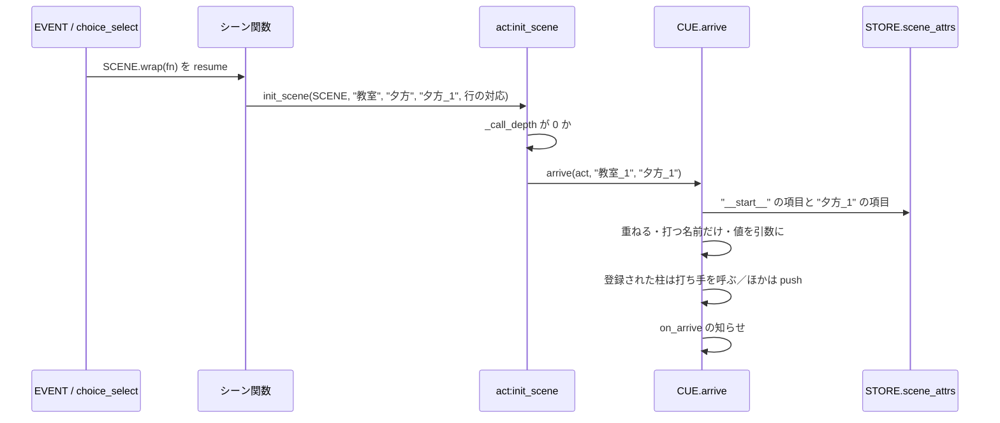
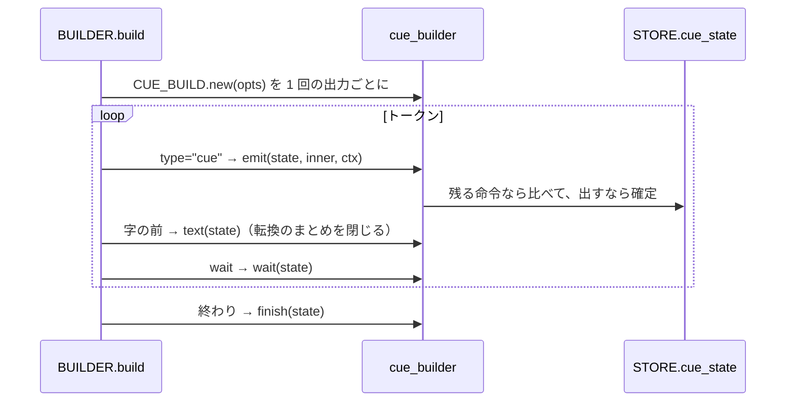

# 暫定の設計: cue-command-runtime（ト書きと柱）

2026-11-19。Phase 13 の 8 本を、設計の段まで通しで試す作業の 1 本である。requirements.md と spec.json はまだ無い。正は `novel-areka-contract/final-model-2026-11-19.md`（以下「骨子」）と、この spec の brief の「決定（2026-11-19。最終形）」の節と申し送りである。名前（命令・関数・表）は、どれも仮である。この文書は、正式の設計（`design.md`）ではない。

---

## 1. 暫定の要件

brief の決定と骨子から起こした。番号は、この文書の中だけで使う。

### 要件 1: ト書きを流す

- 1.1 `select` 以外の `！名前＠対象（引数…）` の行が実行されたとき、pasta はトークンを 1 つ、書いた位置に積み、さくらスクリプトでは `\![頭,対象,引数…]` を出す（対象は、書いたときだけ）。
- 1.2 頭は、別名表に名前が在ればその並び、無ければ書いた名前そのものとする。
- 1.3 対象は、アクターの名前の文字で出す（スコープの番号にしない）。
- 1.4 引数の中の `\`・`%`・`]` はエスケープし、`,` か `"` を含む引数は `"` で囲む。
- 1.5 `！select` の生成と出力は変えない。
- 1.6 ト書きのトークンは、台詞にも字にも選択肢にも数えない。列の状態を動かさず、行の継ぎ目の印を取らない。
- 1.7 pasta が意味を知らないト書きの出力は、外見の記録に入れず、外見の記録を「不明」にもしない。

### 要件 2: 別名表

- 2.1 `pasta.toml` の `[cue.alias]` に、名前ごとの頭の並びと、「残る」か「瞬間」かの印を書ける。
- 2.2 既定の表を持つ。書いた名前だけ、既定を置き換える（`[scene.alias]` と同じ流儀）。
- 2.3 表の誤りは、読み込みのエラーにする。pasta.dll と `pasta_check` は、同じ規則で読む。
- 2.4 pasta が意味を知る名前（要件 7 の 10 個と、登録された柱の名前）は、表に書けない。

### 要件 3: 引数

- 3.1 対象（`＠` の後ろ）と引数に、変数（`＄名前`・`＄＊名前`・`＄０`）を書ける。値は実行時に読む。
- 3.2 数字で始まる文字の引数は「」で囲む決まりにする（文法は直さない）。
- 3.3 時間は、どれもミリ秒で書く。pasta は値を換算しない。

### 要件 4: 柱

- 4.1 シーンに着いた時（イベントで選ばれた時と、最後の行の `＞` で飛んだ時）、pasta はそのシーンの柱を、書いた順に打つ。
- 4.2 途中の行の `＞`（と、単語・関数の呼び出し）で入ったシーンでは、柱を打たない。そのシーンの最後の行の `＞` で飛んだ先でも、呼んだ側へ戻るまでは打たない。
- 4.3 打つ柱は、グローバルシーンの属性（ファイル属性を含む）に、ローカルシーンの属性を重ねて決める。同じ名前は、ローカルの値が勝ち、位置はグローバルの位置に置く。
- 4.4 柱として打つのは、宣言の項目のうち、名前が「打つ名前」（要件 7 の 10 個・別名表の名前・登録された柱の名前）に入る物だけである。`＄` で始まる条件・フラグと、選び方の予約の 6 つ（`優先`・`priority`・`重み`・`weight`・`順番`・`index`）は打たない。打つ名前に無い属性は、今までどおり、何も出さない。
- 4.5 引用しない値に区切りの字（`、`・`，`・`,`）が在れば、引数の並びとして読む（`＆環境音：空調、遠い街` は `！環境音（空調、遠い街）`）。引用した値は、1 つの引数とする。
- 4.6 値が「なし」の柱は、引数なしのト書きと同じ意味にする（`＆曲：なし` は `！曲（）`）。
- 4.7 柱を読むのは実行時の属性の倉（`STORE.scene_attrs`）である。生成コードに柱の命令を埋めない。

### 要件 5: 残る命令と、pasta が覚える値

- 5.1 残る命令の最後の値を、pasta がゴーストに 1 つ覚える。同じ値なら、出さない。
- 5.2 残る命令の引数なしは「無い」の意味とする。
- 5.3 瞬間の命令は、毎回出す。高速再生と出し直しの 1 本では、出さない（呼ぶ側が指定する）。
- 5.4 覚えた値は、さくらスクリプトに組み立てた時に確定する（組み立てなかったトークンは、覚えない）。
- 5.5 アクター状態に当たる値（並び・位置・重ね順・大きさ・透明度）を、写して返す口と、置き直す口を持つ。
- 5.6 覚えた値から、画面の状態を全部書く 1 本の中身を作る口を持つ。
- 5.7 アクション行に直に書いた `\![…]` は、覚えない。

### 要件 6: 並び

- 6.1 アクター指定行（`％教室、さくら`）は、並びとして伝える（仮 `\![play,cast,教室,さくら]`）。並びは残る命令として覚える。
- 6.2 スコープの番号は、今の割り当て（`act:set_spot`）のまま変えない。
- 6.3 アクター指定行は、今の文法のまま、グローバルシーンの頭にだけ書ける。

### 要件 7: pasta が意味を知るト書き（10 個）

- 7.1 舞台・曲・環境音・効果音・待つ・時間で次へ・位置・透明度・大きさ・転換の 10 個は、ベースウェアに合わせて、正典のタグか `play` の命令に直す。直せない物は、そのベースウェアでは出さない。
- 7.2 転換は、まとめの範囲（次の字・次の待ち・次の転換・1 本の終わりの、早い所まで）の終わりに、`待つ` のときだけ `\_w[時間]` を入れる。
- 7.3 時間で次へは、値をその 1 本の印として残し、1 本の末尾を作る側（`novel-talk-flow`）へ渡す。

### 要件 8: ベースウェアの判定

- 8.1 ベースウェアの名前と版を返す公開の Lua の関数を足す。作者の Lua からも使える。
- 8.2 判定できないベースウェアは、SSP と同じに扱う（正典のタグだけを出す）。

### 要件 9: 他の spec への口

- 9.1 意味を知る柱を、名前で登録できる（`novel-talk-flow` の `＆再生モード`）。
- 9.2 シーンに着いた時を、ほかのモジュールが知る口を持つ（今のシーンの記録・控えの取り直し）。
- 9.3 ある再生位置の柱を、着いた時と同じに打つ口を持つ（ロードと巻き戻し）。

### 要件 10: 検査と文書

- 10.1 `pasta_check validate` が、別名表の誤りを pasta.dll と同じ規則で報告する。一致テストを足す。
- 10.2 マニュアル（文法・設定・内部設計）・スキル references・LSP の色付け・VSCode の文法定義を、新しい挙動に合わせる。

---

## 2. 概要

`！` 行と柱を、実行時にさくらスクリプトへ流す。仕組みは 3 層である。

1. **生成**（Rust）: `！` 行を `act:cue(名前, 対象, {引数…})` の 1 行にする。シーンの関数の頭の `act:init_scene` に、ローカルの登録名を 1 つ足す。属性の倉の項目に、値の並び（`args`）を足す。
2. **宿主に依らない層**（`pasta/cue.lua`）: トークン `{type="cue"}` を積む。シーンに着いた時を見分け、倉から柱を引いて積む。覚えた値と比べて、同じなら積まない。
3. **SHIORI の層**（`pasta/shiori/cue_builder.lua`）: トークンを、ベースウェアに合わせたタグへ直す。覚えた値を確定する。

### 目標

- 要件 1〜10 を満たす。既にある辞書の出力は、`！select` 以外の `！` 行を書いた所と、打つ名前の柱を書いた所だけが変わる。

### 目標にしない物

- 1 行ずつ進む走り方・`\x`・`OnPlayNext`（`novel-talk-flow`）。
- 目印・控え・早回し（`novel-checkpoint-rollback`）。
- 命令の名前の確定（`novel-areka-contract`）。
- `！` で束を呼ぶ形（brief で「今回は入れない」）。
- 語彙の一覧と照らす書き間違いの検査（知らない命令は、実行時にそのまま流す。後で要るなら足す）。

---

## 3. 境界の約束

### この spec が持つ物

- `！` 行の生成・トークン・SHIORI の出力。
- 別名表（`[cue.alias]`）の形・既定・読み込み・検査。
- 柱を打つ仕組み（着いた時の見分け・階層の重ね・倉からの読み出し）と、意味を知る柱の登録口。
- 残る命令の覚えた値（`STORE.cue_state`）と、その写し・置き直し・全部書きの口。
- 10 個のト書きの、ベースウェアごとの直し方。
- ベースウェアの判定（`pasta/baseware.lua`）。

### 範囲の外

- `＆再生モード` の意味（`novel-talk-flow` が、登録口で足す）。
- 今のシーン・再生位置・`＄演劇` の記録（`novel-talk-flow`）。
- 控えの取り方・戻り方（`novel-checkpoint-rollback`）。
- `！select` の 2 つ目の引数（時間切れの飛び先）と、その単位（`novel-talk-flow`。5 章の食い違い 3）。
- areka の側の解釈。

### 使ってよい物

- `SCENE`・`STORE`・`CONFIG`・`FAILURE`・`APPEARANCE`（読むだけ）・`@pasta_config`・`@pasta_log`。
- `pasta_core` の別名表の流儀（`SceneAliasTable::with_written`）。

### 見直しの合図（Revalidation Triggers）

- トークン `{type="cue"}` の形・`act:cue` の引数を変える。
- `act:init_scene` の引数を変える。
- `STORE.cue_state` の形・覚える時（組み立ての時）を変える。
- 着いた時の見分け方（呼び出しの深さ）を変える。
- `[cue.alias]` の形・既定の表を変える（`pasta_check`・マニュアル・`wasmBridge.ts` の形の検査に効く）。

---

## 4. 今の作りの調べ（file:line）

| 事実 | 場所 |
| ---- | ---- |
| `！` 行の文法。引数は `＠参照・数・文字列・識別子` の順に試す | `crates/pasta_dsl/src/parser/grammar.pest:222-231` |
| 対象は `cue_scoped_ident` 1 つで、`＄０` も名前として読む | `grammar.pest:224-226`、`parse_scene.rs:386-400` |
| 変数の名前だけを読む規則 `dyn_name`（末尾の空白を含まない） | `grammar.pest:106-108`、`parse_action.rs:215-230`（`parse_dyn_name`） |
| 引数のトークンの型 | `crates/pasta_dsl/src/parser/ast/cue.rs`（`CueArgToken`・`ScopedName`） |
| 数の引数は数に直る（`007` は 7） | `parse_scene.rs:423-428` |
| `select` だけを生成し、ほかは捨てる | `crates/pasta_lua/src/code_gen/scope_gen.rs:355-360` |
| `！select` は秒を受けて、出力でミリ秒に直す | `scope_gen.rs:395-411`、`sakura_builder.lua:456-458`、`book/src/grammar/block-structure.md:205` |
| 見本の `!select(10)`（秒） | `crates/pasta_sample_ghost/ghosts/hello-pasta/ghost/master/dic/09-choice.pasta:11` |
| 属性の値は、引用した物（`String`）もしない物（`AttrString`）も、同じ文字列で倉へ入る | `scope_gen.rs:486-493`（`attr_value_literal`） |
| 属性の倉の項目は `{key, value}`・`{key, op, value}`・`{key}` | `scope_gen.rs:448-455`、`pasta_scripts/pasta/scene.lua:112-142` |
| ローカルシーンの倉は、自分の宣言行の属性だけ（親を受け継がない） | `scope_gen.rs:116-125`（`merge_attrs(&[], …)`） |
| グローバルシーンの倉は、ファイル属性を前に重ねた物 | `crates/pasta_dsl/src/parser/ast/attr_merge.rs:7-21, 25-41` |
| `SCENE.attrs` は `key・op・value` だけを写して返す | `scene.lua:126-142` |
| 選び方の予約の名前 | `crates/pasta_core/src/registry/scene_types.rs:158, 185, 188` |
| 属性の値は空白を含められない（`attr_string`） | `grammar.pest:169-171` |
| シーンの関数の頭 `act:init_scene(SCENE, 書いたグローバル名, 書いたローカル名)`。行の対応は後から `)` の前へ足す | `scope_gen.rs:273-277`、`crates/pasta_lua/src/transpiler.rs:261-288` |
| アクター指定行は `__start__` でだけ `clear_spot`・`set_spot` になる | `scope_gen.rs:280-292`、`grammar.pest:263, 274` |
| 最後の行の `＞` は `return act:call`、途中は `act:call_restore` | `crates/pasta_lua/src/code_gen/element_gen.rs:198-235` |
| 途中の Call・単語・関数は、どれも `restore_scene` を通る | `pasta_scripts/pasta/act.lua:474, 489, 573, 800-808, 821-823` |
| `init_scene` は実行中のシーンを替え、`STORE.last_global_scene` を書く | `act.lua:221-233` |
| 話者でないトークンは、今のアクターのグループに入る（グループが無ければアクター無しのグループを開く） | `act.lua:73-85` |
| 組み立ては、トークンが 0 件か、すべて空の `raw_script` なら nil | `act.lua:647-668` |
| 割り込みが台詞を出すと、トークン列を中断の物と差し替える | `pasta_scripts/pasta/shiori/act.lua:85-95` |
| タグの引数を守る関数は、`shiori/act.lua` の中だけに在る | `shiori/act.lua:260-271` |
| 1 トークンを文字にする所。知らない型は空文字列 | `pasta_scripts/pasta/shiori/sakura_builder.lua:437-462` |
| 出力は外見の記録に観測させる（`raw_script` は話者なしで） | `sakura_builder.lua:487-504` |
| 字のあるトークンの枝（S3）・ほかの枝（S4）・終わり（S7） | `sakura_builder.lua:647-666, 684-687` |
| `spot`・`clear_spot` の枝 | `sakura_builder.lua:594-607` |
| 台詞の判定は、字のある talk と選択肢だけ | `sakura_builder.lua:536-552` |
| 外見の記録は `\![bind,…]` も読む | `pasta_scripts/pasta/shiori/appearance.lua:128-145` |
| ゴーストの状態の置き場と、まとめて消す所 | `pasta_scripts/pasta/store.lua:41, 66, 89-106` |
| `[scene.alias]` の読み込みと、既定の上に書いた行を重ねる所 | `crates/pasta_lua/src/loader/config/mod.rs:82, 108-170` |
| `[ghost]` の既定を 1 か所で埋めて Lua へ渡す所 | `loader/config/mod.rs:98-103, 172-200` |
| `pasta_check` の別名表の検査 | `crates/pasta_check/src/validate/config.rs:156-205` |
| `pasta_check` の act のメソッドの一覧（28） | `crates/pasta_check/src/validate/builtins.rs:28` |
| 要求の送り手 `req.sender` | `pasta_scripts/pasta/shiori/entry.lua:85` |
| 版は `act:get_property("baseware.version")` で読める（SSP は `SSP/2.9.18 (…)`） | `.kiro/specs/completed/actor-display-style/research.md:219` |
| 呼び出しの引数は式で、裸の名前は書けない（`＞おすすめ項目（「カクヨム」、…）`） | `grammar.pest:113-116`、`book/src/grammar/call-jump.md:596` |
| ファイル属性に、打つ名前でない属性 `＆天気：晴れ` を書いた材料 | `crates/pasta_lua/tests/fixtures/sample.pasta:14` |
| `！` 行が何も出さないことを固定するテスト | `crates/pasta_lua/tests/transpiler/cue_command_passthrough_test.rs:37-56`、`scope_gen_tests.rs:379-390` |
| LSP は対象の `span` で色を付ける | `crates/pasta_lsp/src/analysis/visit_action.rs:85-97` |
| VSCode の `！` 行の定義 | `editors/vscode/syntaxes/pasta.tmLanguage.json:349-400` |

---

## 5. 作りの全体

```mermaid
flowchart LR
  subgraph Rust
    G[grammar.pest<br/>cue_cmd_scope / cue_arg に dyn_name] --> P[parse_scene.rs<br/>CueArgToken::Var]
    P --> C[scope_gen.rs<br/>act:cue(...) / init_scene に登録名 / 倉の args]
    T[loader/config<br/>[cue.alias] → custom_fields.cue] 
    K[pasta_core CueTable<br/>既定と with_written]
    K --> T
    K --> V[pasta_check validate/config.rs]
  end
  subgraph Lua
    C --> A[act.lua<br/>init_scene → CUE.arrive<br/>restore_scene で深さ]
    A --> Q[pasta/cue.lua<br/>push / arrive / pillars / define_pillar]
    Q --> S[STORE.cue_state]
    Q --> B[shiori/sakura_builder.lua<br/>type=cue の枝]
    B --> R[shiori/cue_builder.lua<br/>ベースウェアごとの直し・確定]
    R --> S
    R --> W[pasta/baseware.lua]
  end
```

- 宿主に依らない層は、ベースウェアを知らない。トークンに名前・対象・引数・印を入れるだけである。
- ベースウェアを見るのは、SHIORI の層の `cue_builder.lua` だけである。
- `act.lua`（857 行）と `sakura_builder.lua`（690 行）へは、呼び出しを数行足すだけにする。本体は新しいファイルに置く。

---

## 6. ファイルの割り振り

### 新しいファイル

| ファイル | 持つ物 |
| -------- | ------ |
| `crates/pasta_lua/pasta_scripts/pasta/cue.lua` | トークンを積む `CUE.push`・着いた時 `CUE.arrive`・柱の引き方 `CUE.pillars`・柱の登録 `CUE.define_pillar`・着いた時の知らせ `CUE.on_arrive`・表 `CUE.def` |
| `crates/pasta_lua/pasta_scripts/pasta/cue_state.lua` | 覚えた値 `STORE.cue_state` の読み書き・写し・置き直し |
| `crates/pasta_lua/pasta_scripts/pasta/shiori/cue_builder.lua` | トークンをタグへ直す・転換のまとめ・全部書き |
| `crates/pasta_lua/pasta_scripts/pasta/shiori/tag.lua` | タグの引数を守る関数（`shiori/act.lua` から移す） |
| `crates/pasta_lua/pasta_scripts/pasta/baseware.lua` | ベースウェアの判定（公開） |
| `crates/pasta_core/src/registry/cue_table.rs` | 別名表の形・既定・重ね方・誤りの種類 |
| `crates/pasta_lua/tests/lua_specs/cue_test.lua`・`cue_builder_test.lua`・`baseware_test.lua` | Lua の単体テスト（`sakura_builder_test.lua` には足さない） |
| `crates/pasta_lua/tests/transpiler/cue_command_codegen_test.rs` | 生成の形のテスト |
| `crates/pasta_lua/tests/fixtures/cue_pillar.pasta` | 柱とト書きの材料 |

### 直すファイル

11 章「共有するファイル」に、1 つずつ書く。

---

## 7. 流れ

### 7.1 イベントで着く・最後の行で飛ぶ



### 7.2 途中の行の `＞`

```lua
-- act.lua restore_scene（直した形）
function ACT_IMPL.restore_scene(self, fn, ...)
    local scene, scene_name, local_scene_name, line_map =
        self.current_scene, self.scene_name, self.local_scene_name, self.line_map
    self._call_depth = (self._call_depth or 0) + 1
    return (function(...)
        self._call_depth = self._call_depth - 1
        self.current_scene = scene
        self.scene_name, self.local_scene_name, self.line_map = scene_name, local_scene_name, line_map
        return ...
    end)(fn(...))
end
```

- 深さが 1 以上の間に `init_scene` が呼ばれても、柱を打たない。呼んだ先の最後の行の `＞` も、深さ 1 以上のままなので打たない（要件 4.2）。
- エラーで抜けたときは減らさない。その act は捨てられるので、困らない（今の `restore_scene` も戻さない）。

### 7.3 組み立て



---

## 8. 部品と口

### 8.1 生成（Rust）

#### 文法（`grammar.pest`）

```pest
cue_cmd_scope    =  { at ~ ( cue_scope_var | cue_scoped_ident ) }
cue_scope_var    = _{ dyn_name ~ &( "(" | "\u{FF08}" | space_chars | "#" | "\u{FF03}" | NEWLINE ) }
cue_arg          = _{ cue_arg_at_ref | cue_arg_var | number_literal | string_literal | cue_arg_id }
cue_arg_var      = _{ dyn_name ~ &( s ~ ( comma | rparen ) ) }
```

- 先読みは、`＄１００円` のような今まで識別子だった書き方を、パースエラーにしないためである（変数として読めなければ、今までどおり識別子）。
- `＄％名前`（プロパティ）は `dyn_name` に当たらないので、今までどおり識別子として読む。

#### AST（`ast/cue.rs`）

```rust
pub enum CueArgToken {
    Ident(String), StringLiteral(String), Integer(i64), Float(f64), AtRef(String),
    /// 変数（`＄名前`・`＄＊名前`・`＄０`）。名前と種類は `parse_dyn_name` と同じ
    Var { name: String, scope: VarScope },
}
pub struct ScopedName {
    pub actor: Option<String>,
    pub name: String,
    /// Some なら、対象は変数。`name` は変数の名前
    pub var: Option<VarScope>,
    pub span: Span,
}
```

#### 生成の形（`scope_gen.rs`）

| 書いた行 | 生成する Lua（1 行。`record_span_since` で行を結ぶ） |
| -------- | ---------------------------------------------- |
| `！効果音（雷）` | `act:cue("効果音", nil, { "雷" })` |
| `！転換（３００、待つ）` | `act:cue("転換", nil, { 300, "待つ" })` |
| `！透明度＠＄０（０）` | `act:cue("透明度", args[1], { 0 })` |
| `！移動＠＄０（＄１）` | `act:cue("移動", args[1], { args[2] })` |
| `！bind（閉じる、赤、1）` | `act:cue("bind", nil, { "閉じる", "赤", 1 })` |
| `！揺らす＠さくら:強`（`actor` 付き） | `act:cue("揺らす", "さくら:強", {})`（書いたまま） |
| `！合図（＠名前）` | `act:cue("合図", nil, { "＠名前" })`（6 節の未決 6） |
| `！select（１０）` | 今のまま `act:choice_timeout(10)` |

- 変数の道は `resolve_var_path`（`element_gen.rs:35-42`）を使う。
- 数は `attr_value_literal` と同じ書き方にする（`-0.0` は `0`）。

#### シーンの関数の頭

```lua
-- 今
local save, var = act:init_scene(SCENE, "教室", "夕方", "<行の対応>")
-- 直した形（4 つ目にローカルの登録名。__start__ は nil。行の対応は 5 つ目のまま最後）
local save, var = act:init_scene(SCENE, "教室", "夕方", "夕方_1", "<行の対応>")
```

- 行は足さない（行の対応がずれない）。`fill_line_maps` は `)` の前に足すので、そのまま最後になる。

#### 倉の項目に、値の並びを足す（`append_set_scene_attrs`）

```lua
-- ＆環境音：空調、遠い街（引用しない値に区切りの字）
{ key = "環境音", value = "空調、遠い街", args = { "空調", "遠い街" } }
-- ＆環境音：「空調、遠い街」（引用した値）
{ key = "環境音", value = "空調、遠い街" }
```

- `value` は今のまま（条件・選び方・`SCENE.attrs` の読み手を変えない）。`SCENE.attrs` は `args` を返さない（公開の形を変えない）。柱は `STORE.scene_attrs` を直に読む。
- 区切りの読み方は、ト書きの引数の `comma_sep` と同じ（`、`・`，`・`,`）。値に空白は書けないので、空白は気にしない。

### 8.2 宿主に依らない層（`pasta/cue.lua`）

```lua
--- @class CueToken
--- @field type "cue"
--- @field name string 書いた名前（別名を当てる前）
--- @field target string|nil 対象（アクターの名前の文字）
--- @field args (string|number)[] 引数（書いた順）
--- @field def CueDef 引いた定義
--- @field pillar boolean|nil 柱から打ったか

--- @class CueDef
--- @field name string 名前
--- @field head string[] タグの頭（別名表。無ければ { name }）
--- @field kind "residual"|"instant" 残るか瞬間か（表に無ければ "instant"）
--- @field known string|nil 意味を知る 10 個の内部名（"stage"|"bgm"|"ambient"|"se"|"wait"|"xtimeout"|"pos"|"alpha"|"scale"|"trans"）
--- @field actor boolean|nil アクター状態に入るか（並び・位置・重ね順・大きさ・透明度）

CUE.def(name)                                  --> CueDef
CUE.push(act, name, target, args)              --> act   -- act:cue の本体
CUE.pillars(global_name, local_name)           --> {name, args}[]   -- 重ねて打つ名前だけ。書いた順
CUE.arrive(act, global_name, local_name)       --> nil   -- 着いた時（init_scene から）
CUE.apply_pillars(act, global_name, local_name)--> nil   -- arrive と同じに打つ（ロード・巻き戻し用。知らせは出さない）
CUE.define_pillar(name, fn)                    --> nil   -- fn(act, args, ctx) 。ctx = {global_name, local_name}
CUE.on_arrive(fn)                              --> nil   -- fn(act, global_name, local_name)
```

- `act.lua` には、次の 3 か所だけを足す: `ACT_IMPL.cue = CUE.push` の 1 行、`init_scene` の引数 1 つと `CUE.arrive` の呼び出し、`restore_scene` の深さ（7.2）。
- **`CUE.push` の手順**: 定義を引く → 残る命令なら、この act で積んだ値（`act._cue_pending[キー]`）か、確定した値（`STORE.cue_state[キー]`）と同じなら積まない → `時間で次へ` なら `act._cue_xtimeout = 引数1` を書く（トークンは積まない。要件 7.3）→ トークンを積む。
  - キーは `頭 .. "@" .. (対象 or "")`。
  - 積まない判定を積む時にするのは、同じ値だけのイベントの応答が `\e` だけにならないようにするためである（`act:build` が nil を返し、今までどおり 204 になる）。
- **`CUE.pillars` の手順**（要件 4.3〜4.6）:

```lua
local function pillars(global_name, local_name)
    local by_local = STORE.scene_attrs[global_name] or {}
    local out, index = {}, {}
    local function lay(items)
        for _, it in ipairs(items or {}) do
            if it.op == nil and it.value ~= nil and is_pillar_name(it.key) then
                local args = it.args or { it.value }
                if it.value == "なし" then args = {} end
                local i = index[it.key]
                if i then out[i].args = args            -- 位置はグローバルのまま、値はローカル
                else out[#out + 1] = { name = it.key, args = args }; index[it.key] = #out end
            end
        end
    end
    lay(by_local["__start__"])
    if local_name and local_name ~= "__start__" then lay(by_local[local_name]) end
    return out
end
```

  - `is_pillar_name` は「意味を知る 10 個・別名表の名前・登録された柱」のどれかで、`＄` で始まらず、選び方の予約の 6 つでない名前。
- **`CUE.arrive`**: `pillars` の順に、登録された柱なら打ち手を呼び、ほかは `CUE.push(act, name, nil, args)` に `pillar = true` を付けて積む。最後に `on_arrive` の知らせを、登録した順に呼ぶ。`act.arrival = { global_name, local_name }` も書く。

### 8.3 覚えた値（`pasta/cue_state.lua`）

```lua
--- STORE.cue_state: table<string, CueValue>
--- @class CueValue
--- @field head string[] タグの頭
--- @field target string|nil
--- @field args (string|number)[]
--- @field known string|nil
--- @field actor boolean|nil

CUE_STATE.get(key)                --> CueValue|nil
CUE_STATE.commit(key, value)      --> nil   -- 組み立ての時だけ呼ぶ
CUE_STATE.snapshot_actor()        --> table<string, CueValue>   -- actor が真の物の深い写し
CUE_STATE.restore_actor(tbl)      --> nil   -- actor が真の物を全部消してから写し入れる
CUE_STATE.clear(pred)             --> nil   -- pred が真の物を消す（舞台を閉じた時。省けば全部）
```

- 並びの値は `STORE.cue_state["play,cast@"] = { head={"play","cast"}, args={"教室","さくら"}, actor=true }`（頭の並びを `,` でつないだ物をキーの頭にする）。
- `STORE.reset()` で空にする（`store.lua:89-106` に 1 行）。

### 8.4 SHIORI の層（`pasta/shiori/cue_builder.lua`）

```lua
CUE_BUILD.new(opts)                    --> state   -- opts = { instant = true|false, baseware = BASEWARE.kind() }
CUE_BUILD.emit(state, inner, ctx)      --> string  -- ctx = { actor_spots, last_spot }
CUE_BUILD.cast(state, names)           --> string  -- clear_spot の後の spot の並びから
CUE_BUILD.text(state)                  --> string  -- 字を出す直前（転換のまとめを閉じる）
CUE_BUILD.wait(state)                  --> string  -- wait トークンの直前（同上）
CUE_BUILD.finish(state)                --> string  -- 1 回の出力の終わり（同上）
CUE_BUILD.full_state(opts)             --> string  -- 覚えた値で画面の状態を全部書く
```

#### `sakura_builder.lua` に足す所

| 場所 | 足す物 |
| ---- | ------ |
| `BUILDER.build` の頭（574 行の `STYLE.new()` の隣） | `local cue = CUE_BUILD.new({ instant = config.cue_instant ~= false })` |
| `inner_token_to_string` ではなく、S4 の枝の手前（662 行の前） | `elseif inner.type == "cue" then buffer:put(CUE_BUILD.emit(cue, inner, {actor_spots=actor_spots, last_spot=last_spot}))`。外見の記録には観測させない（要件 1.7） |
| S3 の枝の頭（651 行の前） | `buffer:put(CUE_BUILD.text(cue))` |
| `wait` のトークン（S4 の中） | `CUE_BUILD.wait(cue)` を先に足す |
| S5・S6 の後の最初の別のトークン（`spot` の並びの終わり） | `buffer:put(CUE_BUILD.cast(cue, names))` |
| S7（686 行の `\e` の前） | `buffer:put(CUE_BUILD.finish(cue))` |

- `put` で足す（pasta が出すタグなので、前の単独の `\` に食わせない。`tracking_buffer`）。`put_break` は通さない（区切りでない）。
- `BUILDER.speaks`・列の状態・`spot_tail` は動かさない（要件 1.6）。
- `BUILDER.build` の複雑度は 28 から上がる。cue の枝は 1 つにまとめ、`-- luacheck: ignore 561` のままにする（分割は特性化テストの後の別のコミット。今は入れない）。

#### ベースウェアごとの直し方（10 個と並び）

| 名前（内部名） | 区分 | SSP（と、判定できない物） | areka |
| -------------- | ---- | ------------------------- | ----- |
| 舞台（stage） | 残る | 出さない | `\![play,stage,開く／閉じる]` |
| 曲（bgm） | 残る | 前の値が在れば `\![sound,stop,前]`、新しい値が在れば `\![sound,loop,新]` | 同じ（正典） |
| 環境音（ambient） | 残る | 消えた名前ごとに `\![sound,stop,名]`、増えた名前ごとに `\![sound,loop,名]` | 同じ |
| 効果音（se） | 瞬間 | `\![sound,play,名]` | 同じ |
| 待つ（wait） | 瞬間 | `\_w[ms]` | 同じ |
| 時間で次へ（xtimeout） | 瞬間 | 出さない（`act._cue_xtimeout` を `novel-talk-flow` が使う） | 同じ |
| 位置（pos）＠A | 残る | 数値なら `\p[Aの番号]\![move,--X=x,--Y=y(,--time=T)]` の後に今のスコープへ戻す。席の名前は出さない | `\![play,pos,A,引数…]` |
| 透明度（alpha）＠A | 残る | `\p[Aの番号]\![set,alpha,n(,--time=T)]` の後に戻す | `\![play,alpha,A,n]` |
| 大きさ（scale）＠A | 残る | `\p[Aの番号]\![set,scaling,n(,--time=T)]` の後に戻す | `\![play,scale,A,n]` |
| 転換（trans） | 瞬間 | 出さない。まとめの中の位置・透明度・大きさに `--time=T` を付ける | `\![play,trans,T]` |
| （並び） | 残る | 出さない（スコープの番号は今のまま） | `\![play,cast,名,…]` |
| 別名表の名前 | 表の印 | 頭の並びのまま `\![頭…,対象,引数…]`（SSP は知らない `\![play,…]` を読み飛ばす） | 同じ |
| 表に無い名前 | 瞬間 | `\![名前,対象,引数…]` | 同じ |

- `T` は、まとめの中の転換の時間である。`待つ` 付きなら、まとめを閉じる所で `\_w[T]` を出す。`！転換（０）` はまとめを閉じる。
- 対象のスコープが今のスコープ（`last_spot`）と同じなら、`\p` を出さない。違えば `\p[番号]` で移り、元のスコープへ `\p[元]` で戻す。元が無ければ戻さない。対象が `actor_spots` に無ければ出さず、デバッグのログを 1 行出す。
- `opts.instant == false`（高速再生・出し直し）のとき、瞬間の命令は空文字列。`待つ` も出さない。
- 確定: 残る命令は、文字にした時に `CUE_STATE.commit` する。出さないベースウェアでも確定する（今の値は「書いた値」で、出し直しの全部書きはそれを元にする）。

#### `full_state`

- areka: 覚えた値を、舞台 → 並び → 位置・重ね順・大きさ・透明度（アクターごと）→ 曲・環境音 → 表の残る命令の順に、全部書く（areka は出し直しの頭で既定へ戻すため。骨子 4 章の「承認が要らない整理」）。
- SSP: 何も書かない（SSP は `\![play,again]` を読み飛ばし、画面を既定に戻さないので、書くと曲が頭から鳴り直す）。ロードや巻き戻しで値が変わる物は、`restore_actor` の後の差分と、柱の打ち直しで出る。5 章の食い違い 6。

### 8.5 ベースウェアの判定（`pasta/baseware.lua`、公開）

```lua
BASEWARE.name()                       --> string|nil   -- 最後の要求の Sender（例 "SSP"）
BASEWARE.kind()                       --> "areka"|"ssp"   -- 判定できない物は "ssp"
BASEWARE.version()                    --> {major, minor, patch}|nil
BASEWARE.at_least(major, minor, patch)--> boolean
BASEWARE.observe(req)                 --> nil   -- EVENT.fire の頭で 1 回（内部）
```

- 名前は `req.sender` から取る（毎回の要求に在る）。版の取り方は、areka の取り決め待ち（6 節の未決 4）。仮に、`act:get_property("baseware.version")` の答えを覚える形を口として置く（`BASEWARE.query(act)`。コルーチンの中でだけ呼べる）。

### 8.6 設定（`[cue.alias]`）

```toml
[cue.alias]
揺らす = { tag = ["play", "shake"] }
フラッシュ = { tag = ["play", "flash"] }
重ね順 = { tag = ["play", "zorder"], remain = true }
色調 = { tag = ["play", "tone"], remain = true }
カメラ = { tag = ["play", "camera"], remain = true }
```

- 既定の表は、上の 5 行（`novel-areka-contract` の語彙の表で確定する）。
- 書いたキーだけ既定を置き換える。`揺らす = {}`（`tag` が無い）は既定を消す。見出しだけなら既定のまま。
- 誤り（読み込みのエラー）: `tag` が文字列の配列でない・空の名前・空の頭・`remain` が真偽でない・意味を知る名前（10 個と登録された柱。柱の登録は Lua なので、ここでは 10 個と `再生モード`）を書いた・`＄` で始まる名前・選び方の予約の 6 つ。
- 規則は `pasta_core::CueTable::with_written` の 1 か所に置き、`loader/config/mod.rs` と `pasta_check` の `validate/config.rs` が同じ規則で読む。有効な表は、`apply_shiori_defaults` で `custom_fields.cue.alias` に埋め、Lua は `CONFIG.get("cue", "alias")` で読む。

---

## 9. データの形（まとめ）

| 名前 | 置き場 | 形 |
| ---- | ------ | -- |
| ト書きのトークン | `act.token[]` | `{type="cue", name, target, args, def, pillar?}` |
| この act で積んだ残る命令 | `act._cue_pending` | `table<キー, args>` |
| 時間で次へ | `act._cue_xtimeout` | `number|nil`（ミリ秒） |
| 着いたシーン | `act.arrival` | `{global_name, local_name}` |
| 呼び出しの深さ | `act._call_depth` | `integer|nil` |
| 覚えた値 | `STORE.cue_state` | `table<キー, CueValue>` |
| 倉の項目 | `STORE.scene_attrs[g][l][]` | `{key, value, args?}`（`args` を足す） |
| 有効な別名表 | `@pasta_config.cue.alias` | `table<名前, {tag: string[], remain: boolean}>` |

### 出るさくらスクリプトの例（トークの走り方。SSP）

```pasta
＆曲：朝の光

％教室
    ＠夜：\s[20]

＊教室の朝
    ％教室、さくら
    さくら：おはよう。
    ！効果音（「se_bell.wav」）
    ！透明度＠さくら（５０）
    さくら：鐘だね。
```

`\![sound,loop,朝の光]\p[1]おはよう。…\![sound,play,se_bell.wav]\![set,alpha,50]鐘だね。\e`（並びは SSP では出さない。柱は `init_scene` の中で積むので、アクター指定行より前に出る。対象のさくらは今のスコープ 1 なので、`\p` の移り直しは出さない。字の後の待ちと改行は今の組み立てのまま）

### areka の場合

`\![sound,loop,朝の光]\![play,cast,教室,さくら]\p[1]おはよう。…\![sound,play,se_bell.wav]\![play,alpha,さくら,50]鐘だね。\e`

---

## 10. 他の spec との境界

### novel-talk-flow

- **渡す物**
  - `CUE.define_pillar("再生モード", fn(act, args, ctx))`。着いた時に、重ねた柱の値（`args[1]` が `トーク`・`演劇`・`設定`）で呼ばれる。書いていないシーンでは呼ばれない（前のモードが続く）。途中の `＞` で入ったシーンでは呼ばれない。
  - `CUE.on_arrive(fn(act, global_name, local_name))` と `act.arrival`。今のシーンの記録に使う（どの着き方を今のシーンとして確定するかは talk-flow が決める）。
  - `act._cue_xtimeout`（`！時間で次へ（ms）` の値）。1 本の末尾を作るときに読み、areka へ `\![play,xtimeout,ms]`、SSP へ `\![timerraise,ms,1,OnPlayNext]\x\![timerraise,0,1,OnPlayNext]` にする。読んだら消す。
  - `BUILDER.build` の設定 `config.cue_instant = false`（高速再生・出し直しの 1 本で、瞬間の命令を出さない）。
  - `CUE_BUILD.full_state()`（`＞演劇再開` の出し直しの 1 本の中身）。
  - ト書きのトークンは台詞に数えない（`BUILDER.speaks` が偽のまま）。1 本の区切り（アクション行）の数え方に入らない。
- **もらう物**
  - 1 本ごとに `BUILDER.build` を呼ぶこと（覚えた値は組み立てで確定するため）。
  - `！select` の単位と 2 つ目の引数の扱い（5 章の食い違い 3）。
  - 1 本の区切りの中で、柱とト書きのトークンが書いた順に残ること（トークン列を並べ替えない）。

### novel-checkpoint-rollback

- **渡す物**
  - `CUE.apply_pillars(act, global_name, local_name)`。ロードと巻き戻しで、今のシーンの階層の柱を打つ（着いた時と同じ。知らせ `on_arrive` と柱の打ち手は呼ぶ／呼ばないを引数で選べる形にする: `apply_pillars(act, g, l, { notify = false })`）。
  - `CUE_STATE.snapshot_actor()`・`CUE_STATE.restore_actor(tbl)`。控えのアクター状態のうち、並び・位置・重ね順・大きさ・透明度。表情と着せ替えは今の `STORE.appearance` で、この spec は持たない。
  - `CUE_STATE.clear(pred)`（舞台を閉じた時に、残る命令の記録を空にする）。
  - `CUE.on_arrive`（1 本の途中でシーンに着いた時に、控えを取り直す）。
  - `CUE_BUILD.full_state()`（出し直しの 1 本目）。
- **もらう物**
  - 早回しの間に積まれたト書きのトークンと `act._cue_pending` を、組み立てずに捨てること（覚えた値が早回しで進まない）。
  - 早回しの間の `on_arrive` の知らせを、自分で無視すること（この spec は早回しを知らない）。

### novel-save-slots

- **渡す物**: 直には無い。ロードの柱は `novel-checkpoint-rollback` を通して `CUE.apply_pillars` で打たれる。
- **もらう物**: 無い。

### shell-element-click

- **渡す物**: 選択肢・当たり判定のクリックで入ったシーンも、`init_scene` で柱が打たれる。`choice_select.lua` を直さなくてよい（直に入るローカルシーンでも、倉から親の柱を引く）。
- **もらう物**: 無い。`choice_select.lua` と `event/init.lua` は触らない。

### novel-areka-contract

- **渡す物**: 出力の形の決まり（`\![頭…,対象,引数…]`・対象はアクターの名前・引数のエスケープと引用）。既定の別名表の 5 行の案。ベースウェアごとの直し方の表（8.4）。
- **もらう物**: `play` の命令の名前（`stage`・`cast`・`pos`・`alpha`・`scale`・`zorder`・`trans`・`shake`・`flash`・`tone`・`camera`・`xtimeout`）と引数の並び。areka の名乗り（`Sender` の値）と版の伝え方。同じ値を打ち直されたら何もしないこと。並びに無いアクターを消すこと。

### hello-novel-sample

- **渡す物**: 文法（変数の対象と引数）・柱の決まり・既定の別名表。
- **もらう物**: 見本が、呼び出しの引数を「」で囲むこと（`＞消えて現れる（「さくら」、「いちばん前」）`）。

### manual-novel-guide

- **渡す物**: 文法の章（`book/src/grammar/block-structure.md` のキューコマンド行と属性）・設定の章（`book/src/reference/pasta-toml.md` の `[cue.alias]`）・内部設計（`book/src/internals/talk-output.md` の cue のトークン）・公開の Lua（`pasta.baseware`）。入門の章は、これを指す。
- **もらう物**: 無い。

---

## 11. 共有するファイル

| ファイル | 変えること |
| -------- | ---------- |
| `crates/pasta_dsl/src/parser/grammar.pest` | `cue_cmd_scope` と `cue_arg` に、先読み付きの `dyn_name` を足す |
| `crates/pasta_dsl/src/parser/ast/cue.rs` | `CueArgToken::Var`・`ScopedName.var` を足す |
| `crates/pasta_dsl/src/parser/parse_scene.rs` | `parse_cue_cmd_scope`・`parse_cue_cmd_args` で変数を読む |
| `crates/pasta_dsl/src/partial.rs` | 変わらない見込み（`span` だけを動かす）。確かめるだけ |
| `crates/pasta_lua/src/code_gen/scope_gen.rs` | `！` 行を `act:cue(...)` にする（`select` はそのまま）。`init_scene` にローカルの登録名。倉の項目に `args` |
| `crates/pasta_lua/src/code_gen/scope_gen_tests.rs` | 「`select` 以外は何も出さない」のテスト（379-390 行）を、`act:cue` の形に替える |
| `crates/pasta_lua/tests/transpiler/cue_command_passthrough_test.rs` | 「出さない」の期待を、`act:cue` の期待に替える |
| `crates/pasta_lua/tests/fixtures/sample.generated.lua`・`sample.expected.lua` | `init_scene` の引数が 1 つ増える |
| `crates/pasta_lua/pasta_scripts/pasta/act.lua` | `ACT_IMPL.cue = CUE.push`・`init_scene` の引数と `CUE.arrive`・`restore_scene` の深さ |
| `crates/pasta_lua/pasta_scripts/pasta/store.lua` | `STORE.cue_state = {}` と、`STORE.reset` で空にする |
| `crates/pasta_lua/pasta_scripts/pasta/shiori/act.lua` | `escape_tag_arg` を `pasta/shiori/tag.lua` へ移し、それを読む |
| `crates/pasta_lua/pasta_scripts/pasta/shiori/sakura_builder.lua` | cue のトークンの枝・転換のまとめの 3 か所・並び・`config.cue_instant` |
| `crates/pasta_lua/pasta_scripts/pasta/shiori/event/init.lua` | `EVENT.fire` の頭で `BASEWARE.observe(req)` を 1 行 |
| `crates/pasta_lua/src/loader/config/mod.rs`・`sections.rs` | `[cue.alias]` を読み、有効な表を `custom_fields.cue.alias` に埋める |
| `crates/pasta_core/src/registry/mod.rs`・`lib.rs` | `CueTable` を公開する |
| `crates/pasta_check/src/validate/config.rs` | `[cue.alias]` の誤りを報告する |
| `crates/pasta_check/src/validate/report.rs` | 誤りの種類（`config-cue-alias-*`）を足す |
| `crates/pasta_check/src/validate/builtins.rs` | `ACT_METHODS` に `cue` を足す（29） |
| `crates/pasta_check/tests/validate_parity_test.rs` | 別名表の一致を足す |
| `crates/pasta_lsp/src/analysis/visit_action.rs` | 変数の対象・引数に変数の色を付ける |
| `editors/vscode/syntaxes/pasta.tmLanguage.json` | `cue-arg-var` と、対象の変数の形を足す |
| `crates/pasta_lua/tests/lua_specs/init.lua` | 新しいテストのファイルを 3 行足す |
| `book/src/grammar/block-structure.md` | キューコマンド行（流れる・変数・ミリ秒・数字の引用）と属性（柱・なし・値の並び） |
| `book/src/reference/pasta-toml.md` | `[cue.alias]` の表 |
| `book/src/internals/talk-output.md` | cue のトークン・転換のまとめ・覚えた値 |
| `book/src/lua/` の公開 API の章 | `pasta.baseware` |
| `.claude/skills/*/references/` | 再生成する |

---

## 12. 誤りの扱い

| 場面 | 扱い |
| ---- | ---- |
| 別名表の誤り | 読み込みのエラー（pasta.dll は読み込みで止まる。`pasta_check` は誤り） |
| 変数の対象・引数が値なし | 対象は無しとして、引数は空文字列として出す。`FAILURE.report`（`UNDEFINED_VAR`）を 1 回 |
| 変数の値が表・関数 | `tostring` しない。そのトークンを出さず、`FAILURE.report`（`NOT_STRING`） |
| SSP で、対象が `actor_spots` に無い（位置・透明度・大きさ） | 出さない。デバッグのログを 1 行 |
| 柱の打ち手（`define_pillar`）がエラーを投げた | そのまま伝える（止まるエラー。`FAILURE.raise` の流儀） |
| 同じ名前の `define_pillar` を 2 回 | 後の登録で置き換え、警告を 1 行 |

---

## 13. テストの方針

| 種類 | 確かめること | 要件 |
| ---- | ------------ | ---- |
| 文法（`pasta_dsl/tests/cue_cmd_grammar_test.rs` に足す） | `＠＄０`・`（＄１）`・`（＄＊名前）` が変数になる。`（＄１００円）`・`（＄％x）` は今までどおり識別子 | 3.1 |
| 生成（`cue_command_codegen_test.rs`） | 8.1 の表の各行。`select` は今のまま。`init_scene` の 4 つ目が登録名、5 つ目が行の対応 | 1.1, 1.5, 3.1 |
| 生成（倉の `args`） | 引用しない値の区切りだけが `args` になる。引用した値には付かない | 4.5 |
| Lua（`cue_test.lua`） | 着いた時だけ柱が積まれる: イベント・最後の行の `＞`・選択肢で積まれ、途中の `＞` と、その先の最後の行の `＞` と、単語・関数では積まれない | 4.1, 4.2 |
| Lua | 重ね方: ファイル属性 → グローバル → ローカル。位置はグローバル、値はローカル | 4.3 |
| Lua | 予約の 6 つ・`＄` の条件・打つ名前でない `＆天気` は積まれない | 4.4 |
| Lua | `なし` が引数なし、同じ値が積まれない（act の中・確定した値の両方）、同じ値だけのイベントは `act:build` が nil | 4.6, 5.1 |
| Lua | `define_pillar` の打ち手が、書いたシーンでだけ呼ばれる | 9.1 |
| Lua（`cue_builder_test.lua`） | 8.4 の表を、SSP と areka の 2 つで。転換のまとめの閉じ方 4 つ（字・待ち・転換・終わり）と `待つ` の `\_w` | 7.1, 7.2 |
| Lua | ト書きの後の台詞の改行・選択肢の前の区切りが、ト書きの無い時と同じ（作例・同値・不変条件のテストと同じ流儀） | 1.6 |
| Lua | 組み立てなかった（差し替えた）トークンは確定しない | 5.4 |
| Lua | `snapshot_actor`→値を変える→`restore_actor` で戻る。`full_state` が areka では全部、SSP では空 | 5.5, 5.6 |
| Lua（`baseware_test.lua`） | `Sender` から `kind`。判定できない物は `"ssp"`。`at_least` | 8.1, 8.2 |
| 一致（`validate_parity_test.rs`） | 別名表の誤りが pasta.dll と `pasta_check` で同じ | 2.3, 10.1 |
| 結合（`cue_pillar.pasta`） | 呼んだ先にファイル属性 `＆曲：なし` が在っても、途中の `＞` では曲が止まらない（骨子 4 章の F の作例） | 4.2 |

---

## 14. 規模

18〜21 タスクの見当（文法と AST 2・生成 3・宿主に依らない層 3・覚えた値 1・SHIORI の層 4・判定 1・設定と検査 3・LSP と VSCode 1・マニュアルと references 2）。21 をはっきり超えるなら、ト書き（1〜3・7）と柱（4〜6・9）に分ける。

---

## 15. 骨子・brief との食い違いと、決まっていない所

### 食い違い

1. **打つ柱の名前の範囲**: 骨子 2.4 は「柱は、シーンに着いた時に自動で打たれるト書き」とし、ト書きは「別名の無い名前は、そのまま流す」。そのまま読むと、どの宣言の属性も柱として流れ、`＆天気：晴れ`（`tests/fixtures/sample.pasta:14`）のような、メタデータとして書いた属性が `\![天気,晴れ]` を出す。brief の Constraints は「語彙に無い属性は、何も出力しない。既にある辞書の挙動を変えない」。**仮定**: 柱として流すのは「打つ名前」（10 個・別名表・登録された柱）だけ（要件 4.4）。
2. **値の並びと引用**: brief は「区切りの字を含む値は「」で囲む。文法と、属性の倉の中身は変えない」。倉は引用したかどうかを残さない（`scope_gen.rs:486-493`）ので、実行時に倉から読むと、`＆環境音：「空調、遠い街」` と `＆環境音：空調、遠い街` を見分けられない。**仮定**: 倉の項目に `args` を足す（`value` は変えない。`SCENE.attrs` の公開の形も変えない）。また、今の文法では、並びの一部だけを引用する書き方（`＆環境音：「空調、強」、遠い街`）はパースエラーになる。マニュアルに書くだけにする。
3. **`！select` の単位**: 骨子と brief は「時間は、どれもミリ秒で書く」とし、作例は `！select（２００００、時間切れ）`。今の `！select` は秒（`scope_gen.rs:395-411`・マニュアル `block-structure.md:205`・見本 `09-choice.pasta:11` の `!select(10)`）。brief の Constraints は「`！select` の挙動は変わらない」。**仮定**: この spec では秒のまま変えない。単位を替えるかと、2 つ目の引数は `novel-talk-flow` が決める（替えるなら、今の辞書が 1000 分の 1 の時間になる）。
4. **`重ね順` が 10 個に無い**: `play-script-guide.md` 3 章の表は、`！重ね順＠` をフェーズ 1 の残る命令に置く。骨子 2.4 の「意味を知る 10 個」に重ね順は無い。SSP の `\![set,zorder,…]` は並べ方の指定で、1 つのアクターの数とは形が違う（`research-ssp-capabilities.md:27`）。**仮定**: 重ね順は、別名表の既定（`["play","zorder"]`・残る）として areka だけに流す。SSP では効かない（フェーズ 1 の表と食い違う）。
5. **`移動` と `位置`**: brief と `play-script-guide.md` の束の作例は `！移動＠＄０（＄１）`、10 個の表は `！位置＠さくら（窓際）`。**仮定**: 意味を知るのは `位置` で、`移動` は名前の書き違いとして扱わない（`！移動` は知らない命令として、そのまま流れる）。作例を `位置` に直すかは、要件定義で確かめる。
6. **出し直しの「全部書く」と SSP**: 骨子 4 章は「出し直しの 1 本目は、いつも画面の状態を全部書く」。これは、areka が `\![play,again]` で残る命令を既定へ戻すことが前提である。SSP は `\![play,again]` を読み飛ばすので、全部書くと、`＞演劇再開` やロードのたびに曲が頭から鳴り直す。**仮定**: 全部書くのは areka だけ。SSP には差分だけを出す（8.4 の `full_state`）。
7. **呼び出しの引数の作例**: 骨子 2.4 と brief の `＞消えて現れる（さくら、窓際）` は、今の文法ではパースエラーになる（呼び出しの引数は式で、裸の名前は書けない。`grammar.pest:113-116`）。**仮定**: 文法は直さず、作例を `（「さくら」、「窓際」）` に直す（`hello-novel-sample`・`manual-novel-guide` へ申し送る）。
8. **着いた時を見分ける材料**: `scene-attribute-store` の申し送りは「`act` はローカルの登録名を持たない」。**仮定**: `init_scene` の 4 つ目にローカルの登録名を足す（行の対応は最後のまま）。生成コードの形が変わるので、見本の期待値ファイルと、`init_scene` を手で呼ぶ Lua のテストが変わる。
9. **ト書きを外見の記録に入れるか**（2026-10-21 の申し送り）: **仮定**: 入れない。意味を知らない `！` 行は、記録もせず、記録を「不明」にもしない（`raw_script` と違う扱い）。表情は、今までどおりアクション行の単語で書く。

### 決まっていない所

1. 柱の打ち方と、選び方の予約の名前以外に、打たない名前を足すか（`＄演劇` の受け口など、`novel-talk-flow` が属性で書く物）。**仮定**: 足さない。
2. `位置` の数値の書き方（`！位置＠さくら（１２００、８００）` の 2 つの数か）と、SSP の `\![move]` のどの引数に当てるか（基準・アクターのどこを合わせるか）。**仮定**: 2 つの数を `--X`・`--Y` に当て、ほかの引数は付けない。`novel-areka-contract` の要件定義へ送る。
3. `曲`・`効果音` の値（名前かファイル名か）。SSP の `\![sound,…]` はファイルを指す。**仮定**: 書いた値をそのまま渡す（作者がファイル名を書く）。名前とファイルの対応表は作らない。
4. ベースウェアの版の取り方。`Sender` の名前で areka を見分けられるか、版を何で受け取るか。**仮定**: `req.sender` で名前を見る。版は `BASEWARE.query(act)` で読む口だけを置き、要る所が出るまで使わない。`novel-areka-contract` から受け取る。
5. 残る命令の「無い」の出し方を、別名表の命令（`！色調（）`）で `\![play,tone]` とするか。**仮定**: 頭の並びだけを出す（`\![play,tone]`）。
6. ト書きの引数の `＠参照`（`CueArgToken::AtRef`）の実行時の意味。**仮定**: 書いたままの文字（`＠名前`）を渡す。単語として引かない。
7. 対象の `＠アクター名:名前` の形の扱い。**仮定**: 書いたままの文字を対象にする。
8. いつも居るアクター（台詞の箱など）を、シーンごとに書かずに済ます書き方（brief の要件定義へ送ること）。**仮定**: この spec では足さない。
9. 今の辞書に、値に `、` を書いた柱・引数に `＄` で始まる名前を書いたト書きが在るか。リポジトリの中の `.pasta` には無い（調べた範囲: `crates/` の `*.pasta`）。作者の辞書は分からない。
10. 早回しの間の `on_arrive` を、この spec が抑えるか。**仮定**: 抑えない（受け手が無視する）。

---

## 16. 上位の決定へ差し戻しが要りそうな所

- **無い**。どの食い違いも、骨子の文のまま、今の作りの上で作れる（15 章の仮定で埋まる）。ただし、次の 2 つは、要件定義で開発者に確かめたい。
  - 食い違い 1（打つ柱の名前の範囲）: 骨子の文面だけからは、全部の属性が流れるとも読める。
  - 食い違い 6（出し直しの「全部書く」）: 骨子の決まりを、ベースウェアで分けて作る。

---

## 17. 調査と判断の記録

### 調べた物

- 骨子・`play-script-guide.md`・この spec の brief（全文）・ほかの 7 本の brief の「決定」の節・`roadmap.md` の Phase 13 の節。
- コード: 4 章の表のとおり。`grammar.pest` は全文、`act.lua`・`scene.lua`・`shiori/act.lua` は全文、`sakura_builder.lua` は 430-690 行、`scope_gen.rs` は 60-499 行。

### 判断の記録

| 判断 | 選んだ物 | 退けた物と理由 |
| ---- | -------- | -------------- |
| 着いた時の見分け方 | `restore_scene` の深さ（途中の Call・単語・関数のどれも数える） | 生成コードで `act:call` と `act:call_restore` に印を足す: 呼んだ先の最後の行の `＞` を、呼んだ側の続きとして数えられない |
| ローカルの登録名の渡し方 | `init_scene` の引数を 1 つ足す | 呼び元の関数を `debug.getinfo` で引く: 標準ライブラリを減らす方針に合わない。生成で柱を埋める: brief の「実行時に倉から読む」に反する |
| 値の並び | 生成で `args` を倉の項目に足す | 実行時に `value` を割る: 引用を見分けられない（食い違い 2） |
| 同じ値の判定の時 | 積む時（act の中と確定した値） | 組み立ての時だけ: 同じ値だけのイベントが `\e` を返し、204 でなくなる |
| 覚えた値の確定の時 | 組み立ての時 | 積む時: 差し替えられた（割り込み）・捨てられた（早回し）トークンの値まで覚えてしまう |
| 新しい入口の置き場 | `pasta/cue.lua`・`pasta/shiori/cue_builder.lua` に分け、`act.lua` は 3 か所 | `act.lua` に足す: 857 行で 1,000 行に近い（roadmap の決まり） |
| タグの引数を守る関数 | `pasta/shiori/tag.lua` へ移す | `shiori/act.lua` から公開する: `sakura_builder` → `shiori/act` の循環の require になる |
| 別名表の規則の置き場 | `pasta_core`（`[scene.alias]` と同じ 1 か所） | Lua だけで重ねる: `pasta_check` と規則が分かれる |
| 転換のまとめ | 組み立ての中の小さな状態（`STYLE.new()` と同じ流儀） | トークン列の前処理: 「字」の判定（`emits_text`）が組み立ての中にしか無い |
| 時間で次へ | 値を act に残し、末尾を作る `novel-talk-flow` が直す | ここで `\![timerraise]` を出す: SSP の時間の数え始めが、`\x` の直前でなくなる |

### 確かめていないこと

- SSP の `\![set,alpha]`・`\![set,scaling]`・`\![move]` が、今のスコープのアクターに効くこと（調査ノートの記述から読んだ。実機では透明度と大きさだけを見た）。
- SSP が `\![sound,loop,…]` を同じ名前でもう一度受けたとき、頭から鳴り直すか（食い違い 6 の前提）。
- 先読み付きの `dyn_name` を `cue_arg` に足して、今の `！` 行のテストが全部通るか（ビルドしていない）。
