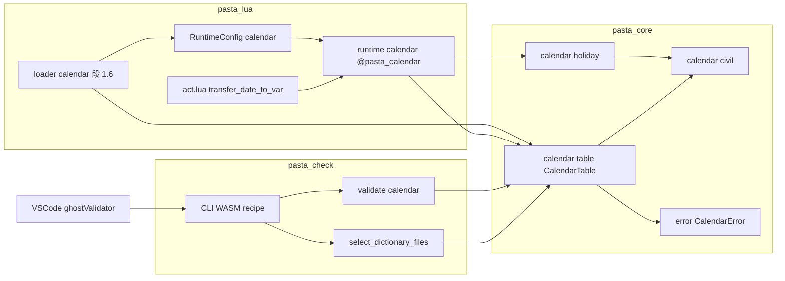
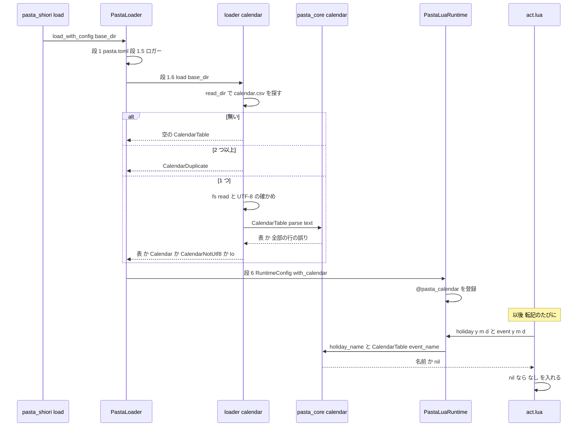

# 設計書: date-var-calendar

## Overview

**Purpose**: 日時変数に `＄祝日`（今の法律の規則から数えた祝日の名前）と `＄行事`（作者の表 `ghost/master/calendar.csv` から引いた行事の名前）を足し、当たらない日は `なし` を入れる。作者は `＞「祝日_」＆＄祝日`・`＞「行事_」＆＄行事` と Call するだけで、祝日・行事ごとのシーンへ Lua なしで振り分けられる。

**Users**: ゴーストの作者が、祝日や誕生日・お正月などの日にその日らしいトークを出すのに使う。見本のゴースト hello-pasta は定番の行事（バレンタイン・ハロウィンなど）の表とトークを持ち、入門ガイドの新しい 13 段目として教える。

**Impact**: 祝日の規則と表の読み取り・照合を `pasta_core` に新しく置き、pasta.dll のローダ（読み込みの段 1.6）と `pasta_check validate` の核の両方が同じ規則を呼ぶ（`SceneAliasTable`・`ActorFont` と同じ層の分け方）。Lua へは Rust のモジュール `@pasta_calendar` で渡し、`act.lua` の `transfer_date_to_var` が `＄節句` の隣で 2 つの変数を入れる。表が無いゴーストの読み込みと、既存の日時変数は変わらない。

### Goals

- `＄祝日`・`＄行事` が、既存の日時変数と同じ日付（仮想時刻・`X-Pasta-Time` 込み）から、転記のたびに名前か `なし` で入る。
- 祝日の規則が、2022 年から内閣府の CSV の最後の年までの全部の日で CSV と一致し、テストがネットワークなしで確かめる。
- `calendar.csv` の書き間違いが、pasta.dll ではファイル名と行番号付きの読み込みエラーに、`pasta_check validate` では同じ行の誤りになる（判定は同じコード）。
- hello-pasta が定番の行事の表とトークを持ち、入門ガイドの 13 段目（`13-calendar.pasta`）として教え、配布を 14 段目にする。

### Non-Goals

- 内閣府の CSV の同梱・読み込み、pasta 本体の既定の行事の表、`＄行事` 以外の行事の変数。
- TOML の `[calendar]`、iCalendar、「第 n 曜日」の書き方、`YYYYMMDD-YYYYMMDD`。
- 二十四節気・雑節、英語名の変数、祝日の規則の設定（外す・足す）、2019〜2021 年の特例と 2019 年までの名前。
- 祝日・行事の値のメモ化（転記ごとに数え直す。理由は「Performance」）。
- `pasta-recipe` の再検査のきっかけの変更（殻は核が選んだファイルを読むので、診断には自然に出る）。

## Boundary Commitments

### This Spec Owns

- 祝日の規則（年・月・日 → 祝日の名前。固定の日・ハッピーマンデー・春分／秋分の式・振替休日・国民の休日）と、名前の文字列。
- `calendar.csv` の書式（1 行の読み方・3 つの日付の書き方・空白の取り除き・注釈・BOM）・誤りの種類・照合（書いた順の先勝ち）。
- ファイル名の判定（`calendar.csv` を大文字・小文字を区別せずに探す規則と、2 つ以上あるときの扱い）。
- ローダの段 1.6（`calendar.csv` の読み込みと検査）と、そこで出る `LoaderError` の 3 つの種類。
- Rust のモジュール `@pasta_calendar` の形（`holiday`・`event` の 2 つの関数）と、`transfer_date_to_var` での `＄祝日`・`＄行事` の転記。
- `pasta_check validate` の `calendar-invalid` の報告と、VSCode の拡張機能の再検査のきっかけへの `calendar.csv` の追加。
- 答え合わせのデータ（内閣府の CSV を UTF-8・LF に直したもの）と出典の文書、その crates.io のパッケージからの除外。
- hello-pasta の `calendar.csv`・`13-calendar.pasta`、入門ガイドの 13 段目の章と 14 段目への付け替え、段階表と段階の検査の更新。
- マニュアル（日時変数の表・注意文・例・`calendar.csv` の書き方の節・検査の誤りの一覧・ローダの段階表・VM のモジュール一覧）と、`pasta-ghost-authoring` の生成の `references/variables.md` の再生成。

### Out of Boundary

- イベントのシーンを選ぶ前の自動転記の仕組み（`scene-condition-attributes`）。`transfer_date_to_var` に足せば乗る。呼ぶ場面は変えない。
- 条件の書き方（`＆＄祝日≠「なし」`・`＆＄行事＝「お正月」` は今の書き方のまま書ける）、Call の前方一致の規則。
- 仮想時刻の仕組み（`pasta.shiori.clock` の `CLOCK.date`）。使うだけで変えない。
- `[scene.alias]`・`[actor].font` の読み込みと検査。エラーの扱いを揃えるだけで、コードは触らない。
- `pasta_check` の殻（CLI の `ghost_files::collect`・WASM の `wasm_select_ghost_files`・`pasta-recipe` の `check.rs`）の読み方。核が返すパスが 1 つ増えるだけで、殻のコードは変えない。
- `pasta-ghost-authoring` の SKILL.md の description のキーワード（任意。足さない）と、完了時のスキルの手書きファイルの同期（`/kiro-complete` の §2 が扱う）。

### Allowed Dependencies

- `pasta_core::calendar` は Rust の標準ライブラリと `thiserror`（既存）だけに依存する。日付のクレート（`chrono` など）と CSV のクレートは足さない。
- `pasta_lua` のローダとランタイムは `pasta_core::calendar` を呼ぶ。`pasta_check` の核は `pasta_core::calendar` を呼び、`std::fs` に触れない（今の核の約束のまま）。
- `act.lua` は `@pasta_calendar` を呼び出しのたびに `pcall(require, …)` で取る（`pasta/act.lua`・`pasta/actor.lua` の `@pasta_search` の前例）。`pasta_scripts` から `io.open` でファイルを読まない。
- 依存の向き: `pasta_core::calendar` → `pasta_lua::loader::calendar`／`pasta_lua::runtime::calendar` → `act.lua`、および `pasta_core::calendar` → `pasta_check::validate::calendar` → 殻。逆向き（`pasta_core` が `pasta_lua`・`pasta_check` を知る）は違反とする。

### Revalidation Triggers

- 祝日の法律が変わる（祝日の追加・移動・名前の変更）: `holiday.rs` の規則と、答え合わせのデータの差し替え・テストの年の範囲。
- `@pasta_calendar` の関数の形の変更: `act.lua`・Lua のテストの実行器・`execution-model.md`。
- `CalendarProblem` の種類の追加・変更: ローダのエラーの文、`pasta_check` の文と `validate.md`、一致テスト。
- `transfer_date_to_var` の呼ばれる場面の変更（`scene-condition-attributes` 側）: `＄祝日`・`＄行事` の入る場面も同じく変わる。
- 入門ガイドの段の追加・並べ替え: 段階表・`tutorial_stages_test.rs` の段の数・`AUTHORING.md` の章の数。

## Architecture

### Existing Architecture Analysis

- 日時変数の転記は `act.lua` の `SHIORI_ACT_IMPL.transfer_date_to_var` 1 か所で、日付は `CLOCK.date(self.req)` から取る。`＄節句` は `SEKKU_JA[month*100+day] or "なし"` の 1 行。イベントのシーン・時報・ランダムトークの前の自動転記も同じ関数を呼ぶ。
- 設定の誤りを読み込みのエラーにする型は 2 つある（`[scene.alias]`・`[actor].font`）。どちらも規則は `pasta_core`、行番号付けは `pasta_lua::loader::config`、検査は `pasta_check::validate::config` で、pasta.dll と `pasta_check` が同じ規則を呼ぶ。`LoaderError` は `pasta_shiori` の `last_load_error` に覚えられ、以後の要求は 500 で理由（`X-ERROR-REASON`）を返す。
- Rust のモジュールは `package.loaded` に登録する。`@pasta_log`・`@toml` は基底のランタイム（`with_config_and_source_map`）で常に登録し、Lua のテストの実行器（`tests/lua_unittest_runner.rs`）は `persistence::register`・`log::register` などの公開の関数で登録する。
- `pasta_check` の核は `select_dictionary_files` が返したパスの中身だけを受け取る。3 つの殻はその一覧のとおりに読む。`FileNotUtf8`・`FileUnreadable` は飛び先と条件の検査を省く理由になる（`skip_reasons`）。

### Architecture Pattern & Boundary Map



**Architecture Integration**:
- Selected pattern: 規則を `pasta_core` に置き、pasta.dll と `pasta_check` で共有する（ギャップ分析の案 B。祝日の規則も同じ `pasta_core::calendar` に置く）。祝日の規則を Rust に置くのは、答え合わせを `pasta_core` の結合テストだけで閉じられ、`@pasta_calendar` 1 つで表と祝日を Lua へ渡せるため（案 C の Lua の祝日の関数とテストへのデータの受け渡しが要らない）。
- Domain/feature boundaries: 「日付の算術」「祝日の規則」「表の書式と照合」は `pasta_core` の純粋な関数。「ファイルを探して読む」は pasta.dll ではローダ、`pasta_check` では殻と核（パスの選択）に分かれ、どちらもファイル名の判定 `is_calendar_file_name` を共有する。
- Existing patterns preserved: `SceneAliasTable`／`ActorFont` の層の分け方、`RuntimeConfig::with_scene_aliases` と同じ組み立て方（`with_calendar`）、`＄節句` の「当たらなければ `なし`」、`@pasta_search` の呼び出しごとの `pcall(require)`、`ConfigActorFont` の「誤りでも辞書の検査を省かない」。
- New components rationale: 祝日の規則は今のコードに無い。表の誤りは今の `LoaderError::Config`（`toml::de::Error` を持つ）に入らないので、新しい種類を足す。`@pasta_calendar` は表をローダから Lua へ渡す唯一の口。
- Steering compliance: pasta は UTF-8 で動かす（文字コードを推測しない）。依存は増やさない。書式の CSV は開発者の判断（2026-11-14）による TOML の方針の例外。

### Technology Stack

| Layer | Choice / Version | Role in Feature | Notes |
|-------|------------------|-----------------|-------|
| 規則（Rust） | `pasta_core`（Rust 2024・既存の `thiserror`） | 日付の算術・祝日の規則・表の書式と照合・誤りの型 | 新しい依存なし。日付は通日（1970-01-01 起点）の整数算術 |
| ランタイム（Rust） | `pasta_lua`（`mlua` 0.12・LuaJIT） | 段 1.6 の読み込み、`@pasta_calendar` の登録 | 既存の登録の型（`runtime/module_registry.rs` の `set_loaded_module`） |
| ランタイム（Lua） | `pasta_scripts/pasta/shiori/act.lua` | `＄祝日`・`＄行事` の転記 | 2 変数の追加のみ |
| 検査 | `pasta_check`（核・CLI・WASM） | `calendar-invalid` の報告 | 殻のコードは変えない |
| エディタ | `editors/vscode`（TypeScript） | `calendar.csv` の保存・作成・削除で再検査 | `ghostValidator.ts` の判定に 1 条件 |
| 文書 | mdBook（`book/`）・`book/tools/*.mjs` | マニュアル・入門の章・段階の検査・スキルの資料の生成 | `gen-skill-refs.mjs` の対応表は変えない |

## File Structure Plan

### Directory Structure

```
crates/pasta_core/
├── src/calendar/
│   ├── mod.rs        # 公開の口: CALENDAR_FILE_NAME・is_calendar_file_name・holiday_name・CalendarTable の再公開
│   ├── civil.rs      # 日付の算術: うるう年・月の日数・通日⇄年月日・曜日（他モジュール専用・pub(crate)）
│   ├── holiday.rs    # 祝日の規則（固定の日・ハッピーマンデー・春分／秋分・振替休日・国民の休日）と単体テスト
│   └── table.rs      # calendar.csv の書式の読み取り・誤り・照合（CalendarTable）と単体テスト
└── tests/
    ├── holiday_cao_test.rs          # 内閣府の CSV との全日の答え合わせ（crates.io のパッケージから除外）
    └── fixtures/syukujitsu/
        ├── syukujitsu.csv           # 内閣府の CSV を UTF-8・LF に直したもの（除外）
        └── README.md                # 出典の文書（データセット ID・URL・取得日・ライセンス・加工・配布物に入らないこと）

crates/pasta_lua/
├── src/loader/calendar.rs           # 段 1.6: ghost/master から calendar.csv を探して読み、CalendarTable か LoaderError を返す
├── src/runtime/calendar.rs          # @pasta_calendar の表（holiday・event）を作る pub fn register
└── tests/loader/calendar_test.rs    # 読み込みのエラー・ファイル名の大文字小文字・無いとき・読み込み直し

crates/pasta_check/
├── src/validate/calendar.rs         # 核: calendar.csv のパスの選択と、CalendarError → Finding の変換
└── tests/validate_calendar_test.rs  # 誤りの種類ごとの報告・辞書の検査を省かないこと

crates/pasta_sample_ghost/ghosts/hello-pasta/ghost/master/
├── calendar.csv                     # 定番の行事の表（Req 10.1 の 6 行以上）
└── dic/13-calendar.pasta            # 13 段目: ＞「行事_」＆＄行事 で振り分ける場面と行事ごとのシーン

book/src/getting-started/
├── 13-calendar.md                   # 新しい 13 段目「季節の行事でしゃべらせたい」
└── 14-nar.md                        # 今の 13-nar.md を改名（14 段目：配布したい）
```

### Modified Files

- `crates/pasta_core/src/lib.rs` — `pub mod calendar;`、`CalendarTable`・`CalendarError`・`CalendarProblem` の再公開。
- `crates/pasta_core/src/error.rs` — `CalendarError`・`CalendarProblem` を足す（英語の Display。既存の誤りの型と同じ書き方）。
- `crates/pasta_core/Cargo.toml` — `exclude = ["tests/fixtures/syukujitsu/", "tests/holiday_cao_test.rs"]`。
- `crates/pasta_lua/src/loader/mod.rs` — `mod calendar;`、段 1.6 で `calendar::load(base_dir)?`、段 6 で `runtime_config.with_calendar(table)`。
- `crates/pasta_lua/src/loader/error.rs` — `LoaderError::Calendar`・`CalendarNotUtf8`・`CalendarDuplicate` を足す。
- `crates/pasta_lua/src/runtime/runtime_config.rs` — `pub calendar: CalendarTable` と `with_calendar`（既存の 4 つの構築子は空の表）。
- `crates/pasta_lua/src/runtime/mod.rs` — `pub mod calendar;`、`with_config_and_source_map` で `@pasta_calendar` を登録（`@pasta_log`・`@toml` と同じく常に）。
- `crates/pasta_lua/pasta_scripts/pasta/shiori/act.lua` — `transfer_date_to_var` に `＄祝日`・`＄行事` の 2 行と `pcall(require, "@pasta_calendar")`。
- `crates/pasta_lua/tests/lua_unittest_runner.rs` — `@pasta_calendar` を空の表で登録。
- `crates/pasta_lua/tests/lua_specs/shiori_act_test.lua` — `＄祝日`・`＄行事` の転記の事例。
- `crates/pasta_lua/tests/loader/main.rs` — `mod calendar_test;`。
- `crates/pasta_shiori/tests/fixtures/virtual_clock/calendar.csv`（新規）・`dic/clock.pasta`・`tests/virtual_clock_e2e_test.rs` — `X-Pasta-Time` で祝日・行事に振り分ける事例。
- `crates/pasta_check/src/validate/mod.rs` — `mod calendar;`、`select_dictionary_files` に表のパスを加える、`validate_ghost` で設定の検査（`config::read_config`）の直後に `calendar::check` を呼ぶ（`CalendarInvalid` は `skip_reasons` の対象に入れない）。
- `crates/pasta_check/src/validate/report.rs` — `FindingKind::CalendarInvalid`（`calendar-invalid`・誤り。`ConfigActorFont` の後）と `msg::calendar_*` の文。
- `crates/pasta_check/tests/validate_parity_test.rs` — `load_failure_matches_errors` に表の事例（正しい表・各誤り・`Calendar.CSV`・フォルダの `calendar.csv`）。
- `editors/vscode/src/ghostValidator.ts`・`editors/vscode/src/test/ghostValidator.test.ts` — master の直下の `calendar.csv`（大文字・小文字を区別しない）の保存・作成・削除で再検査。
- `crates/pasta_sample_ghost/STAGES.md` — 段階表に 13 段目を足し、配布を 14 段目に。注記（辞書を持つ段は 1〜13・13 段目の辞書が配布辞書）、ファイル名の規則（`01`〜`13`）、組み立て方の「段階ごとに変わるのは `dic/` の `.pasta` だけ」に「13 段目だけ `ghost/master/calendar.csv` も足す」の例外、「14 段目：配布したい」の節、道具の節の段の番号を直す。
- `crates/pasta_sample_ghost/tests/tutorial_stages_test.rs` — 段の数 13→14、ファイルの無い段 13→14、検証イベント表の範囲 1〜13、`calendar.csv` の名前ごとに `＊行事_名前` があり `＊行事_なし` があることの確かめ。
- `crates/pasta_sample_ghost/tests/touch_shortcuts_test.rs`・`crates/pasta_sample_ghost/README.md` — 「12 段目＝配布辞書」の記述を 13 段目に、ファイルの木に `13-calendar.pasta`・`calendar.csv`。
- `book/src/getting-started/index.md`・`book/src/SUMMARY.md`・`book/src/getting-started/06-hour.md`・`book/src/debug/recipe.md` — 14 段目への付け替えとリンク。
- `book/AUTHORING.md` — 入門の章の数（16→17）・段の章の範囲（`01-boot.md`〜`14-nar.md`）・辞書を持たない段（14 段目・`14-nar.md`）、`csv` ブロックは hello-pasta の `calendar.csv` と照合されること。
- `.github/workflows/manual.yml` — push・pull_request の `paths` に `crates/pasta_sample_ghost/ghosts/hello-pasta/ghost/master/calendar.csv` を足し（`calendar.csv` だけを変えた PR でも `csv` ブロックの照合を走らせる）、注記の「入門の章 12 枚（01-boot.md〜12-lua.md）」を「13 枚（01-boot.md〜13-calendar.md）」に、照合の説明に `calendar.csv` ↔ `csv` ブロックを足す。
- `book/tools/tutorial-check.mjs`・`book/tools/tutorial-check-test.mjs` — 入門の章の ```` ```csv ```` ブロックと hello-pasta の `calendar.csv` の逐語の照合、`13-nar.md` の見本を `14-nar.md` に。
- `book/src/grammar/variables.md` — 日時変数の表・名前の衝突の注意文・振り分けの例に `＄祝日`・`＄行事`、新しい節「行事の表（calendar.csv）」。
- `book/src/debug/validate.md` — `calendar-invalid` の行と、省く理由にならないことの一文。
- `book/src/internals/loader.md` — 段階表に 1.6。
- `book/src/internals/execution-model.md` — モジュール登録の一覧に `@pasta_calendar`。
- `.claude/skills/pasta-ghost-authoring/references/variables.md` — `node book/tools/gen-skill-refs.mjs` で再生成（手で書かない）。

## System Flows



- 段 1.6 の誤りはどれも `LoaderError` として `load_with_config` から返り、以後の段（ディレクトリの作成・自己展開・トランスパイル）は走らない。`pasta_shiori` は今の経路のまま `last_load_error` に覚え、要求に 500 と理由を返す（`[scene.alias]` と同じ見え方）。
- 表は読み込みのときに 1 回だけ読み、VM の `@pasta_calendar` の関数が捕まえる。読み込み直し（SHIORI の `load`）は VM ごと作り直すので、新しい表が効く。

## Requirements Traceability

| Requirement | Summary | Components | Interfaces | Flows |
|-------------|---------|------------|------------|-------|
| 1.1 | 転記で `＄祝日` に名前か `なし` | DateVarTransfer, CalendarModule, HolidayRules | `holiday` | 転記 |
| 1.2 | `＄祝日` を空にしない | DateVarTransfer | `or "なし"` | 転記 |
| 1.3 | 日付は `＄年` などと同じ | DateVarTransfer | `CLOCK.date` | 転記 |
| 1.4 | 日付が無ければ入れない | DateVarTransfer | 既存の早期 return | 転記 |
| 1.5 | 作者の設定なしで入る | CalendarModule, HolidayRules | `holiday_name` | — |
| 2.1 | 固定の日 10 個 | HolidayRules | `holiday_name` | — |
| 2.2 | ハッピーマンデー 4 個 | HolidayRules, CivilDate | `holiday_name` | — |
| 2.3 | 春分・秋分の式をどの年にも | HolidayRules | `equinox_day` | — |
| 2.4 | 振替休日 | HolidayRules | `holiday_name` | — |
| 2.5 | 国民の休日 | HolidayRules | `holiday_name` | — |
| 2.6 | 名前は内閣府の CSV と同じ | HolidayRules | 名前の定数 | — |
| 2.7 | 表でなく規則から | HolidayRules | — | — |
| 2.8 | 2022〜最後の年で CSV と一致 | HolidayRules, HolidayAnswerTest | — | — |
| 2.9 | 特例を再現しない | HolidayRules | — | — |
| 3.1 | 先に書いた行の名前 | CalendarTable, DateVarTransfer | `event_name` | 転記 |
| 3.2 | 当たらなければ `なし` | DateVarTransfer | `or "なし"` | 転記 |
| 3.3 | ファイルが無ければいつも `なし` | CalendarLoader, CalendarTable | 空の表 | 段 1.6 |
| 3.4 | 同じ名前を複数行に | CalendarTable | `parse` | — |
| 3.5 | 書き方で優先を付けない | CalendarTable | `event_name` | — |
| 3.6 | 日付は `＄年` などと同じ | DateVarTransfer | `CLOCK.date` | 転記 |
| 3.7 | 日付が無ければ入れない | DateVarTransfer | 既存の早期 return | 転記 |
| 3.8 | 祝日と別々に決める | CalendarModule, DateVarTransfer | `holiday`・`event` | 転記 |
| 4.1 | `ghost/master/calendar.csv`・大文字小文字を区別しない | CalendarLoader, CalendarCheck | `is_calendar_file_name` | 段 1.6 |
| 4.2 | 1 行 1 件・`日付,名前` | CalendarTable | `parse` | — |
| 4.3 | `MMDD` | CalendarTable | `DateSpec::MonthDay` | — |
| 4.4 | `MMDD-MMDD` | CalendarTable | `DateSpec::Range` | — |
| 4.5 | 年をまたぐ範囲 | CalendarTable | `DateSpec::Range` | — |
| 4.6 | `YYYYMMDD`（0001〜9999） | CalendarTable | `DateSpec::Date` | — |
| 4.7 | `0229` はうるう年だけ | CalendarTable, CivilDate | `days_in_month` | — |
| 4.8 | UTF-8 として読む | CalendarLoader, CalendarCheck | `String::from_utf8`・`FileText` | 段 1.6 |
| 4.9 | CRLF と LF | CalendarTable | `str::lines` | — |
| 4.10 | 空行・`#` の行を飛ばす | CalendarTable | `parse` | — |
| 4.11 | BOM を飛ばす | CalendarTable | `parse` | — |
| 4.12 | 欄の前後の空白（全角を含む） | CalendarTable | `parse` | — |
| 4.13 | 名前は空でなければ何でも | CalendarTable | `parse` | — |
| 5.1 | 日付の形の誤り | CalendarTable, CalendarLoader | `CalendarProblem::BadDateForm` | 段 1.6 |
| 5.2 | 暦に無い日付・0000 年 | CalendarTable | `CalendarProblem::NoSuchDate` | 段 1.6 |
| 5.3 | 欄の数が 2 でない | CalendarTable | `CalendarProblem::FieldCount` | 段 1.6 |
| 5.4 | 引用符 | CalendarTable | `CalendarProblem::Quote` | 段 1.6 |
| 5.5 | 名前が空 | CalendarTable | `CalendarProblem::EmptyName` | 段 1.6 |
| 5.6 | UTF-8 で読めない | CalendarLoader | `LoaderError::CalendarNotUtf8` | 段 1.6 |
| 5.7 | あるのに読めない | CalendarLoader | `LoaderError::Io` | 段 1.6 |
| 5.8 | 警告で続けない・既定に戻さない | CalendarLoader | `LoaderError` | 段 1.6 |
| 5.9 | 読み込みのときに 1 回 | CalendarLoader, CalendarModule | 捕まえた表 | 段 1.6 |
| 5.10 | 読み込み直しで反映 | CalendarLoader | VM の作り直し | 段 1.6 |
| 5.11 | 大文字・小文字だけ違う表が 2 つ以上 | CalendarLoader, CalendarCheck | `LoaderError::CalendarDuplicate`・重複の誤り | 段 1.6 |
| 6.1 | `pasta_check validate` で検査 | CalendarCheck | `calendar::check` | — |
| 6.2 | 検査の失敗として終わる | CalendarCheck | `Severity::Error` | — |
| 6.3 | ファイルが無ければ何も報告しない | CalendarCheck | `calendar::check` | — |
| 6.4 | ランタイムと判定が食い違わない | CalendarCheck, CalendarTable | 同じ `parse`・`is_calendar_file_name` | — |
| 6.5 | 辞書の検査を省かない | CalendarCheck | `skip_reasons` に入れない | — |
| 6.6 | VSCode の保存・作成・削除で再検査 | VSCodeTrigger | `ghostValidator.ts` | — |
| 7.1 | 既存の変数を変えない | DateVarTransfer | — | 転記 |
| 7.2 | 転記の場面を変えない | DateVarTransfer | — | 転記 |
| 7.3 | 表が無ければ読み込みの成否は同じ | CalendarLoader | 空の表 | 段 1.6 |
| 7.4 | シーンでの代入が効く | DateVarTransfer | 既存の `act.var` | 転記 |
| 8.1 | 全日の答え合わせ | HolidayAnswerTest | — | — |
| 8.2 | UTF-8・LF でコミット・配布物に入れない | HolidayAnswerTest | `exclude` | — |
| 8.3 | 振替・国民の休日・ハッピーマンデーの境目の事例 | HolidayRules（単体テスト） | — | — |
| 8.4 | 表の読み方の事例 | CalendarTable（単体テスト）, CalendarLoader（結合テスト） | — | — |
| 8.5 | 各誤りで読み込み失敗と `pasta_check` の報告 | CalendarLoader, CalendarCheck（一致テスト） | — | — |
| 8.6 | 仮想時刻・`X-Pasta-Time` に従う | DateVarTransfer（SHIORI の結合テスト） | — | 転記 |
| 8.7 | 出典の文書 | HolidayAnswerTest | `README.md` | — |
| 8.8 | ネットワークなし | HolidayAnswerTest | `include_str!` | — |
| 9.1 | 日時変数の表 | ManualDocs | `variables.md` | — |
| 9.2 | 振り分けの例と `＊祝日_なし`・`＊行事_なし` | ManualDocs | `variables.md` | — |
| 9.3 | 表の書き方の節 | ManualDocs | `variables.md` | — |
| 9.4 | 祝日の決め方の説明 | ManualDocs | `variables.md` | — |
| 9.5 | 名前の衝突の注意文 | ManualDocs | `variables.md` | — |
| 9.6 | 「第 n 曜日」は条件で書けると案内 | ManualDocs | `variables.md` | — |
| 9.7 | hello-pasta の 13 段目を案内 | ManualDocs | `variables.md` | — |
| 9.8 | 行事の名前の前方一致の注意 | ManualDocs | `variables.md` | — |
| 9.9 | 検査の誤りの一覧 | ManualDocs | `validate.md` | — |
| 9.10 | `references/` の再生成 | ManualDocs | `gen-skill-refs.mjs` | — |
| 10.1 | 定番の行事の表・前方一致させない | SampleGhostStage13 | `calendar.csv` | — |
| 10.2 | 行事ごとのシーン・`＊行事_なし`・振り分ける場面 | SampleGhostStage13 | `13-calendar.pasta` | — |
| 10.3 | 母の日・父の日・節分を入れない | SampleGhostStage13 | `calendar.csv` | — |
| 10.4 | `pasta_check validate` を誤りなしで通る | SampleGhostStage13 | 既存の `test_validate_hello_pasta_clean` | — |
| 10.5 | 13 段目として教え配布を 14 段目に | SampleGhostStage13 | `13-calendar.md`・`14-nar.md` | — |
| 10.6 | 段階表・章・段階の検査の更新 | SampleGhostStage13 | `STAGES.md`・検査 | — |
| 10.7 | 本体に既定の表を持たない | CalendarLoader | ゴーストの表だけ | 段 1.6 |

## Components and Interfaces

| Component | Domain/Layer | Intent | Req Coverage | Key Dependencies (P0/P1) | Contracts |
|-----------|--------------|--------|--------------|--------------------------|-----------|
| CivilDate | pasta_core | 日付の算術 | 2.2, 2.4, 2.5, 4.7 | なし | Service |
| HolidayRules | pasta_core | 年月日 → 祝日の名前 | 1.5, 2.1〜2.9, 8.3 | CivilDate (P0) | Service |
| CalendarTable | pasta_core | 表の書式・誤り・照合 | 3.1, 3.4, 3.5, 4.2〜4.13, 5.1〜5.5, 6.4 | CivilDate (P0) | Service, State |
| CalendarLoader | pasta_lua loader | 段 1.6: 探す・読む・検査 | 3.3, 4.1, 4.8, 5.1〜5.10, 7.3, 10.7 | CalendarTable (P0) | Service |
| CalendarModule | pasta_lua runtime | `@pasta_calendar` | 1.1, 1.5, 3.8, 5.9 | HolidayRules (P0), CalendarTable (P0) | Service |
| DateVarTransfer | act.lua | `＄祝日`・`＄行事` の転記 | 1.1〜1.4, 3.1〜3.3, 3.6〜3.8, 7.1〜7.4, 8.6 | CalendarModule (P0), CLOCK (P0) | State |
| CalendarCheck | pasta_check 核 | `calendar-invalid` の報告 | 4.1, 4.8, 6.1〜6.5, 8.5 | CalendarTable (P0) | Service |
| VSCodeTrigger | editors/vscode | 再検査のきっかけ | 6.6 | CalendarCheck (P1) | Event |
| HolidayAnswerTest | pasta_core tests | 内閣府の CSV との答え合わせ | 2.8, 8.1, 8.2, 8.7, 8.8 | HolidayRules (P0) | Batch |
| SampleGhostStage13 | hello-pasta・入門 | 定番の行事と 13 段目 | 10.1〜10.6 | DateVarTransfer (P1) | — |
| ManualDocs | book・skills | マニュアルと生成の資料 | 9.1〜9.10 | — | — |

### pasta_core

#### CivilDate（`calendar/civil.rs`）

`pub(crate)` の小さな関数の集まり（要約のみ）: `is_leap(year: i32) -> bool`、`days_in_month(year: i32, month: u32) -> u32`（1〜12 以外は 0）、`days_from_civil(y, m, d) -> i64`（1970-01-01 を 0 とする通日。Howard Hinnant の算術）、`civil_from_days(z: i64) -> (i32, u32, u32)`、`weekday(z: i64) -> u32`（0＝日曜。`(z + 4).rem_euclid(7)`）。負の年・1970 年より前でも同じ式で働く（`os.time` を使わない）。

#### HolidayRules（`calendar/holiday.rs`）

| Field | Detail |
|-------|--------|
| Intent | 年・月・日から、その日の祝日の名前を返す |
| Requirements | 1.5, 2.1, 2.2, 2.3, 2.4, 2.5, 2.6, 2.7, 2.9, 8.3 |

**Responsibilities & Constraints**
- 「1.〜3. の祝日」（以下、基本の祝日）を `base(y, m, d) -> Option<&'static str>` で決める: 固定の日 10 個（Req 2.1 の名前どおり）、ハッピーマンデー 4 個（第 n 月曜日＝日が `7n−6`〜`7n` の月曜日）、春分の日・秋分の日（3 月・9 月の `equinox_day(y)` の日）。
- `holiday_name(y, m, d)`: 基本の祝日ならその名前。そうでなく、前の日から遡って基本の祝日が切れ目なく続き、その中に日曜日があれば `振替休日`。そうでなく、前の日と次の日がどちらも基本の祝日なら `国民の休日`。どれでもなければ `None`。前後の日は通日の ±1 で数え、月・年をまたいでもよい。
- 振替休日と国民の休日の両方に当たる日は `振替休日` を返す（法律の条の順。今の規則では起こらない組み合わせで、どちらも内閣府の CSV では `休日`）。
- 春分・秋分の式（年の範囲で区切らない。Req 2.3）: `t = y − 1980`、春分の日 `= floor(20.8431 + 0.242194·t − floor(t / 4))`、秋分の日 `= floor(23.2488 + 0.242194·t − floor(t / 4))`。`floor(t / 4)` は整数の切り下げ（`div_euclid`）、外側は `f64::floor`。式は 1 年に約 0.0078 日ずれ、春分はおよそ 550〜4520 年、秋分はおよそ 990〜4830 年の外で月の日の範囲を外れるので、式の日を `i64` で求めて `1..=days_in_month(y, 3 または 9)` に収める（clamp。どの年でも春分の日・秋分の日を 1 日ずつ出す。Req 2.3）。2022〜2028 年の官報・暦要項の日と一致することを単体テストで確かめる。
- 2019〜2021 年の特例・2019 年までの名前は持たない（Req 2.9）。日付が暦に無いとき（2 月 30 日など）は `None`。

**Dependencies**
- Inbound: CalendarModule — `holiday` の実体 (P0)、HolidayAnswerTest (P0)
- Outbound: CivilDate — 曜日・前後の日 (P0)

**Contracts**: Service [x]

##### Service Interface
```rust
/// 年月日（暦にある日）の祝日の名前。祝日でなければ None。
pub fn holiday_name(year: i32, month: u32, day: u32) -> Option<&'static str>;
```
- Preconditions: なし（暦に無い日は `None`）。
- Postconditions: 返す名前は `元日`・`成人の日`・`建国記念の日`・`天皇誕生日`・`春分の日`・`昭和の日`・`憲法記念日`・`みどりの日`・`こどもの日`・`海の日`・`山の日`・`敬老の日`・`秋分の日`・`スポーツの日`・`文化の日`・`勤労感謝の日`・`振替休日`・`国民の休日` のどれか。
- Invariants: 状態を持たない純粋な関数。

**Implementation Notes**
- Validation: 単体テストで名前付きの事例（Req 8.3）: 振替休日（例 2026-05-06・2025-02-24）、国民の休日（例 2026-09-22。敬老の日 9/21 と秋分の日 9/23 の間）、ハッピーマンデーの境目（例 2024-01-08・2030-01-14 の成人の日）、特例を再現しないこと（例 2019-12-23 は `None`、2019-10-14 は `スポーツの日`）。
- Risks: 2028 年以降の春分・秋分は式による見込み。官報と食い違ったら式か定数を直す（マニュアルに見込みと書く。Req 9.4）。

#### CalendarTable（`calendar/table.rs`・誤りは `error.rs`）

| Field | Detail |
|-------|--------|
| Intent | `calendar.csv` の本文を検査して表にし、日付で名前を引く |
| Requirements | 3.1, 3.4, 3.5, 4.2, 4.3, 4.4, 4.5, 4.6, 4.7, 4.9, 4.10, 4.11, 4.12, 4.13, 5.1, 5.2, 5.3, 5.4, 5.5, 6.4 |

**Responsibilities & Constraints**
- `parse(text)` は 1 行ずつ、物理の行番号（1 始まり）を付けて読む。手順: 先頭の BOM（U+FEFF）を外す → `str::lines`（CRLF と LF を同じに扱う）→ 前後の空白（半角の空白・タブ・全角の空白 U+3000）を外した行が空なら飛ばす、`#` で始まれば飛ばす → 行に `"` があれば `Quote` → `,` で分けた欄が 2 つでなければ `FieldCount` → 各欄の前後の空白を外す → 日付の欄が 3 つの形でなければ `BadDateForm` → 暦に無ければ `NoSuchDate` → 名前が空なら `EmptyName`。1 行につき最初の誤り 1 つを記録し、全部の行を読み終えてから、誤りが 1 つでもあれば全部を返す。
- 日付の形は ASCII の数字だけ: 4 桁（`MMDD`）、`4 桁-4 桁`（`MMDD-MMDD`）、8 桁（`YYYYMMDD`）。それ以外（全角数字・スラッシュ・片側の欠けた範囲・`YYYYMMDD-YYYYMMDD`・見出しの `日付` を含む）は `BadDateForm`。
- 暦の検査: 月は 1〜12。`MMDD`（範囲の両端を含む）の日は、うるう年の月の日数まで（`0229` を受け付ける）。`YYYYMMDD` の年は 1〜9999、日はその年の月の日数まで（`20270229`・`00000101` は `NoSuchDate`）。
- `event_name(y, m, d)` は書いた順に行を見て、最初に当たった行の名前を返す。当たり方: `MonthDay(md)` は `m*100+d == md`、`Range{start,end}` は `start ≤ end` なら `start ≤ key ≤ end`、そうでなければ `key ≥ start` または `key ≤ end`（年をまたぐ）、`Date{year, md}` は年も一致。2 月 29 日はうるう年にしか日付として来ないので、`0229` は自然にうるう年だけ当たる。
- 名前は空でなければ何でもよい（`なし` も受け付ける。Req 4.13）。同じ名前の行が複数あってよい。

**Dependencies**
- Inbound: CalendarLoader (P0)、CalendarCheck (P0)、CalendarModule (P0)
- Outbound: CivilDate — 月の日数 (P0)

**Contracts**: Service [x] / State [x]

##### Service Interface
```rust
pub const CALENDAR_FILE_NAME: &str = "calendar.csv";

/// ghost/master の直下のファイル名が行事の表か（ASCII の大文字・小文字を区別しない）
pub fn is_calendar_file_name(name: &str) -> bool;

#[derive(Debug, Clone, Default, PartialEq, Eq)]
pub struct CalendarTable { /* entries: Vec<CalendarEntry>（書いた順） */ }

impl CalendarTable {
    /// 本文（BOM 付きでもよい）を検査する。誤りがあれば全部の行の誤りを行の順に返す
    pub fn parse(text: &str) -> Result<CalendarTable, Vec<CalendarError>>;
    /// その日に当たる最初の行の名前
    pub fn event_name(&self, year: i32, month: u32, day: u32) -> Option<&str>;
}

// error.rs（英語の Display。行番号は物理の行・1 始まり）
#[derive(Error, Debug, Clone, PartialEq, Eq)]
#[error("line {line}: {problem}")]
pub struct CalendarError { pub line: usize, pub problem: CalendarProblem }

#[derive(Error, Debug, Clone, PartialEq, Eq)]
pub enum CalendarProblem {
    Quote,                          // 引用符（"）は使えない
    FieldCount { count: usize },    // 欄は「日付,名前」の 2 つ
    BadDateForm { written: String },// MMDD・MMDD-MMDD・YYYYMMDD のどれでもない
    NoSuchDate { written: String }, // 暦に無い（0000 年を含む）
    EmptyName,                      // 名前が空
}
```
- Preconditions: `text` は UTF-8 として読めた本文（文字コードの判定は呼ぶ側）。
- Postconditions: `Ok` の表は 1 行以上の誤りを含まない。`Err` は空でない。
- Invariants: 表は作った後に変わらない。同じ本文には同じ結果。

##### State Management
- State model: `Vec<CalendarEntry { date: DateSpec, name: String }>`。`DateSpec` は `MonthDay(u32)`・`Range { start: u32, end: u32 }`・`Date { year: i32, md: u32 }`（`md` は `月*100+日`）。
- Persistence & consistency: 持ち主は VM（`@pasta_calendar` の関数が捕まえる）。読み込みごとに作り直す。
- Concurrency strategy: 読むだけ。VM 1 つに 1 つ。

**Implementation Notes**
- Validation: 単体テストで Req 8.4 の事例（3 つの書き方・年またぎ・`0229` のうるう年と平年・先勝ち・注釈・空行・BOM・CRLF・全角の空白の取り除き・`なし` の名前）と、Req 5.1〜5.5 の各誤りの行番号（見出しの行・`0101-`・`20270101-20270103`・`0230`・`1301`・`0100`・`20270229`・`00000101`・カンマ 0 個と 2 個・引用符・空の名前）。
- Risks: 行頭の空白の後の `#` も注釈とみなす（「空白だけの行」と同じく空白を外してから見る）。

### pasta_lua

#### CalendarLoader（`loader/calendar.rs`・段 1.6）

| Field | Detail |
|-------|--------|
| Intent | `ghost/master` から行事の表を探して読み、表か読み込みのエラーを返す |
| Requirements | 3.3, 4.1, 4.8, 5.1, 5.2, 5.3, 5.4, 5.5, 5.6, 5.7, 5.8, 5.9, 5.10, 7.3, 10.7 |

**Responsibilities & Constraints**
- `base_dir`（`pasta.toml` のあるフォルダ＝`ghost/master`）を `read_dir` で 1 回見て、名前が `is_calendar_file_name` に当たる項目を集める（ファイルかフォルダかで絞らない。ただしシンボリックリンクは `DirEntry::file_type().is_symlink()` で数えない。`pasta_check` の殻 `ghost_files::walk` と release の `copy.rs` がシンボリックリンクを飛ばすので、pasta.dll だけに効いて検査にも `.nar` にも入らない表を作らないため）。OS に任せず一覧で探すので、大文字・小文字を区別するファイルシステムでも `Calendar.CSV` を読む。
- 0 個: 空の表（`＄行事` はいつも `なし`。エラーも警告も出さない）。2 個以上（大文字・小文字だけ違う名前。区別するファイルシステムでだけ起こる）: `CalendarDuplicate`。1 個: `fs::read` の失敗（権限・フォルダなど）は `LoaderError::Io(path, e)`、`String::from_utf8` の失敗は `CalendarNotUtf8(path)`、`CalendarTable::parse` の誤りは `Calendar { path, errors }`。
- 段 1.6 は段 1.5（ロガー）の後、段 1.7（`LoaderContext`）の前。表は段 6 で `RuntimeConfig::with_calendar` に入れる。pasta 本体の既定の表は無い（Req 10.7）。

**Dependencies**
- Inbound: `PastaLoader::load_with_config` (P0)
- Outbound: CalendarTable (P0)、`RuntimeConfig` (P0)

**Contracts**: Service [x]

##### Service Interface
```rust
/// 段 1.6。表が無ければ空の表
pub(crate) fn load(base_dir: &Path) -> Result<CalendarTable, LoaderError>;

// LoaderError に足す種類
#[error("Invalid calendar file: '{path}': {}", format_calendar_errors(errors))] // "line 3: ...; line 7: ..."
Calendar { path: PathBuf, errors: Vec<CalendarError> },
#[error("Calendar file is not valid UTF-8 (save it as UTF-8): '{0}'")]
CalendarNotUtf8(PathBuf),
#[error("More than one calendar file (names differ only in case): {}", format_paths(paths))]
CalendarDuplicate { paths: Vec<PathBuf> },

// RuntimeConfig
pub calendar: CalendarTable;               // 既定は空の表
pub fn with_calendar(self, calendar: CalendarTable) -> Self;
```
- Postconditions: `Err` のとき、ファイル名（絶対パス）と、行に結びつく誤りでは行番号が Display に入る。
- Invariants: ファイルを作らない・書き換えない。

**Implementation Notes**
- Integration: エラーは今の経路（`load_with_config` → `pasta_shiori` の `last_load_error` → 500 と `X-ERROR-REASON`。`single_line` で 1 行）でそのまま見える。バルーンには出ない（`[scene.alias]` と同じ）。
- Validation: `tests/loader/calendar_test.rs` で、無いとき成功（Req 7.3）、`Calendar.CSV` を読む、各誤り（Req 5.1〜5.6）の Display にファイル名と行番号、`calendar.csv` という名前のフォルダで `Io`（Req 5.7 を権限を使わずに確かめる）、表を書き換えて読み込み直すと `@pasta_calendar.event` の値が変わる（Req 5.10）。
- Risks: 段 1.6 の誤りの後はキャッシュの準備（段 2）が走らない。今の `pasta.toml` の誤りと同じ扱い。

#### CalendarModule（`runtime/calendar.rs`・`@pasta_calendar`）

| Field | Detail |
|-------|--------|
| Intent | 祝日の規則と表を Lua から引ける 2 つの関数にする |
| Requirements | 1.1, 1.5, 3.8, 5.9 |

**Responsibilities & Constraints**
- `register(lua, table)` は Lua の表 `{ holiday = fn, event = fn }` を作って返す（`log::register` と同じ形）。`event` は `table` を `Rc` で捕まえる。登録は基底のランタイム `with_config_and_source_map` が `RuntimeConfig.calendar` で常に行う（`@pasta_log`・`@toml` と同じ）。ローダを通らないランタイムでは空の表になる。
- 作者向けの公開の API にはしない（`book/src/lua/modules/` に章を作らず、内部の構造の `execution-model.md` に載せる）。

**Contracts**: Service [x]

##### Service Interface
```rust
pub fn register(lua: &Lua, table: CalendarTable) -> LuaResult<Table>;
```
```lua
---@class PastaCalendar
---@field holiday fun(year: integer, month: integer, day: integer): string|nil  -- holiday_name
---@field event fun(year: integer, month: integer, day: integer): string|nil    -- CalendarTable.event_name
```
- Preconditions: 引数は整数（`CLOCK.date` の値）。整数でなければ Lua のエラー。
- Postconditions: 名前か `nil`。`なし` への置き換えは呼ぶ側（`act.lua`）がする。

**Implementation Notes**
- Integration: `tests/lua_unittest_runner.rs` が `pasta_lua::runtime::calendar::register(&lua, Default::default())` で登録する（ほかの公開の `register` と同じ並び）。
- Risks: 登録しないその場の Lua の環境（`tests/common` など）では `act.lua` の `pcall(require)` が失敗し、2 変数は入らない（その環境での振る舞いは今と同じ）。

### act.lua

#### DateVarTransfer（`pasta/shiori/act.lua` の `transfer_date_to_var`）

要約のみ。`＄節句` の行の後で、`local ok, CAL = pcall(require, "@pasta_calendar")` が成功し `date.year`・`date.month`・`date.day` があるとき、`self.var["祝日"] = CAL.holiday(y, m, d) or "なし"`、`self.var["行事"] = CAL.event(y, m, d) or "なし"` を入れる。日付は既存の `CLOCK.date(self.req)` の `date`（仮想時刻・`X-Pasta-Time` 込み。Req 1.3・3.6）。`self.req.date` が無いときの早期 return（Req 1.4・3.7）、既存の変数（Req 7.1）、呼ばれる場面（Req 7.2）は変えない。転記の後にシーンで代入すれば、今の `act.var` のとおりその値が使われる（Req 7.4）。

**Implementation Notes**
- Validation: `shiori_act_test.lua` に、実物の `@pasta_calendar`（空の表）で祝日の日と平日の `＄祝日`、`＄行事` が `なし`、`package.loaded["@pasta_calendar"]` を差し替えた見本で `event` の値が入ること、日付が無いと入らないこと、代入した値が残ること。

### pasta_check

#### CalendarCheck（`validate/calendar.rs`）

| Field | Detail |
|-------|--------|
| Intent | 核で行事の表を選び、ランタイムと同じ規則で検査して報告する |
| Requirements | 4.1, 4.8, 6.1, 6.2, 6.3, 6.4, 6.5, 8.5 |

**Responsibilities & Constraints**
- `paths(input)`: `input.entries` のうち `/` を含まず `is_calendar_file_name` に当たるもの（昇順）。`select_dictionary_files` はこれを辞書ファイルの後ろに加えて返す（3 つの殻はこの一覧のとおりに読むので変えない）。`Stats.dictionary_files` は数え方を変えない。
- `check(input, files) -> Vec<Finding>`: `input.entries` と `input.dirs` の直下で `is_calendar_file_name` に当たる名前を合わせて数える（ローダの `read_dir` がファイルとフォルダを区別せずに数えるのと同じ）。0 個なら空（Req 6.3）。2 個以上なら各パスに重複の誤り。1 個でそれがフォルダなら読めない誤り。1 個のファイルなら `FileText::Text` → `CalendarTable::parse`（誤りごとに行番号付きの Finding）、`NotUtf8` → UTF-8 で保存し直す誤り、`Unreadable { reason }` → 読めない誤り。
- 報告の種類はすべて `FindingKind::CalendarInvalid`（`calendar-invalid`・誤り）。`skip_reasons` に入れないので、表の誤りがあっても飛び先と条件の検査は続く（Req 6.5。`ConfigActorFont` の前例）。誤りなので `has_errors` が真になり、`pasta_check release` も止まる（Req 6.2。既存の関門）。

**Dependencies**
- Inbound: `validate_ghost`・`select_dictionary_files` (P0)
- Outbound: CalendarTable・`is_calendar_file_name` (P0)

**Contracts**: Service [x]

##### Service Interface
```rust
pub(super) fn paths(input: &GhostInput) -> Vec<String>;
pub(super) fn check(input: &GhostInput, files: &BTreeMap<String, FileText>) -> Vec<Finding>;
```
- Postconditions: Finding の `path` は一覧の綴り（例 `Calendar.CSV`）、行に結びつく誤りは `line: Some(n)`（ランタイムの `CalendarError.line` と同じ値）、`column: None`。文は日本語（`msg::calendar_*`）。

**Implementation Notes**
- Validation: `tests/validate_calendar_test.rs`（誤りの種類ごとの文と行、無いときに何も出ない、`Calendar.CSV`、表の誤りと飛び先の注意が両方出る）と、`validate_parity_test.rs` の `load_failure_matches_errors`（pasta.dll が読み込みに失敗する ⇔ 誤りがある、に表の事例を足し、誤りの行番号の集合も比べる）。
- Risks: 殻が `select_dictionary_files` の名前から「辞書だけ」を前提にしていないこと（3 つとも一覧の全パスを読むだけであることをギャップ分析で確かめた）。

### エディタ

#### VSCodeTrigger（`editors/vscode/src/ghostValidator.ts`）

要約のみ。`onDidSaveTextDocument` の条件に「`doc.uri.path.toLowerCase() === master/calendar.csv`」を足し、作成・削除（`onFileChange`）の拡張子の判定に「master の直下の `calendar.csv`（大文字・小文字を区別しない）」を足す。`ghostValidator.test.ts` に保存・作成・削除の 3 つの事例を足す（Req 6.6）。

### テストのデータ

#### HolidayAnswerTest（`pasta_core/tests/holiday_cao_test.rs`・`tests/fixtures/syukujitsu/`）

| Field | Detail |
|-------|--------|
| Intent | 祝日の規則を内閣府の CSV の今の法律の年と全日で突き合わせる |
| Requirements | 2.8, 8.1, 8.2, 8.7, 8.8 |

**Contracts**: Batch [x]

##### Batch / Job Contract
- Trigger: `cargo test -p pasta_core`（CI の全 OS）。
- Input / validation: `include_str!("fixtures/syukujitsu/syukujitsu.csv")`（ネットワークなし。Req 8.8）。見出しの 1 行を飛ばし、`Y/M/D,名前`（ゼロ埋めなし）を読む。CRLF でも LF でも読む（`autocrlf` の作業ツリーでも壊れない。`.gitattributes` は足さない）。
- Output: 2022-01-01 から CSV に載る最後の年の 12-31 までの全部の日について、`holiday_name` の値（`振替休日`・`国民の休日` は `休日` に読み替え）と CSV の値（無ければ祝日でない）が一致する。食い違いは日付と両方の値を全部並べて失敗させる。
- Idempotency & recovery: データの差し替え（毎年の更新）は手作業。年の範囲は CSV から決めるので、テストのコードは直さない。

**Implementation Notes**
- データの作り方（実装の作業。テストの実行時ではない）: データカタログ（`cao_20190522_0002`）のリソースの URL（2026-11-15 時点 `https://www8.cao.go.jp/chosei/shukujitsu/syukujitsu.csv`）から取得し、Shift_JIS を UTF-8 に、改行を LF に直してコミットする。中身は変えない（年の範囲も削らない）。data.go.jp のページは証明書の期限切れで取れないことがあるので、CKAN の API（`https://data.e-gov.go.jp/data/api/action/package_show?id=cao_20190522_0002`）でリソースの URL を確かめる。
- 出典の文書 `README.md`（Req 8.7）: データセットの ID と URL、リソースの URL、取得した日付、ライセンス（カタログの表記どおり「CC BY（データカタログの `license_id` は `cc-by`。版の記載なし）」と書き、確かめられない版（4.0 など）は書かない）、出典の表示（内閣府「「国民の祝日」について」）、Shift_JIS→UTF-8・CRLF→LF に直したこと、テストの答え合わせにだけ使い、ゴーストの配布物にも crates.io のパッケージにも入らないこと。既存の型（`book/tools/highlight/grammars/LICENSE.lua-grammar.md`）に倣う。
- crates.io: `pasta_core/Cargo.toml` の `exclude` にデータのフォルダとこのテストのファイルを入れる（テストのファイルも外すのは、パッケージを展開して `cargo test` したときにデータが無くて落ちないため）。

### 見本のゴーストと入門

#### SampleGhostStage13

要約のみ。
- `calendar.csv`: 先頭に注釈の行（何の表か・`MMDD`・`MMDD-MMDD`・`YYYYMMDD` の書き方）を置き、`0214,バレンタイン`・`0314,ホワイトデー`・`0401,エイプリルフール`・`1031,ハロウィン`・`1224-1225,クリスマス`・`1231,大晦日` を持つ（Req 10.1）。母の日・父の日・節分は入れない（Req 10.3）。名前どうしは前方一致しない。
- `13-calendar.pasta`（前提: OPEN QUESTION 2）: 同名の `＊会話` を 1 つ足し、その本体を `＞「行事_」＆＄行事` にする（ランダムトークの前の自動転記で `＄行事` が入っている）。行事ごとの `＊行事_バレンタイン` などと、ふだんの日の台詞を持つ `＊行事_なし` を置く。新しい台詞は既存の段と同じ 2 人のアクション行と既存の表情だけを使い、文言は実装で決める（emo2 の開発の知見に照らす。確定した論点 8）。1〜12 段目の辞書は変えない。
- 段階表: 13 段目「季節の行事でしゃべらせたい」・新しく覚える表現（行事の表を置いて、今日の行事で話を変える）・使う文法要素（`calendar.csv`・`＄行事`・`＞「行事_」＆＄行事`）・追加するファイル `13-calendar.pasta`。14 段目「配布したい」は今の 13 段目の内容。`calendar.csv` は 13 段目で `ghost/master/` に足すファイルとして注記に書く（段階の検査の組み立ては今のまま `ghost/master` を丸ごと写すので、1〜12 段目にも表があるが、`＄行事` を使う辞書は 13 段目だけなので応答は変わらない）。
- 入門の章 `13-calendar.md` は `AUTHORING.md` の段の章の規則（H2 の 5 つ・指示の一文だけの段落・辞書の全体の `pasta` ブロック）に従い、`calendar.csv` の全体を ```` ```csv ```` ブロックで示す。`tutorial-check.mjs` は「`calendar.csv` があればその全体と一致する `csv` ブロックがどこかの章にある」「入門の章のどの `csv` ブロックも `calendar.csv` の全体か連続した行の抜き出し」を確かめる（`pasta` ブロックと同じ規則の対）。
- 段階の検査: `stage_table_matches_dic_files`（段は 1〜14・ファイルの無い段は 14）、`every_stage_loads_and_responds`（1〜13 段目を回す）、新しい `stage13_calendar_has_event_scenes`（`calendar.csv` の各名前に `＊行事_名前` があり、`＊行事_なし` がある）、既存の `scene_names_do_not_prefix_collide`・`test_validate_hello_pasta_clean`（Req 10.4）。

### マニュアルとスキルの資料

#### ManualDocs

要約のみ。
- `grammar/variables.md`: 日時変数の表に `＄祝日`（例 `成人の日`・ほかの日は `なし`）と `＄行事`（例 `お正月`・ほかの日は `なし`）の 2 行（Req 9.1）、名前の衝突の注意文に 2 つ（Req 9.5）、振り分けの説明と例に `＞「祝日_」＆＄祝日`・`＞「行事_」＆＄行事` と `＊祝日_なし`・`＊行事_なし`（Req 9.2）。祝日の決め方（今の法律の規則・`振替休日`・`国民の休日`・2021 年以前の特例は再現しない・先の年の春分・秋分は計算の見込み・法律が変われば pasta の更新で追いつく。Req 9.4）。
- 同じ章の新しい節「行事の表（calendar.csv）」（Req 9.3・9.6・9.7・9.8）: 置き場所と名前（大文字・小文字は問わない）、1 行の形、3 つの書き方（年またぎ・`0229`）、注釈と空行、先に書いた行が勝つ、無いときは `なし`、UTF-8 で保存（Excel は「CSV UTF-8」）、読み込みのエラーになる書き方、前方一致の注意（`クリスマス` と `クリスマスイブ` は混ざる。続きの日は `1224-1225` の 1 行に）、「第 n 曜日」は [条件で候補を絞る](../grammar/block-structure.md#条件で候補を絞る) への案内だけ、見本は入門の 13 段目。
- `debug/validate.md`: 表の節に `calendar-invalid` の行と、省く理由にならないこと（Req 9.9）。
- `internals/loader.md`: 段階表に「1.6 calendar.csv の読込と検査 … 致命」。`internals/execution-model.md`: `@pasta_calendar` の登録と実装のファイル。
- スキルの資料（Req 9.10）: マニュアルの更新の後に `node book/tools/gen-skill-refs.mjs` で `.claude/skills/pasta-ghost-authoring/references/variables.md` を生成し直し、`--check` で一致を確かめる。`.claude/skills` の書き込みが止められたら、回避の手を探さず、入った分と残りを示して開発者の許可を求める。

## Data Models

### Domain Model

- 値オブジェクト: `DateSpec`（3 つの書き方）・`CalendarEntry`（書き方＋名前）・`CalendarTable`（書いた順の列）。集約の根は `CalendarTable` で、作った後に変わらない。
- 規則: 照合は書いた順の先勝ち（書き方で優先を付けない）。祝日は表を持たず、日付ごとに規則で数える。

### Data Contracts & Integration

- `calendar.csv`: UTF-8（BOM 可）・CRLF または LF・1 行 `日付,名前`・`#` の注釈と空行可。引用符・3 つ以上の欄は不可。
- Lua への受け渡し: `@pasta_calendar` の関数の戻り値（文字列か `nil`）だけ。表そのものは Lua に出さない。
- 答え合わせのデータ: 内閣府の CSV の見出し `国民の祝日・休日月日,国民の祝日・休日名称`、行 `YYYY/M/D,名前`。

## Error Handling

### Error Strategy

- 表の誤りは失敗を早く・場所付きで出す（警告で続けない・既定や空の表へ戻さない。Req 5.8）。同じ表の誤りは全部の行を一度に出す（直す手戻りを減らす）。
- 文字コードを推測しない。UTF-8 で読めなければ、UTF-8 で保存し直すことを伝える。

### Error Categories and Responses

| 状況 | pasta.dll（読み込み） | pasta_check（`calendar-invalid`） |
|------|----------------------|-----------------------------------|
| 表が無い | 成功・`＄行事` はいつも `なし` | 何も出さない |
| 行の誤り（5.1〜5.5） | `Calendar { path, errors }`（行番号と原因） | 行ごとに誤り（行番号付き） |
| UTF-8 で読めない（5.6） | `CalendarNotUtf8(path)` | UTF-8 で保存し直す誤り（行なし） |
| あるのに読めない（5.7） | `Io(path, e)` | 読めない誤り（行なし。フォルダのときも） |
| 名前が大文字・小文字だけ違う表が 2 つ以上 | `CalendarDuplicate { paths }` | 各パスに重複の誤り |

### Monitoring

- 読み込みのエラーは今の `PastaShiori load failed` のログと `X-ERROR-REASON` に出る。新しいログは足さない。

## Testing Strategy

### Unit Tests
- `holiday.rs`: Req 2.1・2.2 の各祝日を 1 年分、名前付きの事例（Req 8.3: 2026-05-06・2025-02-24 の振替休日、2026-09-22 の国民の休日、2024-01-08・2030-01-14 の成人の日の境目）、春分・秋分の式の 2022〜2028 年、特例を再現しないこと（2019-12-23・2019-10-14。Req 2.9）、1 年・1969 年・2100 年・9999 年でも 3 月と 9 月にちょうど 1 日ずつ春分の日・秋分の日を返すこと（clamp の両側を含む。Req 2.3）。
- `table.rs`: 3 つの書き方・年またぎ（`1231-0103` の 12/31 と 1/3 と 1/4）・`0229`（2028 年は当たり 2027 年は暦に無い）・先勝ち（範囲と `YYYYMMDD` の重なりで先の行）・同じ名前の複数行・注釈・空行・BOM・CRLF・全角の空白・`なし` の名前（Req 8.4）、Req 5.1〜5.5 の各誤りの行番号と、複数の誤りを全部返すこと。
- `civil.rs`: 通日⇄年月日の往復（1900〜2100 年の全日）と既知の曜日。
- `is_calendar_file_name`: `calendar.csv`・`Calendar.CSV` は当たり、`calendar.csv.bak`・`dic/calendar.csv` は外れ。

### Integration Tests
- `pasta_core/tests/holiday_cao_test.rs`: 2022 年〜CSV の最後の年の全日の答え合わせ（Req 2.8・8.1・8.8）。
- `pasta_lua/tests/loader/calendar_test.rs`: 無いときの成功、`Calendar.CSV`、各誤りのエラー文のファイル名と行番号、Shift_JIS のバイト列で `CalendarNotUtf8`、フォルダの `calendar.csv` で `Io`、書き換えて読み込み直すと反映、unix 限定でシンボリックリンクの `calendar.csv` は数えない（`pasta_check` の一致テストにも同じ事例。Req 5.1〜5.11・6.4・7.3・8.5）。
- `pasta_check/tests/validate_calendar_test.rs` と `validate_parity_test.rs`: 各誤りの報告と行、ランタイムとの一致、辞書の検査を省かないこと（Req 6.1〜6.5・8.5）。
- `pasta_shiori/tests/virtual_clock_e2e_test.rs`: フィクスチャに `calendar.csv` を置き、`＊振り分け` に `＞「祝日_」＆＄祝日`・`＞「行事_」＆＄行事` を足して、`X-Pasta-Time` が祝日・行事の日と平日のときの振り分け（Req 8.6・1.3・3.6）。
- Lua（`shiori_act_test.lua`）: 転記の 2 変数・日付が無いとき・代入（Req 1.1〜1.4・3.1〜3.3・3.7・7.1・7.4）。

### E2E / 文書
- `cargo test -p pasta_sample_ghost`: 段階表と辞書の一致（14 段）、全段の読み込みと応答、13 段目の行事のシーン、前方一致しないこと（Req 10.1〜10.6）。`pasta_check` の `test_validate_hello_pasta_clean`（Req 10.4）。
- `editors/vscode` の `ghostValidator.test.ts`: `calendar.csv` の保存・作成・削除で再検査（Req 6.6）。
- `book/tools`: `tutorial-check`（`csv` ブロックの照合を含む）・`verify-content`（段の章の H2 と目次の並び）・`link-check`（`14-nar.md` へのリンク）・`gen-skill-refs --check`（Req 9.10）。

### Performance
- 転記は OnSecondChange のたびにも走るが、1 回の転記は Lua→Rust の呼び出し 2 回と、基本の祝日の判定を高々十数回（振替休日の遡りは連休の長さまで）する定数の計算で、表の照合は行の数に比例する（作者の表は数十行の想定）。メモ化はしない（日付が変わったかの管理と仮想時刻の飛びの扱いが増えるわりに得が無い）。

## Open Questions（設計ディスカッションへ）

1. （設計ディスカッションで自明な修正として確定）出典の文書のライセンスは、カタログの表記どおり「CC BY（版の記載なし）」と書き、4.0 とは書かない。
2. hello-pasta の 13 段目で `＞「行事_」＆＄行事` を呼ぶ場面（前提: 同名の `＊会話` を 1 つ足して本体を Call だけにし、`＊行事_なし` にふだんの台詞を持たせる。条件の属性は 1〜12 段目で教えていないので使わない）。
3. （設計ディスカッションで自明な修正として確定）名前が大文字・小文字だけ違う表が 2 つ以上あるとき（大文字・小文字を区別するファイルシステムだけ）は、pasta.dll と `pasta_check` の両方で誤りにする（辞書のモジュール名の衝突を誤りにする前例。要件に Req 5.11 を足した）。
