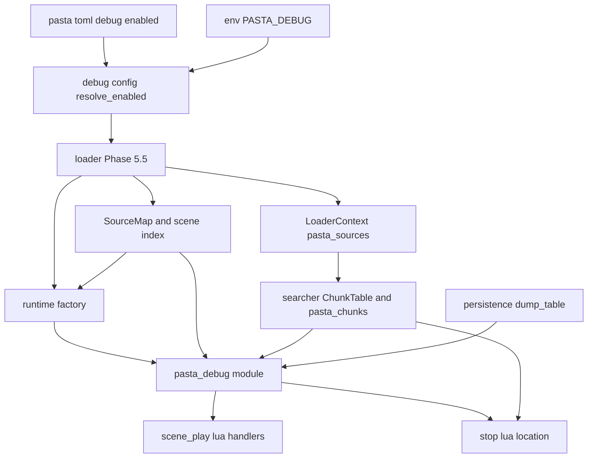
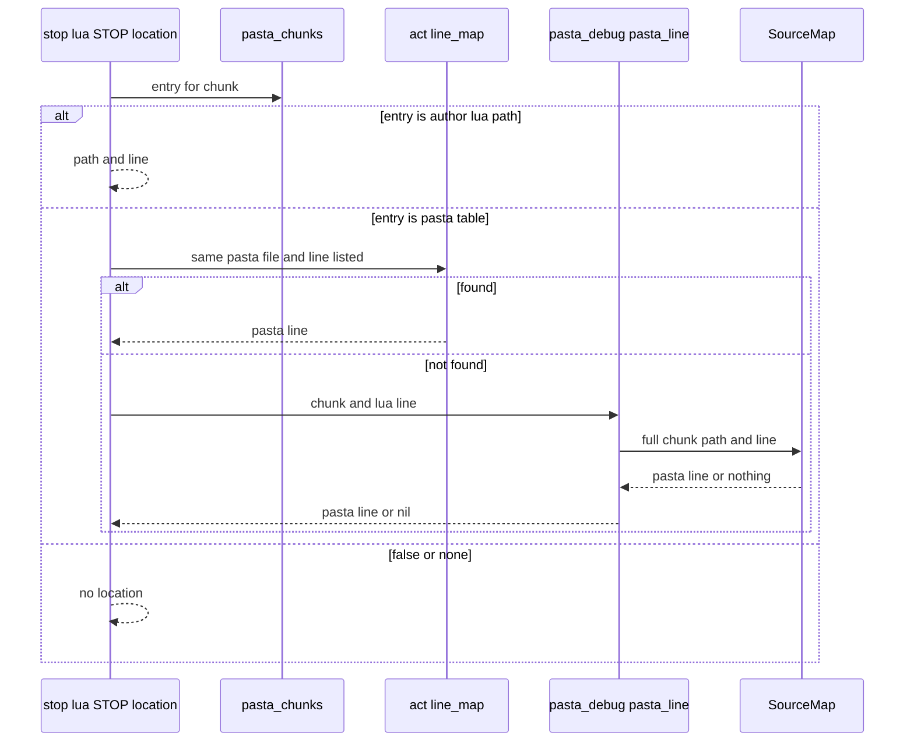
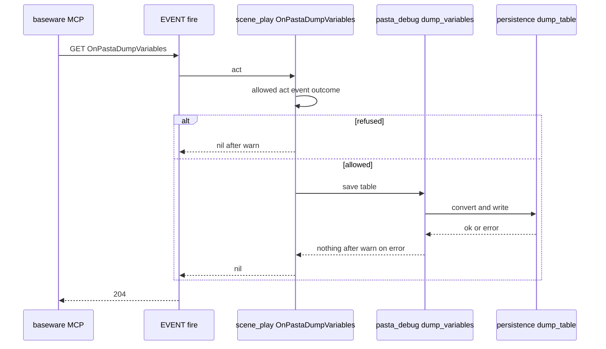

# 設計書: debug-mcp-runtime

## Overview

**目的**: pasta.dll の開発の道具の通り道を、DAP（9276 番の待ち受け）から開発用のイベントへ替える。DAP の待ち受け・セッション・行フック・`jit.off()`・キックを消し、`[debug] enabled`（と `PASTA_DEBUG`）を「開発用のイベントを許し、ソースマップを作る」旗にする。

**利用者**: ゴーストの作者（DEBUG 版の `pasta.toml` に `[debug] enabled = true` を書く人）、VSCode の拡張（`vscode-mcp-client`）と AI エージェント（ぱすた開発。SSP・areka の MCP の `raise_event` でイベントを送る人）、pasta の開発者（残る部品を読む人）。

**変わること**: デバッグを有効にしても、ポートを取らず、JIT も止まらない。指名した再生は `OnPastaScene`・`OnPastaSceneAt` の応答だけになる。保存変数を書き出す `OnPastaDumpVariables` が増える。止まるエラーの場所は、別の `.pasta` の行を取り違えなくなり、デバッグが有効なら別のファイルの Lua のブロックの中でも `.pasta` の行で出る。

```
raise_event("OnPastaScene",          ["会話"])                    → ＊会話 を再生（今のまま）
raise_event("OnPastaSceneAt",        ["dic\\天気.pasta", "15"])   → 15 行目のシーンを再生（URI は受けない）
raise_event("OnPastaDumpVariables",  [])                          → profile/pasta/debug/variables.toml を書いて 204
止まるエラー（デバッグ有効・別のファイルの GLOBAL 関数の中）  → 【スクリプトのエラー：＊会話（dic\道具.pasta:7: attempt to …）】
```

### Goals

- pasta.dll から DAP とキックの部品（Rust・Lua・テスト・依存）を消す。
- デバッグの有効を `[debug] enabled` と `PASTA_DEBUG` の 1 つの値にし、解決を 1 回にする。
- 開発用のイベント 3 つを、デバッグが有効なときだけ、同じ門で許す。
- 止まるエラーの場所を、どの `.pasta` から変換したチャンクかを確かめてから出す。
- 残る部品から、死んだコード・テストだけの口・誤った説明を消す。
- マニュアルの internals とリファレンスを、DAP の無い形に書き直す。

### Non-Goals

- VSCode の拡張と、利用者の章 `book/src/debug/`（`vscode-mcp-client`）。
- 本番（デバッグが無効）でのソースマップ。ソースマップを後から作ること。
- 式を評価して返すイベント。保存変数でない変数の書き出し。
- リロード専用のイベントと「次の読み込みだけ有効」。
- 読み込みのときの Lua のエラーの場所（議題 8）。
- `OnPastaCallFunction`・`OnPastaSetSaveVariable` の振る舞い。`pasta_check validate` の組み込みの名前（議題 10）。
- `dic/` に置いた作者の `.lua`（キャッシュに写される）の止まった場所を出すこと（前提 A3。下の Open Questions）。

## Boundary Commitments

### This Spec Owns

- `crates/pasta_lua/src/debug/` の中身。残すのは `mod.rs`・`config.rs`・`playscene.rs`・`source_map/` とそのテストだけ。
- デバッグの有効の解決（`PASTA_DEBUG` ＞ `[debug] enabled` ＞ false）と、その値をランタイムが持つ形（ソースマップの有無）。`DebugFileConfig` の形。
- 内部モジュール `@pasta_debug` の関数（`enabled`・`scene_at`・新しい `pasta_line`・新しい `dump_variables`）。
- 読み込んだファイルの表 `@pasta_chunks` の値の決まり（辞書のチャンクの値を `true` から `{ pasta = <.pasta のパス> }` に替える）と、それを作るための `LoaderContext::pasta_sources`。
- `pasta.shiori.stop` の場所の決め方（`STOP.location`・`pasta_location`）。
- `OnPastaDumpVariables` の既定のハンドラ（`scene_play.lua`）と、書き出しの関数（`persistence.rs` の `dump_table`）。
- キックの経路の撤去（`pasta_shiori` の actor・shiori、Lua の `kick.lua`・`entry.lua`・`virtual_dispatcher.lua`・`store.lua`）。
- DAP とキックのテスト・フィクスチャの撤去と、残す振る舞いのテスト。`PASTA_DEBUG` の中和の写しの整理。
- ルートの `Cargo.toml` の `socket2` と、各クレートの DAP だけの依存の撤去（`Cargo.lock` は cargo に作り直させる）。
- マニュアルの internals・リファレンスの頁、`SUMMARY.md` の internals の 1 行、ルートの `DEBUGGING.md`、スキルの references の作り直し。

### Out of Boundary

- `act.lua`・`scene.lua`・`search/`・`code_gen/element_gen.rs`（同じウェーブの約束）。`act:init_scene`・`restore_scene` と行の対応の書式（`"<.pasta>|<lua の行>:<pasta の行>,…"`）は変えない。`transpiler.rs` の `fill_line_maps` も変えない。
- `EVENT.fire`・`EVENT.drive`・`STORE.co_preempt` の意味（`scene_play.lua` が今のまま使う）。
- 変換したキャッシュの中身（`CURRENT_VERSION` を上げない）。
- `[loader] debug_mode`（読み込みの統計のログ）。
- VSCode 拡張（`editors/vscode/`）・利用者の章 `book/src/debug/`・README・`SUMMARY.md` の利用者の章の行。
- steering（`tech.md`・`structure.md`・`product.md` の DAP の記述）。kiro-complete のスキルの同期で直す。
- SSP・areka の MCP が 204 にどう答えるか（`vscode-mcp-client` が確かめる）。

### Allowed Dependencies

- Lua: `scene_play.lua` → `pasta.shiori.event.register`・`pasta.failure`・`pasta.store`・`pasta.save`・`@pasta_log`・`@pasta_debug`（`pcall` で読む）。`stop.lua` → `@pasta_chunks`・`@pasta_debug`（どちらも在れば読む。純粋な関数は引数で受ける）。
- Rust: `runtime::module_registry`（`@pasta_debug`）→ `debug::playscene`・`debug::source_map`・`runtime::searcher`（チャンクの全体のパスを引く）・`runtime::persistence`（`dump_table`）。
- `loader` → `debug::config::resolve_enabled`・`debug::source_map`（作る）→ `runtime::factory`（`Option<Arc<SourceMap>>` を受ける）。
- 依存の向き: `loader/config`（型）→ `debug::config`（解決）→ `loader`（作る）→ `runtime`（持つ・登録する）→ Lua（使う）。`debug` は `pasta_shiori` を知らない。`pasta_shiori` は `pasta_lua::debug` を使わなくなる。
- 新しい依存（crate）は足さない。

### Revalidation Triggers

- `OnPastaSceneAt` の Reference0 の受け方（パスだけ。URI を受けない）→ `vscode-mcp-client`。
- `OnPastaDumpVariables` の書き出す先（`ghost/master/profile/pasta/debug/variables.toml`）・応答（204）・書式（TOML）→ `vscode-mcp-client`。
- ログの文言: 無効・external の警告（`<イベント名>: debug is disabled; …`・`<イベント名>: SecurityLevel external is refused; …`）と、有効なときの info の 1 行（`Debug enabled: development events are allowed`）→ `vscode-mcp-client` のトラブルシューティング。
- `@pasta_chunks` の値の形（`true` が無くなる）→ `@pasta_chunks` を読む後の spec。
- `RuntimeConfig`・`PastaLuaRuntime` の pub の口の削除（`debug`・`kick_sink`・`with_debug*`・`with_kick_sink`・`debug_local_addr`・`debug_source_mode`）→ `pasta_lua` を使う外のクレート（0.5.0 で予告なく消す。議題 9）。
- `spawn_actor_thread_with` の引数（kick の送り先を外して 3 つ）→ `shiori4-v4-host`（0.6.0）。
- `LoaderContext` に欄が増える → `LoaderContext` を struct の式で作るコード（今は `context.rs` のテストだけ）。

## Architecture

### Existing Architecture Analysis

- **ローダ**（`loader/mod.rs`）が Phase 5.5 で `DebugConfig::from_env` を呼び、有効ならソースマップを作る。**ファクトリ**（`runtime/factory.rs`）がもう一度 `from_env` を呼んで `RuntimeConfig::debug` に積み、`with_config_and_source_map` が `debug::enable`（フック・`jit.off()`・待ち受け）を呼ぶ。解決が 2 回あり、`debug_enabled()` は待ち受けの有無（`debug_handle.is_some()`）で、`@pasta_debug.enabled()`（設定の値）と食い違う。
- **止まるエラー**は `STOP.response`（`stop.lua`）を通り、`STOP.detail` → `STOP.location` が `@pasta_chunks` の値で場所を決める。辞書のキャッシュは `true` で、行の対応（`act.line_map`）の行の番号だけで引くので、別のファイルの行を取り違える（議題 2）。
- **キック**は、DAP の `pasta/playSceneAt`・`pasta/reloadShiori` → `KickSink` → `ActorMsg::Kick` → `SHIORI.kick` → `STORE.kick_pending`・`kick_force` → 仮想ディスパッチャの分岐、の道である。生むのは DAP だけ。
- **開発用のイベント**は `scene_play.lua` の `allowed()` を門にし、`@pasta_debug` を引いて使う。

### Architecture Pattern & Boundary Map



**Architecture Integration**:
- 採る形: 今の部品の中で消し、残す（research.md の Option A）。新しいファイルは作らない（テストを除く）。
- 境: Rust の開発用の部品は `pasta_lua/src/debug/` と `runtime/module_registry.rs` の `@pasta_debug`。Lua の門は `scene_play.lua` の `allowed()` 1 つ。場所は `stop.lua` が決め、Rust は「チャンク名と行から `.pasta` の行を引く」だけを出す。
- 守る形: `@pasta_debug` は本番の入口だけが登録する。`stop.lua` の関数は表を引数で受ける純粋な関数のまま。`@pasta_chunks` は VM が持ち、searcher だけが書き足す。セーブの変換は `persistence.rs` の 1 か所。
- 新しい部品の理由: `@pasta_debug.pasta_line`（6.3 の唯一の入口）、`@pasta_debug.dump_variables`（5 の Rust の側）、`persistence::dump_table`（セーブと同じ変換で、門を通さずに書く）、`LoaderContext::pasta_sources`（6.2 でチャンクの `.pasta` を知る唯一の手段）。
- steering: シリアライズは TOML、x86 を省かない、`.claude/skills/` は生成ツールで作り直す。

### Technology Stack

| Layer | Choice / Version | Role in Feature | Notes |
|-------|------------------|-----------------|-------|
| Runtime | Rust 2024・mlua 0.12（LuaJIT 2.1） | `@pasta_debug`・searcher・ローダ | 変えない。`jit.status()` は `std_all`（既定）の VM で呼べる |
| Data / Storage | toml（既存）・std::fs | `variables.toml` の書き出し | `persistence.rs` の `save_to_file`（一時ファイル → `rename`）を使う |
| Script | Lua（pasta_scripts） | ハンドラ・場所の決め方 | `scene_play.lua`・`stop.lua` |
| Infrastructure | — | 依存の撤去 | `socket2`（ルート・`pasta_lua`）、`serde_json`（`pasta_lua`・`pasta_shiori` の dev）を外す。足すものは無い |

## File Structure Plan

### Directory Structure

```
crates/pasta_lua/src/debug/
├── mod.rs                    # 開発用の部品の入口。pub mod source_map・pub use config::resolve_enabled・pub(crate) mod playscene
├── config.rs                 # resolve_enabled（PASTA_DEBUG > [debug] enabled > false）・parse_env_bool とその単体テスト
├── playscene.rs              # resolve_position（位置 → 登録名の組）。URI の扱いを消し、パスを結んで絶対にするだけ
├── playscene_tests.rs        # resolve_position の相対・絶対・UNC・`%41` をそのまま扱うこと
├── source_map/
│   ├── mod.rs                # ChunkSourceMap・MapBuilderSink・SourceMap（前方の引きとシーン索引だけ）
│   ├── scene_index.rs        # SceneIdentityIndex（#![allow(dead_code)] を外す）
│   ├── scene_index_tests.rs
│   ├── scene_join.rs         # build_scene_index（insert_file の呼び出しと誤ったコメントを消す）
│   └── scene_join_tests.rs
├── source_map_builder_tests.rs
├── source_map_resolve_tests.rs   # 逆引き・テストだけの口の分を消し、前方の引きを残す
└── source_map_test_support.rs
```

消すファイル（`crates/pasta_lua/src/debug/`）: `breakpoints.rs`・`dap/`（6 ファイル）・`enable.rs`・`error.rs`・`handle.rs`・`hook.rs`・`inspect.rs`・`kick.rs`・`session/`（4 ファイル）・`source_mode.rs`・`transport/`（2 ファイル）・`types.rs`・`wiring/`（4 ファイル）・`source_map/sidecar.rs`、テストの `dap_*`・`debug_mod_tests.rs`・`hook_tests.rs`・`inspect_*`・`session_*`・`transport_*`・`wiring_*`・`source_map_sidecar_tests.rs`。

### New Files（テストだけ）

- `crates/pasta_lua/tests/debug_env_ignored_test.rs` — 古い環境変数を置いたプロセスで読み込む結合テスト（3.4）。環境を変えるので、ほかのテストと別のバイナリにする。
- `crates/pasta_shiori/tests/fixtures/runtime_error_balloon/dic/` に 2 つ目の `.pasta`（別のファイルの Lua のブロックの `GLOBAL` 関数）— 6.2・6.3 の結合テスト用。

### Modified Files

撤去（先）:

- `crates/pasta_lua/src/lib.rs` — `debug::{DebugConfig, DebugError, DebugHandle, SourceMode, enable as enable_debug}` と `default_debug_port` の再輸出を消す。
- `crates/pasta_lua/src/runtime/mod.rs` — `debug_handle` の欄と `debug::enable` の呼び出しを消す。`with_config_and_source_map` は受けた `source_map` をそのまま持つ。
- `crates/pasta_lua/src/runtime/exec.rs` — `debug_local_addr`・`debug_source_mode` を消す。`debug_enabled()` は `self.source_map.is_some()` を返す。`exec_named` の説明からデバッガを外す。
- `crates/pasta_lua/src/runtime/runtime_config.rs` — `debug`・`kick_sink` の欄、`with_debug`・`with_kick_sink`・`with_debug_from_file_and_env`、`kick_sink_tests` を消す。`Debug` は導出に戻す。
- `crates/pasta_lua/src/runtime/factory.rs` — 2 回目の解決を消す。`@pasta_debug` の `enabled` はソースマップの有無から決める。説明の kick を直す。
- `crates/pasta_lua/src/loader/mod.rs` — Phase 5.5 で `resolve_enabled` を 1 回だけ呼ぶ。`build_source_map` に sidecar の引数を渡さない。`default_debug_port` の再輸出を消す。
- `crates/pasta_lua/src/loader/config/sections.rs` — `DebugFileConfig` を `enabled` だけにし、`default_debug_port` を消す（`#[derive(Default)]`）。
- `crates/pasta_lua/src/loader/source_map_build.rs` — sidecar の引数と書き出しを消す。「行がズレ得る」の説明を今の生成に合わせる（7.7）。
- `crates/pasta_shiori/src/actor/mailbox.rs`・`thread.rs`・`instance.rs`・`mod.rs`・`marshaling.rs`・`teardown.rs`、`crates/pasta_shiori/src/shiori.rs` — `ActorMsg::Kick`・Kick の腕・`spawn_actor_thread_with` の kick の引数・`kick_sink_for`・`PastaShiori::with_kick_sink`・`kick`・`kick_sink` の欄と説明を消す。`thread.rs` は `PastaShiori::default()`、`load` は `RuntimeConfig::new()` を使う。
- `crates/pasta_lua/pasta_scripts/pasta/shiori/entry.lua` — `KICK` の require と `SHIORI.kick` を消す。
- `crates/pasta_lua/pasta_scripts/pasta/shiori/event/virtual_dispatcher.lua` — キック割り込みの門（`kick_force`）とキック起動の分岐を消し、`if M.is_blocked(act.req.status) then return nil end` だけを残す。
- `crates/pasta_lua/pasta_scripts/pasta/store.lua` — `kick_pending`・`kick_force` と reset の 2 行を消す。`co_preempt` の説明の「キック」を外す。
- `crates/pasta_lua/pasta_scripts/pasta/shiori/event/kick.lua` — 消す。
- `Cargo.toml`（ルート）・`crates/pasta_lua/Cargo.toml`・`crates/pasta_shiori/Cargo.toml` — `socket2`・`serde_json`（`pasta_lua`・`pasta_shiori` の dev）を外す。`Cargo.lock` は cargo が作り直す。
- テスト（撤去）: 下の Testing Strategy の「消すテスト」。

整え（後）:

- `crates/pasta_lua/src/debug/config.rs` — `DebugConfig` を消し、`resolve_enabled` にする（撤去で形が決まるので撤去と同じタスクでよい）。
- `crates/pasta_lua/src/debug/playscene.rs` — `resolve_and_kick`・`build_kick_scene`・`ResolveOutcome`・`uri_to_pasta_path`・`strip_file_scheme`・`percent_decode`・`hex_val`・`fix_leading_drive` と `#![allow(dead_code)]` を消す。`resolve_position` はパスを `base_dir` に結び、`std::path::absolute` に通すだけにする。
- `crates/pasta_lua/src/debug/source_map/mod.rs` — 逆引き（`reverse`・`resolve_pasta_to_lua`・`nearest_pasta_line_with_mapping`）、テストだけの口（`ChunkSourceMap::new`・`len`・`is_empty`・`lua_lines_for_pasta`・`MapBuilderSink::chunk_name`・`SourceMap::scene_index`）、`canonicalize_pasta_file`、sidecar の再輸出、`#[allow(…)]` を消す。25 行の説明の `normalize_output` を `normalize_output_with_shift` に、`MapBuilderSink::finish` の「ズレ得る」を直す。`from_forward` は `#[cfg(test)]` にする。
- `crates/pasta_lua/src/debug/source_map/scene_join.rs` — 130 行の `insert_file` とその上のコメントを消す。
- `crates/pasta_lua/src/debug/source_map/scene_index.rs` — `#![allow(dead_code)]` を消し、使い手の無い項目を消す。
- `crates/pasta_lua/src/runtime/module_registry.rs` — `register_debug_module` に `pasta_line`・`dump_variables` を足す。`register_chunk_table` に `pasta_sources` を渡す。行の数の読み方を `scene_at` と `pasta_line` で共有する小さな関数にする。
- `crates/pasta_lua/src/runtime/searcher.rs` — `ChunkTable` に `pasta_sources` を持たせ、`record_chunk` に `module_name` を渡す。辞書のキャッシュは `{ pasta = <.pasta のパス> }`、表に無いキャッシュは控えない。全体のパスを引く `chunk_path(lua, key)` を足す。
- `crates/pasta_lua/src/loader/context.rs` — `pasta_sources: HashMap<String, String>`（モジュール名 → ゴーストのフォルダーから見た `.pasta` のパス）を足す（既定は空）。
- `crates/pasta_lua/src/loader/mod.rs` — Phase 4 の後に `pasta_sources` を詰める。読み込みを終えたら、有効なときだけ info の 1 行を出す（1.5）。
- `crates/pasta_lua/src/runtime/persistence.rs` — `dump_table` を足し、外したキーの警告を `save_table` と共有する。`save_to_file` が書きかけの一時ファイルを、書けなかったときにも消す。
- `crates/pasta_lua/pasta_scripts/pasta/shiori/event/scene_play.lua` — `allowed(act, event, outcome)` にし、`OnPastaDumpVariables` を足す。冒頭の説明に 3 つのイベントの共通の決まりを書く。
- `crates/pasta_lua/pasta_scripts/pasta/shiori/stop.lua` — `STOP.location` を、辞書の値 `{ pasta = … }` と行の対応のファイルを比べる形にし、引けなければ `@pasta_debug.pasta_line` で引く。
- テストの中和の写し（`#[ctor]` の `PASTA_DEBUG_PORT` の行）: `crates/pasta_lua/tests/common/mod.rs`・`crates/pasta_shiori/tests/common/mod.rs`・`crates/pasta_sample_ghost/tests/common/mod.rs`・`crates/pasta_check/tests/validate_parity_test.rs`・`crates/pasta_lua/tests/scene_identity_index_test.rs`・`crates/pasta_shiori/src/shiori_request_tests.rs`、`crates/pasta_shiori/tests/` の `actor_marshaling`・`actor_reload_leak`・`actor_teardown`・`actor_thread_vm`・`ffi_actor_lifecycle`・`ffi_extern_session_e2e`・`ffi_loadu`・`ffi_logging`・`free_library`・`load_failure_visibility`・`path_robustness_e2e` の各 `_test.rs`。説明の「固定ポート」も直す。
- マニュアル: 下の「マニュアル」の節。

## System Flows

### 止まるエラーの場所



- 行の対応は、ファイルが `entry.pasta` と同じときだけ使う（6.2）。比べる前に両方の `/` を `\` にそろえる（どちらも `CacheManager::get_relative_path` から作るので、ほかの正規化は要らない）。
- `pasta_line` はデバッグが無効なら `@pasta_debug` が `nil` を返す（ソースマップが無い）。ローダを通らない VM には `@pasta_debug` が無く、`stop.lua` は呼ばない（6.4）。
- `entry` が `false`（重複）・表に無い（`dic/` の `.lua` の写し・ゴーストの外・標準ランタイム）なら場所を出さない。チャンク名が `.lua` で終わるので、接頭辞は今のまま取り除かれる（6.4）。

### OnPastaDumpVariables



- 書き出しは要求の中で同期に終わる。204 はファイルを書き終えた（か、書けずに警告を出した）後に返る（5.2）。
- `dump_variables` はエラーを Lua に上げない。止まるエラーにならず、いつも 204 になる（5.5）。

## Requirements Traceability

| Requirement | Summary | Components | Interfaces | Flows |
|-------------|---------|------------|------------|-------|
| 1.1 | 待ち受けを開かない | DAP の撤去（transport・wiring・enable）、依存の撤去 | — | — |
| 1.2 | フックを付けず JIT を止めない | DAP の撤去（hook・enable の `jit.off()`） | `jit.status()` の確かめ | — |
| 1.3 | 有効な 2 体が並ぶ | DAP の撤去、`multi_instance_test.rs` | `OnPastaScene` | — |
| 1.4 | DAP の要求の口が無い | DAP の撤去（dap・transport・wiring） | — | — |
| 1.5 | 待ち受けのログの代わりに info の 1 行 | ローダ（読み込みの終わり） | ログの文言 | — |
| 2.1 | キックが無い | キックの撤去（Rust・Lua） | — | — |
| 2.2 | 時計のイベントの扱いが今と同じ | `virtual_dispatcher.lua` | `M.dispatch` | — |
| 2.3 | 指名した再生は応答だけ | `scene_play.lua`（今のまま） | `OnPastaScene`・`OnPastaSceneAt` | — |
| 2.4 | 中断している続きを捨てる振る舞い | `scene_play.lua`（`co_preempt` を今のまま） | — | — |
| 3.1 | `[debug] enabled` と `PASTA_DEBUG` だけ | `debug::config::resolve_enabled`、`DebugFileConfig` | `resolve_enabled` | — |
| 3.2 | リロードで読み直す | ローダ（読み込みのたびに解決） | — | — |
| 3.3 | 古いキーを黙って読み飛ばす | `DebugFileConfig`（serde の既定の読み飛ばし） | — | — |
| 3.4 | 古い環境変数を読まない | `resolve_enabled` | — | — |
| 3.5 | 有効ならソースマップと索引を作る | ローダ Phase 5.5、ファクトリの索引 | — | — |
| 3.6 | 無効なら作らない | ローダ Phase 5.5 | — | — |
| 3.7 | キャッシュの中身を変えない | ローダ（Phase 4 は今のまま） | — | — |
| 3.8 | `.lua.map` を書かない | sidecar の撤去 | — | — |
| 4.1 | `OnPastaScene`・`OnPastaSceneAt` の引数と応答 | `scene_play.lua` | Reference0・Reference1 | — |
| 4.2 | 無効なら 204 と警告 | `scene_play.lua` の `allowed` | 警告の文言 | OnPastaDumpVariables |
| 4.3 | external は 204 と警告 | `scene_play.lua` の `allowed` | 警告の文言 | OnPastaDumpVariables |
| 4.4 | Reference0 はパスだけ | `playscene::resolve_position` | `@pasta_debug.scene_at` | — |
| 4.5 | `OnPastaCallFunction`・`OnPastaSetSaveVariable` を変えない | `external_control.lua`（触らない） | — | — |
| 4.6 | 先に登録したハンドラを上書きしない | `scene_play.lua`（`REG.X = REG.X or …`） | — | — |
| 5.1 | 保存変数を `variables.toml` に書く | `scene_play.lua`、`@pasta_debug.dump_variables`、`persistence::dump_table` | `dump_variables(save)` | OnPastaDumpVariables |
| 5.2 | 喋らずに 204・書き終えてから | `scene_play.lua`（`nil` を返す） | — | OnPastaDumpVariables |
| 5.3 | セーブと同じ変換・いつもテキスト | `persistence::dump_table`（`obfuscate = false`） | — | — |
| 5.4 | 書けない値は飛ばして警告 | `lua_table_to_toml_document`・外したキーの警告の共有 | — | — |
| 5.5 | 書けなければ警告して 204・書きかけを残さない | `save_to_file`（一時ファイル → `rename`）、`dump_variables` | 警告の文言 | OnPastaDumpVariables |
| 5.6 | 保存変数・`save.toml`・続きを変えない | `dump_table`（読むだけ・門を通さない）、ハンドラは `nil` | — | — |
| 6.1 | 行の対応の行は今と同じ | `stop.lua`（行の対応を先に引く） | `STOP.location` | 止まるエラーの場所 |
| 6.2 | 別の `.pasta` の行を取り違えない | `stop.lua`、`searcher.rs`（`{ pasta = … }`）、`LoaderContext::pasta_sources` | `@pasta_chunks` の値 | 止まるエラーの場所 |
| 6.3 | 有効ならソースマップで引く | `@pasta_debug.pasta_line`、`searcher::chunk_path`、`SourceMap::resolve_lua_to_pasta` | `pasta_line(chunk, line)` | 止まるエラーの場所 |
| 6.4 | 引けなければ今の文言 | `stop.lua` | — | 止まるエラーの場所 |
| 6.5 | `X-Error-Reason`・対象・止まらない失敗を変えない | `stop.lua`（`STOP.response`・`STOP.subject` を変えない） | — | — |
| 7.1 | DAP・キック・提示・サイドカーの口を残さない | `debug/` の整理、`lib.rs`、`runtime_config.rs`、`exec.rs`、`source_map` の逆引き | — | — |
| 7.2 | `allow(dead_code)` などを残さない | `playscene.rs`・`scene_index.rs`・`source_map/mod.rs` | — | — |
| 7.3 | テストだけの問い合わせと `canonicalize_pasta_file` を残さない | `source_map/mod.rs` | — | — |
| 7.4 | `insert_file` と誤ったコメントを残さない | `scene_join.rs` | — | — |
| 7.5 | 解決を `enabled` 1 つの入力にする | `debug::config::resolve_enabled` | `resolve_enabled` | — |
| 7.6 | 有効を 1 つの値で持つ | `PastaLuaRuntime::source_map`（有無が有効） | `debug_enabled()` | — |
| 7.7 | 説明の誤りを直す | `source_map/mod.rs`・`source_map_build.rs` | — | — |
| 7.8 | DAP だけの依存を外す | ルートと各クレートの `Cargo.toml` | — | — |
| 8.1 | `internals/debug.md` を書き直す | マニュアル、`SUMMARY.md` | — | — |
| 8.2 | `[debug]` 節を `enabled` だけに | `reference/pasta-toml.md` | — | — |
| 8.3 | `OnPastaDumpVariables` と共通の決まり | `lua/shiori-events.md` | — | — |
| 8.4 | ほかの頁のキックと DAP | マニュアルの各頁、`DEBUGGING.md` | — | — |
| 8.5 | 利用者の章を変えない | （触らない） | — | — |
| 8.6 | references の作り直し | `node book/tools/gen-skill-refs.mjs` | — | — |
| 8.7 | マニュアルの検査を通す | マニュアルの検査 | — | — |
| 9.1 | DAP とキックのテストを消し、残す振る舞いのテストを残す | テストの撤去 | — | — |
| 9.2 | 1.1・1.3・3.2〜3.4・5・6.2・6.3 のテスト | Testing Strategy | — | — |
| 9.3 | 環境に左右されない | 中和の写し | — | — |
| 9.4 | fmt・clippy・test・Lua・luacheck | 関門 | — | — |
| 9.5 | i686 のビルドとテスト | 関門 | — | — |

## Components and Interfaces

| Component | Domain/Layer | Intent | Req Coverage | Key Dependencies (P0/P1) | Contracts |
|-----------|--------------|--------|--------------|--------------------------|-----------|
| DAP の撤去 | Rust `pasta_lua` | 待ち受け・フック・セッションを消す | 1.1, 1.2, 1.4, 7.1, 7.8 | runtime（P0） | — |
| キックの撤去 | Rust `pasta_shiori`・Lua | キックの道を消す | 2.1, 2.2 | actor（P0）、virtual_dispatcher（P0） | — |
| デバッグの門 | Rust `debug::config`・loader | 有効を 1 回だけ解決し、ソースマップの有無で持つ | 1.5, 3.1–3.8, 7.5, 7.6 | DebugFileConfig（P0） | Service, State |
| `@pasta_debug` | Rust `module_registry` | Lua への開発用の口 | 4.4, 5.1, 5.5, 6.3 | SourceMap（P0）、searcher（P0）、persistence（P0） | Service |
| 読み込んだファイルの表 | Rust `searcher`・loader | チャンクがどの `.pasta` かを控える | 6.2, 6.3 | LoaderContext（P0） | State |
| `dump_table` | Rust `persistence` | 門を通さず、セーブと同じ変換でテキストを書く | 5.1, 5.3–5.6 | toml（P0） | Service |
| 開発用のイベントのハンドラ | Lua `scene_play.lua` | 3 つのイベントの門と既定のハンドラ | 2.3, 2.4, 4.1–4.3, 4.6, 5.1, 5.2, 5.6 | `@pasta_debug`（P0） | Event |
| 止まるエラーの場所 | Lua `stop.lua` | 場所を正しく決める | 6.1–6.5 | `@pasta_chunks`（P0）、`@pasta_debug`（P1） | Service |
| 残す部品の整理 | Rust `debug/` | 死んだコード・誤った説明を消す | 7.1–7.4, 7.7 | — | — |
| マニュアル | book | DAP の無い形に揃える | 8.1–8.7 | gen-skill-refs（P1） | — |
| テストと関門 | 全クレート | 守りと関門 | 9.1–9.5 | — | — |

### Rust: デバッグの門

#### debug::config::resolve_enabled

| Field | Detail |
|-------|--------|
| Intent | `PASTA_DEBUG` と `[debug] enabled` から、デバッグの有効を 1 つの bool に決める |
| Requirements | 3.1, 3.2, 3.4, 7.5 |

**Responsibilities & Constraints**
- 読む環境変数は `PASTA_DEBUG` だけ。`PASTA_DEBUG_PORT`・`PASTA_DEBUG_SOURCE_MODE`・`PASTA_DEBUG_SOURCE_MAP_SIDECAR` は読まない（読む箇所が無くなる）。
- 値の読み方は今の `parse_env_bool` のまま（`1`・`true`・`yes`・`on` が真、`0`・`false`・`no`・`off`・空が偽、ほかは「設定されていない」）。
- 呼ぶのはローダの Phase 5.5 の 1 回だけ。ファクトリは呼ばない。

**Contracts**: Service [x]

##### Service Interface

```rust
/// `PASTA_DEBUG`（設定されていて読める値なら）＞ `[debug] enabled` ＞ false。
pub fn resolve_enabled(file: Option<&DebugFileConfig>) -> bool;

/// 純粋な部分（単体テストの対象）。
fn pick(env: Option<bool>, file: Option<bool>) -> bool; // env.or(file).unwrap_or(false)
pub(super) fn parse_env_bool(raw: &str) -> Option<bool>;
```

- Preconditions: なし。
- Postconditions: 同じ入力に同じ値。
- Invariants: 返り値が真のときだけ、ローダはソースマップを作る。

#### DebugFileConfig

```rust
#[derive(Debug, Clone, Default, Deserialize)]
#[serde(default)]
pub struct DebugFileConfig {
    /// 開発用のイベントを許し、読み込みでソースマップを作る。既定は false。
    pub enabled: bool,
}
```

- `PastaConfig::debug()`（`get_custom_config`）で読む。知らないキー（古い `port`・`present_as`・`source_map_sidecar`）は serde が黙って読み飛ばす（3.3。`deny_unknown_fields` は付けない）。`port` の欄が消えるので、型の合わない古い `port` で節ごと無効になる穴も消える。
- `[debug]` の節は今のまま `custom_fields` にも残り、`@pasta_config` から見える。

#### ランタイムが有効を持つ形

**Contracts**: State [x]

- State model: `PastaLuaRuntime::source_map: Option<Arc<SourceMap>>` の有無が「デバッグが有効か」の唯一の値である（7.6）。ローダは `resolve_enabled` が真のときだけ `Some` を渡し（`build_source_map` は読めないファイルを飛ばすだけで、いつも `Some` を返す）、偽なら `None` を渡す。
- `debug_enabled()` は `self.source_map.is_some()`。`@pasta_debug.enabled()` も同じ値（ファクトリが `source_map.is_some()` を閉じ込める）。待ち受けの有無は無い。
- ローダを通らない VM（`PastaLuaRuntime::new`・`with_config`）は、いつも無効。`RuntimeConfig` からデバッグを有効にする道は無くなる（使い手は DAP のテストだけで、消える）。
- リロード: `SHIORI.load` のたびにローダが `pasta.toml` を読み直し、`resolve_enabled` を呼ぶ（3.2）。

**Implementation Notes**
- Integration: ローダは `runtime.debug_enabled()` が真なら、`Startup sequence completed` の直前に `info!("Debug enabled: development events are allowed")` を 1 行出す（1.5）。読み込みが途中で失敗したときは出さない。
- Risks: `factory.rs` の「索引の突合」は今のまま `source_map` が `Some` のときだけ走る。

### Rust: `@pasta_debug`

| Field | Detail |
|-------|--------|
| Intent | 開発用のイベントと止まるエラーが使う、内部の Lua モジュール |
| Requirements | 4.4, 5.1, 5.5, 6.3 |

**Responsibilities & Constraints**
- 本番の入口（`from_loader_with_scene_dic`）だけが登録する（今のまま）。デバッグが無効でも登録し、`enabled()` が偽を返す。
- 関数はエラーを Lua に上げない（引数の型の誤りを除く）。
- 閉じ込めるもの: `Option<Arc<SourceMap>>`・`base_dir`（`LoaderContext::base_dir`）。

**Dependencies**
- Outbound: `debug::playscene::resolve_position`（P0）、`SourceMap::resolve_lua_to_pasta`（P0）、`runtime::searcher::chunk_path`（P0）、`runtime::persistence::dump_table`（P0）、`pasta.save` の表（Lua から渡る）。

**Contracts**: Service [x]

##### Service Interface（Lua から見た形）

```lua
---@class PastaDebug
---@field enabled fun(): boolean
---  デバッグが有効か（ソースマップの有無）。
---@field scene_at fun(file: string, line: integer): (string|nil), (string|nil)
---  位置を登録名の組（大域, ローカル）に引く。file は ghost/master/ からの相対パスか絶対パス。
---  URI は受けない（file:// も %xx もそのままのパスの文字として扱う）。見つからなければ nil, nil。
---@field pasta_line fun(chunk: string, line: integer): integer|nil
---  エラー文の「チャンク:行:」のチャンク（縮んだ形のまま）と Lua の行から、.pasta の行を引く。
---  ソースマップが無い・表に無い・重複・行が対応に無いときは nil。
---@field dump_variables fun(save: table)
---  save の表を profile/pasta/debug/variables.toml にテキストの TOML で書く。返り値は無い。
---  書けないときは警告を 1 行書き、前のファイルを残す。
```

- `scene_at`: `resolve_position(map, base_dir, file, line)`。`resolve_position` は `std::path::absolute(base_dir.join(file))`（失敗なら結んだパスのまま）を `SourceMap::scene_at` に渡す。区切りと Windows の大小は `scene_at` の中の正規化に任せる。`join` は絶対パス（UNC を含む）をそのまま返す（4.4）。
- `pasta_line`: チャンクのバイト列で `chunk_path` を引き、`map.resolve_lua_to_pasta(&full, line).map(|p| p.line)`。行の数の読み方は `scene_at` と同じ（`1..=u32::MAX` の整数。ほかは nil）。
- `dump_variables`: `dump_table(lua, &save, &base_dir.join("profile/pasta/debug/variables.toml"))`。`Err(e)` なら `tracing::warn!(path = %path.display(), error = %e, "OnPastaDumpVariables: could not write {path}: {e}")`。

##### runtime::searcher::chunk_path

```rust
/// エラー文の形のキー（縮んだチャンク名）から、そのキーを最初に作った候補の全体のパスを返す。
/// 表が無い（ローダを通らない VM）・キーが無ければ None。重複かどうかは見ない（呼ぶ側が @pasta_chunks で見分ける）。
pub(crate) fn chunk_path(lua: &Lua, key: &[u8]) -> Option<String>;
```

- `ChunkTable::seen`（キー → 最初の候補）を読むだけ。
- 候補のパスは `package.path` から作られ、ソースマップのキーは `CacheManager::source_to_cache_path` から作られる。どちらも同じ `base_dir` の形（`std::path::absolute` は 8.3 の短い名前を解かない）から作り、`canonicalize_chunk_name` が `@`・区切り・Windows の大小をそろえる。DAP のブレークポイントが同じ一致に頼っていた（`LoaderContext::from_config` の説明）。

### Rust: 読み込んだファイルの表（`@pasta_chunks`）

**Contracts**: State [x]

- State model（キーは今のまま、エラー文の形のチャンク名。値だけ変わる）:

| 値 | 意味 | 今 |
|----|------|----|
| 文字列（`scripts\天気.lua`） | 作者の `.lua`。ゴーストのフォルダーから見たパス | 同じ |
| 表 `{ pasta = "dic\\天気.pasta" }` | その `.pasta` から変換したキャッシュ | `true` |
| `false` | 2 つのファイルが同じキーになった（見分けられない） | 同じ |
| （無い） | 標準ランタイム・ゴーストの外・`pasta_sources` に無いキャッシュ（`dic/` の `.lua` の写しなど） | 写しは `true` だった |

- 作り方: ローダが Phase 4 の後に `loader_context.pasta_sources` を詰める（`.pasta` ごとに `cache_manager.source_to_module_name(f)` → `cache_manager.get_relative_path(f)`）。`setup_package_path` が `register_chunk_table(lua, base_dir, transpiled_output_dir, &pasta_sources)` に渡し、`ChunkTable` が持つ。`record_chunk(lua, module_name, candidate)` は、候補がキャッシュの下にあればモジュール名で `pasta_sources` を引き、あれば表、無ければ控えない。値の `.pasta` のパスは `/` を `\` にそろえる。
- `.pasta` からモジュール名へは文字列から戻せない（`.`・`-` を `_` にする）ので、表を渡す（research.md の調べ 2）。
- 変換したキャッシュの中身は変わらない（3.7。`fill_line_maps` を変えない）。

### Rust: persistence::dump_table

| Field | Detail |
|-------|--------|
| Intent | 保存変数の表を、セーブと同じ変換で、門を通さず、テキストで書く |
| Requirements | 5.1, 5.3, 5.4, 5.5, 5.6 |

**Contracts**: Service [x]

```rust
/// 表を TOML にし（書けないキーは外して警告）、テキストで path に書く（一時ファイル → rename）。
/// セーブの門（SaveGate）は見ない。表は変えない。
pub(crate) fn dump_table(lua: &Lua, table: &Table, path: &Path) -> Result<(), PersistenceError>;
```

- 中身: `lua_table_to_toml_document` → 外したキーの警告（`save_table` と共有する小さな関数。文言は今のセーブと同じ `key '{}' was not saved: {}`）→ `save_to_file(&doc, path, false)`。
- `save_to_file` は、親のフォルダを作り（`create_dir_all`）、`<path>.tmp`（`variables.tmp`）に書いて `sync_all` し、`fs::rename` で置き換える。Windows の `std::fs::rename` は在るファイルを置き換える（`persistence.rs` 686 行の説明と同じ前提）。
- 直すこと: 今の `save_to_file` は、`rename` の失敗のときだけ一時ファイルを消す。`File::create` の後の書き込み・`sync_all` の失敗でも一時ファイルを消すようにする（5.5 の「書きかけを残さない」。`save.toml` にも効く）。最後のファイルは `rename` まで触らないので、前のファイルは消えない。
- Postconditions: `Ok` なら `path` は書いた内容。`Err` なら `path` は前のまま（在れば）、`variables.tmp` は残らない。
- 読み手（VSCode）が `variables.toml` を共有の削除を許さずに開いていると、Windows の `rename` は拒まれる。そのときは警告を出して 204（5.5 のとおり）。

### Lua: 開発用のイベントのハンドラ（`scene_play.lua`）

| Field | Detail |
|-------|--------|
| Intent | `OnPastaScene`・`OnPastaSceneAt`・`OnPastaDumpVariables` の門と既定のハンドラ |
| Requirements | 2.3, 2.4, 4.1, 4.2, 4.3, 4.6, 5.1, 5.2, 5.6 |

**Contracts**: Event [x]

##### Event Contract

- 門 `allowed(act, event, outcome)`: `@pasta_debug` が読めない・`enabled()` が偽なら `log.warn(event .. ": debug is disabled; " .. outcome)`、`act.req.security_level == "external"` なら `log.warn(event .. ": SecurityLevel external is refused; " .. outcome)` を出して `nil`。通れば `@pasta_debug` を返す。`outcome` は `OnPastaScene`・`OnPastaSceneAt` が `"scene not played"`（今の文言）、`OnPastaDumpVariables` が `"variables not dumped"`。
- `OnPastaScene`・`OnPastaSceneAt`: 今のまま（引数・応答・`STORE.co_preempt` の印）。`OnPastaSceneAt` の Reference0 はパスとして `scene_at` に渡す。
- `OnPastaDumpVariables`（新設）:

```lua
REG.OnPastaDumpVariables = REG.OnPastaDumpVariables or function(act)
    local debug = allowed(act, "OnPastaDumpVariables", "variables not dumped")
    if debug then debug.dump_variables(require("pasta.save")) end
    return nil -- 喋らない（204）
end
```

- 引数: 見ない（Reference は無くてよい）。
- 応答: いつも 204（許したときも断ったときも）。
- 冪等: 何度送っても、そのときの値で置き換えるだけ。保存変数・`save.toml`・`STORE.co_scene` を変えない（5.6。`nil` を返すので `EVENT.fire` は `RES.no_content()` を返し、ほかのハンドラと同じく続きに触らない）。

### Lua: 止まるエラーの場所（`stop.lua`）

| Field | Detail |
|-------|--------|
| Intent | 止まった行を、正しい `.pasta` の行か作者の `.lua` の行にする。引けなければ出さない |
| Requirements | 6.1, 6.2, 6.3, 6.4, 6.5 |

**Contracts**: Service [x]

```lua
--- 行の対応の中に、そのファイルのその行があれば .pasta の行を返す
---@param line_map string|nil   "<.pasta のファイル>|<lua の行>:<pasta の行>,..."
---@param line integer
---@param pasta string          @pasta_chunks の値の .pasta のパス（\ 区切り）
---@return string|nil           "dic\\天気.pasta:15"
local function pasta_location(line_map, line, pasta) end

--- 位置の接頭辞のチャンクと行を、ゴーストのフォルダーから見た場所にする（純粋な関数）
---@param chunk string
---@param line integer
---@param chunks table|nil              省略時は @pasta_chunks
---@param line_map string|nil           act が控えた行の対応
---@param pasta_line (fun(chunk: string, line: integer): integer|nil)|nil  省略時は @pasta_debug.pasta_line（在れば）
---@return string|nil
function STOP.location(chunk, line, chunks, line_map, pasta_line) end
```

- `STOP.detail` は `STOP.location` を今と同じに呼ぶ（引数を足さない。既定を使う）。接頭辞の見分け（`chunks[chunk] == nil and not .lua$ and not ]$`）は変えない。
- `STOP.response`・`STOP.subject`・`FAILURE.*`・`X-Error-Reason` は変えない（6.5）。
- 既定の `pasta_line` は `package.loaded["@pasta_debug"]` の `pasta_line`（表と関数が在るときだけ）。`require` はしない（ローダを通らない VM で読み込みのエラーにしないため）。

## Data Models

### Data Contracts & Integration

**`variables.toml`**（`ghost/master/profile/pasta/debug/variables.toml`）
- 書式: TOML（テキスト。`[persistence] obfuscate` によらない）。中身は `save.toml` と同じ変換（`lua_table_to_toml_document`）。根のキーが `＄＊名前` の名前。
- 例（`＄＊好感度＝３`・`＄＊名前＝「まさお」`）:

```toml
好感度 = 3
名前 = "まさお"
```

- 置き換え: 一時ファイル（`variables.tmp`）→ `rename`。フォルダが無ければ作る。
- 読み手: `vscode-mcp-client`（応答の後に読む）。

**`LoaderContext::pasta_sources`**: `HashMap<String, String>`。キーはモジュール名（`pasta.scene.天気`）、値はゴーストのフォルダーから見た `.pasta` のパス（`CacheManager::get_relative_path` の形）。読み込みのたびに作り直す。`.pasta` だけを入れる（`dic/` の `.lua` は入れない。前提 A3）。

## Error Handling

### Error Strategy

| 場面 | 振る舞い | 要件 |
|------|----------|------|
| `[debug]` に古いキー | 黙って読み飛ばす | 3.3 |
| `[debug] enabled` の型の誤り（`"yes"`） | 今のまま節ごと読めず、無効（警告は今の `get_custom_config` のまま） | 3.1 |
| 開発用のイベントが無効・external | 警告 1 行と 204 | 4.2, 4.3 |
| `OnPastaSceneAt` の引数の誤り・見つからない | 今の表記と警告 | 4.1 |
| 書き出しで書けない値 | 飛ばして警告（キーと理由） | 5.4 |
| 書き出しでフォルダが作れない・書き込みが拒まれた・`rename` が拒まれた | 警告 1 行（パスと理由）・204・一時ファイルを消す・前のファイルを残す | 5.5 |
| 止まった行を引けない | 場所を出さず、今の文言 | 6.4 |
| ソースマップの突合の失敗 | 今のまま非致命（警告して索引なしで続ける） | 3.5 |

### Monitoring

- 有効なときの info の 1 行（1.5）が、利用者の章のトラブルシューティングの手がかりになる。`debug backend listening`・`debug transport bind failed` は出なくなる。

## Testing Strategy

### 消すテスト（9.1）

- `crates/pasta_lua/src/debug/` の DAP・セッション・フック・transport・wiring・inspect・`debug_mod_tests.rs`・`source_map_sidecar_tests.rs`。
- `crates/pasta_lua/tests/runtime/` の `debug_break_coalesce_fixture_test.rs`・`debug_integration_test.rs`・`debug_integration_zero_cost_test.rs`・`runtime_toggle_e2e_{basic,common,initial_mode,step}*.rs` と `main.rs` の行、フィクスチャ `debug_break_coalesce.pasta`・`debug_toggle_e2e.pasta`・`debug_toggle_step_e2e.pasta`。
- `crates/pasta_lua/tests/runtime/source_map_handoff_test.rs` の `present_as` の 1 本、`tests/loader/config_test.rs` の提示モードの分、`tests/transpiler/final_regression_test.rs` の `enable`・`SourceMode` の 2 本、`loader_source_map_build_test.rs` のサイドカーの 2 本。
- `crates/pasta_shiori/tests/` の `actor_kick_test.rs`・`kick_unused_byte_invariant_test.rs`・`scene_kick_{e2e,gate_e2e,multibeat_e2e,preempt_e2e}_test.rs`・`debug_preservation_test.rs` とフィクスチャ `debug_preservation/`、`multi_instance_test.rs` の `dap_kick_reaches_only_its_own_instance` と `dap_reload_shiori`、`common/mod.rs` の `listening_port`、`actor/instance.rs`・`actor/mailbox.rs` の kick の単体テスト、`actor_test_harness.rs` の Kick の腕。
- `crates/pasta_lua/tests/lua_specs/` の `store_kick_pending_test`・`kick_install_test`・`kick_try_dispatch_test`・`kick_local_composite_test`・`kick_reload_shiori_test`・`virtual_dispatcher_kick_force_test`・`virtual_dispatcher_kick_hook_test`・`kick_position_path_inheritance_test` と `init.lua` の 8 行。
- 直すだけのもの: `chain_talk_interrupt_test.lua`（kick の mock を外し、`OnCtiKick` を `co_preempt` を確かめる名前に直して残す）、`virtual_dispatcher_pause_gate_test.lua`・`actor_proxy_act_delegation_test.lua`・`recommend_menu_test.lua` の kick の行、`tests/scene_alias_search_test.rs` の埋め込みの Lua の `KICK.try_dispatch` の分、`spawn_actor_thread_with` を呼ぶテスト（引数を 1 つ減らす）、`scene_identity_index_test.rs` の kick の名前の組み立て（`resolve_position` の形で確かめる）と `resolve_pasta_to_lua` の分、`pasta_sample_ghost/tests/tutorial_stages_test.rs` の `E2E_PREFIXES`（消した e2e の名残り。使い手が無くなれば消す）、`port = 0` を書くテストの `pasta.toml`（`port` を外す）、`scene_play_event_test.rs` の「待ち受けを塞いでも」の 1 本（`debug_enabled()` が真になるので、ポートの話を外して「有効ならソースマップがある」に直す）。

### 単体テスト

- `debug::config` の `pick`・`parse_env_bool`: env が設定されれば勝つ・読めない値は無いのと同じ・既定は偽（3.1・7.5）。
- `playscene_tests.rs`: 相対・絶対・UNC（`\\server\share\dic\a.pasta`）のパスで引ける、`file:///…` と `%41` を含むパスは文字のまま扱われ、URI として復号されない（4.4）。
- `persistence_tests.rs`: `dump_table` が `obfuscate` にかかわらずテキストを書く、関数の値を外して警告する、在るファイルを置き換える、親のフォルダを作る、一時ファイルのパスがフォルダで書けないときは `Err` で前のファイルが残り `variables.tmp` が残らない（5.1・5.3〜5.5）。
- `searcher.rs` の単体テスト: キャッシュの候補が `pasta_sources` にあれば `{ pasta = … }`、無ければ控えない、作者の `.lua` は今のまま、`chunk_path` が縮んだキーから全体のパスを返す（6.2・6.3）。
- `lua_specs/stop_test.lua`: `STOP.location` が、(a) 同じ `.pasta` で対応に在る行を出す（6.1）、(b) 別の `.pasta` の値なら行の対応に番号が重なっても出さない（6.2）、(c) (b) で `pasta_line` が行を返せばその `.pasta` の行を出す（6.3）、(d) `pasta_line` が nil・`false`・表に無いなら出さない（6.4）。

### 結合テスト

- `pasta_lua/tests/scene_play_event_test.rs`（足す）: 有効なとき `OnPastaDumpVariables` が 204 で `variables.toml` を書き、`＄＊好感度＝３` と `＄＊名前＝「まさお」` が要件 5 の例のとおりになる。2 回目で置き換わる。フォルダが無くても作る。`[persistence] obfuscate = true` でもテキスト。`save.toml` を書かない。無効・external なら 204 と警告で、ファイルを書かない（4.2・4.3・5.1〜5.3・5.6）。
- `pasta_lua/tests/scene_play_event_test.rs`（足す）: 同じフォルダを `enabled = true` → `false` → `true` の順で読み直し、`debug_enabled()` と `OnPastaScene` の 200・204 が切り替わる（3.2）。`[debug]` に `port = "x"`・`present_as = "lua"`・`source_map_sidecar = true` を書いても読み込みが通り、有効で、警告が無く、キャッシュに `.lua.map` が無い（3.3・3.8）。有効な VM で `jit.status()` が真（1.2）。
- `pasta_lua/tests/debug_env_ignored_test.rs`（新しいテストのバイナリ）: `#[ctor]` で `PASTA_DEBUG`・`PASTA_LOG` を消し、`PASTA_DEBUG_PORT=1`・`PASTA_DEBUG_SOURCE_MODE=lua`・`PASTA_DEBUG_SOURCE_MAP_SIDECAR=1` を置いてから、有効なゴーストを読み込み、`.lua.map` が無く、待ち受けのログが無いことを確かめる（3.4）。環境を変えるのはこのバイナリだけにする。
- `pasta_shiori/tests/multi_instance_test.rs`（書き直す）: `log_levels_and_debug_port_stay_per_instance` を、2 体とも `[debug] enabled = true` で読み込み、どちらも `OnPastaScene` に 200 で自分のシーンを返し、どちらのログにも info の 1 行があり、`debug backend listening`・`debug transport bind failed` が無い、に直す（1.1・1.3・1.5）。ログの量の確かめはそのまま残す。
- `pasta_shiori/tests/runtime_error_balloon_e2e_test.rs`（足す）: フィクスチャに 2 つ目の `.pasta` を足し、その Lua のブロックの `GLOBAL` 関数の中で止まるシーンを 1 つ目のファイルから呼ぶ。止まった Lua の行の番号が、1 つ目のファイルの実行中のシーンの行の対応に含まれることをテストの中で確かめてから要求する。無効なら場所を出さない（6.2）、有効なら 2 つ目の `.pasta` の行を出す（6.3）。今の `test_alias_scene_lua_block_error_shows_pasta_location` は残す（6.1）。

### 関門

- `cargo fmt --check`・`cargo clippy --workspace --all-targets`（警告 0）・`cargo test --workspace`・Lua のテスト・luacheck（9.4。cargo の前に `NoDefaultCurrentDirectoryInExePath` を外す）。
- i686（`i686-pc-windows-msvc`）のビルドとテスト（9.5）。新しいテストに 32・64 ビットで違う期待は無い見込み。出たら `cfg(target_pointer_width)` で分け、省かない。
- 撤去の確かめ: `crates/` に `TcpListener`・`socket2`・`jit.off`・`set_hook`・`KickSink`・`kick_pending`・`SHIORI.kick` が残らない（grep。1.1・1.2・2.1・7.1）。`act.lua`・`scene.lua`・`search/`・`code_gen/element_gen.rs` に差分が無い（境の約束）。

## Migration Strategy

- `[debug]` に古いキーを書いた DEBUG 版の `pasta.toml` は、直さなくても読み込みが通る（3.3）。
- `pasta_lua` の pub の口の削除は 0.5.0 で予告なく行う（議題 9。ルートの README 88 行）。
- 既に配った `profile/pasta/pasta_scripts/` の `kick.lua` は、自己展開がフォルダごと入れ替えるので残らない。
- 変換したキャッシュは作り直さない（中身が変わらない）。

### マニュアル（8.1〜8.7）

- `book/src/internals/debug.md` を「開発用のイベントとソースマップ」に書き直す（門・`@pasta_debug` の 4 つの関数・ソースマップと索引の作り方・止まるエラーの場所の決め方・`variables.toml`）。`SUMMARY.md` 82 行の題を合わせる。
- `book/src/reference/pasta-toml.md` の `[debug]` 節を `enabled` だけにし、古いキーを読み飛ばすことと、環境変数は `PASTA_DEBUG` だけであることを書く。
- `book/src/lua/shiori-events.md` に `OnPastaDumpVariables` の節（引数・書き出す先・応答・失敗）を足し、3 つのイベントに共通の「デバッグが有効なときだけ・external は断る」の決まりをまとめ、待ち受けの話を除く。`OnPastaSceneAt` の Reference0 から URI の話を除く。
- `book/src/internals/` の `shiori`・`execution-model`・`loader`・`index`・`internal-modules`・`transpiler`・`registry-search`・`logging-encoding`、`book/src/reference/startup.md`・`reference/runtime-failures.md`（場所の表・193 行の説明を、別のファイルの行を出さないこととデバッグが有効なときの引きに直す）、`book/src/lua/modules/pasta-search.md`・`lua/patterns.md`・`grammar/call-jump.md`・`introduction.md`、ルートの `DEBUGGING.md`。`@pasta_chunks` の値の説明（`internal-modules.md`・`loader.md`）も直す。
- 利用者の章 `book/src/debug/` は触らない。
- `node book/tools/gen-skill-refs.mjs` で `.claude/skills/` の references を作り直す。書き込みが分類器に拒まれたら、入った分と残りを示して開発者に頼む。
- マニュアルの検査（リンク・目次から数える章の数・references の drift）を通す。

## Implementation Order（タスクの分け方の申し送り）

撤去を先に、整えを後にする（brief の Boundary Candidates）。どの段でも `cargo build` が通る順に切る。

1. 撤去（pasta_lua の DAP）: `debug/` の DAP の部品とテスト、`runtime/`・`loader/`・`lib.rs` の結線、`DebugConfig` → `resolve_enabled`、`DebugFileConfig` の縮小、sidecar、DAP の結合テストとフィクスチャ、`socket2`・`serde_json`。
2. 撤去（キックの Rust）: `pasta_shiori` の actor・shiori と、kick のテスト 6 本・`debug_preservation`・`multi_instance` の DAP の部分・`listening_port`、`spawn_actor_thread_with` を呼ぶテスト。
3. 撤去（キックの Lua）: `kick.lua`・`entry.lua`・`virtual_dispatcher.lua`・`store.lua` と `lua_specs`・埋め込みの Lua。
4. 整え（残す部品）: `playscene.rs`（URI を外す）、`source_map/` の整理と説明、`scene_join.rs`・`scene_index.rs`、有効なときの info の 1 行、中和の写しの `PASTA_DEBUG_PORT`。
5. 整え（`OnPastaDumpVariables`）: `dump_table`・`save_to_file` の一時ファイル・`@pasta_debug.dump_variables`・`scene_play.lua`。
6. 整え（止まるエラーの場所）: `pasta_sources`・`@pasta_chunks` の値・`chunk_path`・`@pasta_debug.pasta_line`・`stop.lua`。
7. テストの足し（1.3・3.2〜3.4・1.2 の結合テスト・`multi_instance_test.rs` の書き直し）。4〜6 のそれぞれのタスクに入れてもよい。
8. マニュアルと references（8.1〜8.7）。
9. 関門（9.4・9.5）。

1〜3 は互いに独立に近いが、`runtime_config.rs` の `kick_sink` を 1 で消すと 2 の `pasta_shiori` が壊れるので、1 と 2 は同じタスクか 2 を先にする。

## Open Questions / Risks

- **前提 A1（逆引きを消す）**: 7.1 の「DAP のためだけのコード」に、`SourceMap` の逆引き（`reverse`・`resolve_pasta_to_lua`・`nearest_pasta_line_with_mapping`）を含めた。DAP のブレークポイントだけが使っていた。要件 7.3 の一覧には名前が無い。
- **前提 A2（有効を持つ値）**: 「デバッグが有効か」を、別の bool を持たずにソースマップの有無で表す。`resolve_enabled` が真のときだけローダが `Some` を渡すので、2 つは食い違わない。
- **前提 A3（`dic/` の `.lua` の写し）**: キャッシュに写した `dic/*.lua` は `pasta_sources` に入れず、場所を出さない（今は `true` として行の対応で引かれ、違う行を出しうる）。写しの元の `.lua` のパスで出す案もある（同じ表に入れれば足りる）。
- **前提 A4（info の 1 行の文言）**: `Debug enabled: development events are allowed`。`vscode-mcp-client` のトラブルシューティングが引く。
- **前提 A5（書き出しの関数を `@pasta_debug` に置く）**: Lua の門は `scene_play.lua` にあり、`@pasta_debug.dump_variables` 自体は有効かを見ない（内部のモジュールで、作者が直に呼んでも自分の `profile/` に書くだけ）。
- **危険 R1**: ソースマップのキー（`source_to_cache_path` から）と候補のパス（`package.path` から）が一致しないと、6.3 が黙って引けない。結合テスト（6.3）で守る。
- **危険 R2**: 撤去の本数が多い（Rust のファイル 70 本超・テスト 30 本超）。`spawn_actor_thread_with` の引数の変更が kick と関係の無いテストに広がる。どの段でもビルドが通る順に切る。
- **危険 R3**: `.claude/skills/` の references の作り直しは、分類器に拒まれうる。
