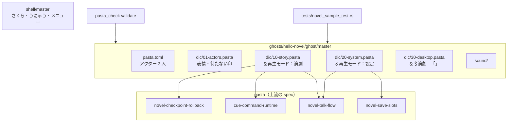
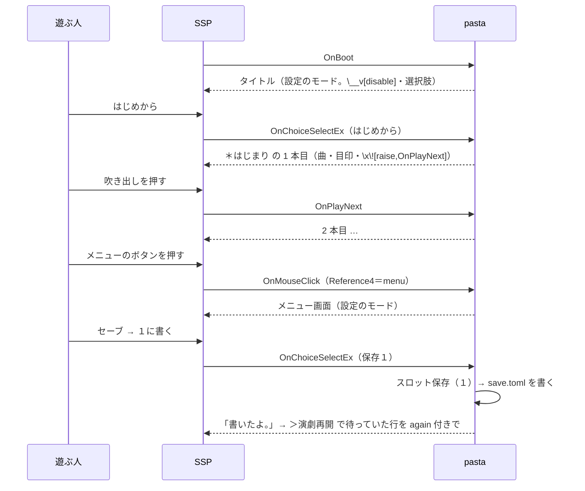

# 暫定設計: hello-novel-sample（見本のノベル）

2026-11-19 の骨子（`.kiro/specs/novel-areka-contract/final-model-2026-11-19.md`、以下「骨子」）に対して、Phase 13 の全 spec の設計を先に通しておくための、**暫定の設計**である。requirements.md と spec.json は、まだ無い。下の「暫定の要件」は、brief と骨子から引いた仮の物で、正式の要件定義（`/kiro-start`）で作り直す。命令・イベント・関数の名前は、骨子と同じく、どれも仮である。

この spec の中身は、見本のゴースト（辞書・シェル・音）と、それが壊れていないことを確かめるテストである。だから、ここでの「設計」は、見本の構成と中身の計画、確かめ方、そして見本が他の spec から何を受け取るかの一覧である。

---

## 0. 暫定の要件

brief の「決定（2026-11-19）」の申し送りと、骨子の 2 章から引いた。EARS に近い形で書く。各節の見出しの後ろに、どの要件を受けるかを書く。

| 番号 | 要件 |
| ---- | ---- |
| R1 | 見本のノベルは、hello-pasta と名前のぶつからない、別のゴーストとして置く。hello-pasta の辞書・シェル・テストは変えない。 |
| R2 | 見本は、最初から最後まで遊べる短い物語を 1 本持つ。結末は 2 つ以上で、選んだ選択肢とフラグで分かれる。 |
| R3 | 物語の辞書は、ファイル属性の行に `＆再生モード：演劇` を 1 行書くだけで、演劇として走る。作者は `\x` を書かない。 |
| R4 | 物語は、柱（`＆曲：…`・`＆曲：なし`）・ト書き（効果音・待つ・時間で次へ・透明度・転換）・表情（アクター辞書）・待たない印の単語・ト書きの束（変数の引数）を、それぞれ 1 回以上使う。 |
| R5 | 物語は、選択肢の条件と、選択肢の時間切れの飛び先を、それぞれ 1 回以上使う。 |
| R6 | 物語は、「待つ場面」を 1 つ以上持ち、その場面だけのクリックの反応を、その場面のローカルシーン（`・OnMouseClick`）で書く。 |
| R7 | 物語の章の頭で、自動セーブ（`＞スロット保存（「オート」）`）を書く。 |
| R8 | ロードで戻るフラグはスロット変数（`＄＊スロット〜`）で、ロードしても消えない印（見た結末）はふつうのグローバル変数で書く。 |
| R9 | システム画面（タイトル・メニュー・セーブ・ロード）は、物語と別のファイルに置き、`＆再生モード：設定` のシーンで書く。物語へ単に戻る所は `＞演劇再開`、ロードで戻る所は `＞スロット読込` で書く。 |
| R10 | タイトルの「つづきから」は、セーブが在るときだけ出す。 |
| R11 | メニューへの入口を、常に出ているボタンと、キーボードの 2 つ以上で書く。右クリックは、取り決めが決まったら足す。 |
| R12 | メニューに、オート・高速再生の入切と、ゴーストの終了の道（`\-`）を置く。 |
| R13 | いつもの反応（デスクトップのゴーストとしての反応）を別のファイルに置き、ファイル属性の行の `＆＄演劇＝「」` で、演劇の間は止める。 |
| R14 | 物語とシステム画面の辞書に、Lua を出さない。DSL で書けない所が見つかったら、見本の中で Lua で塞がず、穴として持ち主の spec へ送る。 |
| R15 | 絵と音は、コミットした素材として持ち、作り方・出どころ・利用条件を記録する。配布物を作る手順に、絵や音を作る段を置かない。 |
| R16 | 見本は、`pasta_check validate` を誤り 0・注意 0 で通る。 |
| R17 | pasta だけで確かめられる所（読み込み・返すさくらスクリプトの要所・分岐・セーブの読み書き・演劇の間の止め方）を、`cargo test -p pasta_sample_ghost` のテストで確かめる。 |
| R18 | フェーズ 1 の分（今の SSP で動く物）は、SSP の実機で通しで遊んで確かめる。 |
| R19 | 見本は、`pasta_check release` で `.nar` にできる。 |
| R20 | 作者が見本を写して、絵と文を差し替えるだけで自分のノベルを始められるよう、システム画面の辞書とシェルの部品を、物語に依らない形にしておく。 |

---

## 1. 概要

### 目的

作者が写して使える、ノベルの見本を 1 つ置く。同時に、Phase 13 のエンジンの機能が、骨子の決まりだけで 1 本のゲームとして組み上がることを確かめる題材にする（R2・R20）。

### ゴール

- フェーズ 1（今の SSP）で、最初から最後まで遊べる見本のゴースト `hello-novel` が在る。
- 物語・システム画面・いつもの反応の 3 つの辞書が、ファイルで分かれている。
- 見本の要所を、テストが SSP 無しで確かめる。
- 見本を作る途中で見つけた、DSL の穴と取り決めの不足を、持ち主の spec へ送る。

### ゴールでない物

- 舞台（areka の合成した窓）を使う見本。areka の準備を待つ。この設計では、別の spec に分ける案を推す（6 章の食い違い 3）。
- CG 鑑賞・回想・音楽室（brief の Out of Boundary）。
- hello-pasta を変えること。
- リリースの CI に `.nar` の添付を足すこと（6 章の食い違い 12）。
- 入門の文章（`manual-novel-guide`）。

---

## 2. 境界の約束

### この spec が持つ物

- `crates/pasta_sample_ghost/ghosts/hello-novel/` の下の全部（辞書・設定・シェル・音・`install.txt`）。
- 素材の記録 `crates/pasta_sample_ghost/art/hello-novel/README.md`。
- テスト `crates/pasta_sample_ghost/tests/novel_sample_test.rs`。
- SSP の実機の確かめの手順と結果（この spec のフォルダの中の記録）。

### この spec の外

- 演劇の走り方・ト書きと柱・目印と控え・スロットの関数・クリックの振り分け（各 spec が持つ）。見本は使うだけである。
- 取り決めの語彙。見本で足りない物が見つかったら、`novel-areka-contract` の取り決めの文書を直す手順（同 brief の「依頼の出し方」）に乗せる。

### 使ってよい依存

- 今の pasta の DSL と、Phase 13 の各 spec が足す物（5 章の表）。
- テストは、今の `pasta_sample_ghost` のテストと同じく、`pasta_lua::loader::PastaLoader` と `PastaLuaRuntime::exec` で `SHIORI.request` を呼ぶ形（`crates/pasta_sample_ghost/tests/touch_shortcuts_test.rs:28-62`）。新しいクレートの依存は足さない。

### 見直しが要る時

- 上流の spec が、名前（柱・関数・イベント・タグ）を確定したとき。見本の辞書とテストの期待を、その名前に合わせる。
- `！select` の時間の単位が決まったとき（7 章の 1）。
- 「同じ台本を SSP でも areka でも動かす」の読み方が決まったとき（7 章の 3）。

---

## 3. 構成

### 3.1 今の仕組みとの関係（調べた事実）

- ワークスペースは `members = ["crates/*"]`（ルートの `Cargo.toml:5`）。見本を `crates/pasta_sample_ghost` の中に置けば、ルートの `Cargo.toml` と `Cargo.lock` を触らない（brief の Constraints）。
- `pasta_sample_ghost` のテストは、ゴーストの `ghost/master` を一時フォルダへ写してから読み込む（`tests/common/mod.rs:18-25`）。写し元は hello-pasta に決め打ちである。
- 既存のテストと CI は、`ghosts/hello-pasta` を名指しで見るだけで、`ghosts/` の下を数えない（`build.yml:78,129`・`manual.yml:45-61`・`release.yml`・`tutorial-check.mjs:48-51`・`validate_cli_test.rs:223`）。フォルダを足しても、既存の検査は動かない。
- 更新の置き場所の注意は、`name` が hello-pasta でないのに `homeurl` が hello-pasta の置き場所を指すときに出る（`crates/pasta_check/src/validate/homeurl.rs:9-26`）。見本は `homeurl` を書かないので、注意は出ない（R16）。
- ファイル属性の行は、1 つのファイルの同じ所に 2 行続けて書くと、パースの誤りになる（`crates/pasta_dsl/src/parser/mod.rs:214-234`）。複数の属性は 1 行に並べる（`＆再生モード：演劇＆曲：なし`）。
- ファイル属性は、そのファイルの後ろのグローバルシーン全部の属性に、先に足される。宣言（`＆名前：値`）は後の値が勝ち、条件（`＆＄…`）は畳まずに足される（`crates/pasta_dsl/src/parser/ast/attr_merge.rs:7-21,25-47`）。**だから、`＆＄演劇＝「」` をファイル属性に書いたファイルに、演劇の間に開くメニューのシーンを置くと、メニューも止まる。** メニューは別のファイルに置く（4.2）。
- アクター指定行（`％…`）は、グローバルシーンの頭にだけ書ける（`grammar.pest:274`。ローカルシーンの行の種類 `grammar.pest:280` に無い）。
- 名前で探すシーンは前方一致で、ローカル（今のグローバルシーンの中）→ `act` のメソッド → `GLOBAL` の完全一致 → グローバルの順に探す（`crates/pasta_lua/pasta_scripts/pasta/act.lua:396-441`）。**ローカルシーンやグローバルシーンの名前が `スロット保存`・`演劇再開` などの組み込みの名前で始まると、組み込みより先に当たる。** 見本は、シーンの名前の付け方の決まりを持つ（4.5）。
- 式の中の関数呼び出し（`＠名前（引数）`）は、文法に在る（`grammar.pest:72,100-102`）。実行時は `expr` の探し方で、`GLOBAL` の完全一致まで届く（`act.lua:428-430`）。だから `＄章＝＠スロット参照（「オート」、「スロット章」）` は、`スロット参照` が `GLOBAL` に在れば、今の文法のまま書ける（`novel-save-slots` の「要件定義へ送ること」の 1 つに答える見込み。実行はしていない）。
- 条件で、値の無い変数は空の文字列と等しい（`crates/pasta_lua/src/search/scene_cond_tests.rs:163-171`。`Nil` と `""` の `＝` は通る）。数字だけの文字列は数と比べられる（同 102-111 行。Reference3 の `"1"` と `１` は等しい）。骨子 7 章の「`＆＄演劇＝「」` の実行時の比べ方は未確認」は、単体のテストの水準では確かめられている。
- イベントでシーンを探す既定（`EVENT.no_entry`）は、`SCENE.co_exec(act, イベント名)` で、条件を `act` で評価する（`shiori/event/init.lua:222-226`。`act` は Reference と日時を写してから作る。同 104-109 行）。今でも `＊OnMouseClick　＆＄ｒ４＝「menu」` は、Reference4 で振り分けられる。
- つつき・撫での近道（`＊つっつき反応…`）は、完全一致で引き、条件を見ない（`shiori/event/mouse.lua:117-123` の `SCENE.co_exec_exact`、`scene.lua:255-295`）。**`＆＄演劇＝「」` は、近道のシーンには効かない**（7 章の 2）。見本のいつもの反応は、近道の名前を使わない。
- ゴーストの終了は、組み込みの `＞ゴースト終了` が `\-` を出す（`shiori/entry.lua:18-26`）。
- `！select` 以外のト書きは、今は何も出さない（`crates/pasta_lua/src/code_gen/scope_gen_tests.rs:379-390`）。`！select（秒）` は秒で、組み立てで 1000 倍する（`scope_gen.rs:389-410`・`shiori/sakura_builder.lua:456-458`。hello-pasta の `09-choice.pasta:4,11`）。
- 選択肢の飛び先は、選択肢を出したグローバルシーン（Reference2）のローカル → グローバルの順に、条件つきで探す（`shiori/event/choice_select.lua:26-71`）。
- スコープの切り替えは、いつも `\p[番号]` で出る（`shiori/sakura_builder.lua:41-45`）。
- 保存は `@pasta_persistence` の `load`・`save`（`crates/pasta_lua/src/runtime/persistence.rs:156,163`）。

### 3.2 構成の図



### 3.3 技術

| 層 | 使う物 | 役目 |
| -- | ------ | ---- |
| 辞書 | Pasta DSL | 物語・システム画面・いつもの反応 |
| 設定 | `pasta.toml` | アクターとスポット。別名表は書かない（既定の表を使う） |
| シェル | `surfaces.txt`・PNG | 立ち絵・メニューのボタン・当たり判定 |
| 音 | 音のファイル（形式は 6 章の 9） | 曲 2 つ・効果音 1 つ |
| テスト | Rust の統合テスト（既存の `pasta_lua` の dev-dependency） | 読み込み・要所の応答・セーブ |
| 実機 | SSP 2.9.34 以降 | 通しで遊ぶ |

---

## 4. ファイルの計画（R1・R9・R13・R15・R20）

### 4.1 置き場所

```
crates/pasta_sample_ghost/
├── ghosts/
│   ├── hello-pasta/            （変えない）
│   └── hello-novel/            （新しい）
│       ├── install.txt         type,ghost / name,hello-novel / directory,hello-novel
│       ├── ghost/master/
│       │   ├── descript.txt    name,hello-novel・sakura.name,さくら・kero.name,うにゅう・shiori,pasta.dll（homeurl は書かない）
│       │   ├── pasta.toml
│       │   ├── dic/
│       │   │   ├── 01-actors.pasta
│       │   │   ├── 10-story.pasta
│       │   │   ├── 20-system.pasta
│       │   │   └── 30-desktop.pasta
│       │   └── sound/          曲 2 つ・効果音 1 つ
│       └── shell/master/
│           ├── descript.txt
│           ├── surfaces.txt    さくら 0〜・うにゅう 10〜・メニュー 20〜
│           └── surface*.png
├── art/hello-novel/README.md   素材の作り方・出どころ・利用条件
└── tests/novel_sample_test.rs
```

- フォルダの名前 `hello-novel`（仮）は、hello-pasta と並べて分かる名前にした。
- ファイルの頭の番号は、読み込みの順（辞書順）を決めるだけで、hello-pasta の「段階」の意味は持たない（6 章の 10）。
- 番号を 10 刻みにして、作者が自分の物語のファイルを間に足せるようにする。

### 4.2 辞書の割り方

| ファイル | ファイル属性の行 | 中身 | 写して使うか |
| -------- | ---------------- | ---- | ------------ |
| `01-actors.pasta` | なし | アクター辞書（表情・待たない印の単語） | 名前と番号を差し替える |
| `10-story.pasta` | `＆再生モード：演劇＆曲：なし` | 物語 | 作者が書き替える |
| `20-system.pasta` | `＆再生モード：設定` | `＊OnBoot`・タイトル・メニュー・セーブ・ロード・`＊OnClose` | そのまま写す（文を差し替える） |
| `30-desktop.pasta` | `＆＄演劇＝「」＆再生モード：トーク` | いつもの反応（クリック・ダブルクリック・会話） | 好みで |

- メニューのシーン（演劇の間に開く）は、`＆＄演劇＝「」` の無いファイル（`20-system.pasta`）に置く（3.1 の属性の受け継ぎの事実から）。
- `10-story.pasta` の `＆曲：なし` は、骨子 4 章 F の例に合わせた書き方で、「柱を書かない場面は無音」を物語の既定にする。

### 4.3 pasta.toml

hello-pasta と同じ `[loader]`・`[logging]`・`[persistence]`（`ghosts/hello-pasta/ghost/master/pasta.toml`）に、次を書く。`[ghost]` のランダムトークの間隔は書かない（既定のまま）。

```toml
[actor."さくら"]
spot = 0

[actor."うにゅう"]
spot = 1

[actor."メニュー"]
spot = 2
```

- 別名表（`cue-command-runtime`）は書かない。既定の表で足りることを、見本で確かめる（R4）。
- 「メニュー」は、メニューのボタンを載せた絵のアクターである（骨子 2.7「画面の部品は、全部アクター」）。SSP では、3 つ目のキャラクターの窓になる（6 章の 7）。

### 4.4 シェル

| アクター | サーフェス | 当たり判定（`collisionex`） |
| -------- | ---------- | --------------------------- |
| さくら | 0〜8（表情 9 つ） | `Head`・`Face`・`Body` |
| うにゅう | 10〜18（表情 9 つ） | `Head`・`Face`・`Body` |
| メニュー | 20（ボタン）・21（隠す。`\s[-1]` でもよい） | `menu` |

- 立ち絵は、hello-pasta の素材（`ghosts/hello-pasta/shell/master/surface0〜18.png` と `surfaces.txt`）を写して使う案を推す（費用 0・作り直せない絵を増やさない）。写すだけで、hello-pasta の側は変えない（R1）。新しく作るのは、メニューのボタンの絵 1〜2 枚だけ（fal.ai。`hello-pasta-shell-art` の前例の手順と記録の形）。6 章の 8。
- 当たり判定の名前は英字にする（`menu`。hello-pasta の `Head` などと同じ流儀）。骨子の例は `＄ｒ４＝「設定」` だが、名前は作者が決める物なので、見本は英字で書く（6 章の 6）。

### 4.5 シーンの名前の決まり（前方一致への備え）

3.1 のとおり、名前で探すシーンは前方一致で、ローカルが組み込みより先に当たる。見本は、次を守る。テストで機械的に確かめる（9 章の T9）。

- どのシーンの名前も、別の名前のシーンの名前の頭になっていない（同じ名前の組は除く）。例: `第一章` と `第一章の続き` を並べない。`保存１`〜`保存３` まで（`保存１０` を作らない）。
- どのシーンの名前も、組み込みの名前（`スロット保存`・`スロット読込`・`スロット消去`・`スロット参照`・`演劇再開`・`ゴースト終了`・`自動トーク停止`・`自動トーク再開`・`チェイントーク`、と上流が足す名前）で始まらない。

---

## 5. 辞書の中身の計画（R2〜R14）

台詞は計画の水準に留める。表情・掛け合いのコツは推測で書かず、実装のときに「emo2 開発」に相談する（brief の Constraints）。ここに載せる DSL は、骨組みと、上流の機能をどこで使うかを示すための物である。

### 5.1 `01-actors.pasta`（R4）

```pasta
％さくら
    ＠通常：\s[0]
    ＠笑顔：\s[1]
    ＠驚き：\s[3]
    ＠びくっ：\![parallel]\s[3]\_w[200]\s[0]

％うにゅう
    ＠通常：\s[10]
    ＠照れ：\s[12]

％メニュー
    ＠出す：\s[20]
    ＠隠す：\s[-1]
```

- `＠びくっ` が、待たない印（仮 `\![parallel]`。`novel-talk-flow`）の見本である。SSP では順に再生される（骨子 2.2）。

### 5.2 `10-story.pasta`（R2〜R8）

```pasta
＆再生モード：演劇＆曲：なし

＊はじまり　＆曲：昼のテーマ
    ％さくら、うにゅう、メニュー
    ＞スロット保存（「オート」）
    ＄＊スロット章＝「はじまり」
    メニュー：＠出す
    さくら：＠笑顔　放課後だね。
    うにゅう：＠通常　ほな、帰ろか。
    ！時間で次へ（２０００）
    さくら：……あ、ちょっと待って。
    ＞教室

＊教室　＆曲：昼のテーマ
    ％さくら、うにゅう、メニュー
    ＞スロット保存（「オート」）
    ＄＊スロット章＝「教室」
    さくら：忘れ物を探すね。気になる所を押してみて。
    ＠？廊下へ「もう行こう」

    ・OnMouseClick　＆＄ｒ３＝１＆＄ｒ４＝「Head」
        うにゅう：＠照れ　なんや、急に。
        ＄＊スロット好感度＝＄＊スロット好感度＋１
        ＞教室

    ・OnMouseClick　＆＄ｒ３＝０＆＄ｒ４＝「Body」
        ！効果音（物音）
        さくら：＠びくっ
        さくら：＠驚き　あった、これだ！
        ＞教室

＊廊下　＆曲：昼のテーマ
    ％さくら、うにゅう、メニュー
    ＞スロット保存（「オート」）
    ＄＊スロット章＝「廊下」
    ＞消えて現れる（うにゅう、「５０」）
    さくら：どっちから帰ろうか。
    ！select（１００００、迷う）
    ＠？寄り道「寄り道しよう」
    ＠？まっすぐ「まっすぐ帰ろう」　＆＄＊スロット好感度≧１

    ・寄り道
        ＄＊スロット好感度＝＄＊スロット好感度＋１
        ＞結末

    ・まっすぐ
        ＞結末

    ・迷う
        うにゅう：はよ決めや。
        ＞結末

＊結末　＆優先：１　＆＄＊スロット好感度≧２　＆曲：夕方のテーマ
    ％さくら、うにゅう、メニュー
    ！転換（５００）
    さくら：＠笑顔　今日は、楽しかったね。
    ＄＊見た結末Ａ＝１
    ＞あとがき

＊結末　＆曲：夕方のテーマ
    ％さくら、うにゅう、メニュー
    さくら：また明日ね。
    ＄＊見た結末Ｂ＝１
    ＞あとがき

＊あとがき　＆再生モード：トーク
    さくら：遊んでくれて、ありがとう。

＊消えて現れる
    ！待つ（３００）
    ！透明度＠＄０（０）
    ！待つ（３００）
    ！透明度＠＄０（＄１）
```

使う機能と、受け取る spec:

| 書き方 | 要件 | 受け取る spec |
| ------ | ---- | ------------- |
| ファイル属性の `＆再生モード：演劇` | R3 | `novel-talk-flow`（モードの走り方）・`cue-command-runtime`（柱を打つ仕組み） |
| `＆曲：昼のテーマ`・`＆曲：なし`・`＆曲：夕方のテーマ` | R4 | `cue-command-runtime` |
| `！効果音`・`！待つ`・`！時間で次へ`・`！透明度＠`・`！転換` | R4 | `cue-command-runtime`（10 個のト書き）。`！時間で次へ` の出し方は `novel-talk-flow` |
| `＠びくっ`（待たない印） | R4 | `novel-talk-flow` |
| `＞消えて現れる（うにゅう、「５０」）` と `！透明度＠＄０（＄１）` | R4 | `cue-command-runtime`（ト書きの対象と引数の変数。文法に足す） |
| `＠？まっすぐ「…」　＆＄＊スロット好感度≧１` | R5 | `novel-talk-flow`（選択肢の条件。文法に足す） |
| `！select（１００００、迷う）` | R5 | `novel-talk-flow`（時間切れの飛び先。文法に足す）。単位は 7 章の 1 |
| `・OnMouseClick　＆＄ｒ３＝１＆＄ｒ４＝「Head」` | R6 | `novel-talk-flow`（今のシーンのローカルを先に探す）。当たり判定の名前は今の条件で書ける |
| 章の頭の `＞スロット保存（「オート」）` | R7 | `novel-save-slots`・`novel-checkpoint-rollback`（着いた時の控え・早回しの間は実行しない） |
| `＄＊スロット好感度`・`＄＊見た結末Ａ` | R8 | `novel-save-slots`（スロット変数の頭） |
| 同名の `＊結末` に `＆優先：１` と条件 | R2 | 今の pasta（`scene-condition-attributes`） |
| `＊あとがき　＆再生モード：トーク` | R3 | `novel-talk-flow` |

- 「待つ場面」の `＊教室` は、最後を選択肢にした（選択肢を待っている 1 本は、外れたクリックで進まない。骨子 2.3）。反応のローカルシーンは、最後の行の `＞教室` で、場面を頭から読ませ直す（骨子 2.3「元の場面を読ませ直したいときは、最後の行に `＞`」）。頭の自動セーブも、そのたびに走る。これは「シーンの頭に書いた保存は、そのシーンの頭から続く」の帰結で、困らない（オートの枠が、同じ場面の頭で書き直されるだけ）。
- `＊結末` を 2 つ書くのは、`＆優先：１` の付いた方が条件を満たせばそちら、満たさなければ条件の無い方、という今の選び方（`scene-condition-attributes`）の見本である。
- `＊消えて現れる` は、呼んだ側の続きとして走るので、柱は打たれない（骨子 4 章 F）。
- 舞台を使うト書き（`！舞台`・並び・席の名前）は、この見本では書かない（ゴールでない物）。`！転換` は、SSP では何も出ない（骨子 2.4「直せない物は出さない」）。同じ台本の見本として 1 つだけ置く。

### 5.3 `20-system.pasta`（R9〜R12）

```pasta
＆再生モード：設定

＊OnBoot
    ＞タイトル

＊タイトル
    ％さくら、うにゅう、メニュー
    ＄章＝＠スロット参照（「オート」、「スロット章」）
    メニュー：＠隠す
    さくら：hello-novel へ、ようこそ。
    ＠？はじめから「はじめから」
    ＠？つづきから「つづきから」　＆＄章≠「」
    ＠？おわる「おわる」

    ・はじめから
        ＞スロット消去
        ＞はじまり

    ・つづきから
        ＞ロード画面

    ・おわる
        ＞ゴースト終了

＊OnMouseClick　＆＄ｒ４＝「menu」
    ＞メニュー画面

＊OnKeyPress　＆＄ｒ０＝「escape」
    ＞メニュー画面

＊メニュー画面
    さくら：どうする？
    ＠？セーブ「セーブ」
    ＠？ロード「ロード」
    ＠？オート「オートの入切」
    ＠？早送り「高速再生の入切」
    ＠？戻る「物語へ戻る」
    ＠？タイトル「タイトルへ」
    ＠？終了「ゴーストを終わる」

    ・セーブ
        ＞セーブ画面

    ・ロード
        ＞ロード画面

    ・オート
        ＞オート切替
        ＞演劇再開

    ・早送り
        ＞高速再生切替
        ＞演劇再開

    ・戻る
        ＞演劇再開

    ・タイトル
        ＞タイトル

    ・終了
        ＞ゴースト終了

＊セーブ画面
    ＄一＝＠スロット参照（１、「スロット章」）
    ＄二＝＠スロット参照（２、「スロット章」）
    さくら：どこに書く？　１：＄一　２：＄二
    ＠？保存１「１に書く」
    ＠？保存２「２に書く」
    ＠？やめる「やめる」

    ・保存１
        ＞スロット保存（１）
        さくら：書いたよ。
        ＞演劇再開

    ・保存２
        ＞スロット保存（２）
        さくら：書いたよ。
        ＞演劇再開

    ・やめる
        ＞演劇再開

＊ロード画面
    ＄オ＝＠スロット参照（「オート」、「スロット章」）
    ＄一＝＠スロット参照（１、「スロット章」）
    ＄二＝＠スロット参照（２、「スロット章」）
    さくら：どこから読む？　オート：＄オ　１：＄一　２：＄二
    ＠？読込オ「オートから」　＆＄オ≠「」
    ＠？読込１「１から」　＆＄一≠「」
    ＠？読込２「２から」　＆＄二≠「」
    ＠？やめる「やめる」

    ・読込オ
        ＞スロット読込（「オート」）

    ・読込１
        ＞スロット読込（１）

    ・読込２
        ＞スロット読込（２）

    ・やめる
        ＞演劇再開

＊OnClose　＆再生モード：トーク
    さくら：またね。
    ＞ゴースト終了
```

- **入口**（R11）: ボタン（`menu` の当たり判定。`＊OnMouseClick　＆＄ｒ４＝「menu」`）とキーボード（`＊OnKeyPress`）の 2 つ。右クリックは、pasta がリソースの照会に答える口が決まってから足す（6 章の 5）。
- 入口のシーンを、`＊メニュー画面` への 1 行の `＞` にしたのは、入口が増えても画面を 1 か所で持つためである。最後の行の `＞` なので、メニュー画面に「着く」（柱 `＆再生モード：設定` はファイル属性から打たれる）。
- **つづきから**（R10）: `＠スロット参照` の値の有無を、選択肢の条件で見る。値が無いと、`＄章` は値なしで、`＝「」` と等しい（3.1）ので、`≠「」` は通らない。セーブが在るかを見る専用の条件（`novel-save-slots` の「要件定義へ送ること」）が出来たら、そちらに替える。
- **オート・高速再生**（R12）: `＞オート切替`・`＞高速再生切替` は、仮の名前である。入切を切り替える口は、まだ決まっていない（骨子 6 章「設定の値を切り替える口」。持ち主は `novel-talk-flow` と `cue-command-runtime`）。見本は、組み込みの呼び出しの形で受け取る見込みで書く。
- **終了の道**（R12）: メニューとタイトルに `＞ゴースト終了` を置く（取り決めの brief「右クリックのメニューを止めている間は…設定のシーンに終了の道（`\-`）を置くことを、見本とマニュアルに書く」）。
- `＊タイトル` から `・はじめから` を選ぶと、`＞スロット消去` でスロット変数を消し、最後の行の `＞はじまり` で物語のファイルのシーンへ着く。そこで演劇になる（骨子 2.1）。前の物語の控えを全部捨てる時は、`novel-talk-flow` の要件で決まる（6 章の 4）。
- `＊OnClose` に `＆再生モード：トーク` を書くのは、終わりの挨拶をクリック待ちにしないためである（ファイル属性の `設定` を、シーンの柱で上書きする見本）。
- ローカルシーンの名前（`セーブ`・`ロード`・`戻る` など）は、4.5 の決まりで選んだ。`＞セーブ画面` を `＊メニュー画面` の中で書くと、ローカルを先に前方一致で探すので、`・セーブ` には当たらない（`セーブ` は `セーブ画面` の頭ではあるが、探すのは「`セーブ画面` で始まる名前」である）。

### 5.4 `30-desktop.pasta`（R13）

```pasta
＆＄演劇＝「」＆再生モード：トーク

＊OnMouseClick
    さくら：なあに？

＊OnMouseDoubleClick
    うにゅう：つつかんといて。

＊会話
    さくら：ねえ、また物語を読む？
    ＠？読む「読む」
    ＠？あとで「あとで」

    ・読む
        ＞タイトル

    ・あとで
        さくら：うん、またね。
```

- 演劇の間、`＊OnMouseClick`（条件なし）は `＄演劇` が空でないので外れ、どのシーンも拾わない左クリックは「進める」になる（骨子 2.3）。このファイルの 1 行が、それを支える。
- つつき・撫での近道の名前（`＊つっつき反応…`）は使わない。近道は条件を見ないので、演劇の間も動く（3.1・7 章の 2）。
- `＊会話` は、演劇と設定の間は返らない（`novel-talk-flow`）。ここでは、物語の外のデスクトップのゴーストから物語へ入る道（`＞タイトル`）の見本になる。

### 5.5 返すさくらスクリプトの形（仮。SSP 向け）

正は各 spec が決める。テストは、ここに書く要所だけを見る（9 章）。

| 場面 | 1 本の形（要所） |
| ---- | ---------------- |
| `＊はじまり` の 1 本目 | `\![sound,loop,…昼のテーマ…]`・`\![play,mark,OnPlayRollback,ID]`・`\p[0]`・「放課後だね。」・末尾 `\x\![raise,OnPlayNext]` |
| `！時間で次へ（２０００）` の 1 本 | `\![timerraise,2000,1,OnPlayNext]\x\![timerraise,0,1,OnPlayNext]\![raise,OnPlayNext]`（骨子 2.6） |
| `＊教室` の最後の 1 本（選択肢） | `\q[…]` が在り、`\x` が無い |
| `＊廊下` の選択肢の 1 本 | `\![set,choicetimeout,…]`。条件を満たさない `まっすぐ` は `\q` に出ない |
| `＊メニュー画面` の 1 本 | `\__v[disable]` の区間で出る。目印 `\![play,mark,` が無い |
| `・戻る` → `＞演劇再開` | 待っていた物語の行が、`\![play,again]` 付きで、字を一度に（`\_q`）出る |
| `＞スロット読込（１）` | 2 本。1 本目は `\![play,again]` 付きで字が無い。2 本目はセーブした行の台詞 |
| `＊結末` の柱 | `\![sound,loop,…夕方のテーマ…]`。`＊あとがき` に着くと、ファイル属性の `＆曲：なし` が打たれて曲が止まる（`\![sound,stop,…夕方のテーマ…]`） |

---

## 6. 骨子・brief との食い違いと、決まっていない所

番号ごとに、この設計で置いた仮定を書く。

1. **brief の「0.5.0」**: brief の申し送りのとおり、版は未定（roadmap の Phase 13 の 2026-11-19 の節）。仮定: 版を書かない。
2. **brief の Upstream の `call-attribute-filter`・`novel-variable-scope`**: どちらも閉じた（brief の申し送り）。仮定: Upstream は `scene-condition-attributes`（入っている）と、Phase 13 の 6 本。
3. **brief の Desired Outcome「背景・場面転換」「areka の実機で動く」と、フェーズ**: 背景のアクターと転換は、舞台（フェーズ 3 の前半）が要る。今の areka には、`\x` の待ちも `\![raise]` も無い（取り決めの brief「areka の現状」）。brief の最後の申し送りは「フェーズ 1 で遊べる見本を先に作れる。舞台を使う見本は、areka の準備を待つ」。仮定: この spec は、フェーズ 1 の見本（SSP で通しで遊べる）までを持ち、舞台の見本は別の spec に分ける（規模も 15〜18 の上限に近い）。「areka の実機」の確かめは、その別の spec に送る。**分けるかは、要件定義で開発者が決める。**
4. **前の物語の控えを全部捨てる時**: タイトルの `はじめから` で、設定のモードから演劇のモードのシーンへ着く。骨子の候補は「トークから演劇に入った時」で、設定から入った時は書いていない。仮定: `novel-talk-flow` の要件で決まる。見本は `＞スロット消去` を先に書く（スロット変数は確かに消える）。
5. **右クリックの入口**: 取り決めは「pasta が `sakura.popupmenu.visible` などに『出さない』と答える」とする。今の pasta には、リソースの照会に答える口が無い（`pasta_scripts/pasta` の Lua に `popupmenu`・`resource` の扱いが無い）。シーンの出力はさくらスクリプトに組み立てられるので、`0` のような素の値を返す DSL の書き方も無い。仮定: 見本は、ボタンとキーボードの 2 つで入口を書き、右クリックは口が決まってから足す（R11）。持ち主は `novel-areka-contract` の要件（「pasta がリソースの照会に答える口の書き方」）で、DSL の書き方が要るなら `novel-talk-flow` か `cue-command-runtime`。
6. **当たり判定の名前とキーの名前**: 骨子の例は `＄ｒ４＝「設定」`。仮定: 見本は英字（`menu`）。`OnKeyPress` の Reference0 の値（`escape` など）は、SSP の実機で確かめてから決める（`novel-talk-flow` の「キーで進めるときのキーの決め方」と揃える）。
7. **SSP の 3 つ目のキャラクター**: メニューのアクターは、SSP では 3 つ目の窓（`\p[2]`）になる。仮定: SSP は `\p[2]` と、シェルの `surfaces.txt` の 20 番台で出せる（実機で確かめる）。出せなければ、ボタンの当たり判定を、うにゅうの絵の中に置く案に替える。
8. **立ち絵**: 仮定: hello-pasta の立ち絵を写して使う（費用 0）。キャラクターの名前は、辞書の上だけ さくら・うにゅう とする。新しいキャラクターを fal.ai で作るかは、要件定義で開発者が決める（1 枚およそ 0.057 ドル。brief の申し送り）。
9. **音の素材**: 曲 2 つと効果音 1 つが要る。入手先（作るか、利用条件のはっきりした素材を使うか）と、ファイルの形式（SSP の `\![sound,…]` で鳴る形式）は、決まっていない。音のタグは、SSP の実機で確かめていない（骨子 7 章）。仮定: 形式は `.ogg`。入手先は要件定義で開発者が決め、`art/hello-novel/README.md` に記録する。
10. **段階に分けるか**: hello-pasta は段階表（`STAGES.md`）で、入門の章と 1 対 1 で照合する（`tutorial-check.mjs`）。仮定: 見本は段階に分けず、仕上がった 1 本として置く。章の割り方は `manual-novel-guide` が決める。章の作例を見本の辞書と照合するなら、辞書を章ごとに切る形を、そちらの要件で決める。
11. **オート・高速再生の入切の口**: 骨子 6 章で未定。仮定: 組み込みの呼び出し `＞オート切替`・`＞高速再生切替`（名前は仮）。
12. **配布**: brief は「`pasta_check release` で作れるか」。`pasta_check release` は `--target` にゴーストのフォルダを取る汎用の作りである（`crates/pasta_check/src/release_args.rs:23-46`）。hello-pasta の `release.ps1` は、パスを hello-pasta に決め打ちしている。仮定: 見本の `.nar` は、`pasta_check release` を手で 1 回動かして作れることを確かめるだけにし、`release.ps1` とリリースの CI には足さない（Release の添付に増やすかは、要件定義で開発者が決める）。
13. **`＄演劇` の値（設定のモードの間）**: 骨子は「演劇の間は今のシーンのグローバルシーンの名前、演劇でなければ空」。設定のモードの間の値は書いていない。`novel-talk-flow` は `＄再生モード` に置き換える案を持つ。仮定: 設定のモードの間も、物語が待っていれば空でない。見本の `30-desktop.pasta` は、名前が決まったら、その形に書き直す。
14. **`＞演劇再開` を、物語が待っていない時に呼んだ時**: タイトルの画面からメニューを開いて「戻る」を選ぶと、物語は待っていない（未定。`novel-talk-flow`）。仮定: 見本は、タイトルの画面ではメニューのボタンを隠し（`メニュー：＠隠す`）、隠したアクターの当たり判定は届かない（取り決めの brief の areka の勧め。SSP で `\s[-1]` の窓に判定が無いことは実機で確かめる）。キーボードの入口は、タイトルの間も届くので、未定の動きに当たる。
15. **待つ場面の反応の後の自動セーブ**: `＊教室` へ `＞教室` で戻るたびに、頭の `＞スロット保存（「オート」）` が走る。骨子の決まりのとおりで、食い違いではない。マニュアルに書くかは `manual-novel-guide`。
16. **バックログ**: brief の Approach は「バックログの一覧は areka が持つので、開く命令だけを書く」。フェーズ 1 の SSP では、バックログは SSP の窓で読むだけで、行へ戻るのはフェーズ 2（骨子 2.9）。取り決めに「バックログを開く命令」は無い。仮定: 見本はバックログを開く命令を書かない。
17. **`manual-novel-guide` の brief の「ローカルシーンは、親のグローバルシーンの柱を受け継がない」**: 骨子 2.4 は「グローバルシーンの属性に、ローカルシーンの属性を重ねる」（柱を打つ仕組みが重ねる。倉は受け継がない。`cue-command-runtime` の brief）。作者から見える動きは「受け継ぐ」なので、`manual-novel-guide` の brief の文は、作者向けには食い違う。見本は骨子のとおりに書く（ローカルシーンに曲を書かなければ、親の曲が鳴る）。
18. **既読**: 骨子 2.6 で、高速再生を「まだ読んでいない行で止める」。見本で確かめるには、2 周目の通しが要る。仮定: テストで 2 周目の高速再生が、1 周目に読まなかった分かれ道の先で止まることを見る（T7）。

---

## 7. 上位の決定へ差し戻しが要りそうな所

1. **`！select` の時間の単位**: 骨子 2.4 は「時間は、どれもミリ秒で書く」で、`play-script-guide.md` の例は `！select（２００００、時間切れ）`。今の pasta の `！select` は秒で、組み立てで 1000 倍する（`crates/pasta_lua/src/code_gen/scope_gen.rs:389-410`・`pasta_scripts/pasta/shiori/sakura_builder.lua:456-458`）。hello-pasta の `09-choice.pasta:4,11` とマニュアルは、秒で書いている。`！select` だけ秒のまま残す（決まりの例外になる）か、ミリ秒へ替えて hello-pasta とマニュアルを直す（破壊的な変更）かは、骨子の水準の決定である。この設計は、骨子に合わせてミリ秒で書いた（`！select（１００００、迷う）`）。
2. **「いつもの反応を止める 1 行」が届かない道**: 骨子 2.3 は「演劇の間に動かしたくない、いつもの反応には、条件 `＆＄演劇＝「」` を書く」とする。つつき・撫での近道のシーンは、完全一致で引いて条件を見ない（`pasta_scripts/pasta/shiori/event/mouse.lua:117-123`・`pasta_scripts/pasta/scene.lua:255-295`）。だから、近道の名前で書いた反応は、この 1 行では止まらない。近道も条件を見るようにする（`scene-exact-match` と揃える）か、演劇の間は近道を探さない（`mouse.lua` が `STORE.auto_talk_paused` の間にしている形。`mouse.lua:143-145`）かを決める必要がある。持ち主は `novel-talk-flow` の見込みだが、「1 文で言える決まり」が今の作りで成り立たない例なので、ここに挙げる。見本は近道を使わずに避けた（5.4）。
3. **「同じ台本を、SSP でも areka でも動かす」と、画面の部品のアクター**: 骨子 2.4 は「同じ台本を、SSP でも areka でも動かす。直せない物は、そのベースウェアでは出さない」、2.7 は「画面の部品は、全部アクター（背景も）」。スコープの番号は並びの順である（`cue-command-runtime` の brief「並びと転換」）。背景のアクターを並びの頭に置いた台本を SSP で動かすと、背景がデスクトップの窓（`\p[0]`）になり、人物の番号がずれる。タグを出さないだけでは、遊べる形にならない。「同じ台本」を「書き方が 1 つ」と読む（ベースウェアごとに台本を分けてよい）のか、SSP では舞台にしか居ないアクターを並びから外すのかは、骨子の水準の読み方である。見本は、フェーズ 1 の台本に背景のアクターを入れずに避けた（6 章の 3）。

---

## 8. 流れ

### 8.1 通しで遊ぶ（フェーズ 1・SSP）



### 8.2 ロード

`＊ロード画面` の `・読込１` → `＞スロット読込（１）` → pasta は 2 本返す（1 本目 `\![play,again]` で画面の状態、2 本目でセーブした行）。曲は、その行のシーンの階層の柱で決まる（骨子 2.5）。物語のファイルの属性は `＆曲：なし` なので、`＊教室` に `＆曲` を書かなければ、`＊教室` の行でロードしたとき（と、`＊教室` に着いたとき）に無音になる。**作者の目には「教室に入ると曲が止まる」と映る。** だから見本は、`＊はじまり` と同じ曲を鳴らす `＊教室`・`＊廊下` にも `＆曲：昼のテーマ` を書いた（骨子 4 章 B の帰結「音の変わる場面のグローバルシーンには、柱を書く」）。同じ値なので、着いた時には打たれず、曲は途切れない（骨子 2.4「同じ値なら、何も起きない」）。この書き分けは、マニュアルの題材になる。

---

## 9. テストの計画（R16・R17）

### 9.1 置き場所と手助け

- `crates/pasta_sample_ghost/tests/novel_sample_test.rs`（新しい）。
- `crates/pasta_sample_ghost/tests/common/mod.rs` に `master_copy_of(ghost: &str) -> TempDir` を足し、今の `master_copy()` はそれを `"hello-pasta"` で呼ぶ形にする（既存のテストの動きは変えない）。
- イベントは、`touch_shortcuts_test.rs:37-62` と同じく、`runtime.exec` で `SHIORI.request({ id = …, method = "get", reference = {…}, status = … })` を呼ぶ。`OnPlayNext` などの名前は、上流が決めた名前に合わせる。

### 9.2 テストの一覧

| 番号 | 確かめること | 要件 |
| ---- | ------------ | ---- |
| T1 | 見本を読み込める（`PastaLoader::load` が成功） | R16 |
| T2 | `pasta_check validate` が誤り 0・注意 0・終了コード 0（`crates/pasta_check/tests/validate_cli_test.rs` に、hello-pasta の試験 217-223 行と同じ形で 1 つ足す） | R16 |
| T3 | 通し: `OnBoot` → `はじめから` → `OnPlayNext` を繰り返して、各 1 本の要所（5.5 の表）と、`＊廊下` の選択肢までを確かめる | R2・R3・R4・R17 |
| T4 | 分岐: `＄＊スロット好感度` が 2 以上と 1 以下で、`＊結末` の別の方へ進む。条件を満たさない選択肢が出ない。時間切れの飛び先（`OnChoiceTimeout` を送る）で `・迷う` へ進む | R2・R5 |
| T5 | 待つ場面: `＊教室` で `OnMouseClick`（Reference3＝1・Reference4＝Head）を送ると、ローカルの反応が出る。外れた所を押しても、選択肢の 1 本は進まない | R6 |
| T6 | セーブとロード: メニューからセーブすると、一時フォルダの `save.toml` に `[pasta_slots."1"]` が書かれ、スロット変数が入る。ロードで、セーブした行の台詞が 2 本目に出る。`＞演劇再開` で、待っていた行が `\![play,again]` 付きで出る。設定のモードの 1 本に目印が無い | R7〜R9・R17 |
| T7 | 既読: 1 周目の後、高速再生を入れて 2 周目を通すと、1 周目に通らなかった分かれ道の先で止まる | R12・6 章の 18 |
| T8 | 止め方: 演劇の間、`OnMouseClick`（Reference4 なし）は `30-desktop.pasta` の反応でなく、次の行を返す。演劇の外では、`30-desktop.pasta` の反応が返る。演劇の間、ランダムトークが返らない | R13 |
| T9 | 名前: 辞書の全部のシーンの名前を読み、4.5 の決まり（前方一致と組み込みの名前）を破る名前が無い | R20 |
| T10 | つづきから: 一時フォルダの `save.toml` を残したまま読み込み直すと、タイトルに `つづきから` が出る。セーブが無ければ出ない | R10 |
| T11 | 辞書に Lua のブロック（```` ```lua ````）が無い | R14 |

- T3〜T8・T10 の期待は、上流の spec の出力が決まってから書ける。上流の 6 本が入る前は、T1・T2・T9・T11 だけが動く。順番は 10 章。
- 期待は、さくらスクリプトの全体でなく、要所のタグと台詞の一部で見る（hello-pasta のテストと同じ流儀。`touch_shortcuts_test.rs:14-22`）。上流の細かい出力の変更で、見本のテストが壊れないようにする。

### 9.3 実機（R18）

- SSP 2.9.34 以降で、通しで 2 周遊ぶ（2 つの結末）。確かめる物: 1 行ずつ進む・メニューの 2 つの入口・セーブとロード・オート・高速再生・時間で次へ・選択肢の時間切れ・曲と効果音・透明度・`\p[2]` のメニューの窓。
- 手順は、今までの実機の確かめと同じく、起動中の SSP とは別の SSP（readonly・別のポート）で起こす。結果は、この spec のフォルダに記録する。
- 舞台の確かめ（areka）は、6 章の 3 のとおり、別の spec へ送る。

### 9.4 配布（R19）

- `pasta_check release --target crates/pasta_sample_ghost/ghosts/hello-novel …` で `.nar` を作り、SSP へ落として起動できることを、1 回だけ手で確かめる（6 章の 12）。

---

## 10. 進め方の順番

| 段 | 内容 | 待つ物 |
| -- | ---- | ------ |
| 1 | フォルダ・`install.txt`・`descript.txt`・`pasta.toml`・シェルの写しとメニューの絵・`common/mod.rs` の手助け・T1・T2・T9・T11 | なし（今の pasta で読み込める辞書から始める。上流の文法の分は、入った順に辞書へ足す） |
| 2 | 物語とシステム画面の辞書を、上流が入った分から書く | `cue-command-runtime`・`novel-talk-flow` |
| 3 | T3〜T5・T8 | `novel-talk-flow` |
| 4 | T6・T10 | `novel-checkpoint-rollback`・`novel-save-slots` |
| 5 | T7・音の素材 | `novel-talk-flow`（既読）・素材の入手先の決定 |
| 6 | SSP の実機・配布の確かめ | 上の全部 |

規模の見当は 15〜17 タスクで、brief の上限（15〜18）の中に収まる。舞台の見本を足すと上限を超える（6 章の 3 で分ける理由の 1 つ）。

---

## 11. 他の spec との境界

### novel-areka-contract

- **渡す物**: 見本を組んで見つかった、取り決めの不足（今の時点で見つかった物: リソースの照会に答える口の書き方・SSP の 3 つ目の窓で `\s[-1]` の当たり判定・`OnKeyPress` のキーの名前・音のファイルの形式）。手順は同 brief の「依頼の出し方」。
- **受け取る物**: 語彙の名前の確定（`\![play,mark,イベント名,ID]`・`\![play,again]`・`\![play,xtimeout,ミリ秒]`・`\![parallel,1]`/`\![parallel,0]`・正典の `\![sound,loop|play|stop,名前]`・`\__v[disable]`・`\_q`）。テストの期待は、この名前で書く。

### cue-command-runtime

- **受け取る物**: 柱を打つ仕組み（`＆曲：名前` → `\![sound,loop,…]`、`＆曲：なし` → 止める、同じ値なら打たない、着いた時だけ打つ、階層 ファイル属性→グローバル→ローカル を重ねる）。意味を知る 10 個のト書きの出し方（`！効果音（名前）`・`！待つ（ミリ秒）` → `\_w[ミリ秒]`・`！時間で次へ（ミリ秒）`・`！透明度＠対象（値）`・`！転換（ミリ秒）` は SSP で何も出さない）。ト書きの対象と引数の変数（`！透明度＠＄０（＄１）`。`grammar.pest` の `cue_cmd_scope`・`cue_arg` に足す）。既定の別名表（見本の `pasta.toml` は表を書かない）。曲の名前から音のファイルへの直し方（`＆曲：昼のテーマ` を `sound/…` のどのファイルにするか。別名表か、名前をそのままファイル名にするか。未定）。
- **渡す物**: 既定の表だけで 1 本が組めるかの確かめ。

### novel-talk-flow

- **受け取る物**: 柱 `＆再生モード：トーク|演劇|設定` の走り方。アクション行ごとに 1 本・末尾 `\x\![raise,OnPlayNext]`（ID の引数が付くなら、その形）・`OnPlayNext` の受け口。選択肢の 1 本は `\x` を付けない。待たない印 `\![parallel]`。今のシーンのグローバルシーンのローカル `・OnMouseClick` を先に探す動き。どのシーンも拾わない左クリックを「進める」。`＄演劇`（か `＄再生モード`）をローカル変数へ写すこと。`＞演劇再開`（英字 `play_resume`）。選択肢の行の条件（`＠？ID「表示」　＆＄…`。`choice_line` に足す）。`！select（時間、飛び先）` と `OnChoiceTimeout` の振り分け。演劇と設定の間はランダムトークと時報を返さない。オート・高速再生の入切の口（見本は仮に `＞オート切替`・`＞高速再生切替`）。既読と、高速再生を読んでいない行で止める動き。
- **渡す物**: 7 章の 2（近道に条件が効かない）・6 章の 4・13・14 の未定の動きが、見本のどこで当たるか。

### novel-checkpoint-rollback

- **受け取る物**: 演劇の 1 本ごとの目印と控え。シーンに着いた時の控えの取り直し（章の頭の自動セーブが、章の頭から続くため）。早回しの間に `スロット保存` を実行しないこと。戻るときの 2 本（`\![play,again]` の 1 本と、選ばれた行）。スロット変数を写す関数と、戻す関数（`novel-save-slots` が使う 2 つ）。
- **渡す物**: 待つ場面へ `＞教室` で戻るたびに控えが取り直される、という使い方の題材。

### novel-save-slots

- **受け取る物**: 組み込みの関数 4 つ。仮の形は次のとおり（引数の `slot` は番号でも名前でも受け、キーは文字列にそろえる）。
  - `GLOBAL["スロット保存"](act, slot)`／`GLOBAL.slot_save` — いちばん新しい控えを書き、その場で `save.toml` を書く。
  - `GLOBAL["スロット読込"](act, slot)`／`GLOBAL.slot_load` — 控えへ戻る。
  - `GLOBAL["スロット消去"](act)`／`GLOBAL.slot_clear` — 今のスロット変数を全部消す。
  - `GLOBAL["スロット参照"](act, slot, name) -> any|nil`／`GLOBAL.slot_get` — 式から `＠スロット参照（１、「スロット章」）` で呼べること（3.1 のとおり、文法は今のまま通る見込み）。空のスロットは値なし。
  - 置き場所 `save.toml` の `[pasta_slots."1"]`・`[pasta_slots."オート"]`。T6 はこの形を読む。
- **渡す物**: 「セーブが在るか」を条件に書く形の題材（見本は `＠スロット参照` の値の有無で代えている。専用の形が出来たら替える）。

### shell-element-click

- **受け取る物**: 無い見込み。見本の当たり判定のクリックは、今の条件の属性（`＊OnMouseClick　＆＄ｒ４＝「menu」`・`・OnMouseClick　＆＄ｒ３＝１＆＄ｒ４＝「Head」`）で書ける（3.1）。アクターと部位の名前で選ぶ近道を足すなら、見本はそれを使わない（近道は条件を見ない道になりやすい。7 章の 2）。
- **渡す物**: 当たり判定のクリックの使い方の題材。

### manual-novel-guide

- **渡す物**: 題材の辞書の場所 `crates/pasta_sample_ghost/ghosts/hello-novel/ghost/master/dic/{01-actors,10-story,20-system,30-desktop}.pasta`。シーンの名前（`＊はじまり`・`＊教室`・`＊廊下`・`＊結末`・`＊あとがき`・`＊タイトル`・`＊メニュー画面`・`＊セーブ画面`・`＊ロード画面`）。写して使う部分は `20-system.pasta` とメニューのシェル。つまずきやすい所の実例（一本道の途中に反応を置かない・外れたクリックは進める・ロードで曲が止まる 8.2）。
- **受け取る物**: 章の作例を見本の辞書と照合するか、照合するなら辞書をどう切るか（6 章の 10）。

---

## 12. 共有するファイル

| ファイル | 変更 |
| -------- | ---- |
| `crates/pasta_sample_ghost/tests/common/mod.rs` | `master_copy_of(ghost: &str)` を足す。`master_copy()` は `master_copy_of("hello-pasta")` を呼ぶだけにする |
| `crates/pasta_check/tests/validate_cli_test.rs` | hello-novel を誤り 0・注意 0 で通す試験を 1 つ足す（217-223 行の hello-pasta の試験と同じ形） |
| `crates/pasta_sample_ghost/src/lib.rs` | 冒頭の説明に hello-novel を 1 行足す（中身は変えない） |

- ルートの `Cargo.toml`・`Cargo.lock`・`crates/pasta_sample_ghost/Cargo.toml` は触らない。
- 新しく作るファイルは、4.1 の木の全部と、`tests/novel_sample_test.rs`・`art/hello-novel/README.md`。
- Rust と Lua のエンジンの源は触らない（見本は使うだけ）。

---

## 13. 誤りの扱い

- 見本が上流の変更で壊れたら、T1〜T11 が落ちる。見本の辞書を直すのは、上流の spec の同じ変更の中で行う（`manual-novel-guide` の brief の「辞書を変える spec は、同じ変更で…直す」と同じ流儀）。
- 見本の辞書で、DSL で書けない所が見つかったら、Lua で塞がない（R14）。穴として、持ち主の spec の brief に申し送る。

---

## 14. 設計の見直し（review gate）

design-review の観点で、気になる所を 3 つに絞った。

1. **上流の名前が全部仮である**（影響: テストの期待と辞書の書き直し）。対策: テストは要所だけを見る。上流の確定ごとに見直す（2 章の「見直しが要る時」）。
2. **舞台の見本を分ける判断**（影響: 0.5.0 の合格ライン「背景・場面転換」を、この spec だけでは満たさない）。対策: 6 章の 3 で、要件定義の議題にする。
3. **ロードで曲が止まる見え方**（8.2）（影響: 作者が写したときに、つまずく）。対策: 見本では、曲を鳴らす場面の全部に柱を書き（5.2）、マニュアルの題材にする。

強み: 見本の 4 つのファイルの割り方が、骨子の決まり（ファイル属性の受け継ぎ・`＆＄演劇＝「」`・設定のモード）と、今の文法の事実（ファイル属性の行の 1 行の決まり・ローカルが先に当たる探し方）の両方から導かれている。Lua を 1 行も使わない。

判定: 暫定の設計としては GO（7 章の 3 つは、上位の決定を待つ）。

---

## 調査と判断の記録

### 読んだ物

- 骨子 `final-model-2026-11-19.md` 全文、`play-script-guide.md` 全文。
- brief: この spec の全文。`novel-areka-contract`・`cue-command-runtime`・`novel-talk-flow`・`novel-checkpoint-rollback`・`novel-save-slots` の「決定（最終形）」の節。`shell-element-click`・`manual-novel-guide` の全文（決定の節が無いため）。
- steering: `product.md` の頭、`roadmap.md` の「Phase 13」の節。
- スキル: `pasta-ghost-authoring/SKILL.md`（属性・選択肢・組み込みの呼び出しの節）。
- コード: 3.1 に引いた行。

### 判断の記録

| 判断 | 選んだ物 | 退けた物と理由 |
| ---- | -------- | -------------- |
| 置き場所 | `crates/pasta_sample_ghost/ghosts/hello-novel` | 新しいクレート: ルートの `Cargo.toml` は `crates/*` で拾うので触らずに済むが、テストの手助けと依存を二重に持つことになる |
| 辞書の割り方 | 役ごとに 4 ファイル | 1 ファイル: `＆＄演劇＝「」` のファイル属性がメニューまで止める（3.1）。ファイル属性の行は 1 行の決まりがあり、ファイルの途中で組を替えると読みにくい |
| つづきからの出し分け | `＠スロット参照` の値の有無を選択肢の条件で見る | 自分のグローバル変数で印を立てる（「ぱすた開発」の台本の形）: 保存と印の書き込みの順を作者が気にする必要があり、スロットの中身と食い違いうる |
| メニューの入口 | `＊OnMouseClick`／`＊OnKeyPress` から `＞メニュー画面` へ 1 行で飛ぶ | 入口ごとに画面を書く: 同じ画面が 2 つになる |
| いつもの反応 | `＊OnMouseClick`・`＊OnMouseDoubleClick` | 近道の名前（`＊つっつき反応…`）: 条件を見ないので演劇の間に止まらない（7 章の 2） |
| 舞台の見本 | 別の spec に分ける案を推す | この spec に入れる: areka の `\x` と `\![raise]` が無く確かめられず、規模の上限を超える |
| テストの期待 | 要所のタグと台詞の一部 | 全体の一致: 上流の細かい出力の変更で毎回壊れる |

### 確かめていないこと

- 5 章の辞書は、どれも読み込んでいない。上流の文法（選択肢の条件・ト書きの変数・`！select` の 2 つ目の引数）が無い今の pasta では、`10-story.pasta` と `20-system.pasta` は読み込めない見込みである。
- SSP の 3 つ目の窓・`OnKeyPress` の Reference0・音のファイルの形式は、実機で見ていない。
- `＄章＝＠スロット参照（…）` は、文法と探し方の読みだけで、動かしていない。
