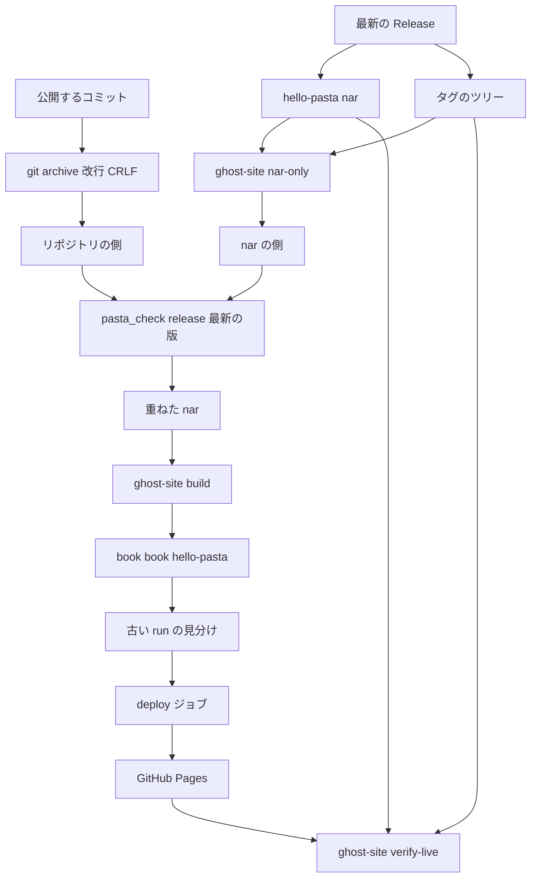
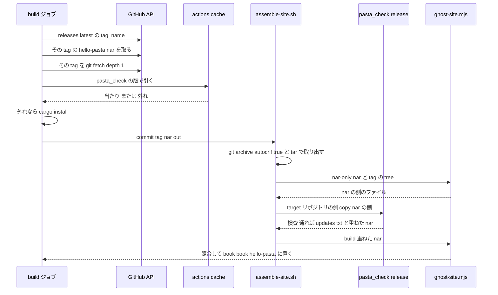
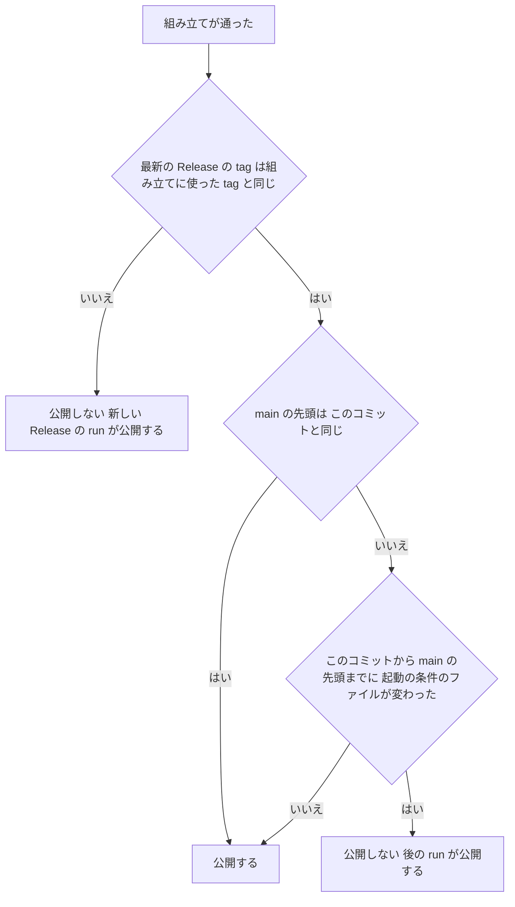

# 設計: hello-pasta-book-sync

## Overview

**目的**: hello-pasta のネットワーク更新の置き場所を、main の中身に合わせる。辞書・シェル・設定は main に入ったときに出る。`pasta.dll` など、ビルドで作るファイルは、リリースのときに出る。

**使う人**: 開発者は、辞書を直してマージした後、手元の SSP の更新確認で変更が届くことを確かめる。hello-pasta の利用者は、変わったファイルだけを受け取る。

**変わること**: 今の置き場所は「最新 Release の `hello-pasta.nar` の展開」である。これを「公開するコミットのリポジトリのファイル」と「最新 Release の nar にだけ在るファイル」を重ねたものに変える。重ねた一式は、最新 Release の版の `pasta_check release` に通す。`pasta_check release` が検査と `updates.txt` の作り直しを 1 回で行う。できた一式を、今の `ghost-site.mjs build` で照合して置く。

### Goals

- 置き場所のリポジトリの側は、公開するコミットの中身になる（改行は nar と同じ CRLF）。
- 置き場所の nar の側は、最新 Release の nar の中身のままになる。
- `updates.txt` の作り手は `pasta_check release` 1 つのままにする。
- 最新 Release の `pasta_check` の検査で誤りになる一式は、公開しない。
- 古い run は、古い中身で公開しない。新しい中身は取りこぼさない。
- リリース CI の見比べは、nar の側の行だけを比べる。

### Non-Goals

- `hello-pasta.nar`・`pasta-starter.nar` と Release の添付の作り方・時機。
- `pasta.dll` を main のコミットごとにビルドすること。
- `delete.txt`（消したファイルを利用者の手元から消させること）。
- `pasta_check release` の `updates.txt` の作り方の変更。
- マニュアルの中身と `tutorial-check`。

## Boundary Commitments

### This Spec Owns

- 置き場所の中身を決める規則（どのファイルを、どちらの出どころから置くか）。
- 置き場所の組み立ての手順（取り出す・分ける・`pasta_check release` に通す・照合して置く）。
- `manual.yml` の起動の条件・置き場所の段・古い run を見分ける段・`deploy` の条件。
- `ghost-site.mjs` の「nar の側」の決め方と、`verify-live` の見比べの中身。
- `publish-ghost-site.ps1` から `verify-live` への渡し方。
- 手順書 3 つと、`hello-pasta-network-update` の要件の置き換わりの記録。
- 実機の SSP での確認。

### Out of Boundary

- `release.yml` の変更（ジョブの並び・権限・`build` ジョブの nar の照合）。この仕様では触らない。
- `pasta_check` のソース（`release`・`validate`・`update_files.rs`）。最新 Release の版をそのまま使う。
- `buildSite`・`checkIntegrity`・`readNar`・`extractNar` の動き。そのまま使う。
- 報告の表の書式・`status`・`reason`・取り直しの回数と間隔。
- 置き場所の URL・`homeurl`・入口のページ（`index.html`）。

### Allowed Dependencies

- crates.io に出ている、最新 Release と同じ版の `pasta_check`（`cargo install`）。
- GitHub の Release の API（`gh api`・`gh release download`）。`GITHUB_TOKEN` の `contents: read` だけで使う。
- `git archive`・`git ls-tree`・`git fetch`・`git diff`、GNU `tar`、`yq`（ubuntu の runner に入っているもの）。
- `actions/cache`（新しく使う。`pasta_check` の実行ファイルを版ごとに残す）。
- Node 22 の標準モジュール（`ghost-site.mjs` は今のとおり依存を持たない）。

### Revalidation Triggers

- `pasta_check release` の引数（`--target`・`--copy`・`--release`・`--nar`）や、段の並び・`updates.txt` の書式が変わる。
- `pasta_check release` が、配布フォルダから更新の対象を外す名前（`update_files.rs` の `EXCLUDED_FILES`）を変える。
- リポジトリに `.gitattributes` を足して、hello-pasta の配下の改行の扱いが変わる。
- hello-pasta のフォルダの場所（`crates/pasta_sample_ghost/ghosts/hello-pasta/`）が変わる。
- `pasta-dll-multiarch` が nar の中の配置を変える（この仕様の変更なしに nar の側に入る前提を確かめ直す）。
- `manual.yml` の `on.push.paths` の書き方が変わる（古い run を見分ける段がこれを読む）。

## Architecture

### Existing Architecture Analysis

- `manual.yml` の `build` ジョブ（ubuntu）が、マニュアルを作って検査し、最後に置き場所を `book/book/hello-pasta/` に作る。公開は `deploy` ジョブ 1 か所で、main のときだけ。
- 置き場所は、今は `releases/latest/download/hello-pasta.nar` を `ghost-site.mjs build` で照合・展開して作る。
- `pasta_check release` は、`--target` を配布フォルダに写し、`--copy` を上から重ね、辞書を検査し、`updates.txt` を作り、nar を作る。これは「重ねて、検査して、作り直す」そのものである。手元で確かめると、`pasta.dll` が無くても動き、0.5 秒で終わる（research 11 章）。
- リリース CI の `publish-ghost-site`（ubuntu、タグで checkout）が `publish-ghost-site.ps1` を呼び、`manual.yml` を main で起動して待ち、`verify-live` で見比べる。

### Architecture Pattern & Boundary Map



**Architecture Integration**:

- 選んだ形: 既存の道具をつなぐだけにする。重ねる・検査する・作り直すは `pasta_check release` の `--target` と `--copy` に任せる。照合と展開は今の `ghost-site.mjs build` に任せる。新しく書くのは「nar の側を選ぶ」規則と、それをつなぐシェルの台本 1 本である。
- 分け方: 「nar の側」の規則は `ghost-site.mjs` の 1 か所に置く。置き場所の組み立て（要件 1.4）と、リリース CI の見比べ（要件 6.1）の両方がこれを使う。
- 保つもの: `deploy` 1 か所・全体の `contents: read`・照合の中身・報告の表・入口のページ。
- 新しい部品の理由: `assemble-site.sh` は、CI と手元（要件 10.4 のローカルの確認）で同じ手順を使うために置く。

### Technology Stack

| 層 | 選んだもの・版 | 役目 | 備考 |
|----|----------------|------|------|
| CI | GitHub Actions `ubuntu-latest`・`actions/cache`（最新のメジャー版。実装のときに版を確かめる） | 置き場所の組み立て・`pasta_check` の残し | `actions/cache` は新しく使う |
| 道具 | `pasta_check`（最新 Release と同じ版。crates.io から `cargo install --locked`） | 検査と `updates.txt` の作り直し | Lua に依存しない。Linux でビルドできる |
| 道具 | Node 22（標準モジュールだけ） | nar の側の選び出し・照合・見比べ | `ghost-site.mjs` を広げる |
| 台本 | bash・`git`・GNU `tar`・`yq` | 取り出しと、つなぎ | `yq` は runner に入っているものを使う |

## File Structure Plan

### Directory Structure

```
book/tools/ghost-site/
├── assemble-site.sh       # 新規: 置き場所の組み立ての台本（取り出す→分ける→pasta_check release→build）。CI と手元で同じものを使う
├── ghost-site.mjs         # 変更: listTree・narOnlyFiles・CLI nar-only を足す。verifyLive を nar の側の行の見比べに変える
├── ghost-site-test.mjs    # 変更: 上の自己テスト
└── index.html             # 変更なし
```

### Modified Files

- `.github/workflows/manual.yml` — 起動の条件に hello-pasta の配下を足す。concurrency の `pages` の組を main の run だけにする。置き場所の段を「最新 Release の特定→nar とタグの取得→`pasta_check` の用意→`assemble-site.sh`」に替える。main のときだけ「古い run の見分け」の段を足し、その結果で Upload と `deploy` を止める。冒頭の説明の注釈を合わせる。
- `book/tools/ghost-site/ghost-site.mjs` — 上の表のとおり。
- `book/tools/ghost-site/ghost-site-test.mjs` — 上の表のとおり。
- `.github/scripts/release/publish-ghost-site.ps1` — `verify-live` に `--tree <タグ>:<hello-pasta のパス>` を渡す。説明と結果の文を「nar の側の行」に合わせる。
- `.github/scripts/release/release-scripts-test.ps1` — 項目 22 の `verify-live` の引数の照合に `--tree` を足す。
- `crates/pasta_sample_ghost/RELEASE.md` — 置き場所の作り方・2 つのきっかけ・リリースの直後の数分の間（要件 5.1 の例外）・検査で止まったときの読み方と直し方・検査で止められない違い・見比べの読み方・消えたファイルの注意（今のまま）。手元で置き場所を組み立てる手順（`assemble-site.sh`）。
- `.claude/skills/release/procedure.md` — 結果表の 8 行目の見比べを「nar の側の行」に合わせる（編集が拒否されたら、開発者の許可を求める）。
- `.github/release-ci-setup.md` — 置き場所の作り方の記述を合わせる。設定の変更は要らないことを書く。
- `.kiro/specs/completed/hello-pasta-network-update/requirements.md` — 置き換わる項に、この仕様で置き換わったことを書き足す。

`release.yml` は変えない。`publish-ghost-site.ps1` が `--tree` を自分で組み立てるので、呼び出しの行は今のままでよい。

ファイルを持たない部品:

- PastaCheckRelease は、crates.io に出ている `pasta_check` そのもので、このリポジトリのファイルを変えない。
- RealMachineCheck の記録は、この spec の `research.md` に「実機確認」の節を足して書く。

## System Flows

### 置き場所の組み立て（`manual.yml` の `build` ジョブの終わり）



- どの段の失敗も、そのまま `build` ジョブの失敗になる。公開は止まる（要件 2.5・2.6・4.2）。
- PR・ブランチでも、ここまでを全部行う（要件 2.7・3.2・4.4）。

### 古い run の見分け（main のときだけ・Upload の直前）



- 飛ばすときは、理由を `::notice::` と summary に出し、ジョブは成功で終える（要件 5.2）。
- 「起動の条件のファイルが変わった」なら、その変更のコミットで `manual.yml` が起動している。`pages` の組は `cancel-in-progress: false` で直列なので、その run はこの run の後に走るか、すでに終わっている。だから新しい中身は取りこぼさない（要件 5.4）。変わっていなければ、新しいコミットの置き場所とマニュアルは、このコミットのものと同じなので、そのまま公開してよい。
- 最新の Release が変わったときは、リリース CI の `publish-ghost-site` が `manual.yml` を起動するので、その run が新しい nar の側で公開する（要件 5.3）。

## Requirements Traceability

| 要件 | まとめ | 部品 | 契約 | 流れ |
|------|--------|------|------|------|
| 1.1 | リポジトリのファイルをコミットの内容で置く | AssembleSite | `git archive <commit>` | 組み立て |
| 1.2 | nar にだけ在るファイルを nar の中身で置く | GhostSite.narOnlyFiles・AssembleSite | `nar-only` | 組み立て |
| 1.3 | 両方に在ればリポジトリの側 | GhostSite.narOnlyFiles | タグのツリーに在るものは nar の側にしない | 組み立て |
| 1.4 | タグのツリーだけで分ける・名前を決め打ちしない | GhostSite.listTree・narOnlyFiles | `--tree <tag>:<path>` | 組み立て |
| 1.5 | 除外の 3 つの名前・nar の `updates.txt` 2 本 | AssembleSite（`tar --exclude`）・GhostSite（`EXCLUDED_NAMES`） | 両側で同じ 3 つの名前 | 組み立て |
| 1.6 | リリースの間は nar の側が変わらない | GhostSite.narOnlyFiles | nar のバイトのまま書く | 組み立て |
| 1.7 | 入口のページ | GhostSite.buildSite（変更なし） | `index.html` を足す | 組み立て |
| 1.8 | 文字のファイルを CRLF で置く | AssembleSite | `git -c core.autocrlf=true archive` | 組み立て |
| 2.1 | 重ねた結果から `updates.txt` を作り直す | PastaCheckRelease | `pasta_check release` 段 5 | 組み立て |
| 2.2 | `pasta_check release` と同じ `updates.txt` | PastaCheckRelease | 作り手そのもの | 組み立て |
| 2.3 | 別の作り手なら一致のテスト | （当たらない） | 作り手は `pasta_check release` なので、この条件に当たらない | — |
| 2.4 | 公開前に今と同じ照合 | GhostSite.buildSite（変更なし） | `build --nar <重ねた nar>` | 組み立て |
| 2.5 | 合わないファイルを表示して失敗 | GhostSite.buildSite | `NG <パス>: …` と `::error::` | 組み立て |
| 2.6 | Release・nar・nar の `updates.txt` が無ければ失敗 | ManualWorkflow・GhostSite（`nar-only` の照合） | `gh` の失敗・`NG updates.txt` | 組み立て |
| 2.7 | PR・ブランチでは公開しない | ManualWorkflow | Upload と `deploy` は main だけ | 組み立て |
| 3.1 | hello-pasta の配下の変更で走る | ManualWorkflow | `paths` に `crates/pasta_sample_ghost/ghosts/hello-pasta/**` | — |
| 3.2 | PR でも走り、公開しない | ManualWorkflow | `pull_request.paths` も同じ | 組み立て |
| 3.3 | 無関係な変更でも、そのコミットの中身で作る | ManualWorkflow・AssembleSite | `HEAD` を取り出す | 組み立て |
| 3.4 | リリースのとき nar の側を入れ替える | ManualWorkflow（変更なしの起動）・AssembleSite | 最新の tag で取る | 組み立て |
| 3.5 | 手動実行は main の先頭と最新の nar | ManualWorkflow | `workflow_dispatch` の `HEAD` | 組み立て |
| 4.1 | 最新 Release の版の `pasta_check` で検査 | PastaCheckInstall・PastaCheckRelease | 段 4 | 組み立て |
| 4.2 | 誤りなら、どのファイルの何かを表示して公開ごと止める | PastaCheckRelease・ManualWorkflow | 段 4 の報告と終了コード 1 | 組み立て |
| 4.3 | 新しい Release で手作業なしに通る | ManualWorkflow・PastaCheckInstall | 版は最新の tag から決まる | 組み立て |
| 4.4 | PR でも同じ検査 | ManualWorkflow | 同じ段 | 組み立て |
| 4.5 | 読める辞書の変更を止めない | PastaCheckRelease | 誤りだけで止まる・注意では止まらない | 組み立て |
| 4.6 | 止められない違いを手順書に書く | Docs（RELEASE.md） | — | — |
| 5.1 | 入れた直後に古いファイルを返さない | AssembleSite・FreshnessGate | リポジトリの側はタグ以降・nar の側はその Release | 見分け |
| 5.2 | 古い中身は公開しない・失敗にしない | FreshnessGate | `publish=false` と notice | 見分け |
| 5.3 | nar の側を古い Release にしない | FreshnessGate | 最新の tag の再確認 | 見分け |
| 5.4 | 最新の中身を取りこぼさない | FreshnessGate | 起動の条件のファイルの差分で判定 | 見分け |
| 6.1 | 実 URL の nar の側の行を md5・大きさで比べる | GhostSite.verifyLive・PublishGhostSite | `verify-live --tree` | 見比べ |
| 6.2 | リポジトリの側は比べない | GhostSite.verifyLive | nar の側の行だけを選ぶ | 見比べ |
| 6.3 | 日付の欄は比べない | GhostSite.verifyLive | `parseUpdates` は path・md5・size だけ | 見比べ |
| 6.4 | 合わない・取れないは `failed` | PublishGhostSite（変更なし） | `failed`・`verify` | 見比べ |
| 6.5 | 報告の表の書式・回数・`skipped` を保つ | PublishGhostSite（変更なし） | 既存の引数のまま | 見比べ |
| 7.1 | 消した・改名したファイルを置かない | AssembleSite・GhostSite.narOnlyFiles | コミットに無い・タグのツリーに在るものは nar の側にしない | 組み立て |
| 7.2 | `delete.txt` を出さない | AssembleSite | 作らない | — |
| 8.1 | nar と添付を変えない | （`release.yml` を触らない） | — | — |
| 8.2 | `pasta_check release` を変えない | PastaCheckRelease | 出ている版を使うだけ | — |
| 8.3 | 権限を保つ | ManualWorkflow | `gh` は `contents: read` の `GITHUB_TOKEN` | — |
| 8.4 | 丸ごと 1 回の公開 | ManualWorkflow | `deploy` 1 か所・Upload 1 回 | — |
| 8.5 | dll のビルド・Windows を要さない | AssembleSite・PastaCheckInstall | ubuntu で `pasta_check` だけを入れる | — |
| 8.6 | キャッシュが効けば増分 1 分以内 | PastaCheckInstall | 版ごとのキャッシュ | — |
| 8.7 | マニュアルと `tutorial-check` を変えない | ManualWorkflow | 置き場所の段だけを替える | — |
| 9.1 | RELEASE.md | Docs | — | — |
| 9.2 | `release` スキル | Docs | — | — |
| 9.3 | `release-ci-setup.md` | Docs | — | — |
| 9.4 | 前の仕様の記録 | Docs | — | — |
| 9.5 | 消えたファイルの注意 | Docs | — | — |
| 10.1 | v0.6.2 の SSP で main の辞書に入れ替わる | RealMachineCheck | — | — |
| 10.2 | 変わったファイルだけを取る | RealMachineCheck・AssembleSite（CRLF） | SSP の更新のログ | — |
| 10.3 | 同じ中身で `No Update` | RealMachineCheck | — | — |
| 10.4 | ローカルとマージ直後の実 URL | RealMachineCheck・AssembleSite | 手元で同じ台本を回す | — |
| 10.5 | 通らなければ完了にしない | RealMachineCheck | — | — |

## Components and Interfaces

| 部品 | 層 | 役目 | 要件 | 主な依存 | 契約 |
|------|----|------|------|----------|------|
| ManualWorkflow | CI | 起動の条件・置き場所の段・公開の条件 | 2.6, 2.7, 3.1–3.5, 4.4, 8.3, 8.4, 8.7 | AssembleSite (P0)・FreshnessGate (P0) | Batch |
| PastaCheckInstall | CI | 最新 Release の版の `pasta_check` を用意する | 4.1, 4.3, 8.5, 8.6 | crates.io (P0)・actions/cache (P1) | Batch |
| AssembleSite | 台本 | 取り出す・分ける・通す・置く | 1.1–1.8, 2.1, 3.3, 7.1, 7.2, 10.4 | GhostSite (P0)・pasta_check (P0) | Batch |
| GhostSite | 道具 | nar の側の規則・照合・見比べ | 1.2–1.6, 2.4–2.6, 6.1–6.3, 7.1 | Node 標準・git (P0) | Service |
| PastaCheckRelease | 外部の道具 | 検査と `updates.txt` の作り直し | 2.1, 2.2, 4.1, 4.2, 4.5, 8.2 | — | Batch |
| FreshnessGate | CI | 古い run の公開を止める | 5.1–5.4 | GitHub API・git・yq (P0) | Batch |
| PublishGhostSite | リリース CI | 見比べに `--tree` を渡す | 6.1–6.5 | GhostSite (P0) | Batch |
| Docs | 文書 | 手順書と記録 | 4.6, 9.1–9.5 | — | — |
| RealMachineCheck | 確認 | SSP での確認と記録 | 10.1–10.5 | AssembleSite (P0) | — |

### 道具の層

#### GhostSite（`book/tools/ghost-site/ghost-site.mjs`）

| 項目 | 内容 |
|------|------|
| 役目 | 「nar の側」の規則を 1 か所に持つ。照合と展開は今のまま |
| 要件 | 1.2, 1.3, 1.4, 1.5, 1.6, 2.4, 2.5, 2.6, 6.1, 6.2, 6.3, 7.1 |

**責務と制約**

- nar の側＝「nar に在り、タグのツリーに無く、除外の名前でないファイル」。ファイル名の一覧は持たない（1.4）。
- 除外の名前は `updates.txt`・`updates2.dau`・`developer_options.txt` の 3 つ。どの階層でも、名前の最後の部品で比べる（`update_files.rs` の `EXCLUDED_FILES` と同じ）。nar のルートと `ghost/master/` の `updates.txt` もこれで外れる（1.5）。
- nar の側のファイルは、nar のバイトのまま書く（1.6）。
- タグのツリーは `git ls-tree -r --name-only -z <treeish>` で読む。`<treeish>` は `<タグ>:<hello-pasta のパス>` の形で、名前は hello-pasta のフォルダからの相対になる。
- `buildSite`・`checkIntegrity`・`readNar`・`extractNar`・`parseUpdates` は変えない。

**依存**

- 呼ばれる: AssembleSite（`nar-only`・`build`）、PublishGhostSite（`verify-live`）（P0）
- 外部: `git`（`child_process.execFileSync`）（P0）

**契約**: Service [x]

##### Service Interface

```typescript
type NarFile = { name: string; data: Buffer };
type UpdateRecord = { path: string; md5: string; size: number };
type CheckResult = { ok: boolean; problems: string[] };

/** pasta_check release が更新の対象から外す名前（update_files.rs の EXCLUDED_FILES と同じ）。 */
const EXCLUDED_NAMES: readonly string[]; // ['updates.txt', 'updates2.dau', 'developer_options.txt']

/** git ls-tree -r --name-only -z <treeish> の名前の集合。git が失敗したら Error（標準エラーを添える）。 */
function listTree(treeish: string, cwd?: string): Set<string>;

/** files のうち、tree に無く、最後の部品が EXCLUDED_NAMES に当たらないもの。順は files のまま。 */
function narOnlyFiles(files: NarFile[], tree: Set<string>): NarFile[];

/**
 * nar の updates.txt の行のうち、nar の側のファイル（narOnlyFiles）の行を「比べる行」とする。
 * 実 URL の updates.txt を取り、比べる行が全部、同じパス・md5・大きさで載っていれば一致。日付の欄と、比べる行の外の行は見ない。
 * 一致するまで attempts 回まで intervalMs おきに取り直す（HTTP 200 以外・解釈できない・ネットワークの失敗も取り直す）。
 * 比べる行が 0 本なら、取らずに失敗する（タグのツリーの渡し間違いを見逃さない）。
 * full なら、一致の後に、実 URL の updates.txt の全部の行のファイルを 1 回ずつ取り、その行の md5・大きさと照合する。
 */
function verifyLive(opts: {
  files: NarFile[];
  tree: Set<string>;
  base: string;
  attempts: number;
  intervalMs: number;
  full: boolean;
  fetchFn?: typeof fetch;
}): Promise<CheckResult & { attempts: number; compared: number }>;
```

- 事前条件: `files` は `readNar` の結果。`tree` は `listTree` の結果。
- 事後条件: `narOnlyFiles` はファイルを書かない。`verifyLive` の `compared` は比べる行の本数。
- 不変: 同じ nar と同じタグなら、置き場所の組み立てとリリース CI の見比べで、nar の側は同じ集合になる。

##### CLI（Batch）

| 命令 | 引数 | 動き | 失敗 |
|------|------|------|------|
| `build` | `--nar --out --index` | 変更なし | 変更なし |
| `nar-only`（新） | `--nar <file> --tree <treeish> --out <dir>` | nar を読み、`checkIntegrity` で照合し、`narOnlyFiles` を `extractNar` で書く。書いた名前を 1 行ずつ出す | 照合の問題・`git` の失敗・nar の側が 0 本・出力先が空でない、で終了コード 1 |
| `verify-live` | `--nar <file> --tree <treeish> --base <url> [--attempts 30] [--interval 30] [--full]` | 上の `verifyLive`。`--tree` は必須になる | 不一致・取れない・比べる行が 0 本で終了コード 1 |

- 成功の文: `OK updates.txt: <n> 回目で nar の側の <k> 行が一致`（`--full` なら `（--full: <m> ファイルも一致）` を足す）。`publish-ghost-site.ps1` はこの文の「<n> 回目で」から回数を読む。

**実装メモ**

- 統合: 問題は今と同じく 1 行 1 件で出し、GitHub Actions では `::error::` も出す。
- 検証: `ghost-site-test.mjs` に、一時の git リポジトリとタグを作って `listTree` と CLI を確かめる項目を足す。
- 危険: `verify-live` の意味が「バイトの一致」から「nar の側の行の一致」に変わる。呼び手は `publish-ghost-site.ps1` と、手順書の手での確認だけである。

### 台本の層

#### AssembleSite（`book/tools/ghost-site/assemble-site.sh`）

| 項目 | 内容 |
|------|------|
| 役目 | 置き場所を 1 回で組み立てる。CI と手元で同じものを使う |
| 要件 | 1.1, 1.5, 1.7, 1.8, 2.1, 3.3, 7.1, 7.2, 10.4 |

**責務と制約**

- 使い方: `bash book/tools/ghost-site/assemble-site.sh <commit> <tag> <release-nar> <out-dir>`。リポジトリのルートで動かす。
- 前提: `refs/tags/<tag>` が手元に在る。`pasta_check` が `PATH` に在る（環境変数 `PASTA_CHECK` で上書きできる）。`<out-dir>` は無いか空。
- 手順（どれかが失敗したら終了コード 1。`set -euo pipefail`）:
  1. 一時のフォルダを作る（終わりに消す）。
  2. リポジトリの側: `git -c core.autocrlf=true archive --format=tar <commit> -- crates/pasta_sample_ghost/ghosts/hello-pasta/ | tar -x -C <tmp>/repo --strip-components=4 --exclude=updates.txt --exclude=updates2.dau --exclude=developer_options.txt`。取り出したファイルが 0 本なら失敗。
  3. nar の側: `node ghost-site.mjs nar-only --nar <release-nar> --tree refs/tags/<tag>:crates/pasta_sample_ghost/ghosts/hello-pasta --out <tmp>/nar`。
  4. 重ねて検査して作り直す: `pasta_check release --target <tmp>/repo --copy <tmp>/nar --release <tmp>/merged --nar <tmp>/merged.nar`。
  5. 照合して置く: `node ghost-site.mjs build --nar <tmp>/merged.nar --out <out-dir> --index <台本の隣の index.html>`。
- 両方に同じ名前があるとき（タグのツリーに無く、コミットには在り、nar にも在る）は、`--copy` が後から重なるので nar の側が勝つ。要件 1.2 の「nar の中身のまま置く」に合う。
- `delete.txt` は作らない（7.2）。
- 置き場所の `ghost/master/updates.txt` は、`pasta_check release` が写したもの（ルートと同じ中身）をそのまま置く。今の置き場所と同じで、`updates.txt` に載らない。SSP が取りに来るのはルートだけである（research 11 章）。

**契約**: Batch [x]

##### Batch / Job Contract

- きっかけ: `manual.yml` の `build` ジョブ、または開発者の手元。
- 入力: コミット・タグ・Release の nar。検査は `pasta_check release` の段 4、照合は `ghost-site.mjs build`。
- 出力: `<out-dir>` に置き場所の一式（重ねたファイル・`updates.txt` 2 本・`index.html`）。
- 冪等: 同じ入力なら同じ一式（`updates.txt` の日付の欄だけが変わりうる）。失敗したときは `<out-dir>` を作りかけで残しうるが、ジョブが失敗するので公開されない。

**実装メモ**

- 統合: 除外の 3 つの名前は、この台本の `tar --exclude` と `ghost-site.mjs` の `EXCLUDED_NAMES` の 2 か所に在る。どちらにも「`update_files.rs` の `EXCLUDED_FILES` と同じ」と書く。
- 検証: PR ごとに実物の hello-pasta で走る（`manual.yml`）。タグのコミットで組み立てると、全部の行の md5 が Release の nar と一致することを、実装のときに 1 回確かめて記録する（research 11 章の実測の再現）。
- 危険: GNU `tar` の `--exclude` を前提にする。Windows の Git Bash の `tar` も GNU `tar` である。

### CI の層

#### ManualWorkflow（`.github/workflows/manual.yml`）

| 項目 | 内容 |
|------|------|
| 役目 | 起動・組み立て・公開の条件 |
| 要件 | 2.6, 2.7, 3.1, 3.2, 3.3, 3.4, 3.5, 4.4, 8.3, 8.4, 8.7 |

**責務と制約**

- `on.push.paths` と `on.pull_request.paths` の hello-pasta の 2 行（`dic/**`・`calendar.csv`）を、`crates/pasta_sample_ghost/ghosts/hello-pasta/**` の 1 行に替える（3.1・3.2）。
- concurrency の組を、main の run だけ `pages` にする。`group: ${{ github.ref == 'refs/heads/main' && 'pages' || format('manual-{0}-{1}', github.event_name, github.ref) }}`。今は PR 以外の run が全部 `pages` に入るので、ブランチでの手動実行（リリースの予行など）が、main の待ちの run を取り消しうる。GitHub は組ごとに待ちの run を 1 つしか残さないためである。取り消されると、FreshnessGate が「後の run が公開する」と見込んだ run が消え、main の中身が出ないまま残る（5.4）。
- 今の「Fetch latest hello-pasta.nar」と「Build hello-pasta update site」の 2 段を、次の段に替える（旧版の生成の後・Upload の前のまま）。
  1. **Resolve latest Release**（`id: rel`）: `gh api repos/$GITHUB_REPOSITORY/releases/latest --jq .tag_name`。`vX.Y.Z` の形でなければ失敗。出力は `tag` と `version`（`v` を外したもの）。`GH_TOKEN: ${{ github.token }}`。
  2. **Fetch hello-pasta.nar and tag**: `gh release download <tag> --pattern hello-pasta.nar --dir $RUNNER_TEMP/release` と `git fetch --no-tags --depth=1 origin refs/tags/<tag>:refs/tags/<tag>`。
  3. **Restore pasta_check**（`actions/cache/restore`）: 置き場所 `~/pasta-check`、鍵 `pasta-check-${{ runner.os }}-${{ steps.rel.outputs.version }}`。
  4. **Install pasta_check**（キャッシュが外れたときだけ）: `cargo install pasta_check --version <version> --locked --root ~/pasta-check`。入れた直後に **Save pasta_check**（`actions/cache/save`、同じ鍵）で残す。`actions/cache` の 1 段の形は、ジョブが成功したときにしか残さないので、後の段が落ちた run でも入れた分を残すために、取り戻しと保存を分ける。その後 `~/pasta-check/bin` を `GITHUB_PATH` に足す（当たったときも足す）。
  5. **Build hello-pasta update site**: `bash book/tools/ghost-site/assemble-site.sh HEAD <tag> $RUNNER_TEMP/release/hello-pasta.nar book/book/hello-pasta`。
  6. **Check freshness**（`id: fresh`・`if: github.ref == 'refs/heads/main'`）: FreshnessGate。
- Upload の条件を `github.ref == 'refs/heads/main' && steps.fresh.outputs.publish == 'true'` にする。`build` ジョブの `outputs.publish` に `steps.fresh.outputs.publish` を出す。`deploy` の条件を `github.ref == 'refs/heads/main' && needs.build.outputs.publish == 'true'` にする（8.4）。
- 権限は変えない。`gh api` と `gh release download` は、全体の `contents: read` の `GITHUB_TOKEN` で足りる（8.3）。
- 冒頭の注釈（パイプラインの説明）を、新しい段に合わせる。

#### PastaCheckInstall（`manual.yml` の段 3・4）

- 版は、組み立てに使う最新の tag から決める。だから新しい Release が出ると、手作業なしに新しい版になる（4.3）。
- リリース CI は crates.io の公開（`publish-crates`）の後に Release を作るので、Release が最新になったときには、その版の `pasta_check` は crates.io に在る。
- キャッシュが当たれば、増える時間は取り戻しの数秒だけである。外れるのは、版が変わった後の最初の run と、7 日使われずにキャッシュが消えた後である（8.6）。

#### FreshnessGate（`manual.yml` の段 6）

| 項目 | 内容 |
|------|------|
| 役目 | 古い中身の公開を止める。止めたときは失敗にしない |
| 要件 | 5.1, 5.2, 5.3, 5.4 |

**契約**: Batch [x]

##### Batch / Job Contract

- きっかけ: main の run の、組み立てが通った後（Upload の直前）。
- 入力: `GITHUB_SHA`・組み立てに使った tag・`git fetch --no-tags --depth=1 origin main` の先頭・今の `releases/latest` の tag・`manual.yml` の `on.push.paths`（`yq` で読む）。
- 判定（System Flows の図のとおり）:
  - 今の最新の tag が組み立ての tag と違う → `publish=false`。理由「最新の Release が <旧> から <新> に変わった。リリース CI の起動する run が公開する」。
  - main の先頭が `GITHUB_SHA` と同じ → `publish=true`。
  - 違い、`git diff --quiet GITHUB_SHA <先頭> -- <:(glob) を付けた paths>` に差がある → `publish=false`。理由「main が <先頭> まで進み、起動の条件のファイルが変わった。後の run が公開する」。
  - 差が無い → `publish=true`（新しいコミットの置き場所とマニュアルは同じ中身）。
- 出力: `publish=true|false` を `GITHUB_OUTPUT` に書く。`false` なら `::notice::` と summary に理由を出し、成功で終える（5.2）。
- 冪等: 何も変えない。再実行で同じ判定になる。
- `gh api`・`git fetch` 自体の失敗は、ジョブの失敗にする（公開しない。再実行で続く）。

**実装メモ**

- 統合: `paths` を読み直すので、起動の条件を足し引きしても、この段の直しは要らない。GitHub の `paths` の `*` は `/` をまたがないので、git の側も `:(glob)` を付けてそろえる。
- 危険: 見分けた後・`deploy` の前に main が進むと、一瞬だけ古い中身が出うる。その変更の run が後に必ず走って上書きする。

### リリース CI の層

#### PublishGhostSite（`.github/scripts/release/publish-ghost-site.ps1`）

- 見比べの直前に、`--tree "$Tag:crates/pasta_sample_ghost/ghosts/hello-pasta"` を `verify-live` に足す。ジョブはタグで checkout しているので、タグは手元に在る。hello-pasta のパスはスクリプトの中の決まった文字列にする（`release.yml` の呼び出しの行を変えないため）。
- 古いタグの判定・起動・待ち・`status`・`reason`・回数・間隔・summary の形は変えない（6.4・6.5）。
- 結果の文を「Release の nar の側の行と一致」に替える。

## Data Models

### Domain Model

置き場所の一式は、次の 4 つの和である。

- **R（リポジトリの側）**: 公開するコミットの `hello-pasta/` の下のファイルから、除外の名前を外したもの。中身は `core.autocrlf=true` で取り出したもの。
- **N（nar の側）**: 最新 Release の nar のファイルのうち、そのタグのツリーに無く、除外の名前でないもの。中身は nar のバイトのまま。
- **U（作り直した `updates.txt`）**: `pasta_check release` が R と N を重ねた一式から作る。ルートと `ghost/master/` の 2 本（中身は同じ）。
- **I（入口のページ）**: `index.html`。

規則:

- R と N に同じ名前があれば、N の中身を置く。
- U の行は、R ∪ N のファイルのうち、`pasta_check release` が載せるものだけ（I と U 自身は載らない）。
- タグのコミットで作ると、R の各ファイルは nar の同じファイルとバイトで一致する（改行が CRLF のため）。N は nar そのもの。したがって U の行は、日付の欄を除いて nar の `updates.txt` と一致する。

## Error Handling

### 失敗の扱い

| 起きること | どこで | 結果 |
|------------|--------|------|
| 最新の Release が無い・tag の形が違う・nar が取れない | ManualWorkflow 段 1・2 | ジョブの失敗。公開しない（2.6） |
| nar の `updates.txt` が無い・nar が壊れている | `nar-only` の照合 | `NG …` を表示して失敗（2.6） |
| タグのツリーが読めない・nar の側が 0 本 | `nar-only` | 失敗 |
| `pasta_check` が入らない（crates.io の失敗） | 段 4 | 失敗。再実行で続く |
| 最新の版の検査で誤り | `pasta_check release` 段 4 | 報告（ファイル・行・中身）を出して失敗。マニュアルも公開しない（4.2） |
| 重ねた `updates.txt` とファイルが合わない | `ghost-site.mjs build` | `NG <パス>: …` を表示して失敗（2.5） |
| 古い run | FreshnessGate | 公開しない。成功で終える（5.2） |
| 実 URL の nar の側の行が合わない | `verify-live` | `failed`・`verify`（6.4） |

### 検査で止まったときの直し方（RELEASE.md に書く）

- 辞書が、まだ出ていない `pasta.dll` の機能を使っている: リリースを出す。リリース CI の起動する run が、新しい版の `pasta_check` で通して公開する。
- 急ぐとき: 辞書を戻す PR を入れる。

## Testing Strategy

### 単体（`ghost-site-test.mjs`）

- `narOnlyFiles`: タグのツリーに無いファイルだけが残る。ツリーに在るファイル（main で消したものを含む）は残らない。`updates.txt`・`ghost/master/updates.txt`・`updates2.dau`・`developer_options.txt` は、どの階層でも残らない（1.2・1.3・1.5・7.1）。
- `listTree`: 一時の git リポジトリにタグを作り、`<tag>:<path>` で相対の名前が返る。無いタグでは、git の文を添えた Error になる（1.4）。
- `verifyLive`: nar の側の行が同じ md5・大きさで載れば一致（日付の欄と、リポジトリの側の行が違っても一致）。md5 か大きさが違う・行が無い・HTTP 200 以外は取り直し、上限で失敗。比べる行が 0 本なら取らずに失敗。`--full` は実 URL の行ごとのファイルを照合する（6.1・6.2・6.3）。
- CLI `nar-only`: nar の側だけが出力先に書かれ、バイトが nar と同じ。nar に `updates.txt` が無いと失敗し、何も書かない（1.6・2.6）。
- CLI `verify-live`: `--tree` が無ければ使い方の誤りで終了コード 1。

### 結合

- `release-scripts-test.ps1` 項目 22: `verify-live` の引数に `--tree v0.0.2:crates/pasta_sample_ghost/ghosts/hello-pasta` が入る（6.1）。他の項目（18〜28）はそのまま通る（6.4・6.5）。
- `manual.yml` の PR の run: 実物の hello-pasta で `assemble-site.sh` が通る（2.7・3.2・4.4）。
- 実装のときに 1 回: `assemble-site.sh <v0.6.2 のコミット> v0.6.2 <v0.6.2 の nar>` で作った `updates.txt` が、公開中の v0.6.2 の `updates.txt` と、日付の欄を除いて全部の行で一致する（1.8・2.2）。
- 実装のときに 1 回: 辞書に、古い `pasta_check` が誤りにする書き方（`pasta.toml` の未知のキーなど）を入れたブランチで、`manual.yml` が段 4 で失敗し、ファイルと理由が出る（4.2）。

### 最初に確かめる（実装の最初のタスク）

- 作り直した `updates.txt` の日付の欄は、必ず nar と違う。SSP が日付の欄を比べに使うなら、要件 1.6・1.8・10.2 が全部崩れ、この作りは成り立たない。
- だから実装の最初に、公開中の v0.6.2 の置き場所を写し、`updates.txt` の日付の欄だけを書き換えて、ローカルの HTTP サーバーに置く。v0.6.2 を入れた別ポートの SSP で更新確認をして、`No Update` になることを確かめる。
- ならなければ、そこで止めて開発者に報告する（作りを考え直す。要件 10.5）。

### 実機（SSP）

- v0.6.2 の nar を入れた別ポートの SSP で、ローカルの HTTP サーバーに置いた `assemble-site.sh` の出力に更新確認をする。main の辞書に入れ替わり、`OnUpdateComplete`（`changed`）の台詞が出る。更新のログで、取ったファイルが変わったものだけで、`pasta.dll` を取っていないことを確かめる（10.1・10.2）。
- 続けてもう 1 回更新確認をして `No Update` を確かめる（10.3）。
- main へのマージの直後に、公開サイトの実 URL で同じことをする（10.4）。通らなければ完了にしない（10.5）。

### 時間

- キャッシュが当たった main の run の所要が、今（40〜50 秒）から 1 分以内の増えにとどまることを、実装の PR とマージ直後の run の時間で確かめる（8.6）。

## Security Considerations

- `GITHUB_TOKEN` は全体の `contents: read` のまま使う。新しい secrets・権限・environment は要らない。
- `pasta_check` は crates.io から、Release と同じ版を `--locked` で入れる。版はこのリポジトリの最新の Release の tag から決まる。
- `nar-only` と `build` は、今と同じく名前の安全性（`..`・絶対パス・`\`）を確かめてから書く。

## Performance & Scalability

- キャッシュが当たったときの増分: 取り戻し・`gh api`・タグの fetch・取り出し・`pasta_check release`（手元で 0.5 秒）・照合で、合わせて 20 秒ほどの見込み。
- キャッシュが外れたとき: `cargo install` の 1〜3 分が足される（依存は 63 個）。版ごとに 1 回。

## Open Questions / Risks

- **決めた: 古い run の見分け方。** 組み立ての後に「最新の tag が変わったか」「main の先頭までに、起動の条件のファイルが変わったか」を見て、変わっていれば公開を飛ばす。「main の run は、いつも main の先頭を checkout して作る」案は、古い run を再実行したときに古い `manual.yml` の段で新しい道具を動かすことになり、失敗しうるので採らない（要件 5.2）。取りこぼさないことは、concurrency の組を main だけにすることで保つ（ManualWorkflow）。
- **決めた: `yq`。** GitHub の `ubuntu-latest` の runner には `yq`（mikefarah 版）が入っている。実装の PR の run で在ることを確かめ、無ければ起動の条件を Node で読む小さな処理に替える。
- **決めた: `verify-live --full`。** 一致の後に、実 URL の `updates.txt` の全部の行のファイルを取り、その行の md5・大きさと照合する（置き場所が自分と合っているか）。手で使うだけである。
- **決めた: 名前がぶつかるとき。** タグのツリーに無く、公開するコミットにも nar にも在るファイルは、次のリリースまで nar の中身を置く（`--copy` が後から重なる）。要件 1.4 の「タグのツリーで分ける」1 つの規則に従う。次のリリースでタグのツリーに入れば、リポジトリの側になる。要件 1.1 に、この例外を書いた。
- **決めた（2026-11-19 開発者の承認）: リリースの直後の短い間。** Release が最新になってから、リリース CI の起動した run が公開を終えるまで（数分）、置き場所の nar の側は 1 つ前の Release のままである。この間に新しい nar を入れて更新確認をした利用者は、古い `pasta.dll` を受け取り、次の更新確認で新しいものに戻る。今の `hello-pasta-network-update` の作りにも同じ間がある。塞ぐには `release.yml` で Release を最新にする時機を変える必要があり、この仕様の外なので、この間は残す。要件 5.1 に例外として書き、RELEASE.md にも書く（Docs）。キャッシュを取り戻しと保存に分けたので、外れたときも間は数分を大きく超えない。
- **危険: SSP が `date=` を見るか。** UKADOC は md5 で比べると書き、`date=` を比べに使うとは書いていない。作り直した `updates.txt` の日付の欄は nar と違うので、もし SSP が見るなら、要件 10.2（変わったファイルだけを取る）が通らない。実装の最初のタスクで確かめる（Testing Strategy「最初に確かめる」）。
- **危険: `release` スキルの編集が拒否されうる。** そのときは、入った分と残りを示して、開発者の許可を求める（要件 9.2）。
