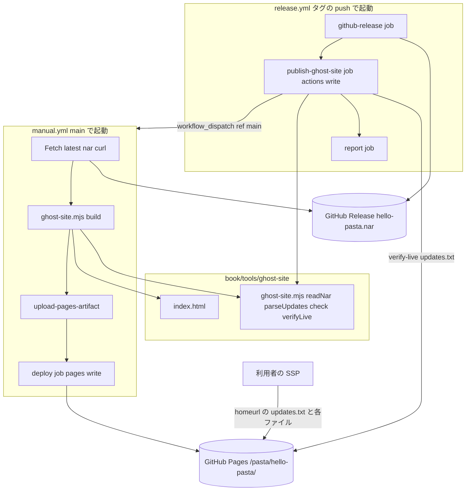
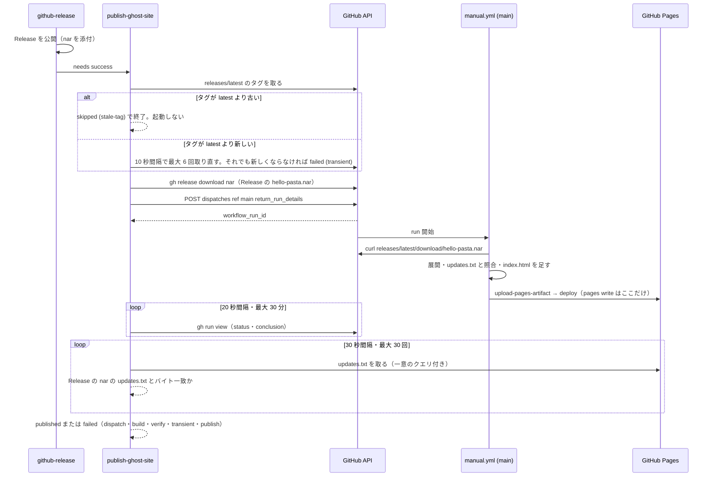
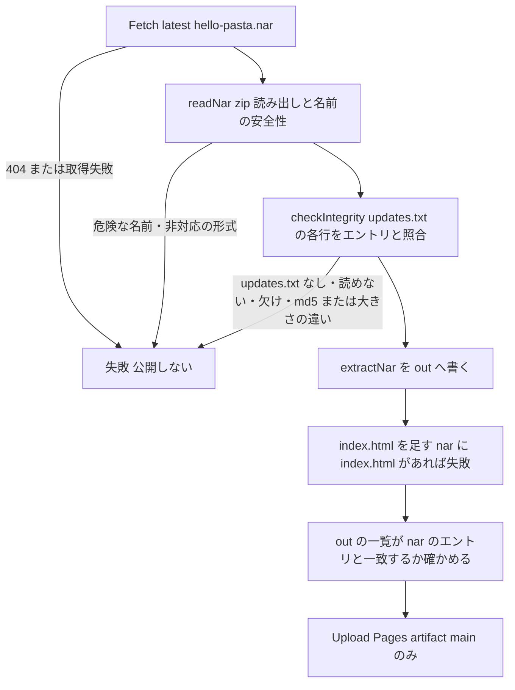

# Design Document: hello-pasta-network-update

## Overview

**Purpose**: 見本ゴースト hello-pasta を SSP のネットワーク更新で最新版にできるようにする。更新の置き場所を GitHub Pages（`https://ekicyou.github.io/pasta/hello-pasta/`）に置き、中身は最新 Release の `hello-pasta.nar` の展開そのものにする。辞書・`pasta.toml`・シェル・`pasta.dll` の版は、nar が 1 つなので必ずそろう。

**Users**: hello-pasta の利用者は、SSP の更新確認 1 回で最新版になる。開発者は、リリースタグを push する以外の手作業なしに置き場所を最新にでき、公開前と公開後の 2 回、CI が中身を機械で確かめる。hello-pasta をコピーして自分のゴーストを作る作者は、うっかり hello-pasta の更新で辞書を上書きされないよう、マニュアルの注意と `pasta_check validate` の警告で守られる。

**Impact**: 次の 4 か所を変える。(1) `manual.yml` に「最新 Release の nar を取って展開・照合し、公開物に足す」段を足す。(2) `release.yml` に、`manual.yml` を `main` で起動して待ち、公開後の実 URL を見比べる新ジョブ `publish-ghost-site` を足し、`report` に 1 行足す。(3) hello-pasta の `homeurl` を置き場所へ向ける。(4) `pasta_check validate` に、派生ゴーストの事故を知らせる注意を 1 種類足す。Pages へ公開する場所は `manual.yml` の `deploy` ジョブ 1 か所のまま変えない。

### Goals

- 最新 Release の `hello-pasta.nar` の展開が、`/pasta/hello-pasta/` にそのまま出る。公開前に `updates.txt` と全ファイルの md5・大きさを照合し、合わなければ公開しない。
- リリースタグの push だけで置き場所が最新になり、公開後に実 URL の `updates.txt` が Release 版と同じことを CI が確かめて `report` に出す。
- 失敗しても、失敗した job の再実行か `manual.yml` の `main` での手動実行で直る（公開済みの Release は変えない）。
- 派生ゴーストの `descript.txt` が hello-pasta の置き場所を指していたら、`pasta_check validate`（と `release`）が注意を出す。
- 実機の SSP で、`pasta.dll` を含む一式が更新で差し替わることを確かめる（完了条件）。

### Non-Goals

- 作者が自分のゴーストをネットワーク更新に対応させる方法の案内、同梱バルーンの `homeurl`、hello-pasta 内の更新通知の台詞。
- `pasta.dll` の arch ごとの配布（`pasta-dll-multiarch`）。nar の中身の構成には依らない作りにするだけで、触れない。
- `pasta_check release` の `updates.txt` の作り方、Release の添付の名前と数、マニュアルの章立てと見た目。
- nar から消えたファイルを利用者の手元から消す仕組み（`delete.txt`）。手順書に 1 行の注意だけ書く。
- エディタ系（VS Code 拡張・LSP・pasta-recipe）での警告。
- この仕様を入れる版の決定（ロードマップ側。`pasta-dll-multiarch` と同じウェーブに置かない）。

## Boundary Commitments

### This Spec Owns

- 置き場所 `https://ekicyou.github.io/pasta/hello-pasta/` の中身の規則（nar の無変換展開＋入口の `index.html`）と、その組み立て・検査（`book/tools/ghost-site/`）。
- `manual.yml` の「最新 Release の nar を取る」「置き場所を組み立てる」の 2 段。
- `release.yml` の新ジョブ `publish-ghost-site`（起動・待ち・公開後の見比べ）と、`report` の置き場所の行。`report` の行の書式は既存の公開先と同じ（公開先・status・reason）。
- hello-pasta の `descript.txt` の `homeurl`（SSOT）と、それを守るテスト（`integration_test.rs`・Rust の定数との一致テスト）。
- `pasta_check validate` の新しい注意 `hello-pasta-homeurl`（判定の純関数・分類・文言・殻での呼び出し）。
- 手順書とマニュアルの該当箇所（`RELEASE.md`・`release` スキル・`release-ci-setup.md`・`download.md`・`setup.md`・`validate.md`）。
- 実機（SSP）での確認の手順と結果の記録。

### Out of Boundary

- Pages へ公開する仕組みそのもの（`upload-pages-artifact`・`deploy-pages`・`deploy` ジョブ・`github-pages` の environment）。変えない。
- `pasta_check release` の `updates.txt` の生成規則（`update_files.rs`）と nar の作り（`nar.rs`）。
- `release.yml` の既存ジョブ（verify・gate・build・publish-crates・publish-vsce・github-release）の中身と権限。ただし `build` ジョブに、作った nar の照合の段を 1 つ足す例外を認める（権限は変えない）。
- マニュアルの静的性・検索・コンテンツ・リンクの検査（置き場所はその対象外）。
- `pasta_check` の検査の核（`validate_ghost`・`GhostInput`・`select_dictionary_files`）の入力の契約。LSP・WASM・pasta-recipe の殻。
- 版の決定、`delete.txt`、`pasta-dll-multiarch`。

### Allowed Dependencies

- `release-workflow`・`release-ci`（完了）: `release.yml` のジョブ構成・`status`/`reason` の契約・`report` の表。新ジョブはこの契約に従う。
- `manual-download-page`（完了）: `link-check.mjs` の `checkReleaseAssetLinks` が `release.yml` の `release/<名前>` だけの行を添付名として読む。新ジョブはその形の行を書かない。
- `pasta-check-bundled-balloon`（完了）: `updates.txt` の出力形式（1 行目 `charset,UTF-8`、`file,<パス>` `0x01` `<md5>` `0x01` `size=<n>` `0x01` `date=<日時>` `0x01` と CRLF）を読む側として使う。作り方は変えない。
- GitHub 提供の機能: Actions の `workflow_dispatch` の REST API（`GITHUB_TOKEN` で呼べる）、`gh` CLI（ランナー同梱）、`releases/latest/download/` の固定リンク、GitHub Pages。
- Node 22 の標準モジュールだけ（`node:zlib`・`node:crypto`・`node:fs`・`node:http`（テスト））。新しい npm 依存は足さない。
- 依存の向きの制約: `book/tools/ghost-site/` は `release.yml` の job からも `manual.yml` からも呼ばれる葉のツールで、他の `book/tools/` のモジュールを import しない。`pasta_check` の新しい純関数は、核（`validate_ghost`）から呼ばない。

### Revalidation Triggers

- nar の中身の構成の変更（`pasta-dll-multiarch`・バルーン同梱・ファイルの改名や削除）: 置き場所は無変換の展開なので動くが、`delete.txt` の要否と手順書の注意を見直す。
- `updates.txt` の形式（区切り・キー・除外の規則）の変更: `ghost-site.mjs` の `parseUpdates` と照合の規則を見直す。
- `manual.yml` の `concurrency`・`deploy`・environment の変更、`release.yml` のジョブ名・権限・`report` の書式の変更: `publish-ghost-site` の起動・待ち・行の読み方を見直す。
- `homeurl` の値（置き場所の URL）の変更: `descript.txt`・Rust の定数・マニュアルの 3 か所と一致テストを見直す。
- Pages の配信（キャッシュ・無変換）の挙動の変化: 取り直しの値と、実機確認 10.4 を見直す。
- `GITHUB_TOKEN` の権限の既定やセキュリティ設定の変更（`actions: write` での起動の可否）。

## Architecture

### Existing Architecture Analysis

- `manual.yml` は `build`（`contents: read`）が検査をすべて通してから旧版 `classic/` を `book/book/classic` に足し、`upload-pages-artifact` へ渡す。`deploy` だけが `pages: write`・`id-token: write` と `github-pages` の environment（`main` だけに公開を許す）を持つ。`concurrency: pages`・`cancel-in-progress: false`。置き場所は `classic/` と同じ位置に足せる。
- `release.yml` は各公開ジョブが `status`/`reason` を job outputs と summary に書き、`report` が `Row` 関数で 1 枚の表にする。書き込み権限は `github-release` だけが持つ（`contents: write`）。`report` は `needs` の outputs だけを読み、他の job の結果を推論しない。
- `pasta_check release` は段 5 で `updates.txt`（ルートと `ghost/master/`）を作り、nar に封入する。`validate` の核はファイルシステムに触れず、`descript.txt` の中身を受けない。殻（`validate_cmd.rs`）は `Report` を受け取れる位置にある。
- `book/tools/*-test.mjs` は `manual.yml` が `find` で自動実行する。`.github/scripts/release/*.ps1` は `release-scripts-test.ps1`（`build.yml` が実行）で検査する。

この設計はこれらの形に乗り、新しい仕組みを足すのは、nar の展開・照合・見比べのツール（Node）と、起動・待ちのスクリプト（pwsh）と、警告の判定の純関数（Rust）だけにする。

### Architecture Pattern & Boundary Map



**Architecture Integration**:
- 選んだ形: 「組み立てと公開は `manual.yml` の 1 か所、起こして確かめるのは `release.yml` の新ジョブ」。検査のコードは `ghost-site.mjs` 1 本で、公開前（ディレクトリ・nar）と公開後（URL）の両方に使う。
- 責務の分け方: 組み立てと照合（manual 側・Node）／起動・待ち・報告（release 側・pwsh）／警告（Rust の純関数＋CLI の殻）。3 つは互いに import しない。
- 保つ既存の形: `status`/`reason` の契約、`report` の 1 枚の表、`classic/` と同じ位置の追加、Pages の公開 1 か所、`release.yml` の書き込み権限の局所化、`book/tools` の自己テストの自動実行。
- 新しい部品の理由: 展開・照合・見比べは既存に無い。起動・待ちは、公開を 1 か所に保つために release 側から manual 側を起こす必要があるため。
- steering 適合: 外部の認証情報を足さない（`GITHUB_TOKEN` のみ）、1 機能 1 PR、完全達成かリジェクト（実機で通らなければ完了にしない）。

### Technology Stack

| Layer | Choice / Version | Role in Feature | Notes |
|-------|------------------|-----------------|-------|
| 組み立て・照合ツール | Node 22・標準モジュールのみ（`zlib`・`crypto`・`fs`・`fetch`） | nar の読み出し・展開・`updates.txt` 照合・実 URL の見比べ | 新しい依存なし。`release.yml` の job では `actions/setup-node`（22）だけで足りる（`npm ci` 不要） |
| 起動・待ち・報告 | pwsh 7（ubuntu ランナー）＋ `gh` CLI | 最新タグの判定・REST で `manual.yml` を起動・run の待ち・`status`/`reason` の出力 | 既存の `.github/scripts/release/*.ps1` の流儀（`Complete` 関数・`GITHUB_OUTPUT` が無ければ標準出力） |
| 検査の殻 | Rust（`pasta_check` の lib＋CLI） | 派生ゴーストの `homeurl` の注意 | 判定は lib の純関数、`descript.txt` を読むのは CLI の殻だけ |
| 公開 | `actions/upload-pages-artifact@v5`・`deploy-pages@v5`（既存） | 置き場所とマニュアルを 1 つのサイトとして公開 | 変更なし |
| 配信 | GitHub Pages（静的・`Cache-Control: max-age=600`） | SSP が `homeurl` から取るファイルの配信 | 無変換配信は実機確認 10.4 で確かめる |

## File Structure Plan

### Directory Structure

```
book/tools/ghost-site/
├── ghost-site.mjs        # ライブラリ（readNar・parseUpdates・checkIntegrity・extractNar・buildSite・verifyLive）と CLI（build / verify-live）
├── ghost-site-test.mjs   # 自己テスト（manual.yml の "Book tools self-tests" が find で自動実行）
└── index.html            # 置き場所の入口（静的な案内とダウンロードのページへのリンクだけ）

.github/scripts/release/
└── publish-ghost-site.ps1  # 新ジョブの本体（最新タグの判定・起動・待ち・公開後の見比べ・status/reason）

crates/pasta_check/src/validate/
└── homeurl.rs            # 派生ゴーストの homeurl の判定（純関数 derived_homeurl_finding と URL の定数）
```

### Modified Files

- `.github/workflows/manual.yml` — `classic/` の段の後・`Upload Pages artifact` の前に「Fetch latest hello-pasta.nar」「Build hello-pasta update site」の 2 段を足す。ヘッダのコメントにパイプラインの 1 行を足す。起動条件・権限・`deploy` は変えない。
- `.github/workflows/release.yml` — `publish-ghost-site` ジョブを `github-release` の後に足す。`report` の `needs` に足し、置き場所の行（専用のラベル）を足す。あわせて `build` ジョブに、作った `hello-pasta.nar` を `ghost-site.mjs build` で一度展開・照合する段を足す（公開前の関門。Req 3.7）。
- `crates/pasta_sample_ghost/ghosts/hello-pasta/ghost/master/descript.txt` — `homeurl` を `https://ekicyou.github.io/pasta/hello-pasta/` にする（SSOT）。
- `crates/pasta_sample_ghost/tests/integration_test.rs`（173 行付近）— `homeurl` の表明を新しい URL にする。
- `crates/pasta_check/src/validate/report.rs` — `FindingKind::HelloPastaHomeurl`（宣言は末尾）・`severity()` の注意の側・`msg::hello_pasta_homeurl`。
- `crates/pasta_check/src/validate/mod.rs` — `homeurl` モジュールの宣言と、`derived_homeurl_finding`・`HELLO_PASTA_UPDATE_URL` の公開。
- `crates/pasta_check/src/validate_cmd.rs` — `check_master` が `descript.txt` を読み、注意があれば `Report::new` で並べ直す。
- `crates/pasta_check/tests/validate_report_test.rs` — 新しい種類の固定の分類（注意）の表明。
- `book/src/debug/validate.md` — 種類の表に `hello-pasta-homeurl` の行。`node book/tools/gen-skill-refs.mjs` でスキル生成物（`.claude/skills/pasta-check/references/` の対応ファイル）を再生成する。
- `book/src/download.md` — サンプルゴーストの節に、ネットワーク更新への対応と上書きの注意を短く足す。
- `book/src/getting-started/setup.md` — 「hello-pasta から写す」の節に、`homeurl` を消すか直す注意と上書きの注意を足す。
- `crates/pasta_sample_ghost/RELEASE.md` — ジョブ表に 1 行、`report` の新しい行の読み方、置き場所の回復、`delete.txt` の 1 行の注意、リリース中に `release.yml` を `main` へ入れない注意。
- `.claude/skills/release/procedure.md`・`.claude/skills/release/scripts/ci-result.ps1` — 結果の読み取りと結果表に置き場所の行を足す（`.claude/skills` の編集は許可待ちで止まる想定。実装タスクに織り込む）。
- `.github/release-ci-setup.md` — 置き場所の更新に必要な権限と `github-pages` の環境の節を足す。
- `.github/scripts/release/release-scripts-test.ps1` — `publish-ghost-site.ps1 -DryRun` の項目を足す。

> 各ファイルの責務は 1 つ。`ghost-site.mjs` は「nar と URL を `updates.txt` と照らす」だけで、起動・待ちを持たない。`publish-ghost-site.ps1` は「いつ・何を起こし・何を待つか」だけで、照合のロジックを持たない（照合は `ghost-site.mjs verify-live` を呼ぶ）。

## System Flows

### リリースから置き場所の更新まで



**フロー上の決定**:

- **古いタグ**: 起動の前に判定し、他の run に何もしない（Req 6.3）。判定は数字 3 つの比較（タグは `vX.Y.Z` の形に限られる）。
- **`cancelled`**: `manual.yml` の `concurrency` は待ちの run を 1 つしか残さず、新しい待ちが古い待ちを取り消す。取り消した側の run は、後から動く run が同じ「最新の Release」から作るので、置き場所は結果的に正しくなる。そのため run の結論が `cancelled` でも失敗にせず、実 URL の見比べに進める（見比べの上限が尽きても合わなければ `failed`・reason `verify`）。見比べが最終の判定者なので、手で取り消した場合もそこで検出される。`failure`・`timed_out` は `failed`・reason `build`。
- **見比べ**: 配信の遅れは取り直しで吸収する。URL に一意のクエリ（`?cb=<run id>-<回数>`）を付けてキャッシュを避けるが、効くかは未確認なので、取り直しの上限（30 秒 × 30 回 = 15 分）を `max-age=600` より長く取る。
- **失敗の独立**: 新ジョブの失敗は他の公開先の status に影響しない（`report` は各ジョブの outputs を読むだけ）。

### manual.yml の置き場所の組み立て



どの失敗も `exit 1` で `build` ジョブが止まり、`deploy`（`needs: build`）が走らないので公開されない。PR・ブランチでも最後の `Upload` の手前まで同じに走る（Req 3.4・4.4）。

## Requirements Traceability

| Requirement | Summary | Components | Interfaces | Flows |
|-------------|---------|------------|------------|-------|
| 1.1 | 置き場所の URL と構造 | GhostSite build・manual.yml | `build --out book/book/hello-pasta` | 組み立て |
| 1.2 | nar と一覧・内容が同じ | GhostSite（extract・一覧の一致確認） | `buildSite` の事後検査 | 組み立て F |
| 1.3 | 変換せず配信 | Pages の静的配信・実機確認 | `verify-live --full` | 実機確認 |
| 1.4 | リリースで入れ替わる | publish-ghost-site・manual.yml | dispatch | リリースから置き場所 |
| 1.5 | `bal/` を含め全体を展開 | GhostSite extract | 除外規則なし | 組み立て D |
| 2.1 | `homeurl` を置き場所に | descript.txt・integration_test | — | — |
| 2.2 | md5 を既存手順で書く | `pasta_check release`（変更なし） | — | — |
| 2.3 | SSP が取れる形で返す | 置き場所一式・index | updates.txt 照合・実機確認 | 実機確認 |
| 2.4 | 既存利用者は版が上がるまで効かない | RELEASE.md・マニュアルの注意 | — | — |
| 3.1 | 展開後に md5・大きさを照合 | GhostSite checkIntegrity | `checkIntegrity` | 組み立て C |
| 3.7 | Release を公開する前に作った nar を照合する | release.yml `build` の関門（`ghost-site.mjs build`） | `build --nar <作った nar> --out $RUNNER_TEMP/…` | 公開前の関門 |
| 3.2 | 合わなければ名前を出して失敗 | GhostSite | 問題の一覧と `exit 1` | 組み立て C |
| 3.3 | `updates.txt` が無い・読めない | GhostSite | `checkIntegrity` | 組み立て C |
| 3.4 | PR・ブランチは公開せず検査まで | manual.yml（`if main` は upload だけ） | — | 組み立て |
| 3.5 | 他の検査の対象外・後で足す | manual.yml の段の位置 | — | 組み立て |
| 3.6 | 検査の失敗でサイトを公開しない | manual.yml（`needs: build`） | — | 組み立て |
| 4.1 | Release 公開後に manual を main で起動し待つ | publish-ghost-site | REST dispatch・`gh run view` | リリースから置き場所 |
| 4.2 | 公開は manual の 1 か所 | manual.yml `deploy`（変更なし） | — | — |
| 4.3 | 無関係な再公開でも置き場所を作り直す | manual.yml（毎回 latest から組み立て） | — | 組み立て |
| 4.4 | Release・nar・updates.txt が無ければ失敗 | manual.yml（curl -f）・GhostSite | `readNar`・`checkIntegrity` | 組み立て A |
| 4.5 | 追加権限は新ジョブだけ | publish-ghost-site の `permissions` | `actions: write`・`contents: read` | — |
| 4.6 | `pages: write` は deploy だけ | manual.yml（変更なし） | — | — |
| 4.7 | 起動・待ちの失敗を表に出し Release は変えない | publish-ghost-site | status failed・reason | リリースから置き場所 |
| 4.8 | `homeurl` 前の版は前の nar を置く | manual.yml（latest をそのまま） | — | 組み立て |
| 5.1 | 実 URL の `updates.txt` を Release 版と比べる | publish-ghost-site・GhostSite | `verify-live` | 見比べ |
| 5.2 | `report` に 1 行加える | report の置き場所の行 | `Row` | — |
| 5.3 | 違い・取れないなら failed | publish-ghost-site | reason `verify` | 見比べ |
| 5.4 | 取り直しの回数・間隔・上限 | publish-ghost-site・GhostSite | 30 秒 × 30 回・一意のクエリ | 見比べ |
| 5.5 | 他の公開先を変えない | report（outputs 読みのみ） | — | — |
| 5.6 | 他の行と同じ書式 | report | `Row` の `Label` 引数 | — |
| 6.1 | 回復手順を示す | RELEASE.md | — | — |
| 6.2 | 再実行は最新 Release から作り直す | manual.yml・publish-ghost-site | 冪等 | リリースから置き場所 |
| 6.3 | 古いタグは skipped | publish-ghost-site | status skipped・reason stale-tag | リリースから置き場所 |
| 6.4 | 読み方と `release.yml` を入れない注意 | RELEASE.md | — | — |
| 7.1 | 入口のページ | index.html | `build --index` | 組み立て E |
| 7.2 | `updates.txt` に載らず検査に影響しない | GhostSite（nar 由来の一覧だけを照合） | — | 組み立て E |
| 7.3 | 版・nar に依らず同じ内容 | index.html（静的） | — | — |
| 8.1 | 派生ゴースト作りの注意（setup.md） | setup.md | — | — |
| 8.2 | 上書きの注意 2 か所 | download.md・setup.md | 実機確認 10.3 の結果 | 実機確認 |
| 8.3 | 警告を出す | homeurl.rs・validate_cmd | `derived_homeurl_finding` | — |
| 8.4 | 出さない場合と読めないとき | homeurl.rs・validate_cmd | 純関数の `None`・読み取りの失敗は黙る | — |
| 8.5 | 固定の重さ（注意） | report.rs `severity()` | `HelloPastaHomeurl` | — |
| 8.6 | 正規化の規則 | homeurl.rs | 小文字化・scheme の除去・末尾 `/`・配下 | — |
| 8.7 | 終了コードは注意だけのときと同じ | validate_cmd `outcome_of` | `WarningsOnly` → 0 | — |
| 8.8 | CLI と release だけ | validate_cmd（殻）・核は不変 | `run_on_master` 経由で release にも載る | — |
| 9.1 | RELEASE.md の更新 | RELEASE.md | — | — |
| 9.2 | release スキルに含める | procedure.md・ci-result.ps1 | 結果表の 8 行目 | — |
| 9.3 | release-ci-setup.md の更新 | release-ci-setup.md | — | — |
| 9.4 | download.md の対応の記述 | download.md | — | — |
| 9.5 | マニュアルは 2 か所だけ | download.md・setup.md | — | — |
| 9.6 | `delete.txt` の 1 行 | RELEASE.md | — | — |
| 10.1 | ローカルの置き場所で更新が通る | 実機確認の手順 | 別ポートの SSP | 実機確認 |
| 10.2 | 読み込み中の dll を差し替えられる | 実機確認の手順 | — | 実機確認 |
| 10.3 | 書き換えた辞書が上書きされるか記録 | 実機確認の手順・research.md | — | 実機確認 |
| 10.4 | 実 URL で無変換 | `verify-live --full` | 初回の main 公開の直後に実行 | 実機確認 |
| 10.5 | 通らなければ完了にしない | 完了の判定（DoD） | — | — |
| 11.1 | `release/<名前>` の行の形を保つ | release.yml（新ジョブにその形の行を書かない） | — | — |
| 11.2 | 添付の名前・数を変えない | release.yml（添付は変更なし） | — | — |
| 11.3 | `updates.txt` の作り方を変えない | `update_files.rs`（変更なし） | — | — |
| 11.4 | nar の構成に依らない | GhostSite（一覧を `updates.txt` から読む） | — | — |
| 11.5 | `release.yml` の変更で検証が走る | manual.yml の既存の起動条件 | — | — |

## Components and Interfaces

| Component | Domain/Layer | Intent | Req Coverage | Key Dependencies (P0/P1) | Contracts |
|-----------|--------------|--------|--------------|--------------------------|-----------|
| GhostSite（`ghost-site.mjs`） | Node ツール | nar の読み出し・展開・照合と、実 URL の見比べ | 1.1, 1.2, 1.5, 3.1–3.3, 4.4, 5.1, 5.3, 5.4, 7.1, 7.2, 11.4 | node 標準モジュール (P0) | Service, Batch |
| manual.yml の 2 段 | CI（公開側） | 最新 nar を取り GhostSite を呼ぶ | 1.1, 3.4–3.6, 4.2, 4.3, 4.6, 4.8 | GhostSite (P0)・GitHub Release (P0) | Batch |
| publish-ghost-site（job＋`.ps1`） | CI（起こす側） | 古いタグの判定・起動・待ち・見比べ・報告 | 4.1, 4.5, 4.7, 5.1–5.6, 6.2, 6.3 | `gh` (P0)・GhostSite (P0)・manual.yml (P0) | Batch, State |
| report の置き場所の行 | CI（報告） | 他の公開先と同じ書式の 1 行 | 5.2, 5.5, 5.6 | publish-ghost-site の outputs (P0) | State |
| index.html | 静的ファイル | 配布元 URL を開いた人へ案内 | 7.1–7.3 | — | — |
| HelloPastaHomeurl 警告 | Rust | 派生ゴーストの `homeurl` を知らせる | 8.3–8.8 | `Report`・`Finding` (P0) | Service |
| ドキュメント群 | 文書 | 手順書・マニュアル・スキルの更新 | 2.4, 6.1, 6.4, 8.1, 8.2, 9.1–9.6 | — | — |
| 実機確認 | 手順 | SSP で更新が通ることの確認 | 1.3, 2.3, 10.1–10.5 | SSP・ローカルの静的サーバー | — |

### Node ツール

#### GhostSite（`book/tools/ghost-site/ghost-site.mjs`）

| Field | Detail |
|-------|--------|
| Intent | nar を安全に読み、`updates.txt` と照合し、置き場所のディレクトリを作る。同じ照合規則を実 URL にも使う |
| Requirements | 1.1, 1.2, 1.5, 3.1, 3.2, 3.3, 4.4, 5.1, 5.3, 5.4, 7.1, 7.2, 11.4 |

**Responsibilities & Constraints**
- 「nar の中身をそのまま置く」だけを守る。ファイルの変換・除外・追加（`index.html` を除く）をしない。
- 一覧は nar のエントリと `updates.txt` から取り、`hello-pasta` 固有の名前を持たない（arch ごとの dll・バルーン同梱が入っても変わらない）。
- 照合は `updates.txt` → エントリの 1 方向（Req 3.1）。`updates.txt` に載らないエントリ（`bal/` 以下・各階層の `updates.txt`・`updates2.dau`・`developer_options.txt`）は許す。
- 危険な名前は読み出しの時点で失敗にする。展開先の外へは書かない。

**Dependencies**
- Inbound: manual.yml の 2 段（P0）、`publish-ghost-site.ps1`（P0）、`ghost-site-test.mjs`（P0）
- Outbound: なし（標準モジュールのみ）
- External: 公開サイトの URL（`verify-live` のとき）(P0)

**Contracts**: Service [x] / Batch [x]

##### Service Interface

```javascript
/** @typedef {{ name: string, data: Buffer }} NarFile */
/** @typedef {{ path: string, md5: string, size: number }} UpdateRecord */
/** @typedef {{ ok: boolean, problems: string[] }} CheckResult */

/** zip（nar）を読む。ディレクトリのエントリは捨てる。名前が不正・形式が非対応なら NarError を投げる。 @param {Buffer} buf @returns {NarFile[]} */
export function readNar(buf) {}

/** updates.txt を読む。charset 行と空行は無視、`file,<パス>` 0x01 `<md5>` 0x01 `size=<n>` 0x01 ... の行だけを返す。date= は読むが使わない。解釈できない行は Error。 @param {string} text @returns {UpdateRecord[]} */
export function parseUpdates(text) {}

/** ルートの updates.txt の各行をエントリと照合する。updates.txt が無い・解釈できない・行が指すファイルが無い・md5 か大きさが違う、を problems に集める。 @param {NarFile[]} files @returns {CheckResult} */
export function checkIntegrity(files) {}

/** 照合に通った files を outDir へ書く（outDir は無いか空）。 @param {NarFile[]} files @param {string} outDir @returns {void} */
export function extractNar(files, outDir) {}

/** 読み出し → 照合 → 展開 → index.html の複写 → 出力の一覧が nar のエントリ＋index.html と一致することの確認。nar に index.html があれば失敗。 @param {{ narPath: string, outDir: string, indexPath: string }} opts @returns {void} */
export function buildSite(opts) {}

/** 実 URL の updates.txt を nar の updates.txt とバイト一致で見比べる。一致するまで attempts 回まで intervalMs おきに取り直す。full なら一覧の全ファイルの md5・大きさも取って照合する。 @param {{ files: NarFile[], base: string, attempts: number, intervalMs: number, full: boolean, fetchFn?: typeof fetch }} opts @returns {Promise<CheckResult>} */
export async function verifyLive(opts) {}
```

- Preconditions: `readNar` の入力は zip。`buildSite` の `outDir` は存在しないか空。`base` は末尾 `/` を含む。
- Postconditions: `buildSite` が成功したとき `outDir` は nar のエントリ＋`index.html` と一覧が一致し、`updates.txt` の全行が md5・大きさとも合う。失敗したとき `outDir` に何も書かない（照合は書き出しの前）。
- Invariants: 名前の安全性（`\`・先頭 `/`・`..`・`:`・空の区切り・NUL・重複を拒否）。非対応の zip（暗号化・zip64・方式が 0 と 8 以外）は失敗。照合は md5 と大きさだけで、`date=` を見ない。

##### Batch / Job Contract

- CLI（終了コード 0＝成功、1＝失敗。問題は 1 行 1 件で標準出力、GitHub Actions では `::error::` 注釈も出す）:
  - `node ghost-site.mjs build --nar <file> --out <dir> --index <html>`
  - `node ghost-site.mjs verify-live --nar <file> --base <url> [--attempts 30] [--interval 30] [--full]`
- 冪等: 同じ nar からは同じ出力。副作用は `--out` への書き込みだけ。
- 問題の表示例: `NG ghost/master/pasta.dll: md5 が違う（updates.txt: …、nar: …）`、`NG updates.txt: nar の直下に無い`、`NG index.html: nar にも index.html があり、入口と衝突する`。

**Implementation Notes**
- Integration: zip の読み出しは最小の自前実装（中央ディレクトリを読み、`zlib.inflateRawSync` で展開。約 60 行）。md5 は `node:crypto`。`shortcut: CRC32 は確かめない（md5 照合が上位にある）。zip の整合の検査が要る形式（zip64 など）が入るときに足す`。
- Validation: `verifyLive` の取得は `fetch` に一意のクエリ（`cb=<ラベル>-<回数>`）を付け、HTTP 200 以外・ネットワークの失敗は取り直しの対象。上限に達したら最後の状態（HTTP 状態・長さ・md5）を出して失敗。
- Risks: Pages のキャッシュがクエリを無視する場合は取り直しの上限（15 分）に頼る。`--full` は dll を含む全ファイルを取るため、CI の常設にはしない（実機確認 10.4 の 1 回用）。

### CI（公開側）

#### manual.yml の 2 段

| Field | Detail |
|-------|--------|
| Intent | 最新 Release の nar を取り、GhostSite で置き場所を組み立てて公開物に足す |
| Requirements | 1.1, 3.4, 3.5, 3.6, 4.2, 4.3, 4.4, 4.6, 4.8, 11.5 |

**Responsibilities & Constraints**
- 位置: `Build classic manual snapshot` の後・`Upload Pages artifact` の前。マニュアルの静的性・検索・コンテンツ・リンクの検査はすべてこの前に終わるので、置き場所は検査の対象に入らない（Req 3.5）。
- 取得は認証なしの `curl`（公開リポジトリの固定リンク）。追加の権限は要らず、`build` の `contents: read` のまま。`deploy` の権限・environment は変えない。
- PR・ブランチでも同じ 2 段を走らせる。取得・照合の失敗はどの実行でも失敗にする（警告にしない）。

```yaml
      # 最新 Release の hello-pasta.nar を取る。Release・nar が無ければここで失敗し、置き場所を欠いたサイトを公開しない。
      - name: Fetch latest hello-pasta.nar
        shell: bash
        run: |
          set -euo pipefail
          curl -fsSL --retry 3 --retry-all-errors -o "$RUNNER_TEMP/hello-pasta.nar" \
            "https://github.com/${GITHUB_REPOSITORY}/releases/latest/download/hello-pasta.nar"

      # nar を展開して updates.txt と照合し、book/book/hello-pasta/ に置く（検査の後・アップロードの前）。
      - name: Build hello-pasta update site
        run: node book/tools/ghost-site/ghost-site.mjs build --nar "$RUNNER_TEMP/hello-pasta.nar" --out book/book/hello-pasta --index book/tools/ghost-site/index.html
```

**Implementation Notes**
- 起動条件（`paths`）は変えない。`release.yml`・`book/**`（`book/tools/ghost-site/**` を含む）の変更で、PR でも組み立てまで走る。`descript.txt` は足さない（置き場所の中身は Release 由来で、`homeurl` の変更だけでは変わらない。判断の記録は `research.md`）。
- `latest` の指す Release の `hello-pasta.nar` が、`homeurl` を足す前の版の間は前の nar（Req 4.8）。この間は置き場所の中身が前の版で、利用者の nar に新しい `homeurl` が入っていないので、更新は動き始めない（Req 2.4）。

### CI（起こす側）

#### publish-ghost-site（ジョブ＋ `publish-ghost-site.ps1`）

| Field | Detail |
|-------|--------|
| Intent | Release の公開後に、置き場所の更新を起こし、完了を待ち、実 URL を Release 版と見比べて結果を報告する |
| Requirements | 4.1, 4.5, 4.7, 5.1, 5.3, 5.4, 5.5, 6.2, 6.3, 11.1, 11.2 |

**Responsibilities & Constraints**
- 位置: `needs: [verify, github-release]`、`if: needs.github-release.result == 'success'`。`github-release` の失敗・スキップでは走らず、`report` は `not-run` と出す。
- 権限: ジョブの `permissions` は `actions: write`（起動と run の読み取りを含む）と `contents: read`（checkout と Release の取得）だけ。他のジョブの権限は変えない（Req 4.5）。`github-pages` の environment は使わない（公開は manual 側の `deploy`）。
- `timeout-minutes: 60`（最新の判定 1 分・run の待ち 30 分・見比べ 15 分に余裕）。
- job の steps は checkout → setup-node（22）→ スクリプトの実行 → 結果の集約（`if: always()`、`github-release` と同じ流儀）。`release/<名前>` だけの行を書かない（Req 11.1）。ダウンロード先は `$RUNNER_TEMP` 以下で、`gh release download` の引数として渡す。

**Dependencies**
- Inbound: `report`（P0）
- Outbound: `manual.yml`（P0・REST の dispatch）、GhostSite の `verify-live`（P0）、GitHub Release（`gh release download`）(P0)
- External: GitHub REST API（`POST /repos/{repo}/actions/workflows/manual.yml/dispatches`・`return_run_details=true`）(P0)

**Contracts**: Batch [x] / State [x]

##### Batch / Job Contract

- Trigger: `github-release` の成功。
- 入力: `-Tag`（`GITHUB_REF_NAME`）、`-DescriptPath`（チェックアウトしたそのタグの `descript.txt`。`homeurl` はスクリプトが、古いタグの判定を終えた後・見比べの直前にだけ読む。無い・読めないときは `failed`・`publish`。step では読まない）、環境変数 `GH_TOKEN`・`GITHUB_REPOSITORY`。テスト用に `-LatestTag`（最新タグの上書き）と `-DryRun`（起動の手前で計画を出して終わる）。リハーサル用に `-Ref`（起動する `manual.yml` の ref。既定 `main`。ブランチを渡すと、`deploy` が `main` 限定なので組み立てまでが走る）。値の既定は引数で上書きできる: `-LatestWaitSeconds 60`・`-RunTimeoutMinutes 30`・`-RunPollSeconds 20`・`-VerifyAttempts 30`・`-VerifyIntervalSeconds 30`。
- 手順:
  1. `gh api repos/$GITHUB_REPOSITORY/releases/latest --jq .tag_name` を取り、`Tag` と数字 3 つで比べる。`Tag < latest` なら `skipped`・reason `stale-tag` で終了（起動しない・何も変えない）。`Tag > latest` なら 10 秒おきに最大 6 回取り直し、それでも新しくならなければ `failed`・reason `transient`。
  2. `gh release download $Tag --pattern hello-pasta.nar --dir <一時>` で Release の nar を取る（見比べの正本）。失敗は `failed`・`transient`。
  3. `POST dispatches`（`ref=$Ref`（既定 `main`）・`return_run_details=true`）で起動し、応答の `workflow_run_id` を控える。応答に無い・API が拒否したときは、起動前の時刻を控えたうえで `gh run list --workflow manual.yml --branch $Ref --event workflow_dispatch --json databaseId,createdAt` から、起動後に作られた最新の run を特定する。特定できなければ `failed`・`dispatch`。
  4. 20 秒おきに `gh run view <id> --json status,conclusion` を読み、`completed` まで待つ（最大 30 分）。`success` と `cancelled` は 5 へ。`failure`・`timed_out`・`startup_failure` は `failed`・`build`。待ち切れなければ `failed`・`transient`。
  5. `-DescriptPath` の `homeurl` を `SiteBase` として読み（ここで初めて要求する）、`node book/tools/ghost-site/ghost-site.mjs verify-live --nar <nar> --base $SiteBase --attempts 30 --interval 30`。成功で `published`、失敗で `failed`・`verify`。
- 出力: job outputs と summary の `status`（`published`・`skipped`・`failed`）と `reason`（`stale-tag`・`dispatch`・`build`・`verify`・`transient`・`publish`）。`skipped` のときも `reason` を消さない（既存ジョブと違い、理由を表に出すため）。スクリプトが `status` を書かずに終わったら、集約の step が `failed`・`publish`（既存ジョブと同じ流儀）。
- 冪等性と回復: 再実行は同じ手順を最初からやり直し、公開済みの Release には触れない（読むだけ）。manual 側は毎回「その時点の最新 Release」から作り直すので、何度走っても結果は同じ。

##### State Management

- 状態は GitHub 側（Release・workflow run・Pages）にだけあり、job 内に持ち越さない。
- 並行: 同じタグの `release.yml` は `concurrency: release-<ref>` で直列。`manual.yml` 側は `group: pages` で直列（待ちは 1 つ）。取り消された run の扱いは上記の `cancelled` の規則。

**Implementation Notes**
- Integration: `report` の `needs` に `publish-ghost-site` を足し、行を専用のラベルで出す（下の「report の置き場所の行」）。`gateFailed` の判定には含めない（関門の段ではない）。
- Validation: `release-scripts-test.ps1` に `-DryRun` の項目を足す（古いタグ・`homeurl` の無い古いタグ・新しすぎるタグ・同じタグの 4 つ）。実際の起動と待ちは、ネットワークと権限が要るため自動テストに入れない。代わりに、実装の中で `-Ref <ブランチ>` を渡したリハーサル（起動・run の特定・待ち・`conclusion` の判定まで。見比べは行わない）を手で実行し、`return_run_details` の応答の形（`workflow_run_id` があるか）とあわせて `research.md` に記録する。あわせて `gh workflow run manual.yml --ref <branch>` による組み立ての確認も行う。
- Risks: `GITHUB_TOKEN` での起動（文書上は可）と `return_run_details`（2026-02 の追加で、REST 文書には未掲載）は、`-Ref` によるブランチでのリハーサルで先に確かめて `research.md` に記録する（`deploy` は `main` 限定なので、ブランチでは組み立てまでの確認）。実リリース（本番）での初回の結果は、この仕様の完了後の確認事項とする。失敗しても他の公開先は無傷で、回復は再実行か `manual.yml` の手動実行（Req 6.1）。`release.yml` はタグのコミットの版で動くので、リリースの実行中は `release.yml` を `main` へ入れない（Req 6.4）。

#### report の置き場所の行

| Field | Detail |
|-------|--------|
| Intent | 置き場所の結果を、他の公開先と同じ書式の 1 行にする |
| Requirements | 5.2, 5.5, 5.6 |

- `Row` 関数に、任意の `[hashtable]$Label = $label` を足す。置き場所の行は `published`＝「今回更新した」、`skipped`＝「最新ではないタグのため飛ばした」、`failed`＝「失敗した」、`not-run`＝「前の段の失敗で行わなかった」のラベルで出す。他の行は既定のラベルのままで、変えない。
- 行の見出しは `GitHub Pages hello-pasta`。最後の「次の手は各 job の summary を参照」の行は変えない。

#### release.yml `build` ジョブの nar の関門

| Field | Detail |
|-------|--------|
| Intent | 壊れた nar を Release として公開させない（公開済みの Release は差し替えられないため） |
| Requirements | 3.7, 6.5 |

- 位置: `build` ジョブの、nar の必須エントリを確かめる既存の段（`actions/setup-node` と同じ Node 22）の直後。`build` が通らなければ `github-release` へ進まない。
- 中身: `node book/tools/ghost-site/ghost-site.mjs build --nar release/hello-pasta.nar --out "$RUNNER_TEMP/ghost-site-check" --index book/tools/ghost-site/index.html`。`manual.yml` と同じ照合（`readNar`・`checkIntegrity`・`index.html` の衝突・一覧の一致）が、Release の公開前に働く。出力先は捨てる。
- 例外の明記: `release.yml` の既存ジョブには触れない方針（Out of Boundary）への 1 段の例外。権限・outputs・`status`/`reason` の契約は変えず、`release/<名前>` だけの行を書かない（Req 11.1。引数の中の `release/hello-pasta.nar` は行頭に単独では書かない）。
- 回復: `latest` が壊れた nar になってしまったとき（この関門をすり抜けた場合）は、新しい版を切って直す。この手順を `RELEASE.md` に書く（Req 6.5）。

### Rust

#### HelloPastaHomeurl 警告（`validate/homeurl.rs`・`validate_cmd.rs`・`report.rs`）

| Field | Detail |
|-------|--------|
| Intent | `name` が `hello-pasta` でないゴーストの `homeurl` が hello-pasta の置き場所を指していたら注意を出す |
| Requirements | 8.3, 8.4, 8.5, 8.6, 8.7, 8.8 |

**Responsibilities & Constraints**
- 判定は純関数（`descript.txt` の bytes を受けて `Option<Finding>` を返す）。ファイルを読むのは CLI の殻（`validate_cmd::check_master`）だけ。核の `validate_ghost`・`GhostInput`・`select_dictionary_files`・LSP・WASM・pasta-recipe は触らない（Req 8.8）。`pasta_check release` は内部で `run_on_master` を呼ぶので自然に載る。
- 読めなくても誤りにしない。ファイルが無い・読み取りが失敗したときは警告を出さず、検査の結果も変えない（Req 8.4）。

**Contracts**: Service [x]

##### Service Interface

```rust
/// hello-pasta の更新の置き場所（descript.txt の homeurl の SSOT と同じ値。一致テストで守る）
pub const HELLO_PASTA_UPDATE_URL: &str = "https://ekicyou.github.io/pasta/hello-pasta/";

/// `descript.txt` の bytes から、派生ゴーストの homeurl の注意を作る。
/// 出さないとき（name が hello-pasta、homeurl が無い、置き場所を指さない）は None。
pub fn derived_homeurl_finding(descript: &[u8]) -> Option<Finding>;
```

- 読み方: 先頭の BOM を除き、`String::from_utf8_lossy` で読む（`charset` が UTF-8 でなくても、キーと URL は ASCII なので読める。読めないことを理由に誤りにしない）。各行を最初の `,` で割り、キーを trim・小文字化、値を trim。キーごとに最初の行を採る。
- `name`: 値が（trim して）`hello-pasta` と完全一致（大文字小文字を区別する）すれば `None`。`name` が無いときは `hello-pasta` でないものとして続ける（Req 8.4）。
- `homeurl` の正規化: 小文字化し、`http://`・`https://` を除き、末尾の `/` を除く。`ekicyou.github.io/pasta/hello-pasta` と等しいか、それに `/` を足したものから始まれば「指している」（配下のパスを含む。`hello-pasta-foo` のような別名は指さない）。
- `Finding`: `code = HelloPastaHomeurl`（宣言は末尾、`severity()` は注意）、`path = "descript.txt"`、`line = homeurl の行番号`、`column = None`。文言は「homeurl が hello-pasta の更新の置き場所を指しています。ネットワーク更新のたびに、このゴーストの辞書が hello-pasta のもので上書きされます。homeurl の行を消すか、自分の更新の置き場所に直してください」。
- 殻: `check_master` が `validate_ghost` の `Report` を受け、`master/descript.txt` を読めて `Some(f)` なら、`findings` に足して `Report::new(findings, stats)` で並べ直す（誤り・注意の数は `Report::new` が数え直す）。`ValidateOutcome` は既存のまま、注意だけなら終了コード 0（Req 8.7）。
- 定数の一致: Rust の単体テストが `include_str!` で hello-pasta の `descript.txt` を読み、その `homeurl` が `HELLO_PASTA_UPDATE_URL` と等しいことを確かめる（SSOT は `descript.txt`）。

### ドキュメント

- `book/src/download.md` のサンプルゴーストの節: 「hello-pasta はネットワーク更新に対応している。更新確認で、手元で書き換えた辞書・`pasta.toml` が上書きされることがある（実機確認 10.3 の結果に合わせて確定）」を 1〜2 文。
- `book/src/getting-started/setup.md` の「hello-pasta から写す」: 「`descript.txt` ごと写したときは `homeurl` を消すか自分の置き場所に直す。残すと更新確認で自分の辞書が上書きされうる」と、`pasta_check validate` が注意を出すことを短く。
- `RELEASE.md`: ジョブ表に `publish-ghost-site`、`report` の置き場所の行の読み方（`published`／`skipped`＋`stale-tag`／`failed`＋reason ごとの次の手）、回復（失敗した job の再実行、または Actions の `Manual` を `main` で手動実行）、「リリースの実行中は `release.yml` を `main` へ入れない」、「ファイルを消す・改名する版を出すときは、SSP の更新が古いファイルを消さないので別途検討する」の 1 行。`latest` の nar が壊れていたときの手順（新しい版を切る）、置き場所の行が `failed`・`dispatch` になったとき（初回の実リリースを含む）の手順、リリース前の確認（マージ直後の実 URL の確認 10.4 が通っていること）。`homeurl` を足した版の nar を入れた利用者から更新が効く旨（Req 2.4）。
- `.github/release-ci-setup.md`: 4 節の表に `github-pages` の行（`main` だけに公開を許す・変更なし・確認のみ）と、`publish-ghost-site` の権限（ジョブ側の `actions: write`・`contents: read`。Settings の変更は要らない）。
- `release` スキル: `ci-result.ps1` の対象 job に `publish-ghost-site` を足し、`procedure.md` の結果表に置き場所の行（8 行目）を足し、最終報告に含める。完了の判定は「結果表の 8 つがすべて `published` か `skipped`」＋「定型コマンド A の公開済み 7/7」（A の 7 つは変えない。置き場所の状態の照会は A に足さず、CI の見比べを正とする）。

## Data Models

### Data Contracts & Integration

**置き場所の構造（nar の展開そのもの）**

```
https://ekicyou.github.io/pasta/hello-pasta/
├── index.html                  # 入口（nar に無い唯一のファイル。updates.txt に載らない）
├── updates.txt                 # nar のルートのもの
├── install.txt                 # nar の中身（updates.txt に載る）
├── ghost/master/…              # descript.txt・pasta.dll・pasta.toml・dic/*.pasta・updates.txt（ルートの複製）など
└── shell/master/…              # descript.txt・surfaces.txt・surface*.png
```

**`updates.txt`（既存の形式。読む側の契約）**: 1 行目 `charset,UTF-8`、以降 `file,<相対パス>` `0x01` `<md5 32 桁小文字>` `0x01` `size=<バイト>` `0x01` `date=<YYYY-MM-DDTHH:MM:SS>` `0x01` と CRLF。除外は `profile`・`var`・`updates2.dau`・`updates.txt`・`developer_options.txt`（ファイル名の一致なので、どの階層の `updates.txt` も行に載らない）。

**照合の規則**（`checkIntegrity`）:

| 対象 | 規則 |
|------|------|
| ルートの `updates.txt` | 必須。無い・解釈できないは失敗 |
| 各 `file,` 行 | パスの安全性を確かめ、同じ名前のエントリを探す。無い・md5 が違う・大きさが違うを失敗として集める |
| `date=` | 読むが照合しない |
| `updates.txt` に載らないエントリ | 許す（`bal/` 以下、各階層の `updates.txt`、`updates2.dau`、`developer_options.txt`）。バルーン用の `bal/updates.txt` の照合はしない（バルーンの持ち主の範囲。`research.md` に記録） |
| `index.html` | nar に含まれていたら失敗 |

**公開後の見比べ**: Release の nar のルートの `updates.txt` と、実 URL の `updates.txt` のバイト一致（Req 5.1）。`--full` は、さらに一覧の全ファイルを実 URL から取って md5・大きさを照合する（実機確認 10.4 の 1 回用）。

**バージョン・互換**: `updates.txt` の形式が変わる（Revalidation Trigger）まで、ツールの入出力は変えない。

## Error Handling

### Error Strategy

公開を止める失敗（manual.yml）は fail fast、公開後の失敗（release.yml）は他の公開先と切り離して 1 行に出す。どちらも再実行で直る形にし、手で公開サイトをいじらない。

### Error Categories and Responses

**manual.yml（公開を止める。PR・ブランチでも同じ）**

| 失敗 | 検出 | 表示 |
|------|------|------|
| Release または nar が無い・取得できない | `curl -f` の失敗 | curl のエラーと終了コード |
| nar が zip でない・名前が危険・形式が非対応 | `readNar` | 理由と対象のエントリ名 |
| `updates.txt` が無い・読めない・行が指すファイルが無い・md5 か大きさが違う | `checkIntegrity` | どのファイルが何で合わないかを 1 件 1 行（Req 3.2） |
| nar に `index.html` がある | `buildSite` | 衝突の理由 |
| 出力の一覧が nar と合わない | `buildSite` の事後検査 | 差分の名前 |

**publish-ghost-site（`report` の 1 行にだけ出す）**

| status | reason | 意味 | 次の手 |
|--------|--------|------|--------|
| `published` | — | 置き場所が最新で、実 URL の `updates.txt` が Release 版と一致した | なし |
| `skipped` | `stale-tag` | 最新ではないタグの再実行。何も起こしていない | なし |
| `failed` | `dispatch` | 起動できない・run を特定できない | 権限（`actions: write`）と API の応答をログで確かめ、直したら再実行 |
| `failed` | `build` | `manual.yml` の run が失敗した | その run のログを読む（照合の失敗が多い）。直して `Manual` を `main` で手動実行 |
| `failed` | `verify` | 実 URL の `updates.txt` が Release 版と違う・取れない | 配信の遅れなら失敗した job を再実行。続くなら Pages の公開状況を確かめる |
| `failed` | `transient` | 最新の判定・nar の取得・run の待ちの時間切れ | 失敗した job を再実行 |
| `failed` | `publish` | スクリプトの異常終了 | ログを読む |

### Monitoring

- 各 job の summary と `report` の表が一次情報（既存の流儀）。置き場所の job の summary には、タグ・最新タグ・起動した run の URL・見比べの回数を出す。
- `manual.yml` の run は Actions の通常の画面で見られる。追加の監視・通知は足さない。

## Testing Strategy

### Unit Tests

- `ghost-site-test.mjs`（自動実行）:
  - `readNar`: テスト内で組む zip（保存・deflate）。ディレクトリのエントリを捨てる。`../x`・`a\b`・先頭 `/`・`C:`・重複・暗号化・zip64・非対応の方式を拒否する。
  - `parseUpdates`: CRLF・`0x01` 区切り・`date=` の無視・charset 行・解釈できない行の失敗。
  - `checkIntegrity`: 全行が合う／行のファイルが無い／md5 が違う／大きさが違う／`updates.txt` が無い／解釈できない／`bal/` 以下や入れ子の `updates.txt` が行に無くても通る／問題が複数のとき全部を出す。
  - `buildSite`: 出力が nar のエントリ＋`index.html` と一致する／nar に `index.html` があれば失敗／照合に失敗したとき `outDir` に何も書かない／空でない `outDir` を拒否する。
  - `verifyLive`（`node:http` のローカルサーバー）: 初回で一致／最初の 2 回は古い内容で後から一致（取り直しで通る）／上限まで違い続けて失敗しメッセージに状態が出る／404／`--full` で 1 ファイルだけ改変すると検出する。
- Rust（`homeurl.rs`・`validate_cmd.rs`・`validate_report_test.rs`）:
  - `derived_homeurl_finding` の表: `name` が `hello-pasta`／`Hello-Pasta`（大文字小文字違いは別名として警告の対象）／`name` 無し／`homeurl` 無し／別の URL／`http`・`HTTPS`・大文字小文字・末尾 `/` の有無・配下のパス／`hello-pasta-foo` は指さない／BOM・CRLF・UTF-8 でない bytes／キーの重複（最初を採る）。
  - 固定の分類（注意）の表明。`hello-pasta` の `descript.txt` の `homeurl` と `HELLO_PASTA_UPDATE_URL` の一致（`include_str!`）。
  - `validate_cmd::run`: 派生ゴーストで `WarningsOnly`・終了コード 0／`descript.txt` が無い・フォルダである（読めない）ときは `Clean` のまま。
- `integration_test.rs`: `descript.txt` の `homeurl` が新しい URL。

### Integration Tests

- `release-scripts-test.ps1`: `publish-ghost-site.ps1 -DryRun` で、古いタグ→`skipped`・`stale-tag`／`homeurl` の無い古いタグ→同じく `skipped`・`stale-tag`（`homeurl` を読む前に判定を終えること）／新しすぎるタグ（待ちを 0 にして）→`failed`・`transient`／同じタグ→計画を出して終了コード 0。
- `manual.yml` の PR の実行: 最新 Release の nar を実際に取り、`build` が通る（`ghost-site.mjs build` の実データでの検査。v0.6.1 の nar が `updates.txt` の全行と整合することの最初の確認を兼ねる）。`gh workflow run manual.yml --ref <branch>` でも同じ。
- `pasta_check release` の統合テスト: 派生ゴーストの `descript.txt` で、注意が出ても nar が作られる（`validate` の注意は止めない）。

### E2E / 実機（Requirement 10）

- 手順（結果は `research.md` に記録）:
  1. 旧版の nar（v0.6.1 の Release の添付）を、readonly・別ポートの別の SSP（`ssp-ghost-test-launch` の流儀）に入れる。入れた `descript.txt` の `homeurl` を、ローカルの静的サーバーの `http://127.0.0.1:<ポート>/hello-pasta/` に書き換える（置き場所の実 URL と同じ階層にするため、サーバーのルートの直下に `hello-pasta/` を置く）。
  2. 新しい nar（作業ツリーで `release.ps1` を実行して作る。`pasta.dll` が旧版と違う）を `ghost-site.mjs build` で展開した `hello-pasta/` を、ローカルの静的サーバーで配信する。
  3. 更新確認の前に、インストール済みの辞書と `pasta.toml` を手で書き換えておく（10.3）。ゴーストを動かしたまま（`pasta.dll` を読み込んだまま）更新確認を行う（10.2）。
  4. 確認: 一式（`pasta.dll` を含む）が新しい nar の中身に差し替わったか（md5）、書き換えた辞書・`pasta.toml` が上書きされたか（10.3 の結果）、更新後にゴーストが再起動して応答するか、`OnUpdate*` の流れで pasta が壊れないか。
  - 差し替わった後の `homeurl` は新しい nar のもの（Pages の URL）に戻る。これは、`homeurl` を持つ版を入れた利用者の通常の動きと同じなので確認の対象外。
- 実 URL の確認（10.4）は、Pages が `main` からしか公開できないため PR のマージ直後にしか行えない。マージ直後の最初の公開は前の版（`homeurl` の無い版）の nar の展開で、新しい `homeurl` を持つ利用者がいないので無害。この公開の直後に `verify-live --full` を 1 回実行し、`.dll`・`.pasta`・`.png` などが変換されずに返ることを確かめて `research.md` に記録する。
- 通らないとき: 10.1〜10.3（マージ前のローカルの実機確認）が通らなければ、この仕様を完了としない（10.5）。マージ直後の 10.4 が通らなければ、次のリリースを出さず、直す PR を先に入れる（10.6）。`RELEASE.md` のリリース前の確認にもこの順を書く。

### Performance / Load

- manual の `build` ジョブの増分は、nar（約 3.7 MB）の取得と展開・md5 だけ（数秒）。
- 公開後の見比べは最大 15 分、run の待ちは最大 30 分。`timeout-minutes: 60` に収める。

## Security Considerations

- **権限の最小化**: `actions: write` は `publish-ghost-site` にだけ。既存ジョブ・`manual.yml` の `build`・`deploy` の権限は変えない。長期の認証情報を足さない（`GITHUB_TOKEN` のみ）。
- **公開の 1 か所**: Pages への書き込みは `deploy` ジョブだけ。`github-pages` の environment が `main` だけに公開を許すので、`release.yml`（タグの ref）からは直接公開できず、`workflow_dispatch` の `ref=main` で `manual.yml` を起こす形が唯一の経路になる。
- **nar は信頼境界の内側**（自前の CI が作り、Release に添付した成果物）だが、展開先の外へ書かないよう名前を厳格に検査する。`curl` は GitHub の固定リンクだけを取る。
- **`index.html` の衝突**: nar の内容が入口を上書きして、悪意のある案内を出す経路を作らないため、衝突は失敗にする。
- **派生ゴーストの事故の防止**は、他人のゴーストの辞書を意図せず上書きする経路を塞ぐ設計（マニュアルと警告の二重）。

## Migration Strategy


- 実装の順序の案（1 つの PR に入れる前提。部分出荷はしない）。第 1 段のマージで、`hello-pasta/` が前の版（`homeurl` の無い版）の nar の展開で最初に公開される。この時点では、どの利用者の nar にも新しい `homeurl` が入っていないので、置き場所が使われることはなく、無害（Req 4.8）。この公開で、10.4 の実 URL の確認ができる。
- 回復の指標: 置き場所の組み立てが失敗する間はサイトが公開されない（既存のマニュアルも更新されない）。直す PR を `main` へ入れるか、問題の Release の取得を直す。
- 第 3 段の初の実行は実リリース（`GITHUB_TOKEN` での起動は実リリースの run でしか確かめられない）。失敗しても他の公開先は無傷で、回復は再実行か `manual.yml` の手動実行。

## Supporting References

- 調査の記録・設計判断（15 項目の採否と理由）・追加の Research Needed は `research.md` の「9. 設計フェーズの判断」。
- SSP の更新の仕様（`homeurl`・`updates.txt`・上書き・`delete.txt`）は `research.md` 2.5 と UKADOC。
