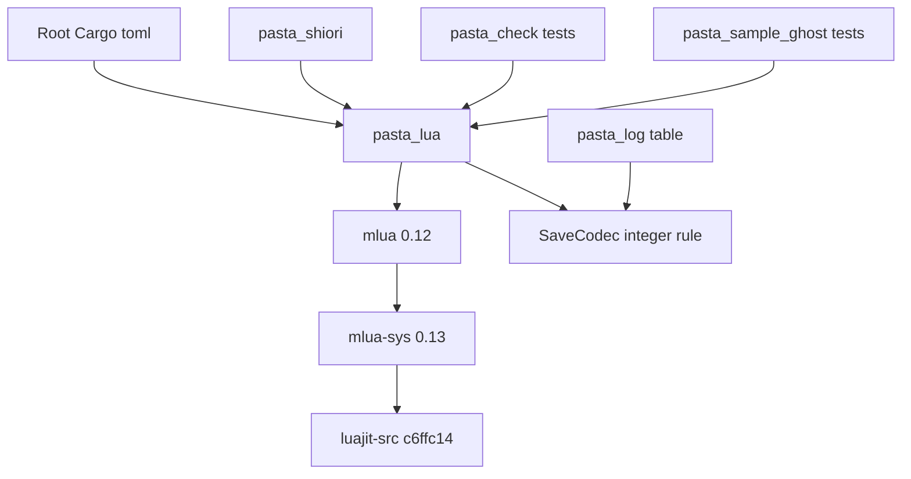

# 設計: mlua-0-12-upgrade

## Overview

**Purpose**: pasta の Lua ランタイムの土台を mlua 0.11.6 から 0.12.2 へ上げる。ゴーストの作者から見て、何も変わらないことを目標にする。上げる前に、今の main で x86 のビルドが通らない不具合（セーブの整数の変換が x86 の Lua の整数を考えていない）を 0.11 の上で直す。

**Users**: ゴーストの作者は、版上げの前と後で同じ辞書と Lua を同じように動かす。pasta の開発者は、今後の mlua の更新を `/update` の小さな直しで済ませる。後に続く spec（`shiori4-v3-portable`・`ponytail-lua-*`）は、0.12 の上の main でギャップ分析をやり直す。

**Impact**: ルートの `Cargo.toml` の mlua の版と `Cargo.lock` の 4 つの版が変わる。コードの直しは、x86 の整数の 1 か所（`persistence.rs`）、0.12 で移った名前の `use` の 6 ファイル、非推奨になった名前の 6 ファイル、版を書いた説明の 3 ファイルである。Lua から見える差は、新しい LuaJIT が受け付ける書き方が増えることだけである（今まで構文の誤りだった書き方。今まで動いていた書き方の結果は変わらない）。

### Goals

- mlua 0.12.2 以上・0.13 未満の上で、x86・x64 のビルド・テスト・clippy（`-D warnings`）と WASM のビルドが通る。
- x86 の pasta.dll のセーブとログの表に書く数が、x64 と同じ文字になる。
- 版上げの前に、まだ押さえていない挙動（`__pairs` を呼ばないこと）を特性化テストで押さえる。
- 変わる挙動（LuaJIT の新しい書き方）を、マニュアルとリリースノートに書く。

### Non-Goals

- mlua の features を変えること（`luajit52`・`vendored`・`serialize` のまま）。
- 0.12 で増えた機能（`#[derive(UserData)]`・スレッドのコールバックなど）を使う作り直し。
- LuaJIT の新しい書き方を止めること、または勧めること（LuaJIT にパッチを当てない）。
- 2^53 を超える整数の丸めを直すこと（`toml-serialization` の確定した判断のまま）。

## Boundary Commitments

### This Spec Owns

- ルートの `Cargo.toml` の mlua の版の行と、`Cargo.lock` の mlua・mlua-sys・`luajit-src`・`lua-src` の 4 つの版。
- セーブの値の変換（`runtime/persistence.rs` の SaveCodec）のうち、Lua の数を TOML の整数か浮動小数に分ける決まりと、TOML の整数を Lua の値にする所。
- 0.12 に合わせる機械的な直し（移った名前・非推奨の名前）。
- mlua の版を書いたソースの説明の書き直し。
- `tech.md` の mlua の版、`roadmap.md` の前提の 1 行、マニュアルの LuaJIT の書き方の注意、この spec の PR に使うリリースノートの文面。
- この spec の特性化テストと、x86・x64 で同じ期待にした整数のテスト。

### Out of Boundary

- セーブの形式・配列の印・深さ・循環の扱いなど、SaveCodec の整数以外の決まり（`toml-serialization` が持つ。この spec は触らない）。
- `@pasta_log` のスカラーの書き出し（`log.rs` の `value_to_string`）。x86 でも同じ文字が出るので直さない。
- デバッガ・searcher・`@toml`・`@enc`・`ffi.load` のコード（0.12 で直しが要らないことを確かめた。名前の `use` の直しだけ）。
- 0.4.3 の見どころのファイル（`doc/release-notes/v0.4.3.md`）。`release` スキルが書く。
- スキルの文書（`.claude/skills/`）の同期。`kiro-complete` が持つ。
- LuaJIT の版を mlua-sys と別に選ぶこと。

### Allowed Dependencies

- mlua 0.12.2（crates.io。features はそのまま）と、それが引く mlua-sys 0.13.0・`luajit-src 210.7.4+c6ffc14`・`lua-src 551.0.2`。
- Rust の標準ライブラリだけで整数の決まりを書く（`num-traits` などを直に足さない）。
- 先に入った `toml-serialization`・`mlua-stdlib-removal`・`ponytail-check-release` の今の形（`persistence.rs` の関数の分け方、`self_deploy_integration_test.rs` の `mod common;`）。

### Revalidation Triggers

- `pasta_lua::mlua` の版が 0.12 になる。`pasta_lua` を Rust のライブラリとして使う人と、`pasta_shiori` など mlua の型を使う後の spec は、0.12 の名前で書く。
- `Cargo.lock` の 4 つの版が動く。`Cargo.lock` を触る後の spec（`shiori4-v3-portable`・`pest-2-9-4-upgrade`・`ponytail-editor-tooling`・`ponytail-core-registry`）は、入った後の main で測り直す。
- `pasta_lua` のソースを広く触る `ponytail-lua-*` は、入った後の main でギャップ分析をやり直す（roadmap の前提）。
- x86 のセーブに書く数の決まりが x64 と同じになる。セーブの整数を扱う後の spec は、この決まりを前提にする。

## Architecture

### Existing Architecture Analysis

- mlua に直に依存するのは `pasta_lua` だけで、`pub use mlua;` で公開する。`pasta_shiori`・`pasta_check`（試験）・`pasta_sample_ghost`（試験）は `pasta_lua::mlua` を通して使う。依存の向きは変わらない。
- mlua-sys は `lua_Integer` を、32 ビットの機械では `i32`、64 ビットでは `i64` にする（0.10.0・0.13.0 とも）。LuaJIT の数はもともとすべて倍精度で、mlua は「`mlua::Integer` に収まり、戻しても同じビット」の数を `Value::Integer` にし、ほかを `Value::Number` にする（mlua 0.12.2 `state/raw.rs` 922〜928 行。0.11.6 も同じ）。x64 では `-2^63` 以上 `2^63` 未満の整数の値がすべて `Value::Integer` で来るが、x86 では 32 ビットを超える整数の値が `Value::Number` で来る。
- `toml-serialization` の SaveCodec は `Value::Integer` を `i64` と決めて書いているため、x86 ではコンパイルできない（3 か所）。`@pasta_log` の表は同じ変換（`lua_value_to_toml_strict`）を通る。
- 0.12 で直しが要るのは、`mlua::Debug` が `mlua::debug::Debug` へ移ったこと（コンパイルの誤り）と、`mlua::String` が `mlua::LuaString` の非推奨の別名になったこと（clippy の誤り）だけである（ギャップ分析で x64 のテスト 3,046 本を実測）。

### Architecture Pattern & Boundary Map



**Architecture Integration**:
- 選んだ形: 依存の版上げと、x86 の整数の決まりを SaveCodec の 1 つの小さな関数にまとめる直し。新しい層や部品は作らない。
- 守る形: `pasta_lua::mlua` の再公開、SaveCodec の関数の分け方（`convert`・`convert_table`・`convert_keyed`・`toml_to_lua`）、`@pasta_log` が SaveCodec を共有すること。
- 新しいもの: `persistence.rs` の中の非公開の関数 `lua_int` 1 つ（x86 と x64 で整数の決まりを揃える唯一の場所）。
- steering: pasta.dll の静的 CRT（`.cargo/config.toml`）のまま。リファクタリングは「1 抽出＝1 検証＝1 コミット」の小さな段で戻せるようにする。

### Technology Stack

| Layer | Choice / Version | Role in Feature | Notes |
|-------|------------------|-----------------|-------|
| Lua バインディング | mlua 0.12.2（`version = "0.12.2"`。0.12.2 以上・0.13 未満） | Lua VM の操作 | features `luajit52`・`vendored`・`serialize` のまま |
| FFI | mlua-sys 0.13.0 | LuaJIT の C の口 | mlua に引かれて上がる |
| Lua 処理系 | LuaJIT 2.1（`luajit-src 210.7.4+c6ffc14`。`jit.version` は `LuaJIT 2.1.1788856981`、`jit.version_num` は 20199 のまま） | ランタイムの Lua | 新しい書き方が増える（Data Models・Migration を参照） |
| ビルド | `.cargo/config.toml` の `+crt-static`（x86・x64） | 静的 CRT | 変えない |

## File Structure Plan

### Directory Structure

新しいファイルは、この spec のリリースノートの文面だけである。

```
.kiro/specs/mlua-0-12-upgrade/
└── release-note.md        # PR のタイトルと本文（kiro-complete のステップ 8 がそのまま使う）
```

### Modified Files

**段 1: x86 の整数（mlua 0.11 の上）**
- `crates/pasta_lua/src/runtime/persistence.rs` — `lua_int` を足し、`convert`（値）・`convert_table`（配列のキーの数え上げと、文字列でないキーの理由）・`convert_keyed`（根の文字列でないキーの印と理由）・`toml_to_lua`（TOML の整数）をこの決まりに揃える。
- `crates/pasta_lua/src/runtime/persistence_tests.rs` — `test_codec_read_value_types` を 64 ビットだけにする。`test_codec_round_trip_i64_extremes_as_values` の `i64::MAX` の回を 64 ビットだけにする（**前提（仮定）**。OPEN QUESTION 1）。x86・x64 で同じ期待の整数のテストを足す。

**段 2: 特性化（mlua 0.11 の上）**
- `crates/pasta_lua/src/runtime/persistence_tests.rs` — `__pairs` を持つ表を保存して、`__pairs` を呼ばずに生の中身だけを書くことを確かめるテストを足す（セーブと、同じ変換を通るログの表の両方の入口）。

**段 3: 版上げ**
- `Cargo.toml`（ルート 33 行）— `version = "0.11"` を `version = "0.12.2"` にする。
- `Cargo.lock` — `cargo update -p mlua` で 4 つの版だけを動かす。
- `mlua::Debug` → `mlua::debug::Debug`（6 ファイル）: `crates/pasta_lua/src/debug/hook.rs`・`src/debug/session/stop_loop.rs`・`src/debug/session/mod.rs`・`src/debug/hook_tests.rs`・`src/debug/inspect_test_support.rs`・`tests/chunk_name_validation_test.rs`。
- `mlua::String` → `mlua::LuaString`（6 ファイル・14 か所）: `crates/pasta_lua/src/runtime/enc.rs`・`src/runtime/ffi_load/mod.rs`・`src/runtime/module_registry.rs`・`src/runtime/searcher.rs`・`tests/runtime/encoding_test.rs`・`tests/runtime/literal_fixes_test.rs`。

**段 4: 説明と文書**
- `crates/pasta_lua/src/debug/inspect.rs`（23・66 行）・`src/debug/inspect_stack_coroutine_tests.rs`（159 行）— 「mlua 0.11.6 で確かめた」「mlua 0.11 / mlua-sys 0.10」を、0.12.2 のソースで確かめ直した内容（下の SourceComments）に書き改める。
- `crates/pasta_lua/src/debug/types.rs`（217 行）— 文書のコメントの `mlua::Debug` を `mlua::debug::Debug` にする。
- `.kiro/steering/tech.md`（7・33 行）— `mlua 0.11` を `mlua 0.12` にする。
- `.kiro/steering/roadmap.md`（137 行）— 前提が満ちたことを書く。
- `book/src/lua/basics.md`（「前提」の段落）— 新しい LuaJIT が受け付ける書き方の注意を 1 段落足す（**前提（仮定）**。OPEN QUESTION 2）。
- `.kiro/specs/mlua-0-12-upgrade/release-note.md`（新規）。
- `.kiro/specs/mlua-0-12-upgrade/research.md` — BehaviorRecord の「挙動の差の記録」に、確かめた差と判断を足す。

VerificationGates はファイルを持たない（CI の `build.yml` と同じコマンドを手元で走らせる）。`pasta_shiori`・`pasta_check`・`pasta_sample_ghost`・`about.hbs`・`.cargo/config.toml` は変えない。

## System Flows


- 段 1 と段 2 は mlua 0.11 の上で通してから段 3 へ進む（5.2）。段 1 は x86 のビルドを通す前提なので、段 2 より先に置く。
- 各段は 1 コミットにし、段 3 で落ちたら段 3 だけを戻せるようにする。
- 段 3 の後に前の段のテストが落ちたら、期待を書き換えずに Requirement 4 の手順で扱う（2.6）。

## Requirements Traceability

| Requirement | Summary | Components | Interfaces | Flows |
|-------------|---------|------------|------------|-------|
| 1.1 | 0.12.2 以上・0.13 未満 | MluaDependency | `version = "0.12.2"` | 段 3 |
| 1.2 | features を保つ | MluaDependency | features の行を変えない | 段 3 |
| 1.3 | crates.io の依存だけ | MluaDependency | git・パスを使わない | 段 3 |
| 1.4 | ほかの依存を動かさない | MluaDependency | `cargo update -p mlua` だけ | 段 3 |
| 1.5 | 静的 CRT | MluaDependency | `.cargo/config.toml` を変えない | 段 3 |
| 1.6 | 1 つの版 | MluaDependency | `pub use mlua;` のまま | 段 3 |
| 2.1 | x86・x64 のビルド | SaveIntegerRule, ApiMigration, VerificationGates | `cargo build` | 段 1, 3 |
| 2.2 | 全テスト | VerificationGates | `cargo test --all --target …` | 段 1〜4 |
| 2.3 | clippy | SaveIntegerRule, ApiMigration, VerificationGates | `cargo clippy --all-targets --workspace -- -D warnings` | 段 1, 3 |
| 2.4 | WASM | VerificationGates | `pasta_lsp` の build・`pasta_check` の check | 段 3 |
| 2.5 | lua_test | VerificationGates | `tests/lua_unittest_runner.rs` | 段 3 |
| 2.6 | 期待を書き換えない | VerificationGates, BehaviorRecord | 落ちたら Requirement 4 へ | 段 3 |
| 3.1 | SHIORI の応答 | VerificationGates | 既存の結合の試験 | 段 3 |
| 3.2 | 誤りの文言 | VerificationGates | 既存の試験 | 段 3 |
| 3.3 | require の探し方 | VerificationGates | `module_searcher_test.rs` | 段 3 |
| 3.4 | `package.loaders` の前提 | VerificationGates | `searcher.rs` の試験 | 段 3 |
| 3.5 | コルーチン | VerificationGates | 既存の lua_spec・Rust の試験 | 段 3 |
| 3.6 | 配列の印 | VerificationGates | `persistence_tests.rs` の 2 本 | 段 3 |
| 3.7 | `__pairs` を呼ばない | CharacterizationTests | 新しいテスト | 段 2 |
| 3.8 | `@toml`・`@enc`・`ffi.load` | VerificationGates | 既存の試験 | 段 3 |
| 3.9 | 13 の `std_` の名前 | VerificationGates | `runtime_config.rs` の試験 | 段 3 |
| 4.1 | 戻せるなら戻す | BehaviorRecord | 差の一覧と判断 | 段 4 |
| 4.2 | マニュアルとリリースノート | Docs, BehaviorRecord | `basics.md`・`release-note.md` | 段 4 |
| 4.3 | 新しい挙動を期待にする | CharacterizationTests, BehaviorRecord | 期待と、差を書いた所 | 段 4 |
| 4.4 | 差が無かったことも残す | BehaviorRecord | `research.md` の記録 | 段 4 |
| 5.1 | 押さえていない項目を足す | CharacterizationTests | 3.7 のテスト | 段 2 |
| 5.2 | 0.11 の上で通す | CharacterizationTests, VerificationGates | 段 1・2 の関門 | 段 1, 2 |
| 5.3 | 版上げの後も同じ期待 | CharacterizationTests | 段 3 の関門 | 段 3 |
| 5.4 | 環境変数に左右されない | CharacterizationTests | ライブラリのテストで `load` を呼ばない | 段 2 |
| 6.1 | ブレークポイント | VerificationGates | `debug/` の試験 | 段 3 |
| 6.2 | コルーチンの中の積み重なり | VerificationGates, SourceComments | `inspect_stack_coroutine_tests.rs` | 段 3, 4 |
| 6.3 | yield の後のステップ | VerificationGates | `session_step_controller_tests.rs`・`wiring_*` | 段 3 |
| 6.4 | `debug` を開かない | VerificationGates | `debug_mod_tests.rs` | 段 3 |
| 7.1 | 32 ビットに収まる整数を書く | SaveIntegerRule | `lua_int` | 段 1 |
| 7.2 | 32 ビットを超える整数を書く | SaveIntegerRule | `lua_int` | 段 1 |
| 7.3 | 32 ビットに収まる整数を読む | SaveIntegerRule | `toml_to_lua` | 段 1 |
| 7.4 | 32 ビットを超える整数を読む | SaveIntegerRule | `toml_to_lua` | 段 1 |
| 7.5 | 配列のキーの判定 | SaveIntegerRule | `convert_table` | 段 1 |
| 7.6 | x86・x64 の自動テスト | CharacterizationTests | 整数のテスト | 段 1 |
| 8.1 | `tech.md` | Docs | 7・33 行 | 段 4 |
| 8.2 | 版を書いた説明 | SourceComments | `inspect.rs` ほか | 段 4 |
| 8.3 | LuaJIT の著作権の文 | Docs | `about.hbs` を確かめる | 段 4 |
| 8.4 | roadmap | Docs | 137 行 | 段 4 |
| 8.5 | `pasta_lua::mlua` のリリースノート | Docs | `release-note.md` | 段 4 |

## Components and Interfaces

| Component | Domain/Layer | Intent | Req Coverage | Key Dependencies | Contracts |
|-----------|--------------|--------|--------------|------------------|-----------|
| SaveIntegerRule | pasta_lua runtime | Lua の数と TOML の整数を、x86・x64 で同じ決まりでつなぐ | 2.1, 2.3, 7.1〜7.5 | mlua の `Value`（P0） | Service |
| CharacterizationTests | pasta_lua tests | 変わりうる挙動を版上げの前に押さえる | 3.7, 4.3, 5.1〜5.4, 7.6 | SaveIntegerRule（P0） | — |
| MluaDependency | workspace | mlua の版と `Cargo.lock` | 1.1〜1.6 | crates.io（P0） | — |
| ApiMigration | pasta_lua | 0.12 で移った名前・非推奨の名前の置き換え | 2.1, 2.3 | mlua 0.12.2（P0） | — |
| SourceComments | pasta_lua debug | 版を書いた説明を 0.12.2 で確かめ直す | 6.2, 8.2 | mlua 0.12.2 のソース（P2） | — |
| Docs | steering・book・spec | 版と挙動の差の文書 | 4.2, 8.1, 8.3〜8.5 | BehaviorRecord（P1） | — |
| BehaviorRecord | spec の記録 | 確かめた挙動の差と判断を残す | 2.6, 4.1〜4.4 | VerificationGates（P1） | — |
| VerificationGates | CI と手元 | 各段の関門 | 2.1〜2.6, 3.1〜3.9, 6.1〜6.4 | x86 の target（P0） | Batch |

### pasta_lua runtime

#### SaveIntegerRule

| Field | Detail |
|-------|--------|
| Intent | Lua の数を TOML の整数にするかの決まりを、x64 の mlua の決まりと同じにして x86 でも使う |
| Requirements | 2.1, 2.3, 7.1, 7.2, 7.3, 7.4, 7.5 |

**Responsibilities & Constraints**
- 決まりは 1 つ: 「`-2^63` 以上 `2^63` 未満で、`i64` に戻しても同じビットの数は整数」。x64 の mlua が `Value::Integer` にする数と同じ集合なので、x64 の書き出しは変わらない。
- この決まりを持つのは `lua_int` だけ。`convert`・`convert_table`・`convert_keyed` は自分で `Value::Integer`・`Value::Number` を分けない。
- `-0.0`・NaN・無限大・小数・`2^63` 以上・`-2^63` 未満は整数にしない。
- 範囲の確かめを省いてはならない。Rust の `n as i64` は `2^63` を `i64::MAX` に飽和させ、戻すと `2^63` と同じビットになるので、範囲を見ないと x64 で浮動小数の `2^63` を x86 だけ `9223372036854775807` と書いてしまう。

**Dependencies**
- Inbound: `lua_table_to_toml_document`（セーブ）・`lua_value_to_toml_strict`（`@pasta_log` の表）— 書き出し（P0）
- Inbound: `load_impl` → `toml_to_lua` — 読み込み（P0）
- External: mlua の `Value`・`mlua::Integer`（x86 で `i32`、x64 で `i64`）（P0）

**Contracts**: Service [x]

##### Service Interface

```rust
/// Lua の数を 64 ビットの整数として読む。x64 の mlua が Value::Integer にする決まりと同じ。
#[allow(clippy::useless_conversion)] // mlua::Integer は x64 で i64・x86 で i32
fn lua_int(value: &Value) -> Option<i64>;
// Value::Integer(i) => Some(i64::from(i))
// Value::Number(n)  => -2^63 <= n < 2^63 かつ (n as i64) as f64 が n と同じビットなら Some(n as i64)
// ほか              => None
```

- 事前条件: なし（どの `Value` でも呼べる）。
- 事後条件: `Some(i)` なら `i as f64` は元の数と同じビット。x64 では `Value::Number` から `Some` は Lua から来た値では起きない。
- 不変条件: x86 と x64 で、同じ Lua の数に同じ結果を返す。

使う所の約束:

| 場所 | 今 | 直した後 |
|------|----|----------|
| `convert` の数 | `Integer(i)` → TOML の整数、`Number(f)` → 浮動小数 | `lua_int` が `Some(i)` なら整数、`None` なら `Number(f)` を浮動小数 |
| `convert_table` の配列のキー | `Value::Integer(i) if i >= 1` を数える | `lua_int(key)` が 1 以上なら数える（x86 の `3000000000` のキーも同じ判定になる） |
| 文字列でないキーの理由の型の名前 | `type_name()`（x86 の 32 ビットを超える整数のキーは `number`） | `lua_int` が `Some` なら `integer`、ほかは `type_name()`。根のキーの印（`[3000000000]`）も同じ数で書く |
| `toml_to_lua` の整数 | `Value::Integer(*i)` | `mlua::Integer::try_from(*i)` が通れば `Value::Integer`、通らなければ `Value::Number(*i as f64)` |

**Implementation Notes**
- Integration: 1 コミットで 4 か所をまとめて直す（どれか 1 つでも残ると x86 でビルドできない）。
- Validation: 設計の段階で、スクラッチ（mlua 0.11.6）でこの形を試した。`cargo clippy -p pasta_lua --all-targets -- -D warnings` は x86・x64 とも通った。`Value::Integer(i) => Some(i as i64)` は x64 の `unnecessary_cast` で落ち、`i64::from` を `allow` 無しで書くと x64 の `useless_conversion` で落ちる。`mlua::Integer::try_from(*i)` は x64 でも警告にならなかった。
- Risks: 後の clippy が `allow` の付いていない書き方を新しく警告にすることがある。`allow` は関数 1 つに限り、理由を 1 行で書く。

#### CharacterizationTests

**Responsibilities & Constraints**
- 段 1 の整数のテスト（`persistence_tests.rs`、x86・x64 で同じ期待）: Lua から `{ big = 3000000000, neg = -3000000000, m63 = -2^63, p63 = 2^63, nz = -0.0, one = 1.0, arr = { 3000000000, 2 } }` を書くと、TOML の文字が `big = 3000000000`・`neg = -3000000000`・`m63 = -9223372036854775808`・`p63 = 9223372036854776000.0`・`nz = -0.0`・`one = 1`・`arr = [3000000000, 2]` になる。キー `3000000000` の表・`-3000000000` の表は、どちらも `non-string key (integer)` の理由で外れる。TOML の `x = 3000000000` を読むと、Lua の数 `3000000000` になる。
- 既存の 64 ビットだけのテスト: `test_codec_read_value_types`（`Value::Integer(i64::MAX)` を照合する。7.6 の例外）を `#[cfg(target_pointer_width = "64")]` にする。
- `test_codec_round_trip_values` は期待を変えずに x86 でも通る（スクラッチで確かめた）。
- `test_codec_round_trip_i64_extremes_as_values` の `i64::MIN` と `-0.0` の確かめは x86 でも同じ期待で通る。`i64::MAX` の回は、Rust の側で `Value::Integer(i64::MAX)` を持つことを確かめる試験で、x86 の `mlua::Value` にはこの値を持つ形が無い（スクラッチの x86 で `Float(9.223372036854776e18)` が戻った）。**前提（仮定）**: この回だけを 64 ビットに限る（7.6 の例外の内側と読む）。Lua の表に入った `i64::MAX` が `2^63` の浮動小数になることは、`test_codec_round_trip_values` の `imax` が x86・x64 で同じ期待で押さえる。OPEN QUESTION 1。
- 段 2 の `__pairs` のテスト: `setmetatable({ a = 1 }, { __pairs = function() error("called") end })` を根の表と、根の中の値と、`lua_value_to_toml_strict` に渡し、`a = 1` だけが書かれ、誤りにならないことを確かめる（3.7）。
- どのテストもライブラリの中の関数を直に呼び、`PASTA_DEBUG` を読むランタイムの `load` を通さない（5.4）。

**Implementation Notes**
- Validation: 段 1・2 のテストは、版上げの前に x86・x64 で通す。段 3 の後も同じ期待で通る（5.3）。
- Risks: 3.5 のコルーチンは新しいテストを足さない。理由は、`suspended`・`dead`・再開の結果・捨てた後の状態を照合する既存の試験が多くあり（`event_coroutine_test.lua`・`actor_proxy_act_delegation_test.lua`・`choice_select_test.lua`・`act_test.lua`・`external_control_events_test.rs` など）、LuaJIT の差分でコルーチンの関数（`lib_base.c` の `coroutine.*`・`lj_state.c` の再開）に変更が無いことを確かめたからである。`running`・`normal` は pasta のランタイムが使わず、照合する試験も無い。

### workspace

#### MluaDependency

- ルートの `Cargo.toml` 33 行を `mlua = { version = "0.12.2", features = ["luajit52", "vendored", "serialize"] }` にする。Cargo の `"0.12.2"` は 0.12.2 以上・0.13 未満を意味する（1.1）。
- `cargo update -p mlua` で `Cargo.lock` を更新し、差が mlua 0.11.6 → 0.12.2・mlua-sys 0.10.0 → 0.13.0・`luajit-src 210.6.6+707c12b` → `210.7.4+c6ffc14`・`lua-src 550.0.0` → `551.0.2` の 4 つだけであることを `git diff Cargo.lock` で確かめる（1.4）。全体の `cargo update` はかけない。
- `features` の行・`crates/pasta_lua/Cargo.toml` の `mlua.workspace = true`・`pub use mlua;`・`.cargo/config.toml` は変えない（1.2・1.3・1.5・1.6）。

### pasta_lua

#### ApiMigration

- `use mlua::{…, Debug, …}` と `mlua::Debug` を `mlua::debug::Debug` にする（6 ファイル）。`HookTriggers`・`VmState` はクレート直下に残るので変えない。
- `mlua::String`（`String as LuaString` の別名の取り込みを含む）を `mlua::LuaString` にする（6 ファイル・14 か所）。
- ほかの名前（`Table`・`Function`・`Value`・`Error`・`Lua`・`LuaOptions`・`StdLib`・`Thread`・`AnyUserData`・`ffi`・`LuaSerdeExt` など）は 0.12.2 でもクレート直下にあるので変えない。`MaybeSync`・`AnyUserData::type_name`・GC の口・`ToLuaConversionError`・`BorrowedStr`・`Function::wrap` は pasta に当たらない（ギャップ分析で確かめた）。

#### SourceComments

mlua 0.12.2 のソースで、デバッガが頼る仕組みが 0.11.6 と同じであることを確かめた。説明はこの内容に書き改める。

| 説明の中身 | 0.12.2 の場所 | 確かめた結果 |
|------------|---------------|--------------|
| 行のフックの C の入口が、走っている `lua_State*` を受け取り、`callback_error_ext` で包む | `src/state/raw.rs` 449〜464 行（`global_hook_proc`） | 同じ |
| `callback_error_ext` が `StateGuard` で `RawLua.state` を走っている状態に差し替える | `src/state/util.rs` 10〜23 行（`StateGuard`）・123 行 | 同じ |
| `current_thread()` が `RawLua.state` を `lua_pushthread` する | `src/state.rs` 1869〜1886 行 | 同じ。0.12 で足された「暗黙の非同期のスレッドを持ち主に解く」分岐は `async` の features のときだけで、pasta は使わない |
| FFI の `lua_getstack`・`lua_getinfo`・`lua_getlocal`・`lua_getupvalue` | mlua-sys 0.13.0（`luajit52` = lua51 の ABI） | 同じ形（x64・x86 のデバッガの試験が通った） |

- `inspect.rs` 23 行・`inspect_stack_coroutine_tests.rs` 159 行の「mlua 0.11.6 source」を「mlua 0.12.2 source」に、ファイルの名前を上の表のとおりに、`inspect.rs` 66 行の見出しを「mlua 0.12 / mlua-sys 0.13」にする。
- `types.rs` 217 行の `mlua::Debug` を `mlua::debug::Debug` にする。

### 文書と記録

#### Docs

- `tech.md` 7 行を `LuaJIT 2.1 (mlua 0.12)`、33 行を `mlua 0.12` にする（8.1）。
- `about.hbs` の LuaJIT の著作権の文は、`luajit-src` 210.6.6 と 210.7.4 の `luajit2/COPYRIGHT` が同じ文であることを確かめたので変えない（8.3）。
- `roadmap.md` 137 行を、「mlua 0.12 へ上げた（`mlua-0-12-upgrade`）。`pasta_lua` を触る ponytail（`ponytail-lua-*`）は、この後の main でギャップ分析をやり直す」の形に改める（8.4）。
- `book/src/lua/basics.md` の「前提」に、次の中身の段落を足す（4.2。**前提（仮定）**。OPEN QUESTION 2）: 同梱の LuaJIT（2.1 の新しい版）は、Lua 5.1 にない書き方の一部（`continue`・`const`・`!=`・`&&`・`||`・`??`・`?.`・ビット演算の記号・`|x| -> 式` の短い関数・数の `_` 区切りなど）を構文の誤りにしない。pasta のマニュアルは Lua 5.1 系＋LuaJIT 拡張の範囲だけを案内し、これらの書き方は同梱の luacheck が読めない。今まで動いていた書き方の結果は変わらない。回避の書き方は書かない。
- `release-note.md`（新規）: `kiro-complete` のステップ 8 がそのまま使う PR のタイトルと本文。タイトルは `feat!(mlua-0-12-upgrade): mlua を 0.12 に上げる` の形にし、`!` でリリースノートの「動きが変わる変更」に載せる（`release-notes.ps1` の決まり）。本文には、(1) `pasta_lua` が公開する `pasta_lua::mlua` が 0.12 になったこと（Rust のライブラリとして使う人は 0.12 の名前で書く。`mlua::debug::Debug`・`mlua::LuaString`）、(2) 同梱の LuaJIT が新しい書き方を受け付けること、(3) x86 の pasta.dll のセーブの整数が x64 と同じ文字で書かれるようになったこと（今の main の x86 のビルドの不具合の直し）を書く（8.5）。

#### BehaviorRecord

- 段 3・4 で確かめた挙動の差を、`research.md` の「挙動の差の記録」に、差ごとに「戻した・戻さず書いた・差が無かった」と書いた所を残す（4.1〜4.4）。
- 設計の段階で分かっている差（Data Models の表）を最初の中身にし、実装で見つかった差を足す。

### CI と手元

#### VerificationGates

**Contracts**: Batch [x]

##### Batch / Job Contract
- Trigger: 各段の終わり。段 3 の後は全部、段 1・2 の後は x86・x64 のテストと clippy。
- Input: 次のコマンド（CI の `build.yml` と同じ）。走らせる前に `NoDefaultCurrentDirectoryInExePath` を外し、`CARGO_TARGET_DIR` は短いパスにする。
  - `cargo test --all --target x86_64-pc-windows-msvc`・`cargo test --all --target i686-pc-windows-msvc`
  - `cargo clippy --all-targets --workspace --target <両方> -- -D warnings`
  - `cargo build -p pasta_lsp --target wasm32-unknown-unknown --release`・`cargo check -p pasta_check --lib --no-default-features --target wasm32-unknown-unknown`
- Output: すべて誤り無し。x64 のテストは版上げの前と同じ数（ギャップ分析では 3,046 本）が通る。x86 は 64 ビットだけにした試験の分だけ少ない。
- Idempotency & recovery: テストが `crates/pasta_lua` の `sample.generated.lua` の改行だけを書き換えたら `git checkout --` で戻し、コミットに混ぜない。

## Data Models

### セーブとログの表に書く数（x86・x64 で同じ）

| Lua の値 | 直す前の x64 | 直す前の x86 | 直した後（両方） |
|----------|--------------|--------------|------------------|
| `1`・`-5` | `1`・`-5` | ビルドできない | `1`・`-5` |
| `1.0` | `1` | — | `1` |
| `3000000000`・`-3000000000` | 整数 | — | 整数 |
| `-2^63` | `-9223372036854775808` | — | `-9223372036854775808` |
| `2^63` | `9223372036854776000.0` | — | `9223372036854776000.0` |
| `-0.0`・`1.5`・`nan`・`inf` | 浮動小数 | — | 浮動小数 |
| 2^53 を超える整数（例 `9007199254740993`） | 倍精度に丸めた整数（`9007199254740992`） | — | 同じ（`toml-serialization` の判断 6） |
| キー `[3000000000]` の表 | `non-string key (integer)` | — | `non-string key (integer)` |

この表の「直した後」は、スクラッチで x86・x64 の両方を走らせて確かめた（`research.md`）。

### LuaJIT `707c12b` → `c6ffc14` の Lua から見える差

| 差 | 今まで | これから | 扱い |
|----|--------|----------|------|
| 新しい書き方（`continue` 文・`const` の宣言・`!=`・`&&`・`\|\|`・`??`・`?.`・`<<`・`>>`・`~>>`・`\|x\| -> 式`・数の `_` 区切り。確かめた） | 構文の誤り | 受け付ける | 戻せない（LuaJIT にパッチを当てない）。マニュアルとリリースノートに書く（OPEN QUESTION 2） |
| `continue`・`const` を名前に使う（`local continue`・`t.const`・`::continue::`） | 動く | 動く（文脈で決まる言葉。確かめた） | 差なし |
| `jit.version` | `LuaJIT 2.1.1767980792` | `LuaJIT 2.1.1788856981` | 差として書かない（`jit.version_num` は 20199 のまま。`pasta.lua_version` は 221 のまま） |
| `os.time` の誤りの判定（`errno` を見る直し） | ちょうど `-1` になる時刻で `nil` | その時刻の数 | LuaJIT の不具合の直し。リリースノートの (2) にまとめる |

## Error Handling

- 新しい誤りは作らない。SaveCodec の書けない理由の文（`hole in array`・`non-string key (…)`・`table mixes array items and named keys` など）は変えず、型の名前だけを x86 と x64 で揃える。
- 段 3 の後に既存のテストが落ちたときは、期待を書き換えず、原因を「mlua の差・LuaJIT の差・pasta の不具合」に分けて Requirement 4 で扱い、BehaviorRecord に残す（2.6）。

## Testing Strategy

- **Unit（段 1）**: `persistence_tests.rs` の整数のテスト（Data Models の表の各行を、Lua から作った表で書いて TOML の文字を照合。x86・x64 で同じ期待）。TOML の `3000000000` を読んで Lua の数 `3000000000` になること。
- **Unit（段 1、既存）**: `test_codec_round_trip_values` が期待を変えずに x86 で通ること。`test_codec_round_trip_i64_extremes_as_values` の `i64::MIN`・`-0.0` の確かめが x86 で通ること。
- **Unit（段 2）**: `__pairs` を持つ表を、根・値・`lua_value_to_toml_strict` の 3 つの入口で書き、`__pairs` が呼ばれず `a = 1` だけが書かれること（3.7）。
- **Integration（段 3、既存）**: lua_test のランナー、デバッガの試験（`hook_tests`・`inspect_stack_coroutine_tests`・`wiring_*`・`session_step_controller_tests`・`wiring_pasta_step_e2e`）、FFI の試験、`runtime_error_balloon_e2e_test.rs`、`module_searcher_test.rs`、`pasta_shiori` の結合の試験、`pasta_sample_ghost` の試験が、x86・x64 で期待を変えずに通ること（2.2・2.5・3.1〜3.9・6.1〜6.4）。
- **Build（段 3）**: x86・x64 の clippy（`-D warnings`）、WASM の 2 つのコマンド（2.3・2.4）。

## Migration Strategy

- 段 1〜4 を、それぞれ 1 コミットにする。段 1・2 は mlua 0.11 の上でコミットする。
- 戻すとき: 段 3 のコミットを戻せば mlua 0.11 に戻り、段 1・2 の直しとテストは 0.11 の上で働き続ける。
- 作者のセーブファイルの移行は要らない。x64 の書き出しは変わらず、x86 は今の main ではビルドできないので、x86 で直す前の形で書かれたファイルは無い（v0.4.2 以前の x86 の pasta.dll は JSON のセーブで、`toml-serialization` の移行の範囲）。

## Open Questions / Risks

- **OPEN QUESTION 1**: 要件の「決まった論点 2」は、x86 だけで落ちていた往復の試験 2 本を「期待を変えずに x86 でも通す」とした。`test_codec_round_trip_values` は通るが、`test_codec_round_trip_i64_extremes_as_values` の `i64::MAX` の回は x86 では通せない（Rust の側の `Value::Integer(i64::MAX)` を x86 の `mlua::Value` が持てない。Lua に入れれば x64 でも `2^63` の浮動小数になる）。設計は、この回だけを 64 ビットに限る前提で書いた（7.6 の例外の内側と読む）。
- **OPEN QUESTION 2**: 新しい LuaJIT の書き方を、どう書くか。設計は、`basics.md` に 1 段落（受け付けること・マニュアルは案内しないこと・luacheck が読めないこと）と、リリースノートの「動きが変わる変更」に書く前提にした。ほかの道: 書かない（今まで動いていた書き方は変わらないので差として扱わない）、書き方として案内する。
- 危うさ: 試験で押さえていない LuaJIT の差（JIT の最適化・FFI の算術・GC の直し）。pasta の試験は全部通ったので、低いと見る。
