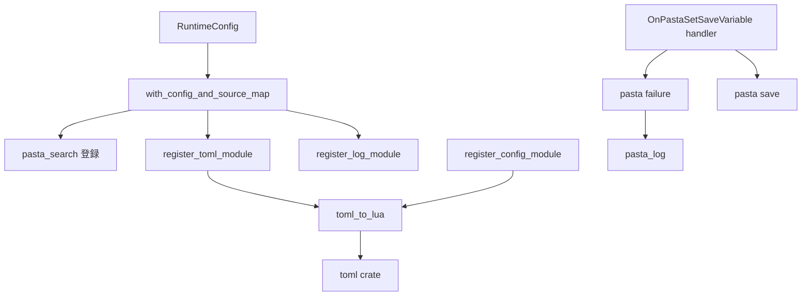
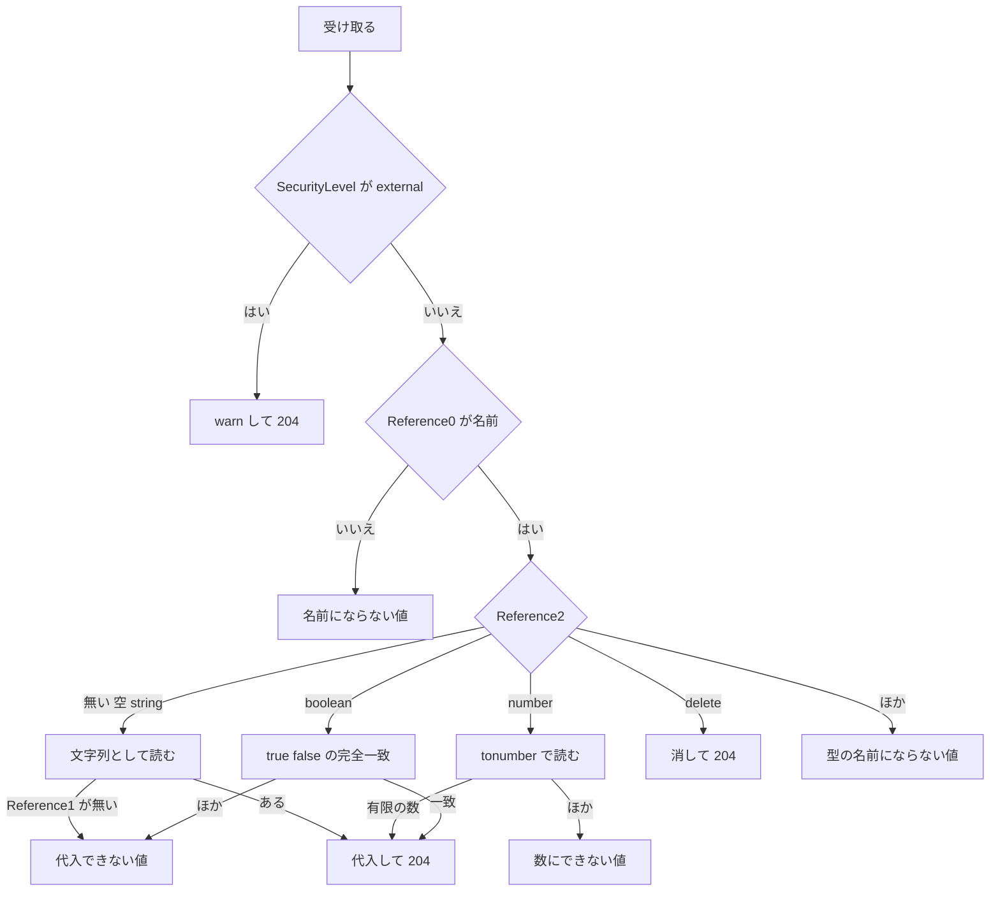

# 設計: mlua-stdlib-removal

## Overview

**目的**: pasta から mlua-stdlib（0.1.0）への依存を外し、mlua 0.12 へ上げる道を開く。あわせて、作者が TOML の文字列を Lua の表に読む `@toml` を足し、外から変数を書き込む `OnPastaSetSaveVariable` を、JSON の値でなく Reference2 の型で受ける形に改める。

**使う人**: ゴーストの作者は `require "@toml"` で TOML を読む。外から試験・操作する人（SSP の MCP の `raise_event` を使う AI エージェントを含む）は、値を引用符で包まずに送り、型を Reference2 で指定する。pasta の開発者は、mlua-stdlib の無い依存の木から `mlua-0-12-upgrade` を始める。

**変わること**: `@json`・`@yaml`・`@regex`・`@assertions`・`@testing`・`@env` の 6 つが無くなる。`OnPastaSetSaveVariable` は 0.4.2 の形（JSON の値）と互換が無くなる。どちらもリリースノートの「動きが変わる変更」で知らせる。ほかのモジュールとイベントは変えない。

### Goals

- pasta の依存の木から mlua-stdlib と、それだけが引く依存（`serde_yaml`・`ouroboros`・`owo-colors`・`quick_cache` など）が消える。
- `@toml` の `decode` が、`@pasta_config` と同じ規則で TOML を Lua の値にし、読めなければ `nil, エラーメッセージ` を返す。
- `OnPastaSetSaveVariable` が、`["会員番号", "01"]` で文字列の `01` を、`["pasta_talk_interval_min", "60", "number"]` で数値の `60` を代入する。
- マニュアル・スキル・README・steering が今の姿を書き、マニュアルの検査がすべて通る。

### Non-Goals

- mlua 0.12 への更新（`mlua-0-12-upgrade`）。
- JSON・YAML・正規表現・テストの道具の代わりの部品、`@toml` の `encode`。
- セーブファイル・`@pasta_log` の表の出力・サイドカーの JSON（`toml-serialization`）。DAP・LSP の JSON。
- 0.4.2 の JSON の形を受け続けること。`OnPastaCallFunction` の変更。

## Boundary Commitments

### This Spec Owns

- 依存の撤去: ルートの `Cargo.toml` の `mlua-stdlib` の行、`crates/pasta_lua/Cargo.toml` の `mlua-stdlib.workspace = true`、`Cargo.lock`（このウェーブで席を持つのはこの spec だけ）。
- Rust の側のライブラリの選び方: `RuntimeConfig` の 6 つの名前・`should_enable_module`・`env` の警告、`ConfigError::UnknownLibrary` の文。
- `@toml` モジュール（`decode` だけ）の登録と契約。
- `OnPastaSetSaveVariable` の既定ハンドラの、値と型の受け方と失敗の出し方。失敗の種類の表の `NOT_JSON` の席（`BAD_TYPE` に置き換える）。
- 上のものの自動テスト（消えたモジュールを使っていたテストの書き直し・削除を含む）。
- 文書: マニュアル 10 頁（下の File Structure Plan）、スキル `pasta-lua-coding` の `SKILL.md` と生成した references、`crates/pasta_lua/README.md`、`tech.md` の該当行、`structure.md`・`TEST_COVERAGE.md` の消すテストの行。

### Out of Boundary

- `tests/loader/config_test.rs`（ウェーブの約束。`[lua] libs = ["std_all", "env"]` のテストは、モジュールが無くなっても `pcall(require, "@env")` が `false` のままなので、触らずに通る）。
- `runtime/persistence.rs`・`lifecycle.rs`・`log.rs`・`sidecar.rs` と、その JSON（`toml-serialization`）。
- `lua/shiori-events.md` の既定ハンドラーの表の行の数と、表の前の「9 つのイベント」の文（`recommend-menu-scenes` が行を足して合わせる）。この spec は `OnPastaSetSaveVariable` の行の文だけを直す。
- 失敗の種類を足すこと。`OnPastaSetSaveVariable` の名前の扱い・`SecurityLevel` の門・作者のハンドラでの止め方・保存の時機（`external-control-events` で決めたまま）。
- リリースノートのファイルそのもの（`doc/release-notes/v0.4.3.md` は `release` スキルが書く）と、出した版の記録 `doc/release-notes/v0.4.2.md`。
- `deny.toml`・`about.toml`（依存が減るだけで、許可の一覧は変えない）。

### Allowed Dependencies

- `toml` クレート（`pasta_lua` の既存の直接の依存。1.1.x）と、既存の `PastaLuaRuntime::toml_to_lua`・`set_loaded_module`。
- `mlua` 0.11（変えない）。
- Lua の側: `pasta.failure`（`FAILURE.report`・`kind_of`・`LABEL`）、`pasta.save`、`@pasta_log`。Lua の標準の `tonumber`。
- 向き: `runtime/mod.rs` → `runtime/module_registry.rs` → `toml`。`external_control.lua` → `pasta.failure`・`pasta.save`。逆向きの参照は作らない。`external_control.lua` は `event/init.lua` を `require` しない（今の約束）。

### Revalidation Triggers

- `RuntimeConfig` の公開の中身（`default_libs()` が `["std_all"]`、`full()` が `["std_all_unsafe"]`、`should_enable_module` が無い）。Rust から `pasta_lua` を使う人と `mlua-0-12-upgrade` は確かめ直す。
- `OnPastaSetSaveVariable` の契約（Reference0〜2・型の名前・失敗の表記）。MCP で送る手順を持つ所（スキル・ghost_dev の手順・試験の台本）は確かめ直す。
- `FAILURE.LABEL` の鍵の名前（`NOT_JSON` が無くなり `BAD_TYPE` になる）。失敗の種類を使う後続の spec（`call-attribute-filter`・`scene-anchor-link`・`shell-element-click` の brief は「12 種」を前提にしており、数は変わらない）。
- `@toml` の契約（`toml-serialization` が後で `encode` を求めるなら、この spec の「`decode` だけ」を改める）。
- マニュアルの章のファイル名（`lua/modules/mlua-stdlib.md` → `lua/modules/toml.md`）と、Lua 標準ライブラリの節の置き場。外からリンクしている所は確かめ直す。

## Architecture

### Existing Architecture Analysis

- `PastaLuaRuntime::with_config_and_source_map`（`runtime/mod.rs`）が VM を作り、`@pasta_search` を登録し、`RuntimeConfig::should_enable_module` を見て 6 つを `mlua_stdlib::*::register` で登録し、`@pasta_log` を常に登録する。`new`・`with_config`・`from_loader` のどれもこの道を通り、`main.lua` はその後に読まれる。
- `@pasta_config` は `module_registry.rs` の `register_config_module` が `toml_to_lua` で pasta.toml の値を表にして登録する。
- `OnPastaSetSaveVariable` の既定ハンドラ（`external_control.lua`）は、門 → Reference0 → `pcall(require, "@json")` → `read_json` → 代入、の順で、失敗は `fail`（`FAILURE.report` と `act:build()`）で返す。
- 守る型: モジュールは `set_loaded_module` で `package.loaded` に置く。公開モジュールの失敗は戻り値の `nil, エラーメッセージ`、引数の型の誤りは Lua のエラー。実行時の失敗は `FAILURE.report` の 1 つの出口から出す。

### Architecture Pattern & Boundary Map



- **選んだ型**: 既存の部品を広げる（ギャップ分析の案 A）。新しい Rust のファイル・新しい抽象・新しい設定は作らない。
- **境界**: Rust の側は「モジュールを登録する」までで、`@toml` の中身は `toml` クレートと `toml_to_lua` に任せる。Lua の側は既定ハンドラ 1 つの中で型を読み分け、失敗は `pasta.failure` に渡す。
- **守る型**: `set_loaded_module`、`@pasta_log` と同じ「常に登録」、`fail` と `FAILURE.report`、失敗の表記の形 `【種類：対象（説明）】`。
- **新しい部品の理由**: `register_toml_module` は要件 2 の口として要る。型を読み分ける Lua の局所関数は、消える `read_json` の席に入る。
- **steering との合い方**: Lua VM の組み込みモジュールは Rust から登録する（`tech.md` の Rust 組み込みモジュール）。テストは `<feature>_test.rs`。

### Technology Stack

| Layer | Choice / Version | Role in Feature | Notes |
|-------|------------------|-----------------|-------|
| Backend / Services | Rust 2024・`mlua` 0.11（LuaJIT 2.1） | `@toml` の登録と `decode` | 変えない |
| Data / Storage | `toml` 1.1.x（Cargo.lock 1.1.8） | TOML の文字列を `toml::Table` に読む | 既存の直接の依存。`toml::from_str::<toml::Table>` は `loader/config/mod.rs` と同じ使い方 |
| Messaging / Events | Lua（`pasta_scripts`） | `OnPastaSetSaveVariable` の既定ハンドラ | 数は Lua の `tonumber` |
| Infrastructure / Runtime | mlua-stdlib 0.1.0 | **外す** | 依存の木から消える。`regex`・`serde`・`serde_json` は pasta が直に使うので残る |

## File Structure Plan

### Directory Structure

```
crates/pasta_lua/
├── src/runtime/module_registry.rs      # @toml の登録（register_toml_module）を足す
├── src/runtime/mod.rs                  # 6 つの登録を消し、@toml の登録 1 行を足す。new() の文書を直す
├── src/runtime/runtime_config.rs       # 6 つの名前・should_enable_module・env の警告を消す
├── src/error.rs                        # UnknownLibrary の文から 6 つの名前を外す
├── pasta_scripts/pasta/failure.lua     # NOT_JSON の席を BAD_TYPE に置き換える
├── pasta_scripts/pasta/shiori/event/external_control.lua  # OnPastaSetSaveVariable を型で受ける
└── tests/
    ├── runtime/toml_module_test.rs     # 新規: @toml の試験
    ├── runtime/stdlib_modules_test.rs  # 消す
    ├── runtime/stdlib_regex_test.rs    # 消す
    └── ...                             # 書き直し（下の Modified Files）
book/src/lua/modules/toml.md            # 新規: @toml の章（mlua-stdlib.md の置き換え）
book/src/lua/modules/mlua-stdlib.md     # 消す
.claude/skills/pasta-lua-coding/references/toml.md         # 生成（gen-skill-refs.mjs が書く）
.claude/skills/pasta-lua-coding/references/mlua-stdlib.md  # 消す（手で）
```

### Modified Files

**依存**
- `Cargo.toml`（ルート）— 34 行の `mlua-stdlib` を消す。
- `crates/pasta_lua/Cargo.toml` — 23 行の `mlua-stdlib.workspace = true` を消す。
- `Cargo.lock` — 手で直さず、ビルドで落とす（`mlua-stdlib` と、それだけが引く依存が消える）。

**Rust**
- `crates/pasta_lua/src/runtime/module_registry.rs` — `register_toml_module` を足す（`toml_to_lua` は変えない）。
- `crates/pasta_lua/src/runtime/mod.rs` — 214〜232 行の 6 つの登録を消し、`register_log_module` の隣で `register_toml_module` を呼ぶ。`new()` の文書の 6 つのモジュールと `@env` の注意を、`@toml` の 1 行に直す。
- `crates/pasta_lua/src/runtime/runtime_config.rs` — `default_libs()` を `["std_all"]`、`full()` を `["std_all_unsafe"]` にする。`should_enable_module` を消す。`validate_and_warn` の `env` の分岐を消す。モジュールの文書・`libs` の文書・`to_stdlib` の注釈（284 行）から mlua-stdlib を消す。
- `crates/pasta_lua/src/error.rs` — `UnknownLibrary` の文を `std_` の 13 の名前だけにする。試験（288〜289 行）を「6 つの名前を含まない」に直す。

**Lua**
- `crates/pasta_lua/pasta_scripts/pasta/failure.lua` — `NOT_JSON = "JSON として読めない値"` を `BAD_TYPE = "型の名前にならない値"` に置き換える（同じ席。数は 12）。
- `crates/pasta_lua/pasta_scripts/pasta/shiori/event/external_control.lua` — 冒頭の説明、`read_json` を型で読み分ける局所関数に置き換え、`OnPastaSetSaveVariable` の本体を書き換える。門・`bad_reference0`・`fail`・`quoted`・`is_name` はそのまま使う。

**試験**
- `crates/pasta_lua/tests/runtime/main.rs` — `stdlib_modules_test`・`stdlib_regex_test` の `mod` を外し、`toml_module_test` を足す。
- `crates/pasta_lua/tests/runtime/unit_test.rs` — 6 つの名前に触れる試験を書き直すか消す（Testing Strategy）。
- `crates/pasta_lua/tests/runtime/runtime_api_test.rs` — 6 つの名前を並べても 6 つのモジュールが入らない試験を足す。
- `crates/pasta_lua/tests/shiori/res_test.rs` — 49 行の `@assertions` を Lua の `assert` に直す。
- `crates/pasta_lua/tests/lua_unittest_runner.rs` — 67〜68 行の `@json` の登録を消す。
- `crates/pasta_lua/tests/lua_specs/external_control_event_test.lua` — 冒頭の「土台の `@json`」を消し、`OnPastaSetSaveVariable` の試験を新しい形に書き直す。
- `crates/pasta_lua/tests/lua_specs/failure_test.lua` — 344〜360 行の `NOT_JSON` を `BAD_TYPE` に直す（数は 12 のまま）。
- `crates/pasta_lua/tests/external_control_events_test.rs` — 210〜233 行の `&["会員番号", "\"01\""]` を `&["会員番号", "01"]` に直す。

**マニュアル（`book/src/`）**
- 新規 `lua/modules/toml.md`（題は `@toml`）— 冒頭と末尾にほかの章と同じ会話（`talk/talk-test.mjs` を通す形）。本文は、読み込み方（`require "@toml"`。設定なしで、初期化の時から使える）、`decode` の使い方と値の対応の表（`@pasta_config` と同じ。2^53 を超える整数は丸まる）、失敗の返し方（`nil, エラーメッセージ`。文は複数行になることがある。文字列でない引数は Lua のエラー）、`encode` を持たないこと、JSON・YAML・正規表現の部品は無く、文字列は Lua の標準の文字列の関数で調べること（5.5）。
- `SUMMARY.md` — 48 行を `- [@toml](lua/modules/toml.md)` にする（章の数は 63 のまま）。
- `lua/modules/index.md` — 一覧の表に `@toml` の行を足し、30〜31 行の mlua-stdlib の段落を「JSON・YAML・正規表現の部品は無い。文字列は Lua の標準の `string.find`・`match`・`gsub` で調べる」に置き換える。共通事項の終わりに `### Lua 標準ライブラリ` を移す（既定で使えるもの・使えないもの・ゴーストから変えられないこと。ただし `ffi` だけは `pasta.toml` の `[loader] ffi = true` で開けることを書き、`reference/pasta-toml.md` の `ffi` へリンクする。今の「変える手段は無い」は FFI の口が入った後に古くなっている）。
- `lua/index.md` — 30 行のリンクを `modules/index.md#lua-標準ライブラリ` に直す。
- `lua/modules/pasta-log.md` — 19 行の「mlua-stdlib 統合モジュールの有効・無効に左右されない」を消す（「常に登録される」だけにする）。
- `lua/shiori-events.md` — 131 行の表の行の文（「Reference2 の型に従って Reference1 をグローバル変数に代入する」）。819〜895 行の `OnPastaSetSaveVariable` の節は、見出し（`OnPastaSetSaveVariable（グローバル変数に代入）`。`grammar/variables.md`・`internals/shiori.md` がリンクする）を変えずに、Reference0〜2 の表、型の表（Event Contract の表と同じ中身。型を省けば文字列）、失敗の表（Error Handling の表と同じ中身）、MCP からの呼び方の例 3 つ（`["pasta_talk_interval_min", "60", "number"]`・`["会員番号", "01"]`・`["会員番号", "", "delete"]`）に書き直し、トークの間隔の変数は `number` を付けて送る（付けないと文字列になり、間隔に使われない）と書く。JSON・引用符の二重の包み・`null`・配列とオブジェクト・`@json` の行は消す。
- `lua/dsl-vs-lua.md` — 24 行の表の行を「外部データ（TOML）の読み込み | Lua（`@toml`）」に、40 行を `@toml` に直す。
- `lua/patterns.md` — 174〜175 行を「外部の TOML を `@toml` で読み込んで」に直す。
- `internals/execution-model.md` — 122 行の警告の対象から `env` を消し、128 行を「`@toml` を登録（libs に依らず常に）」に直す。
- `internals/loader.md` — 54 行の `RuntimeConfig` の説明から mlua-stdlib を消す。

**道具**
- `book/tools/gen-skill-refs.mjs` — 59 行を `['lua/modules/toml.md', LC]` にする。
- `book/tools/gen-skill-refs-test.mjs` — 98 行を同じに直す。

**スキル**（`.claude/skills/pasta-lua-coding/`。分類器に止められたら開発者の許可を求める）
- `SKILL.md` — 53 行の表の行（`@json`/`@yaml` → `@toml`）、76 行の references の表の行（`toml.md`）、114〜123 行の「mlua-stdlib統合モジュール」の表（`@toml` の 1 行と、JSON・YAML・正規表現が無いことの 1 文に）、158・160 行のモジュールの一覧とリンク、174 行の `OnPastaSetSaveVariable` の説明（「Reference2 の型で値を代入する」）。
- `references/modules-index.md`・`pasta-log.md`・`shiori-events.md`・`toml.md` — `gen-skill-refs.mjs` で作り直す。`references/mlua-stdlib.md` は消す。

**ほかの文書**
- `crates/pasta_lua/README.md` — 56 行の組み込みモジュールの文に `@toml` を足して mlua-stdlib を消す。80〜95 行の例の注釈（「std_all + assertions…」「@env モジュール含む」「mlua-stdlib モジュールなし」）と、`from_libs` の例の `"regex"` を `std_` の名前に直す。
- `.kiro/steering/tech.md` — 34 行の `mlua-stdlib 0.1` の依存の行を消す。組み込みモジュールの表の `@env` の行を消し、`@toml` の行（TOML の文字列を表に読む）を足す。
- `.kiro/steering/structure.md` — 155〜156 行の 2 つのテストのファイルを、`toml_module_test.rs` の 1 行にする。
- `TEST_COVERAGE.md` — 90〜91 行の 2 行を、`@toml` の 1 行（`toml_module_test.rs`）にする。

## System Flows

`OnPastaSetSaveVariable` の確かめの順:



- 型の名前を Reference1 より先に見る。知らない型の名前と無い Reference1 が同時に来たら、型の名前の誤りを出す（要件 4.4 は型が無い・空・`string` のときだけ）。
- `delete` は Reference1 を見ない。
- 失敗はどれも変数に触れず、`fail` で表記とログの警告を出して `act:build()` を返す（`balloon_warning = false` なら 204）。

## Requirements Traceability

| Requirement | Summary | Components | Interfaces | Flows |
|-------------|---------|------------|------------|-------|
| 1.1 | 6 つを登録しない | RuntimeInit | `with_config_and_source_map` | — |
| 1.2 | mlua-stdlib に依存しない | Dependency manifests | `Cargo.toml`・`Cargo.lock` | — |
| 1.3 | `pasta_scripts` が 6 つを読まない | SetSaveVariableHandler | `external_control.lua` | — |
| 1.4 | 標準ライブラリの構成を変えない | RuntimeConfig | `to_stdlib`・`parse_std_lib`（変えない） | — |
| 1.5 | 名前を並べても入らない | RuntimeConfig・RuntimeInit | `to_stdlib` が `std_` でない名前を飛ばす | — |
| 1.6 | 誤りの文に 6 つを並べない | ConfigError | `UnknownLibrary` の文 | — |
| 1.7 | `env` の警告を出さない | RuntimeConfig | `validate_and_warn` | — |
| 2.1 | 設定なしで初期化の時から使える | TomlModule・RuntimeInit | `register_toml_module` | — |
| 2.2 | 正しい TOML を表にする | TomlModule | `decode` | — |
| 2.3 | `@pasta_config` と同じ規則 | TomlModule | `toml_to_lua`（共有） | — |
| 2.4 | 読めなければ `nil, エラーメッセージ` | TomlModule | `decode` | — |
| 2.5 | `decode` だけ | TomlModule | モジュールの表 | — |
| 2.6 | 同じ表・呼び出しが独立 | TomlModule | `package.loaded`・純粋な `decode` | — |
| 2.7 | 文字列でない引数は Lua のエラー | TomlModule | `decode` の引数の確かめ | — |
| 3.1 | 型が無い・空なら文字列のまま | SetSaveVariableHandler | 型の表 | SetSaveVariable 確かめの順 |
| 3.2 | `string` も同じ | SetSaveVariableHandler | 型の表 | 同上 |
| 3.3 | 文字列は何の書式としても読まない | SetSaveVariableHandler | 型の表 | 同上 |
| 3.4 | `number` は `tonumber`・有限 | SetSaveVariableHandler | 型の表 | 同上 |
| 3.5 | `boolean` は `true`・`false` | SetSaveVariableHandler | 型の表 | 同上 |
| 3.6 | `delete` は Reference1 を見ずに消す | SetSaveVariableHandler | 型の表 | 同上 |
| 3.7 | 英小文字の完全一致 | SetSaveVariableHandler | 型の表 | 同上 |
| 3.8 | 204 | SetSaveVariableHandler | 戻り値 `nil` | 同上 |
| 3.9 | 名前・見え方・保存の時機を保つ | SetSaveVariableHandler | `pasta.save[name]` | — |
| 4.1 | `number` の失敗は数にできない値 | SetSaveVariableHandler・FailureLabels | 失敗の表 | 同上 |
| 4.2 | `boolean` の失敗は代入できない値 | 同上 | 失敗の表 | 同上 |
| 4.3 | 知らない型は型の名前にならない値 | 同上 | `BAD_TYPE` | 同上 |
| 4.4 | 文字列で Reference1 が無いと断る | 同上 | 失敗の表 | 同上 |
| 4.5 | 表記とログの中身 | SetSaveVariableHandler | `detail`・`warning` | — |
| 4.6 | 出方はほかの失敗と同じ | SetSaveVariableHandler | `fail`・`FAILURE.report` | — |
| 4.7 | 「JSON」を含めず 12 種のまま | FailureLabels | `FAILURE.LABEL` | — |
| 4.8 | Reference0・external は今のまま | SetSaveVariableHandler | `refused`・`bad_reference0` | 同上 |
| 5.1 | 章の置き換え | ManualDocs | `lua/modules/toml.md`・`SUMMARY.md` | — |
| 5.2 | 一覧と 6 つの記述 | ManualDocs | 8 頁 | — |
| 5.3 | Lua 標準ライブラリの節とリンク | ManualDocs | `lua/modules/index.md`・`lua/index.md` | — |
| 5.4 | イベントの節 | ManualDocs | `lua/shiori-events.md` | — |
| 5.5 | JSON・YAML・正規表現が無いと分かる | ManualDocs | `lua/modules/index.md`・`toml.md` | — |
| 5.6 | スキル | SkillDocs | `SKILL.md`・references | — |
| 5.7 | README・tech.md | ReadmeSteering | 該当行 | — |
| 5.8 | マニュアルの検査が通る | ManualTools | `gen-skill-refs`・リンク・章の数の検査 | — |
| 6.1 | ほかのモジュールとイベントを変えない | RuntimeInit・SetSaveVariableHandler | 変える行を限る | — |
| 6.2 | `OnPastaCallFunction` を変えない | SetSaveVariableHandler | 同じファイルの別の関数に触れない | — |
| 6.3 | 6 つを使わないゴーストは同じに動く | RuntimeInit | 既存の通しの試験 | — |
| 6.4 | `@toml` と SetSaveVariable を自動で確かめる | Tests | Testing Strategy | — |
| 6.5 | 既存のテストを書き直す・消す | Tests | Testing Strategy | — |
| 6.6 | `!` で残す | ReleaseNote | PR の題名 | — |

## Components and Interfaces

| Component | Domain/Layer | Intent | Req Coverage | Key Dependencies (P0/P1) | Contracts |
|-----------|--------------|--------|--------------|--------------------------|-----------|
| Dependency manifests | Build | mlua-stdlib を依存から外す | 1.2 | Cargo（P0） | — |
| RuntimeConfig | Rust Runtime | 標準ライブラリだけを選ぶ設定 | 1.4, 1.5, 1.7 | mlua `StdLib`（P0） | Service |
| ConfigError | Rust Runtime | 知らない `std_` の名前の誤り | 1.6 | thiserror（P2） | Service |
| RuntimeInit | Rust Runtime | VM の初期化でモジュールを登録 | 1.1, 2.1, 6.1, 6.3 | module_registry（P0） | Service |
| TomlModule | Rust Runtime | `@toml` の `decode` | 2.1〜2.7 | `toml`（P0）、`toml_to_lua`（P0） | Service |
| FailureLabels | Lua | 失敗の種類の名前の表 | 4.7 | — | State |
| SetSaveVariableHandler | Lua Event | 型で値を受けて代入する | 1.3, 3.1〜3.9, 4.1〜4.8, 6.2 | `pasta.failure`（P0）、`pasta.save`（P0） | Event |
| ManualDocs・ManualTools・SkillDocs・ReadmeSteering | 文書 | 今の姿を書く | 5.1〜5.8 | `gen-skill-refs.mjs`（P0）、`link-check.mjs`（P0） | — |
| Tests | 試験 | 要件の確かめ | 6.4, 6.5 | cargo test・lua_test（P0） | — |
| ReleaseNote | 手順（ファイルなし。PR の題名） | 破壊的変更を残す | 6.6 | `release-notes.ps1`（P1） | — |

### Rust Runtime

#### TomlModule

| Field | Detail |
|-------|--------|
| Intent | TOML の文字列を Lua の表に読む `@toml` を登録する |
| Requirements | 2.1, 2.2, 2.3, 2.4, 2.5, 2.6, 2.7 |

**Responsibilities & Constraints**
- `package.loaded["@toml"]` に、`decode` だけを持つ表を置く。メタデータ（`_VERSION`・`_DESCRIPTION`）は持たない。
- `RuntimeConfig.libs` によらず、`with_config_and_source_map` の中で `@pasta_log` の隣で必ず登録する（`main.lua` より前）。
- 状態を持たない。`decode` は引数だけから結果を作る。

**Dependencies**
- Inbound: RuntimeInit — 登録の呼び出し（P0）
- Outbound: `PastaLuaRuntime::toml_to_lua` — 値の変換（P0）、`set_loaded_module`（P0）
- External: `toml` 1.1.x の `toml::from_str::<toml::Table>` — 読み取り（P0）

**Contracts**: Service [x]

##### Service Interface

Rust:

```rust
impl PastaLuaRuntime {
    /// `@toml` を登録する（`decode` だけ。RuntimeConfig.libs によらず常に）。
    pub(crate) fn register_toml_module(lua: &Lua) -> mlua::Result<()>;
}
```

Lua（作者に見える契約）:

```lua
---@class TomlModule
---@field decode fun(text: string): table|nil, string|nil

local toml = require "@toml"
local t, err = toml.decode(text)
```

| 呼び方 | 戻り値 |
|--------|--------|
| `decode(TOML として正しい文字列)` | 中身の表 1 つ（空の文字列は空の表） |
| `decode(TOML として読めない文字列)` | `nil`, `toml` クレートの誤りの文（複数行になることがある） |
| `decode(UTF-8 として正しくない文字列)` | `nil`, UTF-8 でないことを述べた文（**仮定**: TOML として読めない文字列と同じ扱い） |
| `decode(文字列でない値)`（`nil`・数・表など） | Lua のエラー `bad argument #1 to 'decode' (string expected, got <型>)` |

- 事前条件: なし。
- 事後条件: 成功の表は毎回新しく作る。前の呼び出しの結果を共有しない。
- 値の対応（`toml_to_lua` のまま。`@pasta_config` と同じ）: 表 → キーの文字列の表、配列 → 1 から始まる並びの表、文字列 → 文字列、整数と小数 → 数値（2^53 を超える整数は丸まる）、真偽値 → 真偽値、日付と時刻 → TOML に書いた形の文字列。

**Implementation Notes**
- 引数は `mlua::Value` で受ける。mlua の `String` は数を文字列へ変えてしまい、要件 2.7 を満たせない。
- `toml.encode` は作らない（`nil`）。

#### RuntimeConfig

| Field | Detail |
|-------|--------|
| Intent | VM に入れる Lua 標準ライブラリだけを選ぶ |
| Requirements | 1.4, 1.5, 1.7 |

**Responsibilities & Constraints**
- `libs` は `std_` の名前と `-` の引き算だけを意味に持つ。`std_` で始まらない名前は、今の `to_stdlib` のまま黙って飛ばす（6 つの名前も同じ）。
- `default_libs()` と `new()` は `["std_all"]`、`minimal()` も `["std_all"]`（同じ中身になるが、どちらも公開の API で呼び出し元があるので残す）、`full()` は `["std_all_unsafe"]`。
- `should_enable_module` は消す（使う所が無くなる）。
- `validate_and_warn` は `std_debug`・`std_all_unsafe` の警告だけを出す。

**Contracts**: Service [x]

```rust
pub fn default_libs() -> Vec<String>;            // ["std_all"]
impl RuntimeConfig {
    pub fn new() -> Self;                         // libs = default_libs()
    pub fn minimal() -> Self;                     // libs = ["std_all"]
    pub fn full() -> Self;                        // libs = ["std_all_unsafe"]
    pub fn to_stdlib(&self) -> Result<StdLib, ConfigError>;  // 変えない
    pub fn validate_and_warn(&self);              // env の分岐を消す
}
```

#### ConfigError

- `UnknownLibrary` の文: `Unknown library: {0}. Valid libraries: std_all, std_all_unsafe, std_coroutine, std_table, std_io, std_os, std_string, std_math, std_package, std_debug, std_jit, std_ffi, std_bit`（要件 1.6）。

#### RuntimeInit

- `with_config_and_source_map` の `mlua_stdlib::*::register` の 6 つの呼び出しを消し、`Self::register_toml_module(&lua)?` を `register_log_module` の隣に置く。ほかの登録の順は変えない（要件 6.1）。
- `new()` の文書は、登録するモジュールの一覧から 6 つと `@env` の注意を消し、`@toml`（常に登録）を足す。

### Lua

#### FailureLabels

- `FAILURE.LABEL` の `NOT_JSON = "JSON として読めない値"` の席に `BAD_TYPE = "型の名前にならない値"` を置く。`NOT_NUMBER`・`NOT_ASSIGNABLE` はそのまま。種類は 12 のまま（要件 4.7）。

**Contracts**: State [x]（定数の表）

#### SetSaveVariableHandler

| Field | Detail |
|-------|--------|
| Intent | `OnPastaSetSaveVariable` で Reference2 の型に従って Reference1 を代入する |
| Requirements | 1.3, 3.1〜3.9, 4.1〜4.8, 6.2 |

**Responsibilities & Constraints**
- `REG.OnPastaSetSaveVariable` がまだ空のときだけ登録する（今のまま）。
- `@json` を読まない。ほかのモジュールも足さない。
- 名前は区切らず、予約変数にも代入し、`require("pasta.save")[name]` に書く。書き出しは終了時の自動保存に任せる（要件 3.9）。
- `OnPastaCallFunction` の関数と、共有の局所関数（`refused`・`fail`・`quoted`・`is_name`・`bad_reference0`）の働きを変えない（要件 6.2・4.8）。

**Dependencies**
- Outbound: `pasta.failure` — 失敗の報告（P0）、`pasta.save` — 代入（P0）、`@pasta_log` — 門の警告（P1）

**Contracts**: Event [x]

##### Event Contract

- 受けるイベント: `OnPastaSetSaveVariable`（SHIORI/3.0 の GET・NOTIFY のどちらでも、今のまま）。
- 中身:

| Reference | 中身 |
|-----------|------|
| 0 | 変数の名前（必須。`＄＊会員番号` なら `会員番号`） |
| 1 | 値。届いた文字列をそのまま使う（引用符は要らない） |
| 2 | 型。`number`・`string`・`boolean`・`delete` のどれか。無い・空の文字列は `string` |

- 型の表（英小文字の完全一致。`Number`・`数値` は知らない型の名前）:

| 型 | Reference1 | 結果 |
|----|------------|------|
| 無い・空・`string` | 文字列（空の文字列も） | その文字列をそのまま代入（`01`・`"01"`・`60`・`null` も文字列） |
| `number` | `tonumber` で数になり、無限大・非数でない（`60`・`-1.5`・` 60 `・`0x10`・`1e3`） | 数値を代入 |
| `boolean` | `true`・`false` | 真偽値を代入 |
| `delete` | 見ない | `save[name] = nil` |

- 応答: 代入・消去は `nil` を返し、204 No Content（要件 3.8）。失敗は `fail` の戻り値（表記を積んだ `act:build()`、出さない設定では `nil`）。
- 冪等性: 同じ引数を何度送っても同じ値になる。

**Implementation Notes**
- 数の判定は `local n = type(text) == "string" and tonumber(text)`、受けるのは `n` が数で `n == n` かつ `n ~= math.huge` かつ `n ~= -math.huge` のとき。
- 冒頭の説明（5 行目）を新しい形に直す。

## Data Models

### Domain Model

- 型の名前の集合は閉じている（`number`・`string`・`boolean`・`delete`）。外へ公開する表や、型を足す口は作らない。
- 不変条件: 失敗のとき、`pasta.save[name]` は前の値のまま。成功のとき、型は表のとおり（文字列・数値・真偽値・無い）。

## Error Handling

### Error Strategy

- `@toml`: 読めない入力は戻り値（`nil, エラーメッセージ`）、型の誤りは Lua のエラー（公開モジュールの共通の決まり）。
- `OnPastaSetSaveVariable`: どの失敗も変数に触れず、`FAILURE.report` の 1 つの出口から、表記とログの警告を出す（要件 4.6）。

### Error Categories and Responses

`OnPastaSetSaveVariable` の失敗（名前 `会員番号` などに送ったとき。説明は、値を引用符で包まずにそのまま、無ければ「値なし」、空なら「空文字列」）:

| 場合 | 種類 | 表記 | ログの警告 |
|------|------|------|------------|
| `number` で数にならない（`abc`・空・無い・`inf`・`nan`） | 数にできない値 | `【数にできない値：OnPastaSetSaveVariable ＄＊pasta_talk_interval_min（abc）】` | `OnPastaSetSaveVariable: not a number: name='pasta_talk_interval_min', Reference1='abc'` |
| `boolean` で `true`・`false` でない（`TRUE`・`1`・空・無い） | 代入できない値 | `【代入できない値：OnPastaSetSaveVariable ＄＊初回済み（TRUE）】` | `OnPastaSetSaveVariable: not a boolean: name='初回済み', Reference1='TRUE'` |
| 知らない型の名前（`Number`・`数値`） | 型の名前にならない値 | `【型の名前にならない値：OnPastaSetSaveVariable ＄＊会員番号（Number）】` | `OnPastaSetSaveVariable: unknown type: name='会員番号', Reference2='Number'` |
| 型が無い・空・`string` で Reference1 が無い | 代入できない値 | `【代入できない値：OnPastaSetSaveVariable ＄＊会員番号（値なし）】` | `OnPastaSetSaveVariable: no value: name='会員番号', Reference1=nil` |
| Reference0 が無い・空 | 名前にならない値 | 今のまま | 今のまま |
| `SecurityLevel` が `external` | — | 出さない（204） | 今のまま |

- 表記の説明: Reference1 の誤りは Reference1 を、型の名前の誤りは Reference2 を入れる。ログの警告の値は `quoted`（`'abc'`・`nil`）で書く（今の形）。
- **仮定**: 警告の文の英語の言い回し（`not a number`・`not a boolean`・`unknown type`・`no value`）は、今の `not JSON`・`bad argument` の形に合わせた。

### Monitoring

- ログの警告は `@pasta_log` の `warn`。`env` の警告は無くなり、`std_debug`・`std_all_unsafe` の警告は残る。

## Testing Strategy

### Unit Tests（Lua: `tests/lua_specs/`）

1. `external_control_event_test.lua` の代入: 型を省く・空・`string` で `01`・`"01"`・`60`・`null`・空の文字列がそのままの文字列になる（3.1〜3.3）。`number` で `60`・`-1.5`・` 60 `・`0x10`・`1e3` が数値になる（3.4）。`boolean` で `true`・`false`（`false` が消えない）（3.5）。`delete` で Reference1 が無い・空・何かの文字列でもキーが消える（3.6）。戻り値が `nil`（3.8）。名前の `a.b` と予約変数（3.9）。
2. 同じファイルの失敗: 上の失敗の表の各行で、表記・警告 1 行・前の値が残ること（4.1〜4.5）。`Number`・`数値` が知らない型の名前になる（3.7）。`balloon_warning = false` で表記なし・ログあり（4.6）。門と Reference0 の試験は今のまま通す（4.8）。冒頭の「土台の `@json`」の試験は消す。試験の助け `set(name, text, opts)` は、型を受ける形（`set(name, text, kind, opts)`）にする。
3. `failure_test.lua`: 種類が 12、`BAD_TYPE` の文言が「型の名前にならない値」、`NOT_JSON` が無い（4.7）。

### Unit Tests（Rust: `tests/runtime/unit_test.rs`・`src/error.rs`）

1. `default_libs()`・`RuntimeConfig::new()`・3 つの公開の道の `default_libs` が `["std_all"]`、`full()` が `["std_all_unsafe"]`（1.5）。
2. `to_stdlib` が `std_` でない名前（`assertions`・`regex` など 6 つの名前）を飛ばす（1.4・1.5。今の `test_to_stdlib_ignores_mlua_stdlib_modules` を名前と注釈を直して残す）。
3. `validate_and_warn` が `env` を並べても警告を出さず、`std_debug` は警告する（`tracing_test` の `logs_contain`）（1.7）。`should_enable_module` の 3 つと `env` の 2 つの試験は消す。
4. `ConfigError::UnknownLibrary` の文が `std_all` を含み、6 つの名前を含まない（1.6）。

### Integration Tests（Rust）

1. 新規 `tests/runtime/toml_module_test.rs`: `RuntimeConfig::minimal()` の VM で `require "@toml"` でき（2.1）、正しい TOML（文字列・整数・小数・真偽値・日付・配列・入れ子の表）が `@pasta_config` と同じ値になる（2.2・2.3）、読めない文字列で `nil` と空でない文字列が返りエラーにならない（2.4）、`toml.encode == nil` で表の鍵が `decode` だけ（2.5）、2 回の `require` が同じ表で、続けた `decode` が互いに混ざらない（2.6）、`decode(42)`・`decode(nil)`・`decode({})` が `pcall` で `false`（2.7）。`from_loader` で読み込んだゴーストの `main.lua` の先頭で `require "@toml"` できる（2.1。`runtime_api_test.rs` の `from_loader` の試験と同じ一時フォルダの作り方）。
2. `tests/runtime/runtime_api_test.rs` に足す: `RuntimeConfig::new()` と、6 つの名前を並べた `from_libs` の VM のどちらでも、6 つの `pcall(require, …)` が `false`（1.1・1.5）。
3. `tests/external_control_events_test.rs`: `&["会員番号", "01"]` を送ると `save["会員番号"] == "01"` で、その後のシーンが `01` を話す（3.1・3.9 の通し）。
4. `tests/shiori/res_test.rs`: `@assertions` を素の `assert` にして通す（6.5）。
5. 消す: `tests/runtime/stdlib_modules_test.rs`・`stdlib_regex_test.rs`（確かめる相手が無い。`minimal`・`full` の VM の試験は、1 と 2 が置き換える）（6.5）。残るテストはすべて通す（6.1〜6.3）。

### 文書の検査（5.8）

1. `node book/tools/gen-skill-refs.mjs --check`（古い写し・孤立した写しが無い。`references/mlua-stdlib.md` を消していないと孤立で落ちる）。
2. `node book/tools/link-check.mjs`（`lua/index.md` の `#lua-標準ライブラリ` と、`grammar/variables.md`・`internals/shiori.md` の `OnPastaSetSaveVariable` の節へのリンク）。
3. 章の数を決め打ちする `verify-scripts-test.mjs`・`talk/talk-test.mjs`・`gen-skill-refs-test.mjs`（63 のまま）と、新しい章の会話の検査。

### Validation Hooks（手で確かめるもの）

- `Cargo.lock` に `name = "mlua-stdlib"` が無い。`cargo tree -i mlua-stdlib` が見つからない（1.2）。第三者のライセンスの一覧（`THIRD_PARTY_LICENSES.txt`）は git で追っておらず、リリースの CI が依存の木から作り直すので、依存が消えれば一覧からも消える（1.2）。
- `pasta_scripts` と `crates/pasta_lua/src` を `@json|@yaml|@regex|@assertions|@testing|@env` で検索して 0 件（1.1・1.3）。
- `cargo build`・`cargo test` の前に `NoDefaultCurrentDirectoryInExePath` を外す（LuaJIT のビルド）。`pasta_lua` のテストが書き換える `sample.generated.lua` の改行の差分は `git checkout --` で戻す。`cargo clippy` と、触ったファイルの `cargo fmt --check`。
- `book/node_modules` が無いワークツリーでは、それに頼る自己テストが `ERR_MODULE_NOT_FOUND` で落ちる（この spec のせいではない）。

## Migration Strategy

- 互換は持たない。0.4.2 の `["会員番号", "\"01\""]` は、新しい形では引用符を含めた文字列 `"01"` になる。`["pasta_talk_interval_min", "60"]` は文字列の `60` になり、トークの間隔には使われない（`number` を付けて送る）。
- 知らせ方: squash マージの件名（PR の題名）に `!` を付け、6 つのモジュールを外すことと `OnPastaSetSaveVariable` の形を変えることの 2 つを書く（例: `feat(mlua-stdlib-removal)!: mlua-stdlib の 6 つのモジュールを外して @toml を足し、OnPastaSetSaveVariable の型を Reference2 で受ける（破壊的変更）`）。`release-notes.ps1` は main の件名の `!` だけを見るので、途中のコミットの `!` は main に残らない。見どころのファイルの「動きが変わる点」に 2 点を載せることは、`kiro-complete` の申し送りで `release` スキルへ渡す。
- 進め方（安全に戻せる小さな段）: 1. `@toml` を足す（6 つはまだ残る）→ 2. `OnPastaSetSaveVariable` を型で受ける形にし、`@json` を使わなくする → 3. 6 つの登録・`RuntimeConfig` の名前・依存を外し、テストを書き直す → 4. 文書。どの段の後でもテストが通る。

## Open Questions / Risks

- スキル `pasta-lua-coding` の `SKILL.md` の編集と `references/mlua-stdlib.md` の削除は、分類器が Self-Modification として止めることがある。止まったら、入った分と残りを示して開発者の許可を求める。
- `lua/shiori-events.md` の既定ハンドラーの表は `recommend-menu-scenes` と隣の行。後から入る側が合わせる。
- 依存が減って `deny.toml` の許可のライセンスに使われないものが出ても、cargo-deny は警告だけで失敗しない（`deny.toml` は触らない）。
- 仮定で書いたもの（設計の話し合いで確かめる）:
  1. `decode` に UTF-8 として正しくない文字列を渡したら、Lua のエラーでなく `nil, エラーメッセージ`（文字列ではあるので、要件 2.4 の「TOML として読めない」に入れた）。
  2. `decode(42)` は Lua のエラー（mlua の既定の数から文字列への変換を使わない。要件 2.7 の「文字列でない値」に数を含めた）。
  3. ログの警告の英語の言い回し（`not a number`・`not a boolean`・`unknown type`・`no value`）。
  4. 要件の一覧に無い `structure.md`・`TEST_COVERAGE.md` の、消すテストの名前の行も直す（古い記述を残さないため）。
  5. 移す Lua 標準ライブラリの節で、`[loader] ffi` の 1 点を今の姿に直す。
