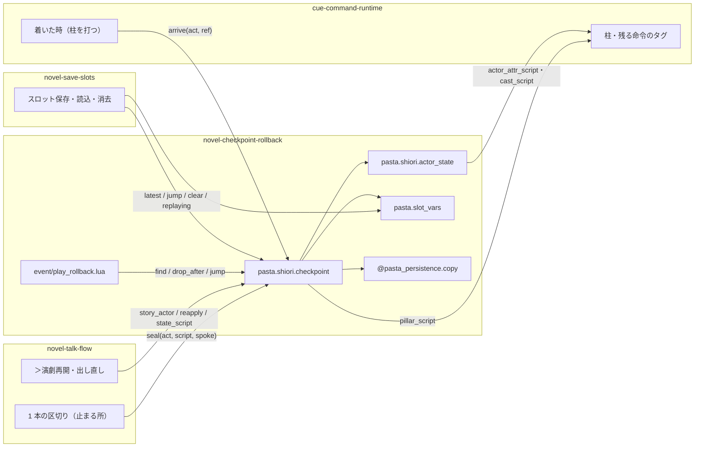
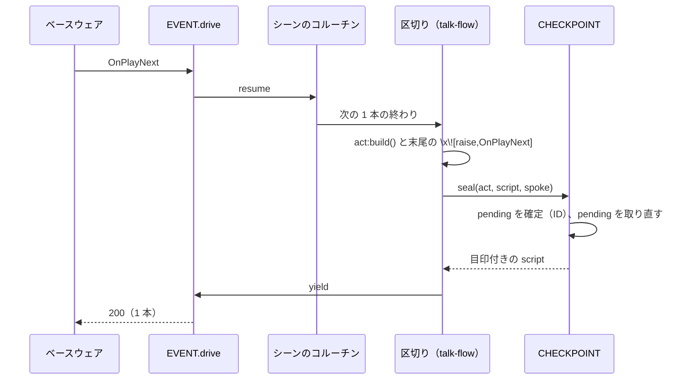
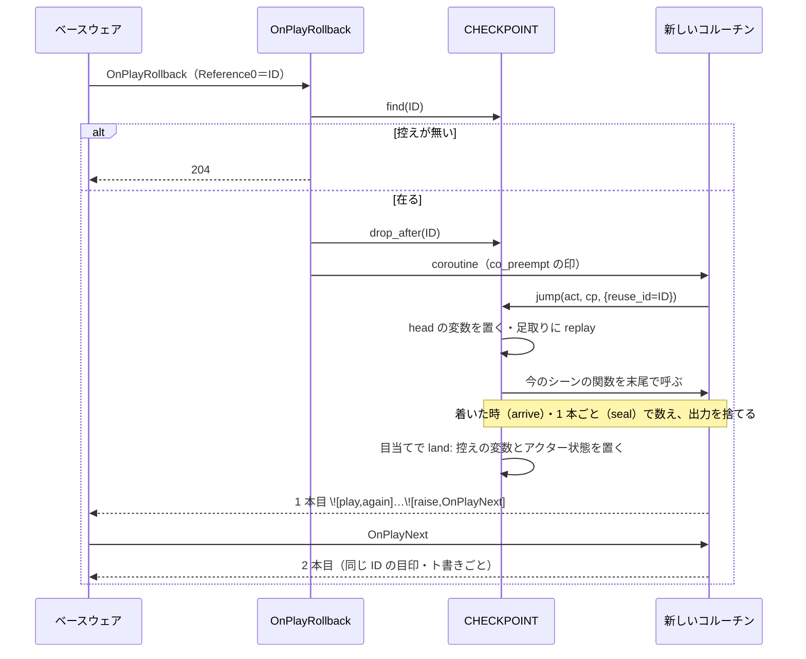

# 暫定の設計: novel-checkpoint-rollback（目印と控え・戻る仕組み・アクター状態の記録）

2026-11-19 の骨子（`novel-areka-contract/final-model-2026-11-19.md`。以下「骨子」）に対する、設計の下書きである。要件定義（`requirements.md`）はまだ無いので、1 章で暫定の要件を立て、以下の章はその番号を引く。名前は、どれも仮である。実装も、動かしての確かめも無い（机の上の設計）。

- 正とする物: 骨子、この spec の brief の「決定（2026-11-19 …最終形）」と、その前の申し送り。
- 食い違いは 12 章に、骨子へ差し戻しが要りそうな所は 13 章に並べた。
- 他の spec へ渡す物・頼む物は 10 章に、触る既存のファイルは 11 章に、まとめた。

---

## 1. 暫定の要件

| 番号 | 要件（EARS に近い形） | 出どころ |
| ---- | --------------------- | -------- |
| R1 | 再生モードが演劇のアクション行の 1 本を返すとき、pasta は、その 1 本の始まりの控え（再生位置・スロット変数・ローカル変数・アクター状態）を 1 つ持つ。設定とトークの 1 本では、控えを作らない | 骨子 2.5、brief「控えと、戻り方」「設定のモード」 |
| R2 | 演劇の 1 本に字が在るとき、pasta は、その 1 本の頭に目印 `\![play,mark,OnPlayRollback,ID]` を付ける。ID は英数字だけで、付けるたびに新しい | 骨子 2.5、brief「バックログと目印」 |
| R3 | 演劇のモードのシーンに着いたとき（イベント・選択肢・時間切れ・最後の行の `＞`）、pasta は、控えを着いた時の状態で取り直す。再生位置は、着いたシーンの頭（行の番号 0）になる。途中の行の `＞` で呼んだ先は、着いたと数えない | 骨子 1 章「今のシーン」・2.4・2.5 |
| R4 | 行の番号は、今のシーンに着いてからの 1 本の通し番号である。途中の `＞` で呼んだ先の 1 本も、同じ列で数える。待たない印で次の行とまとまった行は、1 本として 1 回だけ数える | 骨子 2.2、brief の末尾 |
| R5 | pasta は、控えを新しい方から決まった数（既定 100。`pasta.toml` で変えられる）だけ持ち、それより古い控えを捨てる | brief「控えの数」 |
| R6 | ベースウェアが `OnPlayRollback`（Reference0＝ID）を送ってきたとき、その ID の控えが在れば、pasta はそれより後の控えを捨て、その控えへ戻る。無ければ何もしない（204） | 骨子 2.5、brief「戻り方」「控えの数」 |
| R7 | 戻るとき、pasta は、今のシーンを頭から出力を捨てて早回しし、目当ての 1 本の手前で控えの変数とアクター状態を置く。それから 2 本返す。1 本目は出し直しの印付きの画面の状態だけ（字も `\x` も無く、末尾で続きのイベントを打つ）。2 本目は、選ばれた 1 本を、ト書きごとふつうに、同じ ID の目印で再生する | 骨子 2.5、brief「戻り方」 |
| R8 | 早回しの間、pasta は、控え・目印・ID を作らない。外へ効く組み込みの呼び出し（`スロット保存`・`スロット読込`・`スロット消去`・`演劇再開`）が早回しの間かを、述語で答える | 骨子 6 章、brief「要件定義へ送ること」 |
| R9 | 曲など、アクターに付かない物を、控えに入れない。戻るときは、1 本目で、戻り先の今のシーンの階層（ファイル属性 → グローバル → ローカル）の柱を打つ | 骨子 2.5、4 章 B・F |
| R10 | 戻るとき、今は付いていて戻り先では付いていない着せ替えの部品を、値 0 で打つ | brief「着せ替え」 |
| R11 | スロット変数（名前が「スロット」か `slot_` で始まるグローバル変数）だけを深く写して返す関数と、スロット変数を全部消してから写し入れる関数を持つ。`pasta.save` の表は取り替えない | brief「この spec が足す口（変数）」 |
| R12 | いちばん新しい控えを返す口を持つ。控えは、`save.toml` の中にそのまま書ける形である | brief「戻り方」、novel-save-slots「スロットに入るもの」 |
| R13 | 控えを全部捨てる口を持つ（`スロット読込`・`スロット消去`・前の物語が終わって新しく演劇を始める時に呼ばれる） | brief「控えを全部捨てる時」 |
| R14 | TOML に書けない値は、控えに入れず、そのキーだけ外して警告する（`toml-serialization` と同じ物差し） | brief「この spec が足す口（変数）」 |
| R15 | 舞台を閉じたとき、アクター状態の記録のうち、残る命令の値（位置・重ね順・大きさ・透明度）を空にする | brief「舞台を閉じたとき」 |
| R16 | 設定の場面から物語へ単に戻る（`＞演劇再開`）ために、待っている物語の行のアクター状態を返す口と、それを置き直す口を持つ。この口は、変数も再生位置も戻さない | 骨子 2.5・4 章 C、novel-talk-flow「設定のモード」 |
| R17 | 演劇のモードを一度も使わないゴーストでは、出力・保存・応答を 1 文字も変えない | brief「Constraints」 |

---

## 2. 概要

pasta の演劇は、アクション行ごとにさくらスクリプトを 1 本返して止まる（`novel-talk-flow`）。この spec は、その 1 本ごとに「始まりの状態」の控えを取り、目印の ID を付ける。ベースウェアがバックログの行の ID を送ってきたら、またはロードが呼ばれたら、控えへ戻る。

戻る形は 1 つだけである。**「控えの今のシーンへ着き直し、行の番号の数だけ 1 本を捨てて進め、そこで控えの状態を置いて止まる」**。バックログの巻き戻し（`OnPlayRollback`）も、ロード（`スロット読込`）も、同じ関数 `CHECKPOINT.jump` を通る。

```pasta
＆再生モード：演劇

＊放課後　＆曲：夕方のテーマ
    ％教室、さくら、うにゅう
    さくら：もう帰る？
    ＄＊スロット好感度＝＄＊スロット好感度＋１
    うにゅう：せやな。
    ！効果音（チャイム）
    さくら：＠笑顔　じゃあ、また明日。
```

| 1 本 | 中身 | 控え（その 1 本の始まり） | 目印 |
| ---- | ---- | ------------------------ | ---- |
| 1 | 柱（曲）・並び・「もう帰る？」 | 再生位置（放課後, 0）・好感度 3 | `…n41` |
| 2 | 好感度の加算・「せやな。」 | （放課後, 1）・好感度 3 | `…n42` |
| 3 | チャイム・笑顔・「じゃあ、また明日。」 | （放課後, 2）・好感度 4 | `…n43` |

遊ぶ人がバックログで「せやな。」を選ぶと、pasta は、放課後を頭から走らせ、1 本目を捨てる。そこで好感度 3 とアクター状態を置き、1 本目（画面の状態だけ）を返す。続きのイベントで、2 本目「せやな。」が ID `…n42` で出る（加算は、もう一度実行されて 4 になる。控えの 3 から数えるので、二重にはならない）。

---

## 3. アーキテクチャ

### 3.1 部品の置き場所



- 状態は、全部 `pasta.store`（`STORE`）に置く。`pasta.shiori.checkpoint` 自身は状態を持たない（`appearance.lua` と同じ流儀。`crates/pasta_lua/pasta_scripts/pasta/shiori/appearance.lua:1-8`）。`STORE.reset()` で消える（`store.lua:89-106`）。
- 文法・パーサー・変換器（`code_gen`）は触らない（R1〜R17 のどれも、生成コードの形を変えずに済む）。
- `sakura_builder.lua` は触らない。目印は、組み立ての済んだ 1 本の頭に、`seal` が文字列で付ける（3.3）。

### 3.2 「控え」を取る時の決め方

骨子の「その 1 本の始まりの状態」を、**シーンのコルーチンが止まる所（1 本を返して `coroutine.yield` する直前）の状態**と定める。理由:

- 戻るときは、早回しで同じ止まる所まで進めてから状態を置き、そこから再開する。控えを取る所と、早回しが止まる所が同じなら、`＄x＝…` の代入（生成コードではふつうの Lua の代入で、`act` のメソッドを通らない。`crates/pasta_lua/src/code_gen/element_gen.rs:63`）が、止まる所の前に在っても後に在っても、二重にも抜けにもならない。
- アクター状態（`STORE.appearance`・`STORE.actor_spots`）は、組み立て（`BUILDER.build`）の中で書き換わる（`shiori/act.lua:99-104`・`sakura_builder.lua:594-601`）。止まる所の直前は、1 本の組み立てが済んだ後なので、次の 1 本の始まりの画面と同じである。
- 止まっている間に設定の場面が走って画面（メニューの並び）を変えても、控えは汚れない（取るのは止まる前）。

したがって、`seal` は 1 回の呼び出しで 2 つのことをする: (1) 前の止まる所で取っておいた控え（`pending`）に ID を付けて確定し、今の 1 本に目印を付ける。(2) 今の状態を、次の 1 本の `pending` として取る。

### 3.3 控えはコルーチンごとの「足取り」に付く

`pending`・行の番号・今のシーンは、走っているコルーチンごとの表（足取り。`STORE.checkpoint.tracks[co]`。弱い参照）に置く。

- 台詞を出さないイベントのシーン（`chain-talk-interrupt` の決まりで、待っている続きに触れない。`shiori/event/init.lua:273-280`）が演劇のシーンに着いても、そのコルーチンの足取りが変わるだけで、待っている物語の足取りは汚れない。捨てられたコルーチンの足取りは、GC で消える（`STORE.co_preempt` と同じ作り。`store.lua:72-76`）。
- 控えの列（確定した控え）は、ゴーストに 1 つである（骨子「演劇の再生位置は、いつも 1 つ」）。

---

## 4. 状態とデータの形

### 4.1 STORE に足す物（`pasta/store.lua`）

```lua
--- アクターごとの残る命令の値（位置・重ね順・大きさ・透明度）。cue-command-runtime が ACTOR_STATE で書く
--- @type table<string, {pos?:string|number, z?:number, scale?:number, alpha?:number}>
STORE.actor_attrs = {}

--- 控えと足取り（novel-checkpoint-rollback）
STORE.checkpoint = {
    list = {},        -- 確定した控え。古い順。Checkpoint[]
    serial = 0,       -- 最後に配った番号（セッションの中で増える一方）
    session = "p" .. 36進(os.time()) .. "n",   -- ID の頭（ゴーストを読み直すと変わる）
    tracks = setmetatable({}, { __mode = "k" }),  -- コルーチン → Track
    warned = {},      -- 書けないキーの警告を出した道筋（1 回だけ出すため）
}
```

`STORE.reset()` に、この 2 つを作り直す行を足す。

### 4.2 Checkpoint（控え 1 つ。そのまま `save.toml` に書ける）

```lua
---@class Checkpoint
---@field v integer              -- 形の版（1）
---@field id string|nil          -- 目印の ID（メモリの中だけ。スロットに書くときは novel-save-slots が外してよい）
---@field pos Position
---@field head Snapshot           -- 着いた時の変数（早回しの種。同じ着き方の控えは同じ表を共有する）
---@field var table               -- ローカル変数（act.var の写し）
---@field slot table              -- スロット変数の写し
---@field actor ActorState

---@class Position
---@field scene string            -- グローバルシーンの登録名（例 "放課後_1"）
---@field local_scene string      -- ローカルシーンの登録名（グローバル自身は "__start__"）
---@field scene_written string    -- 書いた名前（既読・表記・古いセーブの手がかり）
---@field local_written string|nil
---@field args table              -- 着いた時の引数（`＞X（a、b）` の a・b）。無ければ空の配列
---@field beat integer            -- 着いてから確定した 1 本の数（= 早回しで捨てる数）

---@class Snapshot
---@field var table
---@field slot table

---@class ActorState
---@field spots table<string, integer>   -- STORE.actor_spots の写し（並び。番号の順が並びの順）
---@field actors table<string, {surface?:string, binds:table, order?:table}>  -- STORE.appearance.actors の写し
---@field attrs table<string, table>      -- STORE.actor_attrs の写し
```

`save.toml` に書くと、こうなる（`novel-save-slots` の `pasta_slots` の中）:

```toml
[pasta_slots.1]
v = 1
var = { "ｒ０" = "", "季節" = "秋" }
slot = { "スロット好感度" = 3 }

[pasta_slots.1.pos]
scene = "放課後_1"
local_scene = "__start__"
scene_written = "放課後"
args = []
beat = 1

[pasta_slots.1.head]
var = { "ｒ０" = "" }
slot = { "スロット好感度" = 3 }

[pasta_slots.1.actor.spots]
"さくら" = 0
"うにゅう" = 1
"教室" = 2

[pasta_slots.1.actor.actors."さくら"]
surface = "5"
binds = { "髪型" = { "ポニー" = 1 } }
```

- 写しは、全部 `@pasta_persistence.copy`（5.5）で取る。TOML に書けない値は、ここで外れる（R14）。だから、メモリの控えとスロットの控えは、同じ中身になる（バックログで戻ってもロードで戻っても、同じ結果）。
- `STORE.appearance.actors` は、キーがアクターの名前（文字列）、`surface` は文字列（`appearance.lua:308-310` の「ID は文字列のまま」）、`binds` の部品のキーは文字列（空文字列を含む）、値は 0・1・`false`（`appearance.lua:151-158`・`216-239`）なので、そのまま書ける。`STORE.appearance.spots`（キーがスポットの整数。0 も在る）は書けないので、控えに入れない（戻るときは「分からない」にして、全部書き直す。7.2）。
- `head` は、着いた時に 1 回だけ写し、その着き方の控え全部で同じ表を指す（メモリは着き方 1 回ぶん）。

### 4.3 Track（足取り。メモリの中だけ）

```lua
---@class Track
---@field pos Position            -- 今のシーンと、確定した 1 本の数
---@field head Snapshot
---@field pending Checkpoint|nil  -- 次に確定する控え（前の止まる所か、着いた時に取った物）
---@field last_id string|nil      -- 最後に確定した控えの ID（待っている行の ID）
---@field story ActorState|nil    -- 最後の止まる所のアクター状態（待っている行の画面。R16）
---@field replay Replay|nil       -- 早回しの間だけ在る

---@class Replay
---@field target integer          -- 捨てる 1 本の数（= cp.pos.beat）
---@field count integer
---@field cp Checkpoint
---@field reuse_id string|nil     -- 2 本目に付ける ID（バックログの巻き戻しのとき）
---@field load boolean            -- ロードか（1 本目に「バックログを空にする」合図を付ける余地。12 章 17）
```

### 4.4 ID の形

`STORE.checkpoint.session .. serial`（例 `pm3k9q2n42`）。英数字だけ（areka の頼み）。番号は確定するたびに 1 増やし、戻っても巻き戻さない（同じ行を 2 度通れば別の ID。ロードの後に古い ID と重ならない）。頭のセッションの印は、ゴーストを読み直した後に、ベースウェアのバックログに残る前のセッションの ID と重ねないためである（12 章 9）。

---

## 5. 部品と口

### 5.1 `pasta.shiori.checkpoint`（新しいファイル。R1〜R10・R12・R13・R16）

```lua
local CHECKPOINT = {}

--- 演劇のモードのシーンに着いた（R3）。着いた所の持ち主（cue-command-runtime）が、柱を打った後に呼ぶ。
--- 足取りを作り直し、着いた時の状態で pending と head を取る。
--- 早回しの間は控えを作らず、目当てが 0 なら状態を置いて 1 本目を返す（呼んだ側は、それを yield する）。
---@param act ShioriAct
---@param ref {scene:string, local_scene:string, scene_written:string, local_written:string|nil, args:table}
---@return string|nil again  非 nil なら、呼んだ側が coroutine.yield(again) してから続ける
function CHECKPOINT.arrive(act, ref) end

--- 演劇の 1 本を返す直前（R1・R2・R4・R7・R8）。novel-talk-flow の区切りの関数が、組み立ての後に呼ぶ。
---@param act ShioriAct
---@param script string   組み立て済みの 1 本（末尾の \x\![raise,OnPlayNext] を含む）
---@param spoke boolean   字が在るか（BUILDER.speaks の値）
---@return string|nil out  非 nil: これを yield する（ふつうは目印付きの script、早回しの目当てでは 1 本目）。
---                        nil: 早回し中なので yield せずに続ける（script は捨てる）
function CHECKPOINT.seal(act, script, spoke) end

--- 控えを探す（R6）。無い・古くて捨てた ID なら nil
---@param id string
---@return Checkpoint|nil
function CHECKPOINT.find(id) end

--- id の控えより後と、id の控えを列から外す（2 本目が同じ ID で入れ直す）
function CHECKPOINT.drop_after(id) end

--- 控えへ戻る（R7）。走っているコルーチンの中で、最後の行の呼び出しとして使う（return CHECKPOINT.jump(...)）。
--- 変数を head で置き、今のシーンへ着き直し（着いた所の持ち主に「次は着いたと数える」と告げる）、
--- シーンの関数を末尾で呼ぶ。早回しは arrive・seal の中で進む。
---@param act ShioriAct
---@param cp Checkpoint
---@param opts {reuse_id?:string, load?:boolean}
function CHECKPOINT.jump(act, cp, opts) end

--- いちばん新しい控え（R12）。走っているコルーチンに演劇の足取りが在れば、その pending（今の 1 本の始まり）。
--- 無ければ（設定の場面から呼んだとき）、列のいちばん新しい控え（待っている行の始まり）。どちらも無ければ nil
---@return Checkpoint|nil
function CHECKPOINT.latest() end

--- 控えを全部捨てる（R13）。足取りの pending は残す（今の 1 本は、次の控えになる）
function CHECKPOINT.clear() end

--- 早回しの間か（R8）。走っているコルーチンの足取りに replay が在れば true
---@return boolean
function CHECKPOINT.replaying() end

--- 待っている行の ID（novel-talk-flow が \![raise,OnPlayNext,ID] に使う）。走っているコルーチンか、STORE.co_scene の足取りの last_id
---@return string|nil
function CHECKPOINT.current_id() end

--- 再生位置（既読に使う）。走っているコルーチンか、STORE.co_scene の足取りの pos の写し
---@return Position|nil
function CHECKPOINT.position() end

--- 待っている物語の行の画面（STORE.co_scene の足取りの story）。R16
---@return ActorState|nil
function CHECKPOINT.story_actor() end

--- 待っている物語の行の画面を STORE へ置き直す（設定の場面で変わった並び・表情を物語の物へ戻す）。
--- 変数と再生位置には触らない。置き直したら true
---@return boolean
function CHECKPOINT.reapply_story_actor() end

--- 画面の状態を全部書いたさくらスクリプト（出し直しの印も続きのイベントも付けない中身だけ）。
--- 柱（cue-command-runtime）＋並びとアクターごとの状態（ACTOR_STATE.script）。1 本目と ＞演劇再開 が使う
---@param ref Position
---@param before table|nil 置く前の STORE.appearance.actors（着せ替えを 0 で打つ差分。R10）
---@return string
function CHECKPOINT.state_script(ref, before) end
```

`seal` の中身（擬似コード）:

```lua
function CHECKPOINT.seal(act, script, spoke)
    local tr = track_of_running()          -- 無ければ演劇の外なので script をそのまま返す（R17）
    if not tr then return script end
    local rp = tr.replay
    if rp then                             -- 早回し（R8）: 控え・ID を作らない
        rp.count = rp.count + 1
        tr.pos.beat = tr.pos.beat + 1
        if rp.count < rp.target then return nil end
        return land(act, tr)                -- 目当てに着いた: 状態を置いて 1 本目を返す
    end
    local cp = tr.pending
    cp.id = next_id()                       -- 字が無くても配る（待つ行の ID。12 章 1）
    push(cp)                                -- 列に入れ、上限を超えた古い物を捨てる（R5）
    tr.last_id = cp.id
    tr.pos.beat = tr.pos.beat + 1
    tr.story = snapshot_actor()
    tr.pending = take(act, tr)              -- 次の 1 本の始まり（3.2）
    if spoke then
        return "\\![play,mark,OnPlayRollback," .. cp.id .. "]" .. script
    end
    return script
end
```

`land`（目当てに着いた時）:

```lua
local function land(act, tr)
    local rp = tr.replay
    tr.replay = nil
    SLOT_VARS.replace(rp.cp.slot)
    replace_in_place(act.var, COPY(rp.cp.var))       -- 生成コードの local var が同じ表を握るので、表は取り替えない
    local before = ACTOR_STATE.apply(rp.cp.actor)     -- 置く前の着せ替えを返す
    tr.pending = rp.cp                                -- 2 本目の控えは、戻り先の控えそのもの
    tr.reuse_id = rp.reuse_id                         -- 次の seal は新しい ID を配らず、これを使う
    tr.story = ACTOR_STATE.snapshot()
    return "\\![play,again]" .. CHECKPOINT.state_script(tr.pos, before) .. PLAY.next_tail()
end
```

（`seal` は、`tr.reuse_id` が在れば `next_id()` の代わりにそれを使い、消す。）

`jump` の中身:

```lua
function CHECKPOINT.jump(act, cp, opts)
    if CHECKPOINT.replaying() then return nil end     -- 早回しの中のロードは実行しない（R8）
    local fn = SCENE.get(cp.pos.scene, cp.pos.local_scene)
    if type(fn) ~= "function" then
        return FAILURE.report(act, { label = FAILURE.LABEL.SCENE_NOT_FOUND,
            subject = "＊" .. cp.pos.scene_written, warning = "checkpoint: scene not found: ..." })
    end
    act.token = {}                                     -- 呼んだ場面（設定）の書きかけは捨てる
    SLOT_VARS.replace(cp.head.slot)                    -- 早回しの種（12 章 3）
    replace_in_place(act.var, COPY(cp.head.var))
    local tr = new_track(cp.pos, cp.head)
    tr.replay = { target = cp.pos.beat, count = 0, cp = cp,
                  reuse_id = opts.reuse_id, load = opts.load }
    ARRIVAL.next_is_arrival(act)                       -- 着いた所の持ち主へ: 次の init_scene は着いたと数える（10 章）
    return fn(act, table.unpack(cp.pos.args))          -- 末尾で呼ぶ
end
```

- 目当てが 0（シーンの頭）なら、`arrive` が `land` を呼んで 1 本目を返す。
- シーンが目当ての前に終わったら（同名シーンの引き直しで行の数が違ったとき）、`jump` を包む側（5.4 のコルーチン、または `novel-save-slots` の `スロット読込`）が `CHECKPOINT.finish_short(act)` を呼ぶ。足取りに replay が残っていれば、そこで状態を置き、1 本目を `act.token` に `raw_script` として入れ、警告を 1 行出す（8 章）。
- 早回しの中で、目当ての前に別のシーンに着いたら（同じ理由でずれたとき）、`arrive` は、そこで `land` する（新しいシーンの頭で止まり、物語はそこから続く）。

### 5.2 `pasta.shiori.actor_state`（新しいファイル。R1・R10・R15）

```lua
local ACTOR_STATE = {}

--- 今のアクター状態の写し（STORE.actor_spots・STORE.appearance.actors・STORE.actor_attrs を @pasta_persistence.copy で）
---@return ActorState
function ACTOR_STATE.snapshot() end

--- 写しを STORE へ置く。STORE.actor_spots と STORE.actor_attrs は表を取り替えずに中身を入れ替える
--- （sakura_builder.lua:50-53 の clear_spots と同じ。組み立てが同じ表を握る）。
--- STORE.appearance は表を残し、actors を写しへ替え、spots・owners・last_spots を空にし、detached を外す
--- （表示中の状態は「分からない」になり、次の組み立てで表情を書き直す）
---@return table before 置く前の STORE.appearance.actors（R10 の差分に使う）
function ACTOR_STATE.apply(state) end

--- アクターごとの残る命令の値（cue-command-runtime が使う）
---@param name string  アクターの名前
---@param key "pos"|"z"|"scale"|"alpha"
function ACTOR_STATE.set(name, key, value) end
function ACTOR_STATE.get(name, key) end

--- 舞台を閉じた（R15）。STORE.actor_attrs を空にし、STORE.appearance の表示中の状態を「分からない」にする
function ACTOR_STATE.on_stage_closed() end

--- 並びとアクターごとの状態を全部書く（1 本目と ＞演劇再開 の中身）。
--- 並びの順（スポットの番号の順）に、\p[スポット] と APPEARANCE.restore(STORE.appearance, actor, spot, {}) の返す
--- サーフェスと着せ替え、before との差の着せ替えの 0、CUE.actor_attr_script の位置などを並べる。
--- 頭に CUE.cast_script(並び) を置く
---@param before table|nil
---@return string
function ACTOR_STATE.script(before) end
```

- 表情と着せ替えのタグは、今の `APPEARANCE.restore`（`appearance.lua:551-566`）を使い回す。表示中の状態を空にしてから呼べば、覚えているサーフェスと着せ替えを全部返す（`restore_surface` は `state.spots[spot]` が無ければ必ず `\s[…]` を返す。`appearance.lua:386-405`）。新しいタグの読み書きは書かない。
- 「並び」は、新しい表を作らず、今の `STORE.actor_spots`（名前 → スポット番号。アクター指定行が `clear_spot`・`set_spot` で書く。`scope_gen.rs:282-292`・`sakura_builder.lua:594-601`）を、番号の順に読んだ物とする。

### 5.3 `pasta.slot_vars`（新しいファイル。R11）

```lua
local SLOT_VARS = {}

--- 名前がスロット変数か（"スロット" か "slot_" で始まる文字列）
---@param name any
---@return boolean
function SLOT_VARS.is_slot(name) end

--- スロット変数だけを深く写して返す（@pasta_persistence.copy。書けない値は外れる）
---@return table
function SLOT_VARS.snapshot() end

--- スロット変数を全部消し、snap を深く写して入れる。pasta.save の表は取り替えない（brief の事実: 表の同一性）。
--- 空の表を渡すと「はじめから」になる
---@param snap table
function SLOT_VARS.replace(snap) end
```

`require("pasta.save")` は表そのものを返す（`pasta/save.lua:11-13`）ので、関数は別のモジュールに置く。`pasta_slots`（`novel-save-slots` の予約の表）は、名前が「スロット」・`slot_` で始まらないので、数えない。

### 5.4 `pasta.shiori.event.play_rollback`（新しいファイル。R6）

```lua
local REG = require("pasta.shiori.event.register")
local STORE = require("pasta.store")

REG.OnPlayRollback = REG.OnPlayRollback or function(act)
    if act.req.security_level == "external" then return nil end   -- 12 章 11
    local id = act.req.reference[0]
    local CHECKPOINT = require("pasta.shiori.checkpoint")
    local cp = type(id) == "string" and CHECKPOINT.find(id)
    if not cp then return nil end                                  -- 戻れない行は何もしない（204）
    CHECKPOINT.drop_after(id)
    local co = coroutine.create(function(a)
        CHECKPOINT.jump(a, cp, { reuse_id = id })
        CHECKPOINT.finish_short(a)
        return a:build()
    end)
    STORE.co_preempt[co] = true    -- 待っている物語の続きを、はっきり捨てる（scene_play.lua:110-114 と同じ）
    return co
end
```

- `EVENT.fire` が、返したコルーチンを `EVENT.drive` で動かす（`shiori/event/init.lua:323-329`）。`co_preempt` の印で、待っていた物語の続きは捨てられ、このコルーチンが新しい続きになる（`init.lua:129-138`・`273-280`）。
- イベントの名前 `OnPlayRollback` は pasta の中の名前で、目印の引数で渡すだけである（骨子 2.5）。`init.lua` の読み込みの並び（`init.lua:85-92`）の末尾に 1 行足す。

### 5.5 `@pasta_persistence.copy`（Rust に 1 つ足す。R14）

```text
persistence.copy(table) -> copy: table, dropped: string[]
```

- 保存と同じ変換（`lua_table_to_toml_document`。`crates/pasta_lua/src/runtime/persistence.rs:342-360`）で TOML の表にし、読み込みと同じ変換（`toml_to_lua`。`persistence.rs:593-622`）で Lua の表に戻す。書けないキー（関数・混ざった表・穴のある配列・32 段より深い表・循環。`persistence.rs:404-509`）は外れ、その道筋を `dropped` に返す。ファイルには触らない。ログも出さない（警告は `CHECKPOINT` が道筋ごとに 1 回だけ出す）。
- 物差しを Lua に写さず、保存の変換そのものを通すので、控えとセーブがずれない。
- `register`（`persistence.rs:113-171`）に `copy` を 1 つ足すだけで、保存の門（SaveGate）は見ない。

---

## 6. 流れ

### 6.1 ふつうの 1 本（演劇）



### 6.2 シーンに着いた時

1. 着いた所の持ち主（`cue-command-runtime`）が、イベントのシーンの頭か、最後の行の `＞` の先で、着いたと判じる（途中の行の `＞` は数えない）。
2. 柱を打ち、再生モードを決める（`novel-talk-flow` と `cue-command-runtime`）。
3. モードが演劇なら `CHECKPOINT.arrive(act, ref)`。足取りを作り直し（行の番号 0）、`head` と `pending` を、着いた時の状態で取る。前の止まる所から着くまでに出したト書き（前のシーンの最後のト書き）は、同じ 1 本に入るが、控えは着いたシーンの頭になる（骨子 2.5）。
4. `arrive` が文字列を返したら（早回しの目当てが 0）、呼んだ側がそれを `yield` してから続ける。

### 6.3 バックログの巻き戻し



### 6.4 ロード（`novel-save-slots` の `スロット読込`）

1. `スロット読込` は、`CHECKPOINT.replaying()` なら何もしない（R8）。
2. スロットの控えを読み、`CHECKPOINT.clear()`（R13）。
3. 控えに `pos` が在れば `return CHECKPOINT.jump(act, cp, { load = true })` を、最後の行の呼び出しとして返す。後は 6.3 と同じで、`reuse_id` が無いので、2 本目には新しい ID が付く。
4. 設定の場面（設定のモード）から呼ぶと、設定の場面のコルーチンが、そのまま物語のコルーチンになる。`novel-talk-flow` の「設定の場面から `＞シーン` で別の場面へ行く」と同じ形である（10 章の頼み 5）。

### 6.5 設定の場面から単に戻る（`＞演劇再開`。`novel-talk-flow` が持つ）

1. `CHECKPOINT.reapply_story_actor()`: 待っている行の画面を `STORE` へ置き直す（変数・再生位置・控えには触らない。R16）。
2. `novel-talk-flow` が、出し直しの印付きの 1 本に、`CHECKPOINT.state_script(CHECKPOINT.position())` と、待っていた行の字を入れて返す。

### 6.6 セーブ（`novel-save-slots` の `スロット保存`）

`CHECKPOINT.latest()` を写して書く（`novel-save-slots`）。

| 呼んだ所 | `latest()` の値 | ロードすると |
| -------- | --------------- | ------------ |
| 物語のシーンの頭（`＞スロット保存（「オート」）`） | 着いた時の pending（シーン, 0） | シーンの頭から続く |
| 物語の 2 行の間 | 今の 1 本の始まり | その 1 本から続く |
| 設定の場面（物語は行 k で待っている） | 列のいちばん新しい控え（行 k の始まり） | 行 k が、ト書きごともう一度出る |
| 演劇を一度も使っていない | nil | スロット変数だけ（`novel-save-slots`） |

---

## 7. 出すさくらスクリプト

### 7.1 目印

`\![play,mark,OnPlayRollback,pm3k9q2n42]` を、字の在る演劇の 1 本の頭に 1 つ。例（areka へ）:

```
\![play,mark,OnPlayRollback,pm3k9q2n42]\p[1]\s[10]せやな。\x\![raise,OnPlayNext]
```

SSP 2.9.34 は、知らない `\![play,…]` を読み飛ばす（`novel-areka-contract` の brief「原則」）。だから、フェーズ 1（今の SSP）でも、同じ形を出してよい。

### 7.2 戻る時の 1 本目

```
\![play,again]（柱: CUE.pillar_script(pos, {full=true})）（並び: CUE.cast_script）\p[0]\s[5]\![bind,髪型,ポニー,1]\p[1]\s[10]\p[2]\s[100]（位置など: CUE.actor_attr_script）\![raise,OnPlayNext]
```

- 字・`\x`・目印は無い。areka は、残る命令の値を全部既定へ戻してから当てるので、pasta は差分でなく全部を書く（骨子 4 章の「承認が要らない整理」）。
- 着せ替えは、置く前に付いていて、戻り先で付いていない部品を `\![bind,カテゴリ,部品,0]` で打つ（R10）。
- 末尾の続きのイベントの形（`\![raise,OnPlayNext]` か、ID を運ぶ `\![raise,OnPlayNext,ID]` か）は、`novel-talk-flow` の `PLAY.next_tail()` に任せる。

---

## 8. 誤りの扱い

| 起きること | 扱い |
| ---------- | ---- |
| `OnPlayRollback` の ID の控えが無い（古い・別のセッション・形が違う） | 何もしない（204）。ログも出さない（遊ぶ人が古い行を選ぶのは、ふつうのこと） |
| 控えのシーンが無い（台本を直した後の古いセーブ） | `FAILURE.report`（シーンが無い）の表記と警告。状態は変えない。古いセーブの扱いの細目は `novel-save-slots` |
| 早回しが目当ての前にシーンの終わりに着いた・別のシーンへ着いた | そこで状態を置き、1 本目を出す。警告を 1 行（「戻り先の行に着かなかった。同名のシーンの引き直しで行の数が変わった見込み」）。物語は、着いた所から続く |
| 早回しの中のエラー | ふつうの止まるエラー（`EVENT.drive` の失敗の道。`init.lua:255-263`）。控えの列は、`drop_after` の後のまま |
| 早回しの中の `get_property` | ふつうに `\![get,property,…]` を返して待ち、答えが来たら早回しを続ける（`CALLBACK` の今の道。`shiori/act.lua:333-384`）。値が前と違えば、ずれうる（12 章 15） |
| 控えに書けない値 | そのキーだけ外す。道筋ごとに 1 回だけ警告（R14） |
| GET が 5 秒を超え、DLL が 204 を返した（`crates/pasta_shiori/src/actor/marshaling.rs:71`） | 控えは確定済みなので、遊ぶ人に見えた行より 1 本先が「いちばん新しい控え」になりうる。直さない（12 章 12） |

---

## 9. テスト

| 種類 | ファイル | 確かめること |
| ---- | -------- | ------------ |
| Lua の単体 | `crates/pasta_lua/tests/lua_specs/checkpoint_test.lua`（新しい。`init.lua` の `specs` に 1 行） | seal の ID・目印・字の無い 1 本・上限・drop_after・clear・latest の 3 つの場合・足取りがコルーチンごと・台詞を出さない割り込みが物語の pending を汚さない・replaying |
| Lua の単体 | `tests/lua_specs/slot_vars_test.lua`（新しい） | 2 つの頭・`slots` を巻き込まない・表の同一性・空で「はじめから」 |
| Lua の単体 | `tests/lua_specs/actor_state_test.lua`（新しい） | apply の表の同一性・表示中の状態が空になる・script が全部書く・着せ替えの 0・on_stage_closed |
| Rust | `crates/pasta_lua/src/runtime/persistence_tests.rs` | `copy` が保存と同じキーを外す・深い写し（元を変えても写しが変わらない）・空の配列の印 |
| つなぎ（e2e） | `crates/pasta_lua/tests/play_rollback_e2e_test.rs`（新しい） | 実の `SHIORI.request` で、演劇のシーンを 3 本進め、2 本目の ID で `OnPlayRollback` → 1 本目の形・2 本目の字と ID・変数が二重にならない・スロット変数でないグローバル変数はもう一度足される・シーンの頭で戻る（早回し 0）・途中の `＞` で呼んだ先の行で戻る・目当ての前にシーンが終わる |
| 不変 | 今の全テスト | 演劇を使わない辞書で、出力が 1 文字も変わらない（R17） |

- Lua のモック（`crates/pasta_lua/scriptlibs/lua_test/mocks.lua:16-21`）の `make_persistence` に `copy` を足す（Lua の深い写しで代える）。
- e2e は、`novel-talk-flow` の区切りと、`cue-command-runtime` の着いた時の判じ方が入ってからでないと書けない（10 章）。

---

## 10. 他の spec との境界

### 10.1 novel-talk-flow

**この spec が渡す物**

1. `CHECKPOINT.seal(act, script, spoke) -> string|nil`: 演劇の 1 本を返す直前に呼ぶ。戻り値を `coroutine.yield` する。`nil` なら yield せずに続ける（早回し）。設定のモードの 1 本では呼ばない。
2. `CHECKPOINT.current_id() -> string|nil`: 待っている行の ID（字の無い 1 本にも在る）。`\![raise,OnPlayNext,ID]` で遅れた続きを捨てるのに使える。
3. `CHECKPOINT.position() -> Position|nil`: 既読の鍵（`scene_written`・`local_written`・`beat`）。
4. `CHECKPOINT.clear()`: トークから演劇のモードに入った時に呼ぶ（「前の物語の控えを全部捨てる時」の候補）。
5. `CHECKPOINT.story_actor()`・`CHECKPOINT.reapply_story_actor()`・`CHECKPOINT.state_script(pos, nil)`: `＞演劇再開` と、毎秒の出し直しの画面。
6. `CHECKPOINT.replaying() -> boolean`: `＞演劇再開` の組み込みの呼び出しが、早回しの間は何もしないため。

**この spec が頼む物**

1. 1 本の区切りの関数の中で、組み立ての後・yield の前に `seal` を呼ぶこと。止まる所は、1 本ぶんの出力を出した直後（ト書きなど次の 1 本の物を `act.token` に持ち越すなら、持ち越したまま止まる）。待たない印で次の行とまとめた行は、まとめた 1 本につき 1 回だけ `seal` を呼ぶ（R4）。
2. 演劇か設定かを決める関数（例 `PLAY.mode(ref) -> "トーク"|"演劇"|"設定"`）。`arrive` を呼ぶかの判じ（10.2）に使う。
3. `PLAY.next_tail() -> string`: 1 本目の末尾の続きのイベント（`\![raise,OnPlayNext]` か `\![raise,OnPlayNext,ID]`）。
4. 早回しの間は、時報・ランダムトーク・高速再生の入切・既読の記録を動かさないこと（既読は早回しの捨てる 1 本を記録しない）。
5. 続きの決まり（`EVENT.drive`。`shiori/event/init.lua:273-280`）の変更で、「この再開の中で演劇のモードのシーンに着いたコルーチンは、物語の続き（`STORE.co_scene`）になる」こと。設定の場面からの `スロット読込`（6.4）も、`＞シーン` で物語へ飛ぶのと同じに扱われる。今の決まりのままでは、1 本目に字が無いので「台詞の無い割り込み」と見られ、待っていた古い続きが残る（`init.lua:279`）。

### 10.2 cue-command-runtime

**この spec が渡す物**

1. `ACTOR_STATE.set(name, key, value)`・`ACTOR_STATE.get(name, key)`（`key` は `"pos"|"z"|"scale"|"alpha"`）: アクターに付く残る命令の今の値の置き場所（`STORE.actor_attrs`）。「同じ値なら打たない」の今の値も、ここから読む。アクターに付かない残る命令（曲・環境の音・舞台）は、`cue-command-runtime` が自分の所に持つ（控えに入れない）。
2. `ACTOR_STATE.on_stage_closed()`: 舞台を閉じるト書き・柱を出した時に呼ぶ（R15）。
3. `CHECKPOINT.replaying()`: 早回しの間に、柱やト書きの「今の値」の記憶を進めてよいかの判じ（下の頼み 4）。

**この spec が頼む物**

1. 着いた時の判じ（イベントのシーンの頭・最後の行の `＞` の先。途中の行の `＞` の先は数えない）と、その時の呼び出し `CHECKPOINT.arrive(act, ref)`（演劇のモードのときだけ。柱を打った後）。`ref` は `{scene=グローバルの登録名, local_scene=ローカルの登録名（"__start__" を含む）, scene_written, local_written, args}`。
   - 今の pasta では、`act:call` がシーンの関数を引いた時点で登録名が落ちる（`act.lua:371-373` は `result.func` だけを返す）。`init_scene` は書いた名前しか受けない（`act.lua:221-233`・`scope_gen.rs:273-277`）。案: シーンの表のメタテーブル（`scene.lua:30-32`。今は `__index` だけ）に `__newindex` を足して、関数 → 登録名の逆引き（`STORE.scene_ids[fn] = {global, local}`）を登録の時に作る。`act:call`（`act.lua:742-744`）と `SCENE.wrap`（`scene.lua:221-226`）で、呼ぶ関数と引数が分かる。
2. `ARRIVAL.next_is_arrival(act)`: 「次のシーンの頭は、途中の行の呼び出しの中でも、着いたと数える」と告げる口（`CHECKPOINT.jump` が使う）。
3. `CUE.pillar_script(pos, {full=true}) -> string`: そのシーンの階層（ファイル属性 → グローバル → ローカル）の柱を、「同じ値なら打たない」を見ずに全部書き、今の値の記憶をそれに揃える。1 本目と `＞演劇再開` が使う。
4. 1 本目の前に、アクターに付かない残る命令の記憶を「無い」に戻すこと（areka は出し直しで残る命令を全部既定へ戻すため。そうしないと、早回しの間のト書きで記憶だけ進んだ曲を、1 本目で打たない）。
5. `CUE.cast_script(names) -> string`・`CUE.actor_attr_script(name, attrs) -> string`: 並びと、位置・重ね順・大きさ・透明度を、ベースウェアに合わせたタグにする。

### 10.3 novel-save-slots

**この spec が渡す物**

1. `SLOT_VARS.is_slot(name)`・`SLOT_VARS.snapshot()`・`SLOT_VARS.replace(snap)`（`pasta/slot_vars.lua`）。
2. `CHECKPOINT.latest() -> Checkpoint|nil`。形は 4.2（`v`・`pos`・`head`・`var`・`slot`・`actor`）。そのまま `pasta_slots.<名前>` に入れて書ける。`id` は書かなくてよい。
3. `CHECKPOINT.jump(act, cp, {load=true})`・`CHECKPOINT.finish_short(act)`・`CHECKPOINT.clear()`・`CHECKPOINT.replaying()`。
4. `@pasta_persistence.copy(table)`（スロットを読み出す時の深い写しにも使える）。

**この spec が頼む物**

1. `スロット保存`・`スロット読込`・`スロット消去` は、`CHECKPOINT.replaying()` の間は何もしない。
2. `スロット読込` は、`CHECKPOINT.clear()` の後に `return CHECKPOINT.jump(act, cp, {load=true})` を最後の行の呼び出しとして返し、戻ってきたら `CHECKPOINT.finish_short(act)` を呼ぶ。控えに `pos` が無い（演劇の外で保存した）ときは、`SLOT_VARS.replace(cp.slot)` だけ。
3. `スロット消去` は `SLOT_VARS.replace({})` と `CHECKPOINT.clear()`。
4. 4.2 の形に `head` が在ること（骨子には無い。12 章 3）を、スロットの形として受けること。

### 10.4 novel-areka-contract

**この spec が渡す物**

1. 目印の形 `\![play,mark,イベント名,ID]` の使い方（イベント名は `OnPlayRollback`、ID は英数字だけで、セッションの頭が付く。例 `pm3k9q2n42`）。
2. 1 本目の形（7.2）: `\![play,again]` の後に、柱・並び・アクターごとの状態を全部書き、字も `\x` も目印も無く、末尾で続きのイベント。

**この spec が頼む物**

1. 目印の在る行が選ばれたら、`\![play,mark,…]` のイベント名を GET で送り、Reference0 に ID を載せる。目印の無い行・字の無い 1 本は、選べない。
2. ロードの 1 本目に「バックログを空にする」合図を足すか（足すなら、その名前。この spec は、`replay.load` のときに 1 本目へ入れる場所を用意する）。足さない場合も、pasta は ID をセッションの中で重ねない。
3. 戻れない行を選ばれた時に、バックログだけが欠けることの扱い（捨てる時を「同じ目印の行を貯め直す時」へ移すか）。

### 10.5 shell-element-click

渡す物・頼む物は無い。当たり判定のクリックで選ばれたイベントのシーンは、`cue-command-runtime` の「着いた時」に入り、ほかのイベントと同じに控えを取り直す。

### 10.6 hello-novel-sample

**渡す物**: 見本に入れられる動き（バックログで戻る・シーンの頭の自動セーブ・設定の場面からのセーブとロード）。**頼む物**: 見本の物語に、(a) シーンの頭の `＞スロット保存（「オート」）`、(b) スロット変数とふつうのグローバル変数の両方、(c) 戻ると引き直される同名シーンを使わない一本道、を入れて、9 章の e2e の題材に使えるようにすること。

### 10.7 manual-novel-guide

**頼む物**: 作者向けの章に、次の 4 行を入れること。(1) 戻るのは、変数（スロット変数とローカル変数）・再生位置・アクター状態だけ。(2) 同名のシーンを `＞` で引き直す所は、行の数が違うと、戻った時に着く行がずれる。(3) スロット変数でないグローバル変数への加算は、戻るともう一度足される。(4) `＞スロット読込` は、場面の最後の行に書く。内部設計の部の取り決めの章（`novel-areka-contract`）には、7 章の 2 つの形が載る。

---

## 11. 共有するファイル

| ファイル | 変えること |
| -------- | ---------- |
| `crates/pasta_lua/pasta_scripts/pasta/store.lua` | `STORE.actor_attrs` と `STORE.checkpoint` を足し、`STORE.reset()` で作り直す（4.1） |
| `crates/pasta_lua/pasta_scripts/pasta/shiori/event/init.lua` | 読み込みの並び（85〜92 行）の末尾に `require("pasta.shiori.event.play_rollback")` を 1 行 |
| `crates/pasta_lua/src/runtime/persistence.rs` | `register`（113〜171 行）に `copy` を 1 つ足す（5.5） |
| `crates/pasta_lua/src/runtime/persistence_tests.rs` | `copy` のテスト |
| `crates/pasta_lua/scriptlibs/lua_test/mocks.lua` | `make_persistence` に `copy` を足す |
| `crates/pasta_lua/tests/lua_specs/init.lua` | 新しいテスト 3 本を `specs` に足す |
| `book/src/lua/shiori-events.md` | 既定のイベントの表に `OnPlayRollback` を 1 行 |
| `book/src/lua/modules/pasta-persistence.md` | `copy` の節（スキル `pasta-lua-coding/references/pasta-persistence.md` は再生成） |
| `book/src/internals/`（新しい頁 `checkpoint.md` と `SUMMARY.md` の 1 行） | 控えと足取り・戻り方の内部設計 |
| `book/src/reference/pasta-toml.md`（と、キーの数を数えるテスト・`book/AUTHORING.md`） | 控えの数のキー（12 章 10） |

新しいファイル: `pasta_scripts/pasta/shiori/checkpoint.lua`・`pasta_scripts/pasta/shiori/actor_state.lua`・`pasta_scripts/pasta/slot_vars.lua`・`pasta_scripts/pasta/shiori/event/play_rollback.lua`・テスト 4 本（9 章）。

触らないファイル（brief の触る物の一覧から外した物）: `sakura_builder.lua`（目印は組み立ての外で付ける）、`shiori/entry.lua`・`shiori/event/callback.lua`（さくらスクリプトを控えないので、応答の出口を寄せる要が無い）、`virtual_dispatcher.lua`（`co_scene` の扱いは `co_preempt` の今の道で足りる。時報を止めるのは `novel-talk-flow`）、`appearance.lua`（`restore` を呼ぶだけ）、文法・`code_gen`・`pasta_check`・LSP。

---

## 12. 骨子・brief との食い違いと、決まっていない所

1. **字の無い 1 本の目印**: 骨子 2.5 は「演劇のどの 1 本にも目印が付く」、この brief は「字の無い、待たない 1 本には付けない」、取り決めの brief は「字の無い 1 本には付けない」（字の無い 1 本はバックログに行を作らない）。**下書き**: 待つ 1 本には、字の有無によらず控えと ID を作る（ロードの続きの場所と、遅れた続きのイベントの照合に要る）。目印のタグは、字の在る 1 本にだけ出す。待たない残り（シーンの終わりのト書き）には、どちらも作らない。
2. **控えの数の数え方**: brief は「数え方は目印の数」。**下書き**: 控えの数（字の無い 1 本を含む）で数える。
3. **早回しの種（`head`）**: 骨子は「早回しの後に控えの変数を置く」だけで、早回しを始める時の変数を決めていない。**下書き**: 着いた時の変数（`head`）で早回しを始める。条件の分岐や `＞＄x` が、着いた時と同じ道を通る。スロットの形にも `head` が入る（`novel-save-slots` の形が 1 つ増える）。
4. **着いた時の引数**: 骨子の再生位置は「シーンの名前と行の番号」だけである。`＞消えて現れる（さくら、窓際）` のような引数つきの最後の行の `＞` で着いたシーンは、引数が無いと頭から同じに走れない。**下書き**: 再生位置に `args` を入れる。
5. **「1 本の始まり」の時点**: 骨子は「その 1 本の始まりの状態」。**下書き**: コルーチンが止まる所（1 本を返す直前）と定める（3.2）。区切りの関数をどこに置くかは `novel-talk-flow` が決めるが、控えは止まる所で取る限り、どこでも正しく戻る。
6. **今のシーンの識別と、着いた時の判じの持ち主**: 骨子は「今のシーン」を定めるが、今の pasta は、呼んだシーンの登録名を落とす（10.2 の頼み 1）。**下書き**: 着いた時の判じと識別は `cue-command-runtime` が持ち（柱を打つ所と同じ）、この spec は `arrive` で受ける。`novel-talk-flow` も同じ識別を使う（ローカルを先に探す・既読）。
7. **1 本目を組み立てる持ち主**: 骨子 5 章は「出し直し」を `novel-talk-flow` に置き、「戻る仕組み」をこの spec に置く。**下書き**: 戻る時の 1 本目はこの spec が組み、中身（`state_script`）を `＞演劇再開` に渡す。続きのイベントの形だけ `novel-talk-flow` から受ける。
8. **早回しが目当てに着かない時**: 骨子は「着く行がずれる。受け入れる」だけ。**下書き**: 着いた所（シーンの終わりか、別のシーンの頭）で状態を置いて 1 本目を出し、警告を出す（8 章）。
9. **ID のセッションの頭**: 骨子・brief に無い。ゴーストを読み直すと番号が 1 から数え直され、ベースウェアのバックログに残った前のセッションの行の ID と重なって、別の行へ戻るおそれがある。**下書き**: 頭に、読み込んだ時刻から作った英数字を付ける。
10. **控えの数のキーの置き場所**: brief は「`pasta.toml` で変えられる」。**下書き**: `[play] checkpoint_limit = 100`（新しい表）。`[ghost]` に置くと、キーの数を数える照合テストと文書が動く。`novel-talk-flow` が演劇の設定を `pasta.toml` に足すなら、同じ表にそろえる。
11. **`OnPlayRollback` を外から送られた時**: 骨子に無い。**下書き**: SecurityLevel が external なら断る（204）。`OnPastaScene` の門（`scene_play.lua:33-36`）と同じ考え。
12. **届かなかった 1 本**: 5 秒を超えた GET（`marshaling.rs:71`）でも、控えは確定する。**下書き**: 直さない（いちばん新しい控えが 1 本先になりうる。マニュアルにも書かない程度の稀なこと）。
13. **ローカル変数が控えに入る量**: `act.var` には、イベントの Reference と日時の転記（`shiori/act.lua:164-249`）も入る。**下書き**: 全部入れる（戻ると、その行を読んだ時のイベントの値に戻る。`・OnMouseClick　＆＄ｒ４＝…` の後の行で `＄ｒ４` を使っても、同じ値になる）。
14. **舞台を閉じた時の表情の記録**: brief は「残る命令を全部『無い』に戻す。pasta の記録も空にする」。サーフェスと着せ替えは残る命令の表に在るか、取り決めで決まっていない。**下書き**: 位置などの値（`STORE.actor_attrs`）は空にし、表情は「表示中が分からない」にするだけで、アクターの覚えている表情は残す（デスクトップへ戻ったゴーストの表情を、次の話者の切り替えで書き直す）。
15. **早回しの中の外へ効く物**: 骨子は「外へ効く関数（`スロット保存` など）を実行しない」。**下書き**: 組み込みの 4 つ（`スロット保存`・`スロット読込`・`スロット消去`・`演劇再開`）だけが `replaying()` を見る。作者の Lua の関数・`＞自動トーク停止`・`get_property` は、ふつうに走る（`get_property` は値が変わるとずれる）。マニュアルに「戻ると、その行までの Lua がもう一度走る」と 1 行書くかは、`manual-novel-guide` と決める。
16. **メモリ**: 控え 100 個 × （ローカル変数・スロット変数・アクター状態）の写しを持つ（骨子 7 章「測っていない」）。**下書き**: 差分にしない。`head` だけ共有する。測るのは実装の後。
17. **ロードの後のバックログ**: 骨子 6 章・取り決めの brief で未決。**下書き**: 合図が決まるまで、1 本目には何も足さない。ID はセッションの中で重ねないので、古い行を選んでも何も起きない（バックログには古い行が残る）。
18. **物語が終わった後（トークのモード）に、古いバックログの行を選んだ時**: 骨子に無い。**下書き**: 控えが残っていれば戻る（戻り先の柱で、再生モードも演劇になる）。控えが捨てられるのは、次にトークから演劇へ入った時（`novel-talk-flow` の `clear` の呼び出し）。
19. **アクター状態の「並び」**: 骨子 1 章は、アクター状態に「誰が出ているか（並び）」を入れる。**下書き**: 新しい表を作らず、`STORE.actor_spots` を並びとして控える（5.2）。`cue-command-runtime` の `\![play,cast,…]` は、この表から作れる。
20. **シーンをまたいで出したト書き**: 前のシーンの最後のト書きと、最後の行の `＞` の先の最初の行が同じ 1 本に入るとき、控えは着いたシーンの頭になるので、その行へ戻ると、前のシーンのト書き（効果音など）は鳴らない。骨子 2.5 の「1 本の途中でシーンに着いたら、着いた時の状態で取り直す」の帰結として受け入れる。マニュアルに書くかは `manual-novel-guide` と決める。
21. **SSP での 1 本目**: SSP は `\![play,again]` を知らないので、1 本目で柱の `\![sound,loop,…]` を書き直すと、鳴っている曲が頭から鳴り直しうる（未確認）。全部書くか、SSP では同じ曲を打たないかは、`cue-command-runtime` と `novel-areka-contract` が決める。
22. **ほかの brief の古い記述**: `manual-novel-guide` の brief の申し送り（2026-11-19）に「ローカルシーンは、親のグローバルシーンの柱を受け継がない」と在る。骨子 2.4 と `cue-command-runtime` の決定は「柱を打つ仕組みの側で、グローバルにローカルを重ねて引く」なので、作者から見ると受け継ぐ。戻る時の柱（R9）も、重ねて引く形で下書きした。
23. **この brief の古い節**: 「Desired Outcome」「Approach」の「控えたさくらスクリプトを切り出して返す」「応答の出口を 1 か所に寄せる」「区切りにする応答」「戻れない点」は、決定の節の読み替えのとおり、この設計に入れていない。2026-11-12 の再測定の「目印は別のモジュールに出す」「テストは `sakura_builder_test.lua` に足さない」は、そのとおりにした。

---

## 13. 上位の決定へ差し戻しが要りそうな所

無い。

骨子の決まり（控えは 1 本ごと・早回しで着いて状態を置く・2 本返す・曲は柱から決める・スロット変数）は、今のコードの上で、文法と変換器を触らずに書ける見込みである。ただし、次の 2 つは、骨子の言葉を足す決定であり、要件定義の議題にする値打ちがある（骨子の形は変えない）。

- 早回しの種として、着いた時の変数（`head`）をスロットにも持つ（12 章 3）。
- 再生位置に、着いた時の引数を入れる（12 章 4）。

---

## 14. 調査と判断の記録

### 14.1 調べた事実（今のコード）

- シーン 1 つは Lua の関数 1 つで、`act:init_scene` が `act.save`（`pasta.save` の表そのもの）と `act.var` を返し、生成コードは `local save, var` で握る（`act.lua:201-211`・`221-233`、`scope_gen.rs:273-277`）。だから、変数を戻すときは表を取り替えずに中身を入れ替える。
- 最後の行の `＞` は `return act:call(…)`、途中の行の `＞` は `act:call_restore(…)` になる（`element_gen.rs:198-199`・`scope_gen.rs:345-347`）。`call_restore` は呼んだ後に `current_scene` などを戻す（`act.lua:800-823`）。だから、「途中の行の呼び出しの中か」は、ランタイムで数えられる。
- アクター指定行は、グローバルシーンの頭のシーン（`__start__`）にだけ `act:clear_spot()`・`act:set_spot(…)` として出る（`scope_gen.rs:282-292`）。並びは `STORE.actor_spots` に、組み立ての時に書かれる（`sakura_builder.lua:594-601`）。`clear_spots` は表を取り替えない（`sakura_builder.lua:48-53`）。
- `ト書き` は、`select` のほかは Lua を生成しない（`scope_gen.rs:355-360`）。ト書きの実行時の形は `cue-command-runtime` が足す。
- シーンの検索は、`SCENE.search` の結果の登録名を捨てて関数だけを返す（`act.lua:367-374`）。シーンの表のメタテーブルは `__index` だけ（`scene.lua:30-32`）。登録名の組からコルーチンを作る口は在る（`SCENE.co_exec_registered`。`scene.lua:297-303`）。
- 外見の記録（`STORE.appearance`）は、アクターごと（`actors`）と、スポットごとの表示中（`spots`。整数のキー）と、`owners`・`last_spots` から成る（`store.lua:63-66`・`appearance.lua:18-20`）。`restore` は表示中が分からなければ覚えている表情を書く（`appearance.lua:386-405`・`551-566`）。
- 指名した再生のコルーチンに `STORE.co_preempt` の印を付けると、待っている続きをはっきり捨てて、そのコルーチンが続きになる（`scene_play.lua:110-114`・`init.lua:129-138`・`273-280`）。種類は再開の前に決まる（`init.lua:238-239`）。
- 保存の変換は、文字列のキーの表か 1 から穴の無い配列だけを書き、ほかはキーごと外す（`persistence.rs:342-360`・`441-509`）。32 段まで（`persistence.rs:330`）。読み込みの変換は配列に印を付ける（`persistence.rs:593-622`）。
- Lua の標準の `debug` は、既定の `std_all`（`StdLib::ALL_SAFE`）では入らない（`crates/pasta_lua/src/runtime/runtime_config.rs:58-59`・`234-235`）。作者が `std_all_unsafe` を選ばない限り、呼んでいる関数を `debug.getinfo` で引けないので、登録名の逆引きは登録の時に作る案にした（10.2 の頼み 1）。
- `act:line()` は、アクション行と継続行の両方の頭に出る（`element_gen.rs:282`・`304`・`316-318`）。だから、`act:line()` だけでは新しいアクション行の頭か継続行の頭かを見分けられない（区切りの持ち主 `novel-talk-flow` の論点）。

### 14.2 判断の記録

| 番号 | 判断 | 採らなかった案と理由 |
| ---- | ---- | -------------------- |
| D1 | 戻る道を `CHECKPOINT.jump` 1 つにする（巻き戻しもロードも） | 巻き戻しとロードで別の手順: 骨子「同じ仕組み」に反し、場合分けが増える |
| D2 | 早回しをシーンのコルーチンの中で進める（`seal` が nil を返して yield させない） | 外のループで resume を繰り返す: `＞yield`・何も出さない区切り・`get_property` の yield と、1 本の区切りを見分ける印が別に要る |
| D3 | 控えは止まる所で取る（3.2） | 1 本の頭（`act:line()`）で取る: 代入が `act` を通らないので、止まる所とずれると代入が二重か抜けになる |
| D4 | 足取りをコルーチンごとに持つ | ゴーストに 1 つの pending: 台詞を出さないイベントのシーンが演劇のシーンに着くと、待っている物語の pending を上書きする |
| D5 | 写しは Rust の保存の変換を往復させる（`@pasta_persistence.copy`） | Lua で同じ物差しを書く: 物差しが 2 つになり、ずれる |
| D6 | 目印は組み立ての外で、1 本の頭に付ける | `sakura_builder.lua` の中で `put` する: 690 行の組み立てに状態が増え、`put_break`・`tracking_buffer`・装いの差し込みの申し送りの見直しが要る。頭に付けるタグは、どれにも触れない |
| D7 | 並びは `STORE.actor_spots` で表す | 並びの表を別に作る: 同じ物を 2 か所で持つ |
| D8 | 1 本目の表情は `APPEARANCE.restore` を使い回す | 表情のタグを新しく組む: タグの読み書きの規則（`appearance.lua` の写し）が増える |
| D9 | 早回しの種に `head` を持つ | 控えの変数で早回しを始める: 頭で使う変数が控えの値になり、分岐が変わりうる。`head` は着き方 1 回ぶんの写しで安い |

### 14.3 確かめていないこと

- 早回し・控え・`land` は、どれも動かしていない。
- `APPEARANCE.restore` を表示中の状態を空にして呼んだとき、着せ替えの「付いていない」部品を 0 で出すか（R10 の差分を別に組むことにしたので、要らない見込み）。
- LuaJIT で、`cue-command-runtime` の「着いた時」の中から `coroutine.yield` してよいか（間に C の境が無いか）。今の生成コードの道（`act:call` → シーンの関数）は Lua だけである。
- 控えの写しを 1 本ごとに Rust で往復させる重さ。
