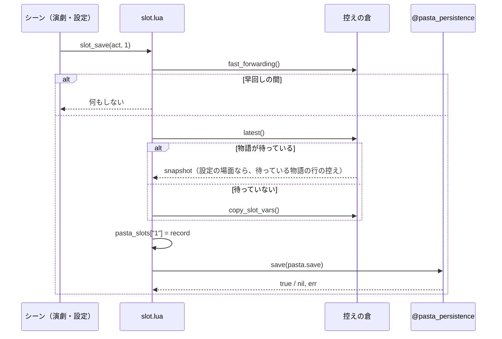
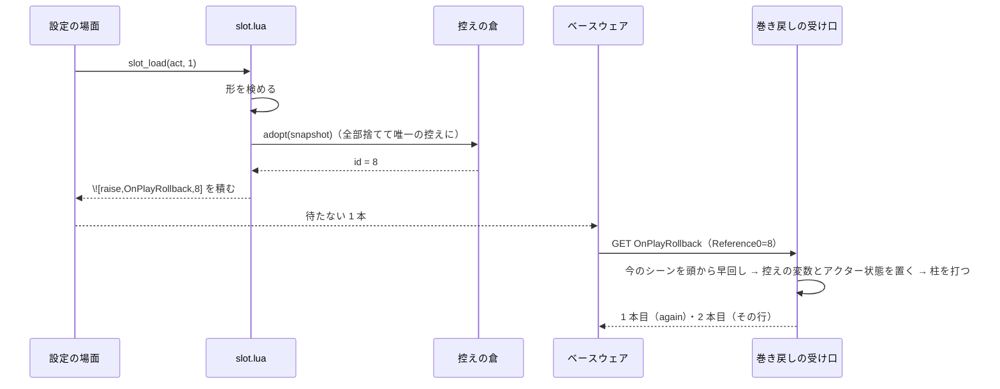

# 暫定設計: novel-save-slots

2026-11-19。Phase 13 の 8 本を、正式な spec の流れの前に、設計まで通して食い違いを洗い出すための下書きである。`requirements.md`・`spec.json` はまだ無い。正は `novel-areka-contract/final-model-2026-11-19.md`（以下「骨子」）と、この spec の brief の「決定（2026-11-19。最終形）」の節である。名前（関数・イベント・モジュール）は、どれも仮である。

- 読んだもの: 骨子（全文）・`play-script-guide.md`・この spec の brief（全文）・ほかの 7 本の brief の「決定」の節・steering 3 本・roadmap の「Phase 13」の節・スキル 2 本の references・下の「調査と判断の記録」に挙げたコード。
- 書いたのはこのファイルだけである。ビルドもテストも走らせていない。

---

## 1. 暫定の要件

骨子 2.5・5 章と、brief の「決定」から引いた。番号は、この文書の中で使う。

| 番号 | 要件（EARS に寄せた形） | 出どころ |
| ---- | ----------------------- | -------- |
| R1 | スロット変数は、名前が「スロット」か `slot_` で始まるグローバル変数（`＄＊スロット好感度`・`＄＊slot_x`）とする。pasta は、変数の種類も文法も足さない。 | 骨子 2.5・brief「スロット変数」 |
| R2 | スロット変数でないグローバル変数は、スロットに入れず、ロードでも戻さない（全セーブ共通）。今の保存（`save.toml`・終了時の保存）は変えない。 | 骨子 2.5・brief Constraints |
| R3 | 作者が `＞スロット保存（スロット）`（`slot_save`）を書いたとき、pasta は、いちばん新しい控えを、そのスロットへ書き、その場で保存ファイルを 1 回書く。 | 骨子 2.5・brief「関数」「置き場所」 |
| R4 | 物語が待っていないとき（控えが無いとき）の `スロット保存` は、今のスロット変数だけを書く（続きの場所を持たない）。 | brief「スロットに入るもの」 |
| R5 | 作者が `＞スロット読込（スロット）`（`slot_load`）を書いたとき、pasta は、そのスロットの控えへ戻る。戻り方は、バックログの行を選んだときと同じ仕組みにする（控えを全部捨てる・早回し・2 本返す）。 | 骨子 2.5・brief |
| R6 | 作者が `＞スロット消去`（`slot_clear`）を書いたとき、pasta は、今のスロット変数を全部消し、控えを全部捨てる（「はじめから」）。 | brief「関数」・rollback brief「控えを全部捨てる時」 |
| R7 | 作者が `＠スロット参照（スロット、名前）`（`slot_get`）を書いたとき、pasta は、読み込まずに、そのスロットの中の変数を 1 つ返す。空のスロット・無い変数は値なしを返す。 | brief「関数」 |
| R8 | スロットの指定は、番号でも名前でも受ける。どちらも文字列のキーにそろえる（`１` と `「1」` は同じスロット）。オートセーブとクイックセーブに、専用の仕組みを作らない。 | brief「関数」「置き場所」 |
| R9 | スロットは、保存ファイル（`pasta.save` の表）の中の、エンジン予約の表 `pasta_slots` に、スロットの名前をキーにして入れる。スロットごとの別ファイルは作らない。 | brief「置き場所」 |
| R10 | 曲・環境の音・舞台など、アクターに付かない物は、スロットに入れない（ロードの時に、その行の階層の柱を打って決まる）。 | 骨子 2.5・4 章の B |
| R11 | 早回し（ロード・巻き戻しの位置合わせ）の間は、`スロット保存` を実行しない。 | 骨子 6 章・brief「要件定義へ送ること」 |
| R12 | 設定のモードの場面から `スロット保存` したときは、待っている物語の行の控えが入る。 | 骨子 4 章の C・brief |
| R13 | 作者は、「スロットにセーブが在るか」で、選択肢やシーンを出し分けられる（「つづきから」）。 | 骨子 6 章・brief |
| R14 | スロットの読み書きで、表の形が崩れていたとき・保存ファイルを書けなかったとき、pasta は、止まらずに、失敗の表記と警告で知らせ、ほかの状態を壊さない。 | 設計の判断（境界の検査） |
| R15 | 4 つの関数を、`pasta_check validate` の組み込みの名前に足し、マニュアルとスキルの references に載せる。 | brief Scope |

---

## 2. 概要

- 新しい Lua のモジュール `pasta.shiori.slot` を 1 つ足す。4 つの関数（日本語と英字の対で 8 つの名前）を `GLOBAL` に置く。`＞自動トーク停止` と同じ作りである（`crates/pasta_lua/pasta_scripts/pasta/shiori/entry.lua:29-48`）。
- 保存の新しい仕組みは作らない。スロットは `pasta.save.pasta_slots` の表の中で値を深く写すだけで、書き出しは既存の `persistence.save(save)` を 1 回呼ぶ。Rust（`persistence.rs`・`lifecycle.rs`）は触らない。
- 控えの中身・写し取り・戻し方は、`novel-checkpoint-rollback` の口を呼ぶ。この spec は、控えをスロットの形に詰め直して置き、取り出して渡すだけである。
- ロードは、スロットの控えを「唯一の控え」として控えの倉に入れ直し、`\![raise,OnPlayRollback,ID]` を出す（下の 6.2）。届いたイベントは、バックログの行を選んだときと全く同じ道を通る。これで「ロードはバックログと同じ仕組み」を、道ごと 1 つにする。

---

## 3. アーキテクチャ

```mermaid
flowchart LR
  DSL["台本<br>＞スロット保存（１）<br>＠スロット参照（１、「スロット章」）"] -->|act:call / act:expr_fn<br>L4 GLOBAL| SLOT["pasta.shiori.slot<br>（この spec）"]
  SLOT -->|latest / adopt / discard_all<br>fast_forwarding| CP["控えの倉<br>（novel-checkpoint-rollback）"]
  SLOT -->|copy_slot_vars / replace_slot_vars| CP
  SLOT -->|pasta_slots の読み書き| SAVE["pasta.save（表は取り替えない）"]
  SLOT -->|persistence.save(save)| PERS["@pasta_persistence<br>（既存・変えない）"]
  SLOT -->|"\\![raise,OnPlayRollback,ID]"| BW["ベースウェア"]
  BW -->|GET OnPlayRollback<br>Reference0=ID| RB["巻き戻しの受け口<br>（novel-checkpoint-rollback）"]
  RB -->|2 本| BW
```

- 置き場所は `crates/pasta_lua/pasta_scripts/pasta/shiori/slot.lua`。`act.req`（保存した時刻）と、`shiori` の層の控えの倉を使うので、`shiori` の下に置く。
- 読み込みは `shiori/entry.lua` に `require("pasta.shiori.slot")` を 1 行足す。`entry.lua` は `main.lua` の後に読まれるので、`GLOBAL` の名前は作者の上書きより後に決まる（`book/src/lua/script-api.md:652` と同じ決まり）。
- 呼び出しの解決は今のまま。`＞スロット保存（１）` は `act:call` → `find_handler("scene", key)` の L4（`crates/pasta_lua/pasta_scripts/pasta/act.lua:427-430`）で `GLOBAL` の関数に当たる。`＠スロット参照（…）` は `act:expr_fn` → `call_expr`（`act.lua:486-498`）で同じく L4 に当たる。文法・パーサー・変換器は触らない。

---

## 4. 部品とインターフェース

### 4.1 `pasta.shiori.slot`（新規。R3〜R8・R11〜R14）

```lua
--- @module pasta.shiori.slot
local SLOT = {}

--- スロットの指定を文字列のキーにする。数は tostring（1 → "1"）、空でない文字列はそのまま。
--- それ以外（nil・空文字列・真偽値・表）は nil と、失敗の表記（名前にならない値）。
--- @return string|nil
function SLOT.key(act, fn_name, slot) end

--- pasta.save.pasta_slots を返す。無ければ作る。表でなければ警告して作り直す（予約の名前のため）。
--- @return table
function SLOT.slots() end

--- R3・R4・R11・R12
--- @return boolean ok
function GLOBAL.slot_save(act, slot) end           -- GLOBAL["スロット保存"]

--- R5
function GLOBAL.slot_load(act, slot) end           -- GLOBAL["スロット読込"]

--- R6
function GLOBAL.slot_clear(act) end                -- GLOBAL["スロット消去"]

--- R7（表の値は深く写して返す。スロットの中身を作者に書き換えさせない）
--- @return any|nil
function GLOBAL.slot_get(act, slot, name) end      -- GLOBAL["スロット参照"]

return SLOT
```

- 2 つ目より後の引数は使わない（Call の形は、呼んだシーンの引数を後ろに足して渡すため。`book/src/grammar/call-jump.md:754` と同じ扱い）。
- どの関数も、出力を積まない（`slot_load` が `\![raise,…]` を 1 つ積むのを除く）。`＠スロット保存` とアクション行に書いても、字は増えない。

| 関数 | 中ですること（順に） |
| ---- | -------------------- |
| `slot_save(act, slot)` | (1) `SLOT.key` で名前を決める。(2) `CHECKPOINT.fast_forwarding()` が真なら、何もしない（R11）。(3) `CHECKPOINT.latest()` を引く。在れば控えをスロットの形（5.2）に詰める。無ければ `CHECKPOINT.copy_slot_vars()` だけを詰める（R4）。(4) `pasta_saved_at` を入れる（6 章の「食い違い」10 番。仮）。(5) `slots()[key] = record`。(6) `persistence.save(require("pasta.save"))` を 1 回呼ぶ。失敗なら警告と失敗の表記（R14）。メモリの中のスロットは残す（終了時の保存で書けることが在る） |
| `slot_load(act, slot)` | (1) 名前を決める。(2) スロットが無い・表でない → 警告と失敗の表記、何も変えない。(3) 控えの形を検める（5.3）。(4) 続きの場所が在る → `CHECKPOINT.adopt(snapshot)` で控えを全部捨てて、この控えを唯一の控えにし、新しい ID を受け取る。`act:raw_script("\\![raise," .. CHECKPOINT.EVENT .. "," .. id .. "]")` を積む。(5) 続きの場所が無い（変数だけのスロット）→ `CHECKPOINT.discard_all()` と `CHECKPOINT.replace_slot_vars(vars)` だけで、何も積まない |
| `slot_clear(act)` | `CHECKPOINT.replace_slot_vars({})` と `CHECKPOINT.discard_all()`。何も積まない。保存されたスロットには触らない |
| `slot_get(act, slot, name)` | 名前を決める。`name` が空でない文字列でなければ失敗の表記と nil。`slots()[key]` が無ければ nil（黙る。空のスロットを調べるのは正しい使い方）。在れば `record[name]` を深く写して返す |

### 4.2 出るさくらスクリプト

設定の場面（骨子 2.1 の例）で「ロードする」を選んだときの流れである。1 本の形と包み（`\__v[disable]`・末尾）は `novel-talk-flow` の物で、ここでは仮に書く。

```text
（設定の場面の残り。後ろにアクション行が無いので、待たない 1 本）
\![raise,OnPlayRollback,8]

（ベースウェアが GET OnPlayRollback、Reference0=8 を送る → novel-checkpoint-rollback の受け口）
1 本目: \![play,again]…画面の状態を全部…\![raise,OnPlayNext,8]
2 本目: \![play,mark,OnPlayRollback,8]\p[0]\s[0]むかしむかし。\x\![raise,OnPlayNext]
```

- SSP（フェーズ 1）でも、`\![raise]` は正典なので動く。`\![play,…]` は読み飛ばされる（骨子 2.8・`novel-areka-contract` の brief「原則」）。
- `スロット保存`・`スロット消去`・`スロット参照` は、さくらスクリプトに何も足さない。

### 4.3 台本の書き方（R13 を含む）

```pasta
＆再生モード：演劇

＊第一章
    ＄＊スロット章＝「第一章」
    ＞第一章本文

＊第一章本文
    ＞スロット保存（「オート」）
    さくら：むかしむかし。
    うにゅう：ほう。

＊OnBoot　＆再生モード：設定
    ＄つづき＝＠スロット参照（「オート」、「スロット章」）
    さくら：どうする？
    ＠？はじめから「はじめから」
    ＠？つづきから「つづきから（＄つづき）」　＆＄つづき

    ・はじめから
        ＞スロット消去
        ＞第一章

    ・つづきから
        ＞スロット読込（「オート」）
```

- 「つづきから」の出し分けは、新しい形を足さずに書ける: `スロット参照` で読んだ値をローカル変数に入れ、選択肢の条件（`novel-talk-flow` が足す文法）で見る。ローカル変数の条件は、選ぶ時点の `act.var` で比べられる（`crates/pasta_lua/src/search/scene_cond.rs:133-141`）。値なしのフラグは偽になる（同 `97-104`）。
- 見出しの変数（`＄＊スロット章`）を、オートセーブと同じシーンの頭に書くと、セーブに入らない。だから、飛ぶ前のシーンで書く（上の例）。理由と、これでよいかは 11 章の 1 番と 12 章。

---

## 5. データモデル

### 5.1 保存ファイルの中の形（R9）

```toml
# 全セーブ共通（今のまま）
"クリアＡ" = true
# 今のスロット変数（今の pasta.save の根に在る。終了時の保存でも書かれる。ロード・消去で入れ替わる）
"スロット好感度" = 5

[pasta_slots.1]
"スロット好感度" = 3                 # スロット変数は平らに置く（brief の例のまま）
"スロット章" = "第一章"
pasta_saved_at = "2026-11-19 21:04:05" # 仮（11 章 10 番）

[pasta_slots.1.pasta_checkpoint]      # 控えの残り。中身の形は novel-checkpoint-rollback が決める
# 例: position = { scene = "第一章本文", line = 1 }、locals = {…}、actors = {…}

[pasta_slots."オート"]
"スロット好感度" = 5
```

- `pasta_` で始まるキーは、スロット変数の名前（「スロット」・`slot_` で始まる）と重ならない。
- 保存ファイルの名前は設定に従う。`obfuscate = true` なら `save.dat`（gzip）になる（`crates/pasta_lua/src/loader/config/sections.rs:100-102`）。この文書の「`save.toml`」は、設定した保存先のことである。
- 入れ子の段数: 根 1・`pasta_slots` 2・スロット 3・`pasta_checkpoint` 4。控えの中身に使えるのは 28 段まで（上限 32。`crates/pasta_lua/src/runtime/persistence.rs:330`）。

### 5.2 控えとスロットの詰め替え

`novel-checkpoint-rollback` に、控え（`snapshot`）の形を 1 つだけ頼む。

```lua
--- 控え（novel-checkpoint-rollback が作る。この spec は vars のほかを読まない）
---@class Snapshot
---@field vars table<string, any>  -- スロット変数の深い写し
---@field [string] any             -- 再生位置・ローカル変数・アクター状態など（形は向こうが決める）
```

| 向き | 詰め方 |
| ---- | ------ |
| 保存 | `record = deep_copy(snapshot.vars)`、`record.pasta_checkpoint = snapshot から vars を除いた浅い写し`、`record.pasta_saved_at = …` |
| 読込 | `snapshot = record.pasta_checkpoint の浅い写し`、`snapshot.vars = record から pasta_ で始まるキーを除いた深い写し` |
| 変数だけ | `record = CHECKPOINT.copy_slot_vars()`。`pasta_checkpoint` は無い |

- 控えの中身は、保存ファイルに書ける形でなければならない。キーは文字列か 1 から穴なしの番号だけ・混ぜない・関数を入れない（`persistence.rs:463-491`）。今の `STORE.appearance` は、整数のキー・空文字列のキー・`false` の値を持つので、そのままでは書けない（rollback の brief「2026-10-10 の検証」）。書ける形にするのは `novel-checkpoint-rollback` である。
- 書けないキーは、保存のときに外されて警告になるだけで、保存は成功する（`persistence.rs:513-585`）。控えが黙って欠けるのを防ぐため、`slot_save` は詰めた後に `pasta_checkpoint` の形を検める（5.3 と同じ物差し）。検めに落ちたら、そのスロットは書かずに失敗の表記を出す。

### 5.3 読み込むときの検め（R14。境界の検査）

保存ファイルは、遊ぶ人も外のツールも書ける。`slot_load` は、次を確かめてから控えの倉へ渡す。

- `pasta_slots` が表である。スロットが表である。
- `pasta_checkpoint` が在るなら表である。その中身の検めは、`CHECKPOINT.validate(snapshot) -> ok, reason` に任せる（形を知るのは向こうだけ）。
- 落ちたら、警告 1 行と失敗の表記を出し、変数も控えも変えない。

---

## 6. 流れ

### 6.1 保存



- シーンの頭のオートセーブ: 着いた時に控えが取り直されるので（rollback の brief「控えと、戻り方」）、そのシーンの頭から続く。
- ロード・巻き戻しの 2 本目（ふつうの再生）では、頭のオートセーブがもう一度走り、同じ中身で書き直す。早回しの間は走らない（R11）。害は無いと見る（11 章 6 番）。

### 6.2 読込



- `＞スロット読込` は、場面の最後の行に書く物である。後ろに行を書いたときの動きは、救わない（`\![raise]` が出るまでに後ろの行が同じ 1 本で出る）。
- トークのモード（`＊OnBoot` など）から呼んでも同じである。受け口が、戻った行の階層の柱（`＆再生モード` を含む）を打つので、着いた時に演劇になる。

### 6.3 消去と参照

- `slot_clear`: 今のスロット変数を全部消し（`pasta.save` の表は取り替えない）、控えを全部捨てる。続けて `＞第一章` へ飛ぶのは作者が書く。
- `slot_get`: 読むだけ。控えの倉にも、今の変数にも触らない。

---

## 7. エラー処理

| 場合 | 動き | 表記・ログ |
| ---- | ---- | ---------- |
| スロットの指定が無い・空・真偽値・表 | 何もしない（`slot_get` は nil） | `【名前にならない値：スロット保存（値なし）】`・警告 `slot_save: bad argument: slot=nil`（`シーン数` と同じ形。`crates/pasta_lua/pasta_scripts/pasta/global.lua:36-52`） |
| `slot_get` の変数名が文字列でない | nil | 同上（`スロット参照`） |
| `pasta_slots` が表でない（外から書かれた） | 読み: スロットが無いと見る。書き: 表を作り直す | 警告 1 行 |
| 読み込むスロットが無い | 何も変えない | `【スロットが無い：スロット読込（1）】`（ラベルは仮。`FAILURE.LABEL` に 1 つ足すか、11 章 9 番） |
| スロットの形が崩れている | 何も変えない | 失敗の表記と警告 |
| 控えに書けない値が在る | そのスロットを書かない | 失敗の表記と警告（どのキーか） |
| 保存ファイルを書けない（権限・容量・読めないセーブを退避できなかった） | メモリの中のスロットは残す | `persistence.save` の `err` を警告に出す（`persistence.rs:189-207`・`221-223`）。失敗の表記 |
| 早回しの間の `slot_save` | 何もしない | 出さない |
| 古いセーブのシーンが無い・行の数が足りない | `novel-checkpoint-rollback` の受け口が決める | 11 章 7 番 |

---

## 8. テストの方針

- Lua の単体テスト `crates/pasta_lua/tests/lua_specs/slot_test.lua`（新規。一覧 `lua_specs/init.lua` に 1 行）。`@pasta_persistence` はモック（`lua_test.mocks` の `persistence`。`save` が `true` を返す）で差し替え、呼ばれた回数と渡された表を見る。控えの倉は、テストの中で `latest`・`adopt`・`fast_forwarding` などを差し替えた偽物を入れる。
  - 名前の揃え方: `1`・`「1」` は同じキー、`「１」` は別のキー、nil・空・真偽値は失敗。
  - 保存: 物語が待っている／いない／早回しの間／設定の場面（`latest` が物語の行を返す）。
  - 詰め替えの往復: `vars` が平らに入り、`pasta_` のキーが読込で外れる。
  - 読込: 在る・無い・崩れた形・変数だけのスロット。`\![raise,OnPlayRollback,ID]` の 1 片だけが積まれる。
  - 消去: `pasta.save` の表が同じ表のまま、スロット変数だけが消え、ほかのグローバル変数が残る。保存されたスロットは残る。
  - 参照: 表の値は写しで返る（書き換えても中身が変わらない）。
- 往復の結合テスト（Rust。`crates/pasta_lua/tests/` に 1 本）: 一時のゴーストのフォルダで、`slot_save` の後に保存ファイルを読み直し、`pasta_slots` の入れ子が TOML で往復することを見る（`obfuscate` の両方）。
- 名前の一致: `crates/pasta_check/src/validate/builtins.rs` の `GLOBAL_NAMES` に 8 つ足す。`validate_parity_test.rs:869-891`（実行時の `GLOBAL` と照らす）と `validate_scenes_test.rs:353-374`（並びの決め打ち）が、そのまま足し漏れを捕まえる。
- 早回し・2 本の中身・柱を打つことは、`novel-checkpoint-rollback` のテストで見る（この spec は偽物で境界だけを見る）。
- 実機（SSP 2.9.34）: 設定の場面からセーブ → 終了 → 起動 → `＊OnBoot` からロードで、続きの行がト書きごと出ること。`hello-novel-sample` の実機確認に含める。

---

## 9. 他の spec との境界

### 9.1 `novel-checkpoint-rollback`（いちばん太い境界）

**求める物**（モジュール名は仮 `pasta.shiori.checkpoint`。以下 `CHECKPOINT`）:

| 口 | 形 | 使う所 |
| -- | -- | ------ |
| `CHECKPOINT.latest()` | `-> Snapshot|nil`。物語が待っていないときは nil（演劇の控えが残っていても nil。11 章 3 番） | `slot_save` |
| `CHECKPOINT.copy_slot_vars()` | `-> table`。スロット変数だけを深く写した表（brief「この spec が足す口」の 1 つ目） | `slot_save`（変数だけ） |
| `CHECKPOINT.replace_slot_vars(tbl)` | スロット変数を全部消してから写し入れる。`pasta.save` の表は取り替えない（2 つ目） | `slot_load`（変数だけ）・`slot_clear` |
| `CHECKPOINT.adopt(snapshot)` | `-> id: string`（英数字）。控えを全部捨て、この控えを唯一の控えにして新しい ID を振る。ID はロードをまたいで重ねない | `slot_load` |
| `CHECKPOINT.discard_all()` | 控えを全部捨てる | `slot_load`（変数だけ）・`slot_clear` |
| `CHECKPOINT.fast_forwarding()` | `-> boolean`。早回しの間だけ真 | `slot_save` |
| `CHECKPOINT.validate(snapshot)` | `-> ok: boolean, reason: string|nil`。外から読んだ控えの形を検める | `slot_load`・`slot_save` |
| `CHECKPOINT.EVENT` | 目印と巻き戻しのイベントの名前（仮 `"OnPlayRollback"`） | `slot_load` の `\![raise,…]` |
| 受け口 | `OnPlayRollback`（Reference0＝ID）を、トーク・設定・演劇のどのモードの間に受けても、その控えへ戻す | `slot_load` の後 |
| 控えの形 | `Snapshot.vars` にスロット変数。ほかは保存ファイルに書ける形（文字列のキーか穴の無い番号・関数なし・28 段まで） | 5.2 |

**渡す物**: スロットの置き場所 `pasta.save.pasta_slots`（予約の名前）。`pasta_` のキーを控えの中に入れないこと（スロットの記録の予約）。

### 9.2 `novel-talk-flow`

- **求める物**: 「物語が待っているか」の判定（`CHECKPOINT.latest()` が nil を返す条件として、向こうの状態を使う。`＞演劇再開` の「物語が待っていない時」と同じ述語）。選択肢の行の条件の文法（`＠？つづきから「…」　＆＄つづき`）と、その条件を選ぶ時点の `act.var` で比べること。設定のモードの行を記録しないこと（設定の場面の `スロット保存` が物語の行を書くため）。設定のモードの場面の、後ろにアクション行が無い残りを「待たない 1 本」として返すこと（`slot_load` の `\![raise]` が、そのまま出る）。
- **渡す物**: 組み込みの関数 8 つの名前（`GLOBAL["スロット保存"]` ほか）。`entry.lua` に `require` を 1 行（`＞演劇再開` も `entry.lua` に置くなら、隣り合う 1 行ずつ）。

### 9.3 `cue-command-runtime`

- **求める物**: ロードの後、戻った行の階層の柱（`＆曲`・`＆舞台`・`＆再生モード`）を打つこと（受け口から呼ばれる。この spec は直接呼ばない）。
- **渡す物**: なし。柱の名前に `pasta_` を使わないこと、だけを頼む（予約の名前）。

### 9.4 `novel-areka-contract`

- **求める物**: `\![raise,イベント名,引数]` の引数が Reference0 に載ること（正典どおり。brief「バックログと目印」）。ロードの後に、ベースウェアのバックログに残る古い行の扱い（「バックログを空にする」合図を足すか。足さないなら ID を重ねない）。
- **渡す物**: 「セーブデータは pasta だけが持つ。ベースウェアの側の控えは作らない」の確認。取り決めの文書に、セーブとロードの命令は**無い**（場面からの関数で起き、ベースウェアには `\![raise]` しか見えない）と書いてもらう。`novel-areka-contract` の brief の古い節（108 行「スロットごとに、areka の側の控え」）は、この決定で消える（11 章 4 番）。

### 9.5 `shell-element-click`

- **求める物**: セーブ画面のスロットの枠を押したとき、`＊OnMouseClick　＆＄ｒ４＝「slot1」` のように場面へ届くこと（今の条件の属性で書ける）。
- **渡す物**: なし。`slot1` と `slot10` の前方一致の話は、場面の名前でなく Reference の値の比べ方なので、この spec には効かない。

### 9.6 `hello-novel-sample`

- **渡す物**: 4 つの関数の書き方と、上の 4.3 の型（オートセーブはシーンの頭・見出しの変数は飛ぶ前に書く・「つづきから」はローカル変数と選択肢の条件・「はじめから」は `＞スロット消去` → `＞第一章`）。保存した日時の見出し（11 章 10 番が決まれば）。
- **求める物**: 見本の中で、セーブ → 終了 → 起動 → ロードを実機で確かめること。

### 9.7 `manual-novel-guide`

- **渡す物**: 下の 10 章の文法の章の書き足し（関数の表と節・予約変数の表）。ノベルの章からは、そこへ繋ぐ。作者がつまずく所: 見出しの変数を書く場所・`スロット消去` は保存したスロットを消さないこと・`「１」` と `１` は別のスロットになること。
- **求める物**: なし。

---

## 10. 共有するファイル

| ファイル | 変更 |
| -------- | ---- |
| `crates/pasta_lua/pasta_scripts/pasta/shiori/slot.lua` | 新規（4.1） |
| `crates/pasta_lua/pasta_scripts/pasta/shiori/entry.lua` | `require("pasta.shiori.slot")` を 1 行（`GLOBAL["自動トーク再開"]` の登録 48 行の後） |
| `crates/pasta_check/src/validate/builtins.rs` | `GLOBAL_NAMES` を 16 → 24。注釈に `pasta/shiori/slot.lua` を足す |
| `crates/pasta_check/tests/validate_scenes_test.rs` | 決め打ちの並び（353-374 行）に 8 つ足す |
| `crates/pasta_lua/tests/lua_specs/slot_test.lua` | 新規 |
| `crates/pasta_lua/tests/lua_specs/init.lua` | 一覧に 1 行 |
| `crates/pasta_lua/tests/` の Rust の結合テスト | 新規 1 本（往復） |
| `book/src/grammar/call-jump.md` | 組み込みの関数の表（410-425 行あたり）に 4 行と、新しい節「スロット保存・スロット読込・スロット消去・スロット参照」 |
| `book/src/grammar/variables.md` | 「予約グローバル変数」の表（493 行〜）に `＄＊pasta_slots`。スロット変数の決まり（名前の頭）の節（11 章 8 番） |
| `book/src/lua/script-api.md` | `GLOBAL` の表（648 行あたり）に 8 行 |
| `book/src/debug/validate.md` | 180 行の組み込みの名前の並びに 8 つ |
| `book/src/lua/modules/pasta-persistence.md` | 「自動で保存される save テーブルとの関係」に、`スロット保存` がその場で書くことを 1 行 |
| `.claude/skills/pasta-ghost-authoring/references/*`・`.claude/skills/pasta-lua-coding/references/*` | マニュアルから再生成（手で書かない） |

`persistence.rs`・`lifecycle.rs`・`save.lua`・`act.lua`・`sakura_builder.lua`・`event/init.lua`・文法は触らない。

---

## 11. 骨子・brief との食い違いと、決まっていない所

1. **見出しの変数が、同じシーンの頭のオートセーブに入らない。** 控えは「その 1 本の始まりの状態」で、シーンに着いた時に取り直される。`＄＊スロット章＝「第二章」` と `＞スロット保存（「オート」）` を同じシーンの頭に並べると、控えは代入の前の値（「第一章」）を持ち、セーブ画面は古い章を出す。brief の「見出しは作者が決めたスロット変数で持つ」と「いちばん新しい控えを書く」を合わせると、いちばん自然な書き方が外れる。**仮**: 見出しの変数は、飛ぶ前のシーンで書く（4.3）。12 章 1 番へ上げる。
2. **保存した日時を、スロット変数では持てない。** 日時は保存の瞬間の値で、控え（それより前）には入りえない。brief の「Desired Outcome」の「日時」は、「決定」の節で触れられていない。**仮**: `slot_save` が `pasta_saved_at`（文字列）をスロットに入れ、`スロット参照（１、「pasta_saved_at」）` で読める（10 番）。12 章 1 番と一緒に決める。
3. **「演劇でないとき（控えが無いとき）」は、控えの有無では決まらない。** 控えを全部捨てるのは「トークから演劇に入った時」が候補で、演劇を出た時ではない。物語が `＆再生モード：トーク` のシーンで終わった後も控えは残るので、そこでの `スロット保存` は、終わった物語の最後の行を書いてしまう。**仮**: `CHECKPOINT.latest()` は「物語が待っていない」とき nil を返す（`novel-talk-flow` の `＞演劇再開` の述語と同じ）。
4. **ベースウェアの側の控えと縮小画像。** brief の古い節（「スロットの持ち主」「areka への依頼」）と `novel-areka-contract` の brief 108 行は、スロットごとの areka の控えを残している。「決定」の節は「セーブデータは pasta だけが持つ」。**仮**: 古い節は無効。ただし骨子 2.9 のフェーズ 2 に「セーブの画面の縮小」が在り、画像を誰が持ち、スロットとどう結ぶかは、どこにも書いていない。**仮**: この spec の外（フェーズ 2。取り決めで、ト書きでベースウェアに画像を書かせ、名前をスロットの名前にそろえる形が候補）。
5. **brief の「写し取る・戻す口は、rollback の 2 つの関数を使う」は足りない。** 2 つの関数は変数だけを扱う。保存・読込には、控えそのもの（`latest`）・唯一の控えに入れ直す（`adopt`）・全部捨てる（`discard_all`）・早回しの判定（`fast_forwarding`）・形の検め（`validate`）が要る。**仮**: 9.1 の表を、rollback の要件に入れる。
6. **ロード・巻き戻しの 2 本目で、頭の `スロット保存` がもう一度走る。** 骨子は「早回しの間は実行しない」とだけ言う。2 本目はふつうの再生なので走り、同じ中身でスロットを書き直す（スロット 1 をロードすると、頭のオートセーブが「オート」をスロット 1 の状態で上書きする）。**仮**: 受け入れる（「今そこに居る」ことのセーブなので、オートセーブの意味に合う）。マニュアルに 1 行。
7. **台本を直した後の古いセーブ**（brief が、この spec の持ち分と書いた）。シーンの名前が無いとき・行の数が足りないとき。**仮**: シーンが無ければ、受け口が `【シーンが見つからない：…】` を出して何も変えない。行が足りなければ、早回しがシーンの終わりまで走り、最後の行の `＞` が無いシーンと同じく「止まって次のイベントを待つ」（1 本目だけを返す）。実装は rollback の受け口なので、向こうと揃える。
8. **スロット変数の持ち主が 2 か所に書いてある。** 骨子 5 章は「スロット変数は `novel-save-slots`」、rollback の brief は「スロット変数を写す 2 つの関数は rollback が作る」。rollback の方が先に入るので、名前の判定は向こうに置くしかない。**仮**: 判定と 2 つの関数は rollback が持ち、マニュアルの変数の章に決まりを書くのは、先に入る rollback（この spec は、スロットの関数の節からそこへ繋ぐ）。
9. **`スロット消去` は、保存したスロットを消さない。** brief の 4 つ目の意味は「今のスロット変数を消す」で、セーブ画面の「このセーブを消す」は書けない。名前からは逆に読める。**仮**: 保存したスロットを消す口は作らない（要望が出てから）。名前（`スロット消去`）を変えるかは議題にする。失敗の表記のラベル「スロットが無い」を `FAILURE.LABEL` に足すかも、ここで決める。
10. **保存した日時の形。** 2 番を採るなら、文字列（`2026-11-19 21:04:05`。`CLOCK.date(act.req)` から作る。`crates/pasta_lua/pasta_scripts/pasta/shiori/clock.lua:196`）か、年月日の表か。**仮**: 文字列 1 つ。`act.req` の無い呼ばれ方（Lua のテスト）では入れない。
11. **全角の数字の文字列。** `１`（数）と `「1」` は同じスロットになるが、`「１」` は別のスロットになる。**仮**: 揃えない（想定外の書き方を救わない）。マニュアルに書く。
12. **引数を書かない `＞スロット保存`。** 途中の行の Call は、呼んだシーンの引数を後ろに足して渡す（`crates/pasta_lua/src/code_gen/element_gen.rs:229-234`）。引数つきで呼ばれたシーンの中で `＞スロット保存` と書くと、そのシーンの 1 つ目の引数がスロットの名前になる。**仮**: 救わない（`シーン数` と同じ。書き方の誤り）。
13. **今のスロット変数は、終了時の保存で根に残る。** 再起動すると、再生位置は消える（メモリの中だけ）が、スロット変数は前の値のまま読み込まれる。**仮**: 害は無い（`＊OnBoot` で `スロット読込` か `スロット消去` を書けば入れ替わる）。デスクトップのトークの条件にスロット変数を使うと、前回の遊びの値が見える、とマニュアルに書く。
14. **保存の形の版。** 控えの形が後の版で変わったとき、古いスロットを読めるか。**仮**: 版の印は入れない（`validate` が落とすだけ）。要るようになったら `pasta_format` を足す。
15. **全セーブ共通の変数の保存は、`スロット保存` のたびの書き出しで足りるか**（brief の問い）。**仮**: 足りる。新しい書き出しの時機は作らない（R2。今の保存を変えない）。

---

## 12. 上位の決定へ差し戻しが要りそうな所

1. **セーブ画面の見出し（章の名前・日時）をどこから取るか。** 骨子は「いちばん新しい控えを書く」と「見出しは作者のスロット変数」を両方決めているが、控えは 1 本の始まりに取られるので、同じシーンの頭で書いた見出しも、保存した日時も、スロットに入らない（11 章 1・2 番）。実装はどちらにも寄せられるが、作者の書き方が変わるので、骨子の水準で決める必要がある。候補は 3 つ。
   - (a) 今の決定のまま。見出しの変数は飛ぶ前に書く、とマニュアルで教える。日時は持たない。
   - (b) スロットに、pasta が保存の瞬間の値を足す（`pasta_saved_at`）。章の名前は (a) のまま。
   - (c) 見出しを、控えの再生位置から導く（スロット参照で、保存した行のグローバルシーンの名前を読める。原則「保存より、シーンの属性と階層から導く」に沿う）。日時は (b)。
   - この下書きは (a) の書き方に (b) を足した形で書いた（4.3・5.1）。

ほかは、今のコードの上で骨子どおりに作れる。

---

## 13. 調査と判断の記録

### 13.1 確かめた事実（コード）

- 組み込みの呼び出しの作り: `GLOBAL.pause_auto_talk` と `GLOBAL["自動トーク停止"]` の対（`crates/pasta_lua/pasta_scripts/pasta/shiori/entry.lua:29-35`）。値を返す組み込みは `シーン数`（`crates/pasta_lua/pasta_scripts/pasta/global.lua:36-58`）。式の中で `＄n＝＠シーン数（「雑談」）` と書けて、数が入る（`book/src/grammar/call-jump.md:739`）。だから `＄見出し＝＠スロット参照（１、「スロット章」）` は今の文法で通る（brief の問い「式の中から呼べるか」の答え）。
- 名前の解決: Call は `find_handler("scene")`、式の関数は `find_handler("expr")`。どちらも L4 で `GLOBAL[key]` の完全一致（`act.lua:396-441`）。L1〜L3 に同じ名前があればそちらが勝つ。作者がグローバルシーン `＊スロット保存` を書いても、それは L5 なので組み込みが勝つ。今のグローバルシーンの下にローカルシーン `・スロット保存` を書くと、L2 で先に当たる（`シーン数` と同じ。`call-jump.md:756`）。
- 末尾の Call は `return act:call(...)`、途中は `act:call_restore(...)`。途中は呼んだシーンの引数を後ろに足す（`crates/pasta_lua/src/code_gen/element_gen.rs:198-234`、テスト `element_gen_tests.rs:239`）。
- `pasta.save` は `persistence.load()` が返す表 1 つで（`crates/pasta_lua/pasta_scripts/pasta/save.lua:7-13`）、act ごとに同じ表を握る（`act.lua:204`）。取り替えると握っている所が割れるので、`pasta_slots` の下だけを書く。
- 保存: `persistence.save(data)` は終了時と同じ道（`persistence.rs:209-225`）。一時ファイル → rename（`281-323`）。書けないキーは外して警告し、成功を返す（`233-246`・`513-585`）。読めないセーブを退避できなかったランタイムでは保存しない（`221-223`）。入れ子 32 段（`330`）。番号のキーと名前のキーを混ぜた表・穴のある配列・0 以下の整数のキーは書けない（`463-491`）。
- 終了時の保存は `pasta.save` を丸ごと書く（`crates/pasta_lua/src/runtime/lifecycle.rs:15-50`）。`pasta_slots` も一緒に書かれる。Rust を触らずに済む。
- `obfuscate = true` で保存先が `.dat` になる（`crates/pasta_lua/src/loader/config/sections.rs:100-102`）。
- 条件の評価: `＄＊` は save、`＄` は var を素の表で引く（`crates/pasta_lua/src/search/scene_cond.rs:133-141`）。キーに `.` の道筋は無いので、`＆＄＊pasta_slots` は表を 1 つの値として見るだけで、スロットごとの有無は書けない（フラグは表なら常に真。`97-104`）。だから R13 は、ローカル変数と選択肢の条件で書く。
- 外からの書き込み: `OnPastaSetSaveVariable` は予約の名前を除かずに `pasta.save[name]` へ書く（`crates/pasta_lua/pasta_scripts/pasta/shiori/event/external_control.lua:127-129`）。`pasta_slots` を文字列にされることが在るので、型を検める。
- 失敗の表記の部品: `FAILURE.LABEL.BAD_NAME`（`crates/pasta_lua/pasta_scripts/pasta/failure.lua:15`）・`FAILURE.is_name`（`215-217`）・`FAILURE.report`（`175`）。
- 組み込みの名前の一覧と照合テスト: `crates/pasta_check/src/validate/builtins.rs:8-25`、`crates/pasta_check/tests/validate_parity_test.rs:869-891`、`crates/pasta_check/tests/validate_scenes_test.rs:353-374`。
- 時刻: `CLOCK.date(req)` が SSP の仮想時刻に従う日付の表を返す（`clock.lua:196-217`）。
- イベントの act は、場面を選ぶ前に Reference と日時を `act.var` へ写す（`crates/pasta_lua/pasta_scripts/pasta/shiori/event/init.lua:104-109`）。`OnPlayRollback` の Reference0 も `＄ｒ０` に入るが、受け口は rollback が `act.req.reference[0]` で読む想定。

### 13.2 判断

| 判断 | 採った案 | 退けた案と理由 |
| ---- | -------- | -------------- |
| ロードの道 | `adopt` で唯一の控えにして `\![raise,OnPlayRollback,ID]` を出し、巻き戻しの受け口に任せる | 場面の中で、その場で早回しして 2 本を組む案。走っている設定の場面のコルーチンの中で、別のシーンの早回しを入れ子に走らせることになり、1 本目の末尾の `\![raise]` も結局要る。「バックログと同じ仕組み」を道ごと 1 つにできる方を採った。代わりに往復が 1 回増える |
| スロットの中の形 | スロット変数を平らに、残りを `pasta_checkpoint` に | 控えをそのまま入れる案。`スロット参照` が控えの形を知る必要が出る。brief の TOML の例（平らな変数）にも合わない |
| 置き場所 | `pasta.save.pasta_slots`（brief の決定） | 別ファイル。brief で退けられている |
| 保存の書き出し | `persistence.save(save)` を 1 回 | 新しい Rust の口。要らない |
| モジュールの場所 | `pasta/shiori/slot.lua`、`entry.lua` から読む | `pasta/global.lua` に足す案。`act.req`・控えの倉（`shiori` の層）を使うので、層が合わない |
| 「つづきから」 | `スロット参照` ＋ローカル変数＋選択肢の条件 | 条件の文法に「スロットが在るか」を足す案。文法を足さずに書けるので要らない。pasta が「在る」印を別に覚える案は、原則（保存より導く）に反する |
| 保存した日時 | 仮に入れる（12 章で決める） | 入れない案（今の決定のまま）。セーブ画面の基本の見出しが書けなくなる |

### 13.3 省いたこと・確かめていないこと

- 控えの中身の形・早回し・2 本の中身は、`novel-checkpoint-rollback` の設計を待つ。この下書きは、その口の形を仮に置いただけである。
- `\![raise]` を待たない 1 本の中で出したとき、SSP がそれを、いつ・どの順で送るかは、実機で見ていない（骨子の芯の確認は `\x` の後ろの `\![raise]`）。
- 1 回の `スロット保存` で保存ファイル全体を書く重さ（オートセーブがシーンの頭ごとに走る）は、測っていない。
- 縮小画像・クイックセーブのキー・セーブの版の印は、作らない。
