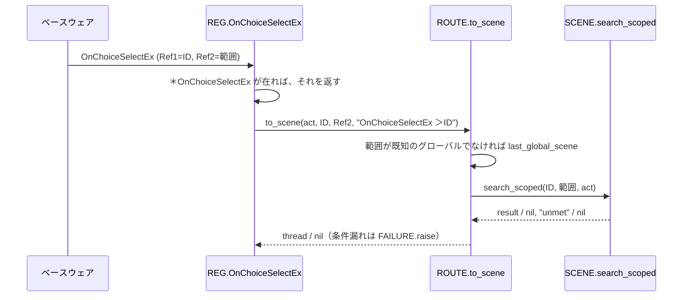

# 暫定の設計: shell-element-click

2026-11-19。Phase 13 の 8 本を、設計の段まで一度に通して、spec どうしの食い違いを洗い出すための下書きである。requirements.md は、まだ無い。この文書は、骨子（`novel-areka-contract/final-model-2026-11-19.md`。以下「骨子」）と、この spec の brief を正として書いた。正式な要件定義が始まったら、この文書は捨ててよい（読み直す材料として残す）。

- 命令・関数・イベントの名前は、どれも仮である。
- 「前提」と書いた所は、決まっていない物を、この下書きのために仮に置いた所である。17 章に、まとめて並べた。

## 1. 暫定の要件

骨子 5 章で、この spec の持ち分は「当たり判定のクリックを場面へ届ける（起票のまま）」である。brief の 2026-11-19 の申し送りで、クリックは今の条件の属性で書けること（`＊OnMouseClick　＆＄ｒ４＝「ドア」`）、演劇の間にローカルを先に探す動きは `novel-talk-flow` が足すことが決まった。残る中身から、要件を次のように置いた。

| 番号 | 要件（暫定） | 出どころ |
| ---- | ------------ | -------- |
| R1 | アクターの当たり判定がクリックされ、`OnMouseClick`（Reference3＝スコープ・Reference4＝当たり判定の名前）が届いたとき、pasta は、条件の属性（`＆＄ｒ４＝「名前」`）が合うシーンを選んで走らせる。名前の比べ方は完全一致である（前方一致の `slot1`／`slot10` の取り違えが起きない） | brief「Desired Outcome」・骨子 2.3・2.7・areka の現状（Reference4 で送る） |
| R2 | 選択肢の振り分け（範囲のローカル → グローバル）を、関数として取り出す。取り出した後も、選択肢の挙動（見つかった・名前が無い 204・条件漏れの止まるエラー）は変えない | brief「振り分けの共有」「Constraints」・2026-11-03 の申し送り |
| R3 | 取り出した振り分けは、文中のシーンリンク（`scene-anchor-link`）と、イベントのローカルを先に探す動き（`novel-talk-flow`）が、そのまま使える形にする。条件漏れを止まるエラーにするかどうかは、呼ぶ側が決める | brief「振り分けの共有」・骨子 2.3 |
| R4 | 名前つきの範囲で探す口は、グローバルシーンの登録名（例 `教室_1`）を受ける。範囲が既知のグローバルシーンでなければ、選択肢は今のまま `STORE.last_global_scene` へ落ちる | `choice_select.lua:51-54` |
| R5 | 作者は、場面の中で Reference を読んで振り分ける処理を書かなくてよい。その場面だけの反応は `・OnMouseClick　＆＄ｒ４＝「名前」`、どこでも効く反応は `＊OnMouseClick　＆＄ｒ４＝「名前」` で書ける | brief「Desired Outcome」・骨子 2.3 |
| R6 | 今の `OnMouseDoubleClick`・`OnMouseMove` の既定のハンドラ（つつき・撫でのショートカット）の挙動を変えない | brief「触られたときの反応との関係」・touch-poke-shortcuts の申し送り |
| R7 | `OnMouseClick` に応えるシーンが無いときは、今のとおり 204 を返す。演劇・設定の間に、どのシーンも拾わなかった左クリックを「進める」に替えるのは `novel-talk-flow` の持ち分で、この spec は、その最後の段を塞がない | 骨子 2.3・brief の 2026-11-19 の申し送り |
| R8 | マニュアルに、当たり判定の名前で場面を振り分ける書き方を載せ、生成スキルの references を作り直す | brief「Scope」 |
| R9 | 取り決めの文書（`novel-areka-contract`）へ、クリックのイベントの形（GET・Reference3・Reference4）を渡し、brief の古い areka への依頼のうち、骨子で要らなくなった物を取り下げる | brief「areka への依頼」・骨子 2.7 |

要件に入れなかった物（理由は 17 章と 18 章）:

- シェルの中のバルーンへ書く口。骨子 2.7 で「箱のアクター自身の行で書いた字は、その箱に出る」と決まったので、新しい口は要らない。
- 当たり判定の名前で選ぶ近道（`・slot1` という名前のシーンに飛ぶ、など）。足さない前提で書いた（17 章の 3）。
- 画面を出した場面を覚えておく置き場所。骨子の「今のシーン」が、それに当たる。持ち主は `novel-talk-flow`。

## 2. 概要

骨子が決まって、この spec の中身は小さくなった。画面の部品は全部アクターであり（骨子 2.7）、押せる所はアクターの表情ごとの当たり判定で、押すと正典の `OnMouseClick` が届く。その場面だけの反応はローカルシーンで書き、条件の属性で当たり判定の名前を比べる。どれも、今の文法と、今の条件の属性で書ける。

この spec が足すのは、次の 3 つだけである。

1. 選択肢の振り分けを取り出した、範囲つきで探す関数（`SCENE.search_scoped`）と、選択肢・シーンリンクが共有する受け口の部品（`pasta.shiori.event.route`）。
2. `OnMouseClick` を条件で振り分ける今の動きを、テストで固めること（今は確かめるテストが無い）。
3. マニュアルの節と、取り決めの文書へ渡す文面。

### 2.1 Goals

- 選択肢の受け口を、挙動を変えずに、使い回せる部品へ分ける（R2・R3・R4）。
- クリックの振り分けを、作者が DSL だけで書ける形のまま保証する（R1・R5・R7）。
- `novel-talk-flow` と `scene-anchor-link` が、同じ部品の上に載れるようにする（R3）。

### 2.2 Non-Goals

- 演劇の間に、イベントのシーンをローカルから先に探す動き（`novel-talk-flow`）。
- どのシーンも拾わなかったクリックを「進める」にすること（`novel-talk-flow`）。
- 当たり判定の定義（シェルの `surfaces.txt`）、クリックの検出と通知（ベースウェア）。
- 画面を出す・消す・重ねること（並び `\![play,cast,…]` と舞台。`cue-command-runtime`・`novel-areka-contract`）。
- セーブ画面の見出しの値（`スロット参照`。`novel-save-slots`）。

## 3. 境界の約束

### 3.1 この spec が持つ物

- `SCENE.search_scoped(name, scope, act)`（`pasta/scene.lua`）。
- 新しいモジュール `pasta.shiori.event.route` の `ROUTE.to_scene(act, id, scope, subject)`。
- `choice_select.lua` を、上の 2 つを使う形に直すこと（挙動は不変）。
- `OnMouseClick` の条件の振り分けのテスト。
- マニュアル `book/src/lua/shiori-events.md` の `OnMouseClick` の節、`book/src/reference/shell.md` の当たり判定の節の追記。

### 3.2 持たない物

- `EVENT.no_entry`（`shiori/event/init.lua:222-226`）の中身。演劇の間の探し方と「進める」は `novel-talk-flow` が変える。
- 今のシーンの登録名を覚えること（`novel-talk-flow`）。
- `REG.OnMouseClick` の既定のハンドラ。この spec は作らない（17 章の 4）。

### 3.3 頼ってよい物

- `@pasta_search` の `SEARCH:search_scene(name, global_scene_name, var, save)`（条件つき。`scene.lua:192`、Rust は `crates/pasta_lua/src/search/context.rs:166` の `search_scene_where`）。
- `FAILURE.raise`・`FAILURE.LABEL.SCENE_UNMET`（`choice_select.lua:63`）。
- `create_act` が Reference を `＄ｒ０`〜`＄ｒ９` へ写すこと（`shiori/event/init.lua:104-109`、`shiori/act.lua:220-238`）。

### 3.4 見直しの合図

- `novel-talk-flow` が、イベントのローカルを先に探す口を、`SCENE.search_scoped` でなく別の形で作ると決めたとき。
- `scene-anchor-link` が、選択肢と違う範囲の決め方（`STORE.last_global_scene` へ落ちない）を選んだとき。
- `scene-exact-match` が、イベントの受け口の名前の一致を完全一致へ替えたとき（`＊OnMouseClick` と `＊OnMouseClickEx` の取り違えの直し。R1 の「名前」は当たり判定の名前で、イベント名の一致とは別である）。

## 4. 構成

### 4.1 今の作り（読んで確かめた事実）

- `OnMouseClick` には、既定のハンドラが無い。`EVENT.fire` は、鎖も `REG` の値も無いので `EVENT.no_entry` を呼び（`shiori/event/init.lua:316-320`）、`SCENE.co_exec(act, "OnMouseClick", nil, nil)` で探す（同 222-226）。
- `SCENE.co_exec` は `act:find_scene` → `find_handler("scene", key)` を引く（`scene.lua:238-244`、`act.lua:710-712`）。イベントの act は `current_scene` が nil なので（`act.lua:208`）、ローカルの段 L2（`act.lua:412-417`）は飛ばされ、L5 のグローバルの前方一致だけになる。条件は act の `var` で評価される（`act.lua:371`）。だから、今でも `＊OnMouseClick　＆＄ｒ４＝「ドア」` は、ドアのクリックだけで走る。
- `co_exec` は、2 つ目の戻り値（条件漏れの `"unmet"`）を捨てる（`scene.lua:239-243`）。イベントの条件漏れは、黙って 204 になる。
- 選択肢の受け口は `REG.OnChoiceSelectEx`（`choice_select.lua:26-71`）。明示の `＊OnChoiceSelectEx`（28 行）→ Reference1 の ID（38 行）→ Reference2 の範囲。範囲が既知のグローバルシーンでなければ `STORE.last_global_scene`（51-54 行）→ 範囲のローカル、無ければグローバル（56-61 行）→ 条件漏れなら `FAILURE.raise`（62-64 行）→ `SCENE.wrap`（70 行）。
- 範囲の Reference2 は、組み立てが `\q[表示,飛び先,範囲]` に埋める（`shiori/sakura_builder.lua:26-33`）。
- `STORE.last_global_scene` は、シーン関数の頭 `act:init_scene` のたびに書き換わる（`act.lua:221-224`）。途中の `＞` で呼んだ先でも書き換わり、戻っても元へ戻らない（`act.lua:795`・`813`）。だから、骨子の「今のシーン」の代わりには使えない（brief の 2026-11-12 の再測定と同じ結論）。
- つつきのショートカットは `mouse.lua:117-124` の `find_shortcut` が `SCENE.co_exec_exact` で探す。`REG.OnMouseDoubleClick`・`REG.OnMouseMove` は 173-174 行。`OnMouseClick` には触っていない。

### 4.2 境界の図

```mermaid
flowchart LR
  BW[ベースウェア<br/>OnMouseClick GET<br/>Ref3 スコープ / Ref4 名前] --> FIRE[EVENT.fire<br/>init.lua]
  FIRE --> NOENTRY[EVENT.no_entry<br/>novel-talk-flow が直す]
  NOENTRY -->|演劇・設定の間| SS[SCENE.search_scoped<br/>この spec]
  NOENTRY -->|トーク| COEXEC[SCENE.co_exec<br/>今のまま]
  CHOICE[REG.OnChoiceSelectEx<br/>choice_select.lua] --> ROUTE[ROUTE.to_scene<br/>この spec]
  ANCHOR[REG.OnAnchorSelectEx<br/>scene-anchor-link] --> ROUTE
  ROUTE --> SS
  SS --> SEARCH[@pasta_search<br/>search_scene 条件つき]
```

### 4.3 技術

新しい依存は無い。Lua（LuaJIT）の 2 つのモジュールの中で閉じる。Rust は触らない。

## 5. ファイルの計画

| ファイル | 変更 |
| -------- | ---- |
| `crates/pasta_lua/pasta_scripts/pasta/scene.lua`（305 行） | `SCENE.search_scoped` を足す（約 20 行） |
| `crates/pasta_lua/pasta_scripts/pasta/shiori/event/route.lua`（新規） | `ROUTE.to_scene` を置く（約 30 行） |
| `crates/pasta_lua/pasta_scripts/pasta/shiori/event/choice_select.lua`（73 行） | 51〜70 行を `ROUTE.to_scene` の 1 呼び出しに替える。定数と明示シーンの段は残す |
| `crates/pasta_lua/tests/lua_specs/scene_search_scoped_test.lua`（新規） | `search_scoped` の単体テスト |
| `crates/pasta_lua/tests/lua_specs/mouse_click_route_test.lua`（新規） | `OnMouseClick` の条件の振り分けのテスト |
| `crates/pasta_lua/tests/lua_specs/init.lua` | 一覧に 2 行足す |
| `crates/pasta_lua/tests/lua_specs/choice_select_test.lua` | 変えない（挙動が不変であることの見張りに使う） |
| `book/src/lua/shiori-events.md` | `OnMouseClick` の節を足す。117 行からの既定ハンドラの表は変えない |
| `book/src/reference/shell.md` | 50 行からの「当たり判定の名前と ＄ｒ４」に、クリックで場面を振り分ける 1 段落とリンク |
| 生成スキルの references | マニュアルから作り直す（手で書かない） |

`shiori/event/init.lua` は、この spec では触らない。`route.lua` は `choice_select.lua` から `require` するので、読み込みの並び（`init.lua:85-92`）に行を足さなくてよい。

## 6. 流れ

### 6.1 選択肢（挙動は今と同じ）



### 6.2 当たり判定のクリック

トークの間（今と同じ）:

```pasta
＊OnMouseClick　＆＄ｒ４＝「ドア」
    さくら：鍵がかかってる。
    うにゅう：開かへんな。
```

ドアを押すと、`EVENT.no_entry` → `SCENE.co_exec` で、このシーンが走る。ほかの所を押すと、名前に合うシーンはあるが条件に合わないので、204 になる。

演劇・設定の間（`novel-talk-flow` が `EVENT.no_entry` を直した後）:

```pasta
＊教室　＆再生モード：演劇
    さくら：気になる所を押してみて。

    ・OnMouseClick　＆＄ｒ４＝「ドア」
        さくら：鍵がかかってる。
        うにゅう：開かへんな。
        ＞教室
```

`novel-talk-flow` は、今のシーンの登録名（`教室_1`）を範囲にして `SCENE.search_scoped("OnMouseClick", "教室_1", act)` を呼ぶ。ローカルの `OnMouseClick`（条件つき）が当たれば走り、無ければグローバルの `＊OnMouseClick` を探す。どちらも無ければ、左クリックなら「進める」。

返すさくらスクリプトは、この spec では何も足さない。演劇の 1 本の形（`novel-talk-flow`）のまま、たとえば次になる（目印は `novel-checkpoint-rollback`）。

```
\![play,mark,OnPlayRollback,13]\p[0]鍵がかかってる。\x\![raise,OnPlayNext]
```

### 6.3 システム画面（見本で書く形の下書き）

骨子では、タイトルやセーブの画面も、ただのシーンとアクターである。ボタンは、ボタンを載せた絵のアクターの当たり判定で、押すとそのシーンのローカルが走る。

```pasta
＊OnBoot　＆再生モード：設定
    ％タイトル
    タイトル：＠いつもの

    ・OnMouseClick　＆＄ｒ４＝「はじめから」
        ＞第一章

    ・OnMouseClick　＆＄ｒ４＝「つづきから」
        ＞スロット読込（「オート」）
```

この形が動くには、設定のモードの間も、ローカルを先に探す必要がある（17 章の 1。骨子は「演劇の間」としか書いていない）。

## 7. 要件のたどり表

| 要件 | 部品 | 流れ | テスト |
| ---- | ---- | ---- | ------ |
| R1 | 今の `EVENT.no_entry`・条件の属性 | 6.2 | T3 |
| R2 | `SCENE.search_scoped`・`ROUTE.to_scene`・`choice_select.lua` | 6.1 | T1・T2・今の `choice_select_test.lua` |
| R3 | `SCENE.search_scoped`（条件漏れを投げない）・`ROUTE.to_scene`（`subject` を受ける） | 6.1・6.2 | T1・T2 |
| R4 | `ROUTE.to_scene` の範囲の決め方 | 6.1 | T2 |
| R5 | 今の文法と条件の属性 | 6.2・6.3 | T3 |
| R6 | `mouse.lua` は触らない | — | 今の `mouse_test.lua`・`mouse_pause_test.lua` |
| R7 | `EVENT.no_entry` は触らない | 6.2 | T3（204） |
| R8 | マニュアル 2 か所 | — | マニュアルの検査（リンク・章の数） |
| R9 | 取り決めへの文面（10 章） | — | 文書の確認 |

## 8. 部品と口

### 8.1 `SCENE.search_scoped`（`pasta/scene.lua`）

```lua
--- 名前のシーンを、範囲のグローバルシーンのローカル → グローバルの順に探す（条件は act で評価）
--- 範囲が nil なら、グローバルだけを探す。条件漏れでも止まらない（止めるかは呼ぶ側が決める）
--- @param name string 探す名前（前方一致。SCENE.search と同じ）
--- @param scope string|nil グローバルシーンの登録名（例 "教室_1"）
--- @param act Act|nil 条件を評価する act。nil なら条件を見ない
--- @return SceneSearchResult|nil result
--- @return "unmet"|nil miss result が nil で、どちらかの段が条件漏れだったとき "unmet"
function SCENE.search_scoped(name, scope, act)
    local result, miss
    if scope ~= nil then
        result, miss = SCENE.search(name, scope, act)
        if result then return result end
    end
    local global_miss
    result, global_miss = SCENE.search(name, nil, act)
    if result then return result end
    return nil, miss or global_miss
end
```

- 中身は `choice_select.lua:56-61` を、そのまま関数にした物である。
- 前方一致は、今の `SCENE.search` のままである。`OnMouseClick` で探すと、ローカルの `OnMouseClickEx` にも当たりうる。これは `scene-exact-match` の持ち分で、この spec は直さない（3.4）。当たり判定の名前は、条件の `＝`（完全一致）で比べるので、`slot1`／`slot10` の取り違えは起きない。

### 8.2 `ROUTE.to_scene`（`pasta/shiori/event/route.lua`。新規）

```lua
---@module pasta.shiori.event.route
--- 名前で選ぶ受け口（選択肢・シーンリンク）が共有する振り分け

local SCENE = require("pasta.scene")
local STORE = require("pasta.store")
local FAILURE = require("pasta.failure")

local ROUTE = {}

--- 飛び先の ID のシーンを、範囲のローカル → グローバルの順に探してコルーチンにする
--- 範囲が既知のグローバルシーンでなければ STORE.last_global_scene を範囲にする
--- 名前が無ければ nil（204）。名前はあるが条件漏れなら止まるエラー（SCENE_UNMET）
--- @param act ShioriAct
--- @param id string|nil 飛び先の ID（空なら nil を返す）
--- @param scope any Reference の生の値（グローバルシーンの登録名のはず）
--- @param subject string 止まるエラーの対象の表記（例 "OnChoiceSelectEx ＞はい"）
--- @return thread|nil
function ROUTE.to_scene(act, id, scope, subject)
    if type(id) ~= "string" or id == "" then return nil end
    if not (type(scope) == "string" and SCENE.get_global_table(scope)) then
        scope = STORE.last_global_scene
    end
    local result, miss = SCENE.search_scoped(id, scope, act)
    if not result and miss == "unmet" then
        FAILURE.raise({ label = FAILURE.LABEL.SCENE_UNMET, subject = subject })
    end
    if not result or type(result.func) ~= "function" then return nil end
    return SCENE.wrap(result.func)
end

return ROUTE
```

- `choice_select.lua` は、明示の `＊OnChoiceSelectEx` の段（28-31 行）と、Reference の読み取り（34-41 行）を残し、残りを `return ROUTE.to_scene(act, choice_id, ref[CHOICE_SCOPE_REF_INDEX], "OnChoiceSelectEx ＞" .. choice_id)` にする。
- `id` が空のときの nil は、今の `choice_select.lua:39-41` と同じである（`choice_select` 側でも残してよい。二重でも挙動は同じ）。
- 止まるエラーの表記は、今と同じ `OnChoiceSelectEx ＞ID` になる。

### 8.3 `OnMouseClick`

- この spec では、`REG.OnMouseClick` を作らない。今の `EVENT.no_entry` が、条件で振り分ける（4.1）。
- 演劇・設定の間の振り分けは、`novel-talk-flow` が `EVENT.no_entry` の中で `SCENE.search_scoped(act.req.id, <今のシーンの登録名>, act)` を呼ぶ形を、前提として置いた（11 章の `novel-talk-flow`）。イベントの条件漏れは、今と同じく止めない（`miss` を見ない）。

### 8.4 状態

この spec は、新しい状態を持たない。保存もしない。画面がどのシーンの物かは、骨子の「今のシーン」から引く（`novel-talk-flow` が持つ）。開発者の原則「状態は、柱と階層から導く」に沿う。

## 9. データの形

### 9.1 届くイベント（正典。取り決めへ渡す形）

| 項目 | 値 |
| ---- | -- |
| イベント | `OnMouseClick`（GET） |
| Reference0・1 | 座標（舞台では、基準の大きさ 1920×1080 の値。骨子 2.7・`novel-areka-contract`） |
| Reference2 | ホイール（0） |
| Reference3 | スコープの番号（どのアクターか） |
| Reference4 | 当たり判定の名前（無ければ空） |
| Reference5 | ボタン（0＝左・1＝右・2＝中） |

場面で読む名前: `＄ｒ３`・`＄ｒ４`・`＄ｒ５`（`shiori/act.lua:226-238` が写す）。

### 9.2 返す物

新しいさくらスクリプトの形は無い。走ったシーンの出力のままである。

## 10. 取り決めの文書へ渡す文面（R9）

`novel-areka-contract` の取り決めに、次を書いてもらう前提で置いた。

- 押せる所は、アクターの表情ごとの当たり判定（正典の `collision*`・`collisionex*`）である。押すと、ベースウェアは `OnMouseClick` を GET で送る。Reference3 にスコープ、Reference4 に当たり判定の名前を載せる。舞台の上でも同じ形で送る。
- 待っている間（`\x`・選択肢）のクリックも送る（骨子 2.8「待ちの解き方」で決まっている）。
- 隠したアクター（`\s[-1]`）の当たり判定は、送らない（areka の勧め。`novel-areka-contract` の brief）。

brief の「areka への依頼」の 3 つは、次のように読み替える。

| brief の依頼 | 今の形 |
| ------------ | ------ |
| エレメント単位のクリックを、名前つきで、GET で知らせる | areka に在る（骨子に写した areka の現状「名前つきの当たり判定のクリックを `OnMouseClick` の Reference4 で送る」）。舞台の上でも同じに送ることだけを、取り決めに書く |
| シェルを、もう 1 枚上に重ねて出す・消す | 取り下げる。画面の部品はアクターで、並び（`\![play,cast,…]`）と重ね順で出す（`novel-areka-contract`・`cue-command-runtime`） |
| 重ねた画面が出ている間、下の画面へのクリック送りを止める | 取り下げる。上に描いたアクターの当たり判定が先に当たるのは、ベースウェアの当たり判定の重ね順の話である。下のアクターの反応を止めたい作者は、並びから外すか、表情で隠す（17 章の 5） |

## 11. 他の spec との境界

### novel-areka-contract

- **渡す物**: 10 章の文面（`OnMouseClick`・GET・Reference3＝スコープ・Reference4＝当たり判定の名前・Reference5＝ボタン、隠したアクターは送らない）。brief の古い依頼 2 つの取り下げ。
- **受ける物**: 舞台の上のクリックの座標の基準（1920×1080）と、黒い余白のクリックを送らない決まり。イベントの名前は正典のまま（`OnMouseClick`）で、新しい名前は要らない。

### cue-command-runtime

- **渡す物**: なし。
- **受ける物**: 並び（`\![play,cast,…]`）で、スコープの番号が並びの順に替わること（骨子 2.7）。Reference3 の番号の意味が、舞台の上では並びの順になる。この spec は Reference3 を使わないので、影響は無い。ただし、つつきのショートカットの `M.resolve_actor`（`mouse.lua:50-70`）は `pasta.toml` の `spot` で引くので、並びの下ではずれる（17 章の 6）。
- `choice_select.lua` を、柱を打つために触るなら、`ROUTE.to_scene` の戻りのコルーチンに柱を打つ形にする（受け口の本体は触らない）。前提として置いた。

### novel-talk-flow

- **渡す物**: `SCENE.search_scoped(name: string, scope: string|nil, act: Act|nil) -> (SceneSearchResult|nil, "unmet"|nil)`。イベントのローカルを先に探す動きの部品として使ってもらう。
- **受ける物**:
  - 今のシーンのグローバルシーンの登録名を返す口（仮 `PLAY.scope(): string|nil`。トークの間は nil）。演劇の間は今のシーン、設定の間は設定のシーン（17 章の 1）。
  - `EVENT.no_entry`（`init.lua:222-226`）の直し: 演劇・設定の間は `SCENE.search_scoped(act.req.id, PLAY.scope(), act)`、どれも当たらない左クリックは「進める」。トークの間は今の `SCENE.co_exec` のまま。
  - `＄演劇`（または `＄再生モード`）の写し。いつもの `＊OnMouseClick　＆＄ｒ４＝「ドア」` を演劇の間に止める書き方に使う。
- `init.lua` は `novel-talk-flow` が持つ。この spec は触らないので、触る順の取り決めは要らない（brief の 2026-11-19 の申し送り「受け口を触る順を合わせる」は、これで済む）。

### novel-checkpoint-rollback

- **渡す物**: なし。
- **受ける物**: なし。クリックで選ばれたシーンの行も、ほかの行と同じく目印と控えが付く（骨子 2.5）。早回しの間にクリックのシーンを走らせ直すときも、`＄ｒ４` はローカル変数として控えから戻る（ローカル変数は戻す対象）。前提として、早回しはイベントを受け直さず、控えのローカル変数を置くと読んだ。

### novel-save-slots

- **渡す物**: セーブ画面のボタンの書き方（`・OnMouseClick　＆＄ｒ４＝「slot1」`）。
- **受ける物**: `スロット保存`・`スロット読込`・`スロット参照`。
- 食い違い: novel-save-slots の brief の例は `＊セーブ画面　・slot1　＞スロット保存（１）` で、当たり判定の名前のローカルシーンへ飛ぶ近道を前提にしている。この下書きは近道を足さないので、例は `・OnMouseClick　＆＄ｒ４＝「slot1」` に読み替える（17 章の 3）。

### hello-novel-sample

- **渡す物**: タイトル・セーブ・ロード・設定の画面のボタンを、ボタンを載せた絵のアクターの当たり判定と、設定のモードのシーンのローカル `・OnMouseClick　＆＄ｒ４＝「…」` で書く形（6.3）。
- **受ける物**: なし。見本の画面が、この形で全部書けるかの確かめ（書けなければ、この spec へ戻す）。

### manual-novel-guide

- **渡す物**: `book/src/lua/shiori-events.md` の `OnMouseClick` の節（リンク先）。
- **受ける物**: なし。ノベルの章では、この節へリンクで送る。

### 隣の spec（Phase 13 の外）

- `scene-anchor-link`: `ROUTE.to_scene(act, id, ref[2], "OnAnchorSelectEx ＞" .. id)` を使う前提。どちらが先に入っても、`choice_select.lua` の取り出しは 1 回で済む（先に入る側が `route.lua` を作る）。
- `scene-exact-match`: `SCENE.search_scoped` の中の `SCENE.search` を完全一致へ替える場合、この関数も一緒に替わる。

## 12. 共有するファイル

| ファイル | この spec の変更 | 同じファイルを触る spec |
| -------- | ---------------- | ----------------------- |
| `crates/pasta_lua/pasta_scripts/pasta/scene.lua` | `SCENE.search_scoped` を足す（末尾の `return SCENE` の前） | `novel-talk-flow`・`scene-exact-match` |
| `crates/pasta_lua/pasta_scripts/pasta/shiori/event/choice_select.lua` | 51〜70 行を `ROUTE.to_scene` へ。`require("pasta.shiori.event.route")` を 1 行 | `scene-anchor-link`・`scene-exact-match`・`cue-command-runtime`（柱を打つなら）・`novel-talk-flow`（選択肢の条件・時間切れ） |
| `crates/pasta_lua/tests/lua_specs/init.lua` | テストの一覧に 2 行 | 多数（行を足すだけ） |
| `book/src/lua/shiori-events.md` | `OnMouseClick` の節を足す | `novel-talk-flow`（「進める」を書く）・`scene-anchor-link` |
| `book/src/reference/shell.md` | 50 行からの節に 1 段落 | `manual-novel-guide` |

新しいファイル: `pasta/shiori/event/route.lua`・`tests/lua_specs/scene_search_scoped_test.lua`・`tests/lua_specs/mouse_click_route_test.lua`。

## 13. エラーの扱い

| 場合 | 動き | 根拠 |
| ---- | ---- | ---- |
| 選択肢の ID に合う名前のシーンが無い | 204（今のまま） | `choice_select.lua:65-67` |
| 選択肢の ID に合う名前はあるが、条件に合う候補が無い | 止まるエラー `【条件に合うシーンが無い：OnChoiceSelectEx ＞ID】`（今のまま） | `choice_select.lua:62-64` |
| `OnMouseClick` に応えるシーンが無い・条件に合わない | 204（今のまま）。演劇・設定の間の「進める」は `novel-talk-flow` | `scene.lua:238-244` |
| 範囲（Reference2）が知らない名前 | `STORE.last_global_scene` を範囲にする（今のまま） | `choice_select.lua:51-54` |
| `SCENE.search_scoped` に文字列でない名前 | nil（`SCENE.search` が nil を返す） | `scene.lua:184-186` |

新しい失敗の種類（`FAILURE.LABEL`）は足さない。

## 14. テスト

| 番号 | 置き場所 | 確かめること |
| ---- | -------- | ------------ |
| T1 | `lua_specs/scene_search_scoped_test.lua` | 範囲のローカルが在ればそれ、無ければグローバル。範囲が nil ならグローバルだけ。ローカルだけ条件漏れでグローバルも無いとき `"unmet"`。グローバルが当たれば、ローカルの条件漏れは返さない |
| T2 | `lua_specs/choice_select_test.lua`（今のまま）と、`route.lua` の小さいテスト | 取り出しの前後で、今の選択肢のテストが全部通る。`ROUTE.to_scene` の範囲の落ち方（知らない範囲 → `last_global_scene`）と、`subject` が止まるエラーの表記に入ること |
| T3 | `lua_specs/mouse_click_route_test.lua` | `＊OnMouseClick　＆＄ｒ４＝「ドア」` と `＊OnMouseClick　＆＄ｒ４＝「窓」` の辞書で、Reference4 が `ドア`・`窓`・`ドア2`・空のときに、走るシーンと 204 を確かめる（完全一致で、前方一致の取り違えが無いこと）。`slot1` と `slot10` の 2 つでも確かめる |
| T4 | 今の `mouse_test.lua`・`mouse_pause_test.lua`・`event_no_entry_test.lua` | 変えずに通る（R6・R7） |

演劇・設定の間のローカルを先に探す動きのテストは、`novel-talk-flow` に置く（T1 の上に載る）。

実機: SSP で、`＊OnMouseClick　＆＄ｒ４＝「Head」` が頭のクリックだけで走ることを、hello-pasta の複製で確かめる（フェーズ 1）。

## 15. 規模の見込み

4〜5 タスク（`search_scoped`・`route.lua` と選択肢の直し・クリックのテスト・マニュアルとスキルの再生成・取り決めへの文面）。brief の 5〜8 より小さい。

## 16. 検証の関門（design-review の 3 点）

1. **今の作りとの合い方**: 足すのは関数 2 つで、イベントの入口は触らない。選択肢の挙動は今のテストで見張る。合う。
2. **一般化**: 「画面」「ボタン」の種別を作らず、イベントのシーンと条件の属性だけで書く。骨子 2.7 の原則に沿う。近道を足さないので、書き方は 1 つである。
3. **一番の懸念**: 設定のモードの間に、ローカルを先に探すかどうか（17 章の 1）。探さないと、タイトル・セーブの画面のボタンは、全部グローバルの `＊OnMouseClick` で書くことになり、デスクトップの間にも当たる。

判定: 暫定で GO。ただし 17 章の 1 と 18 章の 1 が閉じるまで、`novel-talk-flow` の設計と突き合わせる。

## 17. 骨子・brief との食い違いと、決まっていない所

1. **設定のモードの間に、どのシーンのローカルを先に探すか。** 骨子 2.3 は「演劇の間、イベントのシーンは、今のシーンのグローバルシーンのローカルシーンを先に探す」とだけ書く。設定のモードは「物語の再生位置を動かさない」（骨子 2.1）。今のシーンの定義（骨子 1 章「イベントか最後の行の `＞` で、最後に着いたシーン」）どおりなら、設定のシーンが今のシーンになるが、「再生位置＝今のシーンと行の番号」とも書かれていて、設定の間の今のシーンが物語のシーンか設定のシーンかが読み分けられない。**前提**: 設定のモードの間も、ローカルを先に探す。範囲は、待っている行を出したシーン（設定のシーン）のグローバルシーンである。物語の再生位置は、別に止めたまま持つ（`novel-talk-flow`）。
2. **brief の「飛び先の探し方は、選択肢と同じ」「名前の場面が動く」**（`・はじめから　＞第一章`）は、骨子の形（イベントのシーンと条件の属性）と食い違う。**前提**: 骨子が正しい。クリックはイベントのシーンで受け、当たり判定の名前は条件で比べる。
3. **当たり判定の名前で選ぶ近道を足すか**（brief の 2026-11-19 の申し送りで、この spec の要件定義に任された）。足せば、`・slot1` のように書けて、絵のボタンと文字の選択肢（`＠？slot1`）が同じ飛び先を共有できる。足さなければ、書き方は 1 つで、新しい決まりが要らない。**前提**: 足さない（骨子 2 章の原則「ルールは簡潔に」「場合で処理が変わる設計は一般化が出来ていない兆候」）。`novel-save-slots` の brief の例 `・slot1` は読み替える。足すなら、つつきと同じ形（`＊クリック反応<アクター><部位>` の段）に揃えるのが候補である。
4. **`REG.OnMouseClick` の既定のハンドラを作るか。** brief の「Boundary Candidates」は「`shiori/event/` の新しいハンドラ」を挙げる。**前提**: 作らない。`EVENT.no_entry` が条件で振り分けており、演劇の「進める」も `novel-talk-flow` が `no_entry` の最後の段で足す。ハンドラを `REG` に置くと、作者が `REG.OnMouseClick` を上書きした時に「進める」まで消える。
5. **重ねた画面の下のクリック。** 設定の画面が全画面を覆わないとき、下に見えている物語のアクター（ドア）を押すと、設定のシーンのローカルに無ければ、グローバルの `＊OnMouseClick　＆＄ｒ４＝「ドア」` が走りうる。演劇の間に止める `＆＄演劇＝「」` が設定の間にどう効くか（`＄演劇` の値）は、骨子に無い。**前提**: `novel-talk-flow` が決める。この spec は、ベースウェアにクリック送りを止めてもらう依頼を取り下げる。
6. **舞台の上の Reference3 とアクター名。** つつきのショートカットの `M.resolve_actor`（`mouse.lua:50-70`）は、`pasta.toml` の `spot` でスコープの番号からアクター名を引く。舞台の並び（骨子 2.7）では、番号は並びの順なので、名前がずれる。R6（挙動を変えない）の範囲では今のままだが、舞台では `＊つっつき反応さくらHead` が当たらなくなる。**前提**: 並びの持ち主（`cue-command-runtime`）が、並びの下でスコープからアクター名を引く口を持つ。この spec は触らない。
7. **シェルの中のバルーンへ書く口**（brief の「Desired Outcome」「Approach」）。**前提**: 要らない。骨子 2.7「箱のアクター自身の行で書いた字は、その箱に出る」で足りる。セーブ画面の枠ごとの日付と章の名前は、枠ごとに箱を持つアクターの行で書く（フェーズ 3 の前半。areka）。フェーズ 1 の SSP では、ふつうの吹き出しに書く。
8. **「どの画面の場面か」の 2 案**（brief「Approach」）。**前提**: どちらも採らない。骨子の「今のシーン」がそれに当たる（覚えるのは `novel-talk-flow`）。`STORE.last_global_scene` は使えない（4.1）。
9. **チェイントークとの関係**（brief の 2026-11-12 の再測定。割り込みか、`STORE.co_preempt` の印を付けた指名の再生か）。**前提**: 骨子 2.3「今のトークと同じ動き」なので、ふつうのイベントの割り込み（`EVENT.drive` の `"interrupt"`）のままである。`co_preempt` は使わない。
10. **完全一致で条件を見るか**（brief の 2026-11-12 の再測定）。**前提**: 問いが消えた。当たり判定の名前は条件の `＝` で比べ、シーンは名前（`OnMouseClick`）と条件で選ぶので、完全一致の部品（`co_exec_exact`）は使わない。
11. **右クリックの入口**（`＊OnMouseClick　＆＄ｒ５＝１`。`novel-areka-contract` の brief）。Reference は文字列で届き、条件の値は数で書かれている。数と文字列の比べ方は確かめていない。**前提**: この spec の持ち分ではない（条件の比べ方は `scene-condition-attributes` の決まり）。T3 に、`＄ｒ５＝１` の 1 件を足して確かめる。
12. **5 秒の制限と GET**（roadmap の「検証で分かった制約」）。クリックは GET で届くので、さくらスクリプトを返せる。新しい問題は無い。

## 18. 上位の決定へ差し戻しが要りそうな所

1. **骨子の言葉の補い（設定のモードの「今のシーン」）。** 17 章の 1。骨子の「再生位置＝今のシーンと行の番号」と「設定は再生位置を動かさない」を両方満たすには、設定の間は「今のシーン（ローカルを探す範囲）」と「物語の再生位置」が別になる、と骨子に 1 文足す必要がある。決まりの中身を変える話ではなく、言葉の定義の補いである。足さないと、`novel-talk-flow` と、この spec と、`hello-novel-sample` の設定の画面の書き方が、別々に読まれる。あわせて、2.3 の「演劇の間」を「演劇と設定の間」と読むかを決めてほしい。
2. **この spec の存続。** 骨子で、中身のほとんどが `novel-talk-flow`（ローカルを先に探す・進める）と、今の条件の属性に吸収された。残るのは、関数 2 つ・テスト・マニュアルの節・取り決めの文面で、4〜5 タスクである。小さい spec として残す（この下書き）か、`novel-talk-flow` の中の 1 つの持ち場として統合して閉じるかは、棚卸（`/kiro-next`）での判断が要る。`choice_select.lua` の取り出しは `scene-anchor-link` が先に入ればそちらで済むので、統合する場合も失う物は少ない。

## 19. 調査と判断の記録

### 19.1 読んだ物

- 骨子 `final-model-2026-11-19.md` の全部、`play-script-guide.md` の全部、この spec の brief の全部。
- 他の 7 本の brief の「決定（2026-11-19。最終形）」の節（`novel-areka-contract` 201 行から・`cue-command-runtime` 264 行から・`novel-talk-flow` 233 行から・`novel-checkpoint-rollback` 213 行から・`novel-save-slots` 100 行から）と、`hello-novel-sample`・`manual-novel-guide` の 2026-11-19 の申し送り。
- `.kiro/steering/roadmap.md` の「Phase 13」の節（260〜350 行）。
- コード: `shiori/event/choice_select.lua`（全部）、`shiori/event/init.lua`（全部）、`shiori/event/mouse.lua`（全部）、`scene.lua`（全部）、`act.lua` の 195〜234・370〜445・700〜760・790〜820 行、`shiori/act.lua` の 205〜245 行、`shiori/sakura_builder.lua` の 16〜33 行、`crates/pasta_lua/src/search/context.rs` の 138〜196・289〜319 行。
- マニュアル: `book/src/lua/shiori-events.md` の見出しと 117〜125・453〜535・1145〜1231 行、`book/src/reference/shell.md` の 50〜64 行、`book/src/grammar/block-structure.md` の 523 行（`＊OnMouseClick` の例が在るのはここだけ）。
- テストの一覧 `crates/pasta_lua/tests/lua_specs/`（`choice_select_test.lua`・`mouse_test.lua`・`event_no_entry_test.lua` が在る。`OnMouseClick` の振り分けを確かめるテストは無い）。

### 19.2 判断の記録

| 判断 | 採った案 | 退けた案と理由 |
| ---- | -------- | -------------- |
| 振り分けの取り出しの形 | 探す関数（`SCENE.search_scoped`。投げない）と、受け口の部品（`ROUTE.to_scene`。範囲の落ち方と止まるエラーを持つ）の 2 段 | 1 段にまとめる案: イベントの条件漏れは止めない（`scene.lua:239-243` の今の動き）ので、選択肢の止め方を、イベントへ持ち込めない |
| `search_scoped` の置き場所 | `scene.lua`（`SCENE.search` の隣） | `route.lua` に置く案: `novel-talk-flow` が `init.lua` から使うので、イベントの層でなくシーンの層に置く |
| `ROUTE` の置き場所 | `shiori/event/route.lua`（新規） | `scene.lua` に置く案: `FAILURE` と `STORE.last_global_scene` に頼るのは受け口の事情で、シーンの層に持ち込まない |
| `REG.OnMouseClick` | 作らない | 作る案: 17 章の 4 |
| 当たり判定の名前の近道 | 足さない | 足す案: 17 章の 3 |
| バルーンへ書く口 | 作らない | 17 章の 7 |
| areka への依頼 | 2 つ取り下げ、1 つは取り決めへ書くだけ | 10 章の表 |

### 19.3 確かめていないこと

- `＆＄ｒ５＝１`（数）と Reference の文字列 `"1"` の比べ方（17 章の 11）。
- areka が、舞台の上で、隠したアクターの当たり判定を送らないこと（areka の側の見立て）。
- SSP で、`\x` で待っている間に、シェルの当たり判定のクリックが `OnMouseClick` で届くこと（骨子 2.8 では確かめ済みと書かれている。この下書きでは実機を動かしていない）。
- コードは読むだけで、どのテストも走らせていない。
