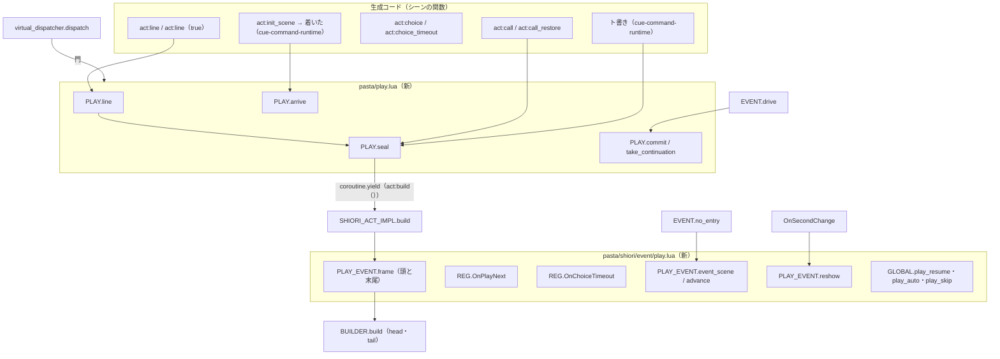
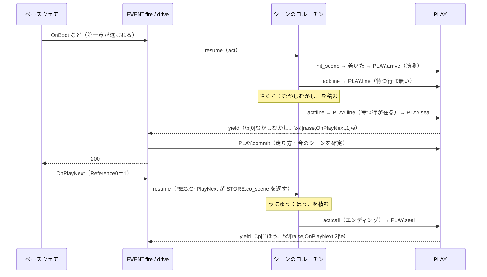
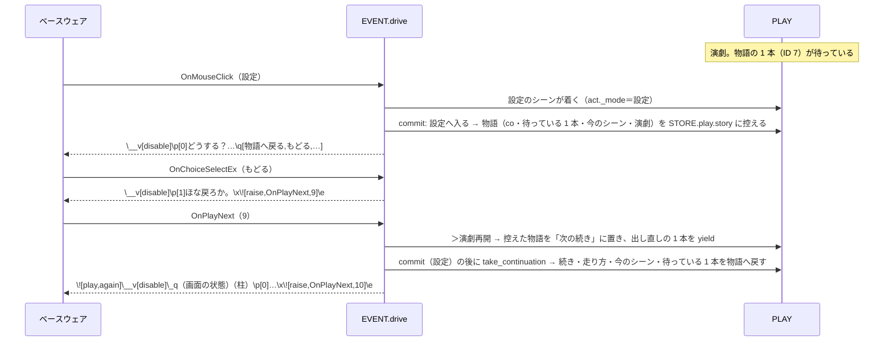

# novel-talk-flow 暫定設計（2026-11-19）

**暫定である。** requirements.md も spec.json も、まだ無い。骨子（`.kiro/specs/novel-areka-contract/final-model-2026-11-19.md`、以下「骨子」）と、この spec の brief の「決定（2026-11-19。最終形）」の節から、暫定の要件を起こし、それに対して設計した。目的は、Phase 13 の 8 本を並べて、設計どうしの食い違いを先に見つけることである。名前（モジュール名・関数名・イベント名）は、どれも仮である。

- 正とした物: 骨子、この spec の brief の「決定」の節と「申し送り」、他の 7 本の brief の「決定」の節。
- 読んだコード: 下の「調査と判断の記録」に、行番号つきで並べた。どれも、この worktree の今の main（`41c40d78`）を読んだ。
- 動かしていない。ビルドもテストもしていない。

---

## 暫定の要件

番号は、後の節から引く。「仮定」と書いた所は、骨子と brief に書いていない所を、設計のために置いた物である（「骨子・brief との食い違いと、決まっていない所」に、全部を並べた）。

### R1 再生モードの柱

1. pasta は、属性 `＆再生モード`（英字 `play_mode`。仮定）の値「トーク」「演劇」「設定」を、走り方として読む。
2. シーンに着いた時（イベントで選ばれた時と、最後の行の `＞` で着いた時）、そのシーンの階層（ファイル属性 → グローバル → ローカル）に `＆再生モード` があれば、その値が走り方になる。無ければ、前の走り方が続く。
3. 途中の行の `＞` で呼んだ先では、走り方は変わらない。
4. 値が 3 つのどれでもない `＆再生モード` は、読み込みのエラーにする（`＆優先` の不正な値と同じ扱い）。`pasta_check validate` も、同じ物を誤りとして出す。
5. 既定（どのシーンにも書いていない）は、トークである。

### R2 区切り（1 本の範囲）

1. 演劇と設定の間、pasta は、さくらスクリプトを「前の区切りの次から、次のアクション行（と、その継続行）の末尾まで」で 1 本にして返し、そこで止まる。字の無いアクション行も 1 本になる。
2. ト書き・柱・アクター指定行は、直後のアクション行の 1 本に、書いた順で入る。
3. 選択肢の行（`＠？`）と `！select` は、直前のアクション行の 1 本に入る。
4. 止まった所は、続きのイベントで再開する（チェイントークと同じ止まり方）。
5. 後ろにアクション行が無い残りは、待たない 1 本として返す。
6. トークの間は、今の出力を 1 バイトも変えない。

### R3 1 本の末尾

1. 演劇と設定の、クリックを待つ 1 本の末尾に、pasta は `\x\![raise,OnPlayNext,ID]` を付ける。ID は、1 本ごとに増える英数字である。
2. 選択肢を待つ 1 本には、`\x` も `\![raise]` も付けない。
3. 待たない 1 本には、何も付けない。
4. 設定の 1 本は、頭に `\__v[disable]` を付けて、バックログに貯めない。

### R4 待たない印

1. アクション行に展開された文の中に `\![parallel]` が在れば、pasta は、その行の末尾で区切らず、次のアクション行と同じ 1 本にする。
2. areka へは、印を `\![parallel,1]` に替え、その単語の終わりに `\![parallel,0]` を置く。areka でないベースウェアへは、どちらも出さない。
3. 高速再生と出し直しでは、区間を出さず、区間の中の最後の表情（`\s[…]`）だけを置く。

### R5 再開

1. `OnPlayNext` の Reference0 が、今待っている 1 本の ID と同じなら、pasta は止まった所から再開し、次の 1 本を返す。
2. ID が合わない `OnPlayNext`（遅れて届いた物）は、捨てる（204）。

### R6 分岐

1. 演劇と設定の間、イベントのシーンは、今のシーンのグローバルシーンのローカルシーンを先に探し、無ければ、今までどおりに探す。
2. イベントで選ばれたシーンが台詞を出したら、続き（`STORE.co_scene`）と今のシーンは、そのシーンに替わる。台詞を出さなければ、どちらも替わらない（`chain-talk-interrupt` と同じ）。
3. 演劇と設定の間は、`＊チェイントーク中断` を動かさない（イベントは割り込みでなく、分岐である。仮定）。
4. 演劇と設定の間、つつき・撫での近道（`＊つっつき反応…`・`＊さわり反応…`）は探さず、イベント名のシーンだけを探す（仮定。自動トーク停止の間と同じ）。

### R7 進める

1. 演劇と設定の間、どのシーンも拾わなかった左クリック（`OnMouseClick` の Reference5＝0）は、クリックを待っている 1 本を「進める」。R5 と同じに再開する。
2. 選択肢を待っている 1 本では、進めない（204）。

### R8 いつもの反応との書き分け

1. イベントの act を作る時、pasta は、ローカル変数 `＄演劇` に、演劇か設定の間は今のシーンのグローバルシーンの書いた名前を、トークの間は空の文字列を入れる。

### R9 時報と雑談

1. 演劇と設定の間、仮想ディスパッチャは、時報・ランダムトーク・止まっている続きを返さない。`wake_talk` の予約も、この門で止まる。

### R10 設定のモード

1. 設定の場面は、物語の再生位置を動かさない。設定へ入った時の物語（続き・待っている 1 本・今のシーン・走り方）を、pasta は 1 つ控える。
2. 設定の 1 本は記録しない（R3.4。目印と控えは、`novel-checkpoint-rollback` が作らない）。
3. `＞演劇再開`（英字 `play_resume`）は、控えた物語へ戻る。何も戻さない（変数もアクター状態も、今のまま）。待っていた 1 本を、出し直しの形（R11.2）で 1 本返す。
4. 物語が待っていなかった時（トークから設定を開いた時）の `＞演劇再開` は、開く前の走り方へ戻り、何も返さない。
5. 設定の場面から、別のシーンへ `＞` で飛んだら、控えた物語は捨て、飛んだ先から続く。

### R11 出し直し

1. 演劇と設定の間、`OnSecondChange` の Status に talking も choosing も無く、待っている 1 本が在れば、pasta は、その 1 本を出し直す。続きは進めない。
2. 出し直しの 1 本は、`\![play,again]\__v[disable]\_q` で始め、画面の状態（アクター状態）と、今のシーンの階層の柱と、待っていた 1 本の中身（瞬間の命令を抜いた物）を書き、新しい ID の末尾を付ける。

### R12 オートと「時間で次へ」

1. オートの入切と時間（ミリ秒）は、pasta が覚える。組み込みの呼び出し `＞オート（ミリ秒）`（0 で切る。英字 `play_auto`。仮定）で切り替える。
2. その行だけの `！時間で次へ（ミリ秒）` は、オートより勝つ。
3. 時間の在るクリック待ちの 1 本は、areka へは頭に `\![play,xtimeout,ミリ秒]` を、SSP へは末尾を `\![timerraise,ミリ秒,1,OnPlayNext,ID]\x\![timerraise,0,1,OnPlayNext]\![raise,OnPlayNext,ID]` にして出す。

### R13 高速再生と既読

1. 高速再生の入切は、pasta が覚える。`＞高速再生（１）`・`＞高速再生（０）`（英字 `play_skip`。仮定）で切り替える。
2. 高速再生の間、演劇のクリック待ちの 1 本は、頭に `\_q` を付け、`\x` と瞬間の命令を出さず、末尾は `\![raise,OnPlayNext,ID]` だけにする。
3. 高速再生は、選択肢の 1 本・まだ読んでいない 1 本・入力のイベント（`OnMouseClick`・`OnMouseDoubleClick`・`OnKeyPress`）で止まる。
4. pasta は、演劇のクリック待ちの 1 本を返すたびに、今のシーンの書いた名前と行の番号を、既読として覚える。置き場は、スロット変数でないグローバル変数 `pasta_read`（全セーブ共通）である。

### R14 選択肢の条件と時間切れ（文法に足す）

1. 選択肢の行の後ろに、シーンの宣言と同じ形の条件を書ける（`＠？手を振る「手を振ってみる」　＆＄＊スロット訪ねた数≧３`）。条件を満たさない選択肢は出さない。比べ方は、シーンの条件と同じである。
2. `！select（時間、飛び先）` の 2 つ目の引数で、時間切れの飛び先を書ける。`OnChoiceTimeout` が届いたら、選択肢を出したグローバルシーンのローカル → グローバルの順に、その名前のシーンを探して走らせる。
3. 1 つ目の引数の単位は、今のまま秒とする（仮定。骨子の「時間は、どれもミリ秒」と食い違う。「上位の決定へ差し戻しが要りそうな所」の 1）。

### R15 走りの失敗

1. 演劇の続きがエラーで止まったら、待っている 1 本も捨てる（止まるエラーの表記は今のまま）。
2. コルーチンの外（Lua から直に）で区切りに当たったら、区切らずに今までどおり集める。

### R16 検査・文書

1. `pasta_check validate` に、R1.4 の誤りを足す。組み込みの呼び出しの名前の表（`GLOBAL_NAMES`）に、R10.3・R12.1・R13.1 の名前を足す。
2. マニュアルの参照の章（SHIORI のイベントの既定のハンドラ・出力の組み立て・選択肢の文法）と、スキルの references を直す。ノベルの章そのものは `manual-novel-guide` が書く。

---

## 概要

pasta は、今は 1 回のイベントに、シーンを最後まで（か `＞yield` まで）走らせて、さくらスクリプトを 1 本返す。この spec は、柱 `＆再生モード` が演劇か設定の間だけ、アクション行ごとに止まって 1 本ずつ返す走り方を足す。止まり方は、今のチェイントーク（`STORE.co_scene` に止まったコルーチンを置き、次のイベントで再開する）をそのまま使う。新しく作るのは、「どこで止まるか」（区切り）・「1 本の末尾に何を付けるか」（枠）・「どのイベントで再開するか」（受け口）の 3 つである。

### Goals

- 台本を書く人は、台詞だけを書く。`\x` も、次の場面の書き方も、要らない（R2・R3）。
- 同じ台本を、SSP（フェーズ 1）と areka で動かす。違いは、枠の文字列だけに閉じ込める（R3・R4・R12）。
- トークのゴーストの出力は、1 バイトも変えない（R2.6）。

### Non-Goals

- 目印・控え・巻き戻し・早回し（`novel-checkpoint-rollback`）。この設計は、差し込む場所と、読む口を用意するだけである。
- スロット（`novel-save-slots`）。
- ト書きと柱の出力・別名表・ベースウェアの判定・「着いた」の判定（`cue-command-runtime`）。
- 完全一致の場面選び（`scene-exact-match`）。
- 話者の名前（取り決めの `speaker`。既定は並びの名前なので、pasta は何も出さない）。
- 声をファイル名で引く仕組み、変わらない行 ID（骨子 4 章の D で作らないと決まった）。
- `pasta.toml` のノベル向けの設定（作らないと決まった）。

---

## 境界の約束

### This Spec Owns

- 走り方の状態（今の走り方・今のシーン・待っている 1 本・設定の間に控えた物語・オートと高速再生・既読）。
- 区切りの決まりと、その判定（`act:line`・`act:call`・`act:choice` に差し込む）。
- 1 本の枠（頭と末尾の文字列。ベースウェアごとの形）。
- 受け口: `OnPlayNext`・拾われなかった左クリック・`OnChoiceTimeout`（時間切れの飛び先）・`OnSecondChange` の出し直し。
- 演劇の間のイベントのシーンの探し方（ローカルを先に）。
- `＄演劇` の転記。
- 組み込みの呼び出し `演劇再開`・`オート`・`高速再生`（と英字）。
- 文法: 選択肢の行の条件・`！select` の 2 つ目の引数。
- `＆再生モード` の値の検査。

### Out of Boundary

- 柱を打つこと・ト書きを出すこと・「シーンに着いた」の判定・ベースウェアの判定（`cue-command-runtime`）。
- 目印の文字列・控え・巻き戻し・早回し・アクター状態の記録（`novel-checkpoint-rollback`）。
- スロット（`novel-save-slots`）。
- 当たり判定のクリックの振り分け（`shell-element-click`）。
- 取り決めの文書（`novel-areka-contract`）。

### Allowed Dependencies

- 今の pasta の部品: `STORE.co_scene` と `EVENT.drive`（`chain-talk-interrupt`）、`SCENE.search`（条件つき・ローカル範囲）、`SCENE.attrs`（属性の倉）、`@pasta_search` の条件の比べ方（`scene_cond.rs`）、`STORE.auto_talk_paused` の門（`ontalk-suppression`）、`BUILDER.build` の `tracking_buffer`（`vertical-balloon-lines`）。
- `cue-command-runtime` の「着いた」の呼び出し・階層の柱・ベースウェアの判定・ト書きのトークンの形（下の「他の spec との境界」）。

### Revalidation Triggers

- `EVENT.drive` の続きの決まり（種類の判定・台詞の印・`set_co_scene`）を変える spec。
- `act:line()` の生成の形を変える spec（この spec は、継続行に引数を足す）。
- `BUILDER.build` の頭と `\e` の前に物を出す spec（この spec は、そこへ枠を置く）。
- `virtual_dispatcher.dispatch` の門の順を変える spec。
- `＆再生モード` の名前・値・英字を変えること。
- 取り決めの `OnPlayNext`・`\![play,again]`・`\![play,xtimeout]`・`\![parallel,1/0]` の名前を変えること。

---

## アーキテクチャ

### 今の作り（関係する所だけ）

- イベントは `EVENT.fire`（`shiori/event/init.lua` 290〜340 行）が受け、ハンドラ（鎖 → `REG` の値 → `EVENT.no_entry`）がコルーチンを返したら、`EVENT.drive`（236〜282 行）で再開する。
- 続きは `STORE.co_scene` に 1 つ（`store.lua` 70 行）。`EVENT.drive` は、再開の前に種類（resume・none・preempt・interrupt）を決め（`drive_kind` 129〜138 行）、台詞を出した割り込みなら続きを置き換え、台詞の無い割り込みなら残す（274〜280 行）。
- シーンの関数は、コルーチンの中で走る（`SCENE.wrap` 221〜226 行。最後に `act:build()` を返す）。途中で止まるのは `act:yield()`（`act.lua` 683〜697 行）と `act:get_property()`（`shiori/act.lua` 365 行）だけである。
- 生成は、アクション行と継続行の頭に同じ `act:line()` を出す（`element_gen.rs` 282・304・316〜321 行）。最後の行の `＞` は `return act:call(…)`、途中の行の `＞` は `act:call_restore(…)`（同 231〜235 行、`scope_gen.rs` 346 行）。
- 出力の組み立ては `BUILDER.build`（`sakura_builder.lua` 561〜688 行）で、1 回ごとに状態を作り直し、最後に `\e` を付ける（686 行）。

### 足す形



- `pasta/play.lua` は、`pasta/act.lua` から呼ぶので、`pasta.shiori.*` を読まない（今の層の向きを守る）。区切りの判定と状態だけを持つ。
- `pasta/shiori/event/play.lua` は、枠（タグ）・受け口・組み込みの呼び出しを持つ。`event/init.lua` の既定のハンドラの読み込みの並び（85〜92 行）に 1 行足す。

### 技術

新しい依存は無い。Lua（LuaJIT）と、今の Rust のクレートだけである。Rust は、文法（`pasta_dsl`）・生成（`pasta_lua/src/code_gen`）・条件の比べ方の口（`pasta_lua/src/search`）・属性の名前（`pasta_core`）・検査（`pasta_check`）を小さく触る。

---

## ファイルの構成

### 新しいファイル

| ファイル | 中身 |
| -------- | ---- |
| `crates/pasta_lua/pasta_scripts/pasta/play.lua` | 走り方の状態の読み書き・区切り（`PLAY.line`・`PLAY.seal`・`PLAY.choice`・`PLAY.parallel_text`）・着いた時（`PLAY.arrive`）・確定（`PLAY.commit`・`PLAY.take_continuation`・`PLAY.abort`）・位置（`PLAY.position`）。目安 150 行 |
| `crates/pasta_lua/pasta_scripts/pasta/shiori/event/play.lua` | 枠（`PLAY_EVENT.frame`）・出し直し（`PLAY_EVENT.again_script`・`PLAY_EVENT.reshow`）・イベントのシーンの探し方（`PLAY_EVENT.event_scene`・`PLAY_EVENT.advance`）・`REG.OnPlayNext`・`REG.OnChoiceTimeout`・`GLOBAL` の 6 つの名前・`＄演劇` の転記（`PLAY_EVENT.on_request`）。目安 250 行 |
| `crates/pasta_lua/tests/lua_specs/play_flow_test.lua` | 区切り・枠・待たない印・走り方の切り替え |
| `crates/pasta_lua/tests/lua_specs/play_event_test.lua` | 受け口・分岐・進める・設定と演劇再開・出し直し・門・オート・高速再生・既読 |
| `crates/pasta_lua/tests/novel_talk_flow_e2e_test.rs` | 本物の辞書を読み込んで、イベントを順に送り、返る文字列を比べる |

### 触る今のファイル

「共有するファイル」の節に、全部を並べた。

---

## 流れ

### 1 本ずつ進む（区切りと再開）

```pasta
＆再生モード：演劇

＊第一章
    さくら：むかしむかし。
    うにゅう：ほう。
    ＞エンディング
```



- 区切るのは、次の 3 つの所で、「待っているアクション行が在る」ときだけである。
  1. 次のアクション行の頭（`act:line()`。継続行の頭 `act:line(true)` では区切らない）。
  2. ト書きの頭（`cue-command-runtime` が `PLAY.seal` を呼ぶ）。
  3. `＞` の頭（`act:call`。最後の行・途中の行・組み込みの呼び出しのどれでも。`act:call_restore` も `act:call` を通る。`act.lua` 821〜823 行）。
- 選択肢の行と `！select` は区切らない。`act:choice` は、待っている物を「選択肢」にする。
- 変数の代入の行は、生成コードが act を呼ばないので、区切らない（前の 1 本の中で走る。出力は無いので、見え方は変わらない）。
- シーンの終わり: `SCENE.wrap` の最後の `act:build(true)` が、待っている行が在れば、それを枠に入れて返す。コルーチンは終わる。次の `OnPlayNext` は、続きが無いので 204 になる（物語はそこで止まり、次のイベントを待つ。骨子 4 章の A）。

### イベントで分岐する

```pasta
＊教室　＆曲：昼のテーマ
    さくら：気になる所を押してみて。

    ・OnMouseClick　＆＄ｒ４＝「ドア」
        さくら：鍵がかかってる。
        うにゅう：開かへんな。
```

1. 「気になる所を押してみて。」を返し、`STORE.co_scene` にコルーチンが止まり、今のシーンは `教室` である。
2. 遊ぶ人がドアを押す → `OnMouseClick`（Reference4＝ドア）。`REG.OnMouseClick` は無いので、`EVENT.no_entry` → `PLAY_EVENT.event_scene(act, "OnMouseClick")` が、`SCENE.search("OnMouseClick", "教室_1", act)` を先に引く → `・OnMouseClick` が条件に合う。
3. `EVENT.drive` の種類は interrupt。演劇の間なので、中断のシーンは掛けない（R6.3）。台詞を出したので、続きは `・OnMouseClick` のコルーチンに替わり、`PLAY.commit` が今のシーンを `教室_1`・`OnMouseClick_1` にする。
4. 「開かへんな。」を読み終えると、コルーチンは終わる。もう一度ドアを押すと、今のシーンのグローバルは `教室_1` のままなので、同じ反応が頭から出る。
5. どの当たり判定でもない所を押すと、どのシーンも拾わないので、`PLAY_EVENT.advance` が、待っている 1 本（クリック待ち）を進める。待っている 1 本が無ければ（反応を読み終えた後）、204。

### 設定の画面と `＞演劇再開`

```pasta
＊OnMouseClick　＆＄ｒ４＝「設定」　＆再生モード：設定
    さくら：どうする？
    ＠？もどる「物語へ戻る」

    ・もどる
        うにゅう：ほな戻ろか。
        ＞演劇再開
```



- 設定の場面の中で、`STORE.co_scene` は設定の場面のコルーチンになる（今の `EVENT.drive` のまま）。物語のコルーチンは、`STORE.play.story.co` に在る。
- `＞演劇再開` は、組み込みの呼び出しで、自分で `coroutine.yield(出し直しの文字列)` する。設定の場面のコルーチンは、その後で捨てられる（`take_continuation` が `STORE.co_scene` を物語のコルーチンに替えるので、参照が外れる）。

### 待っている行が外から消されたとき

1. 物語の 1 本（ID 12）を返した。`STORE.play.wait` に、その 1 本のトークン列が在る。
2. 外からの SSTP が再生を置き換えた。`\![raise,OnPlayNext,12]` は実行されない。
3. 次の `OnSecondChange`。コールバックの掃引の後、`PLAY_EVENT.reshow(act)` が、演劇か設定で、待っている 1 本が在り、Status に talking も choosing も無いのを見て、出し直しの 1 本（ID 13）を文字列で返す。文字列なので、`set_co_scene` を通らず、続きはそのまま残る（`second_change.lua` 11〜12 行の今の約束と同じ）。

---

## 要件の対応表

| 要件 | 部品 | 流れ |
| ---- | ---- | ---- |
| R1 | `PLAY.arrive`・`PLAY.commit`・`PLAY_MODE_KEYS`・`invalid_play_mode`・`pasta_check` の誤り | 1 本ずつ進む |
| R2 | `PLAY.line`・`PLAY.seal`・`PLAY.choice`・`act:line(true)`・`SCENE.wrap` | 1 本ずつ進む |
| R3 | `PLAY_EVENT.frame`・`BUILDER.build` の `head`・`tail` | 1 本ずつ進む |
| R4 | `PLAY.parallel_text`・`PLAY_EVENT.frame` | — |
| R5 | `REG.OnPlayNext`・`STORE.play.wait.id` | 1 本ずつ進む |
| R6 | `PLAY_EVENT.event_scene`・`EVENT.drive` の差し込み・`mouse.lua` | イベントで分岐する |
| R7 | `PLAY_EVENT.advance` | イベントで分岐する |
| R8 | `PLAY_EVENT.on_request`（`create_act` から） | — |
| R9 | `virtual_dispatcher.dispatch` の門 | — |
| R10 | `PLAY.commit`・`STORE.play.story`・`GLOBAL.play_resume`・`PLAY.take_continuation` | 設定の画面 |
| R11 | `PLAY_EVENT.reshow`・`PLAY_EVENT.again_script` | 外から消されたとき |
| R12 | `GLOBAL.play_auto`・`PLAY.set_line_timeout`・`PLAY_EVENT.frame` | — |
| R13 | `GLOBAL.play_skip`・`PLAY_EVENT.frame`・`save.pasta_read` | — |
| R14 | `grammar.pest` の `choice_line`・`ChoiceNode.conds`・`act:choice` の 3 つ目の引数・`SEARCH:cond_holds`・`act:choice_timeout` の 2 つ目の引数・`REG.OnChoiceTimeout` | — |
| R15 | `PLAY.abort`（`EVENT.drive` のエラーの枝）・`PLAY.seal` のコルーチンの判定 | — |
| R16 | `report.rs`・`transpile_rules.rs`・`builtins.rs`・マニュアル・`gen-skill-refs` | — |

---

## 部品とインターフェース

### PLAY（`pasta/play.lua`。新しい）

`pasta.store` と `pasta.scene` だけを読む。`pasta.shiori.*` は読まない。

```lua
--- 走り方の値（柱の値そのまま）
---@alias PlayMode "トーク"|"演劇"|"設定"

--- 今のシーン（着いたシーン）
---@class PlayHere
---@field global string  グローバルの登録名（例: "教室_1"）
---@field local_ string  ローカルの登録名（グローバル自身は "__start__"）
---@field gname string   グローバルの書いた名前（例: "教室"）
---@field lname string|nil ローカルの書いた名前
---@field key string     既読のキー（gname、ローカルなら gname .. "・" .. lname）

--- act の走り方（無ければトーク）
---@param act table
---@return PlayMode
function PLAY.mode_of(act) end

--- 演劇か設定か（区切る走り方か）
---@param act table
---@return boolean
function PLAY.stepping(act) end

--- 着いた時（cue-command-runtime の「着いた」が、柱を打つ前に 1 回呼ぶ）
--- mode は、階層を引いた `＆再生モード` の値（書いていなければ nil）
---@param act table
---@param here PlayHere
---@param mode PlayMode|nil
function PLAY.arrive(act, here, mode) end

--- 行の頭（act:line から）。continued は継続行のとき true
---@param act table
---@param continued boolean|nil
function PLAY.line(act, continued) end

--- 区切る（待っているアクション行が在り、待たない印が無く、コルーチンの中なら、1 本を yield する）
--- act:call・ト書き（cue-command-runtime）・PLAY.line から呼ぶ
---@param act table
function PLAY.seal(act) end

--- 選択肢を積んだ（act:choice から）。待っている物を「選択肢」にする
---@param act table
function PLAY.choice(act) end

--- 台詞の文の待たない印を読む（act:talk・act:sakura_script から）
--- `\![parallel]` が在れば、act に印を立て、`\![parallel,1]` に替えて末尾に `\![parallel,0]` を足した文を返す
---@param act table
---@param text string
---@return string
function PLAY.parallel_text(act, text) end

--- その 1 本だけの「時間で次へ」（cue-command-runtime の `！時間で次へ` から）
---@param act table
---@param ms integer
function PLAY.set_line_timeout(act, ms) end

--- 今積んでいる 1 本の位置（novel-checkpoint-rollback が控えに使う）
---@param act table
---@return { here: PlayHere, line: integer }|nil  トークなら nil
function PLAY.position(act) end

--- EVENT.drive の確定（続きを置いた後でなく、置く前に呼ぶ）
--- replace は「このコルーチンが続きを持つか」（台詞の無い割り込みなら false）
---@param scene_act table|nil
---@param replace boolean
function PLAY.commit(scene_act, replace) end

--- 次の続きを置く（演劇再開・ロード）。EVENT.drive が確定の後に取る
---@param cont { co: thread|nil, mode: PlayMode, here: PlayHere|nil, wait: table|nil }
function PLAY.set_continuation(cont) end

---@return { co: thread|nil, mode: PlayMode, here: PlayHere|nil, wait: table|nil }|nil
function PLAY.take_continuation() end

--- 続きがエラーで止まった（待っている 1 本を捨てる）
function PLAY.abort() end
```

中の決まり（擬似コード）:

```lua
function PLAY.line(act, continued)
    if not PLAY.stepping(act) or continued then return end
    if act._pending and not act._parallel then PLAY.seal(act) end
    act._parallel = nil           -- 待たない印は、次のアクション行の頭まで効く
    act._pending = act._pending or "click"
end

function PLAY.seal(act)
    if not act._pending or act._parallel then return end
    local co, main = coroutine.running()
    if main or co == nil then return end      -- R15.2
    act._sealing = true                        -- build が枠を付ける印（build が外す）
    local resumed = coroutine.yield(act:build())
    if type(resumed) == "table" then act._resume_req = resumed.req end
end

function PLAY.arrive(act, here, mode)
    act._here = here
    act._line = 0
    act._mode = mode or act._mode or STORE.play.mode
end
```

- `act._line` は、今のシーンに着いてから枠に入れた、演劇のクリック待ちと選択肢待ちの 1 本の数である。積んでいる 1 本の行の番号は `act._line + 1`。途中の `＞` で呼んだ先は着いたことにならないので、同じ番号で数え続ける。
- `act._mode` は act ごとに持つ。グローバルの `STORE.play.mode` は、`PLAY.commit` が確定させる。台詞を出さなかった割り込みは、確定させない（R6.2）。
- `PLAY.commit`:

```lua
function PLAY.commit(scene_act, replace)
    if not (replace and scene_act and scene_act._mode) then return end
    local p, new = STORE.play, scene_act._mode
    if new == "設定" and p.mode ~= "設定" then
        p.story = { co = STORE.co_scene, wait = p.wait, here = p.here, mode = p.mode }
    elseif new ~= "設定" then
        p.story = nil                        -- R10.5
    end
    p.mode, p.here = new, scene_act._here or p.here
end
```

### act への差し込み（`pasta/act.lua`）

| 関数 | 足すこと |
| ---- | -------- |
| `ACT_IMPL.line(self, continued)`（248 行） | 頭で `PLAY.line(self, continued)`。継ぎ目の印は今のまま、その後で立てる |
| `ACT_IMPL.call`（725 行） | 名前の検査（727〜737 行）の後、`find_handler` の前に `PLAY.seal(self)` |
| `ACT_IMPL.talk`（263 行）・`ACT_IMPL.sakura_script`（284 行） | トークンに積む前に `text = PLAY.parallel_text(self, text)`（文字列の時だけ） |
| `ACT_IMPL.choice(self, target, display, conds)`（339 行） | `conds` が在れば `@pasta_search` の `cond_holds(conds, self.var, self.save)` で見て、偽なら積まない。積んだら `PLAY.choice(self)` |
| `ACT_IMPL.choice_timeout(self, seconds, target)`（350 行） | トークンに `target` を足す（組み立ては読まない） |

- act のメソッドは増やさないので、`pasta_check` の `ACT_METHODS`（`builtins.rs` 28 行）は変わらない。
- トークの間は、`PLAY.line`・`PLAY.seal`・`PLAY.choice` は何もしない。`PLAY.parallel_text` も、トークの間は文をそのまま返す（R2.6）。

### SCENE（`pasta/scene.lua`）

- `SCENE.wrap`（221〜226 行）の最後を `return act:build(true)` にする。`ACT_IMPL.build` は引数を読まないので、トークの出力は変わらない。`run_interrupt_scene` が差し替える `build`（`init.lua` 196 行）も、引数を読まない。

### SHIORI の組み立て（`pasta/shiori/act.lua` の `SHIORI_ACT_IMPL.build`）

```lua
function SHIORI_ACT_IMPL.build(self, final)
    local token = ACT.IMPL.build(self)
    -- （台詞の印・中断の差し替えは今のまま。演劇の間は _on_speech が掛からない）
    local frame = PLAY_EVENT.frame(self, token, final)   -- トークなら nil
    if token == nil and not (frame and frame.head) then return nil end
    local script = BUILDER.build(token or {}, {
        ...今の 4 つ...,
        head = frame and frame.head,
        tail = frame and frame.tail,
    }, STORE.actor_spots, STORE.appearance)
    return frame and PLAY_EVENT.finish(self, script) or script
end
```

- `PLAY_EVENT.frame(act, token, final)` は、`act._sealing` か、`final` で待っているアクション行が在るときだけ、枠を返す（`get_property` の 1 本や `＞チェイントーク` の 1 本には付けない）。ほかは、設定の間の `\__v[disable]` だけを返す（待たない 1 本も貯めない）。
- `PLAY_EVENT.finish(act, script)` は、ベースウェアが areka でなければ `\![parallel,1]`・`\![parallel,0]` を消す。高速再生の 1 本なら、区間を最後の表情に縮める。
- 枠を付けた 1 本は、トークン列（`token`）を `STORE.play.wait` に控える（出し直しに使う）。

### BUILDER（`pasta/shiori/sakura_builder.lua`）

- `BuildConfig` に `head`・`tail`（どちらも文字列か nil）を足す。
- `BUILDER.build` は、バッファを作った直後（567 行の後）に `if config.head then buffer:put(config.head) end`、`\e` の前（686 行の前）に `if config.tail then buffer:put(config.tail) end` を足す。どちらも `tracking_buffer` を通す（`vertical-balloon-lines` の申し送り）。nil なら何も出さないので、トークの出力は変わらない。
- 字にも選択肢にも数えず、列も動かさない（`put_break` は通さない）。
- `BUILDER.build` の分岐は増やさない（循環的複雑度 28 のまま）。

### PLAY_EVENT（`pasta/shiori/event/play.lua`。新しい）

```lua
--- 1 本の枠。トークなら nil
---@param act ShioriAct
---@param token table[]|nil  まとめたトークン列
---@param final boolean|nil  シーンの終わりの組み立てか
---@return { head: string|nil, tail: string|nil }|nil
function PLAY_EVENT.frame(act, token, final) end

---@param act ShioriAct
---@param script string
---@return string
function PLAY_EVENT.finish(act, script) end

--- 出し直しの 1 本（R11.2）。wait は STORE.play.wait か、控えた物語の wait
---@param act ShioriAct
---@param wait PlayWait
---@return string
function PLAY_EVENT.again_script(act, wait) end

--- OnSecondChange から。出し直すなら文字列、でなければ nil
---@param act ShioriAct
---@return string|nil
function PLAY_EVENT.reshow(act) end

--- イベントのシーンの探し方（R6.1）。演劇と設定の間はローカルを先に。トークなら SCENE.co_exec と同じ
---@param act ShioriAct
---@param name string  イベント名
---@return thread|nil
function PLAY_EVENT.event_scene(act, name) end

--- 拾われなかったイベントの最後の段（R7）。進めるなら STORE.co_scene、でなければ nil
---@param act ShioriAct
---@return thread|nil
function PLAY_EVENT.advance(act) end

--- create_act から。＄演劇 の転記と、入力のイベントで高速再生を止める
---@param act ShioriAct
function PLAY_EVENT.on_request(act) end
```

枠の決め方（`PLAY_EVENT.frame`）:

| act の走り方 | 待つ物 | 高速再生 | 時間（その行・オート） | 頭 | 末尾 |
| ------------ | ------ | -------- | ---------------------- | -- | ---- |
| 演劇 | クリック | 切 | 無し | （目印は `novel-checkpoint-rollback`） | `\x\![raise,OnPlayNext,ID]` |
| 演劇 | クリック | 切 | 在る・areka | `\![play,xtimeout,ms]` | `\x\![raise,OnPlayNext,ID]` |
| 演劇 | クリック | 切 | 在る・SSP | — | `\![timerraise,ms,1,OnPlayNext,ID]\x\![timerraise,0,1,OnPlayNext]\![raise,OnPlayNext,ID]` |
| 演劇 | クリック | 入・既読 | — | `\_q` | `\![raise,OnPlayNext,ID]` |
| 演劇 | 選択肢 | （止まる） | — | — | 無し |
| 設定 | クリック | — | その行だけ | `\__v[disable]` | クリックの行と同じ |
| 設定 | 選択肢 | — | — | `\__v[disable]` | 無し |
| 設定 | 待たない | — | — | `\__v[disable]` | 無し |
| 演劇 | 待たない | — | — | 無し | 無し |

- ID は `STORE.play.seq` を 1 足した物の十進の文字列。枠を付けるたびに `STORE.play.wait = { id, kind, tokens, mode, here, line, timeout }` を置き直す。
- 高速再生の間は、トークン列から、瞬間の命令のトークン（`cue-command-runtime` のト書きのトークンで `instant` が真の物）を抜いてから組み立てる。まだ読んでいない行（`pasta_read` に無い）なら、高速再生を切って、ふつうの枠にする。
- 演劇のクリック待ちの 1 本を枠に入れたら、`act._line` を 1 足し、`pasta_read[here.key][tostring(line)] = true` を書く。

受け口:

```lua
REG.OnPlayNext = REG.OnPlayNext or function(act)
    local w = STORE.play.wait
    if not (w and w.kind == "click" and act.req.reference[0] == w.id) then return nil end
    STORE.play.wait = nil
    return STORE.co_scene          -- 無ければ nil（204）
end

REG.OnChoiceTimeout = REG.OnChoiceTimeout or function(act)
    local w = STORE.play.wait
    if w and w.kind == "choice" then
        STORE.play.wait = nil
        if w.timeout then return route(act, w.timeout.target, w.timeout.scope) end
        return nil
    end
    return PLAY_EVENT.event_scene(act, act.req.id)   -- 今の ＊OnChoiceTimeout のシーンは今までどおり
end
```

- `route` は、選択肢の振り分け（`choice_select.lua` 51〜70 行の「ローカル → グローバル・条件漏れは止まるエラー・名前が無ければ nil」）と同じ物を使う。`shell-element-click` が関数として取り出す予定なので、それを使う（「他の spec との境界」）。
- `PLAY_EVENT.advance(act)`: 走り方が演劇か設定、`act.req.id == "OnMouseClick"`、Reference5 が `"0"`、`STORE.play.wait.kind == "click"` のときだけ、`STORE.play.wait = nil` にして `STORE.co_scene` を返す。

組み込みの呼び出し（`GLOBAL`。`＞自動トーク停止` と同じ作り。`entry.lua` 31〜48 行）:

| 日本語 | 英字 | 引数 | すること |
| ------ | ---- | ---- | -------- |
| `演劇再開` | `play_resume` | なし | R10.3・R10.4 |
| `オート` | `play_auto` | ミリ秒（0 で切る） | `save.pasta_play_auto` に書く（全セーブ共通） |
| `高速再生` | `play_skip` | 1 か 0 | `STORE.play.skip` に書く（保存しない） |

```lua
function GLOBAL.play_resume(act)
    local story = STORE.play.story
    if story == nil then return end                       -- 設定でない所から呼んだ
    local cont = { co = story.co, mode = story.mode, here = story.here, wait = story.wait }
    PLAY.set_continuation(cont)
    if story.wait then
        coroutine.yield(PLAY_EVENT.again_script(act, story.wait))  -- wait.id は again_script が新しくする
    end
end
```

### EVENT（`pasta/shiori/event/init.lua`）

| 所 | 足すこと |
| -- | -------- |
| 読み込みの並び（85〜92 行） | `require("pasta.shiori.event.play")` を 1 行 |
| `create_act`（104〜109 行） | 転記の後に `PLAY_EVENT.on_request(act)` |
| `EVENT.no_entry`（222〜226 行） | `return PLAY_EVENT.event_scene(act, act.req.id) or PLAY_EVENT.advance(act)` |
| `EVENT.drive` の 2（245〜247 行） | `if kind == "interrupt" and not PLAY.stepping_now() then` …（演劇と設定の間は中断のシーンを掛けない） |
| `EVENT.drive` のエラーの枝（255〜263 行） | `PLAY.abort()` |
| `EVENT.drive` の 8（274〜280 行） | 前に `PLAY.commit(scene_act, not (kind == "interrupt" and not spoke))`、後に `take_continuation` を当てる（下） |

```lua
    -- 8. 状態保存
    PLAY.commit(scene_act, not (kind == "interrupt" and not spoke))
    if scene_act and scene_act._interrupted then
        set_co_scene(nil, false)
    else
        set_co_scene(co, kind == "interrupt" and not spoke)
    end
    local cont = PLAY.take_continuation()      -- 演劇再開・ロードが置いた続き
    if cont then
        STORE.co_scene = cont.co
        STORE.play.mode, STORE.play.here, STORE.play.wait = cont.mode, cont.here, cont.wait
        if cont.mode ~= "設定" then STORE.play.story = nil end
    end
```

`PLAY.stepping_now()` は `STORE.play.mode ~= "トーク"`。

### 仮想ディスパッチャ・秒・マウス

- `virtual_dispatcher.dispatch` の門（257〜259 行）を `if STORE.auto_talk_paused or STORE.play.mode ~= "トーク" then return nil end` にする（R9）。`STORE.auto_talk_paused` は書かない（`ontalk-suppression` の契約。印を書くのは停止と再開の関数と `STORE.reset` だけ）。止まっている続き（`check_talk` 234 行の `STORE.co_scene`）も、この門で止まる。
- `second_change.lua` の既定（23〜38 行）: 掃引（26〜29 行）の後に `local again = PLAY_EVENT.reshow(act); if again then return again end`。
- `mouse.lua`: `on_poke`（143 行）と `on_touch`（165 行）の `STORE.auto_talk_paused` を、`STORE.auto_talk_paused or STORE.play.mode ~= "トーク"` にする（R6.4）。`exec_event_scene`（127〜129 行）を `PLAY_EVENT.event_scene(act, event)` にする。`mouse.lua` は `event/init.lua` を読まない約束（8 行）なので、`pasta.shiori.event.play` を読む（`play.lua` も `event/init.lua` を読まない）。

### 文法と生成

1. 選択肢の行の条件（R14.1）
   - `grammar.pest` 236 行: `choice_line = { pad ~ word_marker ~ question_marker ~ id ~ choice_label? ~ s ~ attrs? ~ or_comment_eol }`。条件とフラグだけを読み、宣言（`＆名前：値`）は誤りにする（パーサーで `ParseError`）。
   - `ast/scene.rs` の `ChoiceNode`（195 行）に `conds: Vec<Attr>` を足す（`Eq` を外すかは、`Attr` の派生に合わせる）。`parse_scene.rs` の `parse_choice_line`（306 行〜）で読む。
   - `scope_gen.rs` の `generate_choice`（376〜387 行）: `conds` が在るときだけ、3 つ目の引数に `{ { key = "＄＊スロット訪ねた数", op = ">=", value = 3 } }` を出す（`append_set_scene_attrs` の項目の形。415〜457 行）。無ければ今の 2 引数のまま（生成も変わらない）。
   - `@pasta_search` に `SEARCH:cond_holds(items, var, save) -> boolean` を足す（`search/context.rs` の `add_methods` 496 行〜、中身は `scene_cond.rs` の `evaluate`・`lookup`。87〜141 行）。大小の比べ方で数でない値は、シーンと同じに警告して偽。
2. `！select` の時間切れの飛び先（R14.2）
   - 文法は今のまま（`cue_arg_list` 228 行で、2 つ目の引数を書ける）。`scope_gen.rs` の `generate_choice_timeout`（395〜411 行）で、2 つ目の引数（`Ident`・`StringLiteral`）を `act:choice_timeout(20, "時間切れ")` の 2 つ目に出す。無ければ今のまま。
3. 継続行の頭（R2.1）
   - `element_gen.rs` の `generate_line_marker`（316 行）に「継続行か」を渡し、継続行（304 行）は `act:line(true)` を出す。アクション行は `act:line()` のまま。行の数は変わらないので、ソースマップと `init_scene` の行の対応はずれない。

### 検査

- `pasta_core/src/registry/scene_types.rs`: `PLAY_MODE_KEYS: [&str; 2] = ["再生モード", "play_mode"]` と、値の表 `PLAY_MODE_VALUES = ["トーク", "演劇", "設定"]`（`PRIORITY_KEYS` 158 行と同じ並び）。
- `scope_gen.rs` の `append_set_scene_attrs`（426〜447 行）に、値の不正を `TranspileError::invalid_play_mode` で止める枝を足す（`error.rs` 100 行の `invalid_priority` に倣う）。
- `pasta_check/src/validate/transpile_rules.rs`（127〜136 行）に同じ枝、`report.rs` に `FindingKind::TranspileInvalidPlayMode`（code `transpile-invalid-play-mode`。誤り）。`validate_parity_test.rs` で実行時と一致を確かめる。
- `builtins.rs` の `GLOBAL_NAMES`（8〜25 行）に 6 つ足す（16 → 22。`novel-save-slots` の 8 つと同じ表）。

---

## データモデル

### `STORE.play`（`pasta/store.lua`。保存しない。`STORE.reset` で作り直す）

```lua
STORE.play = {
    mode = "トーク",   -- PlayMode。確定した走り方
    here = nil,        -- PlayHere|nil。確定した今のシーン
    wait = nil,        -- PlayWait|nil。待っている 1 本
    story = nil,       -- 設定の間に控えた物語 { co, wait, here, mode }
    seq = 0,           -- ID の通し番号
    skip = false,      -- 高速再生
    next = nil,        -- take_continuation が取る続き
}
```

```lua
---@class PlayWait
---@field id string          末尾の \![raise,OnPlayNext,ID] の ID
---@field kind "click"|"choice"
---@field tokens table[]     枠を付ける前のまとめたトークン列（出し直しで組み立て直す）
---@field mode PlayMode
---@field here PlayHere
---@field line integer       行の番号
---@field timeout { target: string, scope: string|nil }|nil  時間切れの飛び先
```

### act の欄（プライベート。act ごと）

| 欄 | 意味 |
| -- | ---- |
| `_mode` | この act の走り方（着いた時に決まる） |
| `_here` | この act の今のシーン |
| `_line` | 着いてから枠に入れた 1 本の数 |
| `_pending` | 待っている物（nil・`"click"`・`"choice"`） |
| `_parallel` | 今の行に待たない印が在る |
| `_sealing` | 区切りの組み立ての間だけ真 |
| `_line_timeout` | その 1 本だけの時間（ミリ秒） |

### 保存する物（`pasta.save`。スロット変数でないグローバル変数。全セーブ共通）

```toml
pasta_play_auto = 3000

[pasta_read."教室"]
"1" = true
"2" = true

[pasta_read."教室・夕方"]
"1" = true
```

- 名前は、エンジン予約の頭 `pasta_` で始める（`pasta_talk_interval_min` と同じ。`virtual_dispatcher.lua` 89 行）。「スロット」・`slot_` で始まらないので、スロットに入らない（`novel-save-slots`）。

### 返すさくらスクリプトの例（SSP。さくら＝スコープ 0、うにゅう＝1 と仮定。自動ウェイトの `\_w` は略した）

| 場合 | 返す文字列 |
| ---- | ---------- |
| 演劇のクリック待ち | `\p[0]むかしむかし。\x\![raise,OnPlayNext,1]\e` |
| 同じ（目印が付いた後） | `\![play,mark,OnPlayRollback,1]\p[0]むかしむかし。\x\![raise,OnPlayNext,1]\e`（目印は `novel-checkpoint-rollback`） |
| オート 3000（SSP） | `\p[0]むかしむかし。\![timerraise,3000,1,OnPlayNext,1]\x\![timerraise,0,1,OnPlayNext]\![raise,OnPlayNext,1]\e` |
| オート 3000（areka） | `\![play,xtimeout,3000]\p[0]むかしむかし。\x\![raise,OnPlayNext,1]\e` |
| 高速再生（既読） | `\_q\p[0]むかしむかし。\![raise,OnPlayNext,1]\e` |
| 選択肢待ち | `\p[0]どうする？\n[150]\![*]\q[セーブ,セーブする,OnMouseClick_1]\e` |
| 設定のクリック待ち | `\__v[disable]\p[1]ほな戻ろか。\x\![raise,OnPlayNext,9]\e` |
| 待たない印（areka） | `\p[0]\![parallel,1]\s[12]\_w[200]\s[10]\_w[200]\s[12]\![parallel,0]\p[1]\s[2]きゃっ！\x\![raise,OnPlayNext,4]\e` |
| 待たない印（SSP） | `\p[0]\s[12]\_w[200]\s[10]\_w[200]\s[12]\p[1]\s[2]きゃっ！\x\![raise,OnPlayNext,4]\e` |
| 出し直し | `\![play,again]\__v[disable]\_q`（画面の状態）（柱）`\p[1]ほう。\x\![raise,OnPlayNext,13]\e` |
| トーク | 今と同じ（枠も印も無い） |

---

## エラー処理

| 場合 | 動き |
| ---- | ---- |
| `＆再生モード` の値が不正 | 読み込みのエラー（`TranspileError::invalid_play_mode`）。`pasta_check validate` は誤り |
| 選択肢の条件に宣言を書いた | 構文エラー |
| 選択肢の条件の大小で、値が数でない | シーンの条件と同じに警告して、その選択肢を出さない |
| ID の合わない `OnPlayNext` | 204 |
| 時間切れの飛び先が無い | 204（選択肢と同じ）。条件漏れなら止まるエラー（`SCENE_UNMET`） |
| 続きがエラーで止まった | 今の止まるエラーの応答。`PLAY.abort()` で待っている 1 本を捨てる |
| コルーチンの外で区切りに当たった | 区切らない |
| 設定でない所の `＞演劇再開` | 何もしない（ログに注意を 1 行。仮定） |

失敗の表記を足すときは、今の出口（`FAILURE.report`・`FAILURE.raise`。`pasta/failure.lua`）を通す。

---

## テスト

- 特性化（先に足す）: トークのゴーストの出力が変わらないこと。今の `sakura_builder_test.lua`・`chain_talk_interrupt_test.lua`・`virtual_dispatcher_spec.lua`・`line_newlines_test.lua` を、手を入れずに通す。`config.head`・`config.tail` が nil のとき、`BUILDER.build` の出力が 1 バイトも変わらないことを、新しいファイルで確かめる。
- `play_flow_test.lua`（Lua の単体。`STORE.reset` してから）
  - 区切り: アクション行 2 つ → 2 本。継続行は同じ 1 本。ト書きのトークン（偽のト書きの入口で `PLAY.seal` を呼ぶ）は次の 1 本の頭。選択肢と `！select` は前の 1 本。`＞` の前で区切る。シーンの終わりの残りは待たない 1 本。
  - 待たない印: 印の在る行と次の行が 1 本。間にト書きが在っても 1 本。areka と SSP の形。
  - 走り方: トーク → 演劇（着いた時）・演劇 → トーク・途中の `＞` では変わらない（着いたことにしない偽の入口で）。
  - 枠: 上の表の全部の行。
- `play_event_test.lua`（`EVENT.fire` を通す）
  - `OnPlayNext` の ID 一致と不一致。最後の 1 本の後の `OnPlayNext` は 204。
  - ローカルを先に探す。台詞の無い反応は続きに触れない。演劇の間は `＊チェイントーク中断` が動かない。
  - 進める: 拾われない左クリック・右クリック（Reference5＝1）は進めない・選択肢待ちは進めない。
  - `＄演劇`: 演劇の間の値・トークの間の空・`＆＄演劇＝「」` の条件が演劇の間だけ外れる（`scene_cond.rs` の nil と空の文字列）。
  - 門: 演劇の間の `OnSecondChange` が時報・ランダムトーク・続きを出さない。`wake_talk` の後も出ない。
  - 設定: 入ると物語を控える・設定の 1 本に `\__v[disable]`・`＞演劇再開` で物語の 1 本が出し直しの形で出て、次の `OnPlayNext` で物語が進む・トークから開いた設定の `＞演劇再開`・設定から別のシーンへ飛ぶと控えが消える。
  - 出し直し: Status に talking が無い `OnSecondChange` で出る・talking の間は出ない。
  - オート・時間で次へ・高速再生（止まる 3 つの場合）・既読の書き込み。
  - 時間切れの飛び先・飛び先の無い時間切れ。
- Rust
  - `pasta_dsl`: 選択肢の条件のパース（条件・フラグ・宣言は誤り）。
  - `code_gen`: `act:line(true)`（`element_gen_tests.rs` 173 行の期待を直す）・選択肢の 3 つ目の引数・`act:choice_timeout` の 2 つ目の引数・`invalid_play_mode`。生成のスナップショット（見本の `sample.generated.lua`）は、継続行の行だけが変わる。
  - `search`: `cond_holds` が `scene_cond.rs` の比べ方と一致する。
  - `pasta_check`: 新しい誤りの種類と、`validate_parity_test.rs` の一致・`GLOBAL_NAMES` の数。
- 端から端（`novel_talk_flow_e2e_test.rs`）: 骨子 2.1 の例の台本を読み込み、`OnBoot` → `OnPlayNext` ×n → `OnMouseClick`（設定）→ `OnChoiceSelectEx` → `OnPlayNext` の順で送り、返る文字列を全部比べる。x86 と x64 の両方で走らせる（ポインタの幅に依る期待は無い見込み）。
- 実機: SSP 2.9.34 で、1 行ずつ進む・吹き出しのクリック・シェルのクリックで進む・オートの `\![timerraise]`・外からの SSTP の後の出し直し・`\__v[disable]` の区間を見る（`hello-novel-sample` の見本で行う）。

---

## 他の spec との境界

### cue-command-runtime

**この設計が渡す物**
- `PLAY.seal(act)`（`pasta/play.lua`）: ト書き（`！select` を除く `！` 行）のトークンを積む前に、毎回呼んでもらう。待っている行が無ければ何もしない。
- `PLAY.arrive(act, here, mode)`: 「シーンに着いた」（イベントで始まったシーン・最後の行の `＞`）のたびに、柱のトークンを積む前に 1 回呼んでもらう。`here` は `{ global = 登録名, local_ = 登録名（"__start__" か "夕方_1"）, gname = 書いた名前, lname = 書いた名前|nil, key = … }`、`mode` は階層を引いた `＆再生モード` の値（無ければ nil）。
- `PLAY.set_line_timeout(act, ms)`: `！時間で次へ（ミリ秒）` を読んだら呼んでもらう。ト書きのトークンは出さない（枠がタグを出す）。
- `PLAY.mode_of(act)`・`PLAY.stepping(act)`: ト書きの形を走り方で替えるとき用。
- `PLAY_MODE_KEYS`（`pasta_core/src/registry/scene_types.rs`）: 柱として流さない名前に入れてもらう（`優先`・`重み`・`順番` と同じ扱い）。

**この設計が要る物**
- 「着いた」の判定（途中の `＞` で呼んだ先を着いたことにしない）。`act:call_restore` の深さを数える形が候補（`act.lua` 821 行は `restore_scene(self.call…)` を呼ぶだけ）。持ち主は `cue-command-runtime`（骨子 5 章「柱を打つ仕組み」）。
- 着いたシーンのローカルの登録名。今の `act:init_scene(SCENE, 書いたグローバル名, 書いたローカル名, 行の対応)`（`scope_gen.rs` 273〜277 行）には登録名が無いので、生成で足すか、別の引き方が要る。
- 階層を引いた属性（グローバル `__start__` にローカルを重ねた物）を返す関数。`SCENE.attrs`（`scene.lua` 126 行）を 2 回引いて重ねる物。
- ト書きのトークンの形: `act.token` に積まれ、瞬間の命令には `instant = true` が付くこと（高速再生と出し直しで抜く）。
- ベースウェアの判定の公開関数（areka か・areka の版）。名前の候補 `STAGE.is_areka(act)`。
- 出し直しの 1 本に入れる、今のシーンの階層の柱のトークンを作る関数（候補 `STAGE.pillar_tokens(act, here)`）。同じ値なら打たない決まりは、そちらが持つ。
- `！待つ` を `\_w` で出すこと（この設計は出さない）。

### novel-checkpoint-rollback

**この設計が渡す物**
- 差し込む場所（その spec が、この設計のファイルに書き足す）:
  - `PLAY.arrive` の中: 「トーク → 演劇へ入った」とき（`STORE.play.mode == "トーク"` で `mode == "演劇"`）に控えを全部捨てる所。着いた時に控えを取り直す所。
  - `PLAY_EVENT.frame` の中: 演劇のクリック待ちと選択肢待ちの 1 本の頭に目印を置く所。
  - `PLAY.seal` の再開の後: 次の 1 本の控えを取る所。
- `PLAY.position(act)` → `{ here = PlayHere, line = integer }`（積んでいる 1 本の位置）。
- 記録するかの判定: `PLAY.mode_of(act) == "演劇"`（設定とトークは記録しない）。
- `PLAY.set_continuation({ co, mode, here, wait })`: 巻き戻しとロードで、新しい続き（早回しで目当ての行の手前まで進めたコルーチン）を置く。`EVENT.drive` が確定の後で取る。
- `PLAY_EVENT.again_script(act, wait)`: 出し直しの頭（`\![play,again]\__v[disable]\_q`）・柱・中身・新しい ID の末尾を組む。巻き戻しの 1 本目（字も `\x` も無く、末尾で `\![raise]`）には、別の形（中身なし）が要る。`again_script` に「中身なし」を足すか、その spec が組むかは、その spec の設計で決める。
- 早回し: `act._play_target = n` が在る間、`PLAY.seal` は yield せず、トークンを捨てて `act._line` を進め、`n` の 1 本の頭で止まる（その spec が、この形で使うと仮定。違う形なら、その spec が `PLAY.seal` を書き足す）。
- `STORE.play.story`: 設定の場面から `＞スロット保存` したとき、「待っている物語の行」がどれかを、ここで読める。

**この設計が要る物**
- 画面の状態を全部書くトークンを返す関数（候補 `ROLLBACK.state_tokens(act)`）。出し直しの 1 本（R11.2・R10.3）に入れる。これが無い間は、出し直しの 1 本は、柱と中身だけになる。
- 設定の間に、アクター状態の記録を進めないこと（骨子 4 章の C「設定の場面で変えた画面は、物語のアクター状態に入れない」）。`STORE.appearance` は組み立てが毎回動かす（`sakura_builder.lua` 503 行の `APPEARANCE.observe`）ので、その spec の記録は別に持つことになる。

### novel-save-slots

**この設計が渡す物**
- 予約の名前: `save.pasta_play_auto`・`save.pasta_read`（スロット変数ではない）。
- `STORE.play.story`（設定の間の物語）。`novel-checkpoint-rollback` を通して使う。

**この設計が要る物**
- なし。共有するのは `pasta_check` の `GLOBAL_NAMES`（`builtins.rs`）と、`validate_parity_test.rs` の数である。

### shell-element-click

**この設計が渡す物**
- `PLAY_EVENT.event_scene(act, name)`: 演劇と設定の間のイベントのシーンの探し方（ローカルを先に）。当たり判定の振り分けを足すときも、これを通してもらう。
- `PLAY_EVENT.advance(act)`: 拾われなかった左クリックの最後の段。`REG.OnMouseClick` の既定を、その spec が足すなら、その既定の最後に呼んでもらう（足さないなら、この設計の `EVENT.no_entry` の差し込みで済む）。

**この設計が要る物**
- 選択肢の振り分けを取り出した関数（`choice_select.lua` 51〜70 行の「範囲のローカル → グローバル・条件漏れは `FAILURE.raise`・名前が無ければ nil」）。この設計は、時間切れの飛び先で使う。名前の候補 `CHOICE_ROUTE.to_scene(act, name, scope, subject) -> thread|nil`。`shell-element-click` が先に入らなければ、この spec が取り出す。
- `event/init.lua` の読み込みの並びの行を、順に足すこと（どちらも 1 行）。

### novel-areka-contract

**この設計が要る物（取り決めに書いてもらう名前と動き）**
- `\![raise,イベント名,ID]` の引数が Reference0 に載ること。ID は英数字だけ。
- `\x` で待つ間と、`\![raise]` の返事が届くまで、Status に talking を立てたままにすること（出し直しの判定がこれに頼る）。
- `\![play,again]`・`\![play,xtimeout,ミリ秒]`・`\![parallel,1]`・`\![parallel,0]` の名前と動き。
- `\__v[disable]` の区間を、バックログに貯めないこと。

**この設計が渡す物**
- イベントの名前 `OnPlayNext`（pasta の中の名前）。`\![parallel]`（印だけの疑似のタグ。pasta が読んで消す。ベースウェアへは出ない）。

### hello-novel-sample

**この設計が渡す物（台本に書ける物）**
- `＆再生モード：トーク／演劇／設定`、`＞演劇再開`、`＞オート（ミリ秒）`、`＞高速再生（１／０）`、`＄演劇`（`＆＄演劇＝「」`）、選択肢の条件、`！select（秒、飛び先）`、アクター辞書の単語の `\![parallel]`。

**この設計が要る物**
- なし（見本は、上の書き方を使う）。

### manual-novel-guide

**この設計が渡す物**
- 参照の章の更新（この spec が書く）: `book/src/lua/shiori-events.md` の既定のハンドラの表（`OnPlayNext`・`OnChoiceTimeout`・`OnMouseClick` の最後の段・`OnSecondChange` の出し直し）、`book/src/internals/talk-output.md`（1 本の形と枠）、選択肢の文法の章（条件・`！select` の 2 つ目の引数）。

**この設計が要る物**
- なし。ノベルの章は、その spec が書く。

---

## 共有するファイル

| ファイル | 変えること |
| -------- | ---------- |
| `crates/pasta_lua/pasta_scripts/pasta/act.lua` | `ACT_IMPL.line(self, continued)` の頭で `PLAY.line`、`ACT_IMPL.call` の頭で `PLAY.seal`、`talk`・`sakura_script` で `PLAY.parallel_text`、`choice` に条件の 3 つ目の引数と `PLAY.choice`、`choice_timeout` に飛び先の 2 つ目の引数。`require("pasta.play")` を 1 行 |
| `crates/pasta_lua/pasta_scripts/pasta/scene.lua` | `SCENE.wrap` の最後を `act:build(true)` |
| `crates/pasta_lua/pasta_scripts/pasta/store.lua` | `STORE.play` の表と、`STORE.reset` での作り直し |
| `crates/pasta_lua/pasta_scripts/pasta/shiori/act.lua` | `SHIORI_ACT_IMPL.build(self, final)`: 枠を取り、`BUILDER.build` に `head`・`tail` を渡し、`PLAY_EVENT.finish` を通す |
| `crates/pasta_lua/pasta_scripts/pasta/shiori/sakura_builder.lua` | `BuildConfig` に `head`・`tail`。`BUILDER.build` の頭と `\e` の前に 1 行ずつ |
| `crates/pasta_lua/pasta_scripts/pasta/shiori/event/init.lua` | 読み込みの 1 行、`create_act` で `PLAY_EVENT.on_request`、`EVENT.no_entry` を `event_scene`＋`advance`、`EVENT.drive` の中断の条件・エラーの `PLAY.abort`・確定と続きの差し替え |
| `crates/pasta_lua/pasta_scripts/pasta/shiori/event/virtual_dispatcher.lua` | `dispatch` の門に「トークでなければ止める」 |
| `crates/pasta_lua/pasta_scripts/pasta/shiori/event/second_change.lua` | 掃引の後に `PLAY_EVENT.reshow` |
| `crates/pasta_lua/pasta_scripts/pasta/shiori/event/mouse.lua` | 近道を探さない条件に「トークでない」、`exec_event_scene` を `PLAY_EVENT.event_scene` |
| `crates/pasta_dsl/src/parser/grammar.pest` | `choice_line` に `s ~ attrs?` |
| `crates/pasta_dsl/src/parser/ast/scene.rs` | `ChoiceNode.conds` |
| `crates/pasta_dsl/src/parser/parse_scene.rs` | `parse_choice_line` で条件を読む（宣言は誤り） |
| `crates/pasta_lua/src/code_gen/element_gen.rs` | 継続行は `act:line(true)` |
| `crates/pasta_lua/src/code_gen/scope_gen.rs` | `generate_choice` の 3 つ目の引数、`generate_choice_timeout` の 2 つ目の引数、`append_set_scene_attrs` の `invalid_play_mode` |
| `crates/pasta_lua/src/error.rs` | `TranspileError::invalid_play_mode` |
| `crates/pasta_lua/src/search/context.rs`・`scene_cond.rs` | `SEARCH:cond_holds(items, var, save)` |
| `crates/pasta_core/src/registry/scene_types.rs` | `PLAY_MODE_KEYS`・`PLAY_MODE_VALUES` |
| `crates/pasta_check/src/validate/transpile_rules.rs`・`report.rs`・`builtins.rs` | 誤りの種類 1 つ、`GLOBAL_NAMES` に 6 つ |
| `crates/pasta_check/tests/validate_parity_test.rs` | 新しい誤りと名前の数 |
| `crates/pasta_lsp/src/analysis/visit_action.rs` | 選択肢の条件の変数を、参照として読む（要るなら） |
| `editors/vscode/syntaxes/pasta.tmLanguage.json` | `#choice` の後ろの `＆…` の色 |
| `crates/pasta_lua/src/code_gen/element_gen_tests.rs`・`scope_gen_tests.rs` | 継続行の期待を `act:line(true)` に |
| `crates/pasta_lua/tests/lua_specs/init.lua` | 新しいテスト 2 本の行 |
| `book/src/lua/shiori-events.md`・`book/src/internals/talk-output.md`・選択肢の文法の章 | 上の「manual-novel-guide」の節 |
| `.claude/skills/pasta-ghost-authoring`・`pasta-lua-coding` の references | `gen-skill-refs.mjs` で作り直す |

---

## 骨子・brief との食い違いと、決まっていない所

1. **`act:line()` だけでは、継続行とアクション行を分けられない。** brief は「`act:line()` の中で済む見込み（生成を足さずに）」と書くが、生成は両方に同じ `act:line()` を出す（`element_gen.rs` 282・304 行）。継続行は同じ 1 本に入る決まりなので、区別が要る。仮定: 継続行だけ `act:line(true)` にする（行の数は変わらない。生成の文字列だけが変わる）。
2. **ト書きの前で区切る所が要る。** 区切りを `act:line()` だけで判定すると、アクション行の後ろのト書きが前の 1 本に入ってしまう（ト書きは直後の行を修飾する、に反する）。仮定: ト書きの入口（`cue-command-runtime`）から `PLAY.seal` を呼んでもらう。
3. **`＞` の前で区切る。** 骨子は、途中の行の `＞` で区切るかを書いていない。仮定: どの `＞` の前でも、待っているアクション行が在れば区切る（`act:call` の頭）。最後の行の `＞` と組み込みの呼び出し（`＞演劇再開` の前の台詞を読ませる）で要るので、途中の `＞` も同じにした。帰結: `さくら：Ａ／＞スロット保存（１）／さくら：Ｂ` は、Ａを返して待ち、次の 1 本の頭（Ｂの前）で保存する。
4. **変数の代入は区切らない。** 生成コードが act を呼ばないため。出力が無いので見え方は変わらないが、控えの境目（代入が前の 1 本に入る）は `novel-checkpoint-rollback` と合わせる要がある。
5. **トークから演劇へ入る前の字は、最初の演劇の 1 本に入る。** `＊OnBoot` の「ようこそ」の後に `＞第一章` と書くと、「ようこそ」と第一章の最初の行が 1 本になる（区切りの決まりを、そのまま当てた）。別に 1 本にしたい作者は、`＊OnBoot` を演劇のモードにする。
6. **設定の間の「今のシーン」が 2 つになる。** 骨子 1 章の「今のシーン」は「最後に着いたシーン」で、設定の場面も着く。一方、設定は「物語の再生位置を動かさない」。仮定: 今のシーン（ローカルを先に探す先・`＄演劇` の値）は設定の場面に移り、物語の位置は `STORE.play.story` に控える。
7. **`＄演劇` の値（設定の間）。** 仮定: 演劇と設定の間は今のシーンのグローバルシーンの名前、トークの間だけ空。骨子 6 章の候補 `＄再生モード` は作っていない（両方は作らない）。
8. **`＊チェイントーク中断` は、演劇の間は動かさない。** 今の `EVENT.drive` は、台詞を出す割り込みのたびに中断のシーンを掛ける（`init.lua` 245〜247 行）。演劇の間はイベントが全部割り込みになるので、そのままだと、作者がデスクトップ用に書いた中断の台詞が、分岐のたびに出る。仮定: 演劇と設定の間は掛けない。
9. **つつき・撫での近道は、`＆＄演劇＝「」` で止められない。** 近道は完全一致の `SCENE.co_exec_exact` で引き、条件を見ない（`scene.lua` 284 行・`mouse.lua` 120 行）。仮定: 演劇と設定の間は、自動トーク停止の間と同じに近道を探さない（R6.4）。
10. **`！select` の時間の単位。** 骨子は「時間はどれもミリ秒」で、例は `！select（２００００、時間切れ）`。今の `!select(秒)` は秒（`book/src/getting-started/09-choice.md` 46 行、`sakura_builder.lua` 457 行の `seconds * 1000`）。仮定: 秒のまま。差し戻しの 1。
11. **時間切れの飛び先が無い時間切れ。** 仮定: 待っている 1 本を捨て、何も返さない（出し直しで選択肢が出続けないように）。
12. **最後の行に待たない印が在るとき。** 仮定: 待つ（シーンの終わりの組み立ては、待っている行を枠に入れる）。
13. **待たない印の位置。** brief の例は `\![parallel,1]\p[0]…` だが、この設計は印を単語の文の中で替えるので、`\p[0]\![parallel,1]…` になる。取り決めの「閉じる印で、スコープは開く印の前の値へ戻る」の下では、どちらも同じに見える。
14. **出し直しの 1 本に `\__v[disable]` を付ける。** 取り決めの `\![play,again]` は areka では貯めないが、SSP は `play` の命令を読み飛ばす。仮定: 正典を先に使う原則で、いつも `\__v[disable]` を付ける。
15. **出し直しの 1 本に、柱を打つ。** 取り決めは「画面の状態を全部書く」。柱は音なので画面でないが、同じ値は打たない決まりなので、打っても害が無い。仮定: いつも打つ。
16. **キーで進める（`OnKeyPress`）。** 決まっていない。この設計は何もしない（作者が `＊OnKeyPress` のシーンを書く）。作者が「進める」を書く組み込みの呼び出しも無い。足すなら、ここで決める。
17. **オートと高速再生の口の名前と、保存。** 仮定: `＞オート（ミリ秒）`・`＞高速再生（１／０）`。オートは保存する（遊ぶ人の設定）、高速再生は保存しない。今の値を設定の画面に出す口は、オートは `＄＊pasta_play_auto` で読める、高速再生は無い。`＞オート` は、今のシーンのローカルに `・オート…` が在ると、前方一致でそちらが先に当たる（`find_act_handler` の L2。`act.lua` 410〜417 行）。`自動トーク停止` も同じ弱点を持つ。
18. **既読のキー。** 仮定: グローバルシーンの書いた名前（ローカルなら「・」でつないだ名前）と行の番号。台本を直すと番号がずれる（受け入れる）。
19. **演劇の間に `＞チェイントーク`（`＞yield`）を呼ぶ。** 組み込みの呼び出しなので、`act:call` の頭で区切った後、空の yield になる（読み飛ばされる）。何も起きない。警告を出すかは決まっていない。
20. **演劇のまま物語が終わると、時報もランダムトークも戻らない。** 骨子 4 章の A の帰結（走り方は柱で上書きされるまで続く）。トークへ戻すのは、作者が `＆再生モード：トーク` のシーンへ飛ばす。ゴーストを起動し直せば、トークに戻る（状態はメモリだけ）。
21. **舞台だけが開いている間のランダムトーク。** 決まっていない。この設計は、走り方だけで門を閉じる（舞台はこの spec の状態でない）。
22. **pasta の既定の反応（おすすめメニューなど）を、演劇の間に出すか。** 決まっていない。この設計は変えない。台詞を出す既定の反応は、物語の続きを置き換えるので、出し直しも効かない（続きが替わるため）。
23. **既定の末尾を `pasta.toml` で差し替えること。** 作らない（作者が書く口は DSL。brief の「要件定義へ送ること」の候補を採らなかった）。
24. **高速再生で `\x` を出さないと、行が出る前に次の行で置き換わるおそれ（areka の指摘）。** `\![raise]` は、さくらスクリプトの再生が終わってから送られるので、SSP では起きない見込み。areka で起きるなら、末尾に短い `\_w` を足す。
25. **ダブルクリックで 2 行進むおそれ。** `OnMouseDoubleClick` の前に `OnMouseClick` が届くかは、確かめていない。
26. **`＄演劇` は予約の名前になる。** 作者が同じ名前のローカル変数を使っていると、イベントのたびに上書きされる（`＄ｒ０` と同じ扱い）。
27. **規模。** 目安 18〜20 タスク（受け口 4・区切り 3・枠 2・設定 2・出し直し 1・オートと高速再生と既読 2・文法 2・検査 1・文書 1・端から端 1）。20 を超えるなら、brief の分割の案（出力の分と場面の流れの分）でなく、「文法の 2 つ（選択肢の条件・時間切れの飛び先）」を別の spec に出すのが軽い。

---

## 上位の決定へ差し戻しが要りそうな所

1. **`！select` の時間の単位（ミリ秒か秒か）。** 骨子 2.4「時間は、どれもミリ秒で書く」と、骨子 2.3・play-script-guide 5 章の例 `！select（２００００、時間切れ）` は、ミリ秒で書く前提である。今の `!select(秒)` は秒で、入門の 9 段目がそう教えている（`book/src/getting-started/09-choice.md` 46 行）。ミリ秒にすると、今のゴーストの `!select(10)` が 10 ミリ秒になり、brief の制約「切り替えない限り、今のゴーストの出力を 1 バイトも変えない」に反する。どちらを採るか（秒のまま例を直す／ミリ秒にして読み替えの手当てをする／演劇の間だけミリ秒にする、は「場合で処理が変わる」ので避けたい）は、開発者の決定が要る。

ほかは、今のコードの上で、骨子のとおりに作れる見込みである（上の食い違いは、どれも骨子の言葉の内側で決められる）。

---

## 調査と判断の記録

### 読んだコード（行番号は main `41c40d78`）

- `shiori/event/init.lua`: `create_act` 104〜109（Reference と日時を var へ）、`set_co_scene` 115〜122、`drive_kind` 129〜138、`run_interrupt_scene` 187〜213（`SCENE.co_exec_exact("チェイントーク中断")` 190）、`EVENT.no_entry` 222〜226（`SCENE.co_exec(act, act.req.id)`）、`EVENT.drive` 236〜282（中断を掛けるのは 245〜247、エラーで続きを空にする 255〜263、続きの決まり 274〜280）、`EVENT.fire` 290〜340、既定のハンドラの読み込み 85〜92。
- `pasta/act.lua`: `init_scene` 221〜233（`STORE.last_global_scene` を書く。着いたかどうかを知らない）、`line` 248〜254（引数なし）、`talk` 263〜277、`sakura_script` 284〜287、`choice` 339〜344（scope は `current_scene.__global_name__`）、`choice_timeout` 350〜353（秒）、`find_act_handler` 396〜441（L1〜L5）、`build` 660〜677、`yield` 683〜697（自動トーク停止の間は警告して再開）、`call` 725〜756、`restore_scene` 800〜808、`call_restore` 821〜823。
- `pasta/scene.lua`: `SCENE.attrs` 126〜143、`SCENE.search` 182〜213（範囲つき・条件つき）、`SCENE.wrap` 221〜226、`SCENE.co_exec` 238〜244、`SCENE.co_exec_exact` 284〜290（条件を見ない）。
- `pasta/store.lua`: `co_scene` 70、`co_preempt` 76、`auto_talk_paused` 85、`reset` 89〜106。
- `pasta/shiori/act.lua`: `build` 72〜107（台詞の印 77〜78、中断の差し替え 86〜95、`BUILDER.build` 99〜104）、`transfer_req_to_var` 220〜249、`get_property` 333〜384（yield 365）。
- `pasta/shiori/sakura_builder.lua`: `choice_to_script` 31〜39、`emit_actor_switch` 72〜86、`put_break` 423〜429、`choice_timeout` の出力 456〜458、`emit_inner_token` 487〜504、`BUILDER.speaks` 542〜552、`BUILDER.build` 561〜688（バッファ 567、`\e` 686）。
- `pasta/shiori/event/virtual_dispatcher.lua`: `BLOCKED_STATUSES` 36〜46、`get_config` 62〜98（`pasta_` の予約の頭 89〜90）、`check_talk` 205〜239（`STORE.co_scene` を返す 234）、`dispatch` 244〜269（門 257〜259）、`wake_talk` 294〜301。
- `pasta/shiori/event/second_change.lua` 23〜38、`mouse.lua`（`find_shortcut` 117〜124、`exec_event_scene` 127〜129、`on_poke` 142〜154、`on_touch` 160〜171）、`choice_select.lua` 26〜71、`scene_play.lua` 100〜126（`co_preempt` 113）、`boot.lua` 17〜20、`entry.lua` 31〜48（組み込みの呼び出しの作り）。
- `crates/pasta_lua/src/code_gen/element_gen.rs`: `generate_call_scene` 205〜246（最後と途中 231〜235）、`generate_action_line` 275〜290、`generate_continue_action` 293〜312、`generate_line_marker` 316〜321、単語の参照 342〜348（単語 1 つが `talk` 1 つ）。
- `crates/pasta_lua/src/code_gen/scope_gen.rs`: グローバルの頭と属性 112〜125、ローカルの属性は受け継がない 122（`merge_attrs(&[], …)`）、`init_scene` の行 273〜277、`set_spot` は `__start__` だけ 282〜292、項目の生成 329〜368（最後の `＞` 346、`！select` だけ生成 355〜360）、`generate_choice` 376〜387、`generate_choice_timeout` 395〜411、`append_set_scene_attrs` 415〜473。
- `crates/pasta_dsl/src/parser/grammar.pest`: `string_blank` 121、`attr` 167〜179、ト書き 221〜231、`choice_line` 236、`file_attr_line` 246、`local_scene_item` 280。`ast/scene.rs` の `ChoiceNode` 195、`parse_scene.rs` の `parse_choice_line` 306。
- `crates/pasta_lua/src/search/scene_cond.rs`: nil は空の文字列として比べる 56、等しいかの比べ方 121〜126。だから `＆＄演劇＝「」` は、`＄演劇` が空でも無くても通る（骨子 7 章の「比べ方は未確認」は、読む限り通る）。
- `crates/pasta_core/src/registry/scene_types.rs` 158〜190（予約の名前の並び）、`crates/pasta_check/src/validate/transpile_rules.rs` 127〜136、`builtins.rs` 8〜25・28、`crates/pasta_lua/src/error.rs` 100。
- `book/src/getting-started/09-choice.md` 46（`!select(秒)`）。

### 判断

1. **止まり方はチェイントークを使い回す。** 新しい止まり方を作らず、`coroutine.yield` と `STORE.co_scene` と `EVENT.drive` をそのまま使う。brief の「チェイントークと同じ止まり方」のとおりで、続きを捨てる決まり（台詞を出した割り込み・指名の再生・エラー）が、そのまま「分岐」になる。
2. **区切りは「次の物の頭」で判定する。** アクション行の終わりは生成コードに印が無い。終わりを知る代わりに、次に何かが始まる所（次のアクション行・ト書き・`＞`）で、待っている行を 1 本にする。選択肢は前の 1 本に入るので、区切らない。
3. **枠は組み立ての頭と `\e` の前の 2 か所だけ。** `BUILDER.build` は 1 本ごとに状態を作り直すので、1 本の中に `\x` が入らなければ、brief の「穴」（`\x` の後のスコープ・段落の区切り・列・立ち絵の復旧）は、どれも起きない。`line_breaker.rs` も `actor_style.lua` も触らない。
4. **走り方は act ごとに持ち、`EVENT.drive` で確定する。** 着いた時にグローバルを書くと、台詞を出さない割り込み（続きに触れない）が、今のシーンと走り方だけを動かしてしまう。続きと同じ決まりで確定させれば、「続き」「今のシーン」「走り方」がいつも揃う。
5. **設定の物語の控えと、`＞演劇再開` は、続きの差し替えの 1 つの口で作る。** 同じ口（`PLAY.set_continuation`）を、ロードと巻き戻し（`novel-checkpoint-rollback`）も使う。トークから開いた設定から戻る場合（骨子 6 章の候補「開く前のモードへ戻る」）も、控えた物語の走り方がトークなので、同じ口で済む。
6. **待たない印は、トークンを積む時に読む。** まとめた後（`merge_consecutive_talks`）では単語の終わりが分からないので、`act:talk`・`act:sakura_script` で単語の文を受けた時に、閉じる印を足す。areka でなければ、組み立ての後で印の文字列を消す。
7. **イベントの探し方は、選択肢と同じ順を使う。** `SCENE.search(名前, 今のグローバル, act)` の後に今の探し方。条件と `＆優先` は、どちらの段でも効く。完全一致にはしない（`scene-exact-match` の持ち分）。
8. **`＆再生モード` の不正な値は、読み込みで止める。** `＆優先` の不正な値と同じ扱い。作成ツールは問題があれば止める、の方針に合わせた。
9. **選択肢の条件の比べ方は、Rust の 1 か所を使う。** Lua に比べ方を書き写すと、シーンの条件とずれうる。`scene_cond.rs` の `evaluate` を `@pasta_search` の口から呼ぶ。
10. **新しいファイルに置く。** `act.lua`（857 行）と `sakura_builder.lua`（690 行）には、呼び出しの 1 行ずつだけを足す（brief と roadmap の「1,000 行に近いので別のモジュールに」）。テストも新しいファイルに置く。
