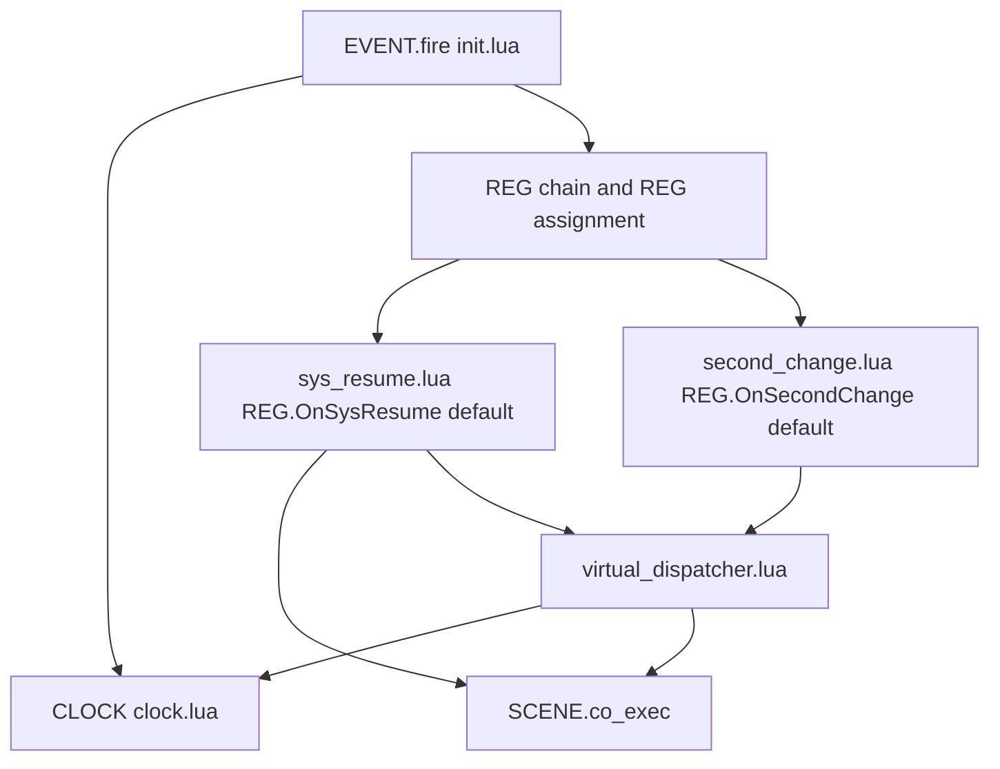
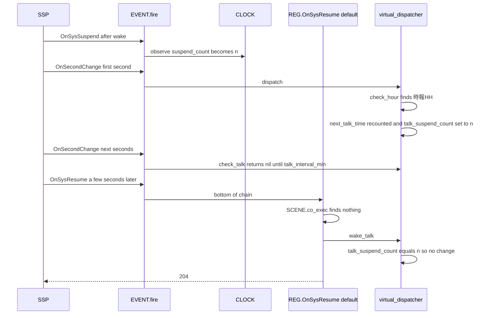
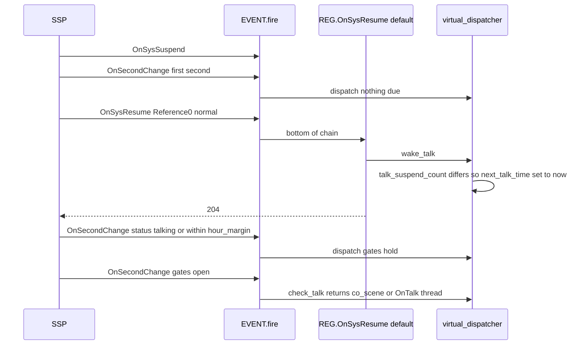
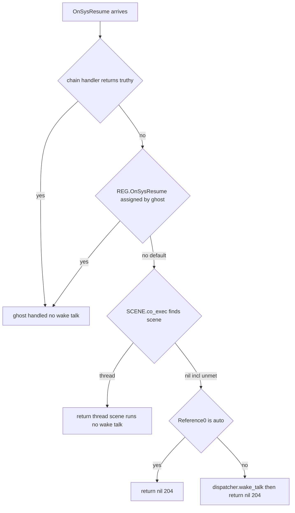

# 設計: onhour-talk-recount

## Overview

**Purpose**: 時報（OnHour）のシーンを出した直後に、正時の前に見送ったランダムトーク（OnTalk）が続けて出る不具合を直す。あわせて、スリープ明けのおしゃべりを、溜まりに頼る偶然の動きから、`OnSysResume` を合図にした意図した既定の動きに置き換える。

**Users**: 時報とランダムトークの両方を書くゴーストの作者と、その利用者。作者は辞書を書き換えずに直った動きを得る。スリープ明けの演出を自分で書いた作者は、`＊OnSysResume` のシーンか `REG` のハンドラで既定の動きを止められる。

**Impact**: 仮想ディスパッチャ（`virtual_dispatcher.lua`）が時報の発行で次のトークの時刻を決め直し、「最後に自動トークを出したのは、最後の `OnSysSuspend` より後か」を覚える。時計（`clock.lua`）は `OnSysSuspend` を見た回数を数えて読み出しの口を足す（飛びの判定は変えない）。`REG.OnSysResume` の既定ハンドラを新しいモジュールに置く。

### Goals

- 時報のシーンを発行したら、次のトークの時刻をその時点から `talk_interval_min`〜`talk_interval_max` 秒で決め直す（スリープ明けも例外にしない）。
- ゴーストが `OnSysResume` を受けていないとき、復帰の後に自動トークがまだ出ていなければ、次のトークの時刻を今にする。復帰の後に喋るのは 1 回だけにする。
- マニュアル（SHIORI イベントの章・内部設計の章）と生成するスキルの references を新しい動きに合わせ、Lua のテストで確かめる。

### Non-Goals

- 間隔の決め方（`talk_interval_min`／`max`・`hour_margin` の値・読み方・下限の補正）、時報の候補の探し方と日時変数の転記、時刻の飛びの判定の変更。
- `OnSysSuspend` への応答、外から起こした `OnTalk` の扱い、チェイントークの続きの決まり、OnTalk の抑止の条件の変更。
- スリープ明け専用のシーン名、`OnSysResume` の応答でトークを返すこと。
- completed の spec の文書、ghost_dev のゴースト・hello-pasta の辞書の書き換え。

## Boundary Commitments

### This Spec Owns

- `virtual_dispatcher.check_hour` が時報のシーンを返すときの、次のトークの時刻の決め直し（要件 1）。
- ディスパッチャの新しい状態 `talk_suspend_count`（最後に自動トークを出したときの `CLOCK.suspend_count()`）と、新しい公開関数 `wake_talk(act)`（要件 3.1・3.4）。
- 時計の新しい状態 `_suspend_count` と読み出しの口 `CLOCK.suspend_count()`（`OnSysSuspend` を見た回数。読み出しだけで、ほかの出力を変えない）。
- `REG.OnSysResume` の既定ハンドラ（新しいモジュール `pasta.shiori.event.sys_resume`）。「ゴーストが受けているか」の判定と Reference0 の `auto` の判定はここが持つ（要件 3.2・3.7・4）。
- マニュアルの該当節と、そこから生成する `pasta-lua-coding` の references（要件 5）。
- 上の動きを確かめる Lua のテスト（要件 6）。

### Out of Boundary

- `check_talk` の門（期限・`hour_margin`）・`dispatch` の門（`date`・Status・自動トークの停止）・`restart_timers` の中身。この spec はこれらを変えず、そのまま通す。
- `clock.lua` の飛びの判定（`watch_jump`・`_resumed`・`_suspended`）、`now`・`date`・`steady`・`epoch` の値（要件 3.10・2.6）。
- `EVENT.fire`・`EVENT.drive`・鎖（`REG:register`）・シーン関数フォールバックの決まり。既定ハンドラはこれらの上に乗るだけである。
- `second_change.lua`（`REG.OnSecondChange` の既定ハンドラ）・`entry.lua`（`自動トーク停止`／`再開`）。
- `novel-talk-flow`（未着手）が足すノベル向けの停止の道。

### Allowed Dependencies

- `sys_resume.lua` → `pasta.shiori.event.register`（REG）・`pasta.scene`（`SCENE.co_exec`）・`pasta.shiori.event.virtual_dispatcher`。`pasta.shiori.event`（init.lua）は require しない（循環を避ける。`boot.lua`・`second_change.lua` と同じ）。
- `virtual_dispatcher.lua` → `pasta.shiori.clock`（今までどおり先に読む）。`pasta.store`・`pasta.scene`・`pasta.save` は今までどおり関数の中で遅延ロードする。
- `clock.lua` は新しい require を持たない（`pasta.shiori.event.*`・`pasta.shiori.act`・`pasta.store` を require しない今の決まりを保つ）。
- 依存の向き: `event/init.lua` → `sys_resume.lua` → `virtual_dispatcher.lua` → `clock.lua`。逆向きの require は置かない。

### Revalidation Triggers

- `virtual_dispatcher` の公開の関数（`wake_talk` の追加）と `_get_internal_state` の形が変わる。`novel-talk-flow` が同じファイルを触るなら持ち場を分けて読み直す。
- 既定ハンドラの表が 13 行から 14 行になる。`REG` の既定のキーを数えるテスト・文書は読み直す。
- `REG.OnSysResume` に既定が入るので、`rawget(REG, "OnSysResume")` が `nil` でなくなる。既定ハンドラを包むゴーストの書き方（`local default = REG.OnSysResume`）が使えるようになる。
- SSP が `OnSysSuspend` を復帰の最初の秒より後に送るように変わったら、要件 3.4 の判定（下の「復帰の後」の測り方）を見直す。

## Architecture

### Existing Architecture Analysis

- 時報・ランダムトークは `REG.OnSecondChange` の既定（`second_change.lua`）が毎秒呼ぶ `virtual_dispatcher.dispatch` が出す。状態はモジュールローカルの `next_hour_unix`・`seen_epoch`・`next_talk_time` だけで、VM と同じ寿命である。
- `check_talk` は `hour_margin` で見送るとき `next_talk_time` を変えない。`check_hour` は時報を返すときに `next_talk_time` を決め直さない。この 2 つが重なって、期限の過ぎたトークが時報の直後に出る（不具合の原因）。
- `CLOCK.observe` は `EVENT.fire` の入口ですべてのリクエストを見る。`OnSysSuspend`・`OnSysResume` で印を立て、スリープ明けの差を飛びに数えない。そのため `CLOCK.steady` はスリープの間も進み、長いスリープの後は復帰の最初の秒で溜まったトークが出る。
- SSP 2.9.18 の実機の順番は「復帰 → `OnSysSuspend` → 最初の OnSecondChange → 数秒後に `OnSysResume`」である（2026-10-18）。
- 既定ハンドラは `REG.X = REG.X or function` で置く。鎖が全部見送れば底（`rawget(REG, id) or EVENT.no_entry`）が呼ばれ、`EVENT.no_entry` は `SCENE.co_exec(act, act.req.id)` でシーンを探す。

### Architecture Pattern & Boundary Map

既存のディスパッチャを延ばし、既定ハンドラを 1 つ足す（research.md の選択肢 A）。「受けているか」は既定ハンドラの置き場所（鎖の底）で決まり、「いつ喋るか」はディスパッチャの時計と門が決める。



**Architecture Integration**:

- 選んだ形: ディスパッチャの延長＋既定ハンドラのモジュール 1 つ。鎖・代入・シーンの判定を自分で書き直さずに済む（要件 4.1〜4.5 に足すコードが無い）。
- 持ち場: 「受けているか・Reference0」は `sys_resume.lua`、「復帰の後にもう喋ったか・次のトークの時刻」は `virtual_dispatcher.lua`、「`OnSysSuspend` を見た回数」は `clock.lua`。
- 保つ作法: `REG.X = REG.X or function`・1 ファイル＝1 つのイベントの族・`event/*` は `pasta.shiori.event` を require しない・時計の通し番号をディスパッチャが「前に見た値」と比べる（`epoch()`／`seen_epoch` と同じ形）。
- 新しい部品の理由: `sys_resume.lua` は `OnSysResume` の既定を置く場所（既存のファイルに同居させると、名前と中身がずれる）。`CLOCK.suspend_count()` は、`OnSysSuspend` を `REG` の前で見られるのが時計だけだから。
- steering: 新しい依存・新しい設定キーを足さない。

### Technology Stack

| Layer | Choice / Version | Role in Feature | Notes |
|-------|------------------|-----------------|-------|
| Runtime | LuaJIT 2.1（mlua 経由） | ディスパッチャ・時計・既定ハンドラ | 新しい依存なし |
| Tests | `lua_test`（`crates/pasta_lua/tests/lua_specs`）・`cargo test -p pasta_lua`・`cargo test -p pasta_shiori` | 単体と `EVENT.fire` を通す結合 | 新しいスイート 1 つ |
| Docs | mdBook（`book/src`）・`node book/tools/gen-skill-refs.mjs` | マニュアルと references | `--check`・`link-check.mjs` が CI で照合 |

## File Structure Plan

### Directory Structure

```
crates/pasta_lua/pasta_scripts/pasta/shiori/
├── clock.lua                      # _suspend_count と CLOCK.suspend_count() を足す
└── event/
    ├── init.lua                   # require("pasta.shiori.event.sys_resume") を 1 行足す
    ├── sys_resume.lua             # 新規: REG.OnSysResume の既定ハンドラ
    └── virtual_dispatcher.lua     # 時報の数え直し・talk_suspend_count・wake_talk(act)
crates/pasta_lua/tests/lua_specs/
├── init.lua                       # specs に "sys_resume_event_test" を足す
├── sys_resume_event_test.lua      # 新規: EVENT.fire を通すスリープ明けのテスト
├── virtual_dispatcher_spec.lua    # 数え直し・wake_talk の単体テスト、実機の順番のテストの期待の書き換え
└── virtual_clock_test.lua         # suspend_count の単体テスト
book/src/
├── lua/shiori-events.md           # 既定ハンドラの表・主要イベントの表・OnSysResume 節・check_hour・時刻の飛び・テスト用関数
└── internals/shiori.md            # モジュール表・読み込みの順・ディスパッチャの段落・時計の状態の表
.claude/skills/pasta-lua-coding/references/shiori-events.md   # 生成物（gen-skill-refs.mjs で作り直す。手で書かない）
```

### Modified Files

- `crates/pasta_lua/pasta_scripts/pasta/shiori/event/virtual_dispatcher.lua` — `check_hour` の候補ループで thread が返ったら `next_talk_time` を決め直し `talk_suspend_count` を記録する。`check_talk` が thread を返すときも `talk_suspend_count` を記録する。`M.wake_talk(act)` を足す。`_reset`・`_get_internal_state` に `talk_suspend_count` を入れる。
- `crates/pasta_lua/pasta_scripts/pasta/shiori/clock.lua` — `observe` の `OnSysSuspend` の行で `_suspend_count` を 1 増やす。`M.suspend_count()` を足す。`_reset`・`_get_state` に入れる。`watch_jump` と既存の印は触らない。
- `crates/pasta_lua/pasta_scripts/pasta/shiori/event/init.lua` — 既定ハンドラの読み込みの並び（`require("pasta.shiori.event.recommend")` の後）に `require("pasta.shiori.event.sys_resume")` を足す。冒頭のモジュール説明に既定ハンドラの一覧があれば 1 語足す。
- `crates/pasta_lua/tests/lua_specs/init.lua` — `specs` に `"sys_resume_event_test"` を足す（注釈に spec 名と要件）。
- 依存の閉包を読み直すスイート（`pasta.shiori.event.boot` を並べる 10 本: `actor_proxy_act_delegation_test.lua`・`auto_talk_pause_test.lua`・`chain_talk_interrupt_test.lua`・`event_clock_hook_test.lua`・`event_coroutine_test.lua`・`recommend_menu_test.lua`・`reg_handler_chain_test.lua`・`scene_condition_test.lua`・`scene_play_event_test.lua`・`shiori_entry_test.lua`）— 既定ハンドラのモジュールの並びに `"pasta.shiori.event.sys_resume"` を足す（並べ方は各ファイルの形に合わせる。`package.loaded[...] = nil` を 1 行ずつ書くファイルはその形で）。期待は変えない。
- `book/src/lua/shiori-events.md`・`book/src/internals/shiori.md` — 下の「マニュアルの変更」。
- `.claude/skills/pasta-lua-coding/references/shiori-events.md` — `node book/tools/gen-skill-refs.mjs` で作り直す（`internals/shiori.md` は生成の対象外）。

## System Flows

### 正時をまたいだスリープ（実機の順番・要件 1.6・3.4・6.3）



正時をまたがない長いスリープでは、最初の秒の `check_talk` が溜まったトークを出して `talk_suspend_count` を `n` にするので、同じく `wake_talk` は何も変えない（要件 3.4）。

### 自動トークの出ていないスリープ明け（要件 3.1・3.3・6.4）



門（Status のブロック・`hour_margin`・自動トークの停止）はすべて今のまま `dispatch`・`check_talk` が見る。`wake_talk` は時刻を動かすだけで、門を飛ばさない。門が閉じている間に正時が来て時報のシーンが出れば、`check_hour` の数え直しが「今」を上書きし、スリープ明けのおしゃべりはその時報が代わりになる（要件 3.4 の最後の場合）。

### OnSysResume の既定ハンドラの判定（要件 3.2・3.7・4）



鎖と代入の枝は `EVENT.fire` の今の決まりそのもので、この spec は既定ハンドラ（図の「no default」より下）だけを書く。

## Requirements Traceability

| Requirement | Summary | Components | Interfaces | Flows |
|-------------|---------|------------|------------|-------|
| 1.1 | 時報で次のトークの時刻を決め直す | VirtualDispatcher | `check_hour` | 正時をまたいだスリープ |
| 1.2 | 時報から `talk_interval_min` 秒は出さない | VirtualDispatcher | `check_hour`（乱数の下限）・`check_talk` | 同上 |
| 1.3 | 見送った分を時報の直後に出さない | VirtualDispatcher | `check_hour` の上書き | — |
| 1.4 | 候補が無ければ変えない | VirtualDispatcher | `check_hour` の `return nil` の枝 | — |
| 1.5 | 見送るたびに決め直さない | VirtualDispatcher | `check_talk`（変えない） | — |
| 1.6 | スリープ明けも例外にしない | VirtualDispatcher | `check_hour` | 正時をまたいだスリープ |
| 1.7 | 出力の有無にかかわらず決め直す | VirtualDispatcher | `check_hour`（実行前の thread を見て決め直す） | — |
| 2.1 | 続きの決まりを保ち、残った続きは決め直した時刻に出す | VirtualDispatcher・EVENT.drive（変えない） | `check_talk` の `STORE.co_scene` | — |
| 2.2 | 停止の間は時報も決め直しもしない | dispatch の門（変えない） | `dispatch` | — |
| 2.3 | 再開で数え直す | `restart_timers`（変えない） | `restart_timers` | — |
| 2.4 | 抑止が解けた最初の秒の時報から決め直す | VirtualDispatcher | `dispatch` → `check_hour` | — |
| 2.5 | スリープ明けの時報は 1 回・進んだ先 | `check_hour`・CLOCK（変えない） | `check_hour` | 正時をまたいだスリープ |
| 2.6 | 探し方・転記・飛び・なめらかな時計を変えない | VirtualDispatcher・CLOCK | 既存の関数（変えない） | — |
| 2.7 | 外から起こした OnTalk を変えない | `EVENT.no_entry`（変えない） | — | — |
| 3.1 | 受けていなければ、復帰の後に未発行なら今にする | SysResumeHandler・VirtualDispatcher・CLOCK | `wake_talk`・`suspend_count` | 自動トークの出ていないスリープ明け |
| 3.2 | 応答はトークを返さない（204） | SysResumeHandler | 既定ハンドラの `return nil` | 既定ハンドラの判定 |
| 3.3 | Status・`hour_margin` の間は待つ | dispatch・check_talk の門（変えない） | `dispatch`・`check_talk` | 自動トークの出ていないスリープ明け |
| 3.4 | 先に自動トークが出ていれば出さない | VirtualDispatcher・CLOCK | `talk_suspend_count`・`suspend_count`・`check_hour` の数え直し | 正時をまたいだスリープ |
| 3.5 | 続きがあれば続きを出す | VirtualDispatcher | `check_talk` の `STORE.co_scene` | 自動トークの出ていないスリープ明け |
| 3.6 | 停止の間は出さず、再開後に持ち越さない | dispatch の門・`restart_timers`（変えない） | `restart_timers` が `next_talk_time` を 0 に戻す | — |
| 3.7 | Reference0 が `auto` なら出さない | SysResumeHandler | `act.req.reference[0]` | 既定ハンドラの判定 |
| 3.8 | OnTalk のシーンが無いときは何も出さず決め直す | VirtualDispatcher | `check_talk`（変えない） | — |
| 3.9 | ふつうの OnTalk と同じシーン | VirtualDispatcher | `check_talk` の `create_scene_thread("OnTalk")` | — |
| 3.10 | スリープを飛びとみなさない扱いを変えない | CLOCK | `watch_jump`（変えない）・`suspend_count` は読み出しだけ | — |
| 4.1 | シーン（`GLOBAL.OnSysResume` を含む）があればそれ | SysResumeHandler | `SCENE.co_exec` | 既定ハンドラの判定 |
| 4.2 | `REG.OnSysResume` の代入 | REG の決まり（変えない） | `REG.X = REG.X or function` | 既定ハンドラの判定 |
| 4.3 | 鎖で止めた回は行わない・全部見送れば受けていない | `EVENT.fire` の鎖（変えない）・SysResumeHandler | 鎖の底 | 既定ハンドラの判定 |
| 4.4 | 名前はあっても条件漏れは受けていない | SysResumeHandler | `SCENE.co_exec` が `nil` | 既定ハンドラの判定 |
| 4.5 | 受けていれば変えない | REG の決まり | 既定ハンドラが呼ばれない | 既定ハンドラの判定 |
| 5.1 | `check_hour(act)` 節 | ManualUpdate | `shiori-events.md` | — |
| 5.2 | 「時刻の飛び」節 | ManualUpdate | `shiori-events.md` | — |
| 5.3 | スリープ明けのおしゃべりの節と既定ハンドラの表 | ManualUpdate | `shiori-events.md` | — |
| 5.4 | 内部設計の章 | ManualUpdate | `internals/shiori.md` | — |
| 5.5 | references の作り直しと検査 | ManualUpdate | `gen-skill-refs.mjs`・`--check`・`link-check.mjs` | — |
| 5.6 | completed を書き換えない | ManualUpdate | — | — |
| 6.1 | 見送り → 時報 → `talk_interval_min` 秒は出ない | Tests | `virtual_dispatcher_spec.lua` | — |
| 6.2 | 候補が無いと変わらない | Tests | `virtual_dispatcher_spec.lua` | — |
| 6.3 | 実機の順番のスリープ明け・長いスリープ | Tests | `virtual_dispatcher_spec.lua`・`sys_resume_event_test.lua` | 正時をまたいだスリープ |
| 6.4 | 受けていないときの発行と 204 | Tests | `sys_resume_event_test.lua` | 自動トークの出ていないスリープ明け |
| 6.5 | 受けている・`auto`・停止のときは出さない | Tests | `sys_resume_event_test.lua` | 既定ハンドラの判定 |
| 6.6 | 続きと時報・スリープ明けのおしゃべり | Tests | `sys_resume_event_test.lua`（本物の `EVENT.drive` を通す） | — |
| 6.7 | 今のテストを通す | Tests | `cargo test -p pasta_lua`・`cargo test -p pasta_shiori` | — |

## Components and Interfaces

| Component | Domain/Layer | Intent | Req Coverage | Key Dependencies (P0/P1) | Contracts |
|-----------|--------------|--------|--------------|--------------------------|-----------|
| VirtualDispatcher | Lua ランタイム（SHIORI） | 時報の数え直しと、復帰の後に喋ったかの記録・スリープ明けの予約 | 1.1〜1.7, 2.1〜2.6, 3.1, 3.3〜3.6, 3.8, 3.9 | CLOCK (P0), SCENE (P0), STORE (P1) | Service, State |
| CLOCK | Lua ランタイム（SHIORI） | `OnSysSuspend` を見た回数の読み出し | 3.1, 3.4, 3.10 | なし | Service, State |
| SysResumeHandler | Lua ランタイム（SHIORI・既定ハンドラ） | 受けていない `OnSysResume` でスリープ明けのおしゃべりを予約する | 3.1, 3.2, 3.7, 4.1〜4.5 | REG (P0), SCENE (P0), VirtualDispatcher (P0) | Event |
| ManualUpdate | 文書 | マニュアルと references を新しい動きに合わせる | 5.1〜5.6 | gen-skill-refs.mjs (P1) | — |
| Tests | テスト | 不具合の再現とスリープ明けの動きを確かめる | 6.1〜6.7 | lua_test (P0) | — |

### Lua ランタイム（SHIORI）

#### VirtualDispatcher（`pasta.shiori.event.virtual_dispatcher`）

| Field | Detail |
|-------|--------|
| Intent | 時報の発行で次のトークの時刻を決め直し、復帰の後に自動トークを出したかを覚え、スリープ明けのおしゃべりを予約する |
| Requirements | 1.1, 1.2, 1.3, 1.4, 1.5, 1.6, 1.7, 2.1, 2.4, 3.1, 3.3, 3.4, 3.5, 3.8, 3.9 |

**Responsibilities & Constraints**

- 「自動トークを発行した」とは、`check_hour` が時報の候補のシーンの thread を返したこと、または `check_talk` が thread（`STORE.co_scene` か新しい OnTalk のシーン）を返したことである。出力の有無は見ない（要件 1.7。時報の候補が見つかって実行されれば数える）。
- 発行のたびに `talk_suspend_count = CLOCK.suspend_count()` を記録する。
- `check_hour` は thread を返す直前に `next_talk_time = calculate_next_talk_time(CLOCK.steady(act.req))` を行う（brief の仮実装と同じ 1 行）。候補が無く `nil` を返すときは `next_talk_time` も `talk_suspend_count` も変えない（要件 1.4）。
- `check_talk` の期限・`hour_margin`・決め直しの順は変えない。返す値を 1 つの変数にまとめ、thread なら記録してから返す。
- `dispatch`・`restart_timers` は変えない。`restart_timers` は `next_talk_time` を 0 に戻すので、停止の間に `wake_talk` が「今」にした分は再開の後に持ち越されない（要件 3.6）。`talk_suspend_count` は `restart_timers` で戻さない（停止の間にスリープしても、再開の後のふつうの数え直しに従うだけで、次の `OnSysResume` の判定は `OnSysSuspend` の回数で正しく決まる）。

**Dependencies**

- Inbound: `second_change.lua`（`dispatch`）— 毎秒の判定 (P0)
- Inbound: `sys_resume.lua`（`wake_talk`）— スリープ明けの予約 (P0)
- Inbound: `entry.lua`（`restart_timers`）— 変えない (P1)
- Outbound: `CLOCK.steady`・`CLOCK.now`・`CLOCK.epoch`・`CLOCK.suspend_count` (P0)
- Outbound: `SCENE.co_exec`・`STORE.co_scene` (P0)

**Contracts**: Service [x] / State [x]

##### Service Interface

```lua
--- スリープ明けのおしゃべりを予約する。復帰の後にまだ自動トークを出していなければ、次のトーク時刻を今にする。
--- 発行はしない。次の OnSecondChange からの check_talk が、今の門を通ったうえで出す。
---@param act ShioriAct act.req.date から今（CLOCK.steady）を取る
---@return nil
function M.wake_talk(act) end
```

- Preconditions: `REG.OnSysResume` の既定ハンドラが、ゴーストが受けておらず Reference0 が `auto` でないと決めた後に呼ぶ。
- Postconditions:
  - `CLOCK.steady(act.req)` が `nil`（`act.req.date` が無い）なら何も変えない。
  - `next_talk_time == 0`（読み込み直後・`restart_timers` の直後でまだ決めていない）なら何も変えない（`check_talk` の「初回は時刻を決めるだけ」の枝を飛ばさない。`restart_timers` の後の数え直しにも従う）。
  - `CLOCK.suspend_count() > 0` で、かつ `talk_suspend_count == CLOCK.suspend_count()`（最後の `OnSysSuspend` より後に自動トークを出した）なら何も変えない（要件 3.4）。
  - それ以外は `next_talk_time = CLOCK.steady(act.req)` にする（要件 3.1）。
- Invariants: 門を飛ばさない。`next_hour_unix`・`seen_epoch`・`STORE` に触れない。同じスリープで 2 回呼ばれても、間に自動トークが出ていれば 2 回目は何も変えない。

`check_hour(act)`・`check_talk(act)` の引数と戻り値（`thread|nil`）は変えない。変わるのは上の副作用だけである。

##### State Management

| 変数 | 型 | 初期値 | 意味 | 書く関数 |
|------|----|--------|------|----------|
| `next_hour_unix` | 整数 | `0` | 次の正時（変えない） | `check_hour`・`restart_timers` |
| `seen_epoch` | 整数 | `0` | 前に見た飛びの通し番号（変えない） | `check_hour`・`restart_timers` |
| `next_talk_time` | 整数 | `0` | 次のトーク時刻（`CLOCK.steady`） | `check_talk`・`check_hour`（新）・`wake_talk`（新）・`restart_timers` |
| `talk_suspend_count`（新） | 整数 | `0` | 最後に自動トークを出したときの `CLOCK.suspend_count()` | `check_hour`・`check_talk` |

- 寿命は今と同じ（`load` から `unload` まで。保存しない）。`_reset` で 0 に戻し、`_get_internal_state` の表に `talk_suspend_count` を足す。

**Implementation Notes**

- Integration: 数え直し（要件 1・2・6.1〜6.3 の前半）を先のコミットにし、`talk_suspend_count`・`wake_talk` は後のコミットに入れる（research.md の選択肢 C）。
- Validation: `virtual_dispatcher_spec.lua` の `vtest`（`_set_scene_executor` で時報と OnTalk の thread を返す形）で単体を確かめる。
- Risks: SSP が `OnSysSuspend` を最初の秒より後に送ると、溜まったトークの記録が古い回数のままになり、`OnSysResume` でもう 1 回出る。実機の順番（2026-10-18）に頼る（下の「前提」）。

#### CLOCK（`pasta.shiori.clock`）

| Field | Detail |
|-------|--------|
| Intent | `OnSysSuspend` を見た回数を数えて読み出す |
| Requirements | 3.1, 3.4, 3.10 |

**Responsibilities & Constraints**

- `observe` で `req.id == "OnSysSuspend"` を見たとき、今の `_suspended = true` の行で `_suspend_count = _suspend_count + 1` も行う。`X-Pasta-Time` の有無にかかわらず数える（今の `_suspended` と同じ位置）。
- `watch_jump`・`_resumed`・`_suspended`・`now`・`date`・`steady`・`epoch`・`offset` の値は変えない（要件 3.10・2.6）。数えた値はどの判定にも使わない。
- 新しい require を足さない。

**Contracts**: Service [x] / State [x]

##### Service Interface

```lua
--- OnSysSuspend を見た回数（load からの通し番号）。ディスパッチャが「最後の自動トークはこの値の後か」を比べる。
---@return integer
function M.suspend_count() end
```

- Postconditions: 0 以上の整数。`OnSysSuspend` を見るたびに 1 増え、減らない（`_reset` を除く）。

##### State Management

- `_suspend_count`（整数・初期値 0）を足す。`_reset` で 0 に戻し、`_get_state` の表に `suspend_count` を足す。保存しない。

**Implementation Notes**

- Validation: `virtual_clock_test.lua` に、`OnSysSuspend` で 1 増えること・ほかのイベントでは増えないこと・増えても既存の飛びの判定が変わらないこと（実機の順番の既存テストがそのまま通ること）を足す。
- Risks: なし（読み出しだけ）。

#### SysResumeHandler（`pasta.shiori.event.sys_resume`・新規）

| Field | Detail |
|-------|--------|
| Intent | `REG.OnSysResume` の既定。シーンがあればそれを動かし、無ければスリープ明けのおしゃべりを予約して 204 を返す |
| Requirements | 3.1, 3.2, 3.7, 4.1, 4.2, 4.3, 4.4, 4.5 |

**Responsibilities & Constraints**

- `REG.OnSysResume = REG.OnSysResume or function(act) ... end` で置く（`boot.lua` と同じ形）。ゴーストが `scripts/main.lua` で先に代入していれば置かない。辞書の Lua ブロックで代入すれば置き換わる（要件 4.2）。
- 本体の順:
  1. `local co = SCENE.co_exec(act, act.req.id, nil, nil)`。thread なら返す（要件 4.1。`GLOBAL.OnSysResume` の関数・前方一致もシーン関数フォールバックと同じに見つかる）。
  2. `act.req.reference[0] == "auto"` なら `nil` を返す（要件 3.7）。
  3. `dispatcher.wake_talk(act)` を呼び、`nil` を返す（要件 3.1・3.2）。
- `nil` を返すので応答は 204 になる（`EVENT.fire` の今の決まり）。
- 鎖のハンドラが真の値を返した回は呼ばれない。全部見送った回は呼ばれる（要件 4.3。`EVENT.fire` の今の決まり）。
- 自動トークの停止は見ない（停止の間は `dispatch` が門で止め、再開の `restart_timers` が予約を消す）。Status も見ない（`check_talk` まで門が残る）。
- `pasta.shiori.event` を require しない。

**Dependencies**

- Inbound: `event/init.lua`（読み込み）・`EVENT.fire`（鎖の底として呼ぶ） (P0)
- Outbound: `pasta.shiori.event.register`・`pasta.scene`・`pasta.shiori.event.virtual_dispatcher` (P0)

**Contracts**: Event [x]

##### Event Contract

- Subscribed events: `OnSysResume`（SSP がサスペンドの解除で送る。Reference0 = `normal`・`auto`・`critical`（Vista 以降は来ない）・空）。
- 応答: シーンが見つかればその出力（200、出力が無ければ 204）。見つからなければ常に 204。
- Ordering / delivery guarantees: SSP 2.9.18 では復帰の最初の OnSecondChange より数秒遅れて届く。届かなければ何もしない（スリープ明けのおしゃべりは出ず、ランダムトークはふつうの間隔で出る）。
- 冪等: 同じスリープで何度届いても、自動トークが 1 回出た後は `wake_talk` が何も変えない。

**Implementation Notes**

- Integration: `event/init.lua` の既定ハンドラの読み込みの末尾に 1 行。依存の閉包を読み直す 10 スイートの並びに足す。
- Validation: 新しいスイート `sys_resume_event_test.lua` で `EVENT.fire` を通して確かめる（下の Testing Strategy）。
- Risks: 既定が入るので、`rawget(REG, "OnSysResume")` を「ゴーストが書いたか」の目印にしていたゴーストがあれば動きが変わる（pasta の中には無い。マニュアルの「既定ハンドラと上書き」の表に足すことで知らせる）。

### 文書

#### ManualUpdate

| Field | Detail |
|-------|--------|
| Intent | 利用者マニュアルと内部設計の章を新しい動きに合わせ、references を作り直す |
| Requirements | 5.1, 5.2, 5.3, 5.4, 5.5, 5.6 |

マニュアルの変更（`book/src/lua/shiori-events.md`）:

- 「既定ハンドラと上書き」の表: `OnSysResume` の行を足し、「13 行」を「14 行」にする。動作は「イベント名でシーンを探して実行する。無ければ、復帰の後にまだ自動トークが出ていないとき、スリープ明けのおしゃべりを予約する（[OnSysResume](#onsysresumeスリープ明けのおしゃべり)）」。
- 「主要イベント」の表: `時間`（または `システム`）の分類で `OnSysResume` の行を足す（「あり（同名のシーンを実行・スリープ明けのおしゃべり）」）。
- 新しい節 `### OnSysResume（スリープ明けのおしゃべり）`（`### OnMinuteChange` の後）: Reference0 の表、出す条件（受けていない・`auto` でない・復帰の後にまだ自動トークが出ていない）、出す時機（次の門の開いた OnSecondChange。応答は 204）、出さない条件（受けている・`auto`・停止中・先に時報かランダムトークが出た）、出すシーン（ふつうの `＊OnTalk`・`＊会話`、続きがあれば続き）、受けているとみなす条件（シーン・`GLOBAL.OnSysResume`・`REG.OnSysResume` の代入・真の値を返す鎖）と止め方。止め方は DSL を先に示す（本文の無い `＊OnSysResume` を書けば、何も喋らずに既定を止める。[空のシーンで反応を止める](#空のシーンで反応を止める) と同じ考え）。Lua では何も返さない `REG.OnSysResume` を代入する。
- 「`check_hour(act)`」節: brief の仮実装の 1 行（時報のシーンが見つかったら次のトーク時刻を決め直す・時報の直後は `talk_interval_min` 秒より前に出ない・候補が無ければ変えない）。本文の無い時報のシーンでも決め直すことも書く（要件 1.7）。
- 「時刻の飛び」節: スリープ明けの文を「時報は 1 回出て、おしゃべりは時報から間隔を数え直して待つ。時報が出なければ、復帰の後の最初のおしゃべりが 1 回出る（溜まったランダムトークか、スリープ明けのおしゃべり。[OnSysResume](#onsysresumeスリープ明けのおしゃべり)）」に改める。
- 「テスト用関数」節: `_get_internal_state()` の表に `talk_suspend_count` を足す。

内部設計の章（`book/src/internals/shiori.md`）:

- Lua 側のモジュール表に `pasta.shiori.event.sys_resume`（既定ハンドラ OnSysResume を `REG` に登録する。シーンが無ければ `virtual_dispatcher.wake_talk` を呼ぶ）の行を足す。読み込みの順の木に 1 行足す。
- 仮想イベントディスパッチャの段落: 状態に `talk_suspend_count` を足し、`check_hour` の段落に数え直しと記録の 1 文（brief の差分）、`wake_talk(act)` の箇条（条件と、`restart_timers` が予約を消すこと）を足す。
- 仮想時刻の時計の状態の表に `_suspend_count` を足す。表の前の「ローカル変数 6 つ」は今の表（7 行）とも合っていないので、足した後の数（8 つ）に直す。`observe` の箇条に「`OnSysSuspend` を見るたびに `_suspend_count` を 1 増やす（判定には使わない。ディスパッチャが `suspend_count()` で読む）」を足す。

references: `node book/tools/gen-skill-refs.mjs` で `.claude/skills/pasta-lua-coding/references/shiori-events.md` を作り直し、`--check` と `node book/tools/link-check.mjs` が通ることを確かめる（要件 5.5）。completed の `tutorial-ssp-gaps` の design.md L641 は書き換えない（要件 5.6）。

## Data Models

### Domain Model

- 「自動トーク」: 仮想ディスパッチャが発行した時報（候補のシーンの thread）とランダムトーク（`STORE.co_scene` か OnTalk のシーンの thread）。外から起こした `OnTalk` とゴーストのハンドラが返すトークは含めない。
- 「復帰の後」: 最後に `OnSysSuspend` を見た時点の後。`CLOCK.suspend_count()` の値が変わった後に自動トークが出たかを、`talk_suspend_count` と比べて決める。
- 不変条件: `talk_suspend_count <= CLOCK.suspend_count()`。`talk_suspend_count == CLOCK.suspend_count() > 0` の間は、`wake_talk` は何も変えない。

## Error Handling

### Error Strategy

- 新しいエラーの道は作らない。`act.req.date` が無いリクエスト（テストの手組みなど）では `wake_talk` は何もしない（`CLOCK.steady` が `nil`）。
- 既定ハンドラの中の `SCENE.co_exec` のエラーは、今の `EVENT.fire` の決まり（`SHIORI.request` の xpcall）に任せる。シーンの中のエラーは止まるエラーとして今どおり表記になる。
- `OnSysResume` が届かない・`OnSysSuspend` が届かないベースウェアでも、自動トークは今の間隔で出続ける（壊れる道は無い）。

### Monitoring

- ログは足さない（`CLOCK` の飛びの debug ログと同じく、必要になれば後で足す）。

## Testing Strategy

### Unit Tests（`virtual_dispatcher_spec.lua`・`virtual_clock_test.lua`）

- 6.1: brief の仮実装のテスト「正時の前に期限が来たおしゃべりは、時報の直後に出ず、時報から talk_interval_min 秒待つ」（10:59:40 に `hour_margin` で見送り → 11:00 に時報 → 待ちが 180〜300 秒 → 時報の 179 秒後の `check_talk` が `nil`）。直す前のコードでは落ちる。
- 6.2: 「check_hour - all candidates miss」に、`next_talk_time` が呼ぶ前と同じであること（brief の形の 0 のまま）を足す。`vtest` の形で、`check_talk` で決めた 0 でない時刻が、候補の無い正時を過ぎても変わらないことも足す。
- 6.3: 実機の順番のテスト（L978）の名前を「…時報は 1 回出て、おしゃべりは時報から数え直す」に改め、時報の 1 秒後の `check_talk` の期待を `nil` にする（brief の差分）。続けて `OnSysSuspend` を見た後に `wake_talk` を呼んでも `next_talk_time` が変わらないことを足す。正時をまたがない長いスリープ（最初の秒の `check_talk` が溜まったトークを返す）の後の `wake_talk` も `next_talk_time` を変えないことを足す。
- `wake_talk` の単体: `OnSysSuspend` の後に自動トークが出ていなければ `next_talk_time` が今になり、次の秒の `check_talk` が thread を返すこと。`hour_margin` の間は `nil` で、正時を過ぎて時報の候補が無ければ出ること。時報の候補があれば時報の数え直しが勝つこと（要件 3.3・3.4）。`OnSysSuspend` を一度も見ていないときは今にすること（下の前提 2）。`act.req.date` が無ければ何もしないこと。`next_talk_time` が 0 のときは何もしないこと。
- 3.6 の単体: `wake_talk` の後に `restart_timers` を呼ぶと `next_talk_time` が 0 になること。
- `virtual_clock_test.lua`: `OnSysSuspend` で `suspend_count()` が 1 増え、`OnSysResume`・`OnSecondChange` では増えないこと。`_reset` で 0 に戻ること。既存の実機の順番のテストが変わらず通ること（要件 3.10）。

### Integration Tests（`sys_resume_event_test.lua`・`EVENT.fire` を通す）

依存の閉包を読み直す形（`reg_handler_chain_test.lua` の `ENTRY_CLOSURE` と同じ）に `pasta.shiori.event.sys_resume` を入れ、シーンの検索は `chain_talk_interrupt_test.lua` と同じく `@pasta_search` を差し替えるか、`dispatcher._set_scene_executor` で OnTalk を返す。

- 6.4: 受けていないゴーストで、`OnSysSuspend` → 最初の `OnSecondChange`（何も出ない）→ `OnSysResume`（Reference0 `normal`）の応答が 204 で、次の門の開いた `OnSecondChange` の応答が OnTalk の出力の 200 であること。Status に `talking` がある秒は 204 で、解けた秒に出ること（要件 3.3）。
- 6.3（結合）: `OnSysSuspend` → 最初の秒で時報が出る → `OnSysResume` → その後 `talk_interval_min` 秒より前の `OnSecondChange` では OnTalk が出ないこと。
- 6.5: `＊OnSysResume` のシーンがあるとき（シーンが動き、`next_talk_time` が変わらない）、`GLOBAL.OnSysResume` の関数があるとき、`REG.OnSysResume` を代入したとき（ゴーストのハンドラだけが呼ばれる）、`REG:register` で真の値を返すとき、Reference0 が `auto` のとき、`＞自動トーク停止` の間に届いたとき（再開の後、すぐには出ない）に、スリープ明けのおしゃべりが出ないこと。逆に、鎖が全部 `nil` を返したとき（要件 4.3）と、`OnSysResume` の名前のシーンが条件漏れのとき（要件 4.4）は出ること。同じ復帰で Reference0 `auto` → `normal` の順に 2 回届いたとき、2 回目で出て、出た後の 3 回目では何も変わらないこと。
- 6.6: 続きが待っているとき、本文の無い時報のシーンの後の決め直した時刻と、スリープ明けのおしゃべりの機会に、続きが出ること。台詞を出した時報は今どおり続きを捨てること（`EVENT.drive` を通すので、本物の続きの決まりで確かめる）。

### 既存のテスト（6.7）

- 期待が変わるのは `virtual_dispatcher_spec.lua` L987 の 1 か所（時報の 1 秒後の `check_talk` が thread → `nil`）だけである。
- 10 スイートの読み直しの並びに `sys_resume` を足す（期待は変えない）。
- `cargo test -p pasta_lua`（Lua のスイートを含む）と `cargo test -p pasta_shiori` を通す。前に `NoDefaultCurrentDirectoryInExePath` を外し、テストが書き換えた `sample.generated.lua` は戻す。luacheck を新しいファイルにも通す。
- 実機（SSP）の確かめは ghost_dev の「ぱすた開発」が受け持つ。pasta の側は x86（`i686-pc-windows-msvc`）の pasta.dll のありかを知らせるだけで、ghost_dev には触らない。頼むときは次の項目を明記する（設計検証の課題 1）。
  - 仮想時刻で 2026/12/31 23:59:30 → 1/1 0:00 の時報の後、`talk_interval_min` 秒より前にランダムトークが出ないこと。
  - 利用者が起こした復帰と、スケジュールによる自動の復帰のそれぞれで、`OnSysResume` が何回届き、Reference0 が何か（`auto` しか来ないなら要件 3.7 を見直す）。
  - 90 秒以下の短いスリープでも、`OnSysSuspend` が復帰の最初の秒より前に届くこと（SSP のスクリプトログか `pasta_log` で見る）。

## 前提（Design Assumptions）

ディスカッションで確かめる前提を、番号付きで置く。設計はこの前提で書いてある。

1. **「復帰の後」は `OnSysSuspend` を見た回数で測る**。`clock.lua` に読み出しの口 `suspend_count()` と数え上げ 1 行を足す（飛びの判定・ほかの出力は変えない）。時間の窓（例: 最後の自動トークから 70 秒以内なら今にしない）と、時計がスリープの差を飲み込んだ秒の記録は採らない。窓は幅の根拠が無く短いスリープで外れる。飲み込んだ秒は 90 秒以下のスリープで記録されず、溜まったトークの二重の発行を防げない。`OnSysSuspend` は SSP が復帰の最初の秒より前に送り（2026-10-18 実機）、ほかのベースウェアのように眠る前に送っても、眠る前の数秒に自動トークが出ない限り同じ結果になる。
2. **`OnSysSuspend` を一度も見ていないときの `OnSysResume` は、喋ってよいとみなす**（`suspend_count() == 0` なら今にする）。`OnSysResume` だけを送るベースウェアでは、溜まったトークが最初の秒に出ていると 2 回目が出ることがある。前のスリープの `OnSysSuspend` が残っていて今回は `OnSysSuspend` が来なかった場合は、前の回数と比べるので、前のスリープの後に自動トークが出ていれば今回は出さない。SSP は両方を送るので、どちらも特別な扱いを足さない。
3. **`SecurityLevel` が `external` の `OnSysResume` も同じに扱う**。`CLOCK.observe` の `OnSysResume`・`OnSysSuspend` の印も SecurityLevel を見ない。害は次のトークが早まることだけである。
4. **本文の無い時報のシーンもスリープ明けの 1 回と数える**（要件 1.7 と 3.4 から導かれる）。正時をまたいだスリープの時報を `＊時報03` で黙らせているゴーストでは、その時刻の復帰では何も喋らず、時報から間隔を数え直す。
5. **マニュアルは `OnSysResume` の節を主要イベントに足し、止め方は本文の無い `＊OnSysResume` を先に示す**。`wake_talk` は内部設計の章にだけ書き、利用者向けの章の「仮想ディスパッチャ」の関数の節には足さない（ゴーストが呼ぶ関数ではないため）。
6. **既定ハンドラの置き場所は新しいファイル `event/sys_resume.lua`**（1 ファイル＝1 つのイベントの族の今の作り）。`second_change.lua` などへの同居は採らない。
