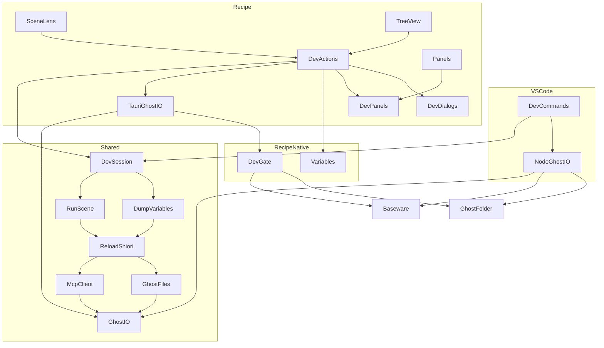
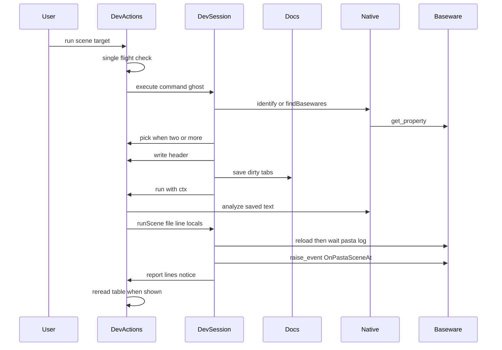
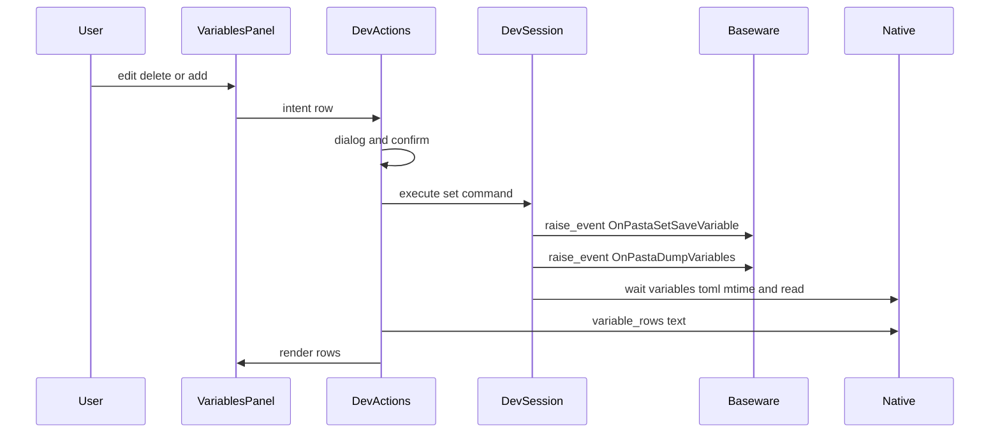

# 設計: pasta-recipe-dev-actions

## Overview

**Purpose**: `pasta-recipe` で辞書を書く作者が、書いたシーンをその場で鳴らし、SHIORI を読み込み直し、保存変数を見て書き換え、ローカル変数を入れて鳴らせるようにする。VS Code や SSP の右クリックに戻らずに確かめられる。

**Users**: `pasta-recipe` で `.pasta` を書くゴーストの作者。SSP か areka でそのゴーストを動かし、ベースウェアの MCP の窓口を有効にしている。

**Impact**: VS Code 拡張の実行の流れ（5 つのファイルと `devCommands.ts` の相手の選び方・文言）を `editors/shared/` へ移し、入出力を 1 つの面（`GhostIO`）で差し込む。拡張は Node の実装を、アプリは Tauri の Rust のコマンドを差し込む。アプリは、開発の操作のときだけ 127.0.0.1 のベースウェアへつなぎ、`ghost/master` の中の決まったファイルを読む。

### Goals

- ツリーとエディタの見出しから、拡張と同じ流れ（保存 → 読み込み直し → `OnPastaSceneAt` → 台本）でシーンを鳴らす。
- SHIORI のリロード・出力の欄・保存変数の表（表示・書き換え・削除・追加）・ローカル変数を入れて鳴らす窓を足す。
- 実行の流れの実装を拡張とアプリで 1 本にし、拡張の振る舞いを変えない。
- アプリのつなぐ先と読む範囲を、Rust の門で固定する。

### Non-Goals

- ランタイムの変更（`OnPastaSceneAt`・`OnPastaSetSaveVariable`・`OnPastaDumpVariables`・Reference2 の受け手）。
- VS Code 拡張への新しい機能（保存変数の書き換え・ローカル変数を入れた実行）。
- `OnPastaScene`（名前で鳴らす）の画面。
- 表（テーブル）の値の保存変数の書き換え。
- `pasta-recipe` のエディタ・ツリー・保存・単一インスタンスの仕組みそのもの。

## Boundary Commitments

### This Spec Owns

- `editors/shared/` の実行の流れ（MCP の頼み・相手の探し方と覚え・読み込み直しの待ち・再生と台本の取り出し・保存変数の書き出しの読み取りと書き換えの頼み・`pasta.log` と `descript.txt` の読み取り・出力の行と案内の文言）と、入出力の面 `GhostIO`。
- 拡張の Node の入出力の実装（`nodeGhostIO.ts`）と、`devCommands.ts` を共有の流れへ差し替えること。
- アプリの開発の操作の画面（▶・値を入れて実行・リロード・出力の欄・保存変数の表・相手を選ぶ窓）と、その糊（`devActions.ts`）。
- アプリの Rust の開発の門: 127.0.0.1 の候補のポートへの POST（`dev_post`）と、開いている `ghost/master` の決まった場所だけの読み取り（`dev_list`・`dev_stat`・`dev_read`）。
- アプリの Rust の TOML の読み書き: `variables.toml` を表の行にすること（`variable_rows`）と、ローカル変数のインライン表を組み立てて弾くこと（`build_locals`）。
- マニュアル `book/src/debug/recipe.md` の「ゴーストを動かす」節と、関連する言い直し。
- CI（`.github/workflows/build.yml`）に、拡張の試験（`editors/vscode` の `npm test`）を走らせる job を足すこと。

### Out of Boundary

- ランタイム（`crates/pasta_lua`）の一切。Reference2 の書き方と誤りの表記は `scene-play-locals` が正本。
- `pasta-recipe` の既存の仕組み（`Documents` の保存の鎖・ツリーの描き方・`paths::resolve_rel` の範囲・開く流れ・CSP・単一インスタンス）。この spec は呼ぶだけで、決まりを変えない。
- 拡張の 3 コマンドの振る舞いと、`sceneOutline.ts`・`ghostValidator.ts`・`package.json` の貢献点。
- steering（`tech.md`・`structure.md`）の書き換え（完了のときに直す）。

### Allowed Dependencies

- 共有の流れ（`editors/shared/*.ts`）は、WebView2 と Node の両方にある大域（`TextDecoder`・`Uint8Array`・`Date`・`Promise`・`JSON`）だけを使う。待ちは今のとおり差し込みの `sleep` で、`setTimeout` を直に呼ばない。Node の `http`・`fs`・`path`・`Buffer` と `vscode`・`@tauri-apps/*` を import しない。共有の中の import は `import type` と `.ts` 付きの相対パス。
- 拡張は共有を相対パス（`../../shared/*.ts`）で取り込み、esbuild で束ねる。npm のワークスペースは作らない。
- アプリの画面は共有を相対パス（`../../shared/*.ts`）で取り込み、Vite で束ねる。
- アプリの Rust は、既に `Cargo.lock` にある `reqwest 0.13`（`default-features = false`）と `pasta_dsl`（パスの依存）を直接の依存に足す。新しい crate・npm の部品は足さない。
- 依存の向き: `GhostIO` の型 → 共有の流れ（`mcpClient` → `ghostFiles` → `reloadShiori` → `runSceneAtCursor`・`dumpVariables` → `devSession`）→ 入出力の実装（`nodeGhostIO`・`ipc.ts` の `tauriGhostIO`）→ 糊（`devCommands`・`devActions`）→ 画面（`devPanels`・`devDialogs`・`sceneLens`・`tree`・`panels`・`main`）。左は右を import しない。

### Revalidation Triggers

- `GhostIO` の形（関数の数・戻り値の形）が変わるとき: 拡張とアプリの両方の実装と、共有の試験の偽の入出力を直す。
- 共有の文言・待ちの長さ・ポートの順が変わるとき: 拡張の振る舞いが変わる（要件 10.2）ので、拡張の試験（`devCommands.e2e` を含む）を通し直す。
- ランタイムの Reference2 の書き方・`OnPastaSetSaveVariable` の型の名前・`variables.toml` の書き方が変わるとき: `build_locals`・`setSaveVariable`・`variable_rows` を見直す。
- Rust の門の範囲（読める場所・ポート）を変えるとき: マニュアルの「つなぐ先と読む範囲」の記述と、門の試験を直す。
- `pasta-recipe` の `Documents.save`・`TreeRow`・`#panels` の形が変わるとき: `devActions`・`tree`・`panels` の差し込みを見直す。

## Architecture

### Existing Architecture Analysis

- 拡張の 5 つ（`mcpClient.ts`・`reloadShiori.ts`・`runSceneAtCursor.ts`・`dumpVariables.ts`・`ghostFiles.ts`）は `vscode` を import しないが、Node の `http`・`fs`・`path`・`Buffer` を直に使う。流れの文脈 `FlowContext`（`endpoint`・`ghost`・`timing`・`sleep`）があり、時計は `sleep` の差し込みで数える。
- 相手の覚えと確かめ（`remembered`・`identify`・`findBasewares`・QuickPick）・同時の止め（`busy`）・見出しの行（`clock()`）・文言の定数・誤りと警告の分け（`ERROR_KINDS`）は `devCommands.ts`（vscode の糊）の中にある。
- アプリは、画面と Rust の接点が `commands.rs` の表と `ipc.ts` の 1 対 1 の包みだけ。読み書きは `paths::resolve_rel`（`profile` を断る）を通る。HTTP の部品は無い。CSP は `connect-src ipc: http://ipc.localhost`（画面からは外へ届かない）。
- アプリの下の欄 `#panels` は高さ 180px の横並びで、「診断」「ゴースト全体の検査」の 2 つの `.panel` を持つ。

### Architecture Pattern & Boundary Map

選んだ形は「流れは共有の 1 本・入出力だけを差し込む」（ポートとアダプタ）。



**Architecture Integration**:
- 共有の流れは今の 5 つの中身をそのまま移し、Node の直の呼び出しを `ctx.io.*` に置き換える。文言・待ち・ポートの順・止め方は変えない。
- `devCommands.ts` の相手の選び方・覚え・同時の止め・見出し・保存の手順・通知の分けは `devSession.ts` へ移す。vscode に固有のもの（対象の文書の決め方・`accepts`・`BAD_DOCUMENT`・`NOT_IN_GHOST`・QuickPick・`TextDocument.save`・`withProgress`・通知）は拡張に残し、`DevHost` として差し込む。
- アプリの糊 `devActions.ts` は、拡張の `devCommands.ts` と同じ立場。`DevHost` を画面の部品で満たす。
- Rust の門（`dev.rs`・`paths.rs` の `dev_path`）は宛先・ポート・読む場所を Rust の側で固定する。画面に URL もパスの決まりも任せない。
- TOML の読み書きと名前の判定は Rust（`variables.rs`）に置く。ランタイムと同じ `toml` と `pasta_dsl::parser::is_id` を使い、画面に TOML の部品を足さない。

### Technology Stack

| Layer | Choice / Version | Role in Feature | Notes |
|-------|------------------|-----------------|-------|
| 共有の流れ | TypeScript（strict）・`.ts` 付きの相対 import | 実行の流れ・相手の選び方・文言 | 拡張は esbuild 0.28、アプリは Vite 8 で束ねる。型はアプリの `tsc --noEmit`（TS 7.0.2）で見る |
| 拡張の入出力 | Node `http`・`fs/promises`・`path` | `GhostIO` の Node の実装 | 今の `rpc`・`readNewLines` などの Node の部分をそのまま移す |
| アプリの画面 | Vite 8・TypeScript・Monaco 0.57 | ▶ の CodeLens・下の欄・窓 | `monaco.languages.registerCodeLensProvider`・`monaco.editor.registerCommand` |
| アプリの Rust | Tauri ~2.12・`reqwest 0.13.5`（`default-features = false`）・`toml 1`・`pasta_dsl`（パス） | POST の門・読み取りの門・TOML | reqwest は lock に既にある（tauri の Android・iOS 向けの依存）。Windows では新しく compile される（hyper の一式）。lock の包みは増えない |
| 試験 | `node --test`（Node 22）・`cargo test` | 共有の流れ（偽の入出力）・Rust の門と TOML | 拡張の今の試験（`npm test`）は、この spec で CI の job に足す |

## File Structure Plan

### Directory Structure

```
editors/
├── shared/                         # 拡張とアプリの共有の実行の流れ（vscode・Node・Tauri を import しない）
│   ├── ghostIO.ts                  # 入出力の面 GhostIO と PostOutcome の型だけ
│   ├── mcpClient.ts                # 移す。rpc は io.post を呼ぶ。ToolArgsMap に OnPastaSetSaveVariable を足す
│   ├── ghostFiles.ts               # 移す。fs は io の 4 つ、path は io.join。ghostTarget を足し、resolveGhost の上りの検査は拡張へ残す
│   ├── reloadShiori.ts             # 移す。FlowContext に io を足す
│   ├── runSceneAtCursor.ts         # 移す。runScene に locals（Reference2）の引数を足す
│   ├── dumpVariables.ts            # 移す。setSaveVariable・formatSet を足す
│   ├── devSession.ts               # devCommands.ts から移す: 相手の覚え・確かめ・選び・同時の止め・見出し・保存の手順・通知の分け・文言
│   ├── fakeGhostIO.ts              # 試験の偽の入出力（メモリの上のファイルと、筋書きの POST）
│   ├── flows.test.ts               # 読み込み直し・再生・引き直し・書き出しの待ち・書き換えの頼み・Reference2（13.1）
│   └── devSession.test.ts          # 覚え・確かめ・選び・閉じる・同時の止め・保存の失敗・通知の分け
├── vscode/
│   ├── tsconfig.json               # 変える: noEmit・allowImportingTsExtensions・include に ../shared
│   └── src/
│       ├── nodeGhostIO.ts          # 新しい: GhostIO の Node の実装と resolveGhost（ファイルから上る検査）
│       ├── devCommands.ts          # 変える: DevSession を使い、vscode の部分だけを DevHost として渡す
│       └── test/                   # 変える: 5 つの試験と fakeMcpServer.selfcheck の import と引数（io）を直す
└── recipe/
    ├── package.json                # 変える: npm test の glob に "../shared/*.test.ts"
    ├── tsconfig.json               # 変える: include に "../shared"
    ├── src/
    │   ├── ipc.ts                  # 変える: 開発のコマンドの包み・tauriGhostIO・型（VarRow・LocalPair・LocalsOutcome）・GhostInfo.root
    │   ├── devActions.ts           # 新しい: DevHost の実装・6 つの操作・アプリ全体で 1 つずつ・行の引き直し・組の覚え・表の読み直しの決まり
    │   ├── devPanels.ts            # 新しい: 出力の欄（OutputPanel）と保存変数の表（VariablesPanel）
    │   ├── devDialogs.ts           # 新しい: 相手を選ぶ窓・値の書き換えと追加の窓・削除の確かめ・ローカル変数の窓
    │   ├── sceneLens.ts            # 新しい: 見出しの上の「▶ シーンを実行」「値を入れて実行…」（CodeLens）
    │   ├── panels.ts               # 変える: 下の欄を 2 つの面の切り替えにする（書く面＝診断｜検査・動かす面＝出力｜保存変数）
    │   ├── dialog.ts               # 変える: open に複数の部品と「閉じる前の確かめ」を足し、choose・confirm を出す
    │   ├── mapping.ts              # 変える: ScenePath（シーンの名前と同じ名前の中の順）・scenePaths・sceneLine
    │   ├── tree.ts                 # 変える: シーンの行のメニューに ▶ と「値を入れて実行…」
    │   ├── main.ts                 # 変える: リロードのボタン・DevActions の組み立て・ゴーストを開いた後の setGhost
    │   ├── style.css               # 変える: 下の欄の切り替え・出力の行・誤りと警告の印・表
    │   ├── mapping.test.ts         # 変える: ScenePath と sceneLine の試験
    │   └── dialog.test.ts          # 変える: 選ぶ窓の戻り値の試験
    └── src-tauri/
        ├── Cargo.toml              # 変える: reqwest（default-features = false）・pasta_dsl（パス）
        ├── Cargo.lock              # 変える: pasta-recipe の依存の列だけ（包みは増えない）
        └── src/
            ├── dev.rs              # 新しい: dev_post（宛先とポートの固定・再送なし・Origin なし）と dev_list・dev_stat・dev_read
            ├── variables.rs        # 新しい: variable_rows（variables.toml → 行）と build_locals（組 → インライン表・弾き）
            ├── paths.rs            # 変える: dev_path（開発の読み取りの門）
            ├── commands.rs         # 変える: コマンドの表に 8 つ・GhostInfo に root
            └── lib.rs              # 変える: mod dev・mod variables
book/src/debug/recipe.md            # 変える: 「ゴーストを動かす」節・できること・まだできないこと・ネットワークの記述・締めの台詞
.github/workflows/build.yml         # 変える: job `vscode-test`（ubuntu-latest・Node 22・editors/vscode で npm ci → npm test）を足す
```

### Modified Files

- `editors/vscode/src/{mcpClient,reloadShiori,runSceneAtCursor,dumpVariables,ghostFiles}.ts` — `editors/shared/` へ移して消す（写しを残さない）。
- `editors/vscode/src/test/{mcpClient,ghostFiles,dumpVariables,runSceneAtCursor,reloadShiori}.test.ts`・`fakeMcpServer.selfcheck.ts` — import を共有と `nodeGhostIO` へ直し、関数に `io` を渡す。確かめることは減らさない。`devCommands.e2e.test.ts` は `DEFAULT_TIMING` の import 先だけを直す。
- `editors/vscode/package.json` — 変えない（`test:unit` が名指すファイルは `src/test/` に残る）。

## System Flows

### ▶ シーンを実行（アプリ）



- 相手を探すのは、覚えた相手を `identify` で 1 回確かめ、外れたら全部の候補を一度に尋ねる（拡張と同じ）。
- 保存は `DevSession` が `DevHost.save` を呼ぶ。1 つでも失敗したら、読み込み直しも再生も頼まない（1.6）。
- 送る行は、保存の後の中身を解析し直して、シーンの名前と同じ名前の中の順（`ScenePath`）で引く（1.4）。見つからなければ送らずに止める。
- 再生の後、保存変数の表を出している間は、同じ操作の中で `dumpVariables` を呼んで表を読み直す（6.9）。

### 保存変数の書き換え・削除・追加



- 書き換えの後は、成功でも失敗の表記でも、同じ操作の中で表を読み直す（7.6・7.7）。頼みが届かないときも読み直しを試み、表は読めた値だけを出す（7.8）。
- 書き換えはファイルを書かない（7.9）。

### ゴーストの切り替えと操作の重なり

- 開発の操作はアプリ全体で 1 つずつ。進んでいる間に次を始めると、共有の文言 `BUSY` を、進んでいる操作のゴーストの名前で出して始めない（5.1）。
- 操作は、始めたときのゴーストの `GhostTarget`（root・master）を持ち続ける。途中で別のゴーストを開いても待たせず、進んでいる操作は前のゴーストのまま最後まで正しく走らせる。Rust の読み取りの門は「進んでいる操作の master」（操作の始めの `dev_begin` が、そのとき開いている master を覚え、終わりの `dev_end` が消す）だけを通すので、操作は前のゴーストのファイルを読み続けられ、新しいゴーストのファイルは読まない。結果の行は 1 つずつなので、前のゴーストの見出しの下に本当の結果が続く（5.2）。
- 別のゴーストを開いたら、保存変数の表を消す（5.3）。前のゴーストの操作が後から表の行を返しても、ゴーストの鍵が今のものと違えば捨てる。

## Requirements Traceability

| Requirement | Summary | Components | Interfaces | Flows |
|-------------|---------|------------|------------|-------|
| 1.1 | ツリーのシーンの ▶ | TreeView・DevActions・DevSession・RunScene | `DevActions.run` | ▶ |
| 1.2 | 見出しの CodeLens の ▶ | SceneLens・DevActions | `registerSceneLens` | ▶ |
| 1.3 | Reference0 は絶対パス・Reference1 は 1 始まりの行 | RunScene・TauriGhostIO | `sceneReferences`・`io.join` | ▶ |
| 1.4 | 保存した中身の今の行 | DevActions・mapping | `scenePaths`・`sceneLine` | ▶ |
| 1.5 | 未保存の `.pasta`・`.lua`・`pasta.toml` を保存 | DevSession・DevActions | `DevHost.save` | ▶ |
| 1.6 | 保存の失敗で止める | DevSession | `SAVE_FAILED` | ▶ |
| 1.7 | 読み込み直しで止める | ReloadShiori | `blocksPlayback`・`formatScene` | ▶ |
| 1.8 | 台本を出す | RunScene・OutputPanel | `formatScene` | ▶ |
| 1.9 | 応答の無いときの引き直し | RunScene | `findPlayedScript` | ▶ |
| 1.10 | 204 のときの案内と警告 | RunScene | `NO_SCRIPT_GUIDE`・`DEBUG_HINT` | ▶ |
| 1.11 | 失敗の表記はそのまま台本 | RunScene | `readRaiseEvent` | ▶ |
| 2.1 | リロードのボタンと要約 | DevActions・ReloadShiori | `DevActions.reload`・`formatReload` | - |
| 2.2 | リロードでは鳴らさない | ReloadShiori | `reloadAndWait` | - |
| 2.3 | `pasta.log` を読めないとき | ReloadShiori | `formatReload` | - |
| 2.4 | `file_path` が外れたとき既定 | GhostFiles | `pastaLogPath` | - |
| 2.5 | 開始の画面では出さない | main.ts・style.css | 既存の `body:has(#start…)` | - |
| 3.1 | 候補のポートを一度に尋ねる | McpClient・DevSession・DevGate | `findBasewares`・`dev_post` | ▶ |
| 3.2 | ルートの絶対パスで指名 | GhostFiles・DevActions | `ghostTarget`・`GhostInfo.root` | ▶ |
| 3.3 | 見つからないとき | DevSession | `NOT_FOUND`・`NOT_FOUND_CHECKS` | ▶ |
| 3.4 | 2 つ以上なら選ばせる | DevSession・DevDialogs | `DevHost.pick`・`pickEndpoint` | ▶ |
| 3.5 | ゴーストごとに覚える | DevSession | `remembered` | ▶ |
| 3.6 | `descript.txt` が無いとき | GhostFiles・DevActions | `ghostTarget` | ▶ |
| 3.7 | 表示名 | GhostFiles | `decodeDescriptName` | ▶ |
| 3.8 | 待ちの長さ | ReloadShiori・McpClient | `DEFAULT_TIMING`・`SCAN_TIMEOUT_MS` | ▶ |
| 3.9 | 同じ形の頼み・`Origin` なし | McpClient・DevGate・NodeGhostIO | `rpc`・`dev_post` | ▶ |
| 4.1 | 見出しの行 | DevSession・OutputPanel | `headLine` | ▶ |
| 4.2 | 出力の欄を見せ、焦点を奪わない | OutputPanel・Panels | `Panels.show` | ▶ |
| 4.3 | 誤りと警告を目立たせる | DevSession・OutputPanel | `DevHost.notify`・`ERROR_KINDS` | ▶ |
| 4.4 | 行を残し、後ろへ足す | OutputPanel | `OutputPanel.append` | - |
| 4.5 | 文字のまま出す | OutputPanel・VariablesPanel | `textContent` | - |
| 4.6 | 進んでいることを示す | OutputPanel | `DevHost.progress` | ▶ |
| 5.1 | 重なりを止める | DevActions・DevSession | `BUSY` | 切り替え |
| 5.2 | 切り替えで結果を混ぜない | DevActions・DevGate | `dev_path`・アプリ全体で 1 つずつ | 切り替え |
| 5.3 | 切り替えで表を消す | DevActions・VariablesPanel | `setGhost`・`VariablesPanel.clear` | 切り替え |
| 6.1 | 表を出す | DumpVariables・Variables・VariablesPanel | `dumpVariables`・`variable_rows` | 書き換え |
| 6.2 | 型を 4 つに分ける | Variables | `VarRow.kind` | - |
| 6.3 | 表の値は中身を出し、操作を出さない | Variables・VariablesPanel | `VarRow.kind = table` | - |
| 6.4 | 書き出されなかったとき | DumpVariables | `formatDump` の `stale` | 書き換え |
| 6.5 | 読めない・TOML でないとき | DevActions・Variables | `variable_rows` の Err | 書き換え |
| 6.6 | 変数が無いとき | VariablesPanel | 空の行 | - |
| 6.7 | メモリと終了時の書き出しの注記 | VariablesPanel | 固定の文 | - |
| 6.8 | 開いただけでは読まない | DevActions | `setGhost` | - |
| 6.9 | 鳴らした後の読み直し | DevActions | `tableShown` | ▶ |
| 7.1 | 書き換えの頼み | DumpVariables・DevActions | `setSaveVariable` | 書き換え |
| 7.2 | 型を選ぶ・真偽は 2 択 | DevDialogs | `editVariable` | 書き換え |
| 7.3 | 削除の確かめ | DevDialogs・DevActions | `confirm`・型 `delete` | 書き換え |
| 7.4 | 追加 | DevDialogs・DevActions | `editVariable(null)` | 書き換え |
| 7.5 | 追加の名前が空 | DevDialogs | `accept` | 書き換え |
| 7.6 | 送った後に読み直す | DevActions | 同じ操作の中の `dumpVariables` | 書き換え |
| 7.7 | 失敗の表記 | DumpVariables | `formatSet` | 書き換え |
| 7.8 | 届かない・形が違う | DumpVariables・DevSession | `formatSet`・`ERROR_KINDS` | 書き換え |
| 7.9 | ファイルを直に書かない | DevGate・DevActions | 読み取りだけの門 | - |
| 7.10 | 1 行の入力 | DevDialogs | `<input type=text>` | - |
| 7.11 | 表を読めていない間は操作を出さない | VariablesPanel | `state` | - |
| 8.1 | 値を入れて実行の窓 | TreeView・SceneLens・DevDialogs | `localsDialog` | ▶ |
| 8.2 | 組を足す・消す・型を選ぶ | DevDialogs | `localsDialog` | - |
| 8.3 | インライン表を Reference2 に | Variables・RunScene | `build_locals`・`runScene(locals)` | ▶ |
| 8.4 | どの文字でも届く | Variables | `build_locals` | - |
| 8.5 | 組が 0 なら Reference2 なし | DevActions・RunScene | `locals = undefined` | ▶ |
| 8.6 | 名前の弾き | Variables | `is_id` | - |
| 8.7 | 重なりの弾き | Variables | `build_locals` | - |
| 8.8 | 数の弾き | Variables | `build_locals` | - |
| 8.9 | Reference2 の誤りの表記 | RunScene | `readRaiseEvent` | ▶ |
| 8.10 | シーンごとに覚える | DevActions | `localsMemory` | - |
| 8.11 | ▶ では組を送らない | DevActions | `run` は locals なし | ▶ |
| 9.1 | 127.0.0.1 の候補のポートだけ | DevGate | `check_port`・`dev_url` | - |
| 9.2 | 開発の操作のほかはつながない | DevGate | `dev_post` だけが送る | - |
| 9.3 | 送り直さない | DevGate・NodeGhostIO | `retry::never`・接続を使い回さない | - |
| 9.4 | 読むファイルの範囲 | DevGate | `dev_path` | - |
| 9.5 | `profile` をツリー・タブに出さない | 既存の `resolve_rel` | 変えない | - |
| 9.6 | master の外を断る | DevGate | `dev_path` | - |
| 10.1 | 流れは 1 本 | Shared 全体・DevSession | `GhostIO`・`DevHost` | - |
| 10.2 | 拡張の振る舞いを変えない | NodeGhostIO・DevCommands | 移すだけ | - |
| 10.3 | 拡張に機能を足さない | DevCommands | locals を渡さない | - |
| 10.4 | `.vsix` を作れる | 拡張の esbuild | 相対 import | - |
| 11.1 | 1000×680 でエディタを残す | Panels・style.css | 2 つの面の切り替え（帯 約 27px＋中身 180px） | - |
| 11.2 | 一覧と同じ見た目 | Panels・DevPanels・style.css | `.panel` | - |
| 11.3 | ボタンとメニューの並び | main.ts・TreeView | `#toolbar`・`#openMenu` | - |
| 11.4 | キーボードと読み上げ | Panels・DevPanels・DevDialogs・TreeView・SceneLens | `aria-*`・メニューのキー | - |
| 12.1 | 使い方の節 | recipe.md | - | - |
| 12.2 | デバッグの要否 | recipe.md | - | - |
| 12.3 | メモリと終了時の書き出し | recipe.md | - | - |
| 12.4 | 古い記述を直す | recipe.md | - | - |
| 12.5 | マニュアルの CI | recipe.md | `link-check.mjs` | - |
| 13.1 | 共有の流れの試験 | flows.test.ts・devSession.test.ts・fakeGhostIO | `node --test` | - |
| 13.2 | インライン表と弾きの試験 | variables.rs の試験 | `cargo test` | - |
| 13.3 | 拡張の試験を減らさない | 拡張の `src/test/` | `npm test` | - |
| 13.4 | 宛先・Origin・範囲の試験 | dev.rs・paths.rs の試験 | `cargo test` | - |
| 13.5 | CI と第三者の表示 | build.yml の recipe・cargo about | 変えない | - |

## Components and Interfaces

| Component | Domain/Layer | Intent | Req Coverage | Key Dependencies | Contracts |
|-----------|--------------|--------|--------------|------------------|-----------|
| GhostIO | 共有・型 | 入出力の面 | 10.1 | なし | Service |
| McpClient | 共有 | JSON-RPC の 1 回・相手を探す・記録を読む | 3.1, 3.8, 3.9, 1.11 | GhostIO (P0) | Service |
| GhostFiles | 共有 | ゴーストの名前・`pasta.log` の場所と増えた分・`variables.toml` | 2.4, 3.6, 3.7 | GhostIO (P0) | Service |
| ReloadShiori・RunScene・DumpVariables | 共有 | 3 つの流れと文言 | 1.3, 1.7〜1.11, 2.1〜2.4, 6.1, 6.4, 7.1, 7.7, 7.8, 8.3, 8.9 | McpClient (P0)・GhostFiles (P0) | Service |
| DevSession | 共有 | 相手の覚えと選び・同時の止め・見出し・保存・通知の分け | 1.5, 1.6, 3.1, 3.3〜3.5, 4.1, 4.3, 4.6, 5.1, 10.1 | 流れ (P0)・DevHost (P0) | Service, State |
| NodeGhostIO | 拡張 | Node の入出力 | 3.9, 9.3, 10.2 | Node (P0) | Service |
| DevCommands | 拡張 | vscode の糊 | 10.2, 10.3 | DevSession (P0) | - |
| TauriGhostIO | アプリ画面 | invoke の入出力 | 3.9, 9.4 | DevGate (P0) | Service |
| DevActions | アプリ画面 | アプリの糊と 6 つの操作 | 1.1, 1.2, 1.4, 1.5, 2.1, 3.2, 3.6, 5.1〜5.3, 6.1, 6.5, 6.8, 6.9, 7.1, 7.3, 7.4, 7.6, 8.3, 8.5, 8.10, 8.11 | DevSession (P0)・TauriGhostIO (P0)・Variables (P0) | Service, State |
| DevPanels | アプリ画面 | 出力の欄と保存変数の表 | 4.2, 4.4, 4.5, 4.6, 6.2, 6.3, 6.6, 6.7, 7.11, 11.2, 11.4 | Panels (P1) | State |
| DevDialogs | アプリ画面 | 4 つの窓 | 3.4, 7.2〜7.5, 7.10, 8.1, 8.2, 8.6〜8.8, 11.4 | dialog.ts (P1) | - |
| SceneLens | アプリ画面 | 見出しの上の 2 つの操作 | 1.2, 8.1 | Monaco (P1)・DevActions (P0) | - |
| Panels | アプリ画面 | 下の欄の切り替え | 4.2, 11.1, 11.2, 11.4 | DevPanels (P1) | State |
| DevGate | アプリ Rust | POST の門と読み取りの門 | 3.1, 3.9, 5.2, 7.9, 9.1〜9.4, 9.6, 13.4 | reqwest (P0)・AppState (P0) | API |
| Variables | アプリ Rust | TOML の行とインライン表 | 6.1〜6.3, 6.5, 8.3, 8.4, 8.6〜8.8, 13.2 | toml (P0)・pasta_dsl (P0) | API |

### 共有の流れ（`editors/shared/`）

#### GhostIO

| Field | Detail |
|-------|--------|
| Intent | 共有の流れが外へ出る口の全部 |
| Requirements | 10.1 |

**Responsibilities & Constraints**
- 移す 5 つが使う入出力（POST・フォルダの一覧・状態・バイト列の読み取り・パスの結び）だけを持つ。時計は今のとおり `FlowContext.sleep`。
- 失敗で投げない。読めない・無い・門で断られたは `undefined`。

**Contracts**: Service [x]

##### Service Interface

```typescript
export type PostOutcome =
  | { readonly kind: 'response'; readonly status: number; readonly body: string } // 本文は UTF-8 で読んだもの
  | { readonly kind: 'unreachable'; readonly detail: string }                       // 頼みを書く前に切れた（接続できない）
  | { readonly kind: 'noResponse'; readonly detail: string };                       // 書いた後に切れた・時間切れ

export interface FileStat {
  readonly size: number;
  readonly mtimeMs: number;
  readonly isFile: boolean;
}

export interface GhostIO {
  /** initialize の clientInfo.name（拡張 'pasta-vscode'・アプリ 'pasta-recipe'） */
  readonly clientName: string;
  /** 127.0.0.1:{port}/api/mcp/v1 へ 1 回だけ POST する。宛先・パス・頭は実装が固定し、Origin は付けない */
  post(port: number, body: string, timeoutMs: number): Promise<PostOutcome>;
  /** フォルダの中の名前。無い・読めない・断られたら undefined */
  list(dir: string): Promise<readonly string[] | undefined>;
  /** 無い・読めない・断られたら undefined */
  stat(path: string): Promise<FileStat | undefined>;
  /** start から終わりまでのバイト列。ファイルでない・無い・読めない・断られたら undefined */
  read(path: string, start: number): Promise<Uint8Array | undefined>;
  /** 区切りを足して結ぶ（拡張は path.join、アプリは \） */
  join(base: string, ...parts: string[]): string;
}
```

- Preconditions: `path`・`dir` は絶対パス。`port` は候補のポート。
- Postconditions: `post` は送り直さない。`read` は `start` が大きさより大きければ空の配列。
- Invariants: 共有の流れは `GhostIO` の外のどこにも触らない。

#### McpClient・GhostFiles・ReloadShiori・RunScene・DumpVariables

| Field | Detail |
|-------|--------|
| Intent | 今の 5 つを、入出力だけを `io` に替えて移す |
| Requirements | 1.3, 1.7, 1.8, 1.9, 1.10, 1.11, 2.1, 2.2, 2.3, 2.4, 3.1, 3.6, 3.7, 3.8, 3.9, 6.1, 6.4, 7.1, 7.7, 7.8, 8.3, 8.9 |

**Responsibilities & Constraints**
- 文言・待ちの長さ・ポートの順・止め方は変えない。`initialize` の `clientInfo.name` は `io.clientName`（拡張は今の `pasta-vscode`、アプリは `pasta-recipe`。ベースウェアの記録で、どちらから来た頼みか分かるようにする）。
- `rpc` は本文を組み、`io.post` を 1 回呼び、`response` の状態の番号と本文から今と同じ `CallResult` を作る（200 以外は `badShape`、空は `noResponse`、JSON の直しは `fixEscapes`）。
- `readNewLines` は `io.stat` で大きさとファイルかを見て、縮んでいれば頭から、`io.read` で増えた分を読み、最後の改行までを `TextDecoder('utf-8')` で行にする（`Buffer` の `lastIndexOf` と `toString` を置き換える）。
- `readText` は `io.read(p, 0)` を `TextDecoder('utf-8')` で読む（先頭の BOM を外す）。今の拡張は BOM を残すため、BOM 付きの `pasta.toml` の 1 行目の `[logging]` を読み落として既定の場所へ落ちる。共有の 1 本で直し、`flows.test.ts` に BOM 付きの `pasta.toml` の試験を足す（要件 10.2 の但し書き）。
- `resolveGhost` の上りの検査（ファイルから `MAX_ASCENT` までたどる）は拡張に残し、共有は `ghostTarget` だけを持つ。

**Contracts**: Service [x]

##### Service Interface（変わる所だけ）

```typescript
// mcpClient.ts
export interface ToolArgsMap {
  get_property: { property_name: 'baseware.name'; ghost_name: string };
  get_log: { log_type: 'error' | 'script'; ghost_name: string; since_id?: number; max_count?: number };
  reload: { target: 'shiori'; ghost_name: string };
  raise_event: {
    event: 'OnPastaSceneAt' | 'OnPastaDumpVariables' | 'OnPastaSetSaveVariable';
    references: readonly string[];
    ghost_name: string;
  };
}
export function callTool<N extends ToolName>(io: GhostIO, port: number, name: N, args: ToolArgsMap[N], timeoutMs?: number): Promise<CallResult>;
export function probe(io: GhostIO, port: number, root: string, timeoutMs?: number): Promise<Endpoint | undefined>;
export function identify(io: GhostIO, port: number, root: string, timeoutMs?: number): Promise<Endpoint | undefined>;
export function findBasewares(io: GhostIO, root: string, ports?: readonly number[], timeoutMs?: number): Promise<Endpoint[]>;
export function lastLogId(io: GhostIO, port: number, logType: 'error' | 'script', root: string, timeoutMs?: number): Promise<number | CallResult>;

// ghostFiles.ts
/** master に descript.txt（大文字・小文字を問わない）があればゴースト。名前は descript の name か folderName */
export function ghostTarget(io: GhostIO, root: string, master: string, folderName: string): Promise<GhostTarget | undefined>;
export function openLogCursor(io: GhostIO, path: string): Promise<LogCursor>;
export function readNewLines(io: GhostIO, cursor: LogCursor): Promise<{ lines: string[]; next: LogCursor } | undefined>;
export function pastaLogPath(io: GhostIO, master: string, pastaTomlText: string | undefined): PastaLogLocation;
export function variablesPath(io: GhostIO, master: string): string;
export function mtimeOf(io: GhostIO, path: string): Promise<number | undefined>;
export function readText(io: GhostIO, path: string): Promise<string | undefined>;

// reloadShiori.ts
export interface FlowContext {
  readonly io: GhostIO;
  readonly endpoint: Endpoint;
  readonly ghost: GhostTarget;
  readonly timing: Timing;
  readonly sleep: (ms: number) => Promise<void>;
}

// runSceneAtCursor.ts
/** locals が無ければ今と同じ 2 つ。あれば 3 つ目に TOML のインライン表 */
export function sceneReferences(fileFsPath: string, line1: number, locals?: string): readonly string[];
export function runScene(ctx: FlowContext, fileFsPath: string, line1: number, locals?: string): Promise<SceneOutcome>;

// dumpVariables.ts
export type SaveVariableType = 'string' | 'number' | 'boolean';
export type SetOutcome =
  | { kind: 'set' }                                   // 204（OnPastaSetSaveVariable は成功で台本を返さない）
  | { kind: 'refusedByGhost'; script: string }        // 失敗の表記（【数にできない値：…】 など）
  | { kind: 'noResponse'; detail: string }
  | { kind: 'failed'; result: CallResult };
/** Reference0=名前・Reference1=値・Reference2=型。削除は [名前, "", "delete"] */
export function setSaveVariable(ctx: FlowContext, name: string, change: { type: SaveVariableType; value: string } | { type: 'delete' }): Promise<SetOutcome>;
export function formatSet(name: string, change: { type: SaveVariableType; value: string } | { type: 'delete' }, outcome: SetOutcome): Report;
```

- `formatSet` の文言: 成功は「＄＊{名前} を {値}（{型}）にしました」「＄＊{名前} を消しました」。失敗の表記は「ゴーストが断りました: {表記}」で、知らせ「保存変数を書き換えられませんでした」（警告。7.7）。届かない・形が違うは「保存変数の書き換えを頼めませんでした: {理由}」（`failure` 付き。7.8）。応答が無いは「応答が無かったため、書き換えを確かめられませんでした: {理由}」（警告。送り直さない）。
- `Report` は `devSession.ts` の型（`{ lines; notice?; failure? }`）。

**Implementation Notes**
- Integration: `import type` と `.ts` 付きの import に書き直す（アプリの `verbatimModuleSyntax` と `node --test` の型を外すだけの読み方の両方を通すため）。enum・引数のプロパティは使わない。
- Validation: 移した後の拡張の試験と、共有の `flows.test.ts` の両方で同じ流れを確かめる。
- Risks: `readNewLines` は大きさを見た後に増えた分も読む（今は見た大きさまで）。完全な行だけを使うので、出る行は変わらない。

#### DevSession

| Field | Detail |
|-------|--------|
| Intent | 拡張とアプリの「1 つの開発の操作」の共通の手順 |
| Requirements | 1.5, 1.6, 3.1, 3.3, 3.4, 3.5, 4.1, 4.3, 4.6, 5.1, 10.1 |

**Responsibilities & Constraints**
- 手順は今の `devCommands.ts` の `execute` の後半と同じ: 同じゴーストの重なりを止める → 覚えた相手を確かめ、外れたら探す → 0 なら止める・2 つ以上なら選ばせる → 見出しの行 → `saves` なら保存し、失敗で止める → 進み具合を出して流れを走らせる → 知らせがあれば誤りか警告で出す。
- 覚え（`Map<key, Endpoint>`）と重なり（`Set<key>`）はこのオブジェクトの中だけ。ファイルに残さない（3.5）。
- 文言の定数（`BUSY`・`NOT_FOUND`・`NOT_FOUND_CHECKS`・`SAVE_FAILED`・選ぶ窓の案内）と `clock()`・見出しの形・`ERROR_KINDS` を持つ。

**Dependencies**
- Inbound: DevCommands（拡張）・DevActions（アプリ） — 操作を頼む (P0)
- Outbound: McpClient — `identify`・`findBasewares` (P0)
- Outbound: DevHost — 画面と保存 (P0)

**Contracts**: Service [x] / State [x]

##### Service Interface

```typescript
export type Report = { lines: string[]; notice?: string; failure?: CallResult };

export interface DevCommand {
  readonly title: string;          // '▶ シーンを実行' など（見出しと進み具合に出る）
  readonly saves: boolean;         // 読み込み直す操作だけが保存する
  readonly run: (ctx: FlowContext) => Promise<Report>;
}

export interface PickItem { readonly label: string; readonly endpoint: Endpoint } // label は `${名前}（127.0.0.1:${port}）`

export interface DevHost {
  readonly io: GhostIO;
  readonly ports: readonly number[];   // 既定 CANDIDATE_PORTS
  readonly timing: Timing;             // 既定 DEFAULT_TIMING
  readonly sleep: (ms: number) => Promise<void>;
  write(lines: readonly string[]): void;                       // 出力へ足す・見せる・焦点を奪わない
  notify(level: 'error' | 'warning', text: string): void;      // 拡張は通知、アプリは出力の目立つ行
  pick(ghost: GhostTarget, items: readonly PickItem[], placeHolder: string): Promise<Endpoint | undefined>;
  progress<T>(title: string, work: () => Promise<T>): Promise<T>;
  save(ghost: GhostTarget): Promise<readonly string[]>;        // 保存できなかったファイル（絶対パス）
}

export class DevSession {
  constructor(host: DevHost);
  /** 進んでいる操作があるか（アプリはアプリ全体で 1 つずつにするために見る） */
  get running(): GhostTarget | undefined;
  /** 重なりの止めの行と知らせを出す（拡張と同じ文言） */
  refuseBusy(title: string, ghost: GhostTarget): void;
  /** 見出しの行と知らせを出して止める（拡張の BAD_DOCUMENT・アプリの descript なしなどに使う） */
  stop(lines: readonly string[], notice: string, asError?: boolean): void;
  /** 1 つの操作。相手が無い・選ばずに閉じた・保存の失敗では cmd.run を呼ばない */
  execute(cmd: DevCommand, ghost: GhostTarget): Promise<void>;
}
export function clock(d?: Date): string;
```

- Preconditions: `ghost` は `ghostTarget` か拡張の `resolveGhost` で作ったもの。
- Postconditions: 重なりの印は、`cmd.run` が投げても `finally` で外す（今と同じ）。流れの関数は投げないので、`run` が投げるのは差し込んだ側の誤り。アプリの `run`（`analyze`・`variableRows` の invoke を含む）は自分で受けて `Report` にする。
- Invariants: 同じ `ghost.key` の操作は同時に 1 つ。

##### State Management
- State model: `remembered: Map<string, Endpoint>`・`busy: Set<string>`。
- Persistence & consistency: メモリだけ（窓・アプリを閉じると消える）。
- Concurrency strategy: 重なりの確かめと足し込みの間に `await` を挟まない（今の決まり）。

**Implementation Notes**
- Integration: 拡張は `registerDevCommands` の中で `new DevSession(host)` を 1 つ作る。`resolveTarget`・`accepts`・`resolveGhost` の失敗は `session.stop` で今の文言のまま出す。
- Validation: `devSession.test.ts` が、覚えた相手の 1 回の確かめ・名前が変わったときの探し直し・2 つ以上の選び・閉じたら送らない・同じゴーストの重なり・保存の失敗で `run` を呼ばない・`ERROR_KINDS` の分けを、偽の入出力と偽の `DevHost` で確かめる。

#### NodeGhostIO（拡張）

| Field | Detail |
|-------|--------|
| Intent | 今の Node の入出力をそのまま `GhostIO` にする |
| Requirements | 3.9, 9.3, 10.2 |

- `post` は今の `rpc` の Node の部分（`http.request`・`agent: false`・頭 3 つ・`setTimeout` の文 `no response within {ms} ms`・`finish` の前後で `unreachable`・`noResponse` を分ける）。
- `list`・`stat`・`read` は `fs/promises`。`join` は `path.join`。
- `resolveGhost(io, fileFsPath, masterPath)` は今の上りの検査をして、`ghostTarget(io, dirname(dirname(master)), master, basename(root))` を呼ぶ。

### アプリの画面（`editors/recipe/src/`）

#### TauriGhostIO（`ipc.ts`）

| Field | Detail |
|-------|--------|
| Intent | `GhostIO` を Rust のコマンドへ 1 対 1 で写す |
| Requirements | 3.9, 9.4 |

```typescript
export interface GhostInfo { master: string; root: string; name: string; version: string } // root を足す
export interface VarRow { name: string; kind: 'string' | 'number' | 'boolean' | 'table'; value: string }
export interface LocalPair { name: string; kind: 'string' | 'number' | 'boolean'; value: string }
export type LocalsOutcome =
  | { kind: 'ok'; table: string }                                        // TOML のインライン表
  | { kind: 'invalid'; problems: { index: number; message: string }[] }; // 組の番号と理由（日本語）

export const devBegin: () => Promise<void>;  // 操作の始め（門が今の master を覚える）
export const devEnd: () => Promise<void>;    // 操作の終わり（finally で呼ぶ）
export const tauriGhostIO: GhostIO; // post→dev_post・list→dev_list・stat→dev_stat・read→dev_read（ArrayBuffer）・join は \ で結ぶ
export const variableRows: (text: string) => Promise<VarRow[]>;          // 失敗は理由の文で投げる
export const buildLocals: (pairs: LocalPair[]) => Promise<LocalsOutcome>;
```

- `list`・`stat`・`read` の失敗（門で断られた・無い）は `undefined` にする。`post` の失敗（ポートが候補でない）は `unreachable` にする。

#### DevActions（`devActions.ts`）

| Field | Detail |
|-------|--------|
| Intent | アプリの糊。`DevHost` を画面で満たし、6 つの操作を組む |
| Requirements | 1.1, 1.2, 1.4, 1.5, 2.1, 3.2, 3.6, 5.1, 5.2, 5.3, 6.1, 6.5, 6.8, 6.9, 7.1, 7.3, 7.4, 7.6, 8.3, 8.5, 8.10, 8.11 |

**Responsibilities & Constraints**
- `DevHost` の実装: `write`・`notify`・`progress` は `OutputPanel` へ、`pick` は `pickEndpoint`、`save` は開いているゴーストの未保存のタブ（`.pasta`・`.lua`・名前が `pasta.toml`）を `Documents.save` で順に保存し、失敗を `io.join(master, rel)` で返す。
- 操作はアプリ全体で 1 つずつ。`session.running` があれば `session.refuseBusy(title, running)` で止める（5.1）。
- 操作の始めに `ghostTarget(io, info.root, info.master, info.name)` を作る。`undefined` なら「ghost/master に descript.txt が無いので、ゴーストのフォルダとして扱えません（{master}）」で止める（3.6）。
- ▶ の流れ（`run`）: `cmd.run` の中で、保存した中身（タブがあれば保存の後の `diskText`、無ければ `readText(rel)`）を `analyze` し、`sceneLine(scenes, path)` で行を引く。タブも `readText` も今開いているゴーストのものなので、読む前と読んだ後に今のゴーストが操作のゴーストでなければ、読まずに（読んだ中身を使わずに）「操作の途中で別のゴーストを開いたので、保存した中身を読めません」で止める（5.2。切り替えの始めに `setGhost(null)` を渡し、開けなければ前のものに戻す）。見つからなければ「シーン「{名前}」が保存した中身に見つかりません（{rel}）」で止める（1.4）。見つかれば `runScene(ctx, io.join(master, ...rel.split('/')), line, locals)`。
- 値を入れて実行（`runWithLocals`）: 覚えた組（無ければ空）で `localsDialog` を開く。閉じたら何もしない。組が 0 なら `locals` なし（8.5）、あれば `buildLocals` のインライン表（窓の中で弾き済み）。鳴らすと決めた組を覚える（8.10）。▶ は覚えた組を使わない（8.11）。
- 表の読み直し: 表の状態が「読めた」なら、▶ と値を入れて実行の `cmd.run` の終わり（`notPlayed` 以外）で `dumpVariables(ctx)` を呼ぶ（6.9）。書き換え・削除・追加は `setSaveVariable` の後に必ず呼ぶ（7.6）。
- 表へ当てる: `dumpVariables` の `shown` を `variableRows` で行にして当てる。投げたら「{パス} を TOML として読めませんでした: {理由}」と知らせ（警告）を出し、表を「読めない」にする（6.5）。`stale`・`failed` は `formatDump` の行のまま出し、表を「読めない」にする（6.4）。当てる前に、操作のゴーストの鍵が今のゴーストと同じかを見て、違えば捨てる（5.3）。
- `setGhost(info | null)`: ゴーストが替わったら表を消す（5.3）。表は読みに行かない（6.8）。

**Contracts**: Service [x] / State [x]

##### Service Interface

```typescript
export interface SceneTarget {
  readonly rel: string;           // master からの相対・'/' 区切り
  readonly path: ScenePath;       // mapping.ts
  readonly label: string;         // 見出しの行に出す名前（＊挨拶・・朝）
}
export type VariableChange = { type: SaveVariableType; value: string } | { type: 'delete' };

export class DevActions {
  constructor(deps: { docs: Documents; output: OutputPanel; vars: VariablesPanel; panels: Panels });
  setGhost(info: GhostInfo | null): void;
  run(target: SceneTarget): Promise<void>;
  runWithLocals(target: SceneTarget): Promise<void>;
  reload(): Promise<void>;
  showVariables(): Promise<void>;
  changeVariable(name: string, change: VariableChange): Promise<void>;
}
```

##### State Management
- `current: GhostInfo | null`・`localsMemory: Map<string, LocalPair[]>`（鍵は `{ghost.key}|{rel を大文字}|{ScenePath}`。ファイルに残さない）。
- 表の状態は `VariablesPanel` が持ち、`DevActions` は「読めたか」だけを見る。

**Implementation Notes**
- Integration: 操作は `devBegin()` → `session.execute(…)` → `finally` で `devEnd()` の順で包む。`ghostTarget` を作る読み取りも、この中で行う。
- Risks: 切り替えの後も、前のゴーストの操作は最後まで走る（最長で読み込みの終わり 20 秒＋頼み 15 秒）。その間、新しいゴーストの開発の操作は `BUSY` で始まらない（5.1）。

#### DevPanels（`devPanels.ts`）・Panels（`panels.ts`）

| Field | Detail |
|-------|--------|
| Intent | 出力の欄と保存変数の表を、今の一覧と同じ見た目で出す |
| Requirements | 4.2, 4.4, 4.5, 4.6, 6.2, 6.3, 6.6, 6.7, 7.11, 11.1, 11.2, 11.4 |

- `Panels` は、下の欄を 2 つの面の切り替えにする。**書く面**は今と同じ並びの「診断｜ゴースト全体の検査」、**動かす面**は「出力｜保存変数」。どちらの面も、今と同じ `.panel`（見出しの `h2` と中身）を 2 つ横に並べ、1 つあたりの幅は今と同じ（1000px の窓で約 500px）。一緒に見たい組（書くとき＝診断と検査、動かすとき＝台本と変数の変化）を、同じ面に置く。
- 面の切り替えは、下の欄の上に足す帯（`--bg-chrome`・高さ 約 27px）の 2 つのボタン「診断・検査（{診断の件数} 件・誤り {n} 件・警告 {m} 件）」「出力・保存変数」で行う。ボタンは `aria-pressed` で今の面を示す（タブの列と同じ形）。件数は、動かす面を見ている間も帯に出る（書き間違いに気づける）。中身の高さは今の 180px のままで、帯の分だけエディタが低くなる（1000×680 で約 428px → 約 401px。11.1 は実機で確かめる）。
- `show('write' | 'run')` は焦点を動かさない。開発の操作（▶・値を入れて実行・リロード・保存変数の表示・書き換え・削除・追加）が行を出すとき、`DevHost.write` が `show('run')` を呼ぶ（4.2）。書く面へは、作者が帯のボタンを押したときだけ戻る（自動では戻さない）。ゴーストを開いた直後は書く面。
- `OutputPanel`: `role="log"` の中に、1 行ずつ `div`（`white-space: pre-wrap`・`textContent`）を足す。前の行は消さない。足したら一番下へ送る（4.4）。`notify` の行は「誤り: 」「警告: 」を頭に付け、色だけに頼らずに目立たせる（4.3）。`progress` の間は、出力の見出しを「出力（実行中: {操作の名前}）」にする（4.6）。
- `VariablesPanel`: 状態は `none`（まだ読んでいない）・`rows`（読めた）・`unreadable`（読めなかった）。「保存変数を表示」のボタンと注記（書き換えはメモリの上で効き、ファイルへはランタイムの終了時に書かれる。6.7）はいつも出す。`rows` のときだけ `<table>`（名前・型・値・操作）と「追加…」を出す（7.11）。型が表の行には操作を出さない（6.3）。行が 0 なら「保存変数はありません」と「追加…」（6.6）。操作のボタンは「＄＊{名前} を書き換える」「＄＊{名前} を消す」の読み上げの名前を持つ（11.4）。
- 押したことは `DevActions` へ渡すだけ（`onRefresh`・`onEdit(row)`・`onDelete(row)`・`onAdd()`）。

#### DevDialogs（`devDialogs.ts`）・dialog.ts

| Field | Detail |
|-------|--------|
| Intent | 開発の操作の 4 つの窓 |
| Requirements | 3.4, 7.2, 7.3, 7.4, 7.5, 7.10, 8.1, 8.2, 8.6, 8.7, 8.8, 11.4 |

- `dialog.ts` の `open` を、部品の並び（今の 1 つの `input` を含む）と、決めるボタンで閉じる前の確かめ `accept`（`false` なら閉じずに窓に理由を出す）を取れるようにする。今の `confirm3`・`prompt`・`notify` の振る舞いは変えない。`choose(message, labels)`（番号か `null`）と `confirm(message, okLabel)` を足す。
- `pickEndpoint(placeHolder, items)`: `choose` で相手のボタンを並べる。取り消す・Esc は `undefined`（3.4）。
- `editVariable(row | null)`: 名前（追加のときだけ。空なら閉じずに「名前が要ります」。7.5）・型の `select`（文字列・数・真偽。初めは今の型。7.2）・値（真偽は `true`・`false` の `select`、ほかは `input type=text`。7.10）。
- 削除は `confirm('＄＊{名前} をゴーストの保存変数から消します', '消す')`（7.3）。
- `localsDialog(label, initial)`: 見出しにシーンの名前（8.1）、組の行（名前の `input`・型の `select`・値の `input` か真偽の `select`・「この組を消す」）、「組を足す」、「鳴らす」「取り消す」（8.2）。「鳴らす」の `accept` で `buildLocals` を呼び、`invalid` なら組の行のそばに理由を出して閉じない（8.6〜8.8）。組が 0 なら呼ばずに閉じる。戻り値は `{ pairs, table }` か `null`。

#### SceneLens（`sceneLens.ts`）

| Field | Detail |
|-------|--------|
| Intent | タブの `.pasta` の見出しの上に 2 つの操作を出す |
| Requirements | 1.2, 8.1, 11.4 |

- `monaco.languages.registerCodeLensProvider('pasta', …)` で、そのタブの今の解析の `scenePaths(analysis.scenes)` から、見出しの行ごとに「▶ シーンを実行」「値を入れて実行…」を返す。コマンドは `monaco.editor.registerCommand` の 2 つで、`SceneTarget` を渡す。解析が当たるたびに `onDidChange` を鳴らす。
- キーボードでは、ツリーのメニュー（Shift+F10・メニューのキー）と、Monaco の「Show CodeLens Commands For Current Line」（`codelens.showLensesInCurrentLine`・F1 から）で同じ操作に届く。

#### TreeView（`tree.ts`）・mapping.ts・main.ts

- `mapping.ts`: `ScenePath = readonly { readonly name: string; readonly n: number }[]`（グローバルなら 1 つ、ローカルなら 2 つ。`n` は同じ名前の中の順で、ツリーの行の鍵と同じ数え方）。`TreeRow` に `scene: ScenePath | null` を足す。`scenePaths(scenes)` は見出しの行と `ScenePath` の組を平らに返し、`sceneLine(scenes, path)` はその行（1 始まり）か `undefined` を返す。純粋で、`mapping.test.ts` で試す。
- `tree.ts`: `#openMenu` のシーンの行に「▶ シーンを実行」「値を入れて実行…」を足す（作成・名前の変更と同じ並び。11.3）。押したら `DevActions.run`・`runWithLocals` へ `SceneTarget` を渡す。
- `main.ts`: 「SHIORI をリロード」のボタンを `#toolbar` へ足す（`primary` にしない。開始の画面では今の CSS が隠す。2.5）。`openGhost` の成功の後に `devActions.setGhost(info)` を呼ぶ。`registerSceneLens(docs, devActions)` を呼ぶ。

### アプリの Rust（`editors/recipe/src-tauri/src/`）

#### DevGate（`dev.rs`・`paths.rs`）

| Field | Detail |
|-------|--------|
| Intent | つなぐ先と読む場所を Rust で固定する |
| Requirements | 3.1, 3.9, 5.2, 7.9, 9.1, 9.2, 9.3, 9.4, 9.6, 13.4 |

**Responsibilities & Constraints**
- `dev_post`: `port` が候補（9801〜9810・9821〜9830）でなければ送らずに `unreachable`。宛先は `http://127.0.0.1:{port}/api/mcp/v1` の固定。頭は `Content-Type: application/json`・`Accept: application/json, text/event-stream`（`Content-Length` は reqwest が付ける）で、`Origin` は付けない。`reqwest::Client` は `no_proxy()`・`http1_only()`・`pool_max_idle_per_host(0)`・`retry(reqwest::retry::never())` で作り、時間は `timeout_ms`。接続の失敗（`is_connect`）は `unreachable`、時間切れは `noResponse`（`no response within {ms} ms`）、ほかの失敗は `noResponse`。本文は UTF-8 で読む（壊れたバイトは置き換える）。
- `dev_path(master, abs, want)`: `abs` が今の `master` の下で、部品が普通の名前だけ（`..`・ドライブ・根を含まない）のとき、次だけを通す。`want = List` は `master` そのもの。`want = Read` は (a) 直下の `descript.txt`（大文字・小文字を問わない）、(b) 直下の `pasta.toml`（同じ）、(c) 直下の `profile`（同じ）の下のファイル（`pasta.log` の場所の決まり＝最初の部品が `profile` で後に部品がある、をそのまま門にする。`variables.toml` もここ）。途中・目的のリンクは断る（`resolve_rel` と同じ）。ほかは `Err`（「開いているゴーストの外は読みません」）。
- `dev_begin()` は、そのとき開いている master を `AppState` の「進んでいる操作の master」に覚える（ゴーストを開いていなければ `Err`。前の覚えが残っていれば上書きする）。`dev_end()` は消す。画面は master を渡さない。
- `dev_list(path)`・`dev_stat(path)`・`dev_read(path, start)` は、「進んでいる操作の master」と `dev_path` を必ず通す。操作が進んでいなければ `Err`（開発の読み取りは、操作の中でしか起きない）。`dev_read` は `tauri::ipc::Response` でバイト列を返す。書くコマンドは足さない（7.9）。
- 重い仕事（ファイルの読み取り）は `run_blocking`、`dev_post` は Tauri の非同期のまま。

**Contracts**: API [x]

##### API Contract

| Command | Request | Response | Errors |
|---------|---------|----------|--------|
| `dev_post` | `{ port: u16, body: String, timeoutMs: u64 }` | `PostOutcome`（`kind` で分ける serde の enum） | なし（失敗も `PostOutcome`） |
| `dev_begin` | なし | なし | ゴーストを開いていない → `Err(String)` |
| `dev_end` | なし | なし | なし |
| `dev_list` | `{ path: String }` | `Vec<String>` | 門・読めない → `Err(String)` |
| `dev_stat` | `{ path: String }` | `{ size: u64, mtimeMs: f64, isFile: bool }` | 同上 |
| `dev_read` | `{ path: String, start: u64 }` | バイト列（ArrayBuffer） | 同上・ファイルでない |
| `variable_rows` | `{ text: String }` | `Vec<VarRow>` | TOML でない → `Err(String)` |
| `build_locals` | `{ pairs: Vec<LocalPair> }` | `LocalsOutcome` | なし |

**Implementation Notes**
- Integration: `Cargo.toml` に `reqwest = { version = "0.13", default-features = false }`。tauri の reqwest は Android・iOS の向けだけなので、Windows では reqwest と hyper の一式が新しく compile される。`Cargo.lock` の包みは増えない（依存の列だけ）。第三者の表示は `cargo about`（`--target x86_64-pc-windows-msvc`）が自動で拾う。ライセンスは MIT・Apache-2.0 で `deny.toml`・`about.toml` の許可の表に入っている。
- Validation（13.4）: (1) `check_port` が 9800・9811・9820・9831・80 を断り、候補の 20 を通す。(2) 宛先の文字列が `http://127.0.0.1:{port}/api/mcp/v1` だけ。(3) 送り手の芯（ポートの検査の前の関数）を、試験の中で 127.0.0.1 の空きポートの `TcpListener` へ向け、届いた生の頼みに `Origin` が無く、`Accept`・`Content-Type` があり、パスが `/api/mcp/v1` で、接続が 1 回だけ（切られても送り直さない）ことを確かめる。待ち受けの無いポートは `unreachable`、読んで黙るのは `noResponse`。(4) `dev_path` が master の外・`..`・別のドライブ・`dic/a.pasta`・リンクを断り、`descript.txt`（`DESCRIPT.TXT` も）・`pasta.toml`・`profile/pasta/logs/pasta.log`・`profile/pasta/debug/variables.toml` を通す。(5) `dev_begin` の後に別の master を開いても、前の master の読み取りは `dev_end` まで通り、新しい master の読み取りは断る。`dev_end` の後・`dev_begin` の前はどちらも断る。

#### Variables（`variables.rs`）

| Field | Detail |
|-------|--------|
| Intent | ランタイムと同じ TOML の部品と名前の決まりで、表の行とインライン表を作る |
| Requirements | 6.1, 6.2, 6.3, 6.5, 8.3, 8.4, 8.6, 8.7, 8.8, 13.2 |

**Responsibilities & Constraints**
- `variable_rows(text)`: `toml::from_str::<toml::Table>` で読み、最上位のキーを 1 行ずつ（名前の順）。型は String → `string`（値はそのまま）・Integer と Float → `number`（値は TOML の書き方）・Boolean → `boolean`（`true`・`false`）・Table と Array → `table`（値は `toml::Value` のインラインの書き方）・Datetime → `string`（ランタイムは書かないが、来たら文字として出す）。名前は TOML のキーのまま（`"a.b"` は `a.b` の 1 つの名前。`OnPastaSetSaveVariable` も区切らない）。
- `build_locals(pairs)`: 組ごとに、名前を `pasta_dsl::parser::is_id` で（8.6）、同じ名前の重なりを（8.7）、型が数の値を `i64` か有限の `f64` として読めるかを（8.8）見る。問題があれば全部の組の番号と理由を返して組み立てない。無ければ `{ キー = 値, … }` を組む。キーと文字列の値は `toml::Value::String(…).to_string()` で必ず引用符で包む（日本語・`'`・`"`・`\`・空白も TOML として正しく書かれる。8.4）。数は `toml::Value::Integer`・`Float`、真偽は `true`・`false`。
- 理由の文: 「`＄{名前}` と書ける名前ではありません（空・数字だけ・`__名前__`・空白や記号を含む）」「同じ名前の組があります: {名前}」「数として読めません: {値}」。

**Implementation Notes**
- Validation（13.2）: 日本語のキー・`'`・`"`・`\`・空白・タブを含む文字列、`3`・`-1.5`・`true` の組を組み立て、`toml::from_str` で `x = {表}` を読み直して、キーと値が入れたとおりに戻ることを確かめる。`""`・`"1"`・`"__x__"`・`"a b"`・`"a-b"`・`"a.b"` を弾き、`"名前"`・`"name_1"` を通す。重なり・`"abc"`・`"inf"`・`""` の数を弾く。`variable_rows` は 4 つの型・入れ子・配列・引用符付きのキー・TOML でない文を確かめる。

### マニュアル（`book/src/debug/recipe.md`）

| Field | Detail |
|-------|--------|
| Intent | `pasta-recipe` でゴーストを動かす使い方を載せる |
| Requirements | 12.1, 12.2, 12.3, 12.4, 12.5 |

- 「画面と操作」の後に「ゴーストを動かす」節を足す: シーンの ▶（ツリーのメニュー・見出しの上）・値を入れて実行（組の入れ方・弾かれる名前・型）・SHIORI のリロード・出力の欄・保存変数の表（表示・書き換え・削除・追加）・送る相手の探し方（2 つ以上なら選ぶ）（12.1）。
- デバッグの要否（▶・表示は `[debug] enabled = true` が要る。書き換えはデバッグによらず働くが、結果を表で見るには要る。12.2）と、書き換えはメモリの上で効き、ファイルへはランタイムの終了時に書かれること・表の値は見るだけであること（12.3）。
- 「入手と置き方」の「ネットワークにはつながない」を「開発の操作のときだけ 127.0.0.1 のベースウェアにつなぐ」に、「まだできないこと」の「ゴーストを動かすこと」を消し、「できること」へ移し、締めの台詞の「鳴らすのは VSCode 拡張の出番」を合わせる（12.4）。
- この章はスキルの参照資料の生成の対象（`gen-skill-refs.mjs` の `GENERATION_MAP`）に入っていないので、照合は変わらない。リンクの検証（`link-check.mjs`）に通す（12.5）。

## Data Models

### Data Contracts & Integration

- **Reference2（ローカル変数）**: `{ "天気" = "雨", "回数" = 3 }` の形の TOML のインライン表（1 行）。キーはいつも引用符付き。値は文字列・整数・浮動小数点数・真偽だけ。正本はマニュアル `book/src/lua/shiori-events.md` の「ローカル変数を入れる（Reference2）」。
- **OnPastaSetSaveVariable**: Reference0＝名前（`＄＊` の後ろ・区切らない）、Reference1＝値の文字列、Reference2＝`string`・`number`・`boolean`・`delete`。削除の Reference1 は空。成功は 204（`noScript`）、失敗は表記の台本。
- **variables.toml**: ランタイムの `persistence::dump_table` が書くテキストの TOML。最上位のキーが保存変数。値は文字列・整数・浮動小数点数・真偽・表・配列。

## Error Handling

### Error Strategy
- 共有の流れは投げずに `CallResult`・各 `Outcome` で返し、文言は今のまま `format*` が作る。`DevSession` が `notice` と `failure` から誤り（`ERROR_KINDS`）と警告を分ける。
- Rust の門は、断るときに日本語の理由を `Err(String)` で返し、画面の `GhostIO` はそれを `undefined` にする（流れは「読めない」として今の文言で進む）。

### Error Categories and Responses
- **作者の入力**: 追加の名前が空（窓の中で止める）・ローカル変数の組の弾き（窓の中で組と理由）・削除の確かめ（取り消せる）。
- **相手がいない・選ばない**: 送らずに見出しと理由（`NOT_FOUND`・`NOT_FOUND_CHECKS`）。選ばずに閉じたら何も出さない（拡張と同じ）。
- **ゴーストが断った**: 失敗の表記を台本・答えとして出し、警告で目立たせる（1.11・7.7・8.9）。
- **届かない・形が違う**: 誤りとして目立たせる（`unreachable`・`badShape`・`rpcError`・`ng`）。応答が無いは警告で、送り直さない。
- **読めない**: `pasta.log`・`variables.toml` が読めない・書き出されない・TOML でないときは、今の文言か「TOML として読めませんでした」で出し、表を「読めない」にする。

## Testing Strategy

- **共有の流れ（`editors/shared/flows.test.ts`・偽の入出力。13.1）**
  - 読み込み直し: 印の行で終わる・`loaded=false` で止める・時間切れ（`sleep` の回数）・ベースウェアの誤りの記録の足し込み・`pasta.log` が読めないときの要約。
  - 再生: 台本・204 の案内と `OnPastaSceneAt:` の警告・応答が無いときの記録の引き直し（見つかる・見つからない）・Reference2 を付けたときの `references` が 3 つで、付けないときは 2 つ。
  - 書き出しの待ち: 更新時刻が進むまで待つ・進まなければ `stale` と `OnPastaDumpVariables:` の行。
  - 書き換えの頼み: `references` が `[名前, 値, 型]`・削除は `[名前, "", "delete"]`・204 は `set`・表記は `refusedByGhost`。
- **DevSession（`devSession.test.ts`）**: 覚えた相手の 1 回の確かめ・名前が変わったら探し直す・2 つ以上で `pick`・閉じたら `run` を呼ばない・同じゴーストの重なりの止め・保存の失敗で止める・`ERROR_KINDS` で誤りと警告を分ける・見出しの行の形。
- **拡張（`editors/vscode/src/test/`・`npm test`。13.3）**: 今の試験を、共有と `nodeGhostIO` に向け直して全部通す（実物の一時フォルダと `fakeMcpServer`。Node の入出力の実装の試験を兼ねる）。`devCommands.e2e` は振る舞いの固定として変えずに通す。`npm test`（grammar・unit・e2e。e2e も偽の `vscode` で Node だけで走る）を CI の job `vscode-test` で走らせ、移した後の取りこぼしを main で見つけられるようにする。ランナーで走らない試験があれば、実装のときにその試験だけを理由を付けて外す。
- **アプリの Rust（`cargo test`。13.2・13.4）**: `dev.rs`（ポートの検査・宛先・`Origin` なし・1 回だけ・失敗の分け）、`paths.rs`（`dev_path` の通す・断る）、`variables.rs`（組み立てと読み直し・弾き・表の行）。
- **アプリの画面（`node --test`）**: `mapping.test.ts`（`scenePaths`・`sceneLine`: 同じ名前のグローバル・ローカル、書き換えで行がずれたときに新しい行を返す、消えたら `undefined`）、`dialog.test.ts`（`choose` の戻り値）。
- **手で確かめる（実機）**: SSP と areka で ▶・リロード・表の書き換え・値を入れて実行が通ること、2 つのベースウェアで選ぶ窓が出ること、1000×680 でエディタに書ける高さが残ること、明暗の両方で読めること。

## Security Considerations

- 送る先は Rust で `127.0.0.1` と候補のポートに固定し、画面は URL を渡せない。CSP は変えない（画面からは今までどおりどこにもつながらない）。
- 読む場所は「進んでいる操作の `ghost/master`」（操作の始めに開いていたもの）の下の `descript.txt`・`pasta.toml`・`profile/` の下のファイルだけ。リンクは断る。書くコマンドは足さない。
- ディスクとゴーストから来た文字列（台本・ログ・パス・保存変数の値）は、いつも `textContent` で書く。

## Performance & Scalability

- 相手を探すのは 20 の候補を一度に尋ね、1 件 2 秒で切る（拡張と同じ）。
- `pasta.log` は増えた分だけを読む。`dev_read` はバイト列を JSON にせず返す。
