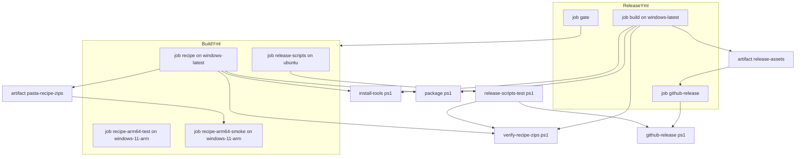
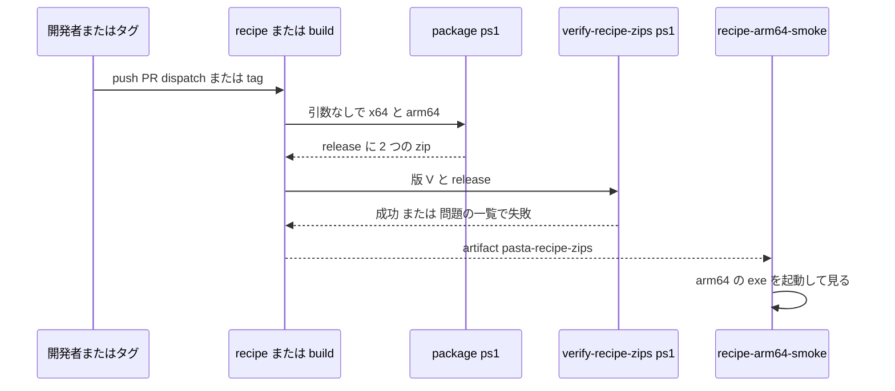

# Design Document: pasta-recipe-multiarch

## Overview

**Purpose**: pasta-recipe の配布物を、arch ごとの 2 つの zip（`pasta-recipe.x64.zip`・`pasta-recipe.arm64.zip`）にする。arm64 の Windows の作者が、エミュレーションに頼らずに pasta-recipe を使える。

**Users**: ゴースト作者は、マニュアルと README の固定のリンクから自分の arch の zip を落とす。開発者は、手元の `package.ps1` と、タグを打たない確かめの実行（`gh workflow run build.yml --ref <branch>`）で 2 つの zip を確かめる。リリースを行うエージェントは、8 つの添付で状態を数える。

**Impact**: `package.ps1` を arch で切り替え、2 つの zip の検査を 1 本のスクリプトに出して、リリース CI（`release.yml`）と main の CI（`build.yml` の job `recipe`）の両方から同じ作成と検査を呼ぶ。main の CI に `windows-11-arm` の 2 つの job（Rust のテスト・配る arm64 の exe の起動）を足す。GitHub Release の添付は 7 つから 8 つになる。`pasta-recipe.zip` の名前は一度も出さない。

### Goals

- 1 つのタグから 2 つの zip を x64 のランナーで作り、中身・版・機械の種類・ライセンスの表示・大きさ・VC++ ランタイムの DLL を検査して添付する。
- 同じ作成と検査を、毎回の push・PR と手動の起動で走らせ、リリースの日より前に壊れを見つける。
- arm64 のランナーで、Rust のテストと、配る arm64 の exe の起動を確かめる。

### Non-Goals

- x86・mac・Linux の pasta-recipe。インストーラ・コード署名・自動更新。
- arm64 のランナーで作った exe を配ること。
- `pasta.dll`・`.nar`・`release.ps1` の arch（`pasta-dll-multiarch`）。
- `release.yml` のほかの配布物の検査を、スクリプトへ出すこと。
- `pasta-recipe.zip` の古い名前の互換（一度も出していない）。

## Boundary Commitments

### This Spec Owns

- `editors/recipe/scripts/package.ps1` の arch の切り替えと、2 つの zip の名前・中身の並び。
- 2 つの zip の検査のスクリプト `.github/scripts/release/verify-recipe-zips.ps1`（中身・版・機械の種類・表示の名前・大きさ・VC++ ランタイムの DLL）。
- `release.yml` のうち pasta-recipe の作成・検査・upload の段と、rust の targets への `aarch64-pc-windows-msvc` の追加。
- `build.yml` の job `recipe` の作成・検査・artifact の段と、新しい job `recipe-arm64-test`・`recipe-arm64-smoke`。
- `editors/recipe/src-tauri/about.toml`・`deny.toml` の targets。
- `github-release.ps1` の添付の一覧（8 つ）と、その自己テスト。`release-state.ps1`・`procedure.md` の添付の数え方（`n/8`）。
- 利用者向けの文書（マニュアルの `debug/recipe.md`・`introduction.md`・README）と、名前を使う所（`RELEASE.md`・steering・`pasta-check` スキル）の付け替え。

### Out of Boundary

- アプリの画面と Rust のコード（`editors/recipe/src`・`src-tauri/src`）。一行も変えない。
- `release.yml` のほかの配布物（`pasta.dll.zip`・`.nar`・VSIX・`pasta_check.zip`・`pasta-skills.zip`）の作成と検査。
- 実際の 0.6.0 のリリースと、そこでの添付の確かめ（`release` スキル）。
- `completed/` の下の spec の記録と、各 spec の `brief.md` の調査の記録。

### Allowed Dependencies

- `windows-latest`（Windows Server 2025 ＋ VS 2026。`VC.Tools.ARM64` あり）と `windows-11-arm` の GitHub-hosted のランナー。
- 既存の道具: `dtolnay/rust-toolchain`・`Swatinem/rust-cache`・`actions/setup-node`・`actions/upload-artifact@v7`・`actions/download-artifact@v8`・`cargo-about` 0.9.2（版と SHA-256 を固定して取る）・`vswhere`・`dumpbin`・pwsh 7.4。
- 新しい依存（crate・npm・action）は足さない。
- 検査のスクリプトは `package.ps1` を呼ばず、zip の置き場と版だけを受ける（作る道と検査の道は一方向: 作る → 検査）。

### Revalidation Triggers

- `.cargo/config.toml` の `[target.aarch64-pc-windows-msvc]`: `pasta-dll-multiarch` と共有する。後に入る方は、在るのを確かめ、足し直さない。
- `release.yml` の build の job の rust の targets・cache の key・ツールの取得の段: `pasta-dll-multiarch` と共有する。
- GitHub Release の添付の一覧（8 つ）: 配布物を足す・名前を変える spec は、`github-release.ps1`・`release-state.ps1`・`procedure.md`・自己テストを一緒に直す。
- zip の中身の並び・名前を変えるとき: `package.ps1`・検査のスクリプト・マニュアルのリンクを一緒に直す。

## Architecture

### Existing Architecture Analysis

- `package.ps1` は x64 に 3 か所で決め打ち（exe の置き場 `target/release/`・`cargo about --target x86_64-pc-windows-msvc`・`release/pasta-recipe.zip`）。失敗で zip を残さない作りと、中身の並びの自己検査は保つ。
- `release.yml` の `Verify release assets` はエラーを集めてから `::error::` で出す形。pasta-recipe の節（218〜237 行）だけをスクリプトの呼び出しに置き換える。
- `build.yml` の job `recipe` は最後に `npx tauri build --no-bundle` で x64 の release ビルドを 1 回している。これを `package.ps1`（両 arch）と検査に置き換える。
- `release.yml` の gate は `build.yml` を `workflow_call` で呼ぶので、`build.yml` に足した job は自動でリリースの関門に入る（6.3）。
- 設計の前に手元で確かめたこと（research.md R1・R3・R6）: `npx tauri build --no-bundle --target aarch64-pc-windows-msvc` がクロスで通る（6 分 22 秒。exe の Machine は `0xAA64`・版は `0.5.2`・`vcruntime*` を読まない・`Cargo.lock` は変わらない）。`cargo about --target` は `about.toml` の `targets` を置き換える。`ValidateSet` の外の値は `pwsh -File` で終了コード 1。今の x64 の exe も arm64 の exe も UCRT（`api-ms-win-crt-*`）は DLL で読む。
- 補助スクリプトは `.github/scripts/release/` に置き、`release-scripts-test.ps1`（`ubuntu-latest` の job `release-scripts`）で偽の道具を渡して確かめる前例がある（`publish-vsix.ps1 -VsceCommand`）。

### Architecture Pattern & Boundary Map

**Architecture Integration**:
- 選んだ形: 作成（`package.ps1`）と検査（`verify-recipe-zips.ps1`）を 1 本ずつにし、リリース CI と main の CI が同じ 2 本を呼ぶ（7.3）。呼ぶ側は版の出どころ（タグ／`editors/vscode/package.json`）だけを変える。
- 配る 2 つの zip は、どちらも x64 のランナーで作る（arm64 はクロス）。arm64 のランナーは確かめだけで、成果物を渡さない。
- 既存の形を保つ: 失敗で zip を残さない・エラーを集めてから出す・偽の道具を渡す自己テスト・版の固定と SHA-256 の照合。
- steering: 静的 CRT（`.cargo/config.toml`）・x86 のテストを省かない方針（出荷する arch で Rust のテストを走らせる）。

### Technology Stack

| Layer | Choice / Version | Role in Feature | Notes |
|-------|------------------|-----------------|-------|
| ビルド | Rust stable・Tauri CLI 2.12（`--target`）・`aarch64-pc-windows-msvc` | arm64 の exe をクロスで作る | target を足すだけ |
| ライセンスの表示 | cargo-about 0.9.2 | arch ごとの依存の表示 | `--target` は `about.toml` の `targets` を置き換える（cargo-about 0.9.3 の `--help` で確認） |
| 検査 | pwsh 7.4・`System.IO.Compression`・`dumpbin`（`vswhere -find`） | zip・PE の機械の種類・import | 新しい依存なし |
| CI | `windows-latest`・`windows-11-arm`・upload/download-artifact | 作成・検査・arm64 の確かめ | `windows-11-arm` は公開リポジトリで無料 |

## File Structure Plan

### New Files

- `.github/scripts/release/verify-recipe-zips.ps1` — 2 つの zip の検査（2.1, 2.2, 2.3, 2.4, 2.5, 2.6, 2.7・2.11・7.1）。リリース CI と main の CI が呼ぶ。手元でも呼べる。
- `.github/scripts/release/install-tools.ps1` — 版と SHA-256 を固定したビルド済みの道具（wasm-pack・cargo-about）を取り、`GITHUB_PATH` に足す。`release.yml` の build の job の今の取得の loop と `env` の固定値をここへ移す（2026-11-14 設計議題 1 で確定）。

### Modified Files

- `editors/recipe/scripts/package.ps1` — `-Arch` の引数（`ValidateSet('x64','arm64')`・既定は両方）。arch ごとに triple・exe の置き場・`cargo about --target`・zip の名前を切り替える。
- `.cargo/config.toml` — `[target.aarch64-pc-windows-msvc]` の `+crt-static` と、頭の説明（出荷の target に aarch64 を足す）。`pasta-dll-multiarch` が先に入れていれば、在るのを確かめるだけ。
- `editors/recipe/src-tauri/about.toml` — `targets` を x64 と aarch64 の 2 つにし、`package.ps1` が arch ごとに `--target` で置き換えることを説明に書く。
- `editors/recipe/src-tauri/deny.toml` — `[graph] targets` に `aarch64-pc-windows-msvc` を足す（6.6）。
- `.github/workflows/release.yml` — 頭の説明（7 つの配布物）・rust の targets と cache の key に aarch64・ツールの取得を `install-tools.ps1` へ・step `Build pasta-recipe zips`（`package.ps1` を引数なし）・`Verify release assets` の pasta-recipe の節を `verify-recipe-zips.ps1` の呼び出しへ・upload の一覧を 2 つの zip へ。
- `.github/workflows/build.yml` — job `recipe`: targets に aarch64・`install-tools.ps1 -Name cargo-about`・最後の `tauri build --no-bundle` を `package.ps1`（両 arch）→ `verify-recipe-zips.ps1`（リポジトリの版）→ artifact `pasta-recipe-zips` の upload へ置き換える。新しい job `recipe-arm64-test`・`recipe-arm64-smoke`。
- `.github/scripts/release/github-release.ps1` — 添付の一覧を 8 つ（2 つの zip）に、文を「8 つ（配布物 7 つと詳しいリリースノート）」に。
- `.github/scripts/release/release-scripts-test.ps1` — 項目 10・11 の置くファイルを 2 つの zip へ。項目 13 を「x64 だけが無い」に、項目 14「arm64 だけが無い」を足す。項目 15〜17 で検査のスクリプトを確かめる。頭の説明に検査のスクリプトを足す。
- `.claude/skills/release/scripts/release-state.ps1` — 8 つの名前・`n/8`。
- `.claude/skills/release/procedure.md` — 過去の版の読み替え（0.4.2〜0.5.2 は `6/8`、0.4.1 以下は `4/8`）・`集計` の行・「公開済み」の数え方の文（状態の表の `7/7`・`6/7 以下`・`0/7` と `集計` の `<n>/7` は公開先の数〔5 クレート＋Marketplace＋GitHub Release〕なので 7 のまま。2026-11-14 実装 4.2 で確認）。
- `.claude/skills/pasta-check/SKILL.md` — 配布物の一覧の名前。
- `book/src/debug/recipe.md` — 固定のリンク 2 つ・arch の調べ方・対象の Windows（8.1, 8.2, 8.3）。
- `book/src/introduction.md`・`README.md` — 固定のリンクを 2 つの zip へ（8.4）。
- `crates/pasta_sample_ghost/RELEASE.md` — 配布物の一覧の名前。
- `.kiro/steering/tech.md`・`structure.md` — 配布物 7・添付 8・2 つの zip の中身と検査の項目（機械の種類・VC++ の DLL）、`recipe` の job の形、`release/` の中身（8.7）。
- `.kiro/steering/roadmap.md` — 38 行（配布物 7・添付 8）・125 行・382 行の名前。この spec の行（343・385 行）は「名前を変えたことの説明」として残してよい。

## System Flows

- 版 V は、`build.yml` では `editors/vscode/package.json` の `version`、`release.yml` では verify の job の出力（タグの版）。
- `release.yml` の build の job は artifact を `release-assets`（7 つの配布物）として後続の公開の job へ渡す。`recipe-arm64-smoke` は `build.yml` の中だけの流れで、gate を通して関門に入る。
- 検査の失敗は step の失敗にし、後続の公開の job は `needs` の既定で止まる（2.8）。

## Requirements Traceability

| Requirement | Summary | Components | Interfaces | Flows |
|-------------|---------|------------|------------|-------|
| 1.1 | タグから 2 つの zip | ReleaseYml, Package | `package.ps1`（引数なし） | System Flows |
| 1.2 | 中身 2 つ | Package, Verify | `$Expected` の並び | |
| 1.3 | arch ごとの表示 | Package, AboutDeny | `cargo about --target <triple>` | |
| 1.4 | exe の版 | Verify | `-Version` | |
| 1.5 | 機械の種類 | Package, Verify | triple 表・Machine 表 | |
| 1.6 | 静的 CRT | CargoConfig, Verify | `+crt-static`・import の検査 | |
| 1.7 | 古い名前を出さない | Package, ReleaseYml, GithubRelease, Docs | 名前の表 | |
| 2.1 | 公開の前に検査 | ReleaseYml, Verify | `Verify release assets` | |
| 2.2 | 無い・中身違い | Verify | エラーの文 | |
| 2.3 | 版違い | Verify | エラーの文 | |
| 2.4 | 機械の種類違い | Verify | エラーの文 | |
| 2.5 | 表示の名前の欠け | Verify | エラーの文 | |
| 2.6 | 30 MB | Verify | エラーの文 | |
| 2.7 | 全部示して失敗 | Verify, ReleaseYml | エラーを集める | |
| 2.8 | 失敗で公開しない | ReleaseYml | `needs` の既定 | |
| 2.9 | lock の不変 | ReleaseYml | `git diff --exit-code`（今のまま） | |
| 2.10 | 後続へ渡す | ReleaseYml | upload の一覧 | |
| 2.11 | VC++ の DLL | Verify | `dumpbin /dependents` | |
| 3.1, 3.2, 3.3 | 手元の作成と既定 | Package | `-Arch` | |
| 3.4 | 中身の自己検査 | Package | 今の自己検査を arch ごと | |
| 3.5 | 失敗で止まり残さない | Package | 終了コード 1 | |
| 3.6 | 不正な arch | Package | `ValidateSet` | |
| 3.7 | もう一方を消さない | Package | 消すのは作る arch の zip だけ | |
| 3.8 | 手元と CI が同じ | Package | CI も同じスクリプト | |
| 4.1, 4.2, 4.3, 4.4 | 添付 8 つ | GithubRelease | 名前の一覧・文 | |
| 4.5, 4.6 | 添付の自己テスト | SelfTest | 項目 10・11・13・14 | |
| 5.1, 5.2, 5.3, 5.4 | 状態の集計と手順書 | ReleaseSkill | `n/8`・表・読み替え | |
| 6.1 | main で arm64 の exe | BuildRecipe, Package | job `recipe` | System Flows |
| 6.2 | x64 の検査を続ける | BuildRecipe | 今の step を保つ | |
| 6.3 | 関門に含める | BuildRecipe | gate の `workflow_call` | |
| 6.4 | arm64 で Rust のテスト | ArmTest | `cargo test --locked` | |
| 6.5 | arm64 で起動の煙試験 | ArmSmoke | 起動の判定 | System Flows |
| 6.6 | 依存の検査に arm64 | AboutDeny | `deny.toml` の targets | |
| 7.1 | タグなしで作成と検査 | BuildRecipe, Verify | `workflow_dispatch`・リポジトリの版 | System Flows |
| 7.2 | 公開しない | BuildRecipe | `build.yml` は公開の job を持たない | |
| 7.3 | 同じ手順 | Package, Verify | 同じ 2 本を呼ぶ | |
| 7.4 | zip を残す | BuildRecipe | artifact `pasta-recipe-zips` | |
| 7.5 | 実行の URL を残す | BuildRecipe | run の URL を完了の記録に書く | |
| 8.1, 8.2, 8.3 | マニュアルの arch の選び方 | Docs | `debug/recipe.md` | |
| 8.4 | README・はじめの章 | Docs | リンク 2 つ | |
| 8.5, 8.6, 8.7 | 名前の付け替え・steering | Docs, ReleaseSkill, GithubRelease | 名前の表 | |

## Components and Interfaces

| Component | Domain | Intent | Req Coverage | Key Dependencies | Contracts |
|-----------|--------|--------|--------------|------------------|-----------|
| Package | 作る道 | arch ごとに exe・表示・zip を作る | 1.1, 1.2, 1.3, 1.5, 3.1, 3.2, 3.3, 3.4, 3.5, 3.6, 3.7, 3.8, 6.1, 7.3 | Tauri CLI (P0), cargo-about (P0), CargoConfig (P0) | Batch |
| Verify | 検査 | 2 つの zip を同じ項目で検査する | 1.2, 1.4, 1.5, 1.6, 2.1, 2.2, 2.3, 2.4, 2.5, 2.6, 2.7, 2.11, 7.1, 7.3 | dumpbin (P0) | Batch |
| InstallTools | CI の用意 | 固定の版の道具を取る | 6.1, 7.3 | GitHub Releases (P1) | Batch |
| ReleaseYml | リリース CI | 作成・検査・渡し | 1.1, 1.7, 2.1, 2.7, 2.8, 2.9, 2.10 | Package, Verify (P0) | Batch |
| BuildRecipe | main の CI | 作成・検査・artifact | 6.1, 6.2, 6.3, 7.1, 7.2, 7.3, 7.4, 7.5 | Package, Verify (P0) | Batch |
| ArmTest | main の CI | arm64 の Rust のテスト | 6.4 | windows-11-arm (P1) | Batch |
| ArmSmoke | main の CI | 配る arm64 の exe の起動 | 6.5 | BuildRecipe の artifact (P0), WebView2 (P1) | Batch |
| CargoConfig | ビルドの設定 | aarch64 の静的 CRT | 1.6 | `pasta-dll-multiarch` と共有 (P1) | State |
| AboutDeny | 依存の設定 | 表示と検査の targets | 1.3, 6.6 | cargo-about, cargo-deny (P1) | State |
| GithubRelease | 添付 | 8 つの添付 | 4.1, 4.2, 4.3, 4.4 | gh (P0) | Batch |
| SelfTest | 自己テスト | 添付の欠けと検査の失敗の形 | 4.5, 4.6, 2.2, 2.3, 2.4, 2.5, 2.6, 2.7, 2.11 | GithubRelease, Verify (P0) | Batch |
| ReleaseSkill | release スキル | 8 つで数える | 5.1, 5.2, 5.3, 5.4 | gh (P1) | State |
| Docs | 文書 | arch の選び方と名前 | 1.7, 8.1, 8.2, 8.3, 8.4, 8.5, 8.6, 8.7 | — | — |

### 作る道

#### Package（`editors/recipe/scripts/package.ps1`）

| Field | Detail |
|-------|--------|
| Intent | arch ごとに exe とライセンスの表示を作り、zip に詰めて中身の並びを確かめる |
| Requirements | 1.1, 1.2, 1.3, 1.5, 3.1, 3.2, 3.3, 3.4, 3.5, 3.6, 3.7, 3.8, 6.1, 7.3 |

**Responsibilities & Constraints**
- arch と triple の表は 2 行だけ持つ: `x64` → `x86_64-pc-windows-msvc`、`arm64` → `aarch64-pc-windows-msvc`。
- arch ごとに: その arch の zip を消す → `npx --no-install tauri build --no-bundle --target <triple>`（`beforeBuildCommand` が `dist/` と `build/js-licenses.txt` を作り直す）→ `src-tauri/target/<triple>/release/pasta-recipe.exe` の在る確かめ → `cargo about generate ... --target <triple>` → 表示をつなぐ → `release/pasta-recipe.<arch>.zip` → 中身の並びの自己検査。
- `npm ci` は最初に 1 回。
- 版・機械の種類・DLL は確かめない（Verify の責務）。

**Contracts**: Batch [x]

##### Batch / Job Contract
- Trigger: `pwsh -NoProfile -File editors/recipe/scripts/package.ps1 [-Arch x64|arm64[,…]]`。既定は `x64`・`arm64` の順で両方。
- Input / validation: `-Arch` は `ValidateSet('x64','arm64')`。ほかの値は pwsh が受け付ける値を示して終了コード 1（3.6。手元で確認済み）。
- Output: リポジトリの根の `release/pasta-recipe.<arch>.zip`。中身は `pasta-recipe.exe`・`THIRD_PARTY_LICENSES.txt` の順の 2 つ。成功の行に zip の置き場と大きさ。
- 失敗: どの段の失敗でも、その arch の zip を消し、`ERROR:` の行を出して終了コード 1。残りの arch は作らない。先に作り終えた arch の zip は残す（3.5・3.7）。
- Idempotency: 作る arch の zip だけを作り直す。もう一方の zip には触れない（3.7）。

**Implementation Notes**
- x64 にも `--target` を付ける。exe の置き場が arch ごとに分かれ、前の arch の exe を詰める取り違えが起きない。`.cargo/config.toml` の `[target.<triple>]` の `rustflags` は `--target` を付けても効く。
- 作りかけの中間ファイル（`build/native-licenses.txt`・`build/THIRD_PARTY_LICENSES.txt`）は arch ごとに作り直し、終わりに消す（今のまま）。

### 検査

#### Verify（`.github/scripts/release/verify-recipe-zips.ps1`）

| Field | Detail |
|-------|--------|
| Intent | 版 V と置き場を受けて、2 つの zip を同じ項目で検査し、問題を全部示して失敗する |
| Requirements | 1.2, 1.4, 1.5, 1.6, 2.1, 2.2, 2.3, 2.4, 2.5, 2.6, 2.7, 2.11, 7.1, 7.3 |

**Responsibilities & Constraints**
- arch と機械の種類の表を中に持つ: `x64` → `0x8664`、`arm64` → `0xAA64`。
- zip ごとに次を見て、問題を 1 つのリストに集める（最初の 1 つで止めない。2.7）。
  1. 在る（無ければ「配布物が無い: <zip の名前>」。その zip の残りの項目は見ない）。
  2. 中身が `pasta-recipe.exe`・`THIRD_PARTY_LICENSES.txt` の 2 つ（違えば zip の名前と見つけた中身。残りの項目は見ない）。
  3. exe の `FileVersionInfo` の `Major.Minor.Build` が V（違えば zip の名前と exe の版）。
  4. exe の PE ヘッダの Machine が表の値（違えば zip の名前・期待した値・実際の値。PE でなければその旨）。
  5. `THIRD_PARTY_LICENSES.txt` に `tauri`・`monaco-editor` の名前（欠けた名前ごとに zip の名前と名前）。
  6. zip の大きさが 31,457,280 バイト以下（超えれば zip の名前と大きさ）。
  7. `dumpbin /nologo /dependents` の DLL の名前に、VC++ の再頒布可能パッケージの DLL（`vcruntime*`・`msvcp*`・`vccorlib*`・`concrt*`・`msvcr<数字>*`）が無い（あれば zip の名前と DLL の名前。大文字小文字を区別しない）。`dumpbin` を動かせなければ、それも問題に数える。UCRT（`ucrtbase.dll`・`api-ms-win-crt-*`）は数えない。`+crt-static` で作った今の x64 の exe も手元で作った arm64 の exe も `api-ms-win-crt-*` を読み（research.md R1）、UCRT は Windows 10 から OS の部品なので 1.6 に効かない。pasta.dll（x64）は UCRT も取り込んでいるが、静的 CRT の目的は「サポート中の Windows で VC++ の再頒布可能パッケージを要らないこと」で、完全な静的は求めない（2026-11-14 設計議題 3 で確定。開発者「MS がセキュリティを保証しないプラットフォームに出すつもりはない」）。どの依存が UCRT を DLL で引くかは調べない。
- 展開は一時のフォルダ（`[IO.Path]::GetTempPath()` の下）に行い、終わりに消す。
- ほかの配布物は見ない。`package.ps1` を呼ばない。

**Contracts**: Batch [x]

##### Batch / Job Contract
- Trigger: `pwsh -NoProfile -File .github/scripts/release/verify-recipe-zips.ps1 -Version <X.Y.Z> [-Dir <置き場>] [-DumpbinCommand <パス>]`。
- Input: `-Version` は必須（`^\d+\.\d+\.\d+$`）。`-Dir` の既定はリポジトリの根の `release`。`-DumpbinCommand` の既定は `vswhere -latest -products * -find 'VC/Tools/MSVC/**/bin/Hostx64/x64/dumpbin.exe'` の最初の 1 つ（見つからなければ問題に数えて失敗。飛ばさない）。
- Output: 問題が無ければ「pasta-recipe の 2 つの zip の検査: 成功（版 V）」で終了コード 0。あれば問題ごとに `::error::<文>` の行を出して終了コード 1（GitHub Actions の注釈。手元ではそのまま読める）。
- Idempotency: 読むだけ。zip を変えない。

**Implementation Notes**
- Machine の読み方: 0x3C の 4 バイト（`e_lfanew`）→ その位置に `PE\0\0` → 次の 2 バイト（little endian）。
- 版の読み取り（`FileVersionInfo`）は Windows でだけ意味を持つ。Linux の自己テストでは版の問題も出るが、自己テストは見たい問題の文が含まれることだけを確かめる。
- `-DumpbinCommand` は `.ps1` でも `.exe` でも `& $cmd /nologo /dependents <exe>` で呼ぶ。自己テストは偽の `.ps1` を渡す（`publish-vsix.ps1 -VsceCommand` の前例）。

#### InstallTools（`.github/scripts/release/install-tools.ps1`）

| Field | Detail |
|-------|--------|
| Intent | 版と SHA-256 を固定したビルド済みの道具を取り、`GITHUB_PATH` に足す |
| Requirements | 6.1, 7.3 |

**Contracts**: Batch [x]
- Trigger: `pwsh -NoProfile -File .github/scripts/release/install-tools.ps1 -Name wasm-pack,cargo-about`（`release.yml`）／`-Name cargo-about`（`build.yml`）。
- 中身: 今の `release.yml` の `Install wasm-pack and cargo-about` の loop と、`env` の `WASM_PACK_VERSION`・`WASM_PACK_SHA256`・`CARGO_ABOUT_VERSION`・`CARGO_ABOUT_SHA256` の値をそのまま移す（取得・SHA-256 の照合・`--version` の照合・`GITHUB_PATH`）。`-Name` は `wasm-pack`・`cargo-about` だけを受け、外れた値は受け付ける値を示して終了コード 1（`pwsh -File` は `a,b` を 1 つの文字列で渡すので、`ValidateSet` でなく `,` で分けて表と照合する）。
- 失敗: SHA-256・版の違い・取得の失敗で終了コード 1（今と同じ）。
- **決定**（2026-11-14 設計議題 1）: 版と SHA-256 を 1 か所に持つため、このスクリプトに出す。`build.yml` へ写す形（版を上げるとき 2 か所を直す）と `cargo install --locked`（毎回のソースのビルドで遅く、SHA-256 の照合を失う）は採らない。

### CI

#### ReleaseYml（`.github/workflows/release.yml` の build の job）

- rust-toolchain の targets: `i686-pc-windows-msvc,x86_64-pc-windows-msvc,aarch64-pc-windows-msvc`。cache の key に aarch64 を足す（`pasta-dll-multiarch` と共有。後に入る方が在るのを確かめる）。
- step `Build pasta-recipe zips`: `pwsh -NoProfile -File editors/recipe/scripts/package.ps1`。
- step `Verify release assets`: ほかの配布物の検査の後で、`verify-recipe-zips.ps1 -Version $env:VERSION -Dir release` を呼ぶ。直書きの検査のエラーとスクリプトの終了コードの両方を見て、どちらかが問題なら終了コード 1（両方の問題が出てから失敗する）。
- step `Check Cargo.lock is unchanged`: 今のまま（2 つのビルドの後に在る。2.9）。
- upload の一覧: `release/pasta-recipe.x64.zip`・`release/pasta-recipe.arm64.zip`。`if-no-files-found: error` は今のまま。
- 頭の説明: 「7 つの配布物」。

#### BuildRecipe（`.github/workflows/build.yml` の job `recipe`）

- targets: `x86_64-pc-windows-msvc,aarch64-pc-windows-msvc`。
- 今の型の検査・フロントのテスト・`npm run build`・`cargo test --locked`・clippy は今のまま（6.2）。
- 最後の `npx tauri build --no-bundle` を次の 4 つに置き換える。
  1. `install-tools.ps1 -Name cargo-about`。
  2. `package.ps1`（引数なし。6.1）。
  3. `verify-recipe-zips.ps1 -Version <editors/vscode/package.json の version>`（7.1）。
  4. `actions/upload-artifact@v7`（`name: pasta-recipe-zips`・2 つの zip・`if-no-files-found: error`。7.4）。
- `build.yml` は公開の job も、Release を作る段も持たない（7.2）。
- 確かめの実行: 作業のブランチで `gh workflow run build.yml --ref <branch>`。成功した実行の URL を、spec の完了の証拠（タスクの記録・`kiro-validate-impl` の報告）に書く（7.5）。

#### ArmTest（`.github/workflows/build.yml` の job `recipe-arm64-test`）

- `runs-on: windows-11-arm`。`needs` なし。`working-directory: editors/recipe`。
- checkout → `dtolnay/rust-toolchain@stable`（host の aarch64）→ `Swatinem/rust-cache@v2`（`workspaces: editors/recipe/src-tauri`）→ `actions/setup-node@v7`（22）→ `npm ci` → `npm run build`（`generate_context!` が `dist/` を要る）→ `cargo test --locked --manifest-path src-tauri/Cargo.toml`（6.4）。

#### ArmSmoke（`.github/workflows/build.yml` の job `recipe-arm64-smoke`）

| Field | Detail |
|-------|--------|
| Intent | x64 のランナーで作った arm64 の zip の exe を、arm64 のランナーで起動して落ちないことを見る |
| Requirements | 6.5 |

- `runs-on: windows-11-arm`。`needs: recipe`。checkout とツールチェーンは要らない。
- `actions/download-artifact@v8` で `pasta-recipe-zips` を落とし、`pasta-recipe.arm64.zip` を一時のフォルダへ展開する。
- 判定（step の中の pwsh。数行）: `Start-Process -PassThru` で exe を起動し、30 秒まで 1 秒ごとに見る。
  - exe が終わった → 失敗（終了コードを示す）。
  - `Win32_Process` に `ParentProcessId` が exe の `msedgewebview2.exe` が在る → 成功（WebView2 が立ち上がった）。
  - 30 秒たっても無い → 失敗（WebView2 が立たない。ランタイムが無いときのメッセージ箱で止まっている場合もここで落ちる）。
  - 最後に exe を止める（ランナーは使い捨て）。
- 窓の題名・画面の写しは見ない（対話の画面の有無に頼らない）。
- **決定**（2026-11-14 設計議題 2）: 合格は「30 秒のうちに exe の子の `msedgewebview2.exe` が立ち、その時点で exe が生きている」。終わらないことだけを見る形（WebView2 が無いときのメッセージ箱で止まっても合格する）と、窓のハンドルを見る形（対話の画面に頼る）は採らない。
- **仮定**: `windows-11-arm` に WebView2 ランタイムがあり、対話の画面が無くても WebView2 の子のプロセスが立つ。実装の最初の `workflow_dispatch` で確かめる。起動できないと分かったら、黙って外さず開発者に戻す（6.5）。

### 設定

#### CargoConfig（`.cargo/config.toml`）

- `[target.aarch64-pc-windows-msvc]` に `rustflags = ["-Ctarget-feature=+crt-static"]`。頭の説明の「出荷ターゲットは x86・x64」を、pasta-recipe の arm64 を含む形へ直す。
- `editors/recipe` の下で動く cargo は上へたどってこの設定を読む（今の x64 と同じ）。
- `pasta-dll-multiarch` が先に入れていれば、在るのを確かめるだけ。

#### AboutDeny（`about.toml`・`deny.toml`）

- `about.toml` の `targets = ["x86_64-pc-windows-msvc", "aarch64-pc-windows-msvc"]`。`package.ps1` が `--target` で arch ごとに置き換える（cargo-about の `--target` は設定を置き換える）。説明の行にそう書く。
- `deny.toml` の `[graph] targets` に `aarch64-pc-windows-msvc` を足す。`build.yml` の job `deny` の `cargo deny check (pasta-recipe)` が、arm64 にだけ入る依存（`windows_aarch64_msvc` など）も見る（6.6）。

### 添付とリリースの状態

#### GithubRelease（`github-release.ps1`）

- `$names` を `pasta.dll.zip`・`hello-pasta.nar`・`pasta-vscode-<V>.vsix`・`pasta_check.zip`・`pasta-skills.zip`・`pasta-recipe.x64.zip`・`pasta-recipe.arm64.zip`・`release-notes-<tag>.md` の 8 つに（4.1）。
- 説明と飛ばした理由の文を「8 つ（配布物 7 つと詳しいリリースノート）」に（4.3・4.4）。欠けの検査（4.2）は今の作りのまま。

#### SelfTest（`release-scripts-test.ps1`）

- 項目 10・11: 置くファイルに 2 つの zip を入れ、「添付 8 つのうち」に（4.6）。
- 項目 13: `pasta-recipe.x64.zip` だけが無い → 終了コード 1・出力に x64 の名前があり arm64 の名前が無い。項目 14: その逆（4.5）。
- 項目 15: arm64 の zip の exe の Machine が `0x8664` → 終了コード 1・出力に `pasta-recipe.arm64.zip`・`0xAA64`・`0x8664`（2.4）。
- 項目 16: x64 の zip が無く、arm64 の zip の表示に `monaco-editor` が無い → 終了コード 1・両方の文が出る（2.2・2.5・2.7）。
- 項目 17: 偽の `-DumpbinCommand` が `VCRUNTIME140.dll` を返す → 終了コード 1・出力に zip の名前と `VCRUNTIME140.dll`（2.11）。
- 2.3（版の違い）と 2.6（30 MB）の失敗の経路は自己テストに入れない（2026-11-14 設計議題 4）。版は Windows でないと読めず、30 MB の zip は重い。成功の経路は job `recipe` の実物で確かめる。偽の版を読ませる差し込み口はスクリプトに作らない。
- 偽の exe は、`MZ`・`e_lfanew`・`PE\0\0`・Machine の 2 バイトだけを書いた小さなファイル。ネットワーク・gh・Windows の道具を使わない（`ubuntu-latest` で走る）。

#### ReleaseSkill（`release-state.ps1`・`procedure.md`）

- `release-state.ps1`: 名前の一覧を 4.1 の 8 つに、添付の `n/7`・`7` を `n/8`・`8` に（5.1・5.2）。公開先の数の `$found/7` は 7 のまま。
- `procedure.md`: 過去の版の読み替えを「0.4.2〜0.5.2 は `公開・添付 6/8`、0.4.1 以下は `4/8` を、`8/8` と読み替える」に。`GitHub Release` と `集計` の行の形と、「公開済み」の数え方の文を 8 つ（2 つの zip は 0.6.0 から）に（5.3・5.4）（状態の表の `7/7`・`6/7 以下`・`0/7` と `集計` の `<n>/7` は公開先の数〔5 クレート＋Marketplace＋GitHub Release〕なので 7 のまま。2026-11-14 実装 4.2 で確認）。
- 分類器が書き換えを拒んだときは、回避策を探さず、入った分と残りを示して開発者の許可を求める。

### 文書

#### Docs

- `book/src/debug/recipe.md`: 固定のリンク 2 つ（8.1）。arch の調べ方 =「設定 → システム → バージョン情報 → システムの種類」が「x64 ベース プロセッサ」なら x64 版、「ARM ベース プロセッサ」なら arm64 版（8.2）。対象は x64 と arm64 の Windows で、32 ビットの Windows・mac・Linux 向けは無い（8.3）。293 行の名前も直す。
- `introduction.md`・`README.md`: リンクを 2 つに（8.4）。
- `RELEASE.md`・steering（`tech.md`・`structure.md`・`roadmap.md`）・`pasta-check/SKILL.md`: 名前と数（配布物 7・添付 8）（8.5・8.7）。`pasta-check/SKILL.md` は `pasta-skills.zip` に入るので、`release.yml` の作った後の中身の照合（タグの木と一致）にそのまま効く。
- 終わりに、`completed/`・各 spec の `brief.md`・この spec の文書・`roadmap.md` のこの spec の行（343・385 行）を除いて `pasta-recipe.zip` が無いことを grep で確かめる（8.6）。

## Error Handling

- 作る道（Package）: 失敗は終了コード 1 と `ERROR:` の 1 行。その arch の zip を残さない。
- 検査（Verify）: 問題を集めてから `::error::` で全部出して終了コード 1。道具（`dumpbin`）が無いのも問題に数える（飛ばさない）。
- リリース CI: 検査の失敗は build の job の失敗になり、公開の job は走らない（2.8）。
- 煙試験: 失敗の理由（終わった・WebView2 が立たない）と終了コードを出して失敗する。

## Testing Strategy

- **自己テスト（`release-scripts-test.ps1`・ubuntu）**: 項目 10・11・13・14（添付 8 つの欠け。4.5・4.6）、項目 15〜17（機械の種類の取り違え・複数の問題を全部示す・VC++ の DLL。2.4・2.2・2.5・2.7・2.11）。
- **作成と検査の実物（`build.yml` の `recipe`・windows-latest）**: 毎回の push・PR と `workflow_dispatch` で、2 つの zip を作り、本物の exe で版・機械の種類（x64 = `0x8664`・arm64 = `0xAA64`）・表示の名前・大きさ・DLL を見る（1.2, 1.3, 1.4, 1.5, 1.6・6.1・7.1）。成功の経路はここでしか確かめられない（`FileVersionInfo`・`dumpbin` が要る）。
- **arm64 のランナー**: `recipe-arm64-test` の Rust のテスト（6.4）、`recipe-arm64-smoke` の起動（6.5）。
- **手元の確かめ（実装のとき 1 回）**: `package.ps1 -Arch x86` が終了コード 1、`-Arch arm64` が x64 の zip を消さない（3.6・3.7）。arm64 の表示が `--target aarch64-pc-windows-msvc` の依存だけになる（1.3）。今の lock で arch によって変わるのは `cpufeatures`（x64 の表示にだけ在る）。テンプレートは crate の名前を全部は書かず、`windows_aarch64_msvc` はどちらの arch の通常の依存にも届かない（2026-11-14 実装 1.2 で確認）。
- **完了の証拠**: 作業のブランチで `gh workflow run build.yml --ref <branch>` が成功した実行の URL と、`release-scripts` の job の成功（4.5・4.6）。

## Open Questions / Risks

1. **`cargo-about` の取得の共有**（InstallTools）: 確定（2026-11-14 設計議題 1）。`install-tools.ps1` へ出す。`pasta-dll-multiarch/brief.md` へ申し送り済み。
2. **煙試験の合格の形と、`windows-11-arm` で起動できるか**（ArmSmoke）: 合格の形は確定（2026-11-14 設計議題 2）。起動できるかは未確認で、WebView2 ランタイムと対話の画面の有無は公式の文書で確かめられていない。最初の `workflow_dispatch` で確かめ、起動できなければ開発者に戻す（6.5）。
3. **VC++ ランタイムの検査から UCRT を外すこと**（Verify）: 確定（2026-11-14 設計議題 3）。UCRT は数えない。対象はサポート中の Windows 10・11 だけで、UCRT はその OS の部品。
- 危険: `windows-latest` でのクロスのビルドは手元でだけ確かめた。`main` の CI は arm64 の LTO の release ビルド 1 回ぶん長くなる。

## Security Considerations

- 道具の取得は今と同じく版と SHA-256 を固定し、照合に失敗すれば止まる。
- 検査のスクリプトは読むだけで、ネットワークに出ない。煙試験は exe を起動するだけで、外へ送らない（アプリの `dev_post` は 127.0.0.1 固定）。
