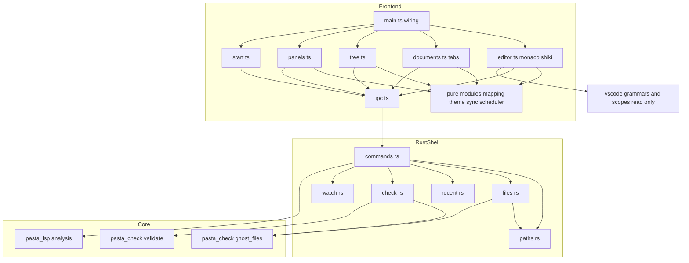
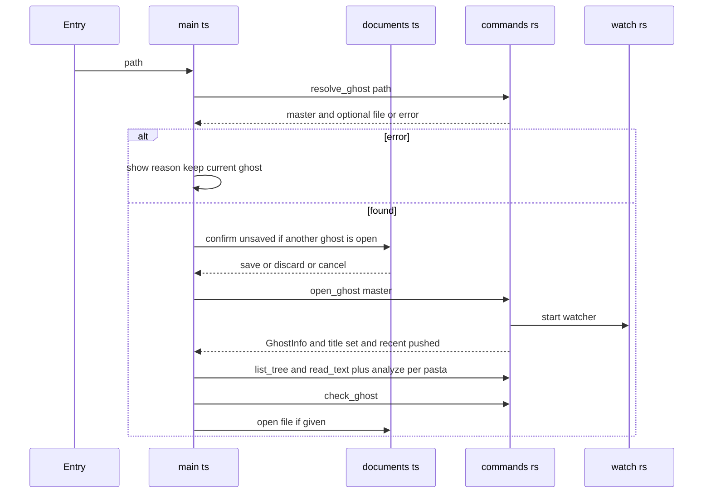
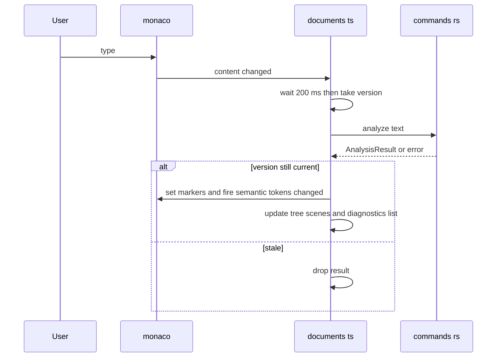
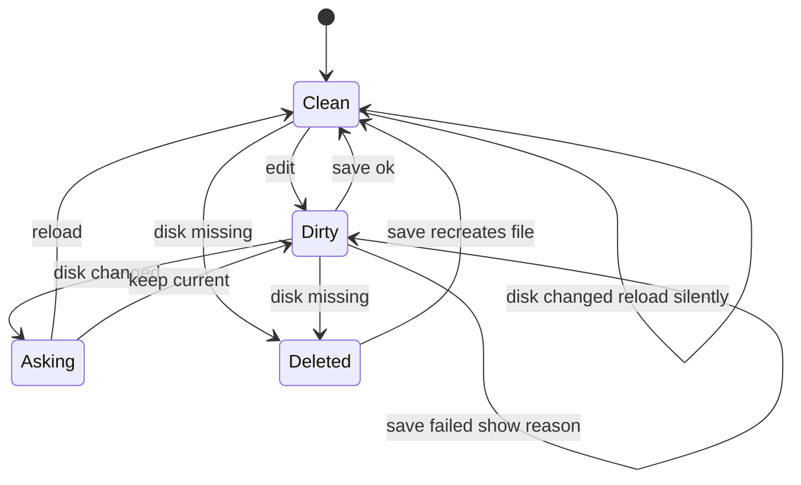

# Design Document: pasta-recipe

## Overview

**Purpose**: VS Code を入れていないゴーストの作者が、`.pasta` を VS Code 拡張（以下「拡張」）と同じ色・同じ診断の下で書けるように、インストールの要らない Windows のアプリ `pasta-recipe.exe`（以下「アプリ」）を届ける。

**Users**: ゴーストの作者が、exe にゴーストのフォルダをドロップして `ghost/master` を開き、ツリーからシーンへ飛び、`.pasta`・`.lua` を書いて保存し、ゴースト全体の検査の結果を見る。pasta の開発者は、日々の CI とリリース CI でアプリを作り、確かめ、配る。

**Impact**: 新しく `editors/recipe/`（Tauri 2 のアプリ。`src-tauri` は別の Cargo ワークスペース）を足す。既存のものは、`pasta_check` のファイル集めをライブラリの `fs` の機能へ移すこと、日々の CI・リリース CI・リリースの補助スクリプトに 7 つ目の配布物を足すこと、マニュアルに章を 1 つ足すことだけを変える。pasta.dll・拡張・ルートのワークスペースの依存は変わらない。

### Goals
- exe 1 つで動き、5 つの開き方（起動の引数・2 つ目の起動・窓へのドロップ・ダイアログ・最近開いたもの）のどれでも同じ `ghost/master` を開く。
- 拡張と同じ解析器・同じ検査の核から、同じ色分け・同じ診断・同じゴースト全体の検査の結果を出す（作りで同じにし、テストで固定する）。
- 書いた中身を失わない（保存の確かめ・外の変更の扱い・パニックで落とさない）。
- 開いた `ghost/master` の外を読み書きしない。
- リリースのたびに `pasta-recipe.zip` を作り、中身・版・大きさを確かめて添える。

### Non-Goals
- シーンの実行・SHIORI のリロード・変数の表示（`pasta-recipe-dev-actions`）。
- 補完・ホバー・定義へ移動・参照・名前の変更・全体の文字の検索。`.lua` の構文の診断。
- mac・Linux・arm64・x86、インストーラ、コード署名、自動更新、複数の窓、レジストリへの書き込み、ツリーからの削除。

## Boundary Commitments

### This Spec Owns
- `editors/recipe/` のすべて（Rust の殻・画面・ビルドの設定・アプリ専用の第三者の表示と依存の検査の設定・テスト）。
- アプリの Rust のコマンドの形（Components and Interfaces の「Rust コマンド」の表）と、画面がそれを写す決まり。
- `pasta_check` のライブラリの `fs` の機能（`pasta_check::ghost_files`）。`pasta_check validate` は同じ関数を呼ぶだけで、振る舞いは変えない。
- 日々の CI のアプリの job と、アプリの lock への依存の検査。
- リリース CI の `pasta-recipe.zip` の作成・検査・添付と、添付が 7 つになったことに合わせるリリースの補助（`github-release.ps1`・`release-scripts-test.ps1`・`release-state.ps1`）と、版の更新の手順へのアプリの lock の更新の追加。
- マニュアルの「VS Code を使わずに書く」章。

### Out of Boundary
- `pasta_lsp` の解析の中身・`scenes` の取り出し・JSON の形（変えたいときは解析器の側の spec）。
- 拡張のファイル（`editors/vscode/` の下）は**読むだけ**で書き換えない（文法 2 つと `package.json` の `semanticTokenScopes`・版・`semanticTokensProvider.ts` の凡例の行をテストが読む）。
- `pasta_check` の検査の核（`validate` モジュール）の判定、`pasta_check release`、ほかの配布物の作り方と中身。
- ルートの `Cargo.toml`・`Cargo.lock`・`about.toml`・`deny.toml`。
- ゴーストを動かす機能（`pasta-recipe-dev-actions` が、ツリーの項目・エディタ・Rust のコマンドの表に足す）。

### Allowed Dependencies
- アプリの Rust（`editors/recipe/src-tauri`）→ `pasta_lsp`（path）・`pasta_check`（path・`default-features = false, features = ["fs"]`）・`tauri` 2.12.x・`tauri-build` 2.7.x・`tauri-plugin-single-instance` 2・`tauri-plugin-dialog` 2・`notify` 8・`toml` 1・`serde` 1・`serde_json` 1・`windows-sys` 0.61（`Win32_UI_WindowsAndMessaging`）。
- 画面（`editors/recipe/src`）→ `monaco-editor` 0.57・`shiki`／`@shikijs/monaco`／`@shikijs/langs`／`@shikijs/themes` 4.6・`@tauri-apps/api` 2.12・`@tauri-apps/plugin-dialog` 2。開発用に `vite`・`typescript`・`@tauri-apps/cli` 2.12。
- 画面のビルドは `editors/vscode/syntaxes/*.tmLanguage.json`・`editors/vscode/package.json` を読み取りで import してよい。
- 禁止: ルートのワークスペースのクレート（`crates/*`）が `editors/recipe` や Tauri に依存すること。`pasta_shiori`・`pasta_lua` をアプリが引くこと。画面がファイルを直接読み書きすること（plugin-fs の JS の API を使わない）。

### Revalidation Triggers
- `pasta_lsp::analysis::AnalysisResult`・`SceneNode`・`SemanticToken` の欄、`TOKEN_TYPES`・`TOKEN_MODIFIERS` の並びが変わる。
- `pasta_check::validate::{Report, Finding}` の欄・`code` の名前（特に `syntax`）、`ghost_files` の関数の形が変わる。
- 拡張の `pasta.tmLanguage.json`・`pasta-lua-injection.tmLanguage.json`・`semanticTokenScopes`・`package.json` の `version` の置き場が変わる。
- ルートの `Cargo.lock` で `pasta_lsp`・`pasta_check` が引くクレートの版が変わる（アプリの lock も合わせる）。
- `pasta-recipe-dev-actions` が Rust のコマンドの表・ツリーの項目の形に足すとき（足すのは向こう。こちらの形を変えるなら再確認）。

## Architecture

### Existing Architecture Analysis
- 解析は `pasta_lsp::analysis::AnalysisEngine::analyze(&str) -> AnalysisResult`（純粋・`serde::Serialize`）。拡張は同じ関数を WASM で呼ぶ。アプリはネイティブで呼び、serde の同じ直列化で JSON にする。
- ゴースト全体の検査は `pasta_check::validate::{select_dictionary_files, validate_ghost}`（ファイルシステム非依存）。ファイル集めは今 `pasta_check` のバイナリの `validate_cmd.rs`（`pub(crate)`）にある。
- 拡張の文法を VS Code の外で読む先例が `book/tools/highlight/`（読むだけ・拡張が正本）。
- リリース CI は「作る → 中身を検査する → lock の不変を確かめる → artifact で渡す → 冪等に添付する」の型。

### Architecture Pattern & Boundary Map



**Architecture Integration**:
- Selected pattern: 薄い Rust の殻＋素の TypeScript の画面。Rust は既存の核を呼び、読み書きの範囲を 1 か所で守る。画面の判断（写し・並べ方・外の変更の判定・まとめ）は DOM に依らない純粋な関数に置く。
- Domain/feature boundaries: ファイルの中身とパスに触れるのは Rust だけ。Monaco のモデル・タブ・ツリーの表示は画面だけ。解析と検査の中身は核だけ。
- Existing patterns preserved: 解析の JSON の形（拡張と同じ）・検査の核の呼び方（`pasta_check validate` と同じ）・拡張の文法を読むだけで使う（マニュアルと同じ）・配布物の検査の型（`pasta_check.zip` と同じ）。
- New components rationale: 下の Components の表の各行。どれも要件の 1 つ以上を持ち、同じ責務の重複は無い。
- Steering compliance: ルートの依存を増やさない（#249 の最小化）・配布は Windows x64 だけ・TOML を既定の書式に・作成ツールは問題があれば止める（配布物の検査）。

**Dependency direction（違反は誤りとして扱う）**:
- Rust: `paths` → `files`・`recent`・`check`・`watch`（互いに依らない。`files` と `check` は `pasta_check::ghost_files` を、`check` は `pasta_check::validate` を使う）→ `commands`（Tauri に触れる唯一のモジュール）→ `lib.rs`（`run()`）→ `main.rs`。`paths`・`files`・`recent`・`check` は Tauri に依らない。`watch` は知らせを閉包で受け、Tauri に依らない。
- 画面: `ipc.ts`（型と呼び出し）・純粋なモジュール（`mapping.ts`・`theme.ts`・`tabs.ts`・`sync.ts`・`scheduler.ts`。Monaco・DOM・Tauri を import しない）→ 画面のモジュール（`editor.ts`・`dialog.ts` → `documents.ts`・`tree.ts`・`panels.ts`・`start.ts`）→ `main.ts`。

### Technology Stack

| Layer | Choice / Version | Role in Feature | Notes |
|-------|------------------|-----------------|-------|
| 殻 | Tauri 2.12.x（tauri 2.12.5・tauri-build 2.7.x）、`--no-bundle` | exe 1 つ・WebView2・コマンドの IPC・窓のイベント | 3.0 は alpha のため 2.12 に固定。`staticVCRuntime` は既定（true）のまま＋ルートの `+crt-static` |
| 殻の plugin | tauri-plugin-single-instance 2・tauri-plugin-dialog 2 | 2 つ目の起動を今の窓へ・フォルダを選ぶダイアログ | dialog は plugin-fs を引くが、JS からの fs の許可は与えない |
| 見張り | notify 8.2（CC0-1.0） | `ghost/master` の再帰の見張り | Rust の側で 200 ms まとめて 1 回知らせる |
| 解析・検査 | pasta_lsp・pasta_check（path・`fs` の機能） | 色・診断・シーン・ゴースト全体の検査・ファイル集め | WASM を通らずネイティブで静的リンク |
| 記録 | toml 1・serde 1 | 最近開いたもの（`%APPDATA%\<識別子>\recent.toml`） | plugin-store（JSON）は使わない |
| 画面 | TypeScript（フレームワーク無し・strict）＋Vite 8.x（2026-11 の最新 8.3.8。Node ^20.19 か >=22.12） | 部品・状態・写し | `edcore.main`（言語なしの Monaco）。版は `package-lock.json` で固定し、TypeScript の版は最初のタスクで `tsc --noEmit` が通る最新の安定版を選ぶ |
| エディタ | monaco-editor 0.57.0 | 編集・タブのモデル・波線・セマンティックトークン | worker は `editor.worker` 1 つを `?worker` で同梱 |
| 着色 | shiki 4.6・@shikijs/monaco 4.6・@shikijs/langs（lua）・@shikijs/themes（light-plus・dark-plus） | 行ごとの下地（pasta・柵の中の Lua・`.lua`） | 正規表現の engine は oniguruma の WASM（`shiki/wasm`・JS に埋め込み） |
| テスト | `cargo test`・`node --test`（Node 22 の型の除去） | Rust の純粋な関数・形・一致、画面の純粋な関数 | 新しいテストの依存は足さない |
| CI | GitHub Actions（`build.yml`・`release.yml`）・cargo-about・cargo-deny | 日々のビルドとテスト・配布物の作成と検査 | 既存の job の型を写す |

## File Structure Plan

### Directory Structure
```
editors/recipe/
├── package.json              # 画面の依存とスクリプト（dev・build・test・tauri）。private・版は持たない
├── package-lock.json         # コミットする
├── tsconfig.json             # strict・allowImportingTsExtensions（node --test のため .ts の拡張子で import）
├── vite.config.ts            # 出力 dist/・worker・editors/vscode の読み取りの import の許可・第三者の表示の plugin の登録
├── index.html                # 窓の骨組み（ツールバー・ツリー・タブ・エディタ・下の一覧・開始の画面・確かめの窓の置き場）
├── scripts/
│   ├── js-licenses.mjs       # Vite の plugin: 束ねに入ったパッケージの license と本文を build/js-licenses.txt へ
│   ├── js-licenses.test.mjs  # モジュールの id → パッケージの根の取り出しのテスト
│   └── package.ps1           # リリース用: build → tauri build --no-bundle → cargo about → 表示の連結 → zip → 中身の自己検査
├── src/
│   ├── main.ts               # 起動・開く流れ（5 つの入口を 1 本に）・見張りの知らせの配り・窓を閉じるときの確かめ
│   ├── ipc.ts                # Rust のコマンドと事件の型付きの包み（型は Data Models の TS の定義）
│   ├── editor.ts             # Monaco の用意（worker・言語の登録・shiki・テーマ・明暗・セマンティックトークンの提供者・波線）
│   ├── theme.ts              # 純粋: テーマ＋semanticTokenScopes → 種類ごとの色の規則
│   ├── mapping.ts            # 純粋: トークン → Uint32Array、診断 → 波線、シーン → ツリーの項目、並べ方、検査の項目の出し分け
│   ├── tabs.ts               # 純粋: 閉じる・開き直すときの判断・名前の変更のタブの付け替え・全部保存（1 つ失敗で止める）
│   ├── sync.ts               # 純粋: 外の変更の判定（タブの状態 × ディスクの中身 → 何もしない／読み直す／尋ねる／消えた）
│   ├── scheduler.ts          # 純粋: まとめて 1 回・走っている間の求めは後で 1 回だけ（時計は注入）
│   ├── documents.ts          # タブ・モデル・未保存の印・保存・閉じる・名前の付け替え・外の変更の適用・解析の結果の配り
│   ├── tree.ts               # ツリーの表示・押下・作成と名前の変更の操作
│   ├── panels.ts             # 診断の一覧・ゴースト全体の検査の一覧（件数・押下）
│   ├── start.ts              # 開始の画面・最近開いたもののメニュー
│   ├── dialog.ts             # HTML の小さな窓（3 択の確かめ・名前の入力・知らせ）
│   ├── style.css             # 明暗の両方（prefers-color-scheme）
│   └── *.test.ts             # theme・mapping・tabs・sync・scheduler のテスト（node --test）
└── src-tauri/
    ├── Cargo.toml            # 自前の [workspace]・[profile.release]（panic は書かない）・依存
    ├── Cargo.lock            # ルートの Cargo.lock を種に作る・コミットする
    ├── build.rs              # tauri_build::build()
    ├── tauri.conf.json       # identifier・version → ../../vscode/package.json・frontendDist ../dist・CSP・窓 1 つ
    ├── capabilities/default.json  # core:default・dialog:allow-open・core:window:allow-destroy だけ
    ├── about.toml            # アプリ専用の cargo-about の設定（MPL-2.0・CC0-1.0 を含む）
    ├── about.hbs             # アプリの第三者の表示の型（about-pasta_check.hbs の写し・名前だけ違う）
    ├── deny.toml             # アプリの lock 用の cargo-deny の設定（targets = x86_64-pc-windows-msvc）
    ├── icons/icon.ico        # crates/pasta_shiori/res/pasta.ico の写し
    ├── src/
    │   ├── main.rs           # windows_subsystem = "windows"・WebView2 の確かめ（無ければ知らせて終わる）→ pasta_recipe::run()
    │   ├── lib.rs            # run(): plugin・状態・コマンドの登録・初めの引数
    │   ├── commands.rs       # #[tauri::command] の表と AppState（開いているゴースト 1 つ）
    │   ├── paths.rs          # ghost/master の探し方・相対パスの検査・名前の検査
    │   ├── files.rs          # 一覧・テキストの読み書き（BOM）・作成・名前の変更
    │   ├── recent.rs         # 最近開いたものの読み書き（TOML・10 件・壊れていれば空）
    │   ├── check.rs          # ゴースト全体の検査（集め＋核＋列の UTF-16 化）
    │   └── watch.rs          # notify の見張り・200 ms のまとめ・profile の除外
    └── tests/
        └── repo_parity_test.rs  # lock の版の一致・凡例と拡張の一致・版の置き場の確かめ
```

### Modified Files
- `crates/pasta_check/Cargo.toml` — feature `fs = []` を足し、`cli = ["fs", …]` にする。
- `crates/pasta_check/src/ghost_files.rs`（新規）— `validate_cmd.rs` の `collect`・`walk`・`read_file` と、その単体テストを移す。
- `crates/pasta_check/src/lib.rs` — `#[cfg(feature = "fs")] pub mod ghost_files;`。説明を「`fs` の機能を除き、ファイルシステムに触れない」に直す。
- `crates/pasta_check/src/validate_cmd.rs` — `ghost_files::collect` を呼ぶだけにする（`run`・`run_on_master` の文言と振る舞いは変えない）。
- `crates/pasta_check/tests/validate_cli_test.rs` — 移す前に足す特性化の試験（`profile` の飛ばし・入れ子の `profile`・UTF-8 でないファイル・`pasta.toml` 無しの出力の行を固定）。
- `.github/workflows/build.yml` — job `recipe`（windows-latest）を足す。job `deny` にアプリの lock の step を足す。
- `.github/workflows/release.yml` — build に「Build pasta-recipe.zip」の step（`package.ps1`）、「Verify release assets」に 3 つの検査、「Check Cargo.lock is unchanged」にアプリの lock、upload に `release/pasta-recipe.zip`。
- `.github/scripts/release/github-release.ps1` — 添付の名前の並びに `pasta-recipe.zip`（6 → 7）と文言。
- `.github/scripts/release/release-scripts-test.ps1` — 項目 10・11 の「6 つ」を 7 つに。
- `.claude/skills/release/scripts/release-state.ps1` — 添付 7 つの数え。
- `.claude/skills/release/SKILL.md`・`procedure.md` — 版の更新の手順に、アプリの lock の更新（`cargo update --workspace --manifest-path editors/recipe/src-tauri/Cargo.toml`）を足す。添付の数の記述を 7 つに。
- `.gitignore` — `editors/recipe/dist/`・`editors/recipe/build/`。
- `book/src/debug/recipe.md`（新規）・`book/src/SUMMARY.md` — 章と目次。
- `.kiro/steering/tech.md`・`.kiro/steering/structure.md` — アプリの置き場・スタック・CI・成果物 7 つ。

## System Flows

### ゴーストを開く（5 つの入口が 1 本に入る）



- 入口: 起動の引数（`initial_path`）・2 つ目の起動（事件 `open-request`）・窓へのドロップ（Tauri の `onDragDropEvent` の最初のパス）・ダイアログ・最近開いたもの。
- 同じ `master`（大文字・小文字を区別しない）がもう開いていれば、確かめも開き直しもせず、ファイルがあればそのタブを開くだけ。
- 最近開いたものから選んで `resolve_ghost` が「無い」を返したら、知らせて `recent_remove`（3.5）。

### 書く → 色と診断とシーン



- 解析は async のコマンドで、画面の入力を止めない（7.7）。結果は送った時のモデルの版と比べ、古ければ捨てる。
- 解析が `Err`（パニックを含む）なら、前の色・波線を残し、下地の色のまま書き続けられる（6.5）。

### 保存・外の変更・ゴースト全体の検査



- 見張りの知らせ（200 ms まとめ・最上位の `profile` を除く）が来たら: ツリーを読み直す → 開いている全タブをディスクと比べて `sync.ts` の判定を当てる → 知らせのパスに `.pasta`・`.lua`・`pasta.toml` が含まれるか、ツリーの `.pasta`・`.lua` の並びが変わったら、ゴースト全体の検査を求める。
- 保存の後も検査を求める（9.2）。求めは `scheduler.ts` が 300 ms でまとめ、走っている間の求めは終わった後に 1 回だけ走らせる（9.9）。

## Requirements Traceability

| Requirement | Summary | Components | Interfaces | Flows |
|-------------|---------|------------|------------|-------|
| 1.1, 1.3 | exe 1 つ・オフライン | TauriConfig・PackageScript・Editor | `frontendDist`・`?worker`・`shiki/wasm`・CSP | — |
| 1.2 | VC++ 不要 | TauriConfig | `staticVCRuntime`（既定）＋`+crt-static` | — |
| 1.4 | WebView2 が無い | MainRs | `tauri::webview_version()`・`MessageBoxW` | — |
| 1.5 | 開始の画面 | StartView | `recent_list` | 開く |
| 1.6 | 版の表示 | Commands・TauriConfig | `version` → `editors/vscode/package.json`・窓の題名 | — |
| 1.7 | exe のそばに書かない | Recent・TauriConfig | `app_config_dir`・`app_local_data_dir` | — |
| 2.1, 2.2, 2.3, 2.11 | 4 つの入口と単一インスタンス | MainTs・LibRs | `initial_path`・事件 `open-request`・`onDragDropEvent`・plugin-dialog | 開く |
| 2.4, 2.5, 2.6, 2.7 | ghost/master の探し方 | Paths | `find_master` | 開く |
| 2.8 | 開き直す前の確かめ | MainTs・Documents・Dialog | `confirmUnsaved` | 開く |
| 2.9, 2.10 | 題名・1 窓 1 ゴースト | Commands | `open_ghost`・`AppState` | 開く |
| 3.1, 3.2, 3.3, 3.4, 3.5, 3.6, 3.7, 3.8 | 最近開いたもの | Recent・Commands・StartView | `recent_list`・`recent_remove`・`recent.toml` | 開く |
| 4.1, 4.2, 4.3 | フォルダとファイルのツリー | Files・GhostFiles・Mapping・TreeView | `list_tree`・`buildTree` | 外の変更 |
| 4.4, 4.5, 4.11, 4.12, 4.13 | シーンの項目 | Mapping・TreeView | `scenesToItems` | 書く |
| 4.6, 4.7 | 押してタブと位置へ | TreeView・Documents | `reveal(rel, pos)` | — |
| 4.8, 4.9, 4.10 | シーンの作り直し | MainTs・Documents | `read_text`・`analyze` | 開く・書く |
| 4.14, 4.15, 4.16, 4.17 | 作成・名前の変更・削除なし | Files・Paths・TreeView・Documents | `create_entry`・`rename_entry`・`check_name` | — |
| 5.1, 5.2, 5.3 | 開けるファイル | Files・Documents | `read_text`（UTF-8 の判定） | — |
| 5.4, 5.5 | タブ・未保存の印 | Documents | `Tab.dirty` | — |
| 5.6, 5.7, 5.8, 5.11 | 保存 | Documents・Files | `write_text`（BOM）・モデルの改行 | 保存 |
| 5.9, 5.10 | 閉じる確かめ | Documents・Dialog・MainTs | `onCloseRequested` | — |
| 6.1, 6.4 | 下地と柵の中の Lua | Editor | shiki（pasta・注入・lua） | — |
| 6.2, 6.3 | セマンティックトークン・凡例 | Editor・Mapping・Commands・RepoParityTest | `legend`・`tokensToData` | 書く |
| 6.5 | 解析に失敗しても書ける | Commands・Documents | `spawn_blocking` の `JoinError`・`Err` | 書く |
| 6.6, 6.7 | 同じ種類・明暗 | Theme・Editor | `semanticRules`・`prefers-color-scheme` | — |
| 7.1, 7.2, 7.5, 7.7 | 波線・1 秒以内・位置・止めない | Documents・Mapping・Editor | `diagnosticsToMarkers`・200 ms | 書く |
| 7.3, 7.4, 7.6 | 診断の一覧 | Panels・Documents | `reveal` | — |
| 8.1, 8.2, 8.3 | `.lua` | Editor・Documents | shiki の lua・保存の決まり・解析しない | — |
| 9.1, 9.2, 9.3, 9.9 | 検査の起動とまとめ | MainTs・Scheduler | `check_ghost` | 外の変更 |
| 9.4, 9.5, 9.11, 9.12 | 同じ検査 | Check・GhostFiles | `ghost_files::collect`＋`validate_ghost` | — |
| 9.6, 9.7 | 一覧と押下 | Panels・Mapping | `findingPosition` | — |
| 9.8 | 開いているファイルの syntax を重ねない | Mapping・Panels | `visibleFindings` | — |
| 9.10 | 検査できない | Check・Panels | `Err(reason)` | — |
| 10.1, 10.5 | ツリーとシーンの作り直し | Watch・MainTs | 事件 `ghost-changed` | 外の変更 |
| 10.2, 10.3, 10.4, 10.6 | タブの読み直し・尋ねる・消えた・自分の保存 | Sync・Documents | `decideExternal` | 外の変更 |
| 11.1, 11.2, 11.3, 11.4 | 読み書きの範囲 | Paths・Files・Commands | `resolve_rel` | — |
| 12.1, 12.2, 12.3, 12.4 | 作成・中身・版・大きさ | PackageScript・ReleaseWorkflow | `package.ps1`・Verify release assets | — |
| 12.5, 12.10 | 第三者の表示 | AppAbout・JsLicenses・PackageScript | `about.toml`・`js-licenses.txt` | — |
| 12.6, 12.7, 12.8, 12.9 | 添付 7 つ・補助・再実行・ほかを変えない | ReleaseWorkflow・ReleaseScripts | `github-release.ps1`・`release-state.ps1` | — |
| 13.1, 13.2 | 日々の CI・ルートを変えない | BuildWorkflow | job `recipe` | — |
| 13.3 | 探し方・記録・範囲のテスト | Paths・Recent・Files | 単体テスト | — |
| 13.4 | 解析の形と中身 | Commands・RepoParityTest | `analyze` のテスト・lock の版の一致 | — |
| 13.5 | 写しのテスト | Mapping・Theme・Sync・Scheduler | `node --test` | — |
| 13.6 | 検査の一致 | Check | `pasta_check validate` と同じ集めの比べ | — |
| 13.7 | アプリの lock の依存の検査 | AppDeny・BuildWorkflow | job `deny` の step | — |
| 13.8 | 移す前後で同じ | GhostFiles・PastaCheckCharTest | 特性化の試験 | — |
| 14.1, 14.2, 14.3, 14.4, 14.5, 14.6 | マニュアル | ManualChapter | `book/src/debug/recipe.md`・`SUMMARY.md` | — |

## Components and Interfaces

| Component | Domain/Layer | Intent | Req Coverage | Key Dependencies (P0/P1) | Contracts |
|-----------|--------------|--------|--------------|--------------------------|-----------|
| GhostFiles | pasta_check lib | ゴーストのファイル集め（一覧・中身） | 4.3, 9.4, 9.5, 9.12, 13.8 | validate（P0） | Service |
| PastaCheckCharTest | pasta_check tests | 移す前後の `validate` の出力の固定 | 13.8 | pasta_check バイナリ（P0） | — |
| Paths | Rust | ghost/master の探し方・相対パスと名前の検査 | 2.4, 2.5, 2.6, 2.7, 4.16, 11.1, 11.2, 11.4, 13.3 | std（P0） | Service |
| Files | Rust | 一覧・読み書き・作成・名前の変更 | 4.1, 4.3, 4.14, 4.15, 4.16, 4.17, 5.2, 5.3, 5.6, 5.7, 5.8, 11.3 | Paths（P0）・GhostFiles（P0） | Service |
| Recent | Rust | 最近開いたものの記録 | 3.1〜3.8 | toml（P0） | Service, State |
| Check | Rust | ゴースト全体の検査と列の UTF-16 化 | 9.4, 9.5, 9.10, 9.11, 9.12, 13.6 | GhostFiles・validate（P0） | Service |
| Watch | Rust | 見張りと 200 ms のまとめ | 9.3, 10.1, 10.5, 11.4 | notify（P0） | Event |
| Commands | Rust | Tauri のコマンドの表・開いているゴーストの状態・題名 | 1.6, 2.9, 2.10, 6.2, 6.3, 6.5, 7.7, 11.2, 13.4 | 上の全部・pasta_lsp（P0） | API, State |
| LibRs / MainRs | Rust | 起動・plugin・WebView2 の確かめ・初めの引数・2 つ目の起動 | 1.2, 1.4, 2.1, 2.11 | tauri（P0） | Event |
| TauriConfig | 設定 | exe・資産の埋め込み・版・CSP・許可 | 1.1, 1.2, 1.3, 1.6, 1.7, 11.1 | — | — |
| RepoParityTest | Rust tests | lock の版・凡例・版の置き場の一致 | 6.3, 13.4 | ルートの Cargo.lock・拡張の TS（P0） | — |
| Ipc | 画面 | コマンドと事件の型付きの包み | 全般 | @tauri-apps/api（P0） | API |
| Theme | 画面・純粋 | 種類ごとの色の規則 | 6.6, 6.7, 13.5 | — | Service |
| Mapping | 画面・純粋 | 解析・検査・一覧の写し | 4.2, 4.4, 4.5, 4.11, 4.12, 4.13, 6.2, 7.1, 7.5, 9.6, 9.8, 13.5 | — | Service |
| Sync | 画面・純粋 | 外の変更の判定 | 10.2, 10.3, 10.4, 10.6, 13.5 | — | Service |
| Tabs | 画面・純粋 | 閉じる・開き直す・名前の変更・全部保存の判断 | 2.8, 4.15, 5.9, 5.10, 13.5 | — | Service |
| Scheduler | 画面・純粋 | 検査の求めのまとめ | 9.9, 13.5 | — | Service |
| Editor | 画面 | Monaco・shiki・テーマ・提供者 | 1.3, 6.1, 6.2, 6.4, 6.6, 6.7, 7.1, 8.1 | monaco・shiki（P0）・Theme・Mapping | Service |
| Documents | 画面 | タブ・保存・閉じる・付け替え・外の変更の適用・解析の配り | 4.6, 4.7, 4.9, 4.10, 4.15, 5.1〜5.11, 6.5, 7.2, 7.6, 7.7, 8.2, 8.3, 10.2, 10.3, 10.4 | Editor・Ipc・Sync・Dialog | State |
| TreeView | 画面 | ツリーの表示と操作 | 4.1, 4.2, 4.4, 4.6, 4.7, 4.14, 4.15, 4.16, 4.17 | Mapping・Documents・Ipc | — |
| Panels | 画面 | 診断の一覧と検査の一覧 | 7.3, 7.4, 7.6, 9.6, 9.7, 9.8, 9.10 | Mapping・Documents | — |
| StartView | 画面 | 開始の画面と最近開いたもののメニュー | 1.5, 3.3, 3.4, 3.5 | Ipc | — |
| Dialog | 画面 | 3 択の確かめ・名前の入力・知らせ | 2.7, 2.8, 4.16, 5.3, 5.8, 5.9, 5.10, 10.3, 10.4 | — | — |
| MainTs | 画面 | 開く流れ・見張りの配り・窓を閉じるとき | 2.1, 2.2, 2.3, 2.8, 2.11, 4.8, 9.1, 9.2, 9.3, 10.1, 10.5, 5.10 | すべての画面のモジュール | — |
| JsLicenses | ビルド | 束ねに入った JS の第三者の表示 | 12.5 | vite（P1） | Batch |
| AppAbout / AppDeny | 設定 | アプリ専用の受け入れの並び | 12.5, 12.10, 13.7 | cargo-about・cargo-deny（P1） | — |
| PackageScript | リリース | `pasta-recipe.zip` の作成と自己検査 | 12.1, 12.2, 12.4, 12.5 | npm・tauri-cli・cargo-about（P0） | Batch |
| BuildWorkflow | CI | 日々のビルド・テスト・依存の検査 | 13.1, 13.2, 13.7 | GitHub Actions（P0） | Batch |
| ReleaseWorkflow / ReleaseScripts | CI | 作成・検査・添付・補助 | 12.1〜12.9 | PackageScript（P0） | Batch |
| ManualChapter | マニュアル | 入手から開き方まで | 14.1〜14.6 | link-check（P1） | — |

### pasta_check

#### GhostFiles（`crates/pasta_check/src/ghost_files.rs`・feature `fs`）

| Field | Detail |
|-------|--------|
| Intent | ゴーストの `ghost/master` からファイルの一覧と、核が選んだ辞書の中身を集める（今の `validate_cmd.rs` の処理を移したもの） |
| Requirements | 4.3, 9.4, 9.5, 9.12, 13.8 |

**Responsibilities & Constraints**
- 振る舞いは移す前と同じ: 最上位の `profile` に入らない（大文字・小文字を区別する今のまま）・シンボリックリンクをたどらず含めない・相対パスは `/` 区切り・中身はバイトで読み、UTF-8 で読めない（`NotUtf8`）と読めない（`Unreadable`）を分ける・`pasta.toml` の無し・読めない・UTF-8 でないを `TomlSource` で表す・文言（`「{} を読めません: {e}」`・`一覧にありません`）も同じ。
- ディスクを読むだけで書かない。

**Contracts**: Service [x]

```rust
pub struct GhostListing {
    /// (相対パス '/' 区切り, 実際のパス)。walk の順
    pub files: Vec<(String, PathBuf)>,
    /// 入ったフォルダの相対パス
    pub dirs: Vec<String>,
}
/// 再帰で一覧を作る。フォルダを読めなければ Err（理由の文）
pub fn list(master: &Path) -> Result<GhostListing, String>;
/// 一覧＋pasta.toml を読み、核の select_dictionary_files が選んだファイルの中身を集める
pub fn collect(master: &Path) -> Result<(GhostInput, BTreeMap<String, FileText>), String>;
/// 1 つのファイルを厳格な UTF-8 で読む
pub fn read_file(path: &Path) -> FileText;
```
- Postconditions: `collect` の結果を `validate_ghost` に渡すと、`pasta_check validate` と同じ `Report` になる（同じ関数なので作りで同じ）。

**Implementation Notes**
- Integration: `Cargo.toml` に `fs = []`、`cli = ["fs", "dep:lexopt", "dep:md5", "dep:zip"]`。`validate_cmd.rs` は `ghost_files::collect` を呼ぶ。`build.yml` の `cargo check -p pasta_check --lib --no-default-features --target wasm32-unknown-unknown` はそのまま通る（`fs` が無い）。
- Validation: 手順は (1) 特性化の試験を足して緑 → (2) 移して同じ試験と既存の単体テスト（移したもの）が緑、の 2 つのコミット。どちらも `cargo test -p pasta_check` と `cargo clippy` を通す。
- Risks: 公開クレートの面が増える（追加だけで、既存の公開の API は変えない）。

### Rust の殻（`editors/recipe/src-tauri/src`）

#### Paths（`paths.rs`）

| Field | Detail |
|-------|--------|
| Intent | 渡されたパスから `ghost/master` を探し、相対パスと新しい名前を検査する（読み書きの範囲の唯一の門） |
| Requirements | 2.4, 2.5, 2.6, 2.7, 4.16, 11.1, 11.2, 11.4, 13.3 |

**Contracts**: Service [x]

```rust
pub struct Found {
    /// std::path::absolute で形を揃えた ghost/master（ディスクの綴りのまま）
    pub master: PathBuf,
    /// 渡されたものが master の中のファイルなら、その相対パス（'/' 区切り）
    pub file: Option<String>,
}
/// 2.4〜2.7 の決まりで探す。見つからなければ Err（パスと理由の日本語の文）
pub fn find_master(path: &Path) -> Result<Found, String>;
/// master からの相対パスを検査して実際のパスにする。範囲の外・profile・リンクを拒む
pub fn resolve_rel(master: &Path, rel: &str) -> Result<PathBuf, String>;
/// 作成・名前の変更の新しい名前を検査する（空・Windows で使えない・同じフォルダの重なり）
pub fn check_name(dir: &Path, name: &str, except: Option<&str>) -> Result<(), String>;
```

- `find_master` の順: (1) `std::path::absolute`。無ければ「ありません」。(2) ファイルなら、そのフォルダから始め、ファイルを覚える。(3) フォルダ `D` に子 `ghost`（大文字・小文字を区別しない）があり、その下に `master` があればそれ。(4) `D` の名前が `ghost` で子に `master` があればそれ。(5) `D` の名前が `master` で親の名前が `ghost` なら `D`。(6) それ以外は `D` から上へたどり、名前が `master` で親が `ghost` の最も近いものを使い、渡されたパスをその相対パスにする（2.6）。(7) どれも無ければ「ゴーストのフォルダではありません（ghost/master が見つかりません）」。子の名前の照らし合わせは `read_dir` の名前を `eq_ignore_ascii_case` で比べ、返すパスはディスクの綴りにする。2.6 で見つけたファイルが master の外（`profile` の下など）なら、ゴーストは開き、ファイルは開かない。
- `resolve_rel` が拒むもの: 空の要素・`.`・`..`・`\`・`:`・NUL を含む要素・末尾が `.` か空白の要素・予約されたデバイス名（`CON`・`PRN`・`AUX`・`NUL`・`COM1`〜`COM9`・`LPT1`〜`LPT9`。拡張子付きも）・最初の要素が `profile`（大文字・小文字を区別しない。11.4）・master から目的の手前までの途中にあるシンボリックリンク（`symlink_metadata().file_type().is_symlink()`。ジャンクションを含む）。`rel` が空の文字列のときは master そのもの（フォルダの操作だけが使う）。
- `check_name` が拒むもの: 空・`/`・`\`・`< > : " | ? *`・制御文字・末尾の `.` と空白・予約されたデバイス名・`dir` の中の既にある名前（大文字・小文字を区別しない。名前の変更では自分自身の大文字・小文字だけの変更を `except` で許す）。

**Implementation Notes**
- Validation: 単体テストで 2.4（3 つの形）・2.5（`Ghost/MASTER`）・2.6（中のフォルダ・ファイル）・2.7（無い・ファイル・ゴーストでない）と、`resolve_rel` の拒む全種類（Windows ではジャンクションを `mklink /J` 相当で作れない環境なら飛ばさず、`std::os::windows::fs::symlink_dir` が権限で失敗したときだけ理由を出して終える）。
- Risks: master 自身がシンボリックリンクの下にあるのは許す（作者がそう置いた）。検査は master より下だけ。

#### Files（`files.rs`）

| Field | Detail |
|-------|--------|
| Intent | ツリーの一覧・テキストの読み書き・作成・名前の変更 |
| Requirements | 4.1, 4.3, 4.14, 4.15, 4.16, 4.17, 5.2, 5.3, 5.6, 5.7, 5.8, 11.3 |

**Contracts**: Service [x]

```rust
pub struct TextFile { pub text: String, pub bom: bool }
pub fn list_tree(master: &Path) -> Result<TreeListing, String>;        // ghost_files::list の相対パスから、最初の要素が profile（大文字・小文字を区別しない）のものを除く
pub fn read_text(master: &Path, rel: &str) -> Result<TextFile, String>;  // BOM を外して覚える・UTF-8 でなければ Err
pub fn write_text(master: &Path, rel: &str, text: &str, bom: bool) -> Result<(), String>;
pub fn create_entry(master: &Path, parent_rel: &str, name: &str, kind: EntryKind) -> Result<String, String>; // 新しい相対パス
pub fn rename_entry(master: &Path, rel: &str, new_name: &str) -> Result<String, String>;                    // 新しい相対パス
```
- `read_text`: `resolve_rel` → バイトで読む → 先頭の `EF BB BF` を外して `bom` に → 厳格な UTF-8（`String::from_utf8`）。だめなら「UTF-8 として読めません」（5.3）。改行は触らない。
- `write_text`: `resolve_rel` → `bom` なら BOM を前に付けて `fs::write`。改行は受け取った文字のまま（画面がモデルの改行で渡す）。失敗は OS の理由を付けた文（5.8）。作業用のファイルを作らない（11.3）。
- `create_entry`: `check_name` → ファイルは `File::create_new`（あれば失敗）・フォルダは `fs::create_dir`。`rename_entry`: `check_name(親, 新しい名前, Some(今の名前))` → `fs::rename`。削除の関数は持たない（4.17）。

#### Recent（`recent.rs`）

| Field | Detail |
|-------|--------|
| Intent | 最近開いた `ghost/master` を新しい順に 10 件まで、`%APPDATA%\<識別子>\recent.toml` に残す |
| Requirements | 3.1, 3.2, 3.3, 3.4, 3.5, 3.6, 3.7, 3.8 |

**Contracts**: Service [x] / State [x]

```rust
pub struct RecentEntry { pub master: String, pub name: String } // name はゴーストのフォルダの名前（master の 2 つ上）
pub fn parse(text: &str) -> Vec<String>;            // 壊れていれば空（3.8）
pub fn push(list: Vec<String>, master: &str) -> Vec<String>; // 先頭へ・大文字小文字を区別しない重なりを消す・10 件（3.1・3.2）
pub fn remove(list: Vec<String>, master: &str) -> Vec<String>;
pub fn render(list: &[String]) -> String;           // TOML（3.7）
pub fn load(dir: &Path) -> Vec<String>;             // 読めなければ空
pub fn save(dir: &Path, list: &[String]) -> Result<(), String>; // フォルダが無ければ作る
```
- State model: ファイルが正本。毎回読み、変えたら書く（メモリに別の写しを持たない）。
- 形:
  ```toml
  # pasta-recipe が最近開いたゴースト（新しい順・最大 10 件）
  ghosts = ['C:\ghosts\hello\ghost\master', 'D:\dev\emo2\ghost\master']
  ```

#### Check（`check.rs`）

| Field | Detail |
|-------|--------|
| Intent | `pasta_check validate` と同じ集め・同じ核で検査し、列を UTF-16 の 1 始まりに直す |
| Requirements | 9.4, 9.5, 9.10, 9.11, 9.12, 13.6 |

**Contracts**: Service [x]

```rust
/// ghost_files::collect → validate_ghost → 各 Finding の column を「その行のコードポイントの列 → UTF-16 の列（1 始まり）」に直す
pub fn check_ghost(master: &Path) -> Result<Report, String>;
```
- 列の直し: `Finding.line`・`column` があり、そのファイルの中身（辞書は `files`、`pasta.toml` は `TomlSource::Text`）が読めているときだけ直す。行は `\n` で分け、末尾の `\r` を除き、先頭から `column - 1` 文字の `len_utf16` の和＋1。中身が無いときは元の値のまま。
- `Err` は集めの失敗の理由（9.10）。画面は古い結果を消してその文を出す。
- Validation: (1) hello-pasta のサンプルゴーストと、誤り・警告・サロゲートペアの行を含む試しのゴーストで、`check_ghost` の `findings` の（code・severity・path・line・message）が `pasta_check` のバイナリの `validate` の出力の行と同じ件数・同じ中身であること（13.6）。(2) 列の直しの単体テスト。

#### Watch（`watch.rs`）

| Field | Detail |
|-------|--------|
| Intent | 開いている `ghost/master` を再帰で見張り、200 ms ためて 1 回知らせる |
| Requirements | 9.3, 10.1, 10.5, 11.4 |

**Contracts**: Event [x]

```rust
/// 見張りを始める。知らせは別のスレッドで on_batch（相対パスの集合・重なりなし）を呼ぶ。返り値を落とすと止まる
pub fn start(master: PathBuf, on_batch: impl Fn(Vec<String>) + Send + 'static) -> Result<Watcher, String>;
```
- Published events（Commands が Tauri の事件 `ghost-changed` に写す）: `{ paths: string[] }`（master からの相対・`/` 区切り）。
- 最初の要素が `profile`（大文字・小文字を区別しない）のパスは捨てる（SSP が書き続けても作り直さない・11.4）。
- 届け方: 最初の知らせから 200 ms 待って、その間の知らせをまとめて 1 回。失った知らせは、画面が「全タブをディスクと比べる」「ツリーを読み直す」で埋める（漏れても正しさが崩れない作り）。

#### Commands（`commands.rs`）

| Field | Detail |
|-------|--------|
| Intent | 画面と Rust の唯一の接点。開いているゴーストの状態を持ち、各モジュールを呼ぶ |
| Requirements | 1.6, 2.9, 2.10, 6.2, 6.3, 6.5, 7.7, 11.2, 13.4 |

**Contracts**: API [x] / State [x]

##### API Contract（Tauri のコマンド。すべて `async`。失敗は `Err(String)`＝画面に出す日本語の文）

| Command | Request | Response | Errors |
|---------|---------|----------|--------|
| `initial_path` | — | `string \| null`（起動の引数の最初の 1 つ） | — |
| `resolve_ghost` | `{ path: string }` | `{ master: string, file: string \| null }` | 見つからない理由（2.7） |
| `open_ghost` | `{ master: string }` | `GhostInfo { master, name, version }` | 読めない理由（状態は変えない） |
| `list_tree` | — | `TreeListing { files: string[], dirs: string[] }` | ゴースト未オープン・読めない |
| `read_text` | `{ rel }` | `TextFile { text, bom }` | 範囲の外・UTF-8 でない・読めない |
| `write_text` | `{ rel, text, bom }` | `null` | 範囲の外・書けない |
| `create_entry` | `{ parentRel, name, kind: 'file' \| 'dir' }` | `string`（新しい rel） | 名前の誤り・作れない |
| `rename_entry` | `{ rel, newName }` | `string`（新しい rel） | 名前の誤り・変えられない |
| `analyze` | `{ source: string }` | `AnalysisResult`（拡張の WASM と同じ JSON） | 解析のパニック（6.5） |
| `legend` | — | `{ tokenTypes: string[], tokenModifiers: string[] }` | — |
| `check_ghost` | — | `Report`（列は UTF-16・1 始まり） | 検査できない理由（9.10） |
| `recent_list` | — | `RecentEntry[]` | — |
| `recent_remove` | `{ master }` | `null` | — |

- `rel` を取るコマンドは、状態の `master` と `paths::resolve_rel` を必ず通す（11.2）。`resolve_ghost` だけが master の外のパスの有無を見る（11.1 の例外）。
- `open_ghost`: 状態の `Ghost { master, watcher }` を置き換え（古い見張りは落ちて止まる・2.10）、題名を `{name} - pasta-recipe {version}` にし（1.6・2.9。`version` は `app.package_info().version`）、`recent::push` して保存する。
- `analyze`: `tauri::async_runtime::spawn_blocking(move || AnalysisEngine::analyze(&source))` で画面の入力と別のスレッドで走らせ（7.7）、パニックは `JoinError` として `Err` に写す（6.5。`panic = "abort"` にしないので、パニックは窓を落とさない）。値はそのまま返す（形を変えない・13.4）。
- `legend`: `pasta_lsp::analysis::{TOKEN_TYPES, TOKEN_MODIFIERS}`（凡例の正本は Rust の 1 か所・6.3）。

##### State Management
- `AppState = Mutex<Option<Ghost>>`。1 つの窓に 1 つ（2.10）。ロックはパスを取り出す間だけ持ち、ファイルの読み書き・解析・検査の間は持たない。

**Implementation Notes**
- Validation（13.4）: `analyze` のテストで、全角文字・サロゲートペア・構文の誤りを含む文書について、`serde_json::to_string(&commands の結果)` が `serde_json::to_string(&AnalysisEngine::analyze(..))` と一致し、欄が `tokens`・`diagnostics`・`scenes` の順・`deltaStartCharacter` などの名前であること（`transport.rs` の形の試験と同じ文字列の形）。版の上の同じさは RepoParityTest。

#### LibRs / MainRs

| Field | Detail |
|-------|--------|
| Intent | WebView2 の確かめ・plugin・状態・コマンドの登録・2 つ目の起動の受け渡し |
| Requirements | 1.2, 1.4, 2.1, 2.11 |

- `main.rs`: `#![windows_subsystem = "windows"]`。`tauri::webview_version()` が `Err` なら、`MessageBoxW` で「pasta-recipe を動かすには Microsoft Edge WebView2 ランタイムが要ります。https://developer.microsoft.com/microsoft-edge/webview2/ から入手してください。」を出して終了コード 1 で終わる（1.4）。
- `lib.rs` の `run()`: `tauri_plugin_single_instance::init(|app, argv, cwd| …)` を最初に登録（2.11）。2 つ目の起動の `argv[1]` を `cwd` と結んで `std::path::absolute` にし、事件 `open-request { path: string | null }` を窓へ送り、窓を前に出す（`unminimize`・`set_focus`）。続いて `tauri_plugin_dialog::init()`、`AppState`、コマンドの表。
- 初めの引数は `std::env::args_os().nth(1)` を `std::path::absolute` にして `initial_path` が返す（2.1。複数なら最初の 1 つ）。

#### TauriConfig（`tauri.conf.json`・`capabilities/default.json`・`Cargo.toml`）

- `identifier`: `io.github.ekicyou.pasta-recipe`。`productName`・`mainBinaryName`: `pasta-recipe`。`version`: `../../vscode/package.json`（拡張・ワークスペース・タグの版はもう揃える決まりがあり、`verify-tag` が拡張の版とタグの一致を見ている。新しい版のファイルを作らない）。
- `build.frontendDist`: `../dist`。`beforeBuildCommand`: `npm run build`。`bundle.active`: false（`--no-bundle` と同じ）。
- 窓 1 つ（`label: main`・`dragDropEnabled: true`・既定の明暗は OS に従う）。題名は `run()` の `setup` で `pasta-recipe {version}` にし、ゴーストを開いたら `open_ghost` が `{name} - pasta-recipe {version}` にする（設定の題名は版を埋められないため・1.6）。
- `app.security.csp`: `default-src 'self'; script-src 'self' 'wasm-unsafe-eval'; style-src 'self' 'unsafe-inline'; worker-src 'self' blob:; img-src 'self' data:; font-src 'self' data:; connect-src ipc: http://ipc.localhost`（外へつながない・1.3）。
- `capabilities/default.json`: `core:default`・`dialog:allow-open`・`core:window:allow-destroy` だけ。fs の許可は与えない。
- `Cargo.toml`: `[workspace]`（members 無し）、`[profile.release] opt-level = "s", lto = true, codegen-units = 1, strip = true`（`panic` は書かない）。`pasta_check = { path = "../../../crates/pasta_check", default-features = false, features = ["fs"] }`、`pasta_lsp = { path = "../../../crates/pasta_lsp" }`。`windows-sys = { version = "0.61", features = ["Win32_UI_WindowsAndMessaging"] }`。
- `Cargo.lock`: ルートの `Cargo.lock` を写し、cargo に足りない分だけ解かせて作る（`cargo generate-lockfile` は全部を解き直すので使わない）。共通のクレートの版はルートと同じになり、RepoParityTest が固定する。

#### RepoParityTest（`tests/repo_parity_test.rs`）

| Field | Detail |
|-------|--------|
| Intent | リポジトリのファイル同士の一致を cargo test で固定する |
| Requirements | 6.3, 13.4 |

- (1) lock: アプリの `Cargo.lock` で `pasta_lsp`・`pasta_check` から通常の依存でたどれるクレート（path のものを除く）の版が、ルートの `Cargo.lock` の同じ名前の版と同じ（同じ名前が複数の版で在るときは集合で比べる）。`toml` で両方を読む。落ちたときのメッセージに、ずれたクレートの名前と版、直し方（`cargo update --manifest-path editors/recipe/src-tauri/Cargo.toml -p <名前> --precise <ルートの版>`）を出す。
- (2) 凡例: `editors/vscode/src/semanticTokensProvider.ts` の `PASTA_TOKEN_TYPES`・`PASTA_TOKEN_MODIFIERS` の配列の引用符の中の名前を順に取り出し、`TOKEN_TYPES`・`TOKEN_MODIFIERS` と一致（6.3。拡張のファイルは読むだけ）。
- (3) 写し: `editors/vscode/package.json` の `semanticTokenScopes[language=pasta].scopes` の鍵の集合が `TOKEN_TYPES` と一致（色の写しに漏れが無い）。
- (4) 版: `tauri.conf.json` の `version` が指す `package.json` の版が、ルートの `[workspace.package].version` と同じ（1.6。日々の CI で崩れに気づく）。

### 画面（`editors/recipe/src`）

#### Ipc（`ipc.ts`）
- Rust のコマンドの表を 1 対 1 で包む `async` 関数と、事件 `open-request`・`ghost-changed` の購読。型は Data Models の TS の定義。`any` を使わない。`invoke` の失敗は `string` の理由として投げ直す。

#### Theme（`theme.ts`・純粋）

```typescript
interface TmThemeRule { scope?: string | string[]; settings?: { foreground?: string; fontStyle?: string } }
interface TmTheme { name: string; type: 'light' | 'dark'; colors?: Record<string, string>; tokenColors: TmThemeRule[] }
type SemanticTokenScopes = Readonly<Record<string, readonly string[]>>;
/** テーマに、セマンティックトークンの種類ごとの規則（scope に種類の名前・色は写し先のスコープの色）を足した新しいテーマを返す */
function withSemanticRules(theme: TmTheme, scopes: SemanticTokenScopes): TmTheme;
/** TextMate のスコープ 1 つの色: 規則の選択子（カンマで分け、空白を含む子孫の選択子は使わない）のうち、点で区切った先頭一致の最も長いもの */
function resolveScopeStyle(theme: TmTheme, scope: string): { foreground?: string; fontStyle?: string } | undefined;
```
- 解けない種類には規則を足さない（既定の文字の色）。テストで、light-plus・dark-plus の両方で 17 種類のうち写し先が色を持つものすべてに規則が付くこと、`namespace` と `scene` が同じ色（同じ `keyword.control.scene.pasta`）であることなどを確かめる。

#### Mapping（`mapping.ts`・純粋）

```typescript
function tokensToData(tokens: readonly SemanticToken[]): Uint32Array;                // 5 つずつ並べるだけ（6.2）
function diagnosticsToMarkers(d: readonly Diagnostic[]): MarkerData[];             // 行・列 +1・重大度 Error（7.1・7.5）
function scenesToItems(rel: string, scenes: readonly SceneNode[]): TreeItem[];     // グローバル ＞ ローカル・文書の順・同名も別項目（4.4・4.5・4.11〜4.13）
function buildTree(listing: TreeListing): TreeNode;                                // フォルダが先・名前の順（小文字にした UTF-16 の並び）（4.1・4.2）
function visibleFindings(report: Report, openRels: ReadonlySet<string>): Finding[]; // 開いているファイルの code 'syntax' を除く（9.8・大文字小文字を区別しない）
function findingPosition(f: Finding): { lineNumber: number; column: number };      // 行の無い項目はファイルの先頭（9.7）
```
- `MarkerData` は Monaco の `IMarkerData` と同じ欄の自前の型（Monaco を import しない）。`TreeItem` は `{ kind: 'scene', rel, name, sceneKind, line, children }`。

#### Sync（`sync.ts`・純粋）

```typescript
type DiskState = { kind: 'text'; text: string; bom: boolean } | { kind: 'missing' } | { kind: 'unreadable'; reason: string };
interface TabSnapshot { diskText: string | null; diskBom: boolean; dirty: boolean; deleted: boolean }
type ExternalAction = 'none' | 'reload' | 'ask' | 'deleted';
function decideExternal(tab: TabSnapshot, disk: DiskState): ExternalAction;
```
- 規則: 中身と BOM が `diskText`・`diskBom` と同じ → `none`（自分の保存・10.6）。`missing` → 既に `deleted` なら `none`、でなければ `deleted`（10.4）。`unreadable` → `none`（次の知らせで決める）。違う中身で `dirty` でない → `reload`（10.2）。`dirty` → `ask`（10.3）。消えた後に戻ってきた（`deleted` で `text`）→ 中身がエディタと同じなら `none`、違えば `ask`。

#### Scheduler（`scheduler.ts`・純粋）

```typescript
interface Clock { setTimeout(fn: () => void, ms: number): unknown; clearTimeout(h: unknown): void }
class CoalescingRunner {
  constructor(run: () => Promise<void>, delayMs: number, clock: Clock);
  request(): void; // delayMs 以内の求めは 1 回に。走っている間の求めは、終わった後に 1 回だけ
}
```
- ゴースト全体の検査（300 ms・9.9）と、各タブの解析（200 ms・7.2）の両方に使う。

#### Editor（`editor.ts`）

| Field | Detail |
|-------|--------|
| Intent | Monaco を 1 つ作り、言語・着色・テーマ・セマンティックトークン・波線を用意する |
| Requirements | 1.3, 6.1, 6.2, 6.4, 6.6, 6.7, 7.1, 8.1 |

- 順: `self.MonacoEnvironment = { getWorker: () => new EditorWorker() }`（`monaco-editor/esm/vs/editor/editor.worker?worker`）→ `import 'monaco-editor/esm/vs/editor/edcore.main'` → `monaco.languages.register({ id: 'pasta', extensions: ['.pasta'] })`・`({ id: 'lua', extensions: ['.lua'] })` → `createHighlighterCore({ engine: createOnigurumaEngine(import('shiki/wasm')), langs: [lua, { ...pastaGrammar, name: 'pasta', embeddedLangs: ['lua'] }, { ...injectionGrammar, name: 'pasta-lua-injection', injectTo: ['source.pasta'], embeddedLangs: ['lua'] }], themes: [withSemanticRules(lightPlus, scopes), withSemanticRules(darkPlus, scopes)] })` → `shikiToMonaco(highlighter, monaco)` → `registerDocumentSemanticTokensProvider('pasta', provider)`（凡例は `legend` コマンドの値）→ エディタを `'semanticHighlighting.enabled': true` で作る。
- 文法と写しの読み込み: `import pastaGrammar from '../../vscode/syntaxes/pasta.tmLanguage.json'`・`'../../vscode/syntaxes/pasta-lua-injection.tmLanguage.json'`・`import { contributes } from '../../vscode/package.json'` の `semanticTokenScopes`（読むだけ）。
- 明暗: `matchMedia('(prefers-color-scheme: dark)')` の値と変化で `monaco.editor.setTheme('light-plus' | 'dark-plus')`（6.7）。
- セマンティックトークンの提供者: `provideDocumentSemanticTokens(model)` は Documents が持つ「そのモデルの最新の解析の結果」の `tokensToData` を返す（無ければ `null`）。Documents が新しい結果を得たら `onDidChange` を発火する。
- `.pasta`・`.lua` 以外は `plaintext`（色なし・5.2）。

**Implementation Notes**
- Validation（関門）: アプリの最初のタスクを関門にし、合格するまで画面のタスク（Documents・TreeView・Panels・StartView・MainTs）に進まない。合格の条件は (1) `+crt-static` のまま `tauri build --no-bundle` が通り、VC++ の再頒布可能パッケージ無しで起動し、exe と zip の大きさを量って記録する、(2) 実物の窓に `＊挨拶`・`＠単語`・柵の中の Lua を含む文書を開き、(a) 下地の色、(b) セマンティックトークンの色が下地の上に出ること（例: アクター名が拡張と同じ種類の色）、(c) 柵の中の Lua の色、を目で確かめ、スクリーンショットを残す。だめなときは、そのタスクの中で下の道へ切り替え（色の重なり → 自前の `setTokensProvider`、静的 CRT → `staticVCRuntime` に任せる）、どちらにしたかを報告に書く。
- Risks: だめなら下地を `vscode-textmate`＋`vscode-oniguruma`（`book/` と同じ版）の自前の `setTokensProvider` にする（テーマ・写し・提供者はそのまま）。

#### Documents（`documents.ts`）

| Field | Detail |
|-------|--------|
| Intent | 開いているファイルの状態の正本（タブ・モデル・ディスクとの揃い・解析の結果） |
| Requirements | 4.6, 4.7, 4.9, 4.10, 4.15, 5.1〜5.11, 6.5, 7.2, 7.6, 7.7, 8.2, 8.3, 10.2, 10.3, 10.4 |

**Contracts**: State [x]

```typescript
interface Tab {
  id: number;                 // モデルの URI は ghost-tab:/<id>（パスに依らない。名前の変更でモデルを作り直さない）
  rel: string;                // 名前の変更で書き換える
  model: MonacoTextModel;
  diskText: string | null;    // 最後にディスクと揃えた中身（消えたら null）
  diskBom: boolean;
  deleted: boolean;
  savedVersionId: number;     // 未保存の印: model.getAlternativeVersionId() !== savedVersionId
  analysis: AnalysisResult | null; // .pasta だけ
  analysisVersion: number;
}
```
- 開く（`open(rel, pos?)`）: 同じ `rel`（大文字・小文字を区別しない）のタブがあればそれへ（5.4）。無ければ `read_text` → モデル（言語は拡張子）→ タブ。失敗は理由を知らせて開かない（5.3）。`pos` があればカーソルを移し `revealPositionInCenter`（4.6・7.4・9.7）。
- 解析（`.pasta` だけ・8.3）: 書き換えのたびに `CoalescingRunner(200 ms)`。送った時の `getVersionId()` を覚え、結果が来た時に同じなら `analysis` を入れ替え、波線（`setModelMarkers(model, 'pasta', …)`）・提供者の `onDidChange`・ツリーのシーン（4.10）・診断の一覧を更新する。`Err` は前の結果を残す（6.5）。
- 保存（`save(tab)`・`Ctrl+S` とメニュー）: `text = model.getValue()`（モデルの改行のまま・5.7）→ `write_text(rel, text, diskBom)` → 成功で `diskText = text`・`deleted = false`・`savedVersionId` を今に・ツリーのシーンを今の解析から作り直す（4.9）・ゴースト全体の検査を求める（9.2）。失敗は理由を出し、中身と印を残す（5.8）。自動では保存しない（5.11）。
- 閉じる: 未保存なら 3 択（保存する → 保存してから閉じる／保存しない → 閉じる／取り消す → 閉じない）（5.9）。閉じたら波線・診断の一覧から消す（7.6）。そのファイルが `.pasta` なら、ツリーのシーンをディスクの中身から読み直す。
- 窓を閉じる・別のゴーストを開く: 未保存のタブがあれば 1 回の 3 択（保存する＝全部保存し、1 つでも失敗したら止める／保存しない／取り消す）（2.8・5.10）。
- 判断は `tabs.ts`（純粋）に置き、Documents は結果を Monaco とタブに当てるだけにする:
  ```typescript
  interface TabRef { id: number; rel: string; dirty: boolean }
  function retargetTabs(tabs: readonly TabRef[], oldRel: string, newRel: string): Map<number, string>; // id → 新しい rel（フォルダは前方一致・大文字小文字を区別しない）
  function needsConfirm(tabs: readonly TabRef[]): boolean;
  async function saveAll(tabs: readonly TabRef[], save: (t: TabRef) => Promise<boolean>): Promise<'ok' | 'failed'>; // 失敗した所で止める
  function afterChoice(choice: 'save' | 'discard' | 'cancel', saved: 'ok' | 'failed' | null): 'proceed' | 'stay';
  ```
- 名前の付け替え: `rename_entry` の結果で、その `rel`（フォルダなら前方一致・大文字・小文字を区別しない）のタブの `rel` を書き換える。モデル・未保存の書き換え・取り消しの履歴は保たれる（4.15）。拡張子が変わったら `setModelLanguage`。
- 外の変更（`applyExternal()`）: 全タブで `read_text` → `DiskState` → `decideExternal`。`reload` はモデルの中身を `pushEditOperations` で置き換え（取り消し可能）、`diskText` を更新。`ask` は知らせの帯に「外で変わりました: 読み直す／今の中身を残す」（選ぶまで中身を変えない・10.3）。「今の中身を残す」は `diskText` を今のディスクに更新し未保存のまま。`deleted` は「外で消えました」の印を出し、未保存にする（10.4）。

#### TreeView・Panels・StartView・Dialog（表示の部品・概要だけ）

- TreeView: `buildTree` の結果と `scenesToItems` を描く。押下で `Documents.open`。フォルダの右クリック・ボタンで「新しいファイル」「新しいフォルダ」、項目の「名前の変更」。入力は Dialog、誤りは Rust の理由を出す（4.16）。削除の操作は置かない（4.17）。
- Panels: 下に 2 つの一覧（「診断」＝開いている `.pasta` の `diagnostics`・ファイル・行・列（1 始まり）・メッセージ（7.3）／「ゴースト全体の検査」＝`visibleFindings`・誤りか警告か・ファイル・行・列・メッセージ・誤りと警告の件数（9.6）・`Err` のときは理由だけ（9.10））。押下で `Documents.open(rel, pos)`。
- StartView: ゴーストを開いていない間の画面。最近開いたもの（名前とフルパス・3.4）・「フォルダを選ぶ」・「ここにゴーストのフォルダをドロップ」の案内（1.5）。ゴーストを開いている間はツールバーの「最近開いたもの」メニューに同じ一覧（3.3）。
- Dialog: `confirm3(message): Promise<'save' | 'discard' | 'cancel'>`・`prompt(label, initial): Promise<string | null>`・`notify(message): void`。HTML の窓で、`Esc` は取り消し。キーボードで操作でき、焦点を窓の中に閉じる。

#### MainTs（`main.ts`）
- 起動: `legend` → Editor の用意 → `initial_path` があれば開く流れ、無ければ StartView。
- 開く流れ（System Flows の 1 つ目）を `openPath(path, origin)` 1 つにし、5 つの入口から呼ぶ（2.1・2.2・2.3・2.11）。`origin === 'recent'` で「見つからない」なら `recent_remove`（3.5）。
- ゴーストを開いた後: `list_tree` → 各 `.pasta` を `read_text`＋`analyze` してシーンを作る（4.8。UTF-8 でないものはシーン無し）→ 検査を求める（9.1）。
- `ghost-changed`: ツリーを読み直す → 消えた rel のシーンを捨て、知らせに含まれる rel と新しく出た rel の `.pasta`（開いているタブのものは除く）のシーンを読み直す（10.1・10.5）→ `Documents.applyExternal()` → 9.3 の条件で検査を求める。
- 窓を閉じる: `getCurrentWindow().onCloseRequested` で未保存を確かめ、続けるなら `destroy()`（5.10）。

### ビルドとリリース

#### JsLicenses（`scripts/js-licenses.mjs`）
- Batch: `vite build` の `generateBundle` で、出力に入ったモジュールの id（`this.getModuleIds()` のうち出力に含まれたもの）から `node_modules/<@scope/>name` の根を取り、根ごとに `package.json` の `name`・`version`・`license` と、根の直下の `LICENSE*`・`LICENCE*`・`NOTICE*`・`ThirdPartyNotices*` の本文を `editors/recipe/build/js-licenses.txt` に書く（`dist/` には入れない。exe に余計なものを埋め込まない）。パッケージの名前の順・決定論。
- 根に `license` も本文も無いパッケージがあれば、ビルドを止める（作成ツールは問題があれば止める）。

#### AppAbout / AppDeny
- `about.toml`: `accepted` = ルートの並び＋`MPL-2.0`・`CC0-1.0`（確かめた木に出たもの）。`targets = ["x86_64-pc-windows-msvc"]`・`ignore-dev-dependencies`・`ignore-build-dependencies`。足りない名前が出たら、そのクレートの中身を読んで足す（12.10）。
- `deny.toml`: `[licenses].allow` は `about.toml` と同じ並び。`[graph] targets = ["x86_64-pc-windows-msvc"]`。勧告・取得元の設定はルートと同じ。出た勧告は 1 件ずつ読み、使わない機能なら理由を書いて `ignore` に足す。

#### PackageScript（`scripts/package.ps1`・pwsh 7）
- Batch: (1) 古い `release/pasta-recipe.zip` を消す → (2) `npm ci` → (3) `npx tauri build --no-bundle`（`beforeBuildCommand` が `npm run build`）→ (4) `cargo about generate -m src-tauri/Cargo.toml -c src-tauri/about.toml --target x86_64-pc-windows-msvc src-tauri/about.hbs` → (5) その出力に `build/js-licenses.txt` を区切りの見出し付きで足して `THIRD_PARTY_LICENSES.txt` → (6) `release/pasta-recipe.zip`（`pasta-recipe.exe`・`THIRD_PARTY_LICENSES.txt` の 2 つ）→ (7) 中身が 2 つだけかを確かめ、違えば止まる。
- どの段の失敗も終了コード 1 で止まり、半端な zip を残さない。

#### BuildWorkflow（`build.yml`）
- job `recipe`（windows-latest）: checkout → Rust（stable・`x86_64-pc-windows-msvc`）→ `Swatinem/rust-cache`（`workspaces: editors/recipe/src-tauri`）→ Node 22（`cache-dependency-path: editors/recipe/package-lock.json`）→ `npm ci` → `npm test`（`tsc --noEmit` で型を確かめてから `node --test src/*.test.ts scripts/*.test.mjs`。`node --test` は型を外すだけで確かめないため）→ `npm run build` → `cargo test --locked --manifest-path editors/recipe/src-tauri/Cargo.toml` → `cargo clippy --locked --manifest-path … -- -D warnings` → `npx tauri build --no-bundle`（リリースと同じ形で作れること・13.1）。
- job `deny`: 既存の step の後に、`manifest-path: editors/recipe/src-tauri/Cargo.toml` で、設定にアプリの `deny.toml` を渡す `cargo-deny-action` の step をもう 1 つ（13.7）。
- 既存の job（`build`・`build-unix`・`wasm`・`deny` のルート・`luacheck`・`release-scripts`・`manual-light`）は変えない。ルートの `cargo test --workspace`・clippy は `crates/*` だけを見るので、アプリの依存は入らない（13.2）。

#### ReleaseWorkflow / ReleaseScripts
- `release.yml` の build: 既存の「Build VSIX」の後に「Build pasta-recipe.zip」（`pwsh -NoProfile -File editors/recipe/scripts/package.ps1`）。Node の用意は既存の step を使い、`cache-dependency-path` にアプリの lock を足す。
- 「Verify release assets」に足す検査（違えば止まる）: (a) 中身が `pasta-recipe.exe`・`THIRD_PARTY_LICENSES.txt` の 2 つ（12.2）、(b) exe の `VersionInfo` の `FileMajorPart.FileMinorPart.FileBuildPart` がタグの版（12.3）、(c) zip の大きさが **30 MB（31,457,280 バイト）以下**（12.4）、(d) `THIRD_PARTY_LICENSES.txt` に `monaco-editor` と `tauri` の名前が両方ある（12.5 のネイティブと画面の両方が入った印）。
- 「Check Cargo.lock is unchanged」に `editors/recipe/src-tauri/Cargo.lock` を足す。upload の一覧に `release/pasta-recipe.zip`。
- `github-release.ps1`: 名前の並びに `pasta-recipe.zip`（7 つ・12.6）。冪等の作り（足りない添付だけを足す）はそのまま（12.8）。
- `release-scripts-test.ps1`（項目 10・11）・`release-state.ps1`: 7 つに（12.7）。ほかの配布物の step・検査は触らない（12.9）。
- `release` スキル: 版の更新の手順に `cargo update --workspace --manifest-path editors/recipe/src-tauri/Cargo.toml`（アプリの lock の path のクレートの版）を足す。添付の数の記述を 7 つに。この書き換えは、リリース CI・補助スクリプトと同じタスクで行う。`.claude/skills/` の書き換えを分類器が止めたら、回避の道を探さず、入った分と残りを示して開発者の許可を求める。

#### ManualChapter（`book/src/debug/recipe.md`）
- 章題「VS Code を使わずに書く（pasta-recipe）」。`SUMMARY.md` の「VSCode 接続と拡張導入」の次。節: 入手（GitHub Release の `pasta-recipe.zip`）と置き方・初めての起動と SmartScreen の「詳細情報 → 実行」・WebView2（Windows 11 は入っている・無いときの入手先）・ゴーストの開き方 4 つ（ドラッグドロップ・窓へのドロップ・フォルダを選ぶ・最近開いたもの）・関連付け（「プログラムから開く」）と「送る」（`shell:sendto` にショートカット）で開くこと（動いていれば今の窓で開く）・できること（色分け・診断・ツリー・ゴースト全体の検査）とまだできないこと（シーンの実行などは拡張）。章の口調（クローディアの前置き）に合わせる。`link-check.mjs` を通す（14.1〜14.6）。

## Data Models

### Data Contracts & Integration

画面の型（`ipc.ts`。Rust の serde の名前と同じ）:

```typescript
interface Position { line: number; character: number }           // 0 始まり・UTF-16
interface Range { start: Position; end: Position }
interface SemanticToken { deltaLine: number; deltaStartCharacter: number; length: number; tokenType: number; tokenModifiers: number }
interface Diagnostic { range: Range; message: string; severity: number }
interface SceneNode { name: string; kind: 'global' | 'local'; heading: Range; range: Range; children: SceneNode[] }
interface AnalysisResult { tokens: SemanticToken[]; diagnostics: Diagnostic[]; scenes: SceneNode[] }
interface Legend { tokenTypes: string[]; tokenModifiers: string[] }
type Severity = 'error' | 'warning';
interface Finding { code: string; severity: Severity; path: string; line: number | null; column: number | null; message: string } // line は 1 始まり・column は UTF-16 の 1 始まり
interface Report { findings: Finding[]; stats: { dictionaryFiles: number; errors: number; warnings: number; uncheckedDynamicCalls: number; skipReasons: string[] } }
interface TreeListing { files: string[]; dirs: string[] }        // master からの相対・'/' 区切り
interface TextFile { text: string; bom: boolean }
interface GhostInfo { master: string; name: string; version: string }
interface RecentEntry { master: string; name: string }
interface GhostChanged { paths: string[] }
interface OpenRequest { path: string | null }
```

- `Severity` と `stats` の欄の正確な名前は `pasta_check::validate::report` の serde の名前に合わせる（実装の最初に `serde_json` の出力で確かめ、`ipc.ts` に写す）。
- パスの約束: 画面と Rust の間の `rel` は常に master からの相対・`/` 区切り。絶対パスは `resolve_ghost`・`open_ghost`・`recent_*`・`GhostInfo.master` だけに現れる。

### 永続のデータ
- `%APPDATA%\io.github.ekicyou.pasta-recipe\recent.toml`（Recent の形）。
- `%LOCALAPPDATA%\io.github.ekicyou.pasta-recipe\EBWebView\`（WebView2 の作業用のデータ。Tauri の既定）。
- ゴーストのフォルダには、作者が保存・作成したもののほかは何も書かない（11.3）。

## Error Handling

### Error Strategy
- Rust のコマンドの失敗は、すべて画面に出す日本語の短文の `Err(String)`（`pasta_check` の文言の型に合わせる: 「{パス} を読めません: {理由}」など）。画面は Dialog の知らせか一覧の行に出す。
- 書いた中身を守る: 保存の失敗はモデルと未保存の印を残す（5.8）。外の変更は未保存のタブを黙って書き換えない（10.3）。消えたファイルは未保存として残す（10.4）。解析のパニックは `Err` にして窓を落とさない（6.5）。窓を閉じる・ゴーストを開き直すときは 3 択（2.8・5.10）。

### Error Categories and Responses
- 開けない（2.7）: パスと理由を知らせ、開いているゴーストを変えない。
- 範囲の外（11.2）: 「開いているゴーストの外は読み書きしません」。どの画面の操作からも起きない作りだが、門として必ず返す。
- UTF-8 でない（5.3）: 開かずに理由を出す。シーンの読み込み（4.8）では黙って飛ばす（ツリーにファイルは出し、シーンは出さない）。
- 名前の誤り（4.16）: 理由（空・使えない文字・重なり）を出して何もしない。
- 検査できない（9.10）: 一覧に理由だけを出し、古い結果を消す。
- 記録が壊れている（3.8）: 空の一覧として続ける。保存に失敗しても開く操作は止めない（理由は出さない・記録だけの失敗）。
- WebView2 が無い（1.4）: メッセージ箱を出して終わる。

### Monitoring
- ログのファイルは作らない（11.3・1.7）。開発中は WebView の開発者ツール（デバッグビルドだけ）で見る。

## Testing Strategy

### Unit Tests（Rust・`cargo test`）
- `paths::find_master`: ゴーストのフォルダ・`ghost`・`ghost/master` の 3 つが同じ master に着く（2.4）、`Ghost/MASTER` を見つける（2.5）、中のフォルダ・ファイルから上へたどりファイルの相対パスを返す（2.6）、無いパス・ファイルでゴーストの外・ゴーストでないフォルダは理由付きの `Err`（2.7）。
- `paths::resolve_rel`・`check_name`: `..`・`\`・`:`・`CON`・末尾の `.`・最上位の `Profile`・途中のリンクを拒み、`dic/a.pasta` を通す（11.2・11.4）。重なり（大文字・小文字違い）・空・`a?b` を拒み、自分の大文字・小文字だけの変更を許す（4.16）。
- `files`: BOM 付き・無し、CRLF・LF の読み → 書きで、バイト列が元と同じ（5.7）。UTF-8 でないファイルは `Err`（5.3）。`create_entry` は既にあれば失敗、`rename_entry` は新しい rel を返す（4.14・4.15）。
- `recent`: 先頭へ移る・重ならない（大文字・小文字違い）・11 件目で古いものが落ちる・壊れた TOML は空・`render` → `parse` で戻る（3.1・3.2・3.7・3.8）。
- `check`: 列の UTF-16 化（サロゲートペア・全角・CRLF の行）。

### Integration Tests（Rust）
- `check::check_ghost` と `pasta_check` のバイナリの `validate`（`cargo run` ではなく、同じ `ghost_files::collect`＋`validate_ghost` の `Report::lines()`）が、hello-pasta と誤り・警告を含む試しのゴーストで同じ項目を出す（13.6）。
- `commands::analyze` の JSON がネイティブの `AnalysisEngine::analyze` の JSON と同じ文字列・同じ欄の名前と順（13.4）。
- `repo_parity_test.rs`: lock の版の一致（13.4）・凡例と拡張の TS の一致（6.3）・写しの鍵の一致・版の置き場の一致（1.6）。
- `pasta_check` の特性化の試験（`validate_cli_test.rs`）: 移す前に足し、移した後も同じ出力（13.8）。

### 画面の純粋な関数（`node --test`）
- `mapping`: トークンの並べ方、診断の +1（全角・サロゲートペアの列がそのまま +1 で拡張と同じ位置・7.5）、シーンの 2 階層・同名の別項目・構文の誤りで出たものだけ（4.4・4.5・4.11）、フォルダが先・大文字・小文字を区別しない並び（4.2）、開いているファイルの `syntax` を除く（9.8）、行の無い項目は先頭（9.7）。
- `theme`: 両方のテーマで写し先の色を持つ種類に規則が付く・選択子の最長一致（6.6）。
- `sync`: 表の全組み合わせ（自分の保存は `none`・未保存なら `ask`・消えた・戻ってきた）（10.2〜10.4・10.6）。
- `scheduler`: 300 ms 以内の 3 回の求めが 1 回・走っている間の 2 回の求めが後の 1 回（9.9）。
- `tabs`: フォルダの名前の変更で中のタブが付け替わり、似た名前（`dic` と `dict`）は付け替わらない・大文字小文字違いも付け替わる（4.15）、全部保存が 2 つ目の失敗で止まり 3 つ目を呼ばない、失敗・取り消しでは `stay`（2.8・5.9・5.10）。
- `js-licenses`: モジュールの id（`\0` 付きの仮想 id・`@scope/name`・入れ子の `node_modules`）から根を取り出す。

### E2E（手で確かめ・最後のタスク）
- 実物の hello-pasta で: exe にフォルダをドロップして開く → ツリーの「朝」を押して 2 行目へ → 書き換えて波線が 1 秒以内に出て消える → 保存して改行と BOM が変わらない（`git diff` で確かめる）→ 外のエディタで同じファイルを変えて読み直し／尋ねる → 2 つ目の起動で今の窓に開く → 窓を閉じるときの 3 択。色の重なり（Editor の Validation）と同じ文書を拡張で開いた時の波線の位置を見比べる。

### Performance
- ゴーストを開いてからツリーとシーンが出るまで: hello-pasta で 1 秒以内を目安に手で確かめる。書き換えから波線の更新まで 1 秒以内（7.2。200 ms のまとめ＋解析）。

## Security Considerations
- 読み書きの範囲の門は `paths::resolve_rel` の 1 か所で、すべての `rel` のコマンドが通る。画面は信用しない入力として扱う（Tauri の IPC は窓の中の JS なら誰でも呼べる）。
- 外へつながない CSP。fs・shell・http の plugin の許可を与えない。リモートの URL を窓に読み込まない。
- `profile`（保存変数）を読まない（11.4）。
- exe は署名しない（SmartScreen の警告はマニュアルで説明・14.2）。

## Open Questions / Risks

- **決定（版の置き場・2026-11-13）**: `tauri.conf.json` の `version` は `../../vscode/package.json`。版の更新の手順にアプリの lock の更新を足し、lock の版の一致の試験は残す（ReleaseWorkflow・RepoParityTest）。
- **Risk: shiki とセマンティックトークンの重なり**: ソースの上では重なる。最初のタスクで実物で確かめ、だめなら Editor の Risks の道へ。
- **Risk: アプリの lock への `cargo deny`**: Tauri の木の勧告で止まることがある。1 件ずつ判断する。
- **Risk: 大きさ**: 上限 30 MB は見積もり（zip 5 MB 前後）の 6 倍。最初のビルドの実測が 15 MB を超えたら、何が大きいかを調べる（Monaco の言語・shiki の言語の取り込み漏れなど）。
- **Known limit**: `pasta_check` の集めは最上位の `profile` を大文字・小文字を区別して飛ばす（移す前の振る舞いのまま）。アプリはツリー（`list_tree`）と範囲の門（`resolve_rel`）で大文字・小文字を区別せずに除くので、綴りが `Profile` でもツリーに出ず開けない（4.3・11.4）。検査の集めとの差は、`pasta.toml` の選び方に `Profile` の下が入る場合だけに残る。
- **Known limit**: BOM 付きのファイルの 1 行目の検査の項目の列は、拡張と同じく BOM を 1 文字に数えた位置になる（拡張と同じ結果を優先）。
