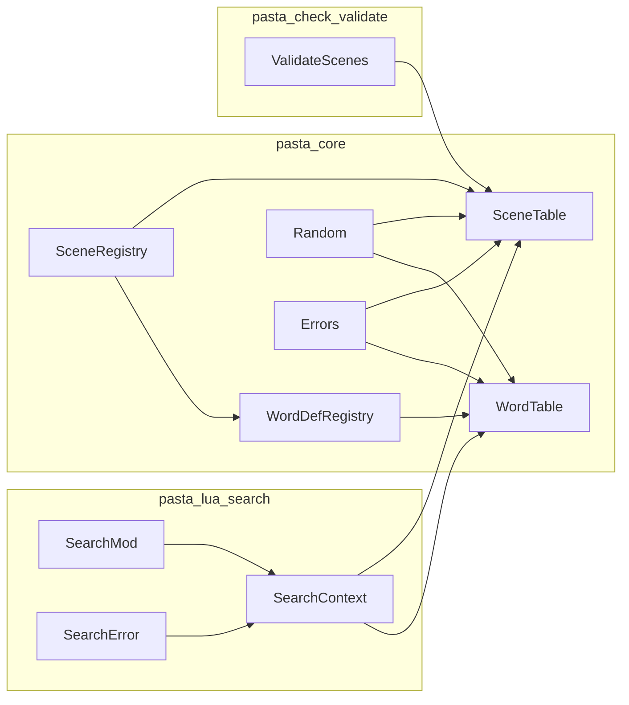
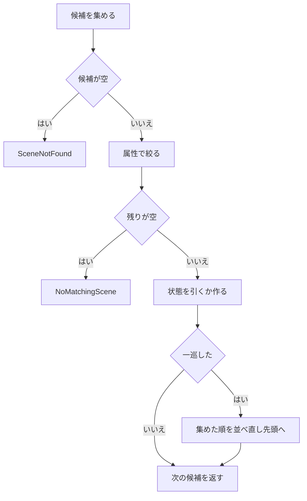
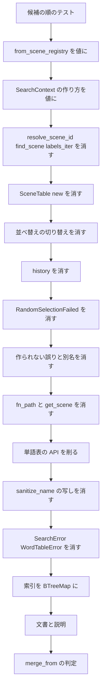

# 設計: ponytail-core-registry

## Overview

**Purpose**: `crates/pasta_core` のシーン表・単語表・シーンの登録から、本番で誰も使わない API・書くだけの欄・作られない誤りの型・前方一致だけのための外部の依存（`fast_radix_trie`）を取り除く。読む人と直す人の手間を減らす。

**Users**: pasta の開発者と、`pasta_core` を読む人。ゴーストの作者に見える挙動（`@pasta_search` の結果・シーンと単語の選ばれ方・`pasta_check validate` の報告）は変えない。

**Impact**: 既存のファイルの中の削除と型の直しだけで、新しいファイル・新しい型・新しい抽象は作らない。前方一致の索引は、標準の `std::collections::BTreeMap<String, Vec<_>>` に替える。呼び手（`pasta_lua` の検索、`pasta_check validate`）は同じ変更で合わせる。

### Goals

- 監査の指摘（brief の Current State の 1〜4）と、ギャップ分析で増えた指摘（要件 1.5・2.3・3.3・4.3・4.4・5.6・6・11.6）を、残らず直す。
- `SceneTable::from_scene_registry` と `SearchContext::new`・`with_aliases` が、失敗の型で包まずに値を返す。
- `fast_radix_trie` を依存から外し、候補の順（キーのバイト列の辞書順・同じキーの中は登録順）と検索の手間（O(log n + k)）を保つ。
- 直しの前に候補の順を固めるテストを置き、1 つの直しを 1 つのコミットにする。

### Non-Goals

- 属性の絞り込みの仕組み（`filter_by_attributes`・`SceneCacheKey.filters`・`filters` の引数・`NoMatchingScene`・`attributes` の欄）の変更。0.5.0 の `scene-attribute-store`・`scene-condition-attributes` が使う。
- `SceneEntry.id` と登録の関数が返す ID の撤去（`ponytail-lua-transpiler` の持ち場の `pasta_lua/src/context.rs` に波及する）。
- `SceneInfo.id`・`name`・`scope`、`WordEntry.id`、`collect_word_candidates` の公開の範囲（research.md「指摘にしなかったもの」）。
- 空の単語名がすべての大域の単語に前方一致する挙動（決めた挙動として固めてある）。
- 前方一致の索引を 1 つの共通の型にまとめること（ギャップ分析の Option B。採らない）。

## Boundary Commitments

### This Spec Owns

- `crates/pasta_core` の公開 API の削り：`SceneTable`・`SceneRegistry`・`WordTable`・`WordDefRegistry`・`SceneTableError`・`WordTableError`・型の別名・再輸出。
- `SceneTable`・`WordTable` の前方一致の索引の入れ物（`BTreeMap<String, Vec<_>>`）と、その候補の順の約束。
- `SceneTable` の順次消費の状態（`CachedSelection`）の形と、`select_from_cache` が誤りを返さない約束。
- `pasta_lua` の検索の文脈の作り方（`SearchContext::new`・`with_aliases`）が値を返す形と、`SearchError` から作られない包み（`WordTableError`）を消すこと。
- 上の直しに合わせる呼び手と文書：`pasta_lua/src/search/{context,mod,error}.rs`、`SearchContext` を作る 4 つのテストファイル、`pasta_check/src/validate/scenes.rs`、`crates/pasta_core/README.md`・`crates/pasta_core/Cargo.toml`・ルートの `Cargo.toml`・`Cargo.lock`、`.kiro/steering/tech.md`、`book/src/internals/registry-search.md`。

### Out of Boundary

- `crates/pasta_lua/src/context.rs`（`TranspileContext`。`ponytail-lua-transpiler` の持ち場）。どの場合も触らない。
- 属性の絞り込みの仕組み（上の Non-Goals）。
- ルートの `README.md` と `tech.md` の「公開クレートの pub API を予告なく消すことがある」断り書き（`ponytail-lua-loader` が書いた）。
- `SOUL.md` の「Radix Trie等の高効率データ構造」（目指す姿の例で、今の実装の説明ではない）。
- roadmap の持ち場の表の書き足し（`kiro-complete` で行う）。
- `Cargo.lock` の、`fast_radix_trie` 以外の行（`ponytail-editor-tooling`・`pest-2-9-4-upgrade` が変える行）。

### Allowed Dependencies

- `pasta_core` が使ってよいもの：`thiserror`・`rand`・標準ライブラリ。依存を足さない。
- 依存の向き：`pasta_core` ← `pasta_lua`（`search/`）・`pasta_check`（`validate/`）。`pasta_core` から上の層を参照しない。
- `pasta_core` の中：`scene_types` ← `scene_registry` ← `scene_table`、`scene_registry` ← `word_registry` ← `word_table`、`random` ← 2 つの表。`word_table` から `scene_table` を参照しない（前方一致の書き方は各表に 1 行ずつ書き、共通の部品を作らない）。

### Revalidation Triggers

- **索引の形が変わる**（`RadixMap` → `BTreeMap<String, Vec<_>>`）：`scene_table.rs` の中を触る 0.5.0 の spec（`scene-count`・`scene-attribute-store`・`scene-condition-attributes`・`scene-pick-modes`・`scene-exact-match`）は、入った後の main で索引の形を見直してから設計する。
- **公開 API が減る**：`SceneTable::new`・`resolve_scene_id`・`find_scene`・`labels_iter`・`set_shuffle_enabled`、`SceneRegistry::get_scene`、`SceneEntry.fn_path`、`WordTable::new`・`entries`・`clear_cache`・`set_shuffle_enabled`、`WordCacheKey`、`WordDefRegistry::sanitize_name`、`SceneTableResult`・`WordTableResult`、誤りの種類 4 つ。これらを前提に書いた brief・設計は読み直す。
- **返り値の形が変わる**：`from_scene_registry` は `SceneTable`、`SearchContext::new`・`with_aliases` は `SearchContext`、`WordTable::search_word` は引数 2 つ。
- **`merge_from`**：`ponytail-lua-transpiler` が先に `TranspileContext::merge_from` を消したかどうかで、この spec の最後の手順が変わる（要件 10）。
- **`Cargo.lock`**：同じウェーブで `Cargo.lock` を変える spec と、後から入る側が作り直す。

## Architecture

### Existing Architecture Analysis

- 本番の流れ：トランスパイル（`SceneRegistry::register_global`・`register_local`、`WordDefRegistry::register_*`）→ 辞書の確定（`pasta_lua/src/runtime/finalize.rs` → `register_global_raw`）→ `search::register` → `SearchContext::with_aliases` → `SceneTable::from_scene_registry`・`WordTable::from_word_def_registry` → Lua の `SEARCH:search_scene`・`search_scene_exact`・`search_local_scene_exact`・`search_word`。
- `pasta_check validate` は `validate/scenes.rs` で同じ登録とシーン表を作る。
- 表は辞書の確定で 1 回作り、作った後は選択の状態と `RandomSelector` のほかは変えない（`replace_selector` は状態を消す）。1 つの Lua VM の中だけで使い、並行して書かない。
- 守る形：レジストリ（集める側）と検索表（引く側）の 2 層、`RandomSelector` の抽象、テストを `#[path]` の子モジュールに置いて中の欄に触れる形（`scene_table_candidate_tests.rs`・`scene_table_resolve_filter_tests.rs`）、単語表の外のテスト（`tests/word_table_test.rs`）。

### Architecture Pattern & Boundary Map



**Architecture Integration**:
- 採る形：既存のファイルの中で削り、索引の入れ物だけを替える（ギャップ分析の Option A）。進める順は、撤去と型の直しを先に、入れ物の差し替えを最後に回す（Option C の順）。候補の順を固めるテストだけは最初に置く。
- 新しい部品：無い。
- steering との整合：言語非依存の `pasta_core` に依存を足さない。公開クレートの pub API を消してよい（2026-10-19 の決定）。

### Technology Stack

| Layer | Choice / Version | Role in Feature | Notes |
|-------|------------------|-----------------|-------|
| 前方一致の索引 | `std::collections::BTreeMap<String, Vec<_>>`（標準） | シーンと単語の候補を、キーのバイト列の辞書順で集める | `fast_radix_trie 1.2.0` を置き換える。`scene_alias.rs` がすでに `BTreeMap` を使う |
| 乱数 | `rand 0.10`（変えない） | 巡の始まりの並べ替え | `RandomSelector` の抽象は変えない |
| 誤りの型 | `thiserror 2`（変えない） | 残る誤りの種類 | 文言は変えない |
| ツールチェーン | Rust edition 2024（変えない） | — | 依存は減るだけ |

## File Structure Plan

新しいファイルは無い。すべて既存のファイルの変更である。

### Modified Files

**`crates/pasta_core`**
- `Cargo.toml` — `fast_radix_trie.workspace = true` の行を消す。`description` を「Pasta Core - Language-independent registry and utility layer」にする（`lib.rs` の 1 行目と同じ。「DSL parsing」を消す）。
- `src/lib.rs` — 再輸出から `SceneTableResult`・`WordTableResult`・`WordCacheKey` を外す。
- `src/registry/mod.rs` — 再輸出を `pub use word_table::WordTable;` にする（`WordCacheKey` を外す）。
- `src/error.rs` — `SceneTableResult`・`WordTableResult`・`RandomSelectionFailed`・`DuplicateSceneName`・`DuplicateScenePath`・`NoMoreScenes` を消す。文言のテストから、消した種類の確かめを外す。
- `src/registry/scene_table.rs` — `new`・`resolve_scene_id`・`find_scene`・`labels_iter`・`set_shuffle_enabled`、欄 `shuffle_enabled`・`CachedSelection.history` を消す。`from_scene_registry` は `Self` を返す。`select_from_cache` は `SceneId` を返す。索引を `BTreeMap<String, Vec<SceneId>>` にする。説明の「RadixMap」を直す。
- `src/registry/scene_table_candidate_tests.rs` — 候補の順を固めるテストを足す。`resolve_scene_id` のテストを `resolve_scene_id_unified("", ..)` へ移す。`SceneTable::new` を空の登録からの `from_scene_registry` に替える。`set_shuffle_enabled(false)` を消して指定列が空のモックにする。手で組む表の索引を `BTreeMap` にする。冒頭の説明から `shuffle_enabled` を外す。
- `src/registry/scene_table_resolve_filter_tests.rs` — 同じ移し替え。`find_scene`・`labels_iter` のテストを消し、`labels_iter()` を使う確かめは `table.labels.iter()` にする。
- `src/registry/scene_registry.rs` — `SceneEntry.fn_path` と 4 か所の書き込み、`get_scene` を消す。テストの `fn_path` の確かめは `fn_name` に、`get_scene(id)` は `all_scenes()[添字]` にする。`test_get_scene_invalid_ids` は消す。（要件 10.2 の場合だけ）`merge_from` とそのテスト 3 つを消す。
- `src/registry/word_table.rs` — `new`・`entries`・`clear_cache`・`set_shuffle_enabled`、欄 `shuffle_enabled`、`search_word` の `_filters` を消す。`WordCacheKey` を中だけの型にする（`pub` を外す）。索引を `BTreeMap<String, Vec<usize>>` にする。
- `src/registry/word_registry.rs` — `sanitize_name` を消し、`register_local`・`register_actor` は `SceneRegistry::sanitize_name` を直に呼ぶ。`test_sanitize_name` を消す（同じ確かめが `scene_registry.rs` にある）。（要件 10.2 の場合だけ）`merge_from` とそのテスト 2 つを消す。
- `tests/word_table_test.rs` — 候補の順を固めるテストを足す。`search_word` の第 3 引数を外す。`set_shuffle_enabled(false)` を消して指定列が空のモックにする。`WordTable::new`・`entries`・`clear_cache` を使うテストを、残る API の確かめに替える（下の Testing Strategy）。
- `README.md` — 公開 API の表から `WordCacheKey` の行を消す。使用例を残る API で書く。依存の表から `fast_radix_trie` の行を消す。アーキテクチャの説明の「RadixMap による前方一致」を直す。

**`crates/pasta_lua`**
- `src/search/context.rs` — `with_aliases`・`new` が `Self` を返す（`from_scene_registry(..)?` の `?` と `Ok(..)` を外す）。3 つの match の腕（160・182・224 行）から `NoMoreScenes` を外す。`search_word` の呼び出し（303 行）を引数 2 つにする。テスト 12 か所の `.unwrap()` を外す。
- `src/search/mod.rs` — `loader` の `SearchContext::with_aliases(..)?`（50 行）の `?` を外す。`loader` は `create_userdata` のために `LuaResult` を返し続ける。
- `src/search/error.rs` — `SearchError::WordTableError`（13〜15 行）を消す。
- `tests/common/e2e_helpers.rs`（69・130 行）・`tests/lua_unittest_runner.rs`（55 行）・`tests/runtime/scene_identity_format_test.rs`（180 行）・`tests/search/scene_search_test.rs`（487 行）— `.expect(..)`・`.unwrap()` を外す。

**`crates/pasta_check`**
- `src/validate/scenes.rs` — 104〜106 行の `.expect("from_scene_registry は失敗を返さない")` を外す。

**ワークスペースと文書**
- ルートの `Cargo.toml` — 23 行の `fast_radix_trie = "1.2.0"` を消す。
- `Cargo.lock` — `fast_radix_trie` の項目と、`pasta_core` の依存の並びの `fast_radix_trie` を消す（cargo が作り直す。`memchr` は残る）。
- `.kiro/steering/tech.md` — 27 行の `fast_radix_trie 1.2.0` を消す。161 行の「前方一致Radix Trie」を「前方一致は BTreeMap の範囲（O(log n + k)）」にする。
- `book/src/internals/registry-search.md` — 次のとおり直す。見出しは変えない（頁の中の参照の印を壊さない）。
  - 20・130 行：「RadixMap」を「前方一致の索引（`BTreeMap`）」にする。
  - 32 行：依存を「`thiserror`・`rand` だけ」にする。
  - 40・42 行：索引の型を `BTreeMap<String, Vec<SceneId>>`・`BTreeMap<String, Vec<usize>>` にする（`WordCacheKey` は中の型として名前を残してよい。194 行も同じ）。
  - 44 行：シーンの誤りを「`SceneNotFound`・`NoMatchingScene`・`InvalidScene` の 3 つ」にする。
  - 148 行：「（`WordDefRegistry::sanitize_name` は同じ関数を呼ぶ）」を「（`WordDefRegistry` の登録も同じ関数を呼ぶ）」にする。
  - 181 行：「候補は、索引を検索キーから順に、キーが検索キーで始まる間だけ読む順に集まる。`BTreeMap` はキーのバイト列の辞書順で並ぶ」にする（残りの文は変えない）。
  - 200 行：`history` の項目を消す。
  - 208 行：`set_shuffle_enabled` の 2 文を消す。
  - （要件 10.2 の場合だけ）36 行の `merge_from` の一文を消す。
- `crates/pasta_dsl/README.md` 73 行の「（fast_radix_trie, rand）」を「（rand）」にする（要件 7.7 は README 全般を対象にする。どの spec の持ち場でもない。2026-11-02 の設計ディスカッションで決めた）。

### 変えないファイル（境界の確かめ用）

- `crates/pasta_core/src/registry/random.rs`（Random。`RandomSelector`・`DefaultRandomSelector`・`MockRandomSelector`。6.3）
- `crates/pasta_core/src/registry/scene_types.rs`（`SceneId`・`SceneInfo`・`SceneScope`。8.3）
- `crates/pasta_core/src/registry/scene_alias.rs`・`crates/pasta_core/src/actor_font.rs`
- `crates/pasta_lua/src/context.rs`（10.3）

## System Flows

### 順次消費の選び方（直した後）



- 状態を作るとき（初回）と一巡したときは、いつも `random_selector.shuffle_usize` を呼ぶ（切り替えを消すため）。渡す配列は、その呼び出しで集めた候補の順である。今の本番と同じである。
- `Pick` の時点で候補は 1 つ以上ある。誤りの道は無い（要件 4.3）。

## Requirements Traceability

| Requirement | Summary | Components | Interfaces | Flows |
|-------------|---------|------------|------------|-------|
| 1.1 | `resolve_scene_id` を消す | SceneTable | — | — |
| 1.2 | `find_scene` を消す | SceneTable | — | — |
| 1.3 | `labels_iter` を消す | SceneTable | — | — |
| 1.4 | `CachedSelection.history` を消す | SceneTable | CachedSelection | 順次消費 |
| 1.5 | `SceneTable::new` を消す | SceneTable | — | — |
| 1.6 | 残す API は同じ意味 | SceneTable | SceneTable の契約 | 順次消費 |
| 2.1 | `SceneEntry.fn_path` を消す | SceneRegistry | SceneEntry | — |
| 2.2 | 登録の欄と返り値は同じ | SceneRegistry | SceneRegistry の契約 | — |
| 2.3 | `SceneRegistry::get_scene` を消し、ID は残す | SceneRegistry | — | — |
| 3.1 | `from_scene_registry` は `Self` | SceneTable | `from_scene_registry` | — |
| 3.2 | `pasta_check` の `expect` を消す | ValidateScenes | — | — |
| 3.3 | `SearchContext::new`・`with_aliases` は `Self` | SearchContext・SearchMod | SearchContext の契約 | — |
| 3.4 | 登録の失敗の扱いは同じ | SearchMod | `loader`・`register` | — |
| 4.1 | 作られない種類 3 つを消す | Errors | SceneTableError | — |
| 4.2 | 型の別名 2 つを消す | Errors | lib.rs の再輸出 | — |
| 4.3 | `RandomSelectionFailed` を消し、必ず 1 つ選ぶ | SceneTable・Errors | `select_from_cache` | 順次消費 |
| 4.4 | `SearchError::WordTableError` を消す | SearchError | SearchError | — |
| 4.5 | 3 つの腕から `NoMoreScenes` を外す | SearchContext | 「見つからない」の写し | — |
| 4.6 | 残る種類の文言は同じ | Errors | SceneTableError・WordTableError | — |
| 5.1 | `WordTable::new` を消す | WordTable | — | — |
| 5.2 | `search_word` の `_filters` を消す | WordTable・SearchContext | `search_word` | — |
| 5.3 | `entries`・`clear_cache` を消す | WordTable | — | — |
| 5.4 | `WordCacheKey` を外へ出さない | WordTable・lib.rs | 再輸出 | — |
| 5.5 | 残す API は同じ意味 | WordTable | WordTable の契約 | — |
| 5.6 | `WordDefRegistry::sanitize_name` を消す | WordDefRegistry | — | — |
| 6.1 | `shuffle_enabled`・`set_shuffle_enabled` を消す | SceneTable・WordTable | — | 順次消費 |
| 6.2 | テストは指定列が空のモックへ | テスト 3 ファイル | — | — |
| 6.3 | 並べ替えの抽象と Lua の指定列は同じ | Random・SearchContext | RandomSelector | — |
| 7.1 | 索引を標準ライブラリにする | SceneTable・WordTable | 索引の契約 | — |
| 7.2 | `fast_radix_trie` の行と項目を消す | Cargo.toml・Cargo.lock | — | — |
| 7.3 | 候補はバイト列の辞書順・同じキーは登録順 | SceneTable・WordTable | 索引の契約 | — |
| 7.4 | 完全一致はキーと等しい項目だけ | SceneTable | `resolve_scene_id_exact`・`resolve_global_owning_local_exact` | — |
| 7.5 | 大域の前方一致は `:` で始まるキーを除く | SceneTable・WordTable | 索引の契約 | — |
| 7.6 | 手間は O(log n + k) | SceneTable・WordTable | 索引の契約 | — |
| 7.7 | 「RadixMap」などの記述を残さない | 文書・コードの説明 | — | — |
| 8.1 | `filter_by_attributes`・`NoMatchingScene` を残す | SceneTable・Errors | — | 順次消費 |
| 8.2 | `filters` の引数と `SceneCacheKey.filters` を残す | SceneTable | SceneTable の契約 | — |
| 8.3 | `attributes` の欄を残す | SceneRegistry・SceneTable | SceneEntry・SceneInfo | — |
| 8.4 | 絞り込みと状態の分け方は同じ | SceneTable | SceneCacheKey | 順次消費 |
| 9.1 | `@pasta_search` の結果は同じ | SearchContext | Lua のメソッド | — |
| 9.2 | 一巡まで重複なし・一巡で並べ直す | SceneTable・WordTable | — | 順次消費 |
| 9.3 | 指定列の位置で同じものを選ぶ | SceneTable・WordTable・Random | — | 順次消費 |
| 9.4 | 状態の分け方は同じ | SceneTable・WordTable | SceneCacheKey・WordCacheKey | — |
| 9.5 | `pasta_check validate` の報告は同じ | ValidateScenes | — | — |
| 10.1 | 相手が未着なら `merge_from` を残す | SceneRegistry・WordDefRegistry | — | 移行の最後の手順 |
| 10.2 | 相手が先なら `merge_from` を消す | SceneRegistry・WordDefRegistry・文書 | — | 移行の最後の手順 |
| 10.3 | `pasta_lua/src/context.rs` を変えない | — | — | — |
| 10.4 | ルートの `Cargo.toml`・`Cargo.lock` は 1 行・1 項目だけ | Cargo.toml・Cargo.lock | — | — |
| 10.5 | 相手が先なら rebase で作り直す | Cargo.lock | — | 移行の最後の手順 |
| 11.1 | `pasta_core` の README | 文書 | — | — |
| 11.2 | `tech.md` | 文書 | — | — |
| 11.3 | `registry-search.md` | 文書 | — | — |
| 11.4 | 断り書きを足さない | 文書 | — | — |
| 11.5 | 生成の元を直したら作り直す | 文書 | — | — |
| 11.6 | `Cargo.toml` の `description` | pasta_core の Cargo.toml | — | — |
| 12.1 | 候補の順を固めるテストを先に置く | テスト 2 ファイル | — | 移行の順序 |
| 12.2 | 1 つの直し＝1 コミット | 全体 | — | 移行の順序 |
| 12.3 | 消す API のテストの観点を移す | テスト 3 ファイル | — | — |
| 12.4 | fmt・clippy・test の関門 | 全体 | — | 移行の順序 |
| 12.5 | `sample.generated.lua` の改行の差分を入れない | 全体 | — | 移行の順序 |

## Components and Interfaces

| Component | Domain/Layer | Intent | Req Coverage | Key Dependencies | Contracts |
|-----------|--------------|--------|--------------|------------------|-----------|
| SceneTable | pasta_core 検索表 | シーンの前方一致・完全一致の解決と順次消費 | 1, 3.1, 4.3, 6.1, 7.1, 7.3〜7.6, 8, 9.2〜9.4 | SceneRegistry (P0), Random (P0) | Service, State |
| SceneRegistry | pasta_core 登録 | シーンを登録順に集め ID を振る | 2, 8.3, 10.1, 10.2 | — | Service |
| WordTable | pasta_core 検索表 | 単語の前方一致と順次消費 | 5.1〜5.5, 6.1, 7.1, 7.3, 7.5, 7.6, 9.2〜9.4 | WordDefRegistry (P0), Random (P0) | Service, State |
| WordDefRegistry | pasta_core 登録 | 単語を登録順に集める | 5.6, 10.1, 10.2 | SceneRegistry (P1: 照合規則) | Service |
| Errors | pasta_core 誤りの型 | 検索の失敗の種類と文言 | 4.1, 4.2, 4.3, 4.6, 8.1 | thiserror (P2) | Service |
| SearchContext・SearchMod・SearchError | pasta_lua 検索 | `@pasta_search` の実装と登録 | 3.3, 3.4, 4.4, 4.5, 5.2, 6.3, 9.1 | SceneTable (P0), WordTable (P0) | Service |
| ValidateScenes | pasta_check | 辞書の検査のシーン表 | 3.2, 9.5 | SceneTable (P0) | — |
| 文書 | README・steering・マニュアル・Cargo.toml | 撤去に合わせた記述 | 7.2, 7.7, 10.4, 11 | — | — |

### pasta_core 検索表

#### SceneTable

| Field | Detail |
|-------|--------|
| Intent | シーンの解決（前方一致・完全一致・ローカルを持つ大域）と、重ならない順次消費 |
| Requirements | 1.1〜1.6, 3.1, 4.3, 6.1, 7.1, 7.3〜7.6, 8.1〜8.4, 9.2〜9.4 |

**Responsibilities & Constraints**
- 作った後は、`cache` と `random_selector` のほかを変えない。
- 欄は `labels: Vec<SceneInfo>`・`prefix_index: BTreeMap<String, Vec<SceneId>>`・`cache: HashMap<SceneCacheKey, CachedSelection>`・`random_selector: Box<dyn RandomSelector>` の 4 つになる（`shuffle_enabled` を消す）。
- 属性の絞り込み（`filter_by_attributes`・`SceneCacheKey.filters`）は今の形のまま残す。

**Dependencies**
- Inbound: SearchContext — 本番の検索 (P0)、ValidateScenes — 検査 (P0)
- Outbound: SceneRegistry — 作る元 (P0)、RandomSelector — 巡の並べ替え (P0)
- External: なし（`fast_radix_trie` を外す）

**Contracts**: Service [x] / State [x]

##### Service Interface（直した後の公開の面）

```rust
impl SceneTable {
    pub fn from_scene_registry(
        registry: SceneRegistry,
        random_selector: Box<dyn RandomSelector>,
    ) -> Self;
    pub fn resolve_scene_id_unified(
        &mut self, module_name: &str, search_key: &str,
        filters: &HashMap<String, String>,
    ) -> Result<SceneId, SceneTableError>;
    pub fn resolve_scene_id_exact(
        &mut self, module_name: &str, name: &str,
        filters: &HashMap<String, String>,
    ) -> Result<SceneId, SceneTableError>;
    pub fn resolve_global_owning_local_exact(
        &mut self, name: &str, local: &str,
        filters: &HashMap<String, String>,
    ) -> Result<Option<SceneId>, SceneTableError>;
    pub fn collect_scene_candidates(
        &self, module_name: &str, prefix: &str,
    ) -> Result<Vec<SceneId>, SceneTableError>;
    pub fn get_scene(&self, id: SceneId) -> Option<&SceneInfo>;
    pub fn replace_selector(&mut self, selector: Box<dyn RandomSelector>);
}
```

- 消すもの：`new`・`resolve_scene_id`・`find_scene`・`labels_iter`・`set_shuffle_enabled`。
- 残す関数の誤りの種類は今と同じ（`SceneNotFound`・`NoMatchingScene`・`InvalidScene`）。
- 中の関数 `select_from_cache(&mut self, cache_key: SceneCacheKey, filtered_ids: Vec<SceneId>) -> SceneId`。
  - 前提：`filtered_ids` は空でない（`filter_by_attributes` が空を `NoMatchingScene` にする）。
  - 結果：状態が無ければ、`filtered_ids` を並べ替えて作る。一巡していれば、`filtered_ids` を並べ替え直して先頭に戻す。次の候補を返し、位置を 1 進める。
  - 書き方：`self.cache.entry(cache_key).or_insert_with(..)` が返す `&mut CachedSelection` をそのまま使う（同じ関数の中で `get_mut` を引き直さない）。閉包と並べ替え直しは、欄 `self.random_selector` を直に使う（`cache` と別の欄なので借用が分かれる）。`SceneCacheKey` の `Clone` と、その理由の説明（16 行）は要らなくなるので消す。
  - 添字が候補の中にある理由：一巡していなければ `next_index < candidates.len()` であり、一巡していれば候補を空でない `filtered_ids` で作り直して位置を 0 にする。どちらも同じ関数の中で決まり、呼び出しをまたぐ前提に頼らない。この理由をコードに 1 行で書く。（同じキーの候補の数が変わらないこと——キーが候補の集まりを決めるものをすべて含み、表は作った後に変わらず、`replace_selector` は状態を消す——は、選ばれ方が今と同じであることの理由で、添字の安全の理由ではない。）
- 呼び手（`resolve_scene_id_unified`・`resolve_scene_id_exact`・`resolve_global_owning_local_exact`）は、結果を `Ok(..)`・`Ok(Some(..))` で包む。

##### 索引の契約（前方一致と完全一致）

- 作るとき：`prefix_index.entry(search_key).or_default().push(scene.id)`。`labels` の順（登録順）に入れるので、同じキーの中は登録順になる。
- 前方一致：`prefix_index.range::<str, _>((Bound::Included(prefix), Bound::Unbounded)).take_while(|(k, _)| k.starts_with(prefix))`。
  - `prefix` で始まるキーは、`prefix` 以上のキーの先頭に続けて並ぶ（バイト列の辞書順の性質）。そのため、範囲の始まりを引く O(log n) と、一致した k 個を読む手間だけで済み、全項目をなめない（7.6）。
  - 列挙の順は `String` の順（UTF-8 のバイト列の辞書順）で、今の `RadixMap::iter_prefix` の「キーで並べた順」（`fast_radix_trie-1.2.0/src/map.rs:553`。キーは `Vec<u8>`）と同じ（7.3）。
  - 大域（`module_name` が空）では、`k.starts_with(':')` のキーを飛ばす（7.5）。ローカルは `:module_name:prefix` で引く。
- 完全一致：`prefix_index.get(key)`（`&str` で引ける）。大域の範囲で `:` で始まるキーを候補にしない規則は今のまま（7.4）。
- 書き方は、2 つの表の 4 か所（シーンの大域・ローカル、単語の大域・ローカル）にそのまま書く。共通の関数や型は作らない。
- 確かめ（2026-11-02 の設計ディスカッション）：この `range::<str, _>((Bound::Included(p), Bound::Unbounded))` の形は、`rustc --edition 2021` でそのまま通る。U1 の大域のキーを入れた `BTreeMap<String, _>` で `挨拶` を引くと `["挨拶", "挨拶1", "挨拶A", "挨拶_夜", "挨拶あ"]` になり、`雑談` は入らない。

##### State Management

- `CachedSelection { candidates: Vec<SceneId>, next_index: usize }`（`history` を消す）。
- 状態のキー `SceneCacheKey`（モジュール・キー・整列した絞り込み・完全一致か・持ち主のローカル）は変えない（8.4・9.4）。

**Implementation Notes**
- 検証：候補の順を固めるテスト（Testing Strategy の U1）を、入れ物を替える前のコミットで置き、替えた後も変えずに通す。
- 危険：前方一致の `take_while` を書き落とすと、範囲の後ろのキーまで候補に入る。U1・U2 は `挨拶` で始まるキーの後ろに並ぶ `雑談` を、ローカルの範囲の後ろには `Zebra` などを置くことで、書き落としを落とす。

#### WordTable

| Field | Detail |
|-------|--------|
| Intent | 単語の前方一致（値をつないだ候補）と順次消費 |
| Requirements | 5.1〜5.5, 6.1, 7.1, 7.3, 7.5, 7.6, 9.2〜9.4 |

**Responsibilities & Constraints**
- 欄は `entries: Vec<WordEntry>`・`prefix_index: BTreeMap<String, Vec<usize>>`・`cached_selections: HashMap<WordCacheKey, CachedWordSelection>`・`random_selector` の 4 つになる。
- `WordCacheKey` は中だけの型にする（`pub` を外し、欄と `new` も中だけ）。

**Contracts**: Service [x] / State [x]

##### Service Interface（直した後の公開の面）

```rust
impl WordTable {
    pub fn from_word_def_registry(
        registry: WordDefRegistry,
        random_selector: Box<dyn RandomSelector>,
    ) -> Self;
    pub fn collect_word_candidates(
        &self, module_name: &str, key: &str,
    ) -> Result<Vec<String>, WordTableError>;
    pub fn search_word(
        &mut self, module_name: &str, key: &str,
    ) -> Result<String, WordTableError>;
    pub fn replace_selector(&mut self, selector: Box<dyn RandomSelector>);
}
```

- 消すもの：`new`・`entries`・`clear_cache`・`set_shuffle_enabled`、`search_word` の第 3 引数。
- 候補の作り方（一致した項目の値を、索引の順に 1 本につなぐ）と、一巡したら集め直して並べ直す動きは変えない。索引の契約は SceneTable と同じ。

#### Errors（`error.rs`・`lib.rs`）

- `SceneTableError` は `SceneNotFound`・`NoMatchingScene`・`InvalidScene` の 3 つになる。`WordTableError` は `WordNotFound` だけのまま。文言は変えない（4.6）。
- `SceneTableResult`・`WordTableResult` を消し、`lib.rs` の再輸出から外す。

### pasta_core 登録

#### SceneRegistry

- `SceneEntry` は `id`・`name`・`attributes`・`fn_name`・`parent` の 5 つになる（`fn_path` を消す）。
- `register_global(&mut self, name: &str, attributes) -> (i64, usize)`・`register_local(..) -> i64`・`register_global_raw(..) -> i64` の形と返す値は変えない（2.2・2.3）。
- `get_scene(&self, id: i64)` を消す。`all_scenes`・`sanitize_name`・`registered_name`・`split_registered_name` は残す。
- `merge_from` は要件 10 の判定に従う（Migration Strategy）。

#### WordDefRegistry

- `sanitize_name` を消す。`register_local`・`register_actor` は `SceneRegistry::sanitize_name` を直に呼ぶ（キーの作り方は変えない）。
- `merge_from` は要件 10 の判定に従う。

### pasta_lua 検索

#### SearchContext・SearchMod・SearchError

```rust
impl SearchContext {
    pub fn new(scene_registry: SceneRegistry, word_registry: WordDefRegistry) -> Self;
    pub fn with_aliases(
        scene_registry: SceneRegistry,
        word_registry: WordDefRegistry,
        scene_aliases: SceneAliasTable,
    ) -> Self;
}
```

- `search_scene_by`・`search_local_scene_exact` の「見つからない」の腕は `SceneNotFound | NoMatchingScene` にする（4.5）。ほかの誤り（`InvalidScene`）は今と同じく `SearchError::SceneTableError` で返し、Lua の誤りになる（9.1）。
- `search_word` は `self.word_table.search_word(&module_name, name)` を呼び、`WordNotFound` を `Ok(None)` に写す（網羅の match のまま）。
- `search::loader` は `let context = SearchContext::with_aliases(..);` とし、`lua.create_userdata(context)` の失敗だけを `LuaResult` で返す（3.4）。
- `SearchError` は `SceneTableError`・`InvalidArgument`・`LuaError` の 3 つになる。`#[from] pasta_core::SceneTableError` は残す（文言のテストと、明示の包みが使う）。

### pasta_check

#### ValidateScenes（`validate/scenes.rs`）

- `let table = SceneTable::from_scene_registry(registry, Box::new(MockRandomSelector::new(vec![])));` にする。ほかは変えない（9.5）。

## Data Models

### Logical Data Model

| 入れ物 | 今 | 直した後 |
|--------|----|----------|
| シーンの索引 | `RadixMap<Vec<SceneId>>`（キーは `Vec<u8>`） | `BTreeMap<String, Vec<SceneId>>` |
| 単語の索引 | `RadixMap<Vec<usize>>` | `BTreeMap<String, Vec<usize>>` |
| シーンの選択の状態 | `CachedSelection { candidates, next_index, history }` | `CachedSelection { candidates, next_index }` |
| シーンの登録の項目 | `SceneEntry { id, name, attributes, fn_path, fn_name, parent }` | `SceneEntry { id, name, attributes, fn_name, parent }` |
| 単語の状態のキー | `pub struct WordCacheKey`（再輸出あり） | 中だけの `struct WordCacheKey` |

- キーの形（大域 `名前の部分`、ローカル `:親の登録名:名前の部分`、単語のローカル `:モジュール:名前`、アクター `:__actor_名__:名前`）は変えない。

## Error Handling

- 残る誤りと Lua への写し方は変えない。
  - シーン：`SceneNotFound`・`NoMatchingScene` → 何も返さない（`nil`）。`InvalidScene` → `Scene search error: …` の Lua の誤り。
  - 単語：`WordNotFound` → 何も返さない。
- 消すのは、どこでも作られない種類と、届かない種類だけである。呼び手の match から、それらの腕を外す。

## Testing Strategy

### 候補の順を固めるテスト（最初のコミット・12.1）

今の `RadixMap` で通ることを確かめてから、ほかの直しに入る。入れ物を替えるコミットでは、このテストを 1 文字も変えない。

C1 で今のコードに対して落ちたときは、今の挙動を正とする。期待を今の挙動に直し、手の計算とどこが違ったかを research.md に残してから進む（振る舞いを写し取るテストなので、止めて相談しない）。

- **U1 シーン**（`scene_table_candidate_tests.rs`。`from_scene_registry` で作る。今の補助 `candidate_fn_names` は並べ替えるので使わず、順のまま比べる）
  - 大域の登録を、わざと辞書順でない順にする：`挨拶_夜`・`挨拶`・`挨拶A`・`挨拶`・`挨拶1`・`挨拶あ`・`会話`・`Zebra`・`雑談`。
  - `会話` の下にローカルを `挨拶_夜`(1)・`挨拶`(1)・`挨拶`(2)・`挨拶A`(1) の順に登録する。
  - `collect_scene_candidates("", "挨拶")` の関数名が、この順であること：`挨拶_1::__start__`・`挨拶_2::__start__`・`挨拶1_1::__start__`・`挨拶A_1::__start__`・`挨拶_夜_1::__start__`・`挨拶あ_1::__start__`（キー `挨拶` < `挨拶1` < `挨拶A` < `挨拶_夜` < `挨拶あ`。同じキー `挨拶` の 2 つは登録順。`会話`・`Zebra`（範囲の前）、`雑談`（範囲の後。`雑` は E9 で `挨` の E6 より大きい）、ローカルは入らない）。
  - `collect_scene_candidates("会話_1", "挨拶")` が、`会話_1::挨拶_1`・`会話_1::挨拶_2`・`会話_1::挨拶A_1`・`会話_1::挨拶_夜_1` の順であること。
  - `collect_scene_candidates("", ":会話_1:挨拶")` が `SceneNotFound` であること（大域は `:` で始まるキーを除く。7.5）。
  - 指定列 `[4, 0]` のモックで `resolve_scene_id_unified("", "挨拶", 空)` を 6 回呼ぶと、`挨拶_夜`・1 つ目の `挨拶`・2 つ目の `挨拶`・`挨拶1`・`挨拶A`・`挨拶あ` の順に選ぶこと（キーをまたぐ候補の並びの位置で選ぶ。9.3）。
- **U2 単語**（`tests/word_table_test.rs`。公開 API だけで書く）
  - 登録：`挨拶_夜`=[夜]・`挨拶`=[a1, a2]・ローカル(`会話_1`, `挨拶`)=[l1]・`挨拶A`=[A]・`挨拶`=[a3]・`挨拶1`=[1]・`挨拶あ`=[あ]・`Zebra`=[z]・`0番`=[0]・`雑談`=[x]・ローカル(`会話_1`, `挨拶_夜`)=[l2]。
  - `collect_word_candidates("", "挨拶")` = `[a1, a2, a3, 1, A, 夜, あ]`（`雑談` は範囲の後で入らない）。
  - `collect_word_candidates("", "")` = `[0, z, a1, a2, a3, 1, A, 夜, あ, x]`（`:` は 0x3A で `0番` と `Zebra` の間に並ぶが、大域では飛ばす）。
  - `collect_word_candidates("会話_1", "挨拶")` = `[l1, l2]`。
  - 指定列 `[2, 0]` のモックで `search_word("", "挨拶")` を 7 回呼ぶと `[a3, a1, a2, 1, A, 夜, あ]`。
- U1・U2 の指定列の期待は、`MockRandomSelector::shuffle_usize` の読み方に照らして確かめた（2026-11-02）。読み方は「列の位置を先に、残りは元の順」（`random.rs:80-97`）である。`[4, 0]` は 6 つの候補を `[4, 0, 1, 2, 3, 5]` に、`[2, 0]` は 7 つの候補を `[2, 0, 1, 3, 4, 5, 6]` に並べる。
- 要件 12.1 のほかの振る舞いは、今あるテストがすでに固めている。U1・U2 と同じく、最初のコミットの時点で通ることを確かめ、移し替えで観点を落とさない。
  - 7.4：`test_resolve_scene_id_exact_ignores_longer_names_with_same_head`・`test_resolve_scene_id_exact_local_scope`・`test_resolve_global_owning_local_exact_no_global_and_no_owner`
  - 8.4：`test_resolve_scene_id_attribute_filter_selects_matching`（移す）・`test_resolve_scene_id_exact_attribute_filter`
  - 9.2：`test_resolve_scene_id_cycling`・`_reshuffles`・`_preserves_candidates`（移す）・`test_search_word_cache_reshuffle`
  - 9.4：`test_resolve_scene_id_exact_cache_does_not_mix_with_prefix`・`test_resolve_global_owning_local_exact_cache_independent_of_exact`・`test_resolve_scene_id_unified_cache_key_includes_module`・`test_cache_key_separation`
- どちらも値の幅が機械で変わらないので、`cfg(target_pointer_width)` で絞らない。x86・x64 のどちらでもそのまま走る（CI の `build.yml` は `i686-pc-windows-msvc`・`x86_64-pc-windows-msvc` の両方で `cargo test --all` を走らせる）。

### 消す API のテストの移し替え（12.3・6.2）

- `resolve_scene_id` のテスト 19 か所は、`resolve_scene_id_unified("", ..)` に移す。属性の絞り込み（`resolve_filter_tests.rs` 52・67 行）、順次消費（`candidate_tests.rs` 408・458・502 行）、指定列の位置（688 行）、`replace_selector`、同名の 2 つの順次消費の観点を残す。`resolve_filter_tests.rs` の `test_resolve_scene_id_attribute_filter_no_match` は、すでにある `test_resolve_scene_id_unified_attribute_filter_no_match` と同じ観点になるので、`filters` の中身の確かめを後者へ移して 1 本にする。`:` で始まるキーを大域から引けた違いは、本番で頼る所が無いので確かめを持たない。
- `find_scene`・`labels_iter` のテストは消す。ほかのテストの `labels_iter()` は `table.labels.iter()` にする。
- `SceneTable::new(selector)` の 12 か所は `SceneTable::from_scene_registry(SceneRegistry::new(), selector)` にする。そのあとで `labels`・`prefix_index` に手で足す形はそのまま残す（下の決めごと）。
- 表を手で組むテスト（構造体の式 6 か所・`prefix_index.insert` の手組み）は、索引を `BTreeMap` にし（`BTreeMap::from([("OnTalk".to_string(), vec![..])])`・`insert("..".to_string(), ..)`）、`shuffle_enabled` の欄を消す。索引の中の ID の並びが昇順でない表（`[2, 0, 1]`）を使う 688 行のテストを、そのまま保つため。
- `set_shuffle_enabled(false)` の 24 か所は行を消し、そのテストのモックを `MockRandomSelector::new(vec![])` にする。今のモックはどれも並びを変えない列（`[0]`・`[0,1,2,3]`・`[0,1,2,3,4]`）なので、順は変わらない。
- `SceneRegistry` のテスト：`fn_path` の確かめ 6 か所は `fn_name` の確かめにし、`get_scene(id)` 14 か所は `all_scenes()[id - 1]` にする。`test_get_scene_invalid_ids` は消す。
- 単語表のテスト：
  - `test_from_word_def_registry` の `entries().len() == 5` は、5 つのキーがどれも `collect_word_candidates` で引けることの確かめにする。
  - `test_new_word_table_is_empty` は、空の登録から `from_word_def_registry` で作った表の `search_word` が `WordNotFound` になる確かめにする。
  - `test_clear_cache_restarts_sequence` は消す（状態を消す道は `replace_selector` だけになり、その確かめは `test_replace_selector_clears_cache_keeps_entries` が持つ）。そのテストの `entries().len()` の行は消す（続く `search_word` が "a" を返すことが、項目が残る確かめになる）。
  - `search_word` の第 3 引数 `&[]` を 27 か所で外す。
- `WordDefRegistry::test_sanitize_name` は消す（`SceneRegistry::test_sanitize_name` が同じ規則を確かめる）。
- `error.rs` の文言のテストから、消した種類の確かめ（146〜162・178〜183 行）を外す。残る 4 種類の確かめは残す。

### 結合とその先（9）

- `pasta_lua` の `tests/search/*`・`tests/scene_alias_search_test.rs`・`tests/runtime/scene_test.rs`・`tests/runtime/scene_identity_format_test.rs`・`tests/lua_specs/*`（`set_scene_selector`・`set_word_selector` の位置で選ぶテストを含む）を、直しのたびに全部走らせる（9.1〜9.4）。
- `pasta_check` の `validate_scenes_test.rs`・`validate_parity_test.rs` で、報告が変わらないことを確かめる（9.5）。
- `src/search/context.rs` の `test_search_scene_empty_name_is_error` で、空の名前が今と同じく誤りになることを確かめる。

### 関門（12.4・12.5）

- コミットごとに `cargo fmt --check`、`cargo clippy -p pasta_core -p pasta_lua -p pasta_check --all-targets`（警告 0）、`cargo test -p pasta_core -p pasta_lua -p pasta_check`。cargo の前に `NoDefaultCurrentDirectoryInExePath` を外す。
- `pasta_lua` のテストが `sample.generated.lua` の改行だけを書き換えたら、`git checkout --` で戻してからコミットする。

## Migration Strategy

1 つの直しを 1 つのコミットにし、どれもそのコミットだけを戻せば元に戻る形にする（12.2）。



- C2 は `search/context.rs` の `from_scene_registry(..)?` の `?` も同じコミットで外す（値に `?` は付けられない）。`with_aliases` はこの時点では `Ok(Self{..})` を返したままにし、C3 で値にする。
- C2 の後は、C5 の `from_scene_registry(SceneRegistry::new(), ..)` に `.unwrap()` が要らない。
- C9 は `search/context.rs` の 3 つの腕の `NoMoreScenes` も同じコミットで外す（種類が無いと腕が書けない）。C11 は `search/context.rs` の `search_word` の第 3 引数も同じコミットで外す。
- C6 を C8 より先に置き、`select_from_cache` の書き直しに切り替えの分かれ道が入らないようにする。
- C14 は選ばれ方が変わりうる唯一の直しである。C1 のテストを変えずに通すことで確かめる。コードの説明の「RadixMap」（`scene_table.rs` 119 行など）はこのコミットで直す。
- C15 は README・`tech.md`・`registry-search.md`・`Cargo.toml` の `description`・`pasta_dsl/README.md`。直す頁は `internals/*` だけなので、`gen-skill-refs.mjs` は要らない（11.5）。生成の元の頁に触れることになったら走らせる。
- **C16（PR を作る直前）**：`git fetch origin main` のあと、`git grep -n "pub fn merge_from" origin/main -- crates/pasta_lua/src/context.rs` で確かめる。
  - 見つかる（相手がまだ）：`merge_from` とそのテストを残す。何もしない（10.1）。
  - 見つからない（相手が先）：`git merge origin/main` で取り込み（rebase で積んだコミットを書き換えない。`sync_with_base_branch` は使わない）、`Cargo.lock` を作り直してから（10.5）、`SceneRegistry::merge_from`（テスト 3 つ）・`WordDefRegistry::merge_from`（テスト 2 つ）・`registry-search.md` 36 行の一文を消す 1 コミットを足す（10.2）。
  - どちらでも `crates/pasta_lua/src/context.rs` には触らない（10.3）。

## Open Questions / Risks

- 設計ディスカッション（2026-11-02）で、8 つの議題をすべて推奨案のとおりに決めた。
  - `pasta_dsl/README.md` 73 行を C15 で直す。
  - C1 が落ちたら、今の挙動を正とする。
  - 前方一致の 1 行は、4 か所にそのまま書く。
  - 手で組むテスト表は、中の欄を直に組む形のまま残す。
  - `test_clear_cache_restarts_sequence` を消す。
  - 属性の不一致のテストを 1 本にまとめる。
  - C16 は `git merge origin/main` で取り込む。
  - `SOUL.md` には触らない。
  - 根拠は research.md にある。
- **危険**：0.5.0 の検索の spec が、`RadixMap` の形を前提に設計を書いていれば読み直しが要る（Revalidation Triggers）。`scene-count` の brief はすでに `BTreeMap` を前提にしている。
- **危険**：`Cargo.lock` を同じウェーブの `ponytail-editor-tooling` も変える。後から入る側が作り直す（10.5）。
